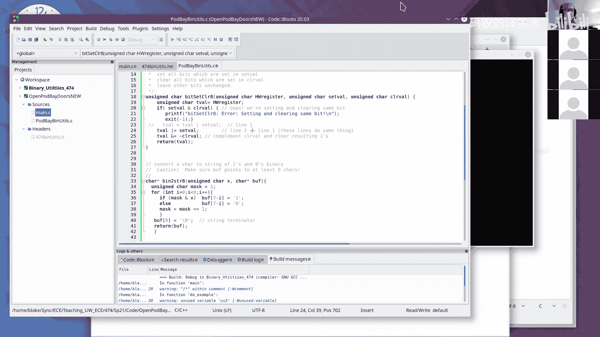
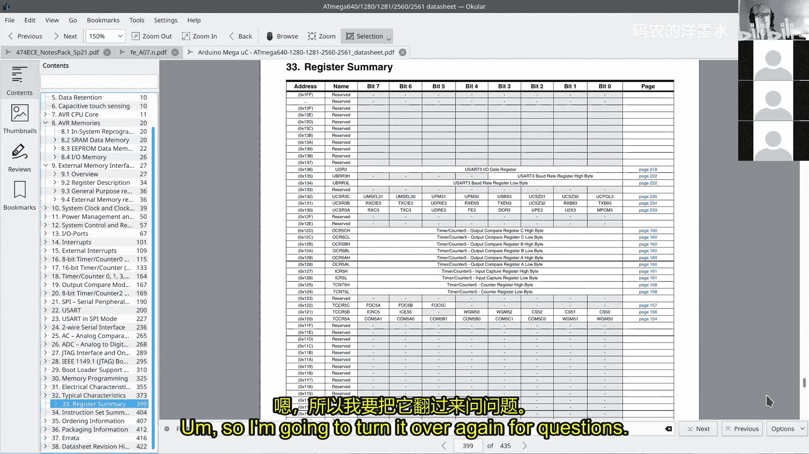

# 【全集 附完整课件】华盛顿大学 嵌入式系统导论 CSE474 中英字幕 p07 Lecture 7-1 - ATMega入门 -BV1ALqnBWEeu_p7-

But， now， it is。I had that same thing of claiming host。

 but I've managed to solve it and I've got the people's chimes turned off， so that's pretty good。

We still have a bit of turnout to。To arrive。But。I will get started basically we're going to do two things today plus we'll probably have time for a solid Q andA if people want to do that the first thing we're going to do is dive do more on the bitse and bit clearing just to kind of power that home and give specific examples and I wrote a little extra code so I don't have to write it in real time during class where we'll we can visualize it easier and see the bits strangely printf as you probably know just not have a binary。

Print format。 So you cannot automatically print out ones and zeros。 And I'll go over how I did that。

 because it's a fairly。呃。It explains some of our key concepts again。And then after the break。

 we'll start the dive into the chip documentation that we're using for the A mega 2560 and we'll take a tour around that document which is。

Big and yeah， it's kind of intimidating， but。Breaks it down and eventually gets you what information you need。

So with that， I'm going to share screen。

Over to desktop2。And I've got my code blocks up here。 So I have。

Sort of crafted a little handy set of tools for dealing with these binary numbers and illustrating them and making them making making them show up or printing them and also entering them So personally I don't have hex the higher hex codes like ABC D and F。

 they're just not quite。At the tip of my tongue。 So if I want to talk about bits。

 it's easier to actually type in bits。 And so I wrote a little function。String binary to character。

 which requires an eight bit string as an argument。

And converts it into a char with that pattern of bits so we can look at how that works。

And so now I can type in any ones and zeros that I want and get that cha easily and so here's a couple of examples and another function and and i'm also going to show you the。

More professional way to organize a project either in code blocks， but also in the Arduino。

 it works the same way and it's really the standard that C language supports。So that is that。

We'll have our main and we'll have this here we are。Going to well， yeah， so this is still。

Utilities to manage and mangle these bits。嗯。But we're going to put the actual utilities in another file。

 so this is just a file the tests and demonstrates those utilities。

And then we have a dot H file if we just call a function like string。In to cha。

 which you'll notice that's not defined anywhere in this file。 So how can C know what to do with it？

 Well， it uses a function prototype。And for do example， which we're going to explain。

Here's a function， do example， and we have the function prototype up here so that C can know what to expect。

 know what it's dealing with when it finds a call to do example down here on line 23。

But these other ones are not do not have function prototypes because we've put them in this other file H。

 this is H stands for header file。And it's a header because it's at the head of the file。

And see like code blocks automatically generates another folder called headers and puts and I've prepulated it with this file so these are the three function prototypes。

For your these functions that we're going to use。Um。Like a。

Sorry got confused these functions that we're going to use like these。

 So now this this code is included just as if I copied that whole file and pasted it in。

 that's what the C preproor does。And then I now it has prototypes for this and other functions。

And then I also have， and this is mainine， but I also have the definition of the functions themselves in a separate C file。

So here's bit said and clear， we talked about that binary to string converts a binary number to a string so we can print it in binary。

And then the finally string binary to character converts ones in zero string into binary so we can generate examples easily。

Okay， so I have those three functions， there's no main here and notice that we never import that file explicitly here。

 but the C compiler knows that we're going to start our program with Maine。

When you start a program in C， it always begins at the first line in Maine。geneeneral rule。

If there's and then similarly， if there's a function here， which has a prototype。

 which it does up here， but no definition in the main file。It looks for that function。

 at first it compiles any other C files。And it looks for a definition in any other C files automatically。

 which would in this case be a definition down here。

So as long as all the functions that are called in Maine。Have a definition somewhere。 C is happy。

And of course it's doing that all the time like if we do say print F， print F's a function。

 it's got to have a definition somewhere that's taken care of in STDo。h。

 that's where the function prototype is。And this。This bracket here， instead of a quote。Quote means。

Look for that file， starting in the current folder。Or the current project， which is right over here。

Brackt means do not look in the current project， look in a pathway defined in the system which goes back into the installation package of your C compiler。

 and there's millions of files back there in a complicated directory structure。

 but thankfully it knows how to look through that and find it。So we don't have to worry。

And you'll see this in the beginning of almost every string C program。

 unless they choose to bury it into a personalized H file。So now our project our。

C project is three files， it main do C which actually has two functions in it you'll notice it also has two example and then 472 binary utilities。

 C and then 472 binary utilitiesil。 H and this can be frankly this can be kind of a pan with C because you have to make sure this function prototype matches exactly the definition of the function in the C file and so you have to keep those two things consistent if you make a change in the C file like you change some parameter to something else。

 then you have to remember to update over here。Let's make sure that that's， well， anyway。

 that's what you have to do。And then mainine so let's let's see what we're doing here so first of all。

 let's build it， make sure everything builds。Okay， so these are the most mildest of warnings that there's a。

Commenting inconsistency。 So I'm going to definitely ignore those。

 And this is another extremely minor warning。 I've declared a variable unsigned3。

 and I never used it。 Okay， what they're saying to me is I wasted some memory。

 I'm never going to use that memory。 Okay， we'll figure out to use for it later。All right， then So。

 or we could just delete it。So it built and let's run it。

And what do we have So hello world thats that's there。

 we have some test values which prove that I am accurately converting。These binary strings。

So let's make sure so well， actually when I did this。

 I didn't have the ability to print the binary strings。

 I just said it's F7 that sure looks like F7 to me， but we can make sure。Um。

Although I have to store it in an intermediate value。So I think I won't bother。嗯。And then， down here。

What we're going to do is we're going to make a new string。1，1，0er，0，1，0，1，0。

And we're going to convert that。We're going to make a new he another string so we convert the test string into binary and then use this to convert it back to a string so if we take a string convert it to binary and put it back into a string of course it should be the same and then this printf will let us verify that so the question is are those two strings the same and yes they are so that means both of those functions most likely work。

And now we're going to do bit setting and bit clearing。And we're going to。

 I wanted to do multiple examples。 so let's see what it means to do an example。

We talked about this last time， we're going to use this function， bit set and clear8。

WithWith an eight bit argument or an input。And then a bunch of bits that we intend to set。

And another bunch of bits that we intend to clear， and I showed you two ways to represent that。

 what we're talking about here is if we want to clear a bit， we have to have a one in that position。

 which is sort of counterintuitive， but both it's。It's also intuitive because you could say where we intend to do something we put a one。

 where we intend to leave everything alone， we put a zero。Okay。

 so let's go over into our code and see what that looks like and again I won't belabor this because we went over it so we have a hardware register which doesn't actually have to be a register it just has to be eight bits。

And our set Val and our clear Val and it's， you know。

 I put the aid in this name because this only works for eight bits。

 but we could write another one for 16 bits that would be almost the same it would just have different declarations。

And I showed you two ways to ore the set valves in， and。What am I doing here， Oh yeah。 actually。

 this is。Out of place。 So I'll put it here。 It's more， more like it。 So first。

 we're going to make sure we didn't make a conceptual error here。

 because if I have bits I want to set。And also， bits， I want to clear。I should never be saying， oh。

 I want to set that bit and also clear it。Because that's pointless。So that means， yeah。

 it's harmless， I guess it will just do whatever we do second。

But it probably means that I have a book that I did something wrong。

So I'm going to call that an error， so we're going to test for that。

 which is simple enough if the bits are the same， if any bits are the same in the set valve and the clearve using the bit wise and operator。

Then this will be a non zero value。Which means the if statement will fire。And we're going to print。

Here's my name and I've detected an error you're trying to set and clear the same bit。Exit。

So that's going to kill the whole program， which is sort of severe， but。

It's it's one option when you detect bad input， Another option is to return an error code。

 but then the code that's calling this function has to detect that error code and do something intelligent。

Okay， so then we're going to use the or equals operator。

To set the set valve bits in our temporary value， which is equal to this parameter。And then。

I'm going to negate the clear value bits to 0 and and them with the test value， temp value。

 which clears the ones indicated by a one。Cls the bits indicated by a1。And finally， return it。Okay。

 so that's we， we mostly went over this before， but I'm just。Going through it。

And so what I'm calling an example is we'll have an input。A set mask。 and a clear mask。

And these are all going to be strings， Okay， so。It's easy to type up these examples like here。

So that's three string inputs。And so we're going to deal with them。

And we're also going to have an output buffer， which is going to return a string example。

Or actually print a string example。And this has to be nine because remember that every string in C has a zero at the end and our bits are going to be an eight character string。

So we have to allocate nine。Btes of memory， and this fills them all in with zero。Why not？Okay。

 so now our unsigned string one is going to be the input。And our。We're going to call this a set mask。

 the mask of bits that we're going to set mask meaning kind of like a kind of like a stencil if you cut lettering into paper and spray paint it。

 you then paint those letters that's a mask and this is the same idea and we're going to convert that string mask into a mask it's a mask which is actually an unsigned actually this should be char。

But a short， I think is the same as a char in our world here， but it's better to be consistent。

And then the clear mask is the same thing for the bits that are going to be cleared。

Probably usually need a space there。 but I don't think that's a problem。

 And then now we're going to do the bit set in clear operation。 Our input is the。

Input and our set mask and our clear mask。 But these this time it's binaries and we're going to get out another unsigned char。

And so then we're just going to print everything before with the。Input。

The set mask that we're going to。Print， I'm sorry。 the bits we're going to set。 and I'm doing it。

 I'm printing it out two ways here。 So I generate the ask the string value using。B to string 8。

 one of our functions。I convert that to the outputbuff。

 so then we're going to print it as a string here and also as a hex value from its original source just for fun。

And then the clear mask， what bits were clearing， and finally how the data looks at the end。

So what it so that that's。That's using all these functions。

In a somewhat meaningful way to illustrate。Bit manipulation。Okay， so I compiled it and I run it。

And so here we have before， that's our initial value， which indeed agrees with this。

And then we had a set mask of binary2 and a clear mask of whatever this number is。

 here we're going to clear this bit。Right there。 And so then the result at the end is correct。

 we've cleared the clear bit and we've set the set mask bit and we haven't messed with any other bits。

 whatever they were， they stay the same。Anybody have any questions or want any clarification about what we have been doing here？

Okay， so the reason we're covering this in such depth is this is exactly what we need to do to control hardware because we're going to have to set a specific bit in a register but not mess with the other bits in the register or clear that bit。

Just another example， just a couple other examples。Just in case， we'll try this example too。

Where now we're going to clear and set the same bit。As if it's a mistake。Building it。Run it。😊。

And we get that error message because that's not a good thing we're not supposed to do that。Okay。

 that worked。I'll just get rid of that and put it in the comment again。

But now we'll do a more interesting example。Sorry about that。It's a spam call even worse。

We'll skip to example 3。 So now oh， that's I'm just going to make up an example， I guess。I guess。

 you know， the point is this is also a buggy example。 The point is that we're not limited to one bit。

If I do that， that's actually a bug。 We'll see。And let's run it。Oh。😮，Our length was not 8。 Okay。

 we have to， we have an error check in here， which is a good thing。Um。

Over in the string binary to character， if the length of the string is not eight。

 we're going to reject it because。That's required for what we're doing here。So I caught that。

So let's just make it a more complicated set mask and we're going to clear a couple of the bits that we do not。

Explicitly。Set。I think I think I got that right。Okay， so in our next example。

 we're setting some bits that are already set。One bit that's already set。That's okay。

 and we're setting a bunch of bits that were zero。And the clear mask。

 we're going to clear a bit that's already clear。But also clear some bits that were set。

And it seems like we get a very consistent result with the the。Arguments， all right。

 I'm not going to go through three more examples because I think we've shown it。But the point is。

 let's use these utilities to open and close pod Bay doors just a little bit on the spacecraft。

So we'll need this H file。So I'm going to make， I've got a brand new project。

 I'm going to make a new project for。Pod Bay doorsors because something got messed up in there。

And this is our main that we were writing at great length last time。

 but we didn't have the right we didn't。Use this clear enough method， in my view。

 for setting and clearing those bits。 So now the problem is that this。Pod bay doors。

Function has a main， but it doesn't have the other things project。So what I'm going to do is and。

I find code blocks a little confusing when you have multiple projects open。 so let's be careful。

 I'm just going to make a new file。Actually， I'm going to see if I can put a new file in this way。

Yeah， sometimes it makes the new file， but it doesn't link it to the project unless you do it explicitly。

 I discovered that before， Okay， we're going to make a new file。Yes。

And we're going to call it the same thing it's going to be。I'm sure I could do this by copying over。

 but I don't want to do that。So we' got a new version of the Bennu Tills file and we'll just open it over here。

And copy it。In a real project， you would actually link the files together so you only have one copy。

But I don't， I'm not enough of an expert on code blocks yet to do that confidently。We'll save it。

 And then here's the thing you have to do。 right click on the name。And。😊，Add it to the project。 Well。

 I guess it already is in the project。 Okay， so that's not a problem。 But which project。

 So we're going to close this project。Why can't I close this Oh I'm sorry I'm going to close this project momentarily see now it won't let me close the project Oh。

 because these files are open Okay， well I'll close that file anyway。Al right。

 and then we'll do this utility dot C as well。I'll change the name of it。

And then we're going to copy them over。From this file。

But they're the same now I can close this file and we'll close the main from the other project as well。

 probably now I can close the project。Why can't I。哈。This is not。I'm sorry about this。😔。

I just want to be careful not to mess up the other project。But we have what we need， all right。

And so main dotsy， we're going to include。Then you till start H。Nicely populates that for me。

It's not going to find this one yet， because we never did it yet。

And I don't think I want to tediously build that right now。

 so I think this example is kind of fizzling， but what we're going to do。And I'll again。

 what we did here is we're working on a function to open a door。A specific door indicated by this。

Integer， and we're going to check which door it is。And we're going to get its status。

 according to which door。And then we're going to define some set and clear bits。

 this is a slight change from what we had before。So we're going to that if if if the。

The first door door A was bit2 and the well， to open it in auto mode。

 we had to do a 10 and then the second bit door door B was shifted over and the third door was shifted over again。

 door C。So we're going to define a shift value， and then we're going to shift those bits according to which door is being operated。

And then instead of using this explicit statement， we're going to go bin。呃。Wait， let me actually。

Get the right name。Itet clear 8。And the input value is going to be pod B or control register A。

And then we're going to have the door。Open， set。And door open， clear。

And that's going to take care of starting the door for us。Um。Now we're going to set the go bit。

 so we're going to do the same thing。Oh， you lose audio again。Hello， professoror。We cannot hear you。

Eck， thank you。 People hear me now。Yeah， okay， sorry about that。Okay， so on side chart godo bit。

Doric go bit。This would be just a little better C style to make the keep the constants out。Okay。

 so now we've started the door and。I I won't keep youlaboing this。

 but I want to expose you guys to the style of programming that's necessary。When we。

Control hardware devices， and this is going to be directly applicable to the lab when you guys start controlling hardware devices on the chip。

Okay， questions， comments。

Alright。Um。Okay， well I'm going to you know this， we may not need the full two hours today。

 which probably everybody's happy about， but I will now switch gears to introduce you to the amazing amount of stuff that's inside that little chip。

Right there。 Sorry， that's blurry。 but that is your at 8 mega 25，60。So， we'll get this document open。

And we'll share it。

And we'll go to the beginning。Page1， start at the top。 it's not quite。 Yeah， I guess this is。

 is this a good format for your guys screen。Ft too big。 Fot too small。Works good， all right。Great。

 so you know the big the big story here， this is just a list of all the features and there are truly a huge number we won't even you know we'll just begin to play with a couple。

 but when you know how to program one， it's really the breakthrough for the others。And of course IO。

 you know， the programmable IO pins we're already using to flash LEDs。

 you can have as little as between 54 and 86 of them。

 I think why is there two numbers it's because this covers a range of chips。

The one we have is this one。Okay。And lots， you know。

 this is substantially more memory than the Arduino Uno。

 and that's one of the reasons we've used this。U。So yeah。

 so we're going to dive into the counter timers in lab two。

 and that's where we're going to get our hands dirty。And there are quite a few timers。

 multiple eight bit and multiple 16 bit timers you can use。Um。

And these PWM channels are also the timers， so that's a little bit。诶。

That's the timers operating in specific mode and we'll talk about PWM later what that is。

The analog to digital converters， that's going to be nice for lab two as well。For human input。

UART are communication interfaces for serial data transmission。And。

These are frankly less and less used， they used to be used a lot。The， for example， plugging a。

Old IBM PC into a modem that was external。 that would be a serial communication requiring U SAt。

Today， we usually rely on a network interface like a Wifi card or Ethernet。

Which will be different than this。SPI serial interface for that's that's also a serial communication。

 serial meaning。Sending one bit at a time over a single wire。And。But this one is designed for。

Communication on a single PCB on a single board within your cell phone， for example。

 for the chips to talk within your cell phone。And this is terminology that。

People are really rethinking and it's really most of us now are getting to acknowledge that this is offensive terminology to a lot of people that we want to feel included in the engineering profession。

 so we've got a bunch of material on this in 398。But。Various standard groups and and companies。

 and I've promised to eliminate this terminology from。From technology， really。

And we've used it a lot in robotics， and we're changing it， we're getting rid of it。

Watchdog timer we're not going to probably use but that's a very common thing in embedded systems that everyone should know about and what it is is that we all know that occasionally a computer can have a software bug that causes it to lock and hang。

And， you know， on your PC， if your PC crashes you restarted and that's okay。

 but what if the what if your embedded system is just you know。

 controlling a refrigerator or something。Well， you don't want the consumer to say， oh。

 my food smells bad， I need to reset the refrigerator， that's not acceptable。

So a watchdog timer is a clever thing， which is a hardware timer。Outside of the CPU。

 independent of your software。And it sends a message every so often， to your computer。

And your software has to respond to that message and say and reset the timer。

And if your software is dead or locked or in an infinite loop or something。

 it's not able to respond to the timer and the timer knows that if it does not get reset within a certain amount of time。

It will。Send a hard reset to the entire system and reboot the chip。

So if there's an obscure software bug in your refrigerator and it hasn't been caught by all the quality control of your manufacturer。

And the night before Thanksgiving， the bug occurs and your refrigerator's embedded controller freezes。

 and I don't mean in terms of temperature， it locks up some of its code goes into an infinite loop and it's just not doing anything。

Um。The watchdog timer will say， hey， I'm here and then the code will not respond to the watchdog timer and the watchdog timer will do a hard reset。

 the embedded system will reboot and hopefully that condition that caused the bug will not recur at least for a few months or a few weeks and Thanksgiving will not be ruined。

Okay。嗯。😊，That's where this power on reset feature comes in。Lots of IO。Various different packages。

 We don't care about that。A very nice temperature range。

 you could run this thing very cold and very hot， 85 centigrade。

And that means it's suitable for use in industrial equipment。Um。

Where the temperatures could be high and low， including refrigerators。

Power consumption is very low and one thing would I hope we get a chance to do。

 but I't I don't think we'll be able to do it in especially with the COVID limitations on our equipment is to try low power operation and of course you can't do much when you power down power is required to compute but。

You， if you're just monitoring a sensor， which you only have to check once every five minutes。

 you can sleep for four minutes and。59 seconds。And run for one second so then you're you're running you know about a this is about a millwatt right 1。

8 volts times 500 microamps that's about1 millitt， which is a very very small power。

 you're running that for a small time and then you're running almost no power for the rest of the time。

And you just go to sleep in a hardware sense， so that' that's very important for many applications。

And we won't get to experiment with that， but we will notice that。When weve work with timers。

 there is a register where you can turn on and off all the timers and time and each timer requires current。

If you don't need a timer， you can turn it off。The Arduino environment by default turns on all the timers。

 so they actually are turned on when we're programming them。

But we could play around with turning them off。Except for the ones we want to use。

And I don't do that in the lab that we're going to do with timers because I'm not exactly sure which timers Arduino actually really needs for its background stuff。

 so I'm not going to mess with it。This is a large view of your chip which looks just like the chip and you know there's lots of pins and these are all the pins。

 many， many， many of these pins， most of them are exposed in the connectors on the edge of the Arduino board。

So that' that's what's great。Okay， so。Here is a very simple block diagram joking of all kinds of stuff inside there。

 I'm not going to really belaor it， but you've got a CPU in the middle。

 you've got flash memory static RA。I forgot what XRAM is。And you've got a bunch of timer counters。

 these are 16 bit timer counters。You've got eight bit timer counters。

This is SPI that serial external data and I don't remember what TWI is。

 JTAag is a special connector which you can apply through some pins for a special kind of debugging interface。

 which we do not use mostly in the Arduino world。We have A to D converters。 That's going to be handy。

 The pins are connected to these ports in groups of8， and they're labeled with letters。

 So starting with a port A， there's B， C， D， E， F， and G， and。

There's a lot of pins and those ports are the ones that you used already to control an LED in lab1 if you're done with lab1 yet。

Um。And they have， you can refer to the pins as port numbers like。

Pin J 2 would be the second pin on port J。And if you go back up here， let's find it。T。Actually。

 Port J must have a special meeting， let's talk about port E because I saw those pins。

So port E doesn't matter where it is in the diagram。 Port E does exist。There it is right here Okay。

 so port E pins0 through 7 are the8 bits of port E。 And then if you look up here， well。

 E6 is pin 8 Okay， and that's the chips pin and then Arduino has yet another pin number so we're going to learn how to trace the pin numbers all the way out。

To the little， the external connector here that is easy for us to connect to。Alright。

 and so all of these have。Por pinned designations。And they also have names that are separate。

And we'll see what those mean。Each of these ports typically has multiple functions。

 So like this Uart， this is a serial data communications interface。 There's three of them。Well。

 there's four， there's zero and three and when they break them out like this。

 it means they're in slightly different they have slightly different features。And the， of course。

 serial communication is an external function， so it needs pins， so it can use the pins in port J。So。

In general， each of these pins has multiple functions， and typically you can only use one。Function。

 so you have to sort of throw away some capability of the chip if you， once you pick a function。

But there's so many。 nobody uses all the features of this chip。Okay。😊，So。Various comparisons。

 here's a description of the ports。U。Here's an architecture overview。

 I've already gone over some of this in conceptual terms， Monday。But this is the specific one for。

For our chip， so the ALU is that ALU just like I described。

 and then we have a more direct pathway the。The data from the registers does not have to go right on the bus to the ALU。

 It has a hardware path。 So that's not， that's faster。

And so you can do any operation on any pair of these 328 bit registers。an eight bit data bus。

 many of these are 16 bit registers though， so they clock their data in two cycles。

SRAM static RAM means random access memory that holds its data as long as the power is on and the EE problem where we could store some data that comes back when you power it back on。

All our IOs and so forth， you can study this。And there of course。

 I'm not going to take you page by page through 60600。This is a total of。Oh。

 it's I guess it's only 422 pages。 I thought it was 600 for some reason， I've been using that number。

Um。So some highlights， so external memory you can plug a memory chip onto the output bus of this board we are not of this chip and are do we know designers did not do that so they are not there is no external memory。

Um。So， we'll skip that。The clock is a clock power management system control and reset let's start with IO ports this is a very important pin right here。

I'm sorry， a very important graphic right here。So this is a very general simplified schematic of all the IO pins。

 so there's a pin that's accessible to you。By tracing it to the correct connector pin on the Arduino board。

And so here's the schematic。 So what are we talking about here， Well， first of all， there's diodes。

These are very nice to have。 This goes to the power supply。And this is ground。

 And what does this mean well？ItWhat it does is it protects the logic from putting to a degree。 Okay。

 so you still have to be careful because it's still possible to blow these pins out。

But we have the protection of these diodes。 So let's say that the power supplies 5 folds。

And you put 7 volts on this pin。That will destroy this logic。

 except the diode conducts it's now forward biased， and so the highest this gets to is 5。7 volts。

The forward bias voltage of the diode plus the5。So and this hopefully is protected at 5。7 volts。

 it's still safe。Similarly， if you go to a negative voltage， this diode protects you。Your input。

Then we have a capacitor。 This is not really a capacitor。 it's just the capacit tense。

Of the input to the chip and the wire， there's a little tiny wire that connects to the chip inside the chip and the pin itself is a plate of metal which has some capacitance。

So they didn't design a capacitor in there because that does slow things down。

 they're trying to tell you that despite our best efforts。To eliminate it。

 there's a little bit of capacitance in there， and you should know about it。

And you could read the specs for what it is， we don't need to worry about it in for the speeds that we're using。

And then there is the logic which reads the input we'll see a lot more about that。

 this can also be an output so the output can drive this pin。

If this is selectively changed to an output， so every pin we can decide is it going to be an input where we read its value or is it going to be an output and we can set it。

And then the pull up resistor， so the pull up resistor is only used in input mode。And what this does。

 this is basically this MoFt is just a。Switch， and again， up here is the power supply。

So what's going on， Well， you can configure the a bit in a register to turn this on and off。

And typically we'll set it and forget it for the entire program。

And what it does is it allows you to sense things that maybe can't pull the。Output all the way up。

So the most common example there would be a switch。

 so if we want to have a switch and the user can flip the switch and we our software can read the switch。

We connect the switch to here。And we connect the other end of the switch to ground。

And then what happens， then we enable this pull up resistor。 So if the switch is open。

 the pull up resistor makes a good quality logic1 signal right there。

 and we read a logic1 and we know the switch is open if the switch is closed and this point is grounded。

 then current flows through the resistor to ground。And this point becomes logic 0。

And this is the right。 This resistor is internal to the chip。

 and they've designed it to work that way so that we can connect switches or contacts or similar sensors。

To the chip without any other resistor， it's a convenience， nice feature。And this is optional。

 you can turn it on or turn it off。This is the real thing under the hood。 There's much more。 Okay。

 but I'm going into detail because you're going to use pins。

 you're using pins already and you're going to do a lot of things with the pins on these chips。

 So for every one of those 50 pins or whatever it is。😊，You get this。

And I'm not even going to tell you everything about it。 I don't even understand everything about it。

 but we just went over this part。 Okay， that is the pull up resistor and this is a bunch of logic that determines if the pull up resistor should be。

Set or not。And。These bits， well。We have some registers that control bits that are these inputs to determine。

How the port is used， how the pin is used。 So if it's an input， these， by the way， these two。

Circuits here。Are when the pin is an output， because you can see this is an output。

 is this little triangle is a driver which amplifies the logic value right here。

And this logic allows the software to set and hold that bit。 This is a bit in a register。

 It's a D flip fl， just like we showed。And then down here is the channel in input mode。

Where we can sense this voltage and read it and this is some I think this is protection circuitry and we can turn it off during sleep mode and stuff like that i'm not even sure what this synchronizer does。

But the simple version is that if we read this bit。We get the value of it。On the database。

And' and then there's a bit called the data direction register。

Which sets whether this is an input or an output。If it's an output， I think you can still read it。

 but that's a little bit meaningless。So， there's these three bits。呃。The data direction bit。

 which is input versus output。The port bit， which is the value itself。And the input bit。

And the port itself， that pin。Can be in these configurations。

 So we have the data direction registers， the most， maybe the the most important one。

 You said it at the beginning。0， if you set it to 0。

 if you set that bit to 0 and you don't have to set the whole port， you can set individual bits。

And it's an input。 So all these states are。Input。But they're slightly different inputs。

 so you can have the pull up resistor。These this in this case， it's the pull no， sorry。

 this is the pull up resistor bit。And in output mode， the pull up resistor bit is not meaningful。

So we put an X there。In input mode， if it's a0。The pull up resistor is connected。

But in if this is a one。It's not connected， it's a high impedance mode， meaning。

As little little current possible。As little current as possible flows into or out of the pin。

And that's also true of。This mode，0，0。So these are identical modes， actually。

Depending on the pattern of these bits。Okay。This is very low level， we don't have to worry about it。

At our speeds， also， they have this sort of scary thing。😰。

That you have to read the port a 16 bit poured in two phases and here's assembly language and it's two steps and so forth。

 but fortunately C takes care of that automatically and to read。For example， reading some pins is。

That simple。 So this statement， I equals pin B。Says。Read all the8 bits of port B into the value I。

And that's it。😊，So I I'm going to take a water break。

 I think I'm going to just power through for another few minutes and then we'll quit without taking a break。

 but we'll quit early。Okay， so。Again， all of this stuff。

And we're going to work through examples on how to set up those pins and so forth。

Interrupts we're going to be talking about a lot， but we haven't introduced the concept in detail yet。

 so these are standard locations in memory where you put some code pointers to do interesting things。

And then we get to timer counters。So here's an eight bittimer counter。As you can see。

 it's a pretty complicated system。And basically， what we have is some logic to control it。

 a clock input。And the clock。Can be an external signal。

 This is a pin here that you could wire up like suppose you want to build a frequency meter to measure the frequency of a signal。

 you would take your external signal。 maybe analog massage it a little bit。

 Turn it into a logic square wave。And stick it in here and then your timer。Counter could be counting。

How many pulses you get for a fixed period of time and you get the frequency。

 so that's an application。Or， of course， the chip itself runs on a clock， which is 16 megahertz。

And so the other purpose of timers is to count a known clock。To measure an interval of time。

And there's a thing called a prescalealar so that we don't always have to use the 16 megahertz clock。

 we could use an 8 megahertz clock， we could use a four megahertz clock。

 and we could divide it down to have a slower counting if desired。Okay。

And then this is the actual counter itself， which is 16， well， in this case， eight bits。

 so it can count from  zero to 255。And then it repeats。嗯。😊，And it can go up and down， though。

 So there's some control logic which could tell it to count up or count down or count up and then start counting down and then start counting up of lot of capabilities。

And then。You know， I think I can detect that now because there was like a slight change in my static background anyway。

Hopefully you can hear me now show of hands if you cannot。

 but any rate then this is the comparator and this is another comparator and this has an important function so。

I may want to count not to 2，55， but I may want to count up to。I don't know。Hundred87。

So I can write 187 into this register。And then when the counter equals 187。

That event is transmitted through this signal here。To various places， so。In certain modes。

 it could cause the counter to clear itself。Or change direction。

And it can also be used to generate an output。And that's another output pin。So， and furthermore。

Often it will be used to generate and interrupt。 And again。

 we're going to go much more into interrupts， but。This could be used every so often。

 to stop your software。Start a little thing happening and then return to your software。

 That's what an interrupt does。And there's many， many modes here， so it's extremely flexible。

 perhaps too flexible。And this there's a very detailed explanation of what every register does and what the modes are that it operates in and so forth。

 but it takes。Careful study。 and。Digging into it。Okay。And again。

 they go into quite a bit of detail explaining each of these things。

 so you really never have to guess that's the benefit of this kind of documentation， it's dense。

 it's long， it's extremely complete。And they know how to do that。嗯。😊，Alright。

And then these are some things that show the modes they're in that you can have。

 and so this is the count and so it's counting clock pulses furiously and the count is increasing。

 but then it gets to a certain level that you can program and it drops again and counts and drops and you can make the output toggle that is change state every time the counter hits zero and so you can make a waveform。

 for example and we're going to do that with our tones instead of explicitly counting the time in software。

If you change the value where it resets， you can make the frequency faster， for example。

And you can generate what's called pulse with modulation。

 I'm going to have more to say about that well。Skip it here。And there's timing diagrams。 And this is。

 these are the registers。 So I tried to sort of copy this with the pod Bay door thing。

 And so these are the8 bits。 And these are what they mean。 And dash means nothing。

 nothing's used there。It shows you' this is a read，r bit。

And then this tells you exactly what those bits do。

 so here's like for control register a for output a。

 so the timer you got to keep referring back to this diagram。Way back here。

So it has an output A and an output B。 This has two outputs， Okay。

 and you can have separate triggers for the two outputs。 So that's kind of cool。😊。

Even if it's just one counter counting。And then getting back to where we were。And nicely。

 they have clickable links that help you go back and forth in here。

But here's the output compare mode。And that could be for both A and B。And then， it tells you。

For example， toggle the output when the compare matches。

Or clear the output when the compare matches or set the output when the compare matches。

Or don't do anything with the output。So those are your options。

And so I'm going tos that's all we'll take on the deep dive， then you get your 16 bit counter。

 which is just a superduper version of the8 bit counter， but gives you a much higher， as you know。

 much higher counting resolution， you get 65，000。Count values here。

 So you can for the same amount of time， you could have much finer accuracy and resolution。

 You also get three outputs with these， instead of two。And other interesting features。

So like it has some processing features for for trigger comparator inputs。

 so you could have a noisy pulse command from a sensor。

And you could process it with this noise cancelor and so forth。

An edge detector to get more reliable operation and then as this thing's counting。

 you can freeze it and store the value exactly when a pulse comes in so you could measure the timing of an arrival pulse very。

 very accurately。Without any software delays， that's all done in hardware。

And so you could use that to make an extremely accurate。Measurement of when a pulse arrives for Ldar。

 radar， sonar or something like that。Okay。So yeah， so we have all those timers we have SPI。

 which is the way to communicate with。External devices through these four pins。

 which is a clock and a strobe and it。Input and output data streams and there are many chips that know know how to talk SPI and I'm not I don't think we're going to dive into detail on programming this。

 but I reserve the right later I'm not sure I don't think so。Useful things analog comparator。

 so you can have different analog values come in and compare them to a specific voltage。

All was important analog to digital converters， 10 bit resolution that's a little bit low these days for some of these embedded chips。

 of course that gives you 1024 values， which is a lot， but it's not going to give you high fidelity。

Audio digitizer， for example。This similar documentation。U。Some features， again。

 we aren't going to use our Jtag， so JTag is a four conductor standard for development systems to do things like halting code and injecting breakpoints and inspecting。

Arduino does not use that so we don't keep is basically what it boils down to。

You make the decision whether or not to use that kind of when you design your board and if you want to expose the pins。

To allow that to be used。嗯。Boootloader support so this has to do with the software that allows code to be uploaded into the chip and again we can thank Arduino for worrying about this and we don't have to worry about it。

 but there's a little bit of code flashed into that chip that handles what that handles the data when we upload our code into it。

There's some valuable stuff down here like the register summary。

 so this is a huge thing of all the registers in the chip and what all the little names are for all the bits in those registers。

And so obviously you're not going to read this for entertainment。What happens， though。

 is what I found that's cool is this is a well indexed Pdf。 So let's say I'm going up。😊。

And here's a kind of pro tip。 So let's say we're， well， I'll use the table of contents。

16 bit timer counter。And I'm working on this and figuring something out and it's like， gosh。OCNB。

 going to I'm onr N is the number of the timer counter that you're using。

And so let's call it timer counter one。And I want to know。Everything I can find out about that pin。

 O C 1 B。 So if I search。Control F。O， C，1， B。Whoops。And I'll。Okay， w。

 I can't believe that's not in there。Because there is a pin for it。Oh， actually。

 that's the reason might be that this is， I know there's a four。Because they don't have no。

 They didn't find four either。 wonder why that is。Well， I've certainly， let's try NB。

This is still a handy。 Okay， something's， oh， I know what I did。I put a 0， not an O， Okay， O， C，1， B。

All right， now the point is you'll find references to this throughout the document and you never know which page is going to give you that key information you need Now this is a false alarm because it's because FOC1 B is not the same。

Okay， now I just learned that OC1B is pin 25 on the chip。

And I can go into the schematic as and there's a document in the lab right up that walks you through this process。

 going through the schematic and finding。Where pin 25 goes in terms of output pins on the Arduino。

Let's see what else we find。That's a different package Okay， so this is important too。

 because this says that the pin PB6， which is at 25。It has different functions。嗯。😊，Including OC1B。

 but also PC int 6。So it's an interrupt that we could set for pin change。Whatever that is。

 but it's another function， you can see that pin Pb7 pin has three functions。Okay。

Here's a little more description of it， so anyway definitely use the search feature when you're reading stuff in this document because it will help you。

Now here's more like where we're using it。Okay， so that was this register summary。嗯。😊，And。

I think those are main highlights I'm going to leave you with。

So I'm going to turn it over again for questions。

And let's go with wide open questions， first questions on this stuff。And then any question？

Everybody's happy。こ。All right， well， as always， keep the questions coming on Piazza and we'll try to stay on top of them。

And let's see there's a chat will I upload the code to Canvas， that was an old question。

 but I now see it， yeah， I will。You can see that code。And play around with it。All right。

 so I will see you guys next week and the lab I think it's lab one yeah lab ones do Sunday night so make sure to stay on top of that and don't put it off completely to the weekend because it'll be harder to get。

Q&A support on the weekend。That's just no just my advice。

 so thank you very much and I'll see you soon。

