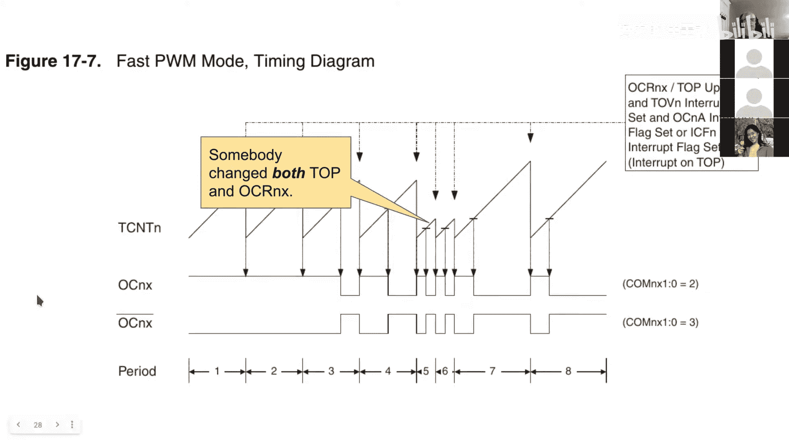
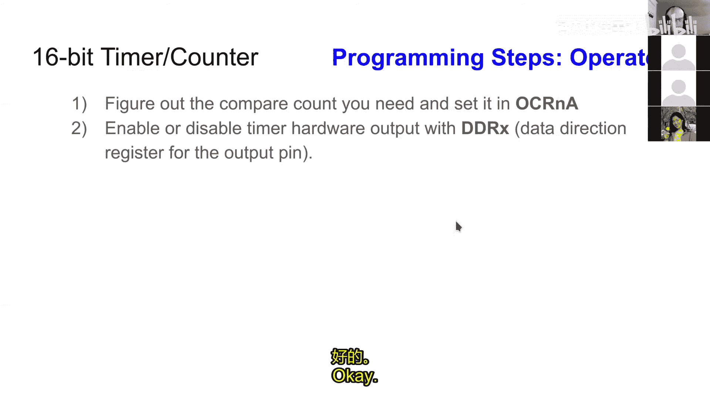
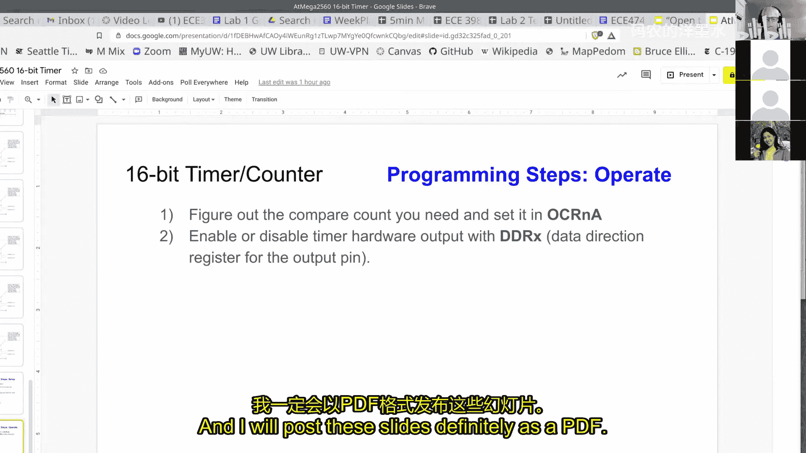
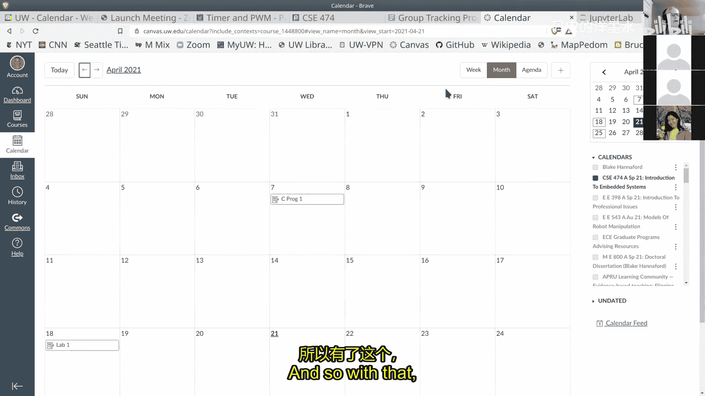

# 【全集 附完整课件】华盛顿大学 嵌入式系统导论 CSE474 中英字幕 p08 Lecture 7-2 - 16位定时器 -BV1ALqnBWEeu_p8-

Recording started automatically this time， even though it didn't last time。Not sure why。

 but that's good。And I have actually a new plan to。Detect。Headphone dropout。

 so I'm going to get that going。And what my plan is。Is that I have a little music。

Playing into my headphones very quietly。And I don't think you guys can hear it。

 correct me if I'm wrong。But the point is， if I hear the music drop out。

Then I know my headphones disconnected。And I'll keep it quiet enough so it doesn't interfere with what I'm trying to get done here。

Oh， that was the wrong。Definitely the wrong audio setting。All right。Great。

 somebody clarified that they can't hear it， I don't even want to hear it。

 I just want to be aware when it's gone。And that should give me a little bit of an alert。

That that the audio's dead， okay。So all right， so today。

 what we're going to do is get into the weeds on the。

Timer that we're using for the next lab and this is where we really learn how to get down into the weeds of the hardware in the Arduino system or in the 80 mega chip really。

 this has got nothing to do with the Arduino implementation of that chip。And so let's see。

 I'm going to share the screen， get my。First， I'll get my slides going over here。

And I think we don't need the full two hours today to cover this。

And we're kind of a little bit ahead of schedule。 So that's kind of good。 Actually。

 before we do that。I'm going to just ask， are there any questions or discussion points or concerns anyone would like to bring up right now？

Interactiveively。Just feel free to unmute if you do or type it in chat。Alright， seeing none。

 I'll get started。And maybe we'll get done a little early today。

Okay， could I just get a confirmation that you can see these slides？Yeah。

 everything looks good from here， but it' double double checking。

 All right then and so this has a link I will post a PDFf of this。

 This has a link to the big data sheet， which。I'm not choosing to share right now we went over it。

In an earlier lecture as a sort of scan and introduction。

 and now we're going to mostly dive into chapter 17。

 oddly the 16 bit counter is covered in chapter 17， go figure。U。😊，But。

We're going to I'm going to it's it's quite overwhelming to just like try to understand all of that timer because it's just got a lot of modes and the modes and settings。

You know， there are there's somebody who needs every mode in setting。

 but almost nobody who needs all the modes and settings。So actually， this is not quite the goal here。

 LED flasher whoops。But how how can we generate a constant frequency？Using the 16 bit timer。

And we'll show how we're going to use the bit setting and clearing of these specific control registers to get something to actually happen。

Okay， so this probably looks familiar from our earlier introduction。

This is the 16 bit counter and timer。And there's a lot of stuff here。

 but there's also some repetition。 so there's channel A， B and C and channel A。

 B and C are pretty much identical。But you get three of them， so that's potentially nice。Um。😊。

You could set up the timer once a certain clock rate and certain limits to the counting。

And then you could generate three waveforms based on that cycle if you wanted to。And again。

 down here， and we won't be using this as far as I can tell in the lab this year。

 but this is a powerful feature where you can have an external signal come in and count those pulses in the counter timer。

De we'll use some terminology here。Sorry。Top max and bottom。And those are bottoms easy。

 bottom is equal to zero， it just means the counters at the bottom of its range。

Max is also easy for 16 bit counter， it's hex FFFF， which is2 to the 16th minus1。

And top is a number you can set that is somewhere between zero and 65535。So you can set top。

 there are some fixed ones or you can set one into one of these registers and then it will compare the counter with this value called top。

Okay， so they use those terms a lot， so this complicated digital system is controlled by three8 bit registers down here。

 A B and C。And TCCR means timer can。Control time or something。 Control register。

 Can't remember what the first C is。And then n is a number。 So there are certain numbers。

 timer one happens to be。A 16 bit timer。 There's a sort of odd pattern of the timer numbers。

 And I can show you that in the block diagram of the entire chip。

 We went over that last time or two times ago， but。Yeah， it's something like timer 0 is an 8 B。

 Timer 1 is a 16 B。 Timer 2 is a。8 bit a timer three， four and five or 16 bits。

 it's an arbitrary complicated system， but you have to look it up anyway。

I'm going to recommend you use timer number four and so that would replace this little n with a four everywhere。

So there's not just one of these， there's about you get about four of them， which is amazing。

And these registers are。These control registers are readable and writeable。

Normally we don't need to read them because the values they have in there should be set by us in the first place and they won't change。

Some of the registers， though， have internal state that we want to check。

These are very important pins。O， C。4 a， let's say， O， C，4， B， O， C，4， C。Output， compare。A， B， and C。

And that means these are output signals that can happen。Under certain in defined ways。That is。

 they can。 They can go from 0 to 1， or they could go from one to 0， or they could flip。

When an output compare event occurs and we'll explain what that is。

But these can be these are directly connected to pins on the chip。

Which in turn are directly connected to Arrduino pins。This is a thing called the waveform generator。

Where there's one for each output compare channel， it sounds very fancy， it's actually much simpler。

 it's really just sort of a D flip flop and a little bit of logic。

 so it doesn't have the ability to generate fancy waveforms， which would be ultra coolol if it did。

It really just is a generalized way to set one or zero on the output when these events occur。

The inputs to this waveform generator are the match， which is this equality detector。

And also bits in the control registers， these are waveform generation mode bits and。

I forget what those stand for actually， we'll figure it out， clock something mode bits。

Clock overflow mode bits。 That's what they are。And three colon zero means。0，1，2， and 3。

 There's four of those。And zero colon one means zero and one， there's just two。And top and bottom。

 the value of top and bottom may affect the waveform generation as well。

And we can set and the output is basically， it can set this bit， it can clear this bit。

 or it can toggle the bit。Which is to flip it from whatever it was。So that's the waveform generator。

And now we're going to focus in on one output compare unit。

Whi is just these are essentially the same a B and C output compares they're all comparing against the timer counter this is the actual counter itself just 16 flip flos arranged in a way to count up or down。

And then this big thick line means that the output of the counter goes to all these places。

And this is just an equals detector， which is a pretty simple combinatorial circuit。

And so we can set this though to detect a certain level。So blowing that up， it looks like this。

 This is the same thing just with more detail。 So this is the counter itself。

 which has two8 bit halves。And this is the 16 bit comparator。The combinatorial circuit。

And then this is the output compare register that we can set。To a 16 B value。Now。

 what's all this other stuff with the temp and everything well。It turns out。

That this data bus inside the timer is only 8 Bs。 So how can we send。And receive 16 bit registers。

 How can we set and clear 16 bit registers。 The answer is。

It puts one half of it into this temp register and then when you write into the lower half of the counter。

 for example， we won't do this， but you can actually set the value of the counter and have it go from there。

 which you may want to do in certain situations。But our output compare。

 we may want to when you write to the low bit， it takes the temp value and puts it in the high bite。

And that。It is complicated。 The good news is that C， the C compiler。😊。

Does all of that for us automatically。 And so we don't have to worry about it。

 We just pretend that this is a 16 bit register and we can write to it through a 16 bit data bus。

 So it's complex。It is stateful。It's potentially error prone。It's automatically taken care of。

 we don't have to worry about it。Here's our waveform generator and then here's our output pin。

So this is just a magnified view， it shows some guts in here that we can pay attention to。

 thank goodness。Another thing that can happen is that when we detect equality between the compare register and the counter。

 we can generate an interrupt request we talked about interrupts last time we're not going to do that yet we're going to leave that for later。

And this is a kind of two stage thing so that。When。In certain modes。

You want to reset this instantly in one clock cycle。

And so there's a buffer that holds the previous value again。

 this is a complexity we don't really have to worry about。Okay， the clock and the prescalealar。

 so I guess actually going up here。There's a clock。 There's a couple of clock options。

And this is for external clocks coming in from the outside。

But we also have this internal clock that generates that allows us to count。

 or we can count pulses on the internal clock。So the internal clock is the main CPU clock。

 sorry I keep doing that because on my PDF slides I can mouse and highlight and on here I click to the next slide anyway。

The internal clock of the chip is 16 megahertz， that means one pulse every 62。5 nanoseconds。Yeah。

 we can count external events but we're not going to do it。

That's pretty fast really and so we get a lot more flexibility if we we're able to count lower frequencies as well。

 so there's a divider which is essentially the same thing as a digital counter and we can tap off various bits。

And those that's all pre implemented and we can we're allowed to get divided values of the clock。

 we can divide by 8， 64 256 or 1024， so we can't divide by an arbitrary number and scale the clock arbitrarily。

 but we get these particular scale factors。And this is a little spreadsheet I cooked up to go through implications of those scales。

So this is a。Sorry too tempted anyway， this is the 16 megahertz fundamental clock frequency ands period。

And if we use a 16 bit timer and we're counting。At 16 megahertz。

 the fast the longest time we can represent is only four milliseconds。

 it takes four milliseconds to get to 6，5，5，3，5。And if we're using that to generate a frequency。

 it means the slowest frequency we can。Generate。U。Actually， this is probably wrong。

 This is one over this maximum time， but the slowest frequency would be。2 over that time。

Because we have to have a full period we have we have to have a one and a zero to constitute a full cycle。

 so I'll actually correct this before I release the slides。And。But the point is。

 the faster your clock。U。😊，The higher， the minimum frequency represent you can output。Um。

The minimum frequency would be by counting all the way up to 65536。Then we divide by8。

 of course it's2 megahertz， all the way down to dividing by 1024， we get 15。6 kilohertz。

Frequency and down here， the period zone is， you know，64 milliseconds。 sorry。064 milliseconds。

The clock period。But the maximum time we can count up to is already 4。2 seconds。

And that this is probably more like 0。5 hertz so。And and。For an api bit counter， of course。

 it''s it's worse。 It's half of this。It's actually not half， it's even less。Okay。

 so you may want to consult this once I correct the frequency when you decide how you want to prescale the clock。

And again， what we're going to be doing is using the timer to generate our tones instead of explicitly making a loop。

Okay， modes。So， the timer has。A lot of modes， because you can set5 bits。Sorry。

 four bits called waveform generation mode bits。And those that gives you 16 different modes。

And we'll start with normal mode。That just means that the timer， the counter counts all the way up。

Whatever its clock pulse rate is， it counts all the way up to its full value。

 65535 and then starts over。And if you want， you could measure time by reading the clock。

 but you have to know how often it rolls over for longer times。It's a very simple mode， though。

Here's another mode called CTC， which means clear timer on Comp matchch。Clear timer on compare。

 We're going to probably recommend that you use this mode。

So here the top of the counter is set by you， you program a value into this register OCNA。

And so once it gets up to that value that you plug in。It will reset。And start over。

And the compare match event will be detected there。

 and so then you can set the waveform generator to do whatever you want and we'll get more explicit about that。

So here's CTC mode， so this shows the value of the counter， it's not analog， it's digital。

 but this is just a concise way to show a number that's counting up very fast。And。If we want。

 we can generate interrupts。When these events occur， when the counter gets to the top。

I should say when it gets to Max。Well， no， actually，' the correct answer is top， as it says here。But。

 we're not going to worry about interrupts now。So what this means is that the timer reached。

The value in the output compare register。 and that's set by this little。

 it's indicated by this little horizontal line。And then。

It automatically resets itself to zero when that event occurs。

And then here somebody changed the register value with their code。

 and so they set it to a lower number。 so now the timer reaches that point sooner。

But the same thing happens， it resets to zero。So we can make it go faster。

And what we have here is we have the output bit output compare NA。

And we have that set to toggle mode。So every time there's an output compare event。

 it toggles it from zero to one or from one to zero。And that's what's shown here。

 and it speeds up because weve now put in lower values。Into the compare register。

The clock is going at the same rate。The timer is still 16 Bs， but it doesn't get up as far。

Until it has to reset。Somebody changed it again， so now it's even faster。

So one more thing to keep in mind is that if we know the clock speed and we know what this output compare register value is。

We know how long that's going to take。And。That's a period of a waveform that we're generating。

And that the clock speed is determined by the prescale value applied to 16 megahertz。

 like 16 megahertz divided by 64。So okay， we can figure that out。

And we just want to remember if we're using this to generate a tone period is related to frequency by one over。

1 over P。But don't forget， we're toggling， and so the actual frequency that comes out is half as fast。

As these saw tooooth events occur in toggle mode。So we just want to be。Be aware of that。

 Think about that。Here's another mode called Fast PWM。Pulse width modulation。

 we'll review that in a second， really briefly。And so here。The counter counts up to 6，5，5，3，6。

And then it resets to zero。And the output。Is set to one。On the reset event。

 and it's cleared when the compare match happens。So， the period is。Constant。

But then we'll have a pulse that clears at variable times。

So I talked about this with my yogurt cooker。And this was much slower pulse width modulation。

But the point is that this is a very， very common technique。

If you get out of this course and you don't know what PWM is。

 I've failed my job and so I want to hammer it so pulse width modulation means we switch on and off and on regular periods。

 so we always switch on at the green line unless our duty cycle is zero。And。

We switch off at a time that's some proportion of the period。Including 25%， 50%。

 75 and 100 are examples here。But it's not uncommon to have 255 individual options here or even 1024。

And then， many physical systems respond。According to the average value。

Which goes up and down in an analog way， according to the percentage of your duty cycle。

If it's on all the time， obviously， the analog value is。1 or five volts。If it's on none of the time。

 the analog value is zero and if it's on 50% of the time。Then the average value is 50%。And of course。

 so this is a very cheap way to do digital to analog conversion。And it's widely used。

 and especially it's widely used for high power applications like。Heaters control or machine control。

So you're controlling a motor。Or a heater that's hundreds， thousands megawatts。

 You could control it this way。If you have a switching device that's capable of following your PWM signal。

Okay。So fast PWM mode is one of many ways to do PWM in this chip。But again。

 this is by far actually the most common way that most implementations。Generate PwM。

So at the beginning， we're in the fast PWM mode， the count is going up all the way to 65535。

And repeating， and it keeps doing this， at least at first。And the output compare。

 we've set our output compare register equal to the max value here， and so it's 100% duty cycle。

 it never turns off timer just the counter just resets。I think it did too okay。

 here's another one with 100% duty cycle， but now we this is something new the little horizontal line is not at the reset point。

In this mode。The little horizontal line， which is the match event。That this， here we go。

We've changed the duty cycle。 This is still matching。

 This is when the timer value matches the output compare register。

And that causes the clearing of the output bit。But then the reset event at the top。

Causes the setting of the output bit。So if we change this threshold up and down。

We change the duty cycle。Like here， it's now changed to about 50%。

 and so this is about a 50% duty cycle in this period。Back here。It's more like a 60% duties cycle。

Okay。😊，All right， and then out here somebody changed the value of the top register and this changes the frequency as well as the duty cycle again。

 not a common thing that you do typically in most systems。

We pick one frequency and stick with it for pulse width modulation， and we only vary the duty cycle。

Alright。

I think I just want to pause and see if there's any questions so far。

AnyAny things in here that I should go over more？Or explain again。Okay， we'll go back。

All right。So， let's sort of。Yeah， so we're making good progress。

So that's how we can generate a pulse with modulated output。呃。And by the way， let's go。

 let me just say one more thing。 if we're back in this CTC mode with toggle。

Our duty we do have a duty cycle， any square wave has a duty cycle， and it's just always 50%。

 If we're driving a speaker just to generate a tone， this is fine。 We don't need to do PWM。

But we might need it for some other application。Okay， so how do we。

 how do we actually write code for this timer。So first thing is in setup。

 Arduino explicitly exposes a setup routine。But。Regardless of whether you're using the Arduino environment or not。

 you need to set up your hardware before you use it。And so the first step is enabling the timer the。

The chip has a thing called the power reduction register。

And it has bits for each timer and you can turn off the timers that you don't want to use。

 which actually saves energy， and in many applications， as you know from your phone。

 energy equals battery life and so you may really want to save that energy。U。😊，In Arduino。

 the setup software behind the scenes automatically turns all the timers on。

And leaves them on so that's kind of wasteful but I didn't want to turn them off I didn't want to ask you to turn them off and then turn on the one you want to use because there may be some Arduduino magic in the background that requires some clocks and so we're not going to turn off any clocks and we don't need to turn them on either because they're already turned on but you should know about this because it's a thing and it's explained on page 55 and 56 of the data sheet。

Now figure out what clock frequency。That is what how you want to set the prescalear。

 do you want to divide by8， do you want to do 16 megahertz。

 do you want to do divide by 1024 and you'll need to do that to cover the frequencies that you need to you need to think about that。

 to cover the frequencies that you want to output。And then we select a mode so I think more like you're going to either use fast PWM and set a 50% duty cycle or you're going to use CTC mode those are the simplest and most practical modes for what we need to do。

And so in order to do that， you have to look up how to set these five。

Waavveform generation mode bits。 and that you saw that table there。

 so there's a magic combination of those bits， but those bits are spread onto two different registers。

 They're not in the same register， so you have to set some of them on register A and some of them on register B。

And then you also have to set the compare mode。Which is。Toggling。

And then you also have to set the prescalear。Raatio that you want， whether it's 8，64 or 1024。

 And so register B has bits to pick your prescalealar parameters and some of the。

Wayform generation mode bits and register A has the compare mode。

 which you may want to set to toggle or you may want to set to。Clear on match， which is the。

Moode for PWM the way we usually do it。And then。Some bi partial WG modes。

 I mean some of these waveform generation bits。And you'll fill in in here。

According to which counter you use， I think in the lab。

 we're going to recommend it you use counter number 4。 And from using it。

 I know that that does not screw up any other Arduino functions， at least that I've。See， and then。

Final step。Is your interrupts？And you want to。Set。YouSe up your ISR。And enable interrupts。

But we're going to do that later。 So the first version， there's going to be no interrupts and no ISR。

 So you're not， you're going to not enable interrupts。And now that you've done this。

 now that you've set it up， everything should work and you can change the frequency at any time by updating this output compare register。

 but you're going to have to figure out。Based on this information。

What output compareare register corresponds to the frequency that you want。And that， in turn。

 is a function of。What prescale you use。And then， also。You may want to turn off the waveform。

Entirely。And so you can use your data direction register。 I guess I actually forgot。One step here。

Which I'll also add， but you and it's I think it's specified in the lab right up as well。

You also have to set the output bit to output mode。 and so we' weve begun。

 we'll do that in lab one as well， but just going way back。To the original block diagram， yeah。

So these output compare bits are。Connected to individual pins。

But pin has to be initialized to be an output versus an input because pins have multiple functions。

 so you're going to have to make sure that the output compare bit that you use to generate your waveform。

Is enabled as an output。And that's it。 So that allows you to turn on and off the output and change the frequency as you wish。

Okay。

That's really it for the。😊，The timer details， any questions again so far， you guys think with this。

 you can get in there and program it。Did we see that last light again？Sure。

Did that generate a question。Oh， I just want to write some of it down Oh okay。All right。

 and I will post these slides definitely as a PDF。

Okay， we're going to take a break and we'll get back in 10 minutes。See you then。Okay。

 that's pretty much about 10 minutes， but the good news is I think we're making good progress and I just I don't have more material I'm going to cover today。

So I'll definitely hang around for Q&A， I do want to just quickly review the upcoming stuff that you guys are doing so this is your Canvas calendar which is sort of not the most I guess for one course it's not efficient anyway coming up this Sunday is the second programming assignment I know you guys are aware of that many have turned it in already or have asked questions and lab two then will be the following week May 2 and we are embarking on grading your videos which have come in for lab one and I'll make sure we calibrate those among the Ts they're very dedicated in an experience though on this class so I think that'll go smoothly they're not starting this for the first time。

And as usual， I'm pleased with how people are posting and answering questions on Piazza so stuff is getting answered pretty quick and we don't waste time on typos and things like that。

 thank you very much for finding those again， if you find a confusing typo。

 please pester me about it， I will fix it as soon as possible。

 as you know there's a lot of links and I just found one one lingering link to the winter material which I now have fixed。

 but if you see stuff like that please， or you get any dead links。

Please let me know it's hard to track those down honestly the Canvas tries to send some messages。

 but they aren't always good enough for that。U。😊，And so with that。

 I'm going to let everybody's excused， but if you'd like to stick around for a question。

 definitely this is a good time。

