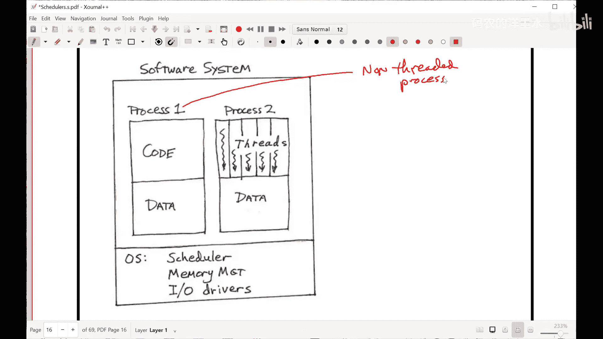
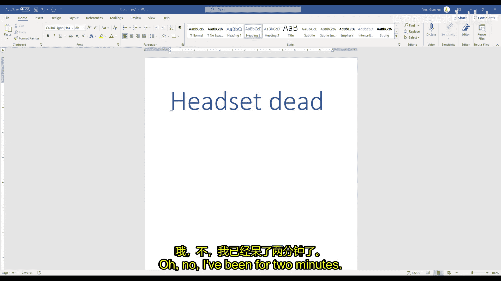
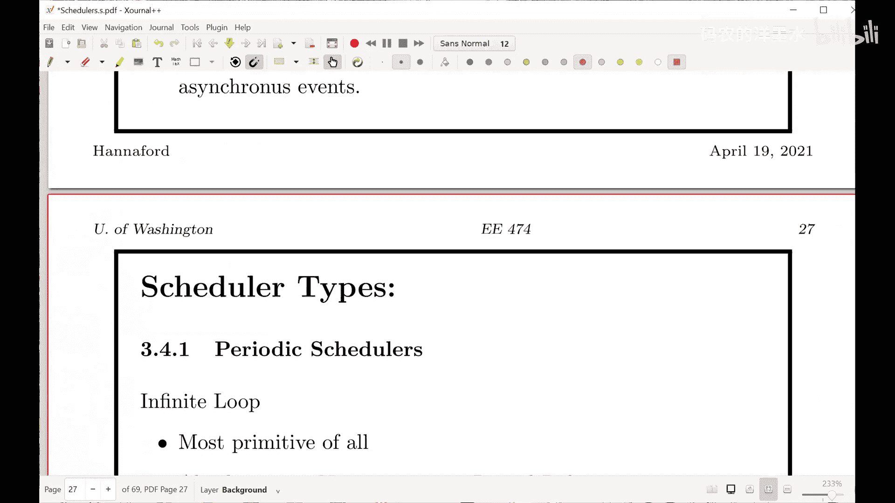
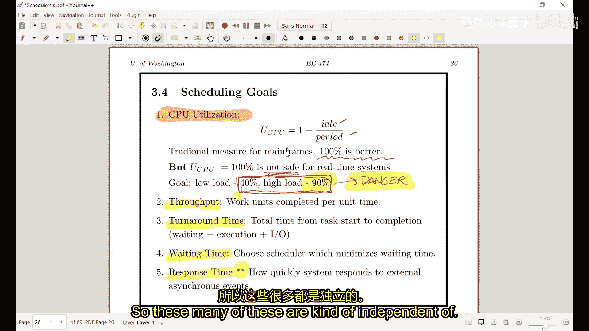
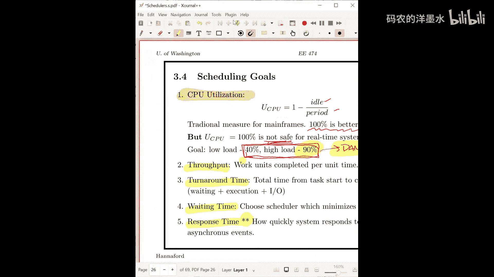
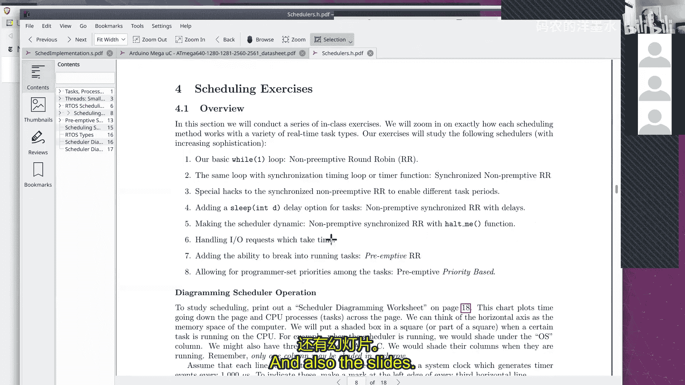
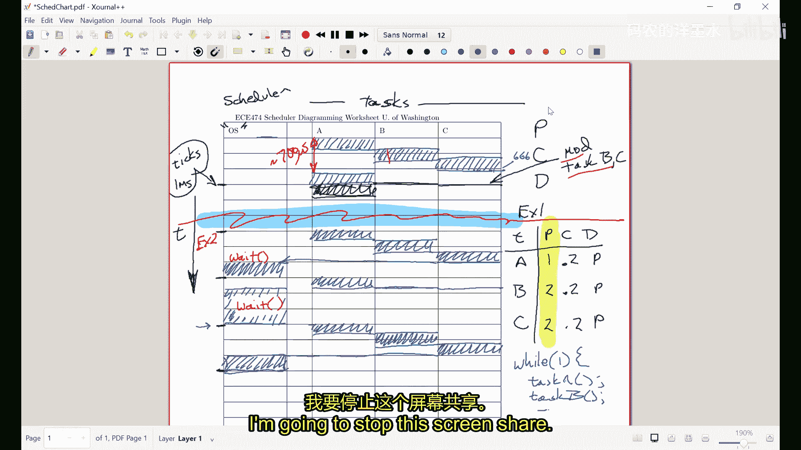
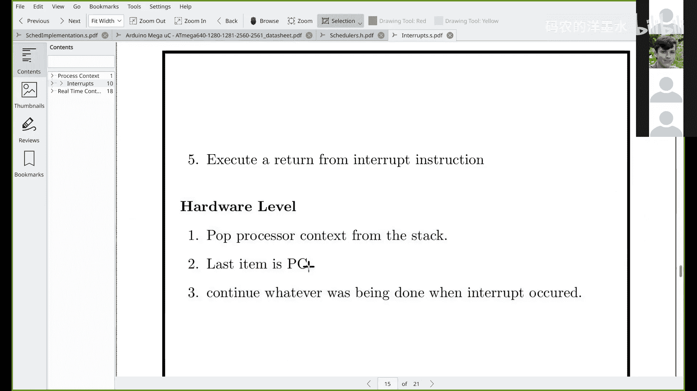
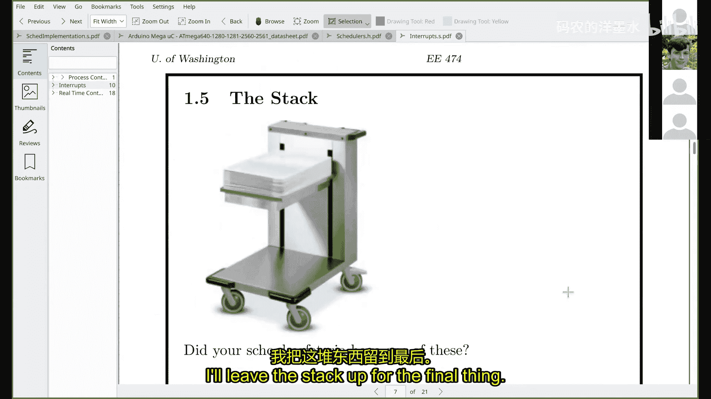

# 【全集 附完整课件】华盛顿大学 嵌入式系统导论 CSE474 中英字幕 p09 Lecture 8 - 任务、线程、调度I、中断 -BV1ALqnBWEeu_p9-

Doing that。 And that's great。 So we can just get started。

Okay， I want to officially welcome you all to summer term at the University of Washington。

It's been quite an amazing weekend for those of you lucky enough to be around here。

 it's about 80 degrees。And， unfortunately。Or fortunately， depending on your perspective。

 many of you were indoors working on your labs this weekend。And hopefully you got out。

 though and got had some fun as well。Um。Alright， so what we're going to do is。Start reviewing。

What happened there。My zoom。ok。😊，Here we go。

Sorry about this， okay。

Yeah， so what we're going to do is start talking about schedulers and what is schedulers and why do we care and what is today's topic going to be？

So basically， what we did so far in lab1。Is to just sort of write a loop based on what Ardu weino。

Likes to do and the standard initial Arduino。Task or let's say。

 setup is a loop that just runs over and over forever。And that's great people do a lot with it。

 but it's not the kind of thing that you do if you want to fly a helicopter on Mars or make a medical device or make a real time embedded system that really can do sophisticated things and even more importantly can really use the full power of your device。

 for example， if you write a task and you need to wait 50 milliseconds。

 so you call delay 50 that's okay， but。You're just completely wasting the CPU during that 50 milliseconds。

 at least with Arduino's。Delay method。And so hopefully we can do better than that。

 hopefully this CPU can be doing something else while we're just flashing an LED and you've all sort of figured out some techniques to do that。

 but we need a much more systematic way to do that。

So that's where schedulers come in and just like making a course schedule for a student or scheduling a bunch of classrooms。

 we're going to schedule a resource over time and the resource is the CPU。

 the central processing unit of our chipI。And the modules or chunks we're going to put in there。

 like classes into a classroom are tasks。Processes and threads。

 which are different names for somewhat the same concept。

But a task is some code we write that gets a single job done if we try to write code that gets 12 jobs done simultaneously。

That can be complicated and unreliable and maybe the computer can。

Simplify our lives if we can write 12 simple programs to get 12 tasks done。

Instead of writing one program that gets all 12 done。Okay， so what we're going to say is， well。

 our 12 jobs that we want to do are going to be tasks。

And so let's define that a little more carefully and then we can talk about how to schedule them。

So as I said that I'm going to switch to pen。Tasks， processes， and threads are somewhat the same。

But there's key differences that we'll see and then we're still going to talk about them at somewhat of a conceptual level。

 so to know exactly what a thread means you have to talk about a very specific operating system and we't we won't really do that。

Okay， the most important thing to figure out， think about first is the processor state， the context。

 and if you studied dynamics or like 447， you have some idea of a system having a state like an airplane。

We'll have a certain speed， angle of attack， direction and altitude。

And when you start to know all of that， you know kind of everything you need to know about how much energy the plane has。

 how much and what it's going to do in the future if you don't control it。

You can predict about it the processor has digital states not analog states so the key and and we're not talking about the memory so if a processor has a gigabyte of RA it's got a massively high dimensional state space where the state is every possible value that its whole memory could have and we're going to not we're going to ignore memory primarily but mostly talk about internal state from the processors registers which is a much smaller amount of memory but not zero。

So some of the key parts of the state。the program counter， which is saying， you know。

 it's just like you can identify it with it as a human if you're reading a book。

 you have to keep track of what page you're on， even if you're interrupted。

 so you have to write it down or use a bookmark。Every register in the CPU because a given task is going to evolve according to what's in those registers。

Processor status flags are also similar or there's you could call that a register anyway。

 this set of all processor status flags。 but again， those flags are things like。

They're often set after each logical operation。 So， for example。

If you subtract two numbers and the result is negative， there's a sign bit， which is set。

If you shift and a one goes off the end， there's a bit for that。

Even though it's not in your register， it's forgotten in the register， but the status bit saves it。

And the stack pointer and we'll explain much more about this， this is a very important register。

 which is a pointer into memory， which actually tells the processor where to save its state。

And sometimes this is also called the processor context or the process context。

Because if you've got a program that's running and you。Suddenly， stop it and leave。

All this information has to be saved。Or you must restore it。Exactly。To resume a task。

Or let's just not use the word task， let's say program。

If you resume the program without saving that stuff and restoring it。Then it will do something wrong。

 something incorrect。Okay。So。So here's our sort of more formal definition， a task or process。

 those are the same things。In our purpose。It's a unit of code and data。

 which is associated or described by one processor or state。So an old familiar task example。嗯。

Send a bitete over communication link。Read from a thermoistister every minute and calibrate it to temperature。

And usually， we write some function to implement that task。 Okay， you've already done all that。

So context switching。So in we didn't do this in our initial lab。We but。In a real system。

 the computer has to switch back and forth between tasks。Certainly in your desktop or laptop。

 this is happening millions of times。Per minute or second。And because， you know。

 we have this small number of processors， one in the case of our Arduino and whatever for or something in the case of your laptop。

So。If we want to switch from one task to another， we have to restore it。

 we've already been we have to be able to restore it， and so we have to save the state。

So switching from one program to another is these three steps。Saving the context of the current task。

 restoring the previous context from some other task that you want to start now and start the new task。

And that's kind of obvious， maybe， but we have to be very clear about that for managing tasks。Okay。

 so types of tasks， now this is where in sort of desktop programming。

 we think of programs as all the same they might be bigger， smaller， faster， slower。

 but they're fundamentally the same， and we also don't think about time very much except that it might take a long time or might take a little time。

So we have some other aspects in our embedded world though， including periodic tasks。

And you might remember periodic functions from your signals class， so something like a triangle wave。

Would be periodic。And in that case， we define this time where it repeats。As the period。Okay。

 so that's what we called a periodic signal in the signals class。

But periodic tasks that therefore run on a deterministic cycle。

 so a task might run every millisecond or every 20 milliseconds or every hour。

And it's a periodic task。And often these are in hard real time applications， meaning control systems。

 controlling a nuclear power plant or an aircraft。The system will diverge and go out of control if we don't repeat the calculation precisely on a clock。

So controlling something every 10 milliseconds would be reading sensors， computing。

And outputting a command。That's what's happening， say in your car's cruise control。

 So every so often I don't know what the period is for car cruise controls。But you。

 it measures your actual speed。Compares the actual speed to what your desired speed is that you set on your cruise control。

It thinks about what the right control is to correct that error。

 and then it outputs a new throttle command to your engine。

And another good really common example is multimedia。So get a sample of music。

Maybe you have some filter that's needed an equalizer to change the sound to the way you like it。

 so that would be another step and then output the sample to a digital to analog converter。

And you must do that every 22。7 microseconds， which is， I think， what a wave file is Cd quality。

Otherwise， the sound will be off and the human ears pretty sensitive as you began to study or figure out。

Okay， so those are periodic task examples and we have there's some other things besides the period so the way we characterize the periodic task is the period P how much you know exactly how much time。

C is the computing resources， so okay fine， if I'm operating this task every 10 milliseconds。

 how much time does the how much CPU time is required to do the task。Obviously。

 we can't exceed the period。So we can't compute for longer than our interval between starts。

But it also doesn't have to be the same each time it could vary a bit as long as it doesn't overflow the next period。

And also a deadline， we won't do too much with this， but。

We could have a spec that says it also has to start or it has to conclude。It has to start at。

It has to be done。Within a certain deadline after the period begins， so if it's strictly periodic。

 the deadline is the same as C。嗯。And the deadline， of course， has to be greater than C。

 or I guess it could be equal， right， So this relationship is true。So if we had a task。

 let's say we have。Time again。And we have our period。Intervals。And these are called ticks。

And this would be the period。The period doesn't have to be equal to the ticks， by the way。

So actually， I'm going to actually erase that。That's slightly oversimplified。

 so I'm going to instead just call this P the period。U。

And then our code is running at the beginning of the period for a certain amount of time。Each time。

 But this time， maybe it operates like so。And operates like， so。And so this time is C。

Approximately constant the way I've drawn it。And。Let's say， our deadline。Is here。And over here。

 we violated the deadline。Okay。So all right， that's a graphical definition of these。呃。Terms。So， okay。

 so typically we'll write our code for a task。In two ways。

For depending on how the schedule is implemented。 Now， the way。WereI we'll do it this way。

 which we may have already done in the lab for lighting LEDs and so forth。So we'll do some work。

And return。And we hope that the task is called。Periodically so that we meet the period。

And the deadline。Okay， another， so that's periodic tasks。Another task is intermittent tasks。

And we find these all over the place， so they're not really periodic。

 but they happen once in a while and we need to schedule them so send an email every night at 11 at 4 a that's okay that's technically periodic but on the scale of。

Real time， it's something that happens very irregularly or infrequently。But here's one， like。Oh。

 we detect that powers going down and computers are pretty fast。 Often。

 there's a lot of energy storage in your power supply so you can detect that the powers like even if somebody just unplugs the computer。

 the computer can detect a power loss。Before the voltage that drives the CPU actually drops in significant computing work can be done in that time interval。

 so。If you know power is going to fail very soon， you could save all your data。

And shut down in orderly manner， and it's not predictable when that happens， it's not periodic。嗯。

Sending messages to humans。嗯。😊，Is not something that happens every 10 milliseconds or something。

And startup tasks like calibrate a sensor once when you turn on。

 but then assume it's going to stay okay。So there we don't have a period。

But we still have computing resources。How much will it take how much time will it take and a deadline？

For example， with that power example， we may know that we only have two seconds before the power shuts off completely。

And so， for this intermittent task。We'll just compute for a while。

If we were writing the code for it and then。U。If we're not done， return。

And allow the scheduler to keep working。And if otherwise。

 we can call something assuming that exists in our little operating system， halt me， which says。

 I'm done， stop me， I don't need any more CPU。Until I'm called again。Okay。

 and then there's also background tasks so。A background task could be a non real time task that's mixed in to a system containing real time tasks。

It'ss we think of it as lower priority because in terms of time response， it is。We'll do it。

But only when the CPU is available and there aren't any hard real time tasks that need the CPU。Um。

And there we just know how much computing resources it takes。 but not anything else。

 but there's really no other constraints。So， here。Same kind of thing。We'll compute for a while。

Right now we're writing this code， assuming that the scheduler cannot stop or interrupt a task。

This is kind of like the honor system， so each task has to give up the CPU once it starts。

 otherwise other tasks will be starved we'll later learn that we can avoid that and also simplify the code that one has to write。

 but right now we're going to assume that it's the honor system every task gives up the CPU。

And so here we're going to this task is going to run work for a while like like a tenth0 of a second or something。

 And if we're not done， it'll return to the scheduler。To get more time later。But if we're done。

 we call halt me。And okay。So you know， there are many examples of something like this logging data to a log file or computing some。

Computing， you know， like on a Mars lander， pictures have been taken。

 but they have to be processed and compressed before sent。Back to being sent back to earth。

 So you may have real time control that are higher priority tasks， but in the background。

 you're crunching these images， getting them ready to send back to earth。

And there's an example right there。And then you have sort of everything else。

 kind of regular computing。Web server， app word processing， anything like that。

 and there we need kind of continuously need as long as it's running， we need CPU time。

And it has it's doing IO frequently， like reading a disc。And sending a block of data on the Internet。

 So those are actually very， very important for scheduling because if if Microsoft Word wants to read some text。

While the disk drive is performing that operation。Microsoft Word has nothing to do。

 so it should give the CPU back。So that other tasks can be working while the disk drive is getting that big document loaded up。

And similarly， the web server， tasks on the web server are very often just waiting for the internet。

 waiting for a user to click something， waiting for a block of data to arrive over the internet or waiting for a block of data from the disk drive。

 which it's then going to send。So actually web servers are an interesting example of tasks and threads because they get implemented with many threads that are overlapping and saving。

 allowing the CPU not to be stuck waiting。Okay。Okay， so here our code would it never stops。

 it never pauses because。Well， let's just say this this task is doing a lot of IO。

And we'll be explicit here。好。Okay， so if a task does a lot of IO like a web server。

 it doesn't need to return because each time it calls for IO， that's like a return。Okay。

 and now we'll add a notion of the state of a task， so this is fairly self explanatory。

It can be running。It can be ready。Which means waiting。And saying， I want to run now， but I can't。

It can be waiting for another thing like I O。 So once you launch a disk drive a physical drive even or even an SSD。

 but it might take。Even 100 milliseconds。For that data to come back。So again。

 that's valuable time the CPU can be using， so a task that initiates a disc read。

Will go into the waiting state and others other tests can use the CPU and inactive means not running。

 you so。It's closed like in your cell phone， when you swipe through all the different apps。

 the stuff that you ran。Two hours ago， Android keeps a list of that， but it's not active。

You can revive it。But， it's not active。Okay， threads。 So these are smaller units than tasks。And。

So where does threads sort of fit into all this jargon？And。U。We have tasks。And so each unit。

 whatever you want to call it， each unit of computation， which I'll kind of clarify there。Um。😊。

It has code。It has data。And it has context， the processor context and various resources and it might be in control of an IO device。

 it's got some block of memory we're going to talk about semaphos later in the quarter。

 it's a cool synchronizer。And。So。WhatSo we give that sort of a sort of a name or let's look at this。

Professor， we can hear you again。A professoror。We cannot hear you。

I'm back， thank you。Oh， no。 I've been for two minutes。

I'm sorry。That's terrible。Okay。I've lost my screen share。😔，And everything。What happened？

Maybe I'll figure out how to set up some background music or something so I can。

Detect this in the future。 It's really annoying。For for you guys， of especially。Okay。All right。

 let's go back。Professor it looks like we got to the end of page 13 just before your example with the circles Yeah。

 thank you。

嗯。Great。So I apologize for that。Mostly you can read it， of course， that's the thing about slides。嗯。😊。

Again， I just want to say this is a kind of a concept that concept conceptual Venn diagram。

And each of these， this circle， your process is some program like， for example， a web server。

And the web server might spawn threads internal to itself。

One for each visitor to the website to handle their requests and their disk access。

 and they share a lot of code because every every visitor is doing the exact same types of things to the website。

They may share some， they obviously share some data namely the website， okay。

 but they also have some private data like what I happen to be typing into a form， my credit card。

 whatever。AndThe point is these threads are units that aren't as big as a full process。

 but this operating system can schedule them individually and start them and stop them and map them onto CPUs。

Actually， before I get。Any further looks like somebody， anyway。

IIf somebody killed my screen share in order to get my attention， that was a brilliant move。Anyway。

 we're good。 what I'd like to do is since I， you know， since I got disconnected and。Everything。

 and I see a hand or two， I want to pause for questions。

 Anybody have a question I could answer if there are some hands。

 but they may have been trying to frantically warn me。Any questions right now？Okay。😊，Thanks for your。

 Thanks for bearing with me there。Okay， so I circled no private data here because I think in retrospect that statement's a little too strong。

 there's some private data， but not exclusively private data in each thread。

They share data and share code。And again， this is just another example， another way to visualize it。

 another graphic， I'm kind of a visual thinker， so I like these things。Process one is non threaded。

 but process two has five threads and they can be running or stopping individually。

And programming languages generally have some support for launching threads in your code。

But it's sort of an advanced technique and most code doesn't have threads and I'm introducing this more as background to you。

 we're not going to do threaded programming necessarily in our in our tasks in the lab。Yeah。

 so context switching so we said the context is the processor state and and all that as processors get bigger that state is more information and context switching is done all the time including within a process like when you call a subroutine which calls another subroutine which calls another subroutine that also requires context switching and saving context and so actually a major part of performance is how fast can the computer store save and restore。

Per context。And threads have this performance advantage because that you can make their state smaller。

 and then you don't have as much。Effort in switching the context。Okay。

 I already use the web server extensively。This is this is illustrating why this is a good thing to thread because there's so much delay in this loop okay。

 reading the network we have to wait for that okay we do some computing but then disc input and output and writing to the network and this is basically all that a web server does but there's many delays to ignore or like to make use of when this task is running。

So I've already made this。Point。Okay， so I think what I want to do。

 I went kind of long last week and I think what I want to do is try to get myself into a pause every roughly 40 minutes。

 so we're going to take our break now and then I'll see you guys and resume right on time at 320。

And then we can keep moving， so let's take our break and well see we'll start up again at 320。

Okay， as we get started。Does anybody anybody have any questions or comments you'd like to start off with before we resume？

Okay， we'll get back to more on threading。Sorry about this。 Okay， back to screen share on the tablet。

Okay， so concluding with threads。We， there's different。

Philosohies of designing a threading system and so sometimes the thread is almost as big as a regular task and has almost as many as much powerful features。

 other times threads are much weaker or have much fewer pieces of context and so they can be switched faster and that's something that you have to learn about in when you try a new operating system。

 in other words， the operating system designers have made all those architectural choices。

We don't get to do that unless we're making our own operating system。

 which we could and we'll we'll sort of play around with as we get into lab three。Okay。

 so now that we've kind of got a clearer idea of what a task is， what a thread is。

 what the context is a process， let's dive into scheduling again。

 so key aspect of scheduling obviously is time。And we have some kind of hardware in every computer that measures time。

 a real time clock， typically a counter which just counts pulses and we'll also play with that quite a bit。

And。So we use terms like ticks or time quantta or time slices to talk about the discrete time samples now a lot of times in Arduduino or real time systems will go with one millisecond。

 but that is not。By any means standard， that's a pretty actually pretty fast。

AP of time for operating systems to switch a lot， but it may well be required by whatever the system is that we're controlling。

Okay， so we're going to call the period of the time takes capital T。

 so that's how often the operating system kind of how it defines time， how it counts time。

 how it wakes up and pays attention to time， how often。

And so if we have a bunch of tasks that have periods。Typically， the time quantum or the tick。

Will be smaller than the smallest period so if your task fastest period is three milliseconds。

 maybe the time quantum will be one millisecond or even less half a millisecond time quantum if the periods if the fastest period is a 10 of a second 100 milliseconds。

 maybe the time quantum or your tick time is 10 milliseconds。U。

In some systems it's much less than a tasks period might be hundreds of time quant these kind of change how you debug and look at the code of a scheduler of these sort of qualitative ranges。

 but it's never greater tasks not run more often than your clock ticks。Soft versus hard real time so。

Real if say said there's real time computing system。

That actually kind of means different things to different people。

 So all computing systems are concerned with performance， so mainframes。Desktop servers。

 that kind of performance typically， though， is a throughput kind of measure。

 So if 99% of the work is done in10 in say。One second。And 1% kind of trickles in later。

 it's okay it's fine the average work is done very fast and if it doesn't have to be consistent。

 but it does have to have an average throughput that's very fast。So once you specify some kind of。

 once you give a specific speed requirement or a response time requirement。

Into your system specifications。Then it's a real time system。

And then we can further refine that into soft and hard real time。

So soft real time means if the few deadlines are missed。

 it's okay as long as the periodicity is correct of each task。

But a hard real time system takes those numbers， the period and the deadline。

And this computation resources for each task it takes those very seriously。

 so if every deadline isn't met that's a failure the system is not working and yeah I've said it over and over。

 it's like the plane falls out of the sky if that's the case it may not be quite as serious as that。

 but it's written on paper somewhere that this system must pass tests in order to be validated and accepted that demonstrate that the tasks run。

100% on schedule。 that would be called a hard， real time system。

And this is the finally we have a super hard real time system。

 that's kind of a Blake term that I invented， but in this one is where almost all the tasks are periodic rather than intermittent or background and where the deadline equals the period very often and often the period equals the。

Clock tick， so we might have three tasks they all have to run every clock tick and we can't overflow to the next clock tick。

 That would be an extreme case of a hard real time system。And sometimes we do that in 474。Okay。

 so now we can get to scheduling， so the definition of scheduling is it whenever it can the operating system says to itself。

 I've got some number of tasks which are ready， which one should I run now？And。

One definition is based on the deadlines， this is not an answer to that question。

 but it's a property。 So if we can show that。It always achieves the deadlines。

 then we call it deterministically scheduleable。But you can imagine if you have a bunch of intermittent tasks complicated tasks or even if they're not very tough。

 it's not obvious to prove that a schedule is possible。

 and so a lot of thought has gone into this even in the non-retime world scheduling correctly can improve performance even if you don't care about periodicity and deadlines you're just processing a bunch of payroll in the back office。

 you still want that to get done faster rather than slower and scheduling all the tasks can improve that a lot。

So the metric that we may want to pay attention to。

 often want to pay attention to is called CPU utilization。And what is that， Well。

 we take the idle time。When it's not doing anything divided by the period。And then， of course。

We don't want to maximize that because that's a lot of wasted time。 So we take one minus that ratio。

So， mainframes。Try to get to 100%。And that's because that the most uses your silicon most efficiently。

But it's not safe in a real time system。And that's because。In 100%， if you really achieved 100%。

 there'd be no safety margin if any task needed just a little bit more CPU。

Something would balls would get dropped。Perhaps， literally。Okay， so in in a real time system。

 our goal is kind of in this range。And if your CPU。If your CPU load gets into the 90% range。

We're going to be worried。Ohoops。ok。U。Right， so these are various measures from you know the the。

World of computer performance， throughput， turnaround time， waiting time， response time。

And we're going to pay a lot of attention to response time for sure。Throughhput。

Really doesn't matter make any mention of deadlines so or even fairness or anything like that right it's just grab tasks from the heap the queue that's coming in in any order and get them done and you might move a task ahead in line because you know that that resource available right now so these are many of these are kind of independent of。

Of of。Many of these measures that you'll see traditionally have nothing to do with real time systems or little to do。

So let's look at some algorithms and we'll start with the simplest。

 which is basically what your Arduino does so this is just like Arduino。Almost。

We're going to just call these tasks in order and repeat。And again。

 here's where the honor system comes in。So if these tasks really got stuck， got an infinite loop。

We'd be stuck。So in order to get all the tasks running simultaneously。

 we have to make sure that each task doesn't stop and get stuck on something。

 even not just an infinite loop， but even a loop that takes more than the period for all these tasks。

And that's the point here。And so we're looking at this kind of realm。

 the period is equal to our time tick， the time tick will be one loop through。

 and we want each task to just compute a little bit of its work and return。

And then we'll call it over and over， and it will get stuff done， hopefully。

So that's a whole different style of programming you may have been doing this already in your code for lab1。

You're going to start thinking this way for sure for lab two。So you don't get the whole job done。

 you just try to do a little bit and return and you'll get called again so you have to save some state to know where you were。

So it's your， it's on you to save your context， not explicitly deal with the CPU， but save。

Variables as static variables that you know， you're going to need。Now。

 there's a very simple extension to get this。To make this much more stable and predictable。

 And that's to synchronize the loop。So somewhere we find a clock。In the hardware or。Software system。

 ultimately it'll be from hardware。But we may be doing some kind of call to a function that's available。

And we wait for a clock pulse。And that's going on right here。

And weight doesn't take a fixed amount of time， it takes however much time is needed until the next clock pulse comes。

So when that clock pulse comes， it returns and now we execute our three tasks here。Possibly more。

And hopefully they obeyed the honor system， they got done before the next clock pulse。

And so then we'll wait again。And so， if。If all the compute times of the three tasks， C1， C2， C3。

 if they add up to more than our tick rate， we're in trouble， it's not going to work。

 but if they add up to less， we can get this done。Okay。As you imagine， this honor system。

Doesn't work very well for more complex tasks， systems， I should say。Um。😊。

Even if everyone really is trying hard， which they are， it's not clear that you can guarantee， well。

 we don't know。Each programmer might be working on one task。 They don't know what the total。

Time requirement is and so you could say well， each task has one fraction of the clock tick T， but。

Maybe one doesn't need it all so you don't that's over conservative so at any rate it's not that practical to manage a bunch of tasks and require them to get done in this short amount of time。

 especially when you consider。A group of tasks getting done in a bigger amount of time。

So that's where preemption comes in， so preemption means that the operating system can actually go in and stop a task and switch to another one。

So that is more advanced， it's more complicated。But much more powerful because then writing the task。

 you pretend you have the whole CPU and the operating system stops you when it wants to。

So just to highlight this， here's the key point。And that makes schedulers much more powerful and effective and also bonus。

 it simplifies writing the code。Okay， so now we're going to actually。

 we're mostly going to do these exercises。On Wednesday。

 and I'll get you guys ready for it so that you can do them in class。

But what we're going to do is we're going to carefully diagram some of these schedule operations to see how they're working with some example setups and I find that working through it on a couple of worksheets and figuring out exactly what's running when is the best way to get a feel for how this stuff works and it's not。

嗯。😊，U。😊，We won't have to do this a lot， but it's a key skill to understanding。These。

These different schedulers and what a scheduler is actually trying to do。

So we're going to look at all these schedules over the next couple days。

 so the basic while loop like just like the Arduino。A loop with synchronization。

 which is having that waiting for the clock pulse。Um。诶。

Allowing different task periods for the different tasks。嗯。Adding a sleep option。

 This is just sort of like delay in Arduino， but much better because a sleep option says put me to sleep for 20 milliseconds。

But do other things。And so instead of just。Soaking up the time for 20 milliseconds and blocking everything else。

 sleep will just give up the CPU for 20 seconds。And other stuff can run。And then dynamic scheduling。

 so will allow things like task A can start task C and task C can stop itself forever。

 but then task A could start it again。IO requests that take time， so it's I'm not a periodic task。

 but I might say。Do some I that's going to take six time ticks。And then start me again。

And by the way， this whole process of doing a loop。Has this term round Robin。

And that's sort of a traditional English expression， it just means going around taking turns。

Not sure what it has to do with Robins， if anything。Robin's， the bird。Okay。So I am going to。Actually。

 I'm going to。Switch my screen share a little bit around。

And I'm going to share that the slides over here。But where， okay。Now。

 I've lost my stuff a little bit。Okay。All right， so we have our scheduling。And here's where we were。

 this is a slightly different format， but it's the same information。

And that's on the screen share here。And then。I'm going to stop this is， by the way， in the handout。

And also， the slides。

That are already up on canvas if you want to。Get those PDFs and install and watch along。

And over here， we're going to save this。

Save these。That's better。Okay， and then I'm going to go to a new。File。Alright。

 so what you see is a grid。And I might magnify just a little bit。And what we're going to do here is。

Diagram out three tasks。And we're going to do that with。Why is my。Okay， stuff's working。

 it just seems weird。Okay。😊，So our time ticks are going to be on this axis， so this axis is time。

And this worksheet is also on the files tab of Canvas。And you don't need it right now。

 but then on Wednesday， I'd like you to have this either for electronic annotation like I'm doing here or print them out and scribble on them。

And this is time。And then， these are tasks。And this is time。

 this is when we're operating the scheduler。Which is kind of an operating system。O。

So now what we're going to do is we're going to define some specs for the tasks like。The period。

 the compute resources and the deadline for each task。 And then we're going to， let me。

I just reset my headset just in case we're going to。Give each of those tasks。Some parameters。

 And we're going to see how it evolves。 And so for starters。

 we're going to make each of these a tick。Every three lines so we can really graph this at high resolution so these are。

Ticks。😊，And we're going to call those one millisecond。So each line is 333 microseconds。

And then we're going to look at exercise one。Example one， and so we're going to have a task。

And we're going to have the period， the compute and the deadline。And we have A， B， and C。

And so we're going to have one millisecond。And 2。 and 2。And compute is 0202 and 02。

 and the deadline is equal to the period。For each of these。So that's a that's just。

 I just made those up， that's a set of tasks。And we're going to see how they schedule。

 And the first thing we're going to do is Arduino style。Non synchronized， non preemptive round Robin。

 we're just going to go in that loop。Okay。So。I'll change color for that， just for fun。

So the first thing that happens， let's say we wake up right here and with start task A because it's the first in this loop。

You can say loop。Actually， I don't want to use that。Say。Okay。

 so we're just going to call them in a sequence。And 200 milliseconds is little little awkward to draw here because these lines are 333。

 but we'll sort of make a line there and we'll call that 200 so task a is running first only one task can be running at a time。

Or even the scheduler， because there's one CPU a single core。 And then we start B。

 neglect the time in between。It's non zero， but it's very small compared to 200 microseconds。

And finally， C。And。My time here is only approximate， okay because。This is really 666。

And it should be 200。 It should be 600。 but don't worry about that。 So we got these。

 we got these three tasks done。And now， if we just start a again， we'll be ahead of the period。

That it requires。 so let's assume that we have some way well， but that's what would happen。

 I'm going to destroy it because that's all we have。In our in our code right now。

And then we start B because we're going in this loop。And then we start C。

 At least this explains the notation。But it's not a good scheduler right now。

There's not really overlap here。Okay。😊，But this is good because it gives the notation I'm working with here。

The problem， of course， is that we aren't following the specs， especially the periods。So。

 the period here。Oops， that was not what I intended。That's around 700。Microseconds。Which is wrong。

 and especially for tasks， B and C， which have longer periods。So they're all about 700。

 but this should be going out to like here， and we should skip this。

For those tasks to run correctly so this simple loop just doesn't have that ability we could imagine putting some logic into the tasks so that these tasks would resume right away so what about that。

So let's sort of erase everything that happened here。And assume that task B has some。

Some logic in it that every time it's called it skips， it only runs every two times that it's called。

 so we'll get back to this blue。Now， okay， it took a tiny amount of time to figure that out。

 and same thing with task C。But then task A can be run again。

But this doesn't work either because task A should not run this soon。Unless task A is some logic。

 but task A doesn't know when the actual time is elapsed， when that time tick occurs。

 So we're not quite there。We could make now what some people have done and it's perfectly legit is put a delay at the end of the loop and tune that delay if all of them have the same period。

 but that's not the case here。So now we're going to try synchronized。Okay， and synchronize is saying。

嗯。Well， we're going to be able to start over and we'll use this modification。And we'll synchronize。

 So let's， let's start over rather than erase that what we're going to do。

Is sort of make a line here。And start over。So task A starts let's。Get a nice the same blue。

It can start task B。And task C starts。Say those are all 200 microseconds。

And then we're going to go to the synchronizer。 we're going to wait for the clock to hit the next clock pulse。

And then， when that's up。Let's say we have this modified task B and C。Now we'll run task8 again。

And B will wake up， but it will say it's not time。And C will do the same。

And now we start to sync the weight function。Actually， it's better to draw it in the middle there。

I'll start with。Okay， I'll just say we're going to wait starting now。All this time。Until the next。

Clock until the next tick。And we'll sort of render that， if you will。

 by I'll write the weight in there。And then after that weight， we can start A again。

B will start and B will say， oh， this time， I want to run for full 200 microseconds because。

That's my period of two， and C will do the same。Because it skipped last time。

And now we'll go back and wait， and we'll have a short wait。Okay。

 so I want to pause here and ask for questions and。See if this is understandable to people。

No questions。 Okay， so you guys can do this。So we will we will do that next next time。

 so please have some kind of the easiest thing is just print these out if you guys have access to a printer and scribble on them with paper second easiest is what I was just doing if you have the right software。

Or if you don't have a printer it's not super hard to use lined paper and just make something like this In fact。

 that's what I would really ask you to do if you do not have a printer just draw some lines on。

Your notebook paper。Okay， so。I'm going to stop this screen share。

Excuse me。And now we're going to。We've seen that。There's， let me open this。Okay。

So now we're going to talk about in a remaining。10 to 20 minutes at most。

 we're going to talk about how to stop a task。When you want to and you want to because it makes it we can make our scheduler work better and we can make it easier to program the tasks that go into the scheduler because the programmer of a task doesn't need to worry about it。

So a little review here of context the registers in the CPU。

 typically like our typical CPUs have six to8 to 64 registers。

The program counter says where exactly we're going to execute the next instruction。

 keep our place in the program。Stack pointer and we'll talk about the stack in a minute。

 but this is where the stack is where the temporary data goes when you save the context。

 when you interrupt a task。And the processor flags。Sometimes it's called the processor state。

 reading a book as the classic example。Okay， context switching。We， we went over that。Um。

Let's call this OSH operating system or hardware。 and the reason I'm saying that is because。

Some of these process context switching steps。Can be automated in the hardware。If they're not。

 the operating system does them with code and that where that cutoff lies is very system dependent so there's you know it depends on the exact chip and the operating system implementation on that chip。

So if you interrupt a process or want to stop it， the control goes to the operating system or the hardware。

The operating system or the hardware saves the state。Of the registers note that you can't really。

 you have to do that super fast， because。You can't execute code without mangling those registers and so sometimes there's a single instruction that saves it。

Then it finds the stored state of process2 and puts that stuff all back into the CPU so that process 2 can restart。

And then it jumps to。Exactly where process。This is actually wrong， it jumps to process too。

According to the instruction registered。Okay。U。So one of those， what you do this for two reasons。

 One is a subroutine call or exit return from a subroutine。Our function。

 just like we do in our round robin Arduino type scheduler。

And the second is interrupts and interrupts we're going to talk about now。

 probably continue a little Wednesday， this is when some hardware event causes the context switch。

 not software。Okay， so I'm not going to go in there。And so， let's。Look at a picture。

 How many people had one of these in their high school cafeteria。Just raise a hand。

And I can't really do。Let's see on this computer， I can do participant view。

There we go so people vaguely remember this I'm not going to be labor it or get an exact count。

 but I have more than one hand and so here's the idea you put this you put the trays onto that thing。

And then as the trays get heavier， there's a spring and the whole thing goes down。

And when it and the idea is to keep the。诶。Keep the tray。

 keep a tray right at hand level so you can easily pick it up。Okay fine。

 this is kind of what we're going to do with the data from processes that we interrupt or that execute a context switch。

 so we're going to put all the data on the stack and put more data on top of it and more data on top of it and then we'll take it off and take it off in the opposite order that we put the data on。

And so the freshest newest data is always right on the top。Because it has this stack property Now。

 in memory， we're not really going to shift everything up and down。 We're just going to。

Put it in static memory。And we'll have a pointer that points to the top of the stack called the stack pointer。

And that will obviously climb up and up and go down as we restore the context。

So it's not really sliding like in this example， but the key thing it shares is that when you put one on。

 the very next one to come off is the last one you put on。Okay。

So a stack has two operations push and pop on this device you don't need to push it。

 you just need to release a tray onto it and when you take it off that's called popping。

 pop it off the stack。And you always put in you always push and pop from the top of the stack。

 you never like stick stuff in the middle or at the bottom。And stacks are implemented with。

A stack pointer。So， pushing。Is this operation， It says de referenceence the stack pointer。

And put your piece of information at the stack pointers location and then subtract to。

Or if you're going up in memory， it could be plus plus。

 but these the point is is these two are opposite。So then popping means that you dereence the stack pointer。

First， you increment the stack pointer and then you dereence it。In C， if you recall。

 if we do x minus minus， it means get the value of x and then subtract one from it。

So this is dereference the pointer， get its value， use it。

 and then after this whole statement is over， we subtract one。Now you can't go minus minus first。

 so this is popping here is two statements。Now often computers have a hardware instruction to push and pop on a stack。

 maybe always， actually。And this is a stack that grows downwards because we're using minus for the push。

Derement， if you will。And so we're going to initialize the stack by starting at the top wherever we allow some memory for the stack。

 it's going to grow down。Actually， I'm。What you can't see is I'm waving my hands here。

 so I'm going to take the slide away for a while。 the stack grows down in that example。

 and as we release information from the stack， it comes back up。

And one of the issues in real time systems is it's hard to know in advance how much nest data you need for the stack and so it's actually tricky to allocate data for a stack and you can have what's called a stack overflow but。

Thankfully， there's a lot of cancel that that thing I didn't want to do。 Thankfully。

 there's a lot of cheap RamM now。 And so we can not worry about stack overflows as often。😊。

Okay， so this is calling a subroutine， another word for subroutine as function。

 so we've been using this all along。So。At the detail level， and we thankfully。

 we don't have to program this， it's automatic， but we need to understand it。

First thing it happens when you call a function。Is that you push the arguments。Values onto the stack。

 Okay， so if you call a， if you call a function with several arguments。嗯。

CD references or gets those arguments。And puts them on the stack。

 which means if you have an argument X， you change it inside the function。

 you're only changing it in the stack。 You're not actually changing the argument to the function。

And so this is pseudocode， but it's putting each argument onto the stack。

Then there's a machine instruction called Ju to Subroutine。

Which pushes all the internal registers of the CPU onto the stack。And。

Loads the new address for where we're going to jump to into the program counter and jumps to whatever the program counter is pointing to Now the new code is running。

 but the context is saved on the stack。And the subroutine。

 now it looks for the arguments to itself on the stack。

Except we've already pushed the machine registers， so it's going to look not at the stack pointer itself。

 but it's going to offset by how big this set of registers is。

 so it's going to look down on the stack below the machine language registers to get the arguments。

And finally， it's going to finish off and complete。 it's going to execute this return instruction。

 which is also a hardware instruction return from。UsAnyth。

And it'll pop the machine registers back off the stack。

 it'll get rid of the arguments those are thrown away now。And then it loads the old。

Program counter value last。And then jumps to it and that program counter has the。

Ass allows it to resume what it was doing before。Okay， so that's again。

 that's a context switch that applies in very much detail that applies to both interrupts and calling functions。

And now an interrupt is a context switch。Which is caused by an external event。

So that's what's different here。And。The types of events could be a person uses a push button or moves a mouse。

A packet arrives on a network interface。A sensor detects something。

A disk drive completes an operation。A clock。 and well use this。 So we might program a clock to。

Generate and interrupt every millisecond。A hardware timer would be。

Generate an interrupt of 200 microseconds from now， but not repeat。A thermostat。

 which is really another switch。Okay， so these。The key thing is that these interrupts are physical logic signals that are wired to the CPU。

And they cause these context switches。Interrupts are very。

 very useful and so chips have many of them。Or at least have the potential to use many of them。

They start off being disabled， and so your code has to enable them。

And so sometimes you might have seven lines that are interrupt lines， but theyre。

They can be in priorities。So let's see if I have a diagram， not really。

So here's an example from a small chip。So there are seven lines leading to pins on the CPU。

And any peripheral device can be hooked into one of those lines。

And it can pull current down to make it a logic 0。 There's a pull up a single pull up resistor。

 And if any device。Sources sinks current into itself。

 it will pull that point down to a logic zero that will cause an interrupt。And。

Then there's a little address bus and the peripheral can put a digital number， say。

 eight bits onto that bus。And indicate which device is causing the interrupt。And interestingly。

 these seven lines are rated internally in the hardware， according to priority。

So one of them is the highest priority， let's call that line zero。

And the other interrupts have to wait and cannot interrupt and interrupt。 but if you're。

Llowly line six at the bottom， then a interrupt comes in on line five。

That can interrupt the interrupt。And so the designer can adjust the priorities of these interrupts at the hardware level by connecting them to different lines。

Interrupt vectors， so a vector sounds fancy， but really it's just。A pointer。In the。Well。

 there's two levels of it and we'll get specific on that in a moment。

But it's a it's a way to tell the computer where to go to execute code when that interrupt comes in。

And the CPU has a block of memory at a specific location that's hardwired in called the interrupt vector table。

And that's an array of function pointers。And the functions they point to are the code that should operate in response to each interrupt。

And they're called interrupt service routines。So here's an idealized simplified typical vector table interrupt vector table。

 This is memory。And we won't even concern ourselves with hex orocyl this applies to。

Binary hex and ocal， the way it's written here。And then there's all these different interrupts。

And this is a function pointer。Pointing to a function that will execute when this particular hardware interrupt 0 comes in。

And。😊，I've shown it sort of fully populated， often there are null pointers in a lot of these because it's rare that all of them would be used by one system。

 but in theory you could have a different ISR for every single interrupt and you could turn them all on and make them all active。

So each hardware device would be capable of going to a different location on this table and picking a different ISR。

And then each ISR is code that we write to do the right thing for that device。So。Let's look at that。

嗯。When there's a hardware interrupt。We have to push all the context onto the stack。

Go into the interrupt vector table and figure out which one of these pointers to run。

And load that into the program counter， and jump there。And so that starts the ISR。

There's no arguments to an ISR。Then that ISR often has to do some more work。

Just to save context because this is kind of the minimal。

 so oftentimes it might have to block other interrupts。

 it may or may not be allowed to block higher priority interrupts generally though this might be blocking other interrupts that are lower or the same priority。

Service a device means。We needed to interrupt for some reason so。

At a sounds like I had a dead headset again。I'm sorry about that。We're almost done。And。

I did see the hands popping up this time。Wrong screen。Okay。😊，So after that interrupt service。

Takes place。 the hardware restores the last details of the CPU status or context and then starts。

 resumes what was going on before。 And so notice the interrupt is completely asynchronous。

 It happens。呃。At an absolute random time， with no warning。

And so that's why it has to be so careful with the processor context。Okay。

 so I am going to stop here， it's we should all get out and get that last warm weather before the weather gets bad again。

I'll leave the stack up for the final thing。

any right now， I'm going to throw it open to any questions， Q&A， thoughts， questions。

 issues as we wind up the class。So。Feel free， there's。Jin has a hand up。

But maybe that was to remind me that my headset was dead。Chat。Says welcome back。 only a few seconds。

 I was gone only a few seconds。And so I wish you guys a good couple of days and I'll see you Wednesday afternoon。

