# 【全集 附完整课件】华盛顿大学 嵌入式系统导论 CSE474 中英字幕 p10 Lecture 9 - 调度II -BV1ALqnBWEeu_p10-

Likely to forget to record。Okay， so those of you watching on video basically what's happened is that I got started and somebody reminded me to press record so you didn't miss anything All right。

 so I'm sharing screen。

And it should look normal。 We'll make it a little bigger。And so this is lab two。

 thanks to one or two clarifications， this is the version that you want， it's online。

And so we're going to pull a lot of things together and try to get them to run simultaneously。

And we're going to learn how to directly。Twiddle our output bits instead of using the Arduino functions。

 pin mode and digital right， which are fine functions， but you want to understand how they work。

And then translating those into pin numbers so that you can。

Figure out the exact official name of the bit that you want to set。In the hardware。

And then what is the corresponding pin on the Arduino so again。

 nobody's asked about parts one and two， so I won't dwell into this too long and like our hardware guide。

 which is this other document linked here。Walks you through this process。

Of finding the the specific pins。 And basically， these， this is a little snapshot from the schematic。

 and these are。Actually， these are pins on the chip， so I'm going to basically cut to the chase here。

 there's this big schematic。This schematic is the Arduino board itself。

 and this red rectangle is the chip。And then these are the connectors and so this is how you translate between pins on the chip。

 which are documented in the data sheet and your actual connector points on the Arduino which are。

 for example， these black connectors here。And so this just walks you through an example so you can always get the right one。

And then we talk a bit about the timers we went into much more detail on that before。

 I guess this is so this is a hardware document， so don't forget that exists out there to kind of intermediate level between the data sheet and the lab write up。

So okay， and then part two is the counter timer again。

 we went into that in quite a bit of detail and you you're going to need to。

Get that going autonomously， or let's say。Get that spontaneously generating a frequency on the output pins。

 And here are some a simple test。 There's that you can a sound file so you should see what it sounds like。

And this is， I think I alluded to this in an earlier answer， but you hadn't seen it yet。

 so I apologize for that。But I noticed that。When I was mocking this up。

 if you just drive the speaker as we instructed you to do directly from a port and somebody pointed out online that that can put a pretty high current in。

 especially at the DC。State where you turn it off or on and leave it。

So there's two consequences of that， or are potentially three。

1 is it could heat up and destroy the speaker。 It turns out that。

We're just on the hairy edge of that， but you're probably not going to heat up and destroy the speaker。

 but it's still you don't want to be on the hairy edge of burning up your speaker。

 So that's one problem numberumb two is that。We're driving it with a square wave and a square wave at 800 Htz。

 as you guys know from earlier courses， is not the same thing as a sine wave at 200 Htz。

 It has harmonics， and it sounds very different。And the third thing is without any resistance in the circuit。

We're driving that speaker very， very hard and maybe it's slamming and generating all kinds of sound that isn't what we intend and I found actually that when you're playing some of these tunes。

Sometimes it sounds funny because the harmonics are louder than the fundamental and the music is just off。

 so I really recommend that we put a resistor an experiment with resistors。

In series with your speaker， start with a few hundred couple hundred ohms， maybe go up or down。

 you want it loud enough so that you can hear it and we can hear it on a video for demos and you want it quiet enough the quieter you can get the smoother the sound will be and the harmonics will be reduced so that we cant you know we can't measure your frequency by an oscilloscope because we're at home。

So we're going to have to do it by sound and we want it， you know。

 of course we're not going to do that to 1% accuracy or anything unless any of us on the team are。

Perfect pitch， musicians。But。Anyway。😊，We recommend that you put a resistance in series with the speaker。

Okay。So part three and so part two， yeah， so part three and four。So we're going to set up tasks。

And run them simultaneously like you did in lab one。

 but we're just going to do that more and be a little more explicit about it actually the kind of main lecture material today goes into this organizing concurrent tasks in quite a bit of detail so i'm going to kind of just go through this super quick。

But the tasks are we're going to have three LEDs and that's the same as it's listed above。

 but it's just flash them one at a time， so they just a little moving sign kind of thing。

And making a tone outputs with the timer。And then a third task which controls tasks A and B。

 turning them on and off So running a for two seconds。

 task B for itself with no LEDs for four seconds and so on and we adjusted 3。2。1 because。

The music cycle takes a little longer， so this is now consistent， it's not a huge deal。

But it's all fixed， and you can read about this on Piazza if you want。U。Yeah， and again。

 all this scheduling， I'm going to go into more detail today， even though we touched on it last week。

Mary had a little lamb， the notes are at the bottom。And then part four interactive display。

 so you should have one of these that was it's in most of those kits and。

So check for that and similarly with this thumbstick like taken right out of a game controller and this is really just a it's two potentio。

And they measure the movement of the stick in two directions。And then you attach five volts to this。

And ground。And the output of the potententioomes tells you how far the stick has been moved。

In each direction。And the idea is to wire that up and if you have seen this。

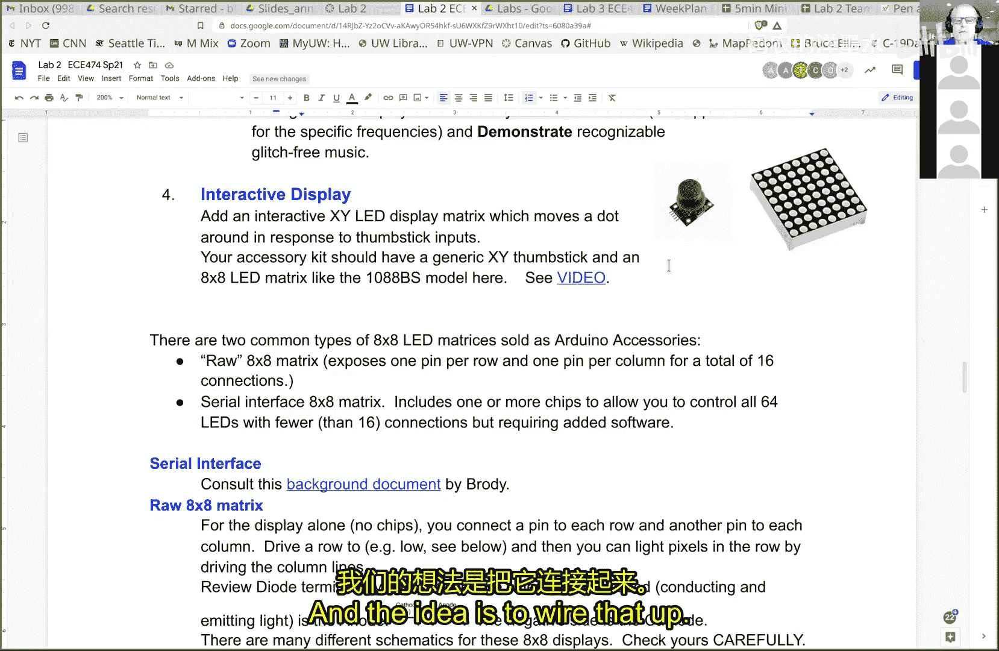

This one does not require sounds， I'm not going to fuss。But that tells it all。

 That's what I want to see。Joystick is connected to two analog inputs which read their voltage and then there's the and here's Bob Ross okay。

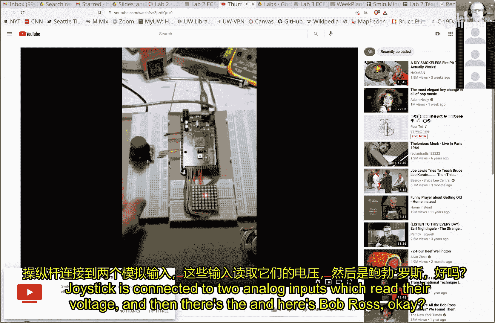

Okay。U。And you know， it's never quite as simple。 So the different kits have variations on this。

 This is just a matrix of 8 by8 LEDs， but they come in different flavors sort of a surprising variety。

 So part of the lab is figuring out what equipment you have and wiring it appropriately。

 there's two kinds the。I'll start with this raw 8 by 8。

 So these are two schematics of raw 8 by 8 LED arrays。 And you see a lot of LEDs。 And here the anode。

 which is the positive side or the。The site that is more positive when it's forward biased and conducts current。

Here， the anodes are all tied together to form a row。

And the columns tie together a bunch of cathodes to form a column。

 so if I make one row positive and or let's say logic one， and one of the columns zero。

 then that picks a unique LED that lights up。And this is just the same idea except it reverses the diodes。

So we have to switch high and low。And so you have to look for the model number。

 often it's printed on the side here。And Google that and very carefully make sure you have the right schematic。

 but don't just stop there。 This tells you how to use your。

Digital multimeter to verify that you have the exact schematic， right。And then of course。

 also these pin numbers， so these pin numbers may vary from chip to chip。

 although there are a lot of standards。And then the。

The other kind is where your LED matrix comes soldered to a little board and there's a chip on it。

hich may quote unquote help you by reducing the number of wires so with this architecture you have eight by8 so you have 16 wires you've got to run across to your Arduino。

And Brody had one of those， so he wrote up a write up to make sure you can use that kind if that's the kind you have。

And so there's a little example， here's an example of scanning it to generate the letter A this on the left。

 it scanned very fast and your eye merges it on the right， it scans slower and you see moving dots。

But that again， this is not the assignment， it's just an illustration of how it works。Okay。Um。

So this， for me， it was handy to make a worksheet like this。And write down all the pins I needed。

 What's the LED matrix pin from。In my case， I did it with the matrix。

 So which of these pins is which row and which column。And then which Arduino digital I O pins。

 Am I going to use。 This is my choice， your choice。It had a lot to do in my video。

 you can see I kept the wires very short。

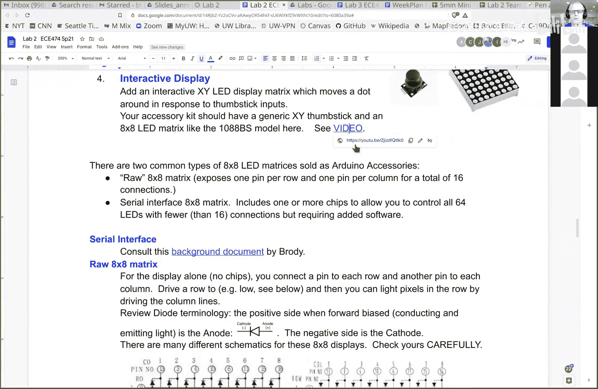

Is possible。And the pins I chose had to do with getting the wires to go as neat as possible。

And so you get a lot of flexibility with all these digital IOs at the end of your Arduino。

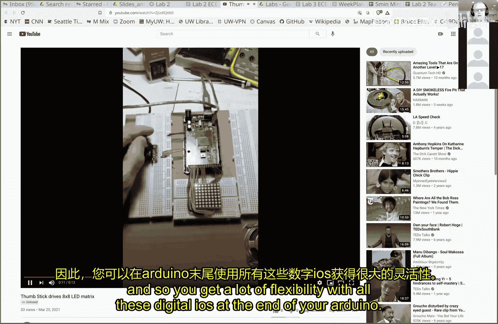

Okay。So you fill out this worksheet for yourself。And these things up here are just examples， whoops。

 I don't want to do that， but these colored blocks are just examples to show you what you might want to have。

And the thumbstick is， again， it's two， you can use this Arduino function analog read and you just analog read from a pin that's able to do analog inputs。

 which is actually printed on the board there。And then you'll have to map that because you'll get a value from the analog input。

That goes from 0 to 1024。And that's great， but you it would be very cool if you had 1 thousand0 by 10 rows。

 but that's a much more complicated lab so you have to make a mapping so that the full range of joystick motion or thumbstick motion。

 that full range goes to the range of。😊，rowow one to row eight。

 or if you're using zero base numbering from zero to seven。Um。And then， yeah。

 the code that made that video just runs this loop。It reads the voltages。

Converts them to row and column indices， namely numbers between zero and7。

And it turns on the LED at row， row and column column。

And it waits for 50 milliseconds that gives it that kind of fast response。

And then it turns the LED off and just repeat this。And then for the final is an extra credit。

 Do that。 keep it responsive and fast and also。Output the music function at the same time。

Using a scheduler like you did for part two。So any any questions。

 any further questions about the lab again， let's not dive into。

The tasks scheduling because I'm going to do that momentarily。

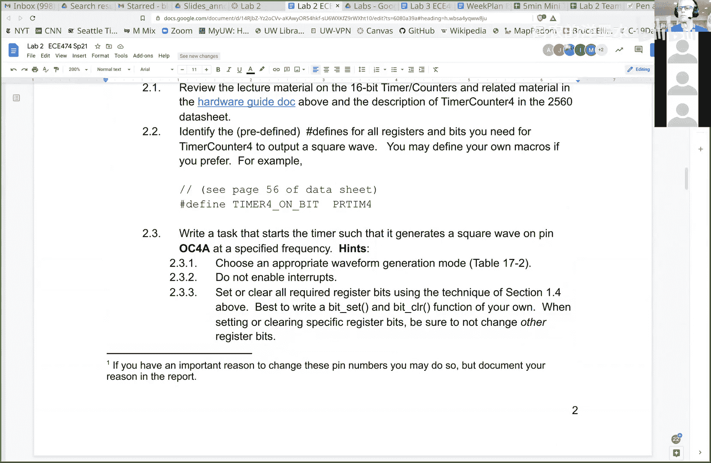

Okay。😊，Al right， so let me revive my。Laptop here。My other laptop， I don't know why。

It doesn't it goes to sleep on me。When it's in this。Position。Okay。Okay， just bear me with。

 bear with me for a second， and I will。Log in this other laptop to the zoom。All right。

 and I'm going to share a screen。

And if I can see it on my other computer， that means you guys can see it。

So we're going to dig into the details of how to build a scheduler。So。Hope hopefully， in lab 1。

You guys got to something like this where you have a list of tasks in the loop function and we start with task one and。

Each one does something for a little bit。And then we have some kind of delay to synchronize。

And give us an assurance that， you know， this whole cycle is some。Approximately， at least some。

Unit of time that we like， we can call it the operating system tick time or Delta T or whatever。

And this so far we don't have a good way to set that time interval except futzsing around with this delay and the Arrduino delay function uses unitsisecon of milliseconds。

 but you can also do one， which is microseconds and you could fiddle with it until it's right。

 although again without an oscilloscope， you can't verify this， so we're not really there yet。

 but it's a start。So we're going to add some more feature， I guess we did talk about the ability to。

 well， I' just I'll just go ahead and talk about it。And say， how else can we do this？

What we're really we're not really interested in wasting time we're waiting what we're really about is synchronizing and we want to guarantee somehow that。

Our loop goes around。We get exactly one loop in our operating system tick time。

And for little simple tasks like， for example， flashing an LED。You know。

 the worst case execution path through that task is microseconds。嗯。😊。

Or we may have- and so it's very practical to run tasks like this for a very small amount of time and come back to them again and look at the time variable and say。

 is it time for me to switch the state of my LED or not？

And that's all that that can easily be done with room to stick to a one millisecond。

Time clock it's a nice round number alternatively you may have really high speed performance requirements in your tasks so that you're required you know you have to do maybe complicated optimization of your code to make sure that can run within one millisecond and then a final alternative could be okay。

 let's set it for 10 or 100 milliseconds like maybe 10 loops per second。

Through that loop is going to be fine for everything we're doing。And again。

 it was like my yogurt controller example that is such a slow system。

 there's no point in doing a one millisecond loop， it could be a one second loop and there would be plenty fast for heating and cooling yogurt。

But。On the other hand， tasks， A， B， and C， they're not going to take the exact same time to complete every time。

Most likely because almost all code has some if branching in it， if this is true branch over here。

 do this stuff， else do this other stuff。We have that in all our code。

 and that means depending on how the if statements execute。

It could take slightly or even majorly different amounts of time。To complete the tasks。

 So we can't just sit there and delay every time either。

 That's where our hardware timers and clocks come in， so。You can already guess where I'm going here。

 we set up that 16 bit timer。And we set it to count up for our Delta T。

 I'll just emphasize that that's what I'm talking about here。An operating oops。An operating system。

 tick。And this scheduler as crude as it is， it's like。If Windows 10 is an operating system。

Is a human being then this operating system is like a primitive bacteria at the dawn of life anyway。

 this is a super primitive operating system。And it has a tick of one millisecond。

 so anyway the bottom line is we set the timer to run for intervals of one millisecond and then what we could do in that time delay function is watch the timer when the timer rolls over we exit and go back。

And then the loop will start over and then it doesn't matter if tasks A。

 B and C take different amounts of time。Okay， so now we have sort of something that's a little more that actually kind of could work。

But let's add some new features， so suppose a task doesn't have to run。All the time， forever。

It might figure out that it's done with its task。And then it doesn't need to run anymore。U。

I don't know， I thought of a military example， so it's a fighter jet control。

And the pilot needs to launch a missile and the missile needs to go through all sorts of states and get ready and lock on its target and then fire when the pilot presses the button。

But after the missiles fired， we don't need that code anymore。So it should be able to just say， okay。

 I'm done。And the other one， which is a bigger one is to delay or sleep。

 you guys have already used that to flash an LED， the problem as you discovered with Arduino's delay function is nothing else can happen。

 it's just stopped。And thats are super inefficient。 We can only do one thing。

That involves delays because everything else is blocked。

So of course what I'm talking about here is a non blocking delay。So that's what's new。 So let's。

 let's think about how we do that。So first to get started。

 we're going to abstract the we're going to want to be able to manipulate these functions and if you if you and turn them on and off and stuff and if you look at this。

 that's hard coded， somebody typed it in， somebody compiled it。And now， how can we change that。

 How can we turn off a task。We can't or stop one。So we're going to use function pointers for that。

 so we covered all kinds of pointers and one of the most powerful pointers is a function pointer。

Which is a pointer that can point to a function。And function pointers are written with this。

 I don't know。 I find this a little bit。A little bit obscure and hard to。Read。

 but it's just the way it is。 And so this is the generic function pointer declaration。

 meaning some type like int。The name of our function pointer。And then， different arguments。

Because it's not just a pointer， it's a pointer to a function。

 So C is going to keep track of what the arguments might be to that function。

And so here's actually an example。That's not an example。 That's like a generic description。

 This is an example。 So I've got a function pointer called FP。 I wonder where that name came from。

And it's got three arguments， a char called x， an int called Y and a double called Z。

And it means that this function point or FP， it can only point to a function which takes those specific arguments。

It will be broken if it points to different arguments。

 if it's called with different arguments or points to a function that's coded up。

For different arguments。So keep that in mind， but we have a workaround for that。

So we can use that to say， oh， if you give me a function pointer， I can start it。

And that would be this simple function， so this is not a function， well。

 this is a function definition。And it parameter。Is a function pointer。With no， in this case。

 with no arguments。And it's'。Were。Casting it to void。

 So actually a function pointer is also a void pointer。 It's a sort of a well。

 it's not a data type because it's a function。So this is saying the parameter to this start function。

Is a function pointer with no。Arguments。And so。Here， we execute the function pointer。

And that was something else we covered earlier that the difference between a function call in code and a function pointer is none。

 so you can just type the function pointer and that's like calling the function。Okayか。

But and furthermore， if you define a function， its name already is a function pointer。

But the thing about this start function is。It can point to any function。It can start any function。

Oops， I didn't want that。I wanted to get fancy and switch to highlighter。 Okay。

 so start function is a regular function， but it's what it does is starts its argument。

And its argument is a function pointer， okay。So that way we could have the scheduler like we could have a list of our functions as function pointers。

 our tasks， I'm sorry， we could list our tasks as function pointers and then have a function that starts them。

And it may be a little more intelligent than just a loop。So。For example， this though。

 is just a trivial rewrite of what we had before。 Okay， so yeah。

 this is fancier than listing them in the code， but it really doesn't accomplish anything yet okay。

So what would be better？Well let's keep a list of the functions and then go through that list and start them。

So。We're going to say， okay， we can handle up to 10 functions， namely up to 10 tasks。This is not。

Linux or Windows， which would have hundreds of tasks。And then we will， so that's set by this。

 I like yellow here that's set by this pound of fine。And then here， we're going to define a array。

Of 10 function pointers。And these function pointers have a very specific。嗯。Argument list。

Are you confused yet， there's a lot of pointers and voids and stuff。

But that is what we're going to use so that we can sort of put anything as the argument。

That's the reason void pointers exist。 So void means nothing。 the emptiness of space is a great void。

 okay and。So， avoid pointer。Is not a null pointer， but it has no type。

But that means you can use it for anything。And and that's what we'll do so we could now have our tasks have a pointer that's I'm sorry the arguments one one task could have a float argument。

 another one could have a int argument and we'd be okay with that we could handle that。Okay。

 so we've got this list of functions。 That's the array。And then we're going to have another list。

 which is the running tasks， meaning which of those tasks are active。Because。

If we allow programs or tasks to halt themselves， some of them will no longer be active。

Also same thing for sleeping， so if a task goes to sleep。Then it's not active。

And we don't want to run it。So we could move pointers back and forth between these two arrays to change their state。

And just like with the string， we could put a nu pointer。

I have not yet configure out how to change the instrument。

 the writing instrument with the buttons on this pen。

 even though that's supposed to work at least with this software so。Forgive me。

 I have to still select them。So just like with a string， we will have our array。

 we will put the function pointers in and the last thing will be a null pointer so we know when we've run out of functions。

And just like with the string， if we really want to have 10 functions， we should have 11。

Spots in our list， although we could also do something different and say we could have code the tests if you hit a null。

 you're done or if you hit 10， you're done。And then you could get 10 functions in the array without an 11th slot。

Memory is very cheap， however。Okay。So here's some pseudo code to play around with that。

 So let's say we have these two tasks， task A and task B， and they have some。Parameter。

 which we could just put nothing in we could put null in there if we don't need it。You know。

 not all tasks in our we we're not going to use parameters on tasks very much。

 but you could imagine where that could be useful like flash and LED and the parameter would be an int of how many milliseconds it should be on and off。

Okay， that's reasonable。 And then you've got one size if it's all one flashing app。

 one flashing task that can do。Anything or any LED flashing。All right。

 so that's why you might have a parameter。嗯。😊，And we're going to make a function called the scheduler。

 we're going to have a very small little world where there can be only four tasks。

And we're going to have。A list called an array， which I since I've been doing a lot of Python。

 I kind of keep using the word lists a lot， but this is an array， and it's our tasks。

 which are ready。Yeah。Ready to rock and roll。So， here's our main。And maybe we set up that list。

 we start setting up that list， okay， so when you talk when you just use the name of a task。Without。

The parents because that is a or well that's a function pointer we already defined it as a function pointer。

 So the first two elements of the ready tasks array are these two tasks。

And then the third element of the array is actually， there's a typo。Okay。

 there's still a few typos in this stuff。Because the point， of course。

 was to put the null after the first two tasks。So that's the third element。

 but it should be a number three。This isn't Spanish。

 so I'll erase that other that might confuse people。All right。Okay。

 so we've terminated the list and now we can start our scheduler we haven't we haven't pseudo coded the scheduler yet。

 but。Now we've set up our task list and let's say we have it， so we schedule。

 we synchronize the time delay， and then that's main， So here's our scheduler function。

So it takes a little thought there's a few things that can happen， so it's called。

 let's say these are the task indexes a global and the ready task is a global。So。😊。

If the one thing that can happen is we're done with the list， so with one pass through the list。

 So if the task index， if the ready task is null and the task index is not equal to0。

 then we just start over。Andll we'll hit it again the next time。Starting at the beginning。

 but another thing that can happen is the ready tasks。

The current task that's pointed to by the index is null， and we're at the beginning of the list。

That means there's actually no tasks that are ready。So we'll figure something out to do。

 like we'll just wait， delay a little bit and hope something else started a task。But otherwise。

 there's nothing to do because the task， the ready tasks list is empty。

There's actually a very good use case where this could happen。

Which is all of the act that you have you have a bunch of important tasks。

 they're all running and everything's good， but they all go to sleep for a while they all don't they all want to sleep until for I don't know5。

20，10 milliseconds。And you could be in a period there where none of the tasks want to run。

So we can't just die。But we don't have any work to do。And then， otherwise。

We start our function with the task index。 This is actually。Pretty casual pseudocode， Okay， because。

If both of， if。If this succeeds。If this if statement is true。

 we're still going to drop down here and start a function， so that's actually。

 I'll just note that for people。Okay， that would be better pseudocode is to put an else in there。

And then finally， we increment。The task index to go to the next task。So that's our scheduler。

And then let's look at these functions that are going to be new capabilities that we have now。

 halt me okay。Now， what's going on is that some task。

 it's fired its missile and it's time to halt itself。 So it calls this function。

 So we have to write it。So what's that function going to do Well。

 as to figure out who called it and what task is actually running right now。

 but that could come from the task index。Or other ways。

And then we're going to copy its function pointer。Out of the ready task。

List or array and put it into the halted tasks。From ready to halted， we just move it。

And we're also going to delete it in the ready tasks， not just copy it。

We don't want it to stay there。And then there's going to be a gap in the ready tasks。

 and so we' have to move everything up。So that's that's what this is。And putting a null。

Into the last element that was freed up by shifting up the tasks。And then。Now we're going to。

Go to the next。Calted task。Next let me double check that。I think let's just delete this。 We're gonna。

 just。Not worry about this。Because that'll take care of itself。When the main task returns。Okay。

 now then we return。But remember that this is returning to。Task。That。Tried to halt。

So let's take a look at that。And potentially， there's a logic bug there。 So what we want。So。

I guess this is a very sketchy illustration。But there's some code here。And first。

 imagine that this return is not here。So you might easily want you might easily write code that says。

 well， if it's time to halt， call halt me。And that's fine。But the way we've implemented haltme。

 haltt me is going to return。So then control will come right back to this point。

And you never know then what logic down below could fire another missile or something。

So we don't want that。Instead， we should。In our documentation。

 we should make sure that each task that calls halt me。Returns immediately after calling halttney。ok。

So that's going to give our logic， that's going to make our program logic much more predictable。

And it's going to give the expected behavior because it won't resume after it tried to halt。Okay。

 and the other thing is sleeping。So what you find in many real time OS implementations and applications is this kind of。

Okay。U。Paraigm。A task computes for a while does something important。

And then maybe it has an if statement and says， well， if it's。Time to sleep for a while。

Sleep for 10 units。And for the same logic， we have to do a return here。

And so we should put a return right after the sleep call in a real OS。

 there are hacks you can do to manipulate the stack to make this automatic， but that's。Pretty tricky。

So we're not going to do that。Alright。So pseudocode for the sleep function。

Is similar to the halt meat idea。And we have ready。

 we're taking it out of ready and putting it into waiting。And just like with Ht me。

 we're going to clean up the list。That was deleting the original entry and shifting everything up and putting a null at the end。

And。Then we're going to， But the difference is， this has a parameter。Blue， I'm going to highlight。

And so the parameter D is some integer， and we're going to put it into an array called delays。

And that's going to keep track of every task which is sleeping， how long they have left to sleep。

That's going to be the alarm clock。Okay。And so then keeping track of those delays is like when。

We hit that scheduler。Time tick。 we're going to subtract。One unit from each of those。Delays。

Until they get to 0。And so when it's when when you do find zero。We move it into ready。

And remove it from waiting。Okay， so it's like the it's like a game of cards or something and each task is a card and we're going to shuffle them around into different stacks。

 different piles， and only one of them gets actually executed。Okay。

 so now that's sort of one approach is that we have these these piles of cards and we shuffle things around。

But another one， which is often used is。To make a struct。

 and the struct holds everything we need to know about a task。

And so we're going to call it a task control block。And here's a pseudo。Code。Task control block。

So first we have the function pointer itself。And then our argument pointer。

 So we might point to some arguments and then use it when we call the function。We're going to again。

 we're not going to make a big deal out of that。And we're going to have some little。

Flags or information like this state。 So is a short in because there's only a few states it can be in right now。

 We're saying it can be active。It can be。呃。Suspended or stopped。It can be waiting。

 that's only three states， so we don't need like 16 bits to represent that。

We can represent that in only one by， and that's a short int。Or could be an unsigned short end。

 It doesn't matter。're， We're going never get to。Thousands of states。 It's just not a thing。

Gotta keep it simpler than that。 And then we're going also store our delay there。If we're sleeping。

And right， this is an unsigned int so that because we negative delays are not useful。

 so the unsigned int can go from 0 to 6，5，5，3，5。 So if this unit is if our operating if our operating system is tick is millisecond。

 then this allows us to go to all the way to。嗯。65 seconds。65 and a half seconds。As maximum delay。U。

Okay。So I think I'm going to we're going to do our 10 minute break now， I'm going to。Stretch。

 and you should too。 And so I will see you at。Well， I'm going to look at my official time。

Which is not shown on either of my computers right now。Why am I full screen over here。哈。Anyway。

 I will see you in 10 minutes， which by my wristwatch is。3，35 or35 minutes after the hour。

 And so thanks， so， thanks for your attention。

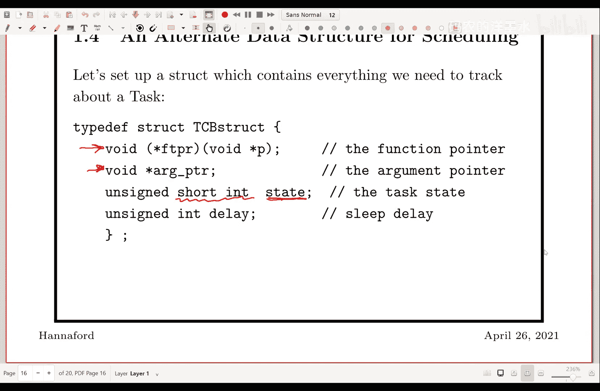

Okay， we are back from the break， we're going to continue that sort of advanced scheduler implementation stuff。

 but first I want to get you ready for a little bit of exercise we'll do this afternoon in the remaining time。

So let's see。 what I want you to do is。嗯。😊，Get make sure you have some。

 I should have given this to be a task during the break， I guess， try to have some lined paper。

And pencils or pens。And。Or you can get you can go to our files。

I will。Go to this screen and share it， and then go right into。The course。And files。

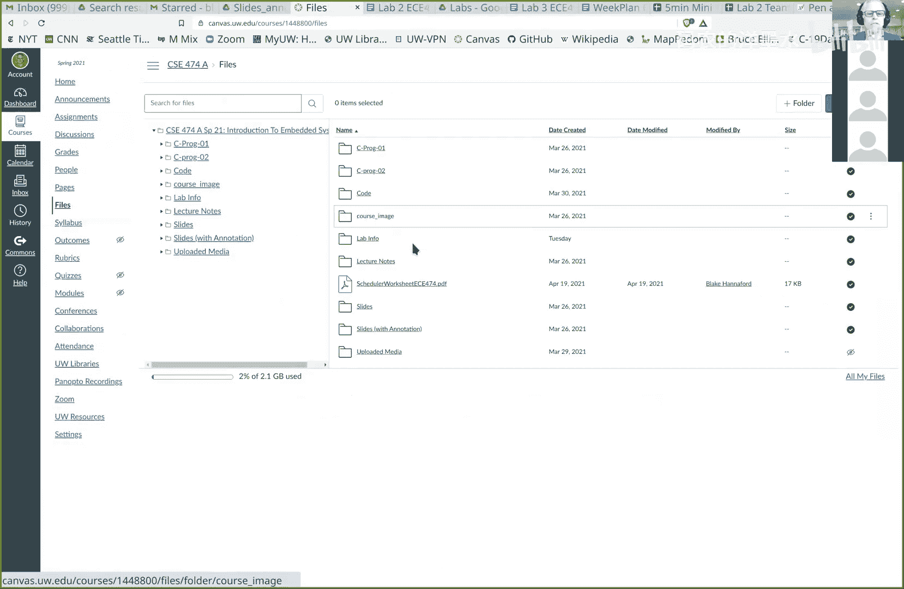

And scheduler worksheet。 So I introduced this before。

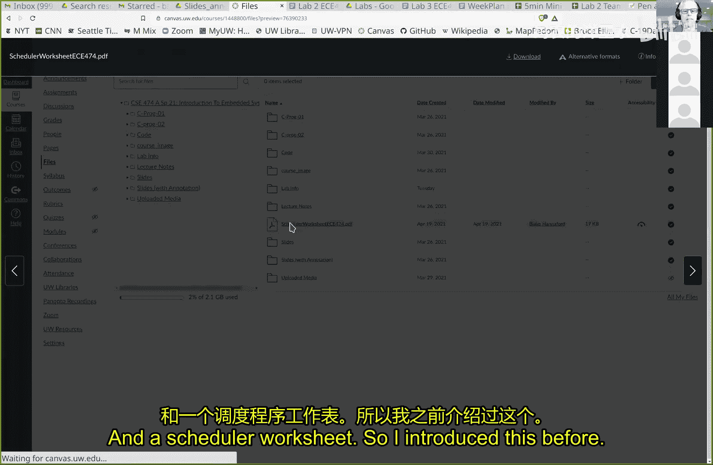

So you could print out a couple of these if you have a printer， but obviously on line paper。

 it's trivial to make one of these。So that may be more practical。

 so we're going to want a couple of these to go through some exercises in and take notes as I kind of do them。

Okay。Also right now， any questions？

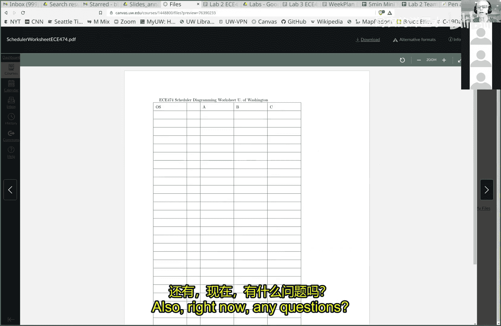

That people want to ask based on is there anything that's， you know this is a lot of material， but。

You'll digest it over time。 But if you have any questions right now， I'm glad to。Ask them。

 answer them。Yeah， professorfes， I have a question， so could you go back to the sleep function slide？

Okay。😊，Let me get that going on。 my other。Computer and share it there。And actually。

 it seems to have gone right to the right place。

Okay。Can you see it now。Let me get。This is I didn't actually you know go into D I didn't。

Have a slide on the sync function。 Is this what you were thinking about， though。Oh。

 I was thinking of the pseudo code for the sleep function。Can you give me a slide number or anything。

There's a chat that stays slide 14。Slide 14， great。It was just a general question， but I don't sleep。

 oh i'm sorry I misheard you， I heard something different so。

Yes yeah I don't think I fully understand what the sleep function is doing so sure so when is called is it skipping the current task and billing it for the amount of time？

Right， so like in regular Arduino code， they have the delay function。And you can just call it。

 and it stops your code for however long you want， right。

And we still want to be able to do that that's useful for programs the problem with the Arduino one is that nothing else can happen。

So this is a function that a task will use internally for itself。

Like I want to flash an LED for 50 milliseconds， so I'll turn the LED on and then I'll go to sleep for 50 milliseconds。

And when I wake up， I'll turn it off。So that would be just three lines of code， turn it on， sleep。

 turn it off。Does that make sense？ok啊。go ahead， oh sorry。So。Waiade。收活。嗯。Okay。So when is what does？

Copying D into the delay array do exactly。Okay， we're going to make an array。 I。

 I'm going kind of quick there。 So I don't， I don't like， like。

 I sort of let laid out a lot of steps at the beginning for the ready tasks。Aray。But I'm just making。

 I'm pulling an array out of thin air。 So let's say， let's make an， but it's a simple array。

 It's an int array。 So I'll write it out。So， let's。Let's see I can make this smaller， okay。Yeah， so。

Let's say that somewhere up here， we've got。And。Sleep times。And maybe we'll just give it。Well。

 I define some pound defines which we normally use， but I'm going to put 10 there。Okay。

 so that's 10 integers。And now what we're going to do is say if a task goes to sleep。

 it already has a position in or other arrays， like we know this task index right here。We know that。

 right？And so we can use that to index into this。Sleep time。And put a D in there。

 put an integer value in there， which is how long we want to sleep。

So now we have a little place to store how long everybody's sleeping。Does that make sense。Okay， yeah。

 thank you and that's why I call it the alarm clocks okay， so you know。

 maybe each one of them will go off and and we'll have some we willll also have some code that every millisecond subtracts one from each of those that are non zero。

So they will eventually go to zero and then we have to wake the task up again。Makes sense。Yep。

 thank you。 Great， good question， Any others。Oh another question so if we are decing the delay value of D or we。

Derementing by D for every。Index of the sleep time or just the first index。No， well。

 what we would do is go through that array， sleep times。

And there's one of two things that is going to be in there at each index in the array。

Either zero because the task is not sleeping。Or a nonzero number， like 5。So。

I think it'll just be we would just write code that goes through the array if it's zero。

 we just leave it alone because the task is not sleeping anyway。But if it's non0， we subtract one。

And as it was after that subtraction， we test it。 So if we subtract one and it's equal to 0 now。

 we have to wake it up。The other ones， we didn't have to wake up if they were zero because they were already awake。

Makes sense。Yeah， and so waking the task up。Is going to be the reversing this。

Because it's no longer waiting， it's going to be ready again。Okay， great， thank you， thanks。

 any others。Oops。嗯。I'mJust checking chat。 Oh， there's a bunch of chat stuff。 Ishaon is on top of it。

Okay， everything looks good there。Alright， so， alright， so let's see。

 So let's get to back to where we were。I'd much rather continue when people have their questions answered than just keep going on。

Good。So now that whole idea was we're moving things back and forth into these different piles and we're only running the ready list。

 so this is just like another way which has a certain advantages。

 and that is we have one list but then each task has a block of data that contains everything we need to know。

So that's where we stopped。And we have a state variable， let's say。

Just encode the states into different numbers and we can put our delay in there too and say task。

 you know， this particular task has is sleeping if and it's got nine more milliseconds to go。Okay。

 so here's some pseudocode to illustrate that。And so we're going to define these states。

 they're really just number zero to three， but we'll give them descriptive names so when we use them in the code。

 the code's understandable。And then what we're doing now is making a big list， well。

 it's not a big list， but it's a list of pretty big things。So this is an array of TCBs。

Where did my page go。Sorry about that。There we go。Okay。😊。

And so now let's see how we would set up that same task list。That we did before。

're going to we're going to start with just an index， a task number， if you will， J。

And then we're going to say， let's say for the illustration example that task B needs a parameter like it's a generalized LED flasher and we have to tell it an argument of how long to flash the LED。

And so we have a J。 and then we'll take the first element of the of the task list or the J， but。

So J equals0， we're going to that's just our first task。

 there may not be any significance to being first。 it's just that's where we parked it。

And so we're setting we're initializing the four elements of that struct。

Task we're giving it the function pointer。Task A does not have an argument， so it's null。

 and we're setting it up to inactive because。But just that's I just felt like it for the example。

So this is a task that is sitting around， ready for us to start sometime。

 but it's not going to run when we run。And the this delay of -1， I guess， means it's not。Delayed。

I guess what I just explained， I used zero for everything。

 but we could also just have a negative number meaning。Do not。Do not apply delay。

And then now we're going to do task B。 So then significantly here， it's a detail you might miss。

Why am I not highlighting？That's weird。My pen stopped working。 Oh， no。I don't know。

 The highlighters stopped working Anyway， don't forget that because now we're moving to the next slot。

In the list。And so now we're setting up task B and its pointer is task B， its argument is 56。

 just ran some number。And so now what we're doing is we're。And remember that the argument was an int。

So it's not any pointer it's not anything fancy。 This is just an int。But what we're going to do。

Is this pointer magic right here。So we have an integer pointer。

 which we've initialized right there to point to that int that contains 56。

And then the argument pointer that we'll have for that function is cast into a void。

To strip away the information that is's an integer。 And we did that to make it generic， so that。

The scheduler can handle anything。And we are assuming that task B knows that it's going to look for an integer。

And it's going to interpret those bytes， those bits properly。And just again。

 because it's an example this time， task B， we're going to say is ready。

 which means as soon as we start the scheduler。Boom， it starts to go。And it's not sleeping。

And then we increment it again。We increment J again。To get to the next task。

 we're just initializing everything prior to running right now。

 we're just building up our task control blocks and sort of in place inside this list。

And then the last one I'm going to try highlighting again because I like it so oh。

 I know it's this thing。think。There， okay， so the last one is null。

 which means we will know to stop looking for more。But maybe we could have done other tasks。

So this way， there's a neat structure that holds everything。We need。So before we get to those。

Scheduling worksheets。Just do some thinking for five minutes。 and I want you to write a pseudocode。

And I'm going to for halt me， start task and delay。

And we're going to use assume that these this list of TCBs already exists Okay， if it's easier。

 go into canvas right now and you can get， can I find it Yes， okay in。U。Slides。

You can get these slides， scheduler implementation。

Why didn't that that didn't show in screen sharing， okay， I got to reshare that。

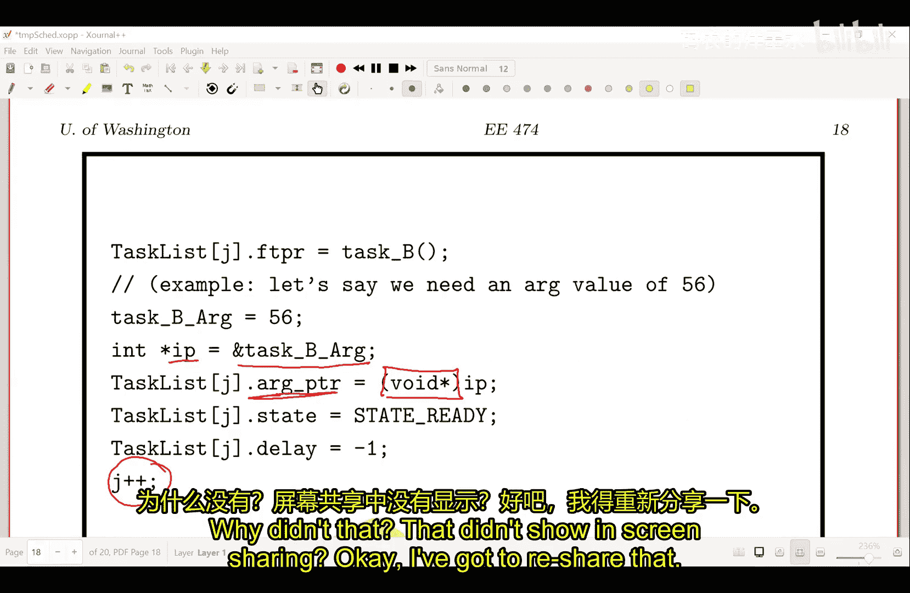

Okay， good， thanks for answering each other's questions， that's good。

I'm going to share the screen again。And to show you what's going on with Canvas right now。

Okay， so what you might want to do is go into slides annotated， which aren't annotated yet。

But I'm going to upload that later， of course。And then， whoops。

The thing we're talking about is scheduler implementation。Dot S。And it's PDFf。

And so that's the slides I'm lecturing on right now。

 the annotation will not be on there yet wait till after class for that。

But if you go ahead and download that， then you can consult all this while you're doing the exercise。

And so I'm going to get back to the other。

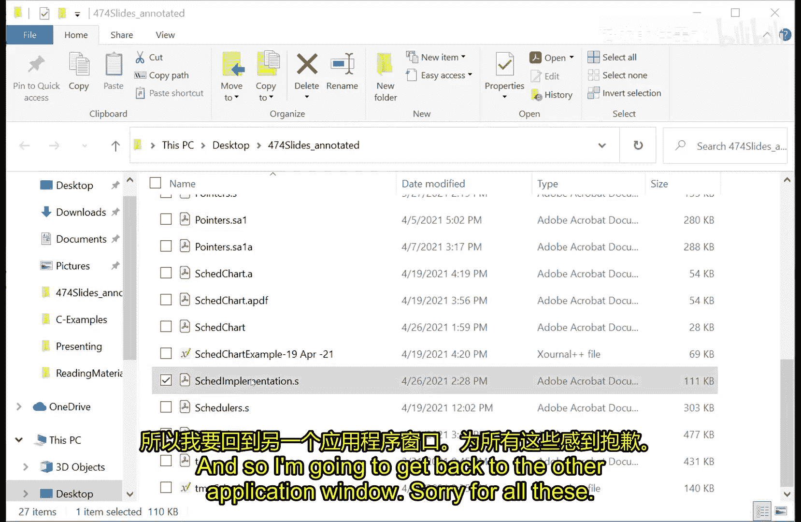

Application window， sorry for all these。

Here we go。All right， so yeah， so you'll be able to consult this and so assuming that we have these TCBs set up and the the more generic description is。

Right here， which explains what everything is。Can you write pseudocode and it can be very simple even and it can be correct。

 can you write pseudocode to do the halt me delay and I guess start， what was the other one？Yeah。

Okay， so I'm going I'm going to give you guys。Three to five minutes， I don't want many pages of code。

 we don't need many pages of code。But can you write those？And at at。4 o'clock。

 which will be the out right at the hour， will resume。Okay， so。I， I hope that went okay。

 It's a little hard to。Normally I'd walk around and interact with you while you're scribbling on paper and get a sense of how you are doing on it。

I'll just present what I had in mind and hopefully you learn more than if you just listened to the slide anyway to the。

To the to me talking。 so basically it's it should be as simple as this。

 So halt me could say whatever the current task is， somehow we find this index。For the current task。

We change its state to inactive， over and done with。And halt me should again。

 return immediately after it， I mean， the task that called halt me should return immediately after it calls halt me to make sure it's really。

 really dead。And then start task is the opposite， we can just change its state to ready next time the scheduler gets through its list and gets there。

 it'll be run。And。But， but star halt me doesn't need an argument because it's me。 It's the same task。

 But obviously， starting a task needs an argument。Which would be an ID for the task and there I just realized that my example could be better。

Because。Well， no， I mean， this assumes that， you know where the task is in the list and the Id is the index。

 So these would that that is how you call start a task start the task that's。Number3 in the list。

And delay would state set the current delay variable to D。And whatever that value is。

 and set its state to waiting。And now there's the scheduler function every time it wakes up。

 every time it's looking at the timer should decrement D by one。And。

Undo this if change the state back to running， in fact， it could even call start task。

When it gets to zero。Questions。Does that make sense。Okay。😊，All right。

 I'm going to let's now do one or two scheduler diagraming examples I personally I'm kind of a visual thinker and let's see I'm going to export this。

And this one is going to be SA。There's supposed to be a way I can get that。 Now。

 you recall last time。I was able to get a little bit of a window where I could pen。

 I could write in there with a pen， but now I can't so I have to unfold this thing again。

And do it old school。All right， that's saved。 So now we're going to open。Sure， I can open some。 well。

 I'm going to open the document。Example  one， scheduling chart。 So I have some。Yeah。

 I don't need to save it。I'll save it， okay。That saving in the sketch format。 Anyway。 So let's see。

 we have some new chats。No， those are not new they're only new on this computer Okay。

 so good discussion about casting and peres in the void statement。

 but I think I don't need to add to Iwn's answer。Okay。

 so now we're going to diagram what really happens on a millisecond by millisecond basis。

For some tasks。And this helps solidify the concepts that we're talking about here。

 it doesn't matter if we're doing the list based scheduler where we move pointers back and forth between the ready waiting and inactive lists or the TCB method where everything's in a list of task control blocks。

 this will apply either way because we won't see how the scheduling decisions are made will just illustrate。

What decisions are made。And this kind of micro analysis of timing。Is TBBH， it's rarely done。But。

It's done when it really matters。 Like， you can bet。That the engineers at JPL who do the。Helicopter。

 they're doing this。Because there's legendary spacecraft that have failed when timing constraints are violated。

So let's have a look。So I have three tasks， A， B and C。

 and we're going to first and we've done this once before， so you probably remember the basics。

 but we're going to mark off milliseconds。3。Rs per millisecond。 again。

 you can do this on paper by just drawing four vertical lines。

 you don't even have to draw in the descriptions if you don't want to。

Let's putting a few more tick marks in。So our operating system is going to have ticks of one millisecond。

Our scheduler。Come on。Alright， that's enough for now。And just just to be clear， though。

 we'll label that。Okay， and then we're going to go and have a look at what these tasks are asking for。

 So you remember there's a c and D for each task as a standard way to describe them and C means。

How much computing time does it need each time it's called？And yes， this can change， okay， but。

So there's some approximate here。Two is the P period。

 How often does it have to be called and that's either。

In this in since our time quantum is one millisecond。That period can be one。Or if it's more than one。

 it's going to implement that with sleep。Calls， so if it's trying to run every 5 milliseconds。

Then it will run。And compute a little while and then sleep for four milliseconds。

And then it's going to have a period of five because even if even because the time is quantized into milliseconds。

And then there was the deadline， and we're going to be doing very hard real time where deadline equals period。

 so we don't need to write down the deadline。Okay。And then。

We have taskask A is computing for 300 microseconds， which is roughly one of these boxes okay。

 if there's three boxes in a millisecond， then each box is 333 microseconds。

 and we're not going to do this out to the microsecond， is this is not that's not the point。

 especially because the code and a task won't run exactly the same every time if the code really did run if for example。

 if the code has no if statements。And it will probably run exactly the same time every time。

But most code has if statements and depending on the branching， it'll change the time。Okay， so。

So it's assumed also that if the。Taskask has a period of one time quantum or time tick。

Then it doesn't need to go to sleep。It's implicit that every task sleeps one after it's called。

And we're going to sort of prioritize the tasks from A to C in that you have to pick some arbitrary order and we're going to start。

 we're going to go alphabetical。So as you remember， I just color these in。

 I'm going to just keep it simple， make it essentially one box。We run task C。And actually。

 I'm inside the box， so maybe that's fairly accurate。And then it returns to the scheduler。

And it will then run task B。For which is a similar compute demand。Of course。

 there's a tiny amount of time here where the scheduler switches context。

Between the tasks and thinks maybe a little bit。And then finally， we have task C。

Which is a shorter task。Takes about half of a square。And then it's going to go to sleep。

For in this case， for I guess，2 milliseconds， okay。Because it will subtract one here。

And then subtract one again to get to zero。So。 I think it actually it。Yeah， it has to do too。

 So I have a notation for that， which is a little wgggly line。And then what happens。

 So now the scheduler is going to take over because there's a little bit of time left until。

The operating system tick occurs。And it's going to go into some kind of waiting loop。

And wait for the next millisecond。And then， of course， it starts over again。 So it starts task A。

 and now I'm going to use my increasing knowledge of。This。Drawing app。Except that didn't work。

 Must have been in the wrong tool。That's supposed to go in。To fill mode。Hah。I don't know， Okay。

 I'll go back to old reliable pen mode。Oh， I know。 That's a selection。 Sorry， this is the mode。

 drawaw rectangle。 Now I can fill。 Okay， so now I can make really neat， precise orange boxes。

And then we'll start task B because it's task B's time。And now task C is asleep。 So actually。

 what we can do， this is a good exercise， too， is we can。😊，Clear the drawaw rectangle tool。

And we can note what the value of D is。 So this is。

 let's say they I because I couldn't remember if it's D equals 2 or d equals 1。

 So this is D equals 2。 Oh， I have the fill thing selected。 Okay， fine。And then now。

 because the scheduler will。Derement it， actually， that's Python。 It's， it's， it's valid C。

 but it's more pythonic than Cish。 So we'll go D minus minus。Which is C like。

And then so D equals one。And then， down here。D will decrement again。And so when it's time。

 the scheduler will wake it up at the right time。Okay， so this is a asleep。

 So that means we have a bigger。Rectangle for the。Operating system to kill。Right there。

And then it will start over。 So we'll start with task A still。Task B。Which are not sleeping。

And then task C is ready because it' it's。Because its delay went to zero。

And so we'll run that for half of a square。And then it all repeats so。U。

This requests two delays again。Oh wait。Okay。Yeah。😊，Sorry， maybe this isn't worth it。

 but I think it is。It looks better。All right， now we get our eraser and clean up。

HAll the fill leaked out。All right， whatever。We'll go old school and color this in。

Should task C start right after task B ends？there actually， that's， that's very good。

 Why didn't I do that。嗯。Yes， you're right， okay。I'll tell you why I take the blame because I got too too focused on fiddling around with these features。

 that's why。Thank you for that comment。 Okay， so task C is able to start precisely because。Of。This。

And so that's she's thank you for bringing that up that is absolutely correct comment so then we'll do our little wiggle through two lines。

 one， two。And that will repeat。And then the OS， again， I can take this。 we can go on forever。

The O S has a little bit of time to kill here。 Well， I got to get the right color。Close enough。

And then the cycle will repeat。So again， just to kind of go back and show that。

This depends this exact evolution depends on these parameters for the definitions of the task so obviously task C is much less demanding overall in resources because。

It's got。You know， it's shorter and it runs less often。

But really it boils down to this kind of analysis to prove that a whole bunch of tasks actually have a valid schedule that's possible to meet all their respects。

Um。Okay， I think that's that's going to be it for today。 We covered a lot。

 I'm going to post this and the other annotated。Fileles， and I'll see you guys on Wednesday。

Good luck on La 1。

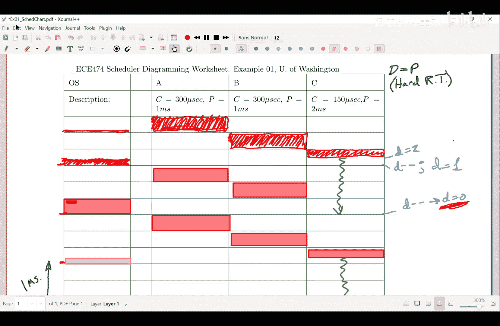