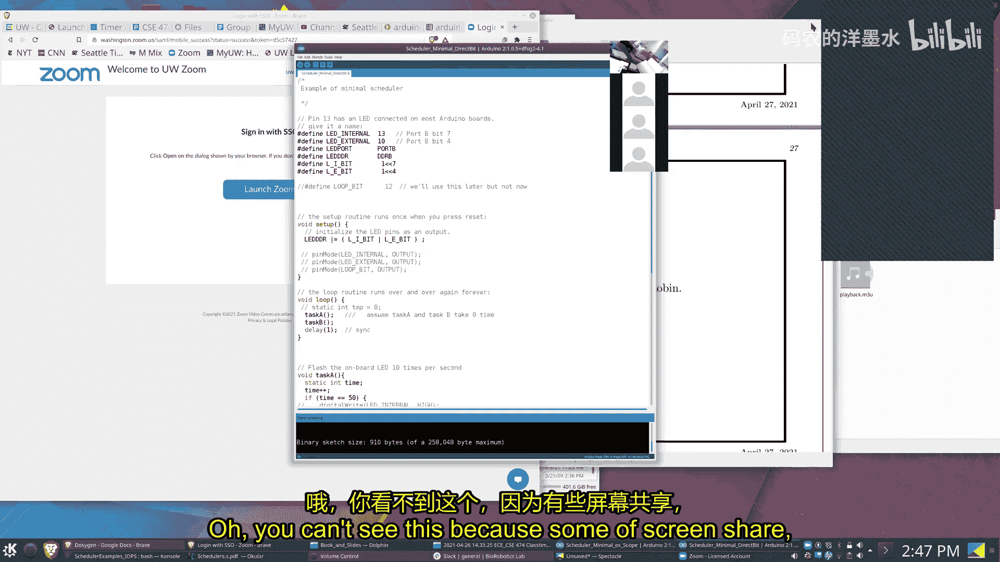
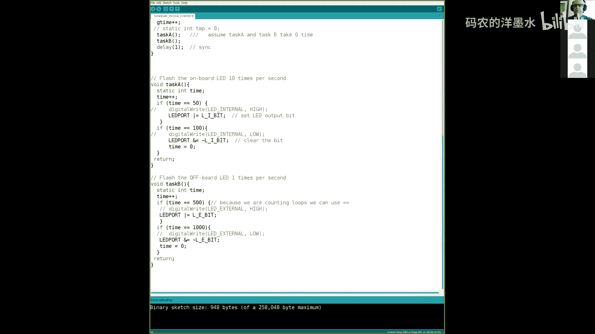
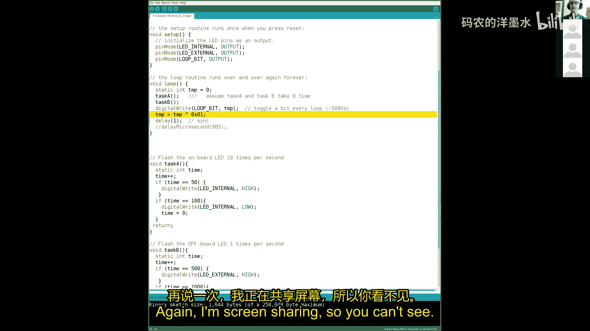
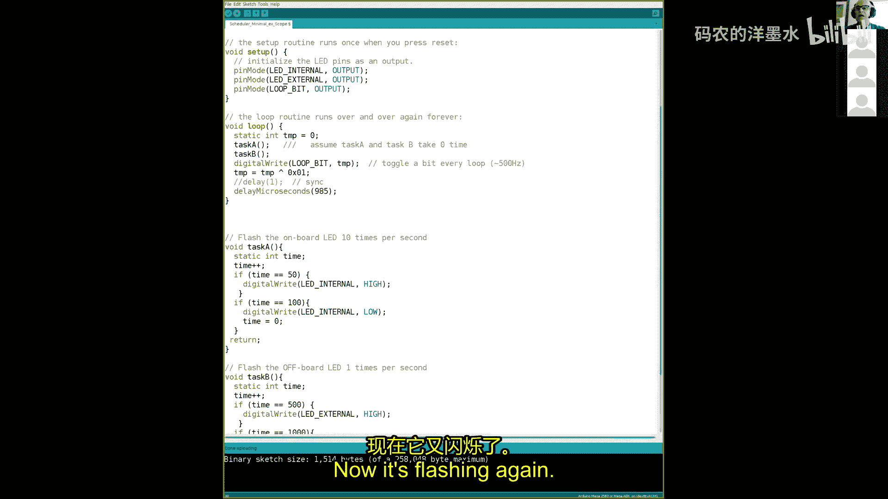
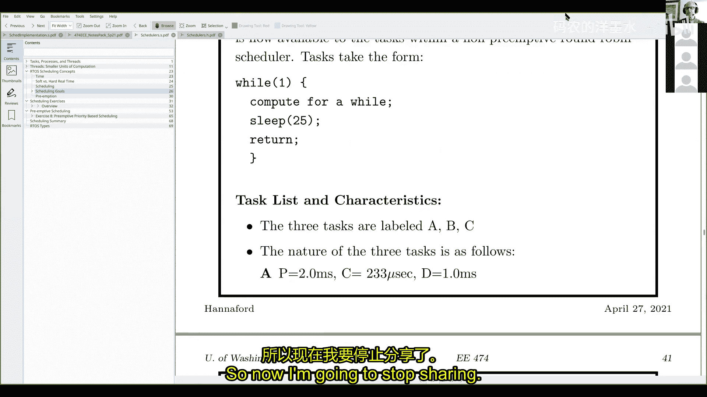

# 【全集 附完整课件】华盛顿大学 嵌入式系统导论 CSE474 中英字幕 p11 Lecture 10 - 调度III -BV1ALqnBWEeu_p11-

All right， recordings begun。And now I will turn off the chime。Gone， all right。Okay， and so yeah， so。

呃。You know， it's a couple of points， One is。Pazzas they're great questions coming into piazza and me and the TAs and by the way I just want to give them a shout out these are some of the finest TAs I've worked with in a while who are it seems like doing a great job I hope you agree with me of course if you don't drop me a private note but I'll be shocked。

But I need to know so that's that's that's that just in case， but。At any rate。

 we are jumping on those as fast as we can and trying to get solid answers。

And I just want to put out a request to， if at all possible。

 make your question a public question because。If there's some reason that we don't want to give everybody in the class the answer to your question。

 we'll take it private， but generally speaking， we want everybody to benefit from the Q and a that you guys do so really there's no reason to to make your questions private。

Unless there's a special reason to make your question private， so that's also okay。

And then what I thought I would do because there are still people who are still struggling with making multiple tasks run together and we've presented a bunch of different scheduling concepts and all that and I think some people have been a little overwhelmed by that so I'm going to present an example and we're going to flash it into the Arduino and show you that this doesn't have to be that hard。

And so I think I'm going to get right to that。

I think I'm going to just go to the desktop and bring up this sketch。And okay， so here it is。

And what we're going to do is just have two tasks。And by the way。

 as you create a method of scheduling tasks and running multiple tasks at the same time。

 definitely start that and test that with very simple tasks。

And then you won't have the issue of a complicated task which has bugs in it。Breaking your schedule。

 you'll know that the tasks are simple enough and your schedule scheduler。Algorithm can be tested。

Without worrying about that extra complexity， then you've got something that works like this。

Go ahead and add more complexity to your tasks， ideally just a bit at a time so you can see where things break。

So what we're going to yeah， like I said we're going to flash two LEDs。

 one of them will be the onboard built in LED to save time and then the other one will be an external LED going through pen 10。

Okay， and so what we have is some defines。 So the internal LED。By the way， oh yeah。

 one other thing is I didn't play the my background jazz this time because I think I figured out why my headset was dropping。

Which was in the old configuration he used to be plugged into the same USB hub as the camera。

And that was an embedded system issue where there's this high data rate going through the same hub from two devices。

 especially the camera， and there were just a glitch that would hang。And I so far。

 when I was playing the jazz。I had the the wireless unit for the headset plugged into either directly into the laptop or through a very lightly loaded hub and it seems like it never happened so definitely though I want to see hands up as soon as the audio dies if it does die。

But I don't expect it today all right， so internal LED hat is 13。

 that's just the way the board is wired external LED， we're putting it in pin 10。

 and if you look those up in the schematic， that's port B bit7 and port B bit4。

And then we're going to just。You know kind of write our code a little more generically so we could port this code to another board by just changing the defines that's the kind of the goal and so we're going to say the LED port is port B and the data direction register for the LEDs is DDRB。

So those are the registers for port B， as you know。

 and the LED internal bit is bit7 and the LED external bit is bit4。All right。

 so then setup becomes really easy and I you know， okay。

 I confess I did this example first using pin mode。

But its actually might be even easier to do the setup this way。And actually， oops。

 I forgot to use my pound defined， so I'm going to do that。LED。DDR， Okay。

 so we're going to set some bits for the two LEDs we want in the LEDs DDR and all this stuff is defined right up here。

And then that's all we need to do to set set up our bits， set up any。

 we're not going to use the timer right now。Okay， now we're in our loop。 And so this is。

I don't even need this temp bit， I use that for some other example。

 so now we're going to have a loop and it's going to have task A followed by task B。

 followed by a delay of one millisecond。And when we're running this， we're assuming。

That the tasks take zero time。And we'll check that assumption in a little bit。But。

That has two consequences。 One is the main one is it's on you to write your task so that it executes as close to zero time as possible。

But it's going to get called a thousand times per second in this loop。

 so it can still get some work done。Although LED flashing is。

I'm not sure I would define that as work， okay， but it's getting something done。

So now we have two methods or functions， task A and task B， which are obviously very， very similar。

So task A here's a key concept， we're going to have a static int in there so what's the difference between an int with the scope of a function and a static int with the scope of a function so they have the same scope。

But static ints have a magic property， which they persist。From call to call。

 So if it's a regular int。Deeclaration。Time will get reset to zero and re initialitialized。

 and actually。It makes room for time on the stack so the time variable will disappear after the task a function returns。

 but if we make it static。There's some permanent memory set aside for time and it doesn't reset after each invocation or call to the function。

 we need that to keep track of time and we're just we know we're running once per millisecond so if we just count the time。

Coun the times that we get called， we have a measure of time。In milliseconds。

And so we can say if time equals 50 milliseconds， now the task we're going to have is 10 flashes per second。

Of the LED and you have to turn it on and off and both the off and the on have to be visible to the human eye。

 So we're going to have it on for 50 milliseconds and off for 50 milliseconds。

 The total period is 100 milliseconds， which is 10 flashes per second。And so if time equals 50。

 we're going to set the bit in the LED port corresponding to the internal。Onboard LED。

LED internal bit， which I defined up here。 It bit4 because the。Oh， I've got it backwards。

 What do you know， Okay， it always helps to walk through code and， you know。

 professional places like Google， you will walk through your code with a couple of other programmers to catch stuff like this。

 So I made a little bug there。😊，诶。😊，This is supposed to be the internal bit。Is 7。Oh， no， I'm sorry。

 It's not wrong。External is four and we're supposed to do the internal bit。And the L bit is seven。

 okay。Fair enough。It's fine。 I thought it was working right， I have tested this okay。

Now we keep checking time and because we're incrementing time whenever we're called。

 know there has been an issue with on Piazza， somebody used the millisecond function。

 which reports the number of milliseconds since you turned on the Arduino。

And they discovered that it may skip a millisecond or two once in a while because something went。

 something happened。And if that happens， this could be a bug because。What if it goes from 49 to 51。

 you'll never make this。Happen， this will never happen or even worse from 99 to 101 and then we'll never reset time。

 so that's bad indentation there。Okay， so you have to be cautious using equality and testing for equality。

 however， I know that I'm going to get to 50 because I just I'm incrementing time every time。

I'm called and so it's a different。Way that time is is counted here， time could still be inaccurate。

 but I'm not going to miss time equals 50。Or， I could just say。

I don't want to say greater than equal to because I don't want this to fire 50 times as we go from 50 to 100。

So anyway， now we're turning on the LED and then later on our next we check if time equals 100 if this fails。

 if it's 100， we turn off the LED so we're ending with the。Negigation of the bit。

 which we have to do to set a zero in there。And we're setting time back to zero。

 So we start this over as this thing is repeatedly called。This thing it's almost like it's in a loop。

 there's no loop in the code， but we know it's getting called 1000 times per second， roughly。

So that's kind of a mental adjustment to write your task。

That's going to happen a lot and does a little thing each time。Okay， and then we return。

And then we have the same logical， it's really the same code。

 the only thing we've changed is the numbers and the bits。For one time per second。

 we're going to wait 500 milliseconds and set the bit and then at 1 thousand0 we're going to clear the bit and then we start over。

But it's also called a thousand times per second。And that's our operating system。

 Delta T or our time quantum。So let's have a look， Let's see how this checks first for syntax。 Okay。

 no red nasties。 And then I have。My oops， I dropped you guys。 I have my lab here， my lab bench。

And I have an LED on the right。Right there， I hope that's not blurry， but that's the LED。

 ignore the seven segment。And ignore the eight by8 matrix。

 and we'll download so I'm going to plug it into USB。And power lights up。 So that's good。

And then I'll do the usual， oh， you can't see this because I'm of screen share， I apologize。

Anyway， so there's my little setup。And I'm not using these big LED arrays， but I have a bit there。

And it's actually running。Because I tested it before。

So you can see the onboard LED is flashing about 10 times per second。

And the external LED is one time per second。Questions， comments about this。

I'm going to go back to screen share and go over the code。

Why don't we use a global variable for time， Okay， I'll answer that question， It's a fine question。

But I'm going to screen share first。Back to the code。

I guess I can do that。Okay。So， yeah。Why don't we use a global variable for time and then we could increment it here and in fact。

 that's a perfectly good thing we could do there's there's generally a bias against globals。In code。

People don't like them。 This would be。Perhaps a justifiable exception， because time is universal。

 We want everybody to have the same time。 so we don't want any。

Disccrrepancy between the times of the different。Tasks， so it's not a bad suggestion， but let's。

 so let's try it。 So int time equals 0。What you know， what we might want to do is long in。Because。

These times that are in the tasks which are independent of each other， their separate memory。

 they just have the same name。Remember， we're only going up to 100 here。

 and we're only going up to 1000 for this one。 That means to represent this time，16 B is great。

16 Bs can go up to plus -3，2，7，6，7。If we made it an unsigned end， we could go higher okay。

 because we're not doing any negative values， we can go twice as high to 6 five535 but。Now。

 if we're going to have a global time， we want to think about what happens when it rolls over because if it's an int。

 we only get 65 seconds worth of milliseconds before the time rolls over and our tasks may not be smart enough to know what happens when you go from。

You know，6，5，5，3，5 back to 0。So I'm going to make it a long int， which makes it much。

 much longer and it's still an issue because you might want your Arduino embedded control system to run for many。

 many weeks， months， years。And so you have to actually pay attention to that。 But we'll。

 we'll just address the issue a little bit by making it long int。Actually can be an unsigned long in。

 and then we get another factor of two。So that's like a really， that's like a 32 bit。

Integer going up to tent。2 to the 30 second。That's probably what Millis does， actually。

 because I think it was， what did you guys say， it's like 50 hours。Of running or something So anyway。

 we got lots of bits for time and then we're going to increment time in the loop。

And now we've we've got a global for time。 so now。But see， now I have to keep track of。Relative time。

Versus that global。 and so maybe it's a little more complicated because I can't reset it to zero。

In fact， I think that's going to conclude my answer。 So it's a very valid question。

There might be ways you want to use it， but now my tasks have to store the time。

And look at the relative time。From when they last reset themselves or something and this is actually a little bit simpler to have a local clock that just goes back to zero for the next cycle。

So this is， I'm going to just call this G time and it's going to be unambiguous our global time。

 and it can still be there counting。But it doesn't affect our tasks。And I'm going to download it。

It just downloaded and without moving the camera， I'll tell you the lights look just the same。

 but I didn't actually implement the global time。Does that how does that for an answer to the question？

Okay。All right， so I guess I just want to， I'll go back to that。

Just to double down and share on the key take， oh， no， no， no。

 there's one more thing which I have another one。

So this one， and I apologize， I did not get rid of the digital rights and pin modes on this one。

But you see how to do that over there on the first one。This one。

 we're going to add another bit and every time we go through the loop。

We're going to set the bit or clear the bit， we're going to toggle it。

And then we're going to use my handy little oscilloscope。Which is optional。 This is not required。But。

 we're going to check。If our assumption that the tasks take zero time。

So let's see what this looks like。 So now we have this。The 12 is a loop bit。

And we're going to make it an output。And we're going to our scheduler looks like this or our basic loop。

 So we're going to have a little flag or integer called temp。

And it's just it should be called flag or something like that， so then we call task A。We call task B。

And we now we digital right temp to the loop bit。But temp starts to be 0。

 But then we have a little Boolean。Magic here with the exclusive or operator。

And so what this does is if the one bit of temp。If the bit zero of temp is equal to one。

Temp will clear it。 This will clear it。 And if bit zero is equal to zero， then it will be set to one。

 So you can think of the exclusive or， which is that up arrow there。

 the bitwise exclusive or as a complement operator it flips a bit。

 Whatever bit is on the right there will be flipped on the left。

And so that means it's alternately going to write a one and a zero to the loop bit。

And we will then expect a 500 Htz wave because there's there's one cycle where it's one。

 and the next cycle it's 0。 So that cuts the frequency in half from 1000 Htz and our expected frequency。

Based on the assumption is 1000。 so I have my scope hooked up。And I am going。

 it's all connected already。And I'm going to set the values。I'll start with auto。

But auto doesn't work when it's in。10 x mode。Or maybe I have a bug。 Let's see。It's running too fast。

Okay， so I don't have anything right now。 And why is that。Oh， let's see。 I know why。

 Because I'm running the old code。 I'm not running this code。

 The old code doesn't have this loop bit。 So let's check it。Let's upload it to the Arduino。

 Little lights flashing。And now， what do I have？There， okay， so you can see that scope display。

And I told you already that I didn't bother to calibrate my scope probe， so it doesn't look。

Super rectangular。 But that's just a matter of adjusting this little screw here。

 And I didn't bring a small screwdriver。 Anyway， that is our waveform。

 And then there's a frequency measurement here， which is 488 Hz。So it's not really doing 500 hertz。

Again， I'm screen sharing so you can't see。

So we're going to stop the share all right this is better so here is our wave form and it is as I said it's not a perfect square rectangular wave。

 but that's the reason is this calibration of the probe and I can easily fix that with a tiny screw divter。

And then the frequency measurement is in the corner of the screen， and it's 488。488， okay。

 that's sort of 500， but it isn't 500。And it shows you that， well， let's see。 it's about， it's。

 it's about within。Its certainly within 10% of 500。But it's not accurate。 And that's， again。

 because these tasks do take some time。And so let's fix it。 Let's tweak it。

And so right now we're delaying now we have screen share so you can see this。Arduino code。

 we have this delay of 1 millisecond， and that's too much。 So we're going to get rid of that。

 And we're going to there is a routine in Arduino， which delays by microseconds。

And I fiddled around a little bit and so we're going to delay instead of 1000 microseconds。

 we're going to delay 985 microseconds。Basically that's saying that task A and task B and this toggling thing together。

 they take about 15 microseconds and then the total loop time will be 1000， so checking that oops。诶。

I think that is an S， actually。Yes， okay， I somehow deleted the S at the end of microseconds。

So we're going to upload this。It went in。Now it's flashing again。

Now I'm going to show you the oscilloscope。And now it says 498 Htz。

And I'm going to tell you that's about as close as we're going to get。With this method。

 sure I could shave a couple of microseconds either way and get it to read 500。

But the problem there would be then we're not robust to any code that has any。

 any different changes of。That changes is execution time。Okay， any questions about this whole demo。

No questions。Okay。😊，Anyway， my point was to show that。

Getting multiple tasks to work isn't that hard if we keep the， if everything's kind of simple。And if。

嗯。You mentally refactor， you're writing a task that is repeatedly called。

And it does just a little it spends just a little bit of time。All right。

 so now we're going to get back to some lecture on more advanced schedulers。And also review so again。

 I went through this before and I think with that with this demo， it might be a little more。

It mightight catch a little more for some of you because。

We just put it into action and we just modified it。 So here is our very。

 very simple thing that more or less we just did， although we didn't put the delay the delay is not shown here。

And this is the key that that made it work that every task function。

Is computing a little tiny bit and then returning。And that's just the generic template that a task has to follow。

And if it ever starts to think and ponder and scratch its head and use up time。

 it'll break the whole schedule and implicit in that is that the computing time is much less than the period。

And the period equals our tick value。Which is 1 millisecond。And that's kind of hardwired。

 You have to， you know， the reason that。More elaborate operating systems don't require you to code this way is because。

This is a little bit artificial， but tasks like these are totally doable if you program it this way。

嗯。So， now。You read you've already many of you have already set up the hardware clock and you notice that the。

chipip we're using has several like eight or 10 of these clocks of some eight bit， some 16 bit。

And so we could have a clock where it is set for one millisecond。

And then we could write a function that watches it。

Watching the clock like people in an office at 455 pm and it can watch the clock and then start the tasks and then watch the clock again。

Or maybe it resets the clock or maybe the clock is。Okay， I'm back。

 Thank you for quickly raising hands。I guess there's no actual questions but。I caught that。

 So I wonder why when I'm listening to music in the background， it doesn't die。

So my old explanation was wrong anyway， we caught it so。As you saw before。

 for me to get close to 500 hertz， which was really 1000 hertz。

 I had to fine tune that delay by hand， and that has obvious flaws。

 especially with code that might operate a little differently each time。

So this is a way to get around that， this weight function will be looking at the timer in its hardware register and releasing itself or returning when the timer resets。

So the same thing， same constraints。Compute time of the task and the period of the time of the task and the。

Operating system tick。Okay， so first thing is， so yeah。

 so we have this prototype of a function and this obviously this requires all the programmers on the team。

To behave and write code that that agrees with， especially this constraint。

 that compute time is much less in the period， it can't just be less in the period。

Because you have to have multiple tasks and so if you want three tasks to run。

 you can't use even more than a third of the period for one task。Et cetera。And so， you know。

 then your system is only good as the worst programmer on your team or the person who's just beginning their project and hasn't fully debugged it or whatever。

So this is artificial and we can do it for these super simple tasks， but what about realistic tasks？

So that's where preemption comes in。So preemption means the operating system。

Forces a task to quit wherever it's at。And break into the task and stop it。

And we heard a little bit about this with interrupts。It can be done with interrupts。

 it is done with interrupts so an interrupt occurs at a certain time。

Determined by the scheduler and the task is interrupted its state is saved though。

 so it can be restarted later。And now the state is restored from a different task。Which is switched。

Okay， and so I'm going to do a few more of these。 We're getting the to smooth them out and。

We have some sort of more detailed examples here。That I didn't do before。

So I'll have the worksheet on my other computer again。If it wakes up。And we're going to have。

A system interrupt every thousand microconds now， every millisecond。We're going to mark those。

And we're going to have these three tasks。 So each exercise will have a。ACharacistic set of tasks。

 And this is kind of like what we did before。 Why is not， Why is this not waking up。There。

And we kind of got to this exercise two different periods。

Different the same compute resource for each one， the deadline equals the period。

 thats kind of what we did。Now here's a different one。Sort of a heuristic or。Survive one。

 So we're going to kind of。Automatically give。The second the task A， a different。Operating system。

 period。The task。Then then B and C。And they have these specs。So now let me get this one going。

And let me set it up to join the Zoom。Sorry， there's fighter jets flying overhead because。

That's what happens in San Diego。Okay， and I'm going to mute the speaker on this one。Okay。

And share the screen。Okay， that worked。And so I guess I will let me see that if there's anything。

 okay， chat， you lost audio。Got that fixed， okay。And I'm going to pull up for my own reference those。

Task parameters from the slide 37。And actually， I'll write them in here。So this is exercise three。呵呵。

Okay， leftover junk。Still got the bucket fill。Okay。

 and I'm going to turn this around and make it a little better。And so， task A is。P equals。

1 millisecond。And task B is。No wait a second。Oh yeah。 But we have this unusual scheduler。

 this unusual code。I'm not going to write task。Oops， sorry。Wrong icon。Okay。Sorry， again。

 I forgot to put the weight function in there。All right。

So I'm not going to write the semicolonons they're not coming out well with this pen。Okay。

 and so that's unusual， but it's just kind of a way to learn this notation。And so then our。

Periods are。2 whoops back to the pen。And task C is two milliseconds。

And we'll put our interrupt ticks in there。I guess I could build those into the document， but。

It reduces flexibility。And so now let's run this schedule that's up here。

 which has this this unusual feature。All that's kind of a little different。So， let's start with。

And I guess I can get back to my field rectangles。Oh， that's the wrong rectangle tool。

 That's a rectangle select。All right。Got it。 So task A runs for 2004。

These all run for 200 microseconds， so I'll put that rectangle in there like that。

And then immediately we can run。The second task。And then immediately we run the third task。

About the same size， a little bit smaller than the。Blocks。And then we take up time to。

 we kill time until the next。Clock tick or interrupt。And these since these have a different period。

 tasks B and C。Where're。Now wait a second， I want to make sure yeah， okay， good。

 then we have a time delay for B and C。But we also have after C。

 we're waiting for the next clock pulse， which occurs right here。

And then we're going to quickly run a。 so we didn't quite finish。What we needed to do。Wops。

 that's not right。 It's after。Yeah， it is right， because we're synchronizing here。

 So this is the weight。Okay。😊，And then。After this nobody's nobody's ready to run we're waiting for the next clock pulse here。

 so that's going to happen。Right， we're going to go back to rectangles。

Not sure this is the most ergonomic software。I don't know why that didn't fill。

And this is the second weight。嗯。And now the loop goes back up to the top。So we'll just repeat this。

Yeah， so now immediately we've done task A B and C， we're going to wait again。

And that's the first weight， and then we can start A， B and C again。Actually， no。

 we don't start B again。Because it's waiting for a second， it's asking for a longer period。

But task A has finished a second time， so we have the second weight。

And I think I'm going to stop fiddling around with all these triangle all these fills and rectangles。

Okay。😊，Finally。We'll clear all this。And I haven't really。I haven't really explained。

Or implemented yet a way to implement these delays shown by the green squiggly arrows but。

We already talked a bit about like TCBs and how that we can keep track of a counter for each of those。

Okay。This is a good time for our break， so we're going to take the 10 minute break and resume at 330。

See you soon。Okay， welcome back， we'll just do one more first of all shout out to Seth Seth I mentioned the Jes flying over and Seth was commented because he heard them too。

 I guess we're in the same neighborhood so that that's pretty funny。And。I guess I'll pause right now。

 any questions， did anything percocollate through your brains during the break that you decide you'd like me to go over again？

I see a hand， Lucas。Yeah， so yeah， so I will just have a quick question about because I realized that if we're using a static variable。

 for example， to keep track of our time， that means that。Was the exception of the scheduler itself。

 none of our tasks themselves can can like call the delay function。

 right because that would just hold everything， right？Exactly， that is a super key point。 Okay。

 the way are we know。Implementments the delay function。I'm not actually sure， you know， you know。

 we can dig in and find their code， but it doesn't matter the point is it blocks。

And when you call delay。10， and you want to sit there for 10 milliseconds。 That's fine。

 But you're just， you stopped everything else。So that's a key point， so I'm really glad you asked it。

And that's why we doing we're keeping track of time ourselves。

And you'll notice that those functions always return right away。No matter what they're doing。

They keep promptly returning， but they can still keep track of time。Anything else？Okay， well。

 we're going to do one more diagram slightly different and address that because really your question also brings up。

A sort of another issue， which is， gosh， it seems like。

We're making every task keep track of time and maybe we can abstract that so that we can have one code that keeps track of time and the tasks can use it one like for example。

 the delay function only we don't want that kind of delay function that blocks。

 we want a delay function which keeps the scheduler going for the other tasks which don't want to sleep。

 don't want a delay。And so let's do that and we'll go over and share screen over here， whoops。Zoom。

 okay， zoom。

Share。And we have a new fresh worksheet。

And。But before， and now that I've got that， that's good， but。I'm going to go back to the notes。

 share on this computer。It's a little complicated， but。Um。Bear withy。 Okay。

 so we're going to do exercise 4。And we're going to address this exact problem。Which is。

 suppose my task wants to sleep for 20 milliseconds。And， just wait。We can't use delay。Um。

And so we want to return to the scheduler。 We're going to use a software counter to keep track of that delay。

 and then。Every so off， and then when the delay gets to zero， we'll start you up again。And so let's。

 let's work on that， assuming that we have a sleep function。 Sleep is not the same as delay。

 So sleep says。Put me to sleep for 25 milliseconds， but keep everybody else running。If they want to。

And so we're just going to assume the existence of this and we've already talked a little bit about how those those work and now our three tasks are going to be the following。

The first one's a period of two milliseconds and it computes for 233 just as another one of those slivers。

A deadline is 1 millisecond。After it starts， so every two milliseconds it has to be done within one millisecond if that makes sense。

And taskask B is a little slower， so it's got a four millisecond period and similar compute and similar deadline。

 so task B is going to look like this。It's going to be compute for 233 microseconds。More or less。

 sleep for three milliseconds。And return and start over。 So that's。

 this is easier for the programmer to write， right， It's kind of like。Being back in high school。

 writing an Arduino task using the delay functions。

Because you just sleep for however a long time you want。

 but you're not breaking the other tasks this way。And then C is one of our hardcore hard real time tasks that runs every millisecond。

And computes for a tenth0 of a millisecond。And soll， we'll do those。

 So now I'm going to stop sharing。

But keep that up on my screen。On the right for so I can sort of label them。

And then get back to screen share on this computer。All right。And so this is example 4， pen。

 no fancy rectangles and red。41 or 40， let's call it。And。Right， so a has a period of2。And C of 233。

And B has a period of four。And a C of 2，33。And see。Is our hardcore one。Better run every time。

And but it's fast。Okay。😊，And。I guess and this one has， yeah， okay。 And we assume this。

 the sleep function exists。 So let's just start diagraming。Okay， now I've got a good screen set up。

And oh， we'll put our interrupts in， sorry。And now we'll get to fancy rectangle mode， no latex。

 please。Oh， gosh。 what happened。Good， okay， no problem。Cancel， alright。Great， all right。

 so A starts for 233， which is sort of this much of a bar and then C was going to generate about the same compute and task C is very skinny。

One third of a bar。And then， our scheduler will。Synchronize somehow， we're assuming that。

 So it will take over。And we'll label that later so I can keep with thee。A recectangular tool。

And then。We'll start this again， except a is not ready， it has a period of two。

 so it's doing a sleep of one， so a is not ready， B is not ready either because it's got a period of four。

 so it's doing its sleep for three cycles。But C is ready。

 So C is going to do its little thing right here， whatever that is。And now no tasks are ready。

 so we're going to just burn all the time available。

 watching a timer or waiting for an interrupt or something。And then it's the next tick。

 so now A is eligible to run。But， B isn't。B is trying to delay for4。 I'm going to start。

 I'll clear my rectangle and bucket fill and start putting in time delays。

 So this is going to skip one and go to the second clock cycle。 This is a delay of this is a sleep。

I didn't explicitly show that in the task descriptions。

 but that's how you would implement the period of two。And， similarly。

P is going to have a very big green squiggly arrow。1，2，3， all the way down to here。One，2， three。

 actually， it's going to be here。Okay， so this is where。There's going to be some quantization。

 potentially quantization error。 So if we really want to well， let's， let's see what happens。

 We said it was a delay of three。I mean， a sleep of three。

So we're going to take it the way it's supposed to be。 So we're sleeping through one tick。Two ticks。

And three ticks。 And then we're eligible for the fourth。 Then we go to 0。

 I guess it's it the exact implementation of how you do that could be that it ends here。

Or it could end here。 So let's， let's assume that it ends。N plus1 ticks later。

 and that will solve our dilemma。And then， of course。

 this one doesn't have a squiggly line because it's just running every time it's not calling a delay。

So anyway， getting back to task graphs。So task B is not eligible。

 but task C certainly is and it's waiting its turn。And because it's later in the alphabet。

 it doesn't get to run right at the millisecond boundary but。It's within its deadline。And now， oh。

 and going back to this。We've now sleep one again， so we go through， go past one tick。

In order to get a period of four of two。So， okay， nothing's eligible after C runs。

So the operating system or scheduler has to burn all of that time。And then。At this next stage， again。

 only C is eligible。And the now we have time to burn because nothing's eligible yet。

And now we're kind of at a common divisor of all the periods。

 and so now we're going to start the whole process over just like here because everything's eligible。

To run now， so。I don't know。 I'm getting See like I'm getting less confused about the。

Rectangles and bucket fills right now。So I'll go with it。So， we have a。Just like the very beginning。

 B。And see， skinkinnier。And it starts over。It repeats。Okay， so again， just reviewing wherere。

 maybe I can zoom out a little bit。Yeah， I can。Okay。

 sort of the big picture is that we we follow the sleep commands or the sleep calls of the different tasks。

And then they get to pick their own period as long as the period is a multiple of the operating system tick。

And what you find in。Many practical systems and again， these are not widely you know available。

 they're not like typical codes you find on the internet because when somebody's programming an electronic braking system or home security controller or a medical device or any of these things that embedded systems are for。

 they're just not posting their code on the internet in general。

So but my point is this that in real applications， yeah。

 maybe there's some things that are really intensive real time tasks like task C。

 which are really needed to run every operating system time tick。

 but more commonly tasks run in this mode where their period for the task is multiple time ticks。

Even dozens or 20 or something。For example， if I want to control some kind of motor。

 it may be perfectly acceptable to control it。50 times per second。

And 50 times per second means that I can have。20 milliseconds。Of is that right？Yeah。

 it is 20 milliseconds delay between updates of between calls。

 so my controller for that motor might run。A little control and then sleep for 20 milliseconds。

And that sort of that's a low ratio， but that's sort of a very common mode that real time operating systems are used in。

And most real time programmers would get very nervous if you had lots of tasks running。

At whose period is equal to the operating system tick。And， you know。

 these examples that I'm graphing are nice because。They're unusually nice because the C。

 the compute load is constant all the time， but real tasks， it can vary。

And so what people are obsessed with in real time systems is。

Can the schedule be completed so that every task meets its specifications for CP and D？Compute。

 period and deadline。And you could easily imagine a case where we just jam a little bit too much in here and won't it's not possible for all the tasks to run。

And since tasks sometimes take longer and shorter。U。

It's very dangerous to crowd this schedule too much。Um。So we'll talk more about that。

 but I think I'm going to wind it up for today。 I hope this has been。

Especially the initial part has been helpful for your labs keep the questions flowing on。Pazza。

 we will stay on top of them and and again reminder think about putting your question as a public question。

 there's no shame all these are good questions I really haven't seen。Dumb questions， honestly。

 even the private ones， and so I just assume that everyone gets the benefit of those questions。

So I'll wind it up there， but I'll stay on for Q&A or discussion， but you're now free to sign off。

 I think i'll stop the recording。Actually， I may leave it on in case there's interesting questions。

I'll stop this from screen share。And I'll throw it open。Thank you， Professor。You are welcome。Hello。

 Pera， I was just wondering if you could do like。AI guess a， cause I。

 because I think the the LED matrix I have is the raw 16 pin 1 and。I've ready， lab。Book。

 I've looked over the Internet， and it's。I， I think will be nice if like exactly like how you will explain the scheduling part in the beginning of the class think will be nice if we I guess for you to。

 I guess， explain a bit on how to deal with that， particularly because。嗯。Cause it's。Okay。

 I'm not's actually sure how to say this， but the diagrams and。你个片系。I don't find don't like。😡。

100% intuitive because because， you know， the pins are on either sides of the board and。

It's's I played around with it a bit and it's。II I am currently I haven't found like a pattern of of how things worky I just know that some has to be high。

 some has to be low in order for one specific light to turn on so I think。Will be pretty cool。

 Do you have the schematic for your specific LED array I。I believe I do。 It is。 It's 1，5，8。B， S。

 right，15，8，8 B S sounds right。 I mean， there every single digit matters in there。 You know。

 the B A versus the B， S， they're going to change the pin out。 I， you know， it's， you know。

100% intuitive is a very high bar。 But do you want to screen share your're schematic。So。I mean。

 I just went on the internet and I looked at the first one I found and it's I mean。

 I guess one of the things is for all of the。For all of the， give me one second， please。六六六波。So for。

 let me， do some minimizing water I mean， I mean， for all of these schematics， I think it's。

 it's a bit well， you know， I mean， I mean，'s get the song and。

Because all of thematics， like even the ones， 41，0，8，8， Yeah， this is right， yeah， it's it's。

So because the pin， at least for mine， is there's a row of as on the side where the model name is and then another row of as on the opposite side。

Yeah。So it。I'm not sure where the pins are in this particular。Schematic， yeah。

 like I understand it's supposed to be wire up like this。 I mean， I didn't use a preper。

 I just word up all 16 pinence directly to the Arino。And。

It'ss'm let me let me talk you through it Okay， so start with the top so the photo on the top。

So you've got the pins labeled there。You've got the hopefully the number is printed on the side of your actual unit。

 is that correct Yes， that is correct great exactly like that great and let me just out of curiosity。

What do I have。Hey， out of curiosity， I have the same one。 so that's kind of cool。😊，By the way。

 oh yeah， I meant to castiggate the class a little bit， there's a video that we refer to。

In that lab that shows the proper function of the LED matrix and it only has 12 views on YouTube。

 which means most of the class hasn't even looked at it yet and so definitely watch the video to see what your output should look like But first you got to get the pin out So now so you see one through8 and 9 through 16。

 and of course they're not really visible there， but that's showing you where the pins are hopefully relative hopefully correct with respect to the lettering on your device right and then you've got the pins now the middle before we get to the matrix there the middle。

Now you've got pins one through eight on the bottom row and nine through 16 on the top row。No， no。

 the middle， the pin out， the thing that's labeled pin out so so this bottom a is corresponding to D and the top eight is corresponding to the like the other side okay。

And as you know， they aren't like right at the edge of the device， they're kind of internal。Yeah。

 and which makes the wiring a little painful。Now you see row numbers and letters applied to those pins。

嗯。So， for example。Now， let's say you wanted to try to light up the upper left hand corner in a thing called diagram。

 you're pointing to it。That's， that's right。 So now you've got to make pin 8， the pin called8。

 which is row 8。Hi， and you've got to make。The a column， low。

And this is a very confusing and complicated pinout， you know， I feel your pain， but it's readable。

So。😊，We look for row 88 turns out to be。Where is 8。呃。还是个 course试柜。Is this window know。

 that's that's two。Hold on。 Don't Don't move it。 I'm still understanding that We've got AB，C， E， D。

 E， F， So we G and H。 So we got all the columns present。 And then in terms of numbers， we got 0。1，2。

3，4， five， six，7 and not eight， so those are zero based row numbers。S。

 this one right here is big yeah。Yeah， so。嗯。Well， no， there's， yeah， so。Pin。

 the pin number there would be 1，2，3，4，5。Would be。Row7， which their diagram incorrectly labels eight。

 which is， you know， this is horrible documentation， but sometimes we just have to deal with that。

Also， if you keep searching， I think you can find a clearer pin out for this device because I did。

I found one that was better and not as confusing as this one for the same device。In fact。

 isn't that in the lab right up because you and I have the same device。The lab right up。 Let me。

 let me take a look at that。 Okay， so I guess one， one more thing actually is is so so from our understanding。

 then what like， so if we make8 high and then a low。

 that means it's gonna flow in from8 through the dialode and then out into a and that will light it up right。

 correct， okay。And you can use your DMM， and I suggest you really do that to check this。And。

 you know， make sure you've got the pin out understood properly。

 But you're in luck because your device is exactly the same as my device。 And so what I wrote up。

In the in the lab right up applies to you。I'm just taking a very quick look Where the lab by lab is。

 Why don't you， Why don't you share it。 Yeah， Give me one second， please La 2。

Facial version number 4。 consult this。 Bea。 Okay， there you go。T this out。On window and。

Let's take a look。Shaer screen。🤧There we go。So raw a by8。喂。I mean， in the case of mine， it should be。

 Well， just read the figure legend。 So the。The right， wait， go down。 Don't stay there。Yeah。

Show the two diagrams， okay。Though it says on the right is type 1088 B。嗯。😊，So and。Yeah， you know。

 that's interesting because the one on the left。Looks like。Your diagram。

 but I couldn't get it to work until I had。The， I use common。Common。Come an anodeode。On the right。

So let me take a look at the one that I found the other website。 It looks like， let's see。

 So it goes from。Ororizontto vertical。Yeah， the one on the left appears to be the 1588。嗯。Oh。

 you have 1588。 Okay， yes， I'm sorry。 I have 10，88 B， S。 So there you go。But anyway。

 here's the thing， figure out if you can the pin out and then use your DMM to test it in diode mode so the red lead is positive。

 the black lead is negative and touch the pins and see if you can make it your DMM should make the pin light the LED light up。

So then the logic behind this is whenever I need to turn anything on。

 I I keep its row on high okay like yeah I keep the low thats it is on high and I keep the column that it is on low and then that's going to turn only that one on right exactly and all the other columns are high。

And if you if you， if you send all the， you know， you can light more than one at a time if you。

InIn a given row， you can light more than one if you lower。More than one row。

 but the assignment only requires you to lower one row。开事。Okay， yeah。

 that that's making a lot like a lot more sense。 now， Excelt。Great， okay， yeah， thank you very much。

 And don't forget， Don't forget to watch the video that's linked into the document。😊。

And you'll see how it works。The video actually， wheres。The video is what page is it on again。

 because I think， oh， I found it It is is it last is this page7。It's just a YouTube。

 You can't not see it， okay。And I only 12 people have watched it。

 it's only got 12 views and I've watched it a couple times。

 so going to I forgot I was going to mention it in class if people need to watch that because then you can see what it's supposed to do。

Yeah， okay。 Yeah。 I think I probably missed a。 Yeah， I think I did miss that。

 I think I think Esha's cursor is on right now。 Allright， makes sense， okay。Yeah， yeah。

 thank you very much。 Al right， good， good luck with the lab。 Okay， have a great day。😊。

Other other things， other questions。I messaged you a question I'm not sure if you saw it basically I was confused in the first example。

 the coding example from a class today。You had a scheduler that used like delayed of one to synchronize the loop。

But you also said that that's not completely accurate。

 so I wasn't sure if like is that a valid way to do it for our lab。Yes。

 because you don't have an oscilloscope I mean obviously I encourage you to get one of these if you can for 75 bucks。

 it's it's kind of incredible that you can get this for 75 bucks。

 but that is definitely not a requirement and so you know if you're accurate if you' accuracy is similar to that。

 you know488 versus 500 and basically the only way we're going to tell on the。

On the video demo that you submit， we're going to tell that by the sound and does the pitch sound right。

 and none of us are。Perfect pitch trained musicians that are going to be able to resolve that frequency。

To2 Htz or something so。If it sounds crazy wrong， then it's not just a little bit off。

Does that make sense Yeah so the scheduler that you or like the scheduler format you use in the first example。

 like that would be valid to do it in our。I mean， they are do we know？意啊，嗯哼。Yeah。😊，Great， thank you。

There's a question in the chat。I guess I just answered that question。So yeah。

 that's acceptable accuracy for lab2。I have a more general question about scheduling Okay sure so in the scheduler that you mentioned so we're doing round Robin' scheduling from what I remember and so it's like we break up whatever task we have like in the code demo that you showed at the beginning class we break up whatever。

Code we want to do into like very small bits。 Yes， Yes。

 so is that the case for like all schedulers is like like taking whatever we want to do So I've briefly introduced。

 but we haven't done anything yet with in detail with preemptive scheduling So your laptop that you're using right now is running preemptive scheduling。

 which means the the programmers of。Zoom and all your apps are just writing code for their apps。

And the scheduler is just stopping them。By interrupting them。

And switching in other tasks to make it seem like your computer is running all these things simultaneously。

But you have a scheduler in Windows， Mac， Linux， they all have schedulers。And but in a heavy duty。

 you know。Full size system。 it's preemptive。 So the programmer doesn't have to worry about being nice to the scheduler。

 The scheduler just stops it and switches something else on。Okay。Okay， cool。Thank you。

 I was a little confused because when I was doing lab two I was thinking like I want to do like all of task A and all of task B。

And like， how do I try to mesh them together， I know and， you know， honestly。

 I've it's been a long time since I've taught this course， but I've taught it many times。

 and I just remember this is one of the things that's hard for students and and anyone to。

Change their thinking， right， So you， you change your， you just refactor and think。

And try to write your code a totally different way so that it can just get little bits of the task done and return。

And it has to trust the scheduler to keep calling it over and over。Otherwise， it won't ever get done。

Okay。Okay cool， thank you for the explanation。All right， good question。Two people left any。

 any others。I just wanted to talk about something interesting I found I was the one who posted on piazza about the millisecond skipping thing and when I was testing more of like with my initial。

Like implementation， I found that if I set。The OCR 4 a to different frequencies。

 like setting it up or down like 500 to4， it skips at different times。So let's say I say it to 60。

 it skips maybe the fourth loop or the fifth loop。And then when I said to like 500。

 it skips only like the 31st looppin very infrequently， so I found that pretty interesting。

So you're saying that you were changing hardware timer four and it was messing with the millisecond。

Thing that came back， I that correct， I believe so， Okay， in some sort of way。

Because that's the only way I could understand because for some reason， low higher frequencies。

Would skip a lot more than what lower frequency at a certain point， but it would still skip。

Once or twice， but very infrequently。I'm really surprised and unsure why that would be。

 And the reason is because。嗯。I would think that if millisecond， ifie is using timer 4 at all。

 then our project is just going to smash it into pieces and it's。It's not going to be a subtle error。

 like dropping a millisecond here and there， right， and so。And so the other explanation could be。

If the timer is generating interrupt。That interfere with some other。Interrupts that are。

Helping Arduino do the millisecond function。That might explain it， but。

We're definitely clearing interrupts， at least you're supposed to be clearing you know。

 disabling interrupts on timer four。In the initialization， according to the lab write up。

So assuming you did that， that means that the timer four is not generating any interrupts and so that explanation doesn't。

Apply either。 So I have to say I'm kind of baffled about that。

 And what we could do is dig into the Arduino code base and look at。Everything they do。

 but I just don't have time to do that this quarter， you could do it if you're curious。

 if you want engage with the T Brody because Brody has dug into some of these things and he has some he's installed some other software which makes it very easy to click through to the Arduino functions。

If you're using the Arduino IDE。As I am。It's you have to go search for those functions in complicated directories。

 but Brody has it set up that he can just like click on the code and it will open up the Arduino function and so you guys together could track it down and。

You know， I'd give you five extra credit points if you briefly write that up and but it'll be faster if you work with Brodie。

Becauseuse he's， he's， he's got that sort of down。 Yeah。

 I just found it pretty interesting because I it is interesting。 and it's disturbing because。

I you know， it's such an it's such a it's a semi subtle effect。 and I also。

 you know the fundamental problem is that Arduino uses some timers。

And I don't know exactly which they use， and I tried timer4 and I got away with it， okay。

 but I'm not absolutely positive that there are no circumstances where Arduino is trying to use timer four。

Well， thank you very much， Professor。You're welcome， good， good comment。Thank you。 Have a nice day。

 Thank you， sunnyny。

Any other comments， feedback。Okay， I guess class is over， I'm going to stop recording。

