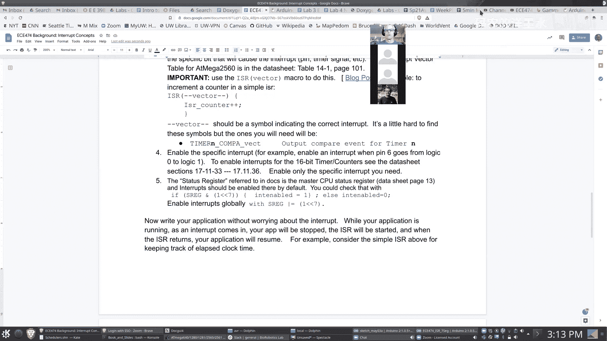
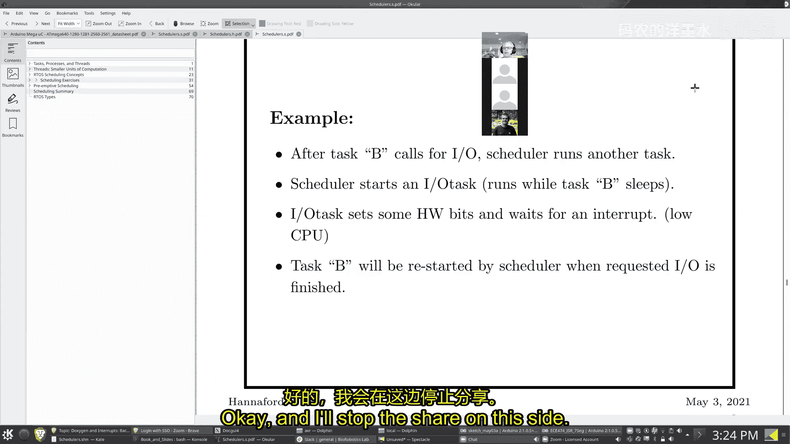
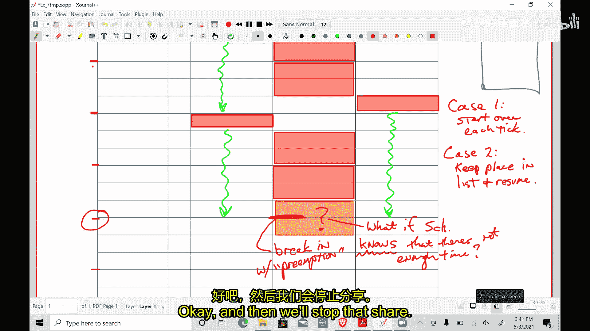

# 【全集 附完整课件】华盛顿大学 嵌入式系统导论 CSE474 中英字幕 p12 Lecture 11 - 读取模拟数据及中断入门 -BV1ALqnBWEeu_p12-

All right， welcome everybody。 This is my last。My last class from beautiful San Diego and i'm heading back tomorrow morning it's been fun and i'm glad that I brought my Arduino set up with me I'm hard at work on。

Lab 3， which is。Counting away on the seven segment display。 if that that's a good alert for people。

 You will need a seven segment display。 I'll just pull it out。Something like this。4 lab 3。

 So it's in most of your kits。 But if you don't have it， start working on that now。

The 1 I have is F 5，4，6，1， A H。Which you may see there too blurry。Sorry， that's not visible but。

I'll type it into chat。But you don't have to have that one that's just like with the eight by eight。

 there's a lot of kinds。Okay， we'll turn that off。 And so today。

 we'll probably not use the full two hours， but we're going to cover。

Just keep covering these concepts for advanced scheduling and for interrupts and in particular that's because you guys had to work hard to get your schedulers timed properly and you really didn't have a。

An accurate time base， frankly， I mean， if we could set up the timers to generate accurate tones for the music。

 that was great。But to make sure your task， for example， runs。

Every every one millisecond or every five milliseconds it's a little tougher and the best technique we have right now was setting up like a loop and tuning the delay I demonstrated for you guys going into the microseconds and compensating for the time all that stuff。

 we're going to get that nailed down by using interrupts and interrupt service routines。

So we're going to go over a few slides about that also there's a new thing we're going to have for the documentation and lab write ups。

For lab 3 and 4。 And that's a tool that we're going to ask you to use。 And the tool is called deox。

Some of you might have heard of it it's a very widely used software engineering tool it's a nice little resume bullet for your skills and it's not that every work environment uses deoxgen。

 but it's a well-known professional grade documentation tool and what it does and you know some of you are saying oh no he's adding another requirement but the hope is and actually this was in response to a respectful and thoughtful student comment that came in and by the way I have to say I just want to say。

That I think the tone of student communication in this class has been great and sometimes there's problems and people are。

 but this is a this you guys have been a good class for that。😊，You're asking questions。 That's fine。

 if there's。Something unclear in our lab right up。 that's on us to fix it。

 And so those are just welcome。 And I， I applaud you guys for。

The general tone of student communication in the class so far， so that's good。And at any rate。

 among those good comments was one that said， well， gosh， you know。

 it seems like busy work because we have to write detailed comments。

 but then also write descriptive text about our code。And yeah， I will say that that's realistic。

 that that's how you're going to work as a professional embedded programmer and so in some sense suck it up on the other hand。

 that's the beauty of deoxygen is it。Elims that。 So we're going to add that tool。

 And what in the nutshell deox reads your code。It figures out what all your functions are by。

Understanding C code。It figures out what the parameters are for your functions and so forth。

And it reads most importantly， it reads your comments。

And it gives you a set of tags that you can add to your comments。

That organize the text in your comments。 And then it generates a whole。

Folder full of nice Hml that documents your code， and it's automatic， automatic magical。

 So I'll introduce that a little bit， and we will support you in making sure that it gets installed。

 that you guys can install it on your computers。 And then basically。

 you're just going to run it on your code。And it will generate this HTML folder。

 which you include in your zip file and you turn in。So let's look at that。

And yeah， let's start off with that。So I've shared a document on the screen。

And this is a document with the simple name， the oxygen， which is in。Our folder。 And I am。

 it's going to be a link to this document in。Our lab right up。

 I think I'll post this also on Canva so if youre if you have time you can get a head start on installing it。

 but there's very standardized installs for Windows Mac and Linux and so we don't anticipate that it will you'll have any problem。

So basically the product， the output of deox looks like this。

 this is code that we did a few years ago for our surgical robot called Raven 2 and this is all automatically generated and basically there's it you can use it for C+ plus which adds a layer about classes but it certainly works for C as well and so for example here is this is just a screen grab I took from。

Our documentation， but in this menu on the left， there's the classes and the class list and I've just clicked on a class called orientation。

Which is actually a struct， not a class and structs get thrown into the class list by deoxygen。

And this is the documentation for that struct。And this is a little bit skimpy。

 there is not that much in terms of comments here。Most of this is actually automatically generated by the oxygen。

And。A cool thing also is that it gives you this little these links。

 So if the documentation isn't good enough or clear。

 you can just click here and go right to the source code for the thing you're documenting。

 which will be definitive。嗯。And these are some members of thestruct， the thing called grasp。

 which is an int orientation grasp。And so forth， so this is obviously a specific example for different software。

 but it's just automatically generated for your software with your names and the things you use。Um。

 okay。And you can also create things like modules， which means。

Let's say you have a whole bunch of functions to work with the timer。You could just。

Put a tag in there that say these belong to the timer module。

 and then you can in in your deox documentation， you can find a page that lists all the functions that have to do with the timers。

 So that's a really neat feature。So how do you do that again， you just type in your comments。

 but you put in tags like here at brief。Is something you'd put in there。

 which it's just a one line field and you enter a short summary of your function。

 not the full documentation， but just say this is a function to set the frequency of a timer in CTC mode。

 something like that。And then you can have a longer description。

And if you want to talk about the parameters inside the longer description。

 you go@ P in the name of the parameter， and then it will generate hyperlinks so that the user can click to the parameter description。

 which is cool。And you can have formatting like in your comment so you can kind of convert the comment back to code if you want to that's pretty fancycied don't necessarily need to do that。

 you could do bolding。And then the as you probably know， documenting a function。

 the most one of the most important things is to give the。Data type。

 the valid ranges and the purpose of every parameter。 So that's what you do here。

 You say at parameter。 and then let's say your first parameter is the stupid name of Para1。

 So you put that there。 And then you describe it in detail here。

And then parameter two and the second your description and the second parameter。

 you can use the return tag and you describe what the function return so again。

You're doing good commenting。But then deox takes it from there and you get this beautiful HTML documentation。

You can also do things like C which means here's a related link for more information that can be a URL to something online or it could be a different function。

 so like if this function is very similar to another one。You might want to say or this one， you know。

 function function 37 has to be called after you set everything up with function 36。

 so you might want to actually reference function 36 in your description of function 37。Warning。

 you know， if there's something you need to warning if you call this function with a negative argument the aircraft will explode。

 something like that。Hopefully it's got a check for that。😊。

And then you've also got a comment for the file itself。And you， you know， you。

You put in the file name I this means。That you often use this for files of dot C or dot H extension。

 it doesn't mean C slash H。You put your name in as the author， maybe a date， some brief summary。

 and then you can put as much detail as you want。 And then here's a bunch of links with tutorials。

 Here's some sample theox code and C。You know， it shows how it works。

 how you might do it for us this is actually a little too generic to be a concrete example。

 but at any rate I think this tool I've seen other courses require it and I think it's very practical and useful for。

Software engineering， we've found it。Very easy to use in our big robot control software that is this project in fact it was you know we were doing basically we just started doing a code walk through what the short version of it is or slightly long version is that a student who wrote a lot of this code was graduating。

And that's always scary for the remaining students and professor because are we going to understand that code and going to be able to maintain it and expand it？

So we started having weekly meetings reviewing the code and going over it line by line。

Pretty quickly we started saying， oh， let's just add some comments to clarify once we figured out something complicated or we had to go ask that original student what this means and then lets let's fix it by putting in better comments and there were comments but they can always be better。

And pretty soon after that， it's like， hey， let's use this deox package and it became a very easy thing to take a large body of code and document it。

So that's the oxygen， some of these links show you how to install it and so that is a thing you could get started on if you have any time to spare for lab3 preparation。

And and reminder， the other thing to get started is make sure you've got a seven segment LED display for four digits。

LED display。And then your speaker with a resistor is the only other thing I'm pretty sure that's special and we will we're doing the final polish on the lab3 write up and we'll release it to you shortly。

 I'm sure that most of you want to not look at for 74 lab write ups for a while。Okay。

Any questions or comments on？The oxygen。I actually put this on the chat。

 but where can we find this document I I you may have joined late， but I it's right now it's。

Not online， but I'm about to， it's， first of all， it's definitely linked in the lab3 document。

 which you will get， but I'm going to post this on canvas right after we're done。 Okay， thank you。

Anything else。Okay。So we're going to move on to another document which is。LinkedIn to lab 3， and。

You know， I've already lectured about interrupt。ll， I'll tell you。A story。

 I'm going to I sometimes I like in a class to repeat material。

 and I'm not doing that because I forgot we covered the material。 I'm doing that， because。

I think the human brain。Learns。Learns pretty well if you have the luxury of the time to repeat material it's good thing for the brain and so and also I'm not ever going to present it the same the same way twice and so that also facilitates learning I hope when I was a freshman in college I talked my way into electrical engineering class an intro level like 200 level because I I'm just weird or whatever。

 but I wanted to and so I took this class and。I'm sitting there and it's like， wow。

 this guy is going fast。 And this is intimidating。 But I just， you know， okay， I'm a freshman。

 and I knew college was going to be hard。 I kept。Trying hard， you know。

 I'm going to see if I can keep up。And he was just going boom， and this guy was old， you know。

 he would come early before class and cover the wordss with right equations before class started。

 So your note taking， you were behind before he even began。

So it was it was a little intimidating and scary and he kept going just at this killer pace for a few weeks。

 but then about a third of the way through the semester。

He just started over and covered the same material again。Really fast， but by the end of the semester。

 we had covered that material three times。And I actually understood it。

And he never said this is what I'm going to do， it's just how it came out anyway， so I appreciate。

 I think repetition is worth it。So anyway， here's the detailed background that I think you ought to have for。

And for working on ISRs， which are notoriously tricky。

 one of the tougher things in this class and also。The kind of differentiator skill that gets you past the job interview。

 It's like you've done this。 That's where it separates the pros from the beginners in embedded programming。

So let's just review these basic definitions so an interrupt first of all the we all know what the word interrupt means and it's a pretty descriptive term。

 some code is running an event happens you've got to stop that code。

 save its context and run something else and then get back to that code。Um。

 and we all can think of everyday examples of humans being interrupted and resuming。

So an interrupt service routine ISR， that's your code that does the special thing that has to happen when the interrupt occurs。

And I， you know， you can read this later， but I'm just going to go over these。

Another concept is enabling and disabling interrupt。

 so if an interrupt is not set up properly like the ISR is not set up。

Then the computer can just hang or crash if the interrupt occurs without proper code being attached to it。

And so interrupts can be disabled by a bit that you set just like these timer bits we've been manipulating。

嗯。😊，You can turn off interrupt。And you can turn them on and there's all kinds of fine grain control about turning on specific interrupts。

 turning off turning on and off all interrupts globally。And things like that。Internal interrupts。

 so what we're going to do is we're going to get our timing to be right on accurate。

By using interrupts generated by those timers that you are now expert at。

And that's internal to the chip， so it's an internal interrupt an external interrupt comes from a pin which is exposed to a signal or connected to a signal。

 and there's a logic level transition on that signal like a transition from low to high。

And that will cause an interrupt。And that could be that there's an external device that wants attention from the CPU right now。

And then there's priorities， so the CPU has multiple hardware channels for interrupts and of course every chip has a different number of them and so forth。

But then they can be clustered into priority。 So， for example。

 if you have a high priority interrupt and its ISR is currently running。

 then a lower priority interrupt will not。Start its ISR until the higher one is finished。

On the in the reverse situation， if a low priority ISR is running and a high priority interrupt comes in。

 then the high priority one immediately starts and the low priority interrupt service routine is suspended until the high priority IR is done so that way the you can。

You can prioritize an interrupt that really， really， really requires very fast。

Response from the chip。And。Another one which is just needs pretty fast response can be lower priority。

Okay。We are not going to worry about priority levels because we're just going to use one or two interrupts and they're going to be so short。

That。Their ISRrs are going to be so small that it really doesn't matter。

Which one interrupts the other。And we may in many cases， just use one， interrupt anyway。

Interrupt vectors。So。There are many possible interrupt on a powerful chip in our 8 mega 2560。

 there's I forget how many， but we're going to cover that in a second。

And there's all the internal ones that come from all the timers， not just all the timers。

 but all those output compare registers from the timers。

 so like the 16 bit timers have three output compares， A B and C， and you used one of them。

And each one of those could have its own separate interrupt。

And then there's a bunch of external interrupts that come from external pins。 and so there's。

 I think maybe up to 100 or so on this chip。And。So， and each one means a different thing。

And you might want to do a different thing for each one。

 So you have to potentially have a different ISR for each interrupt。

 And so there's the vector means an address in memory。

Where the computer jumps to and starts executing。When that interrupt occurs。So if Inter 27 occurs。

 we need to go to a specific ISR。Okay， and then that means there's an interrupt vector table。

 and that's a place in memory where。All the interrupt vectors are listed if they're present and they could be just nulls if you aren't using an interrupt but。

Um。That's a hardware dedicated place in memory because the interrupt is processed at first in hardware and the hardware needs sort of a dumb way to know where to go。

 And so it goes to this particular slot in the table and says。I'm going to do。

 I'm going to jump to the code at the following address。

And if you start reading the documentation in the chip。

 there's a little bit of complexity there because。There's a boot loader mode。

 and it has its own ISR table。 So like when it's running the code that receives data from the receives your code from the art from your laptop。

And you see the little flashing lights。That's got that it can swap in a different。

Interrupt service routine set without disturbing your， which is elegant and cool。

 but it makes the documentation a little bit complex。And so then let's put these concepts to work。

 Well， first of all， any questions about these concepts so far。Okay。

 and I definitely want you to read this in detail later。

 but I certainly don't want to read this to you。And you don't want me to do that either。Okay， so。

Let's look at hardware and software steps for， actually。Do handling and interrupt。

So the hardware steps。And if it's an external interrupt。

 you've got to physically wire your signal to a pin and。

There's a specific list of pins that that will work。 so。

 but we're not going to do that at this stage anyway for this lab。

 So I'm not going to go into more detail about that。Um。Software for an internal interrupt。

 you don't need to do any hardware because it's all wired up in the silicon。Okay， but software steps。

 so we're going to do these in order， you got to do these in a specific order。During setup。So first。

 like if we are using a timer， you got to configure the timer， which you guys now know how to do。

And so。We got to set its control registers， so it generates the interrupts when we want it to， like。

 for example， 1000 times per second or 500 times per second or something。Okay， then we write an ISR。

And now， I'm going to explain。嗯。we get when you read this。

 I'm going to be explaining it at the lowest level。We're actually going and as you know。

 I've tried to discourage the use of Arduino's prewritten functions。

Because I want you to know more than what a high school kid knows。 I mean。

 that's slight exaggeration， but。At the same time， the Arduino IDE or libraries simplify a bunch of stuff and intentionally hide that detail。

 which we're trying to teach you in the embedded specialization in ECE so。And so I'm。

 I'm telling you the detail。In ISR setup， however， for reasons， I'll explain later。

 we're going to use one of the macros that comes from the chip vendor。

To do our ISRrs and that will make your life easier， and there are reasons we have to do that。

So anyway， in theory， though， you write your ISR as a function。And you make a function pointer。

For that function。And remember， the name of your function is automatically a function pointer because that's C。

And then you copy the function pointer value into a slot in the interrupt vector table that corresponds to your interrupt。

And。诶。Now， I'm going to show you that interrupt vector table with reference to the data sheet。

 So if we go。I think this is still in here。 Yes， okay， so the famous page，101。

So this is the data sheet for our chip。And maybe I can make it a little bigger。

And this is the memory address。嗯。In hes。And these are the various interrupts。

That correspond to these slots in the interrupt vector table， and you can see there's 16 bits。

 there're two bytes because these go up by units of two。

And you know there's some way that you map individual pins to these external interrupts。

Which I don't remember right now， but we don't need that。But this starts to look familiar。

 So we have timers。 like here's timer one， compare a。And that means that when that compare。

 when the timer one is counting up and it matches。And the interrupt in the timer is enabled。

Then it will execute whatever code is pointed to in slot 22 here。

And so we if we want an ISR to respond to that event， we have to plug it in there。

And this is timer for compare a， which you might be pretty sick of by now。

So our internal interrupts are pretty well represented there。Okay， so back to the document。Right。Um。

Now， this is where instead of just like copying a pointer in there。

 which is what I wanted to get working， there's an issue and the issue is that。

There are things that happen in your IS at interrupt time。

That are managed in a consistent way by Arduinos。Functions。Among all the ISRrs。

And so this macro called ISR。Actually lets you generate it it's it automatically puts the function pointer in and it。

Puts some prefix and post fix code before and after your ISR that makes sure that it saves the state properly to not mess up other Arduino functions。

 So we're going to do that。This is a blog post which gives a nice example。Of a timer interrupt ISR。

 You could probably read this and implement it。Approximately to get the function done for La 3。

But this is for a different chip， so it's not quite exactly the same， but it's very， very close。

And it documents the ISR function a little bit， the ISR macro。And what I mean by a macro， whoops。

Here we go。 So this is actually not a function。ItIt's what's called a pre processorces macro and what that means is。

It's a little sort of it's like an Excel macro or word macro that。Generates the function for you。

And as I said， it prepends your own code。Or somebody's code。 So anyway。

 it has only two things you need to work with。There's this vector， and I'll explain that in a minute。

And that is the name of the interrupt that you're going to。Write your ISR for。

 And it's a name that is similar to these names。But it's not。 that has a space in it， and。

So it's a little tricky to find those and we're going to give you those names。

So don't worry about that。And then this is your code。

 so that's where you write your code for your ISR and it mouses that into this template ISR。

And this is an extremely simple。ISSR， which just counts every time an I interrupt comes in。

 it increments that counter and let's say that counters global so that your regular code can see that counter。

 that can be a measure of time， for example， and this is an ISR which is only one line。

And I'll tell you， this is not， it's very good practice to keep your ISRs very。

 very simple like this and try to figure out overall application logic。

So that you can keep your ISRs dead simple because A， they're hard to debug and B。

 they can block interrupts again， automatically because of this ISR macro so they can block other interrupts and screw up other things like maybe your serial communication or something so。

Keep them very lightweight。And the one you're going to need the most is this one in terms of this vector symbol。

Timer4， timer three， timer2 compare a， and again this could be any letter。

 as you know it could be A B and C， not all timers have three output compares。

 some of them have two or even one I think for the eight bit ones。

So make sure that that compare register。Event exists。

 but you can use this for any timer and any compare。Um。I should have made that generic。Okay。

 and then so now we've set up the ISR。 we've put our ISR code in there。

And the next step is enabling the interrupt。 So this is making sure that。

There's two levels of enablement， the system level。

 do we pay attention to any interrupt at all for any reason， yes or no。

 and then the peripheral itself can it be enabled to cause interrupts or request interrupts。

And so we have to do that so the timer counter， I'll let you do that research。

 but you want to interrupt when the output compare register matches。

And so here's your reference on the data sheet to find those。And the other thing is that。

So there's those two levels of enabling。And one of them is also the system level。

 and I'm still a little unclear if by default that system level interrupt。Is turned on or off。

 but I think you need to turn it on in my latest mockup。Our latest code that you saw。嗯。

In setup actually turns the interrupts on， I believe。Yes， okay。

 So what I'm going to do is show you that right here。This Sreg is called the status register。

 it's like a master byte that controls everything in the chip at a very。

 very high level and one of them is interrupt and A and that's bit7。

So this is a test of whether it's enabled or not， you could do this logical and。But。

You should also set that bit to turn them on when you're ready to use interrupts。Okay。

 so that's that's the， you know， I should probably make that not a footnote。Because。It is important。

Okay， no more footnote。Okay。😊，So of course， you will be able to reference this document and this step by step。

When you're working， but are there questions at this point？Okay， good。So， I am at this point。

We're going to take a seven minute break until。20 after。

The hour and then we'll do just a little bit more on scheduling。

 I have looked more at the examples in the scheduling slides and there's some that are a little buggy and I corrected them and I want to。

Take you through one or two more and。You should be practicing those with your own pencil and paper。

To just work on getting those concepts down。 and I'll have more to say about that。

 So I'm going to pause video recording， and I will see you at 20 after hour。Oh professor。

 we can't hear you。Yeah。I'm now audible。Good， sorry about that。Okay， well， we caught it in time。

 so yeah， so I've posted those two documents， the deox。

Document and the interrupts document onto canvas and they you have to be logged into uW to get those。

 but。They should， that should be fine。Okay， so I want to go into。The back to schedulers a bit。

On my desktop。And。We're going to look at some。Where we're at here。

And so we've been doing these exercises， and I want to give a little more context。For these。Actually。

 I'll switch to an example， maybe one that we did before。Over here。Okay。

 and I'll stop the share on this side。

And how am why am I not sharing， I'm not sharing on this side yet， okay。That will be fixed shortly。

Okay， great。 So we did some exercises like this and。

I you know this is kind of an idiosyncratic it's my own approach to analyzing scheduling and it's a little informal you may have felt that when we're doing these and I。

I want to clarify a little bit more what we what's our objective of doing these colorful or not diagrams。

 And the objective is just to improve。Are the， the， our ability to think about scheduling， because。

 you know， it's going on such， at's such a fast rate， even in the code that we write。

 not to mention code that is running on your laptop or something。 This is going on at the。You know。

 sub millisecond level。 and okay， maybe it's not， maybe your your computers not being very responsive。

 and that's annoying。 but that doesn't help us understand what's going on inside a scheduler。

 and that's what this does。 Now， suppose I gave you one of these to do on a final exam。

 This is where it gets a little tricky。 What is the exact right answer for some of these。

And the answer is， you can't。You can't worry about getting this diagram exactly right。

And the reason is the only way that you could get this diagram exactly right is if you had a copy of the source code of a real scheduler。

And you could say in this exact situation， what is this exact code going to do。

 Then I could grade you in a binary fashion。 Okay， this is correct。 This is incorrect。

What we're trying to do here instead is just expose all the different states that a scheduler can be in。

And then realize what kind of things have to be accounted for in a scheduler so。For example。U。😊。

I guess I'm going to open another one。 I think we we。Did it。Yeah， I did it recently。This was sort of。

Oh。This is not what I meant to open。I meant to open this one。Yeah， okay。

 so now this is this is technically example6 a in the。In the in the deck。And we have three tasks。

 I won't go back to the deck， but。Wait a minute now。 I want this to be somewhere else。 Okay， sorry。

 I've got a rather big zoom window that I'd like to shrink， and I can do that。 Okay， I did it。Yeah。

 so anyway， let's say that we talked about different schedulers。 the simplest is just。

The loop function in the Arduduino and its it's calling things one at a time。

 but that when we get to a little more sophisticated， there's actually a software list。

 we can use function pointers to call anything in this list。

And so let's say that we have the following tasks。And there。Um。

I'm going to annotate this with a different color。 So we've got the period P。Of the task。

 that means we want it to run this particular one task A。 we want it to run every2 milliseconds。

And then actually， so I'm also going to do some erasing here because。This is a weird way to erase。

You see， it won't erase the fill until I erase everything。 and then the fill's gone。 All right。

 whatever。So all right， this is a little bit better。Let's actually。

 I'll go ahead and get rid of this too。Okay， so we have a pointer over here。

 which points to the list。 and it starts us on task A。 and task A runs。

 and it's got some mechanism to。Get its period to be two operating system ticks。

 So let's just say that it's going to delay for one and for two ticks。

And going it's going to ask the scheduler to skip it on the next tick to get that period and actually I'm going to maybe change this one to a period of one。

So it's a heavy load for the computation。So that's two two of these squares every millisecond。

 And then this last one is one square with a period of two just like task a。 So okay。

 we ran that and now I'm going to get my。And I practiced before。 So I wouldn't get stuck with these。

 So now we have the second task， which is this big。And。Now， our next， it's。

That means the after the first task runs， and I have another trick up my sleeve here。

We can move this， so the pointer goes to task B。And task B。Is the second one， which now runs。

But now there's another operating system tick。And so we can't， we don't have time to run task C。

And the question is， are we going to start task A again， Well， no， because it's put itself to sleep。

So that is a simple situation。I guess those are still selected， so task8 doesn't run again。

And now the question is， does our algorithm go next to task C or does it start at the top again every。

Operating system tick。 So this is a thing to think about， right， It's like。

I can't I haven't specified that in this example， but now we realize that the behavior is going to be different。

 well in this case it's not because either way we go to taskque tasksques asleep。Well， actually。

 it is going to be different。 So， okay， let's do two cases。 I'm going to spell it out。Start over。

Each tick。So that's what we're doing。I'll get my oops， that's yeah， I'll get my boxes back。

 So at this point we start over here。And then task gaze asleep。And task B is going to run again。

For this long。But now we can get to， we can move the pointer down。To task C。And task C can run。

For little， you know， less than one of these slots because。So。Each of these ticks is 1 millisecond。

 each of those marks。Is 1 millisecond。 So each block there is 333。

 So I made it a little less than a block。 So that that actually runs。

 Now we start over again and the pointer。Goes back。That's going to be wrong。

 That's going to break the pointer up。 Oh， my poor pointer。Okay。All right， task A is now running。

So we start that one。It goes to sleep again。And we run task C， task B。Because task B is period one。

But， it's a big fatty。And now we're in that situation again， where we're going to and it's repeating。

 So this is stable and。Sorry， this is stable and every task is meeting its deadline。And getting run。

 including task two， oh yeah， this one should now request to a delay of two as well。

 because it's got period two。So。That means now， the next time we start， we're going to run task。

See again。And now we have another choice to make， so both of these two。

 both tasks A and C are asleep。And so task B could be run again。Or we could say， well。

 there's not enough time。In the remaining tick for task B to run。

 So this is where the scheduler has to make another tricky little decision。And again。

 this is non preemptive。 So we're not going to be able to but in when the operating system tick occurs and that implies that we know how much time the task is going to take Again。

 this is very low level sort of hardcore real time programming。

And so it may or may not be so we have to know that。Compute demand。

 the amount that it will take very accurately。So let's say we make the decision that it's not going to run and we'll wait until this tick。

 But now all the tasks are awake。 and when all the tasks are awake。It's repeating from the beginning。

It's the same thing we did up here。So it exposes these things that you wouldn't think of。

Like what happens if we know that running the task is going to look like this。

I'm even going to give that a different color to sort of highlight that that's sketchy。Okay。

 so that's what happened。 Now， case 2。Is。We don't start over， after each link。

And it may be that they're the same in this case。With this particular set。I'm not going to do it。

 but I'll write it out。And you guys could complete that exercise for yourselves。

 and it's probably worth it。So I'm not going to do that and。

See if it can be see if it works out differently or the same it has to but if all we have to do is change these task parameters a little bit。

And we could easily make a case where those would turn out different。Okay。😊。

So any questions about this so far？You guys would be okay doing some of these on a test。professorsor。

 I have a quick question，So if you could scroll down。

 you know that task B that was like orange that you said was like sketchy。 Yeah。

 is that I correct me if I like misheard， but is that like actually what's going to happen or is that just like。

 okay， you're right， I sketchkey is a terrible word to use in an engineering lecture， isn't it。

 It's just not clear enough。 Okay， so thank you for， thank you for asking that。Okay。

 so I'm going to put a question mark here。U。What。😮，If the scheduler。Nose。That。

There's not enough time。So in that case， it probably should just not run this task。

 See if this task is running in the orange box。We're going to miss this operating system tick。

And that's a big one， because that's when these two tasks wake up。

And so that's kind of important for those other tasks to make their deadlines。

And so it's really kind of bad to run this task here。So alternatively， we could stop it， not run it。

 and it's after all， it's getting a lot of CPU time anyway。Alternatively。

 we could just not run it until the next and wake it up when the operating system tick happens。U。😊。

This is also trying to motivate why preemptive scheduling is good because again。

 we just don't worry about it then with preemption， we can just break in。

And that's using an interrupt， but then the scheduler or operating system has to play this very tricky game。

Where interrupt a task。But saves its state somewhere。

In such a way that it can completely switch to other tasks。And then resume。

Is that helpful to your question Yeah yeah， that was really that was a good explanation Thank you professors great。

Any others， that was a good question。Okay， I'll just。

I think I'm going to go back to slides a little bit。

 let me save this so I can make sure to put it on canvas。Okay。

And then we'll stop that share。And I just， I guess I just want to。

Get a little bit more and introduce another kind of scheduling。So。Um。Right。

Scheduling with I O requests。 And this is very common in a real。You know。

 a big style operating system like Windows Linux and iOS or Mac OS。

And this is what happens when you access peripheral devices and the biggest ones today would be the solid state drive。

 the hard drive and the。U。And the network。Okay， so， you know。

 think of how much time you spend on your browser。And think of how much time your browser spends interacting with the network and。

Ftching and sending stuff to the network， so。If you to you want to get a block of data off of a disk drive。

 you have to ask the drive for it， but the drive is a physical spinning mechanism and literally you have to wait for the disk to spin around until the bits go by the head that reads it。

And it's spinning fast， but look at the time scales we're on already and so sometimes you have to not only wait for the disk to rotate。

 but wait for the head to move to another track。And so that is actually an eternity and you know。

 it could be tens of milliseconds。And so requesting IO takes time。

And you want the scheduler to run other tasks during the IO。

So what I mean by this first bullet is that when you guys do a digital write or a port or equals a bit。

 that's really fast， that's nanoseconds， but a complex IO device like a drive is a whole different game and certainly we all know that network access can take a long time。

So in that case， what we want is our tasks to make。

Call to an input output routine and build that into the scheduler so the scheduler knows， oh。

 task A is waiting。 It's just sitting there waiting for a disk drive。 So I'm it's just like sleep。

So the scheduler starts， but what's behind what's under the cover is that。Of course。

 we need another task to do the I O and run the disk drive。

So the scheduler will suspend the task that wants to do diskIO and start a disk drive task。

But even the disk drive task， maybe that sets a few hardware bits saying go find this data。And then。

 it's waiting。So it can sleep or wait for an interrupt。That the drive generates after it's done。

So these IO tasks still have used a low amount of CPU。And then when the IO is done。

 task B gets started again。So tasks like that will look， for example。

 in in in ultra simplified pseudocode， it might look like this。

 so we're going to define we're going to。Talk about a device called hard drive zero and we're going to do some computing。

 Maybe we're doing some you know。My baby we're training a neural network with data off of a disk drive。

So there's lots of computing going on， but then we have to load a lot of data from the disk drive so we request from the operating system。

诶。Data from the device。 and this is again， super simplified。

 like I don't tell it what data I want or how much data I want， but those would be other parameters。

And return， and this is a task that's going to run in our scheduler。

 but during this time it's asleep。And so other tasks can run。Um。Okay。

 so I just wanted to introduce that and we may do some of this a little bit next week。

I be I will hang on for a while if you guys have questions or comments and otherwise that's the end of class so I'll see you guys on Wednesday and best of luck on all your midterms and everything。

Thanks， Professor。You are welcome any any Q&A is welcome now if you want I could even wait until after I can do your Q&A after I turn off the recording if you prefer。

It， it's all good。Thank you， Blake， have we go。Thanks。Hi professorfes。

 I do have a questions great I'm not sure if I missed this。

 but I was wondering I think earlier in the quarter you mentioned that we will be having exam or midterm。

When will we get more information on those yeah？The reason you can't get any information right now is that I just it's just not I don't know yet and I will get that I'll get that going as quick as possible do you have constraints of any kind that I should know about you can send them to me privately or whatever。

No， I just want to start preparing for it if oh， that's so good planning ahead I you know。

 that's the best way you could kick me in the butt to get it done It's like， oh。

 the students are trying to plan that is much better than complaining so I appreciate that。

And I will work on it。All right， thank you so much， have a good one， great。😊。

All right， I will sign off。 Thanks very much。 I'll see you guys again。

