# 【全集 附完整课件】华盛顿大学 嵌入式系统导论 CSE474 中英字幕 p13 Lecture 12 - I2C 与 SPI 通信 -BV1ALqnBWEeu_p13-

Okay， so what we're going to do today is two things。

 We're going to dive further into scheduling in particular。

Well we're going to do some coding and well we're going to review some of the big schedulers or let's say main scheduling concepts that we're going to do in lab three。

 we're going to kind of mock up some of those schedulers with some coding。

And then we're also going to review the lab three assignment。

 and that's kind of our agenda for today。So I guess before we launch into that though， any questions。

 comments， things that I could address that might be of interest to the whole class。

Or a subset of them you know， remember if you have a question there's probably five to 10 other people who have the same question that's generally my philosophy so my bar is my threshold is kind of low for what questions are appropriate I'm wide open there。

Okay， well， then we'll head into things。 So I'm going to start by a screen share of slides you've seen already。

But as I said last time， I'm kind of into repetition。And as a teaching method。

 obviously up to a point。Nobody wants to hear the same thing over and over。

Okay， and so however。There's always a。A benefit to some repetition so certainly by now you get this concept we'll try to certainly we asked for this in lab two we'll try to simulate a scheduler or our ultra basic scheduler it's just a loop and okay maybe it's not a while loop maybe we rely on some other while loop to call the loop function over and over。

 but this loop， the stuff in the curly brackets is repeatedly executed。

We may have some means of delaying to try to ensure that one loop is completed every。Say。

1 millisecond。So now we want to implement some。Halting and delay features。 Actually。

 I'm going to kind of go with delay first because most of our assignments， well， I'll take that back。

 We're gonna， we're gonna ask you to halt tasks later， but for now。Delay is something。

We know we need， for example， the simplest task that we have is flash an LED on for 20 milliseconds and off for 80 milliseconds。

 for example， so you got to time it。And then we're also going to re review function pointers。

 So this is kind of a。Perhaps a little bit too generic description of a function pointer declaration type meaning。

Int float， char or whatever。 And then the name of the function pointer with a star in parentheses。

Followed by the argument prototype。 So here's a more concrete example of an actual function prototype。

Declaration， this is a function sorry， function pointer。Deeclaration， this is a function pointer。

That's going to point to a function， which returns an integer。So for now。

 we're going to insist that all the functions we point to with this function pointer have the same function prototype。

 they return the same thing and they have the same argument calling block。And so this is called FP。

 that's the name of our function pointer。And it's a type of function that takes three specific arguments。

 a called doesn't have to be called X， but it has to be a chaR。

An int and a double double beans double precision floating point if you didn't know that。

And so this is an example of declaring a function pointer。Called F P。嗯。😊。

We are going to we have been using just like up here in our simple case， really simple。

Task functions， which are void， they don't return anything。

 or at least we don't pay attention to what they return。And then they have no arguments， okay。

 so that cleans this up a little bit。It makes our and we're going to stick with that。

 So the function pointers declarations are kind of simpler。We get rid of all this stuff in here。

 and we have void。As the return。But then。We can write a function to start any function indicated by a function pointer。

 So this would be our start function。And it takes an argument。

 which is a function pointer in our case for tasks。

 it's going to return it's going to have a void return， meaning it's not going to return anything。

And it's going to have no arguments。 So then you can just type function pointer， empty friends。

 and it'll run。This is kind of stupid because we could already do that。

But this is a but if we have the function pointers in a list。

 we can go through the list you know we don't want to do this， this is kind of pointless。

 but writing a loop and going through a list could be more interesting so now we have number of functions 10。

5，100 whatever。And then we're going to set up an array of function pointers。

Which I'm calling in a list， maybe array would be a better name， doesn't really matter。

And then I'm putting in void pointer argument。Which is。Probably not。

 actually I probably shouldn't have for this example， we don't need it。

So more concrete running tasks，10 of them。And we're going to keep our system small。

 The maximum number of running tests we could have is 10。We can and there's actually。

 you're going to see there's really a lot of ways to implement this kind of thing。

Which are almost equivalent， but have these subtle differences。 And we kind of talked about that。

When we're diagramming the scheduler flow。Because。Worrying about an exactly correct diagram is impossible。

Unless we have very specific scheduler code， then we could figure out exactly what。

That code is going to do in that situation， and there's a right answer。

So we're going to see there's lots of possible slight variations among schedulers。Okay， so， yeah。

 so we could either。Put a null at the end， like with a string。

 and that gives us only nine working slots， but we won't run over。

This time we allow some kind of generic pointer argument， but don't worry about that。And。

Now we're going make a We could。Yeah， so okay。So let's， before we get too far along。

Let's start looking at some code。And what I've done here is in order to。

Not worry about during a lecture， not worry about downloading， you know。

 flashing the Arduino and then how do you know what's really happening anyway because you're watching it on a screen。

嗯。😊，I I coded up this really quick and dirty little Arduino simulator， which is extremely basic。

 It only took me about half an hour to an hour。That's how basic it is。

 But I'm going to walk you through it。 and you can see what I did。

 I don't want you to think that you， I don't want you to beg me for a copy of all this code， because。

What you should be focusing on is implementing it for real on a real Arduino in the lab。

And so I think this is a distraction and there's subtle differences that actually you could get confused about if you dig too deep into this code。

 but it is in C and it's going to get some concepts across。So first of all。

 we have some globals and you know you've been taught not to use globals as use globals as little as barely possible。

 and that is correct， that is how that is absolutely important software engineering practice。

 but I'm breaking that rule because if you think about what you guys have been doing with the Arduino。

 you have all those timers， you have all those registers， you have memory。

 but especially those hardware timers and registers。Um。😊，If you think about it， those are global。

Because they're visible to absolutely any line of code that you write。

 you could set some output compare register。In one module， one function。

 and then some other function written by a different member of your team could also mess with that register and it's almost like that the chip is designed to intentionally violate this rule about globals okay fine they're not variables and in a bigger operating system the hardware can actually protect those bits。

So that only proven operating system code like a device driver is allowed to manipulate them and random random people's code cannot。

 But in a microcontroller， they are global。 And so we're going to use global variables to simulate that。

Because that's actually the flaws， which is fragility of your code， are actually also present。

In this bare metal microcomputer environment that we're in。 So it's。

 I feel like it's not a bad thing。So we declare them in a C file and I had to review a little bit。

 frankly， on how to lay out files in a。Correct C project because I forgot exactly what goes into an H and what goes into a C file and so forth and you don't need to worry about this either because。

These globals represent the chip。 you've already got the chip。 You don't need to lay this stuff out。

But for example， we have we're simulating the LED on the board that flashes on and off we don't have an LED on my laptop。

 but we're going to print it out and you're going to see when the LED is on and when the LED is off we're going to have a global to represent time this is kind of like what we're going to do in La three is we're going to have an interrupt service routine。

And what you may choose to do， there's other ways to do it。 You may choose to。

Have a millisecond counter。Called time。And increment that counter by one every interrupt。So， now。

 tasks can。Read that variable。 And it's fundamentally global between your tasks and your your ISR。

 even though those are different programs or， let's say， pieces of code。

So it's kind of a global and so we're going to have a global time， which is in reality。

Is generated by， for example， an ISR。Or timer， like you guys kind of did a timer synchronization。

Actually， you haven't done that yet， I take it back。So you could be at the end of your loop。

 for example， reading a bit until the counter overflows。

And then also IO pins so this is all simulated it's all just going to run on a terminal and so there's no real IO so we're going to simulate some pins let's say 10 of them。

And of course， the LED is pin 13， so we're going to have like a separate。

Thing to store the state of the LED。Even if we don't have 13 pins。 Okay。

 and so basically the way globals work in a multi file project is you declare them in one place。

And initialize them like I do here in a C file and yeah。

 I could have put them at the beginning of mainine， for example。This is a very simple C file。

But then the other files have to know about them。That want to use them like what I'm calling Arduinosimulatorutilities。

c。And so we're going to include a file called Globaldo H。

 and that includes the external keyword external。And that means。The symbol Sim time。

For a file like this。Is not declared anywhere in this file。 It's external。 It's in another file。

 So the linker has to go look for it。 The The another file is this global dot C。

And so we're going to any other file that wants access to the Globals has to include these statements。

So IO P states is an array of integers and it's somewhere else， it's external。

And so that's why this is included here。Okay， but this is very scalable because I can put it anywhere I want them like Maine。

 let's see， I have to have the globals also here in Maine so I can look at them or modify them。Okay。

 so that's our file layout， so all my functions which are actually directly simulating the Arduino are going to be in this aSM u。

c。And so what can we do？Well， first of all， we'll start at the bottom。First of all。

 we can find there's something wrong and we can print an error message and quit。Okay， fine。

 But that's necessary because like。If I have， if I。

 if I decide I'm going to simulate 10 Iop pins and I tell it to set pin 27。That's meaningless。

 it's an error， so we should just quit。Okay， so we have that option。 Then we have LED output。

And it takes an integer parameter。 So if the input is。LED on。

 then we're going to set the LED state to one。 And if the input。Is LED off。

We're going to set it to 0。And otherwise， it's an error like if we want to set the LED to 53 that we're going to say that's that's a bug。

We could say anything non zero means light the LED or we could think about brightness or something。

 but that's how can I I can't display brightness on the terminal。Okay。

 and then we have I'll go up here， we have set a pin。

 so if this is just some error checking for the illegal pin numbers。

 if it's greater than the number of simulation pins or less than zero， we don't accept it。Actually。

 we don't need this exit because。A do we same error never returns。 And then if it's 13。

 we'll do something in addition， we'll set the LED。Even if actually， this。Is a little mistake too。

 because we have to move that before we check for errors。Okay。Okay， great。

 And then if we're within the range， we'll just set that pin to one。It's like digital right。

 that's the intention。And we can clear a pin。Which is the same thing。

 and I'll correct that bug again。And then。We just clear that individual bit。All right。

And then state output， we need to see what the state is just like looking physically looking at the LED。

 we need to type it out， so this is just some prints that are going to type out a line every millisecond。

Every tick really and it's going to have the time and then a vertical bar and then the a character it's going if the LED state is on it will be a star and if the LED state is off it will be an underline so it's kind of a little cartoon of an LED。

And then。We'll go through all the simulator pins and print them。

In one little tight field as ones and zeros。And then a new line。 Now， actually。

 we could probably make it so that it prints over and over。 and it looks like a real time display。

 but I'm not going to do that。So those are the utilities to simulate an Arduino and we can also get。

 yeah， we can read the value of a pin。And that。You know there's no external inputs that would be a cool thing to build into the simulator somehow。

 but this just means I previously set it with set pin。Okay， and I corrected some bugs。

 so I'm going to save those， make sure it still compiles， okay， good。And now， let's look at Maine。

Are there any questions so far？

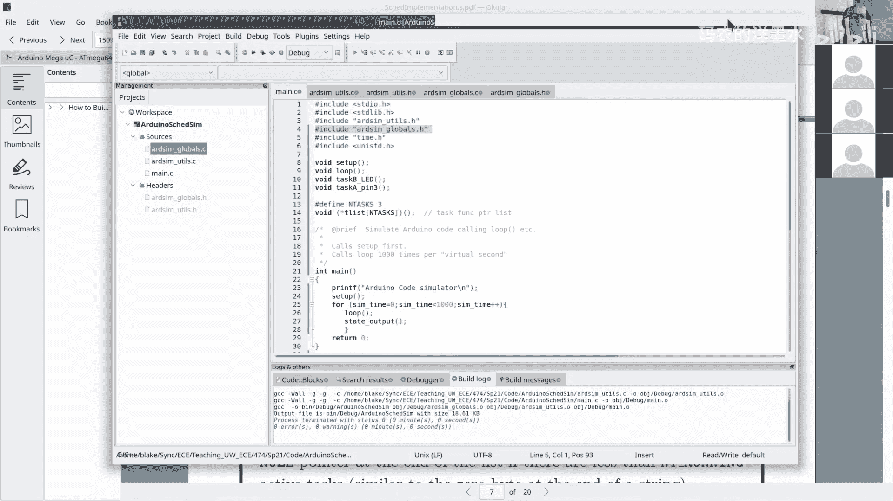

This is the easiest way to look for hands and so forth。Clear enough， so far。Okay。

All right， so now we're looking at Maine。So we have a few function prototypes here within the main file。

 they could be in a dot age but。It won't go too crazy。 We'll look at that later。So。

 here's the main this。5 line code simulates an Arduino， if you will。 So it prints a little message。

 It calls setup， which is。What you guys have in your Arduino template。

And that's called exactly once at the beginning。And then we're going to go in a loop。

And we're just going to， you know， we're just not going to go on forever。

 We're going to do 1000 of these loops。And we're going to increment time。That's a global。

And then we're going to call the loop function。Just like Arduino does， you never see that call。

 but it's you're counting on it you're you're hoping and expecting that loop will be called often frequently and then we'll print the state output that we just went over and we'll see what's happening。

To all the bits in the Arduino。So right now I have no setup。

And I have the little super basic scheduler loop that we've used in the lab。And I have two tasks。

And then this sleep is not。An Arduino delay， exactly。This is。

This is actually a Microsoft Windows delay， this is all running in Microsoft Windows and this is going to delay for one second。

So that the output doesn't just。Come out instantly， which is less fun。

You want to have a little suspense to see if the tests are going to work right。So what are my tasks。

 Well， task a。Pin 3 is a very simple one， so it looks at the time global and mods it with 10。

And then if if that is equal to zero， meaning we're on a power we're at a multiple of 10 counts。

 and we can pretend those are milliseconds。They're probably faster than milliseconds in a Windows laptop。

And then。U。Actually， this is running Linux， so it's Linux time。But it doesn't matter。U。

And then we use the exclusive bit wise exclusive or to just flip the flag。From 0 to 1。

And then if the flag is one， we'll set the pin 3。 and if the flag is 0， we'll clear the pin 3。

 Notice we're kind of doing extra work here。Because all the other times， when these。

 if statements fail。We're still going to be setting and clearing。

 so it's kind of like we could fix that logic， but it's not。

It's going to generate the correct output， but it's going to be doing a lot of extra setting and clearing that it doesn't need to do。

Under the hood。So every 10 samples or every 10 loops。It should flip bit three from one to zero。

And task B is our LED flasher。So this one is every three samples。Toggle the flag， and。

We'll set it to on and off。If the flag is set。So this is also doing extra work。

But it's going to be doing a similar thing， but on a different cycle。

So everybody understand this so far any。Questions， can everybody predict the output。

You're probably having trouble imagining what the output's going to look like because I haven't run it yet。

 but I'll do that。

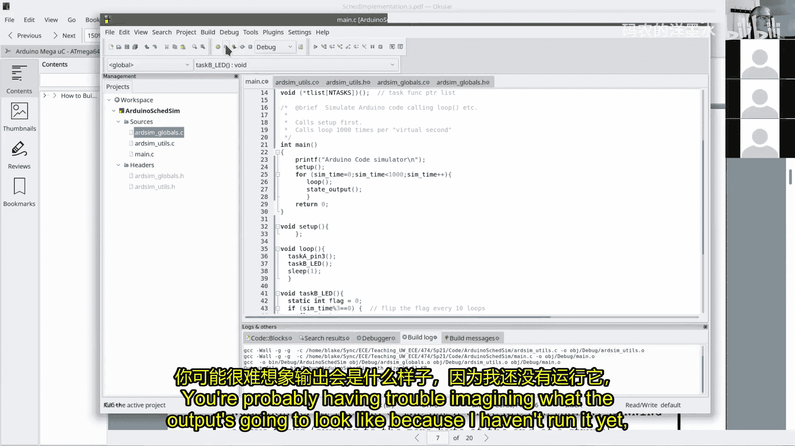

So now we have our simulator and it's sleeping for one second between rounds。And bit 3 is one。

And the LED is on for three and off for three。Just as we asked to do。 And now after sample。

 after 10 samples， bit 3 is off。But then Bi 3 turned on again。Because it's looking at。

Period or a time interval of 10 loops。 And the LED one is looking at an interval of three loops。

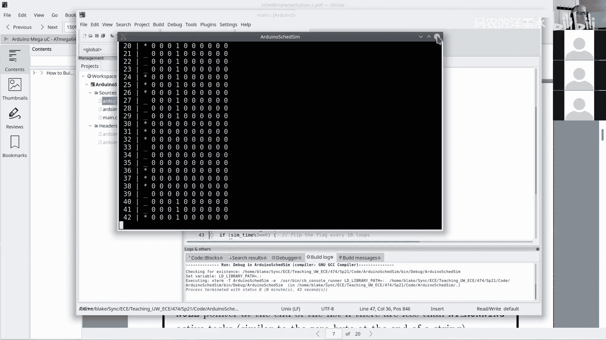

So this is how we were doing lab2。U。So let's get a little more sophisticated here。 So let's make the。

 let's say。Or so I guess I'm going to just give you guys one more chance to look at this。

 And now that you see， So what I'mprinting is this first thing is the time。

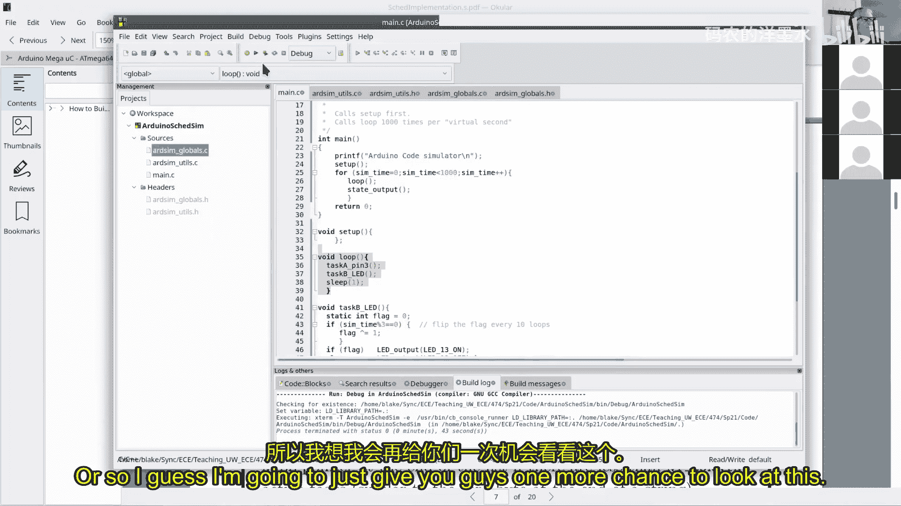

This bar is just style。 This is the LED on or off。And then these are the 10 bits that I declared。

As Iop pins for the simulated Arduino。So does this all make sense now？Maybe some thumbs up gestures。

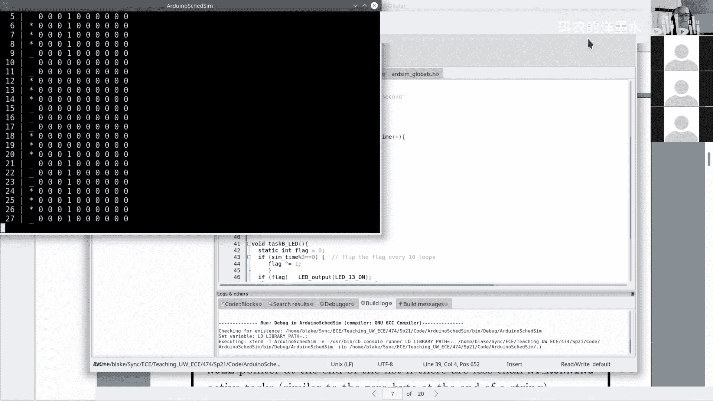

I want to see some thumbs up if it makes sense。Okay。😊。

And I want to see some hands if it does not make sense， because I don't see like 100% thumbs up。

I don't see 100% thumbs up som。Still a little nervous about whether this is getting through。 But oh。

 there's a hand。 Okay， Lucas， yes， first， I would just like to ask because I think you mentioned at some point I'm not sure it was it was you who mentioned。

 but some I think someone mentioned it that lab Su is going to be about more advanced scheduling， so。

嗯。I guess。Like if that is true， how does all this all of our scheduling lectures and content relate to the upcoming lab perfect question that's the exact question I'm going to cover next okay。

So， okay， that's good。That was an excellent question and that's exactly what we're going to cover next。

Anything else。Okay， so we've got our little simulator there。I guess I'll just kill it。

And so now we're going to get rid of this loop because it's basically what you guys just did already。

And it also doesn't have any flexibility。Because it's hard coded and it won't change。

So now the thing I skipped。 So let's make a list。Of task function pointers。

 So this is following that same。Syntax。It's a void function。 It points to a function。

 And notice all of our， our two tasks are void prototypes， and they have no arguments。

 So we have no arguments， and we're declaring this void。 and then bracket our Par star。

T list array close per end is an and followed by an either full or empty parameter list is how you define a function pointer or an array of function pointers。

 So that's what we did。 And N tasks is 3。 Okay， that's modest。

Let's start with two because we only have two tasks。And let's make a new loop that goes through that。

 and executes them。So。We need a loop to loop through the tasks inside the loop instead of listing them。

Well， I'll be formal here。So we're going to loop through the list of tasks。And then， we're going to。

Exeeccut it。And so。We call it by。I have to remember that syntax， now。Right。

 what you in Parez sorry professorss， do you mean to be sharing your screen right now？

And you're not screen sharing。 Oh， gosh， I'm sorry。 Thank you。All right。So again。

 we're reviewing this。

Whoops。Okay， thanks for that。 Can you see this now。You see the code now and we can see it great。Okay。

Just starting that over。 So here's our we're going to have two tasks。Defined by this symbol N tasks。

 and we have the syntax for declaring our task list called T list。

And it's an array of function pointers。Specifically functions with no arguments because this。

 this second parent is empty。And that return void， just like our two task functions do。

And we have to keep all our functions in that same prototype。Al right， sorry about that。

 So now we're making a new loop function。And we're making a little loop through the tasks， and then。

We have to。Um。Index it the function pointer list。 So that is。Either 0 or one。

 the offset into our list of tasks。And then we put the second parent end here to call it。

 so that's a proper， I'm just double checking my notes here。Because I I got it wrong a couple times。

 Okay， so this somewhat arcane syntax means we get the Ithe element of our task list。

And we know it's a function pointer， and we execute it。With an empty parameter list。And so。

 we're going to do that。However， there's one problem。

Which is this list is empty and it doesn't contain any function pointers yet。

And we could initialize it up there or we could use setup， so let's do that。And when you want to。

TUse the function name as a function pointer like we're doing right here。

 and we're plugging it into this list of function pointers or this array of function pointers。

Then you do not put the pars at the end because the pars at the end say， actually run this function。

And we don't want to do that。So now we've set the list up。And now we're going to loop through it。

 And， oh， yeah。 And one more thing。After we run those tasks， let's sleep。For one second。

 so that we get the excitement and suspense of the things coming down。Any questions so far？All right。

 let's see if this even compiles。Nope， I made a mistake。That's because I didn't spell the list right。

 this should be T list。Or the array name， right？Okay， let's see about that。

I'm missing a semicolon somewhere。There。Coma should not be there。Okay， I get my happy two blue lines。

And so let's see what happens。

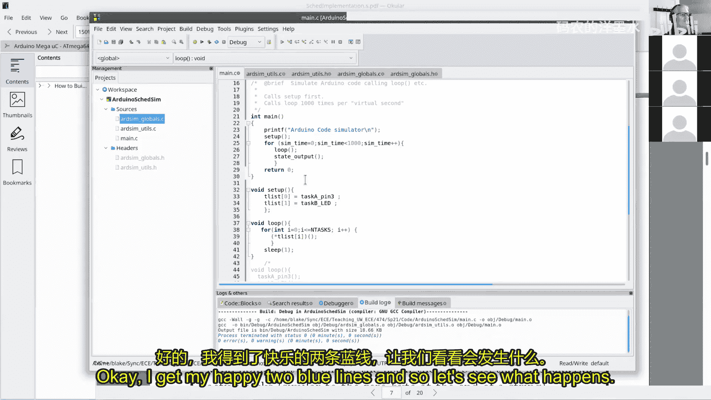

Okay， segmentation fault， so something went wrong。

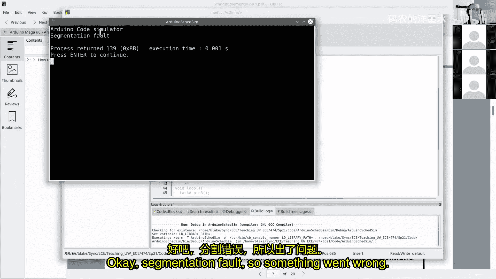

So what is that。I did get this working just a little while ago so I could cheat and see what I did wrong。

Oh， I know what？I didn't。 This is a。This is。HNot sure why it matters。

 but what I did differently is declare this to be a static int。

And I'm not sure why that was important。But that was a big difference between the two files。Nope。

 that's not the reason， okay。Well， that's cool。 What other possibility could we have。

Should it be I less than N tasks rather than less than or equal to。Nope。

 because end task is equal to two and if it's equal to two。

 then we've gone too far into the array because the indices we're allowed are only zero and1。

But I've， I've done this。 so I'll get it going。Maybe it's the declaration。嗯。😊。

Is it possible it viable to use the GDP debugger in this situation？I'm sorry I can't。

 you need to be a little louder， I couldn't quite hear I asked。

 is it viable to use the GDP debugger in this situation？I would have to learn how to do that。

 So maybe。Yes， no it is。Is it because I is getting initialized to zero at the start of each loop like right there it gets set to zero every time it loops over it now the loop is is this four loop。

And so it's just going to go through。Shoot if it's I is less than or equal to M tests doesn't then make I sometimes equal to instead of never being2。

 actually， that's the answer。 I got that exactly wrong。 So you guys caught it， and I appreciate that。

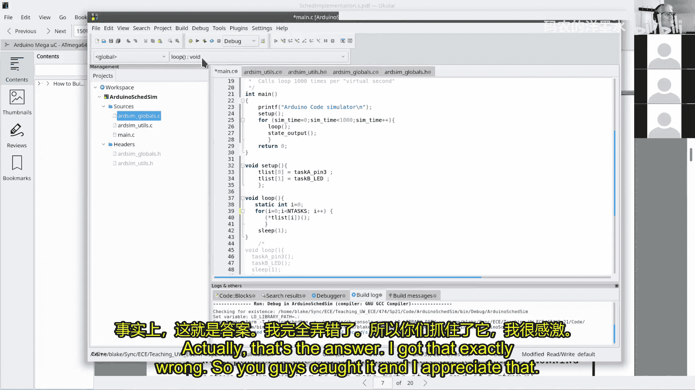

Watch this。There we go。Okay， so。With your help。It's working。

And it's working exactly the same as it did before。

And we get period of three or alternating at three cycles with the LED and alternating a 10 cycles with pin3。

Whi is just some arbitrary things I wanted to do with these two tasks so right it was exactly that equal equality that was my problem。

And so， yeah， so we're just going through the list。Okay， so we can do some other interesting things。

 so。Like。We now let's， let's think about implementing sleep。And that way。

 we can simplify these tests a lot because these tests have this logic。To measure time， or at least。

You know， check for time events with modD， but maybe we want to just have a delay that we want to change。

And maybe we don't necessarily want to stop on a round number of time or something like that。

So we're going to work on our delay function。So one option is we could decide to have。Two lists。

 one is the sleeping tasks， and the other is the awake tasks。And we could move tasks back and forth。

And what I what I mentioned in lecture before， and actually， you may remember this。Is like。

 we have a scheduler。And then。We have。呃。Starting the task。

 And then like I'm going to skip ahead to sleep， okay。U。

The scheduler for sleep would move the function pointer from some ready task list to a waiting task array。

 And then what I said here is that we have to fill the empty hole and shove and move everything up and we can do that。

 but it's complicated and I thought of a simpler one and simpler is always better。

 So let's let's do the simplest possible way to do delay。 and that is that we'll just well。

 but first I'll show how we might。Check for that without。 But let's just， here's a little experiment。

 Okay， so let's， let's say the task array is actually 3。And let's say， we put a。啊。

Nll in the task list。Okay， so now we have this gap in here。

 We will get a Seg fault if we try to execute this because it's just a zero pointer。So all we what。

 what we could do here is like， if。诶。Tea list， I。Not equal to no。Then， execute it。

So now we're going to inspect as we go through the loop， we're going to inspect the。

A function pointer。 That's a bug。We're going to inspect the function pointer。 If it's not null。

 go ahead and run it。 If it's null， we'll just skip it。Let's see if that works。Okay， compiled。Sure。

 that's running great， okay。So now we've got a more， you know， a richer， more complicated task list。

 but everything's working fine。 There's no reason that the tasks have to be packed together。

So let's start refactoring task A to use a sleep function which doesn't exist yet。

We're going to give it the same name though， just to keep everything else the same。

And we're going to say。We're going to have that flag。And we're going just toggle it。嗯。Actually， yeah。

 and we're going to run this little if statement。Okay， so so far。It's not really any different。

 But instead of that mod operator， we're just going to go， let's say， asyM sleep。4。

So we're going to sleep for four cycles。And let's write an asym sleep。 So to do that。

 we're going to make a delay list。And it's going to be equal to 0。So with these initializers。

 you either give it。All the elements， or you give it one， and it'll repeat that。 I think actually。

 if I gave it2 like 0，1， it would go 0，1，0，1，0，1 until it filled up n tasks。 But anyway。

 we're obviously setting the delays to 0 to begin with。And there's one thing we have to do。

 We have to know which task is calling sleep。And so we have to know what pointer。

 what index we're using in this。Thing here。So I'm going to make a global。A variable。Also， an ant。呃。

I'm going call it。A task， active。Equals 0。And now we're going to loop on that， instead of I。

So when somebody calls delay calls ACM or we know SM sleep。

 we're going to know we can look at that variable， we're going to know which task it is。

 also we can stick a delay into the T Dell's array。Okay。😊，So we hacked that。And I'm going to write。

Thisis function， now。And this is going to be void。Asyim。sleepleep。Might didn't that complete。

Should have。Maybe there's no prototype。Okay， sleepy time。And what's this going to do， Well。

 it's going to put a it's going to take that delay value and stick it in the T Dells。

And does it have to do anything else。No， okay。 Now all that did is it copied its argument into this array。

So we have to be a little smarter up here。And so we're not going to merely。Check if it's null。

Which is doesn't give us anything yet。U。We're going to。 we have another condition。

So we're going to go and。嗯。T Dells， the delays。I， oh， if this should be task active。And， whoops。

 snow。And this is wrong， too。 This should be task active。Time delay is greater than 0。呃。No。

 equals  zero。So， that means。I'm only going to start the task in the loop。If the time。

If it's not sleeping。Okay， does that make sense。 So this nu thing isn't even really important for delay。

We're going to do that。And。😊，Now， there's only one thing left， which is。Else。嗯。If。

If we're not looking at a null。And we could even get away with ignoring this。

We've got to reduce the delay and go down。And to be safe。

 I'm going to put less than or equal to 0 in case somehow some way that value got to be negative because we don't want negative delays。

 Ne playss don't mean anything。So I certainly want to run it if the task is negative and hopefully'll get if the delay is negative and hopefully it'll get cleared out。

But if there's a positive value in delay， we will not run the task， but we will reduce the delay。

And eventually， it'll go to 0， and it'll start running again。So let's see if this works。 First。

 I'm going to check for compilation。Got an error， as usual。Something's wrong here with parentheses。

Okay， I've got an extra left parent。That should be good。And task is undeclared here。Oh， that's why。

 It's S。And let's make sure that's good。Okay， now before I run it， though。We haven't， actually。Yeah。

 well， we have。 Okay， so task A is a really different task A now。It's going to。It's toggling。Oh。

 but I never toggled a bit。 so that's not going to work。So， flag。Equals。呃。Exclusive or equals one。

Okay， so if flag is0， it's going to go to one and if flag is1。

 it's going to go to zero because that's the definition of bitwise exclusive or。Okay。

 so I fixed that bug before it happened。 And then we're going to do instead of three。

 like it was before it's going to go for。Cyclees。And task B is not going to do anything different。

 oh， sorry， task A was 10 cycles。 now it's going to do four cycles。

Task B is not going to do anything different because we never call sleep and we didn't change anything。

And it should still be okay because the loop is synchronized to one second。So let's see what happens。

 we'll do one final compile that's good。It's running。Nothing's happening。So we've got a problem。But。

 we didn't crash anything。This to me means that no tasks are running at all because I have some bad logic。

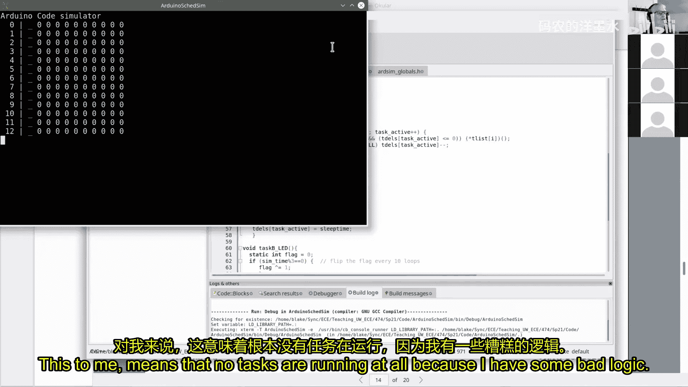

In this statement。So let's see what's happening。Probably， let's see the easiest。

 let's I could get rid of all this null stuff to test， but that worked before。If the task。

 if the delays are okay， so did we set the delays properly。嗯。

So the way to fix this is we're going to。U。Modify our state output to also print。The delays。

I'm going to hack it， because。U。I don't have the variable scope for that pound to， I think。Okay， so。

I'm just going to put。Li sign there。And it's helping me here because I didn't actually print it。

This won't know what the state is because it's not a global。A。

We're going to have to put that into global in order to print it。And when you make this X statement。

 you can't initialize it ever again from the C statement。Does this build？ Now it's worse。To to to。

And to hack it。Okay。That is not a clear error message。Sorry， this is taking。

 It's not going quite as smooth as I wanted。This is beply defined。Plips。Binggo。

 now it's now it worked。So let's see what happens with these。Okay。😊，Okay， lots of， okay。

 there's too much delays， everything's sleeping。Except except the middle one， which is null。

 So the non null task， everybody's sleeping。 Everybody's falling asleep。 That's the problem， okay。

So back in here。What we're doing is if its， if it's less than or equal to 0， we should be running。

And if it's not。We should。We should not be setting that this is。Sleeping。

And it should not be running， but it should not be every task。 It should just be one of the tasks。

Task active。Hm。😊，Well。I'll just say we'll leave it at that。 The point is to explain how it's working。

 and I'll debug it because this will bug me all night， but。U。😊，This should be。Just。

ExIt's executing every task。 But no， it's not executing the tasks。 Somehow。

 it's setting a sleep value。For each task， that's not nu。But， this is the subtraction。It should。

 And it's， and that's working， too， because they're going down。

 probably that it'll take like 10 of these for the。Or four of these for the。LED to light。Professor。

 yeah， I think I found the bug， I think it's because on line 43。

 you're calling T is I instead of task active。Brilliant。You know。

 I is just junk from there and that's exactly right， that is the problem。So。Now。Well。

 we have an unused variable I。 fine， I don't care。 It's unused。 It's only a warning。There we go。Okay。

 very nice。 Thank you so much， whoever did whoever put that in。

But this is actually really nice that we got the visualization of the delays， isn't it？

Because this thing set the。It's it's interesting that setting it to four delays it for three。

 and so that's a side effect。 So what we're going to do is hack that。Sleep time plus one。

Because there must be an extra subtract in there。And so， now。It's going to run four LED flashes。Oh。

 it didn't。Oh。It's four pin3s。 Okay， right， I'm sorry。 the LED。

 the LED task never changed because this three is the same。So actually， it was working。

 so this is doing one，2，3，4，5。So it's， it's actually still needed that change。

 I think let's start over。No， it's doing6 now。 Okay， my bad。I was just looking at the wrong signal。

So anyway， bottom line。What you see here is that we now refactored this task to be even cleaner。

 really。Um。And。Using now we have a sleep function that works。

And it's showing these pin this pin3 output is sleeping for what we requested for cycles。

 well when I rebuild it。H no， it's five cycles。4，3。 So I need to actually subtract one。And then。

 of course， the question becomes what happens if。嗯。😊，We delay for  zero。 I mean， we delay for one。

So we're going to test that。Okay， so we got 1，2，3。4， and then four zeros。Okay， so this。

 this is now working as expected because we called for a sleep of four。You could argue maybe this。

 this part is one cycle。 And so we should sleep for。one。Less than the period， but out of curiosity。

 we're going to see what happens when we sleep for one。I think that's the expected behavior。

 That's what we'd want to see。Skips 1。And then let's break things。 sleep for 0。Okay。

 that didn't work。 The delay is -1。But we can just put a。If statement in there。So when we sleep。

 we'll say。If sleep time。Greater than zero。Otherwise， we're not going to do anything。

Which is probably smart anyway。Because we don't want to sleep for negative time。mm。😊，Okay。

 so now let's see。 maybe that we just have fundamentally a minimum sleep of one， let's。

Comment this out， and not sleep at all。Okay， well。It's， it's， oh， it's toggling every time。 Yeah。

 I guess I， you know， I'm misinterpreting this is， this is not sleeping for one cycle。

 This is running every single cycle because it's toggling every time。

So I guess that is correct behavior and if we say one。It's incorrect behavior。So that's also my bad。

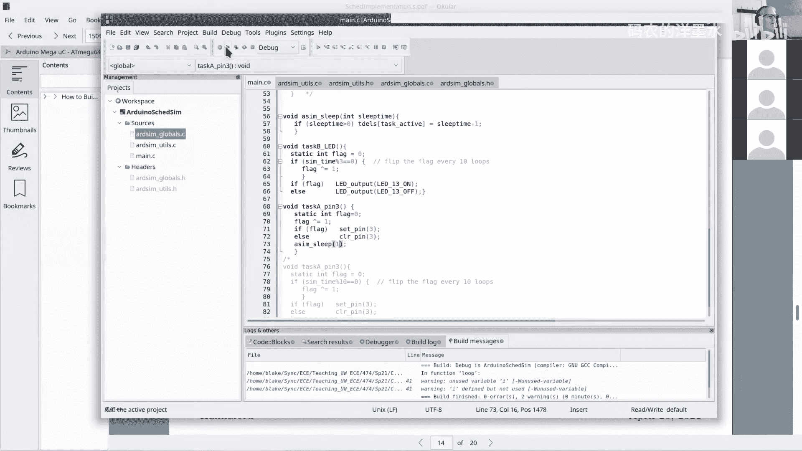

Yeah， so this is actually running every time because the desired behavior is a toggle。

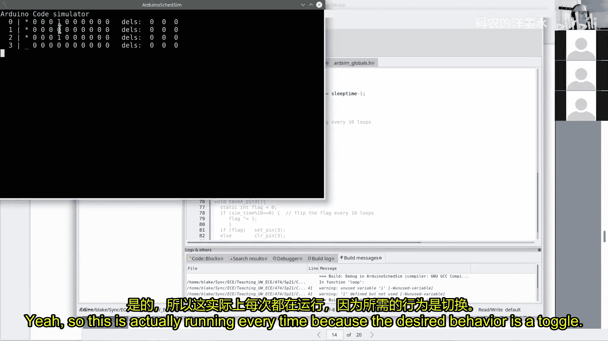

So okay， I had the simplest form already， and we're not going to subtract one。So， that's sleeping。

After each change， it weights one， and then it runs and does it change。

So I think that's probably the expected behavior。And if you look at the delays。

 it's got a delay of one and then it goes to zero， and then after the delay goes to zero。

 it changes let me get that stable again。So it sets the delay to one。

 it skips a cycle and then it changes and sets the delay to one。So that's correct。All right。

 so the purpose of this。 And I think we're just going to wind up for Q And A after。 Oh， no。

 I'm going to introduce lab 3。 So let's take a break till 3。45。And then we'll go over La 3。

And you guys are going put these。Ideas into practice on the Arduino。

And that's what lab three will do among other things。

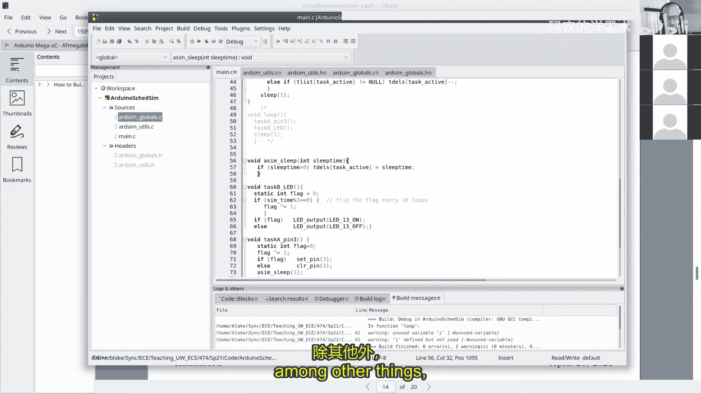

I will stop the share。 There's some things in chat。Okay， sorry， I didn't see that。Anyway。

 we cured it。And I'm going to pause and we'll see you guys in 10 minutes。

 and then we'd probably be able to finish early。Okay。

 we'll resume and we'll just spend a little time going over lab3。

 This is not it's a little bit early， but it's。I we've been digging deep into scheduling。

 And that's a big part of lab 3。 So I want to cover that and also interrupt。

 So I think it'll be topic。 It's a good thing to。Actually， include in this lecture。

So I'm sharing a Google Doc view of this document。 It's still officially the Ts are still helping me debug it and perfect it。

So I guess it's not released yet， but it will be soon。Um。We're going use different schedulers。

And different some tasks， so the first major objective is to do some of these schedulers for yourselves。

 which give more and more accuracy and programming convenience to your tasks。And then secondly。

 we're going to nail down。Synchronous timing by using those beautiful timers that have so much power inside the chip。

And they're going to generate and interrupt。Every millisecond and your code will monitor that bit and look for it。

In its waiting loop at the end of the schedule。We've already introduced theox and so that's going to be a feature for your write up I actually truly believe it will save you time compared to our existing write up。

And also teach you a valuable professional skill， so I'm excited about that。

You may have noticed deox tags I just wrote in that。

Sample code and the key thing I know some people have had supply issues。

 So get one of these one way or another and。4 segment。4 digit seven segment display。Now， the。

With the eight by8 for lab2， there was some versions that had serial SPI interface and other versions。

That were what I called the raw8 by8。 And that involved that required different。

Totally different software approaches， really， I think these are mostly in the raw form。

 I haven't seen too many of these with the serial interface chips attached to them。

 So be prepared for that。And。The good news is， though， that it's 4 by 7 instead of 8 by 8。

 So you have 28 wires instead of。😊，I mean， sorry， you have 11 wires instead of 16 wires。

This is orange because we're still debating some of these things there's comments I won't bother showing you one thing we're going to do the reason this is。

Is orange is that we had a little trouble with inconsistencies between the lab write up and the turn in document last time。

 so we're going to remove all this stuff that's turn in specific and put that in the other document and therefore you will have one stop shopping。

So some of these tasks will be quite trivial because。You've done them。

 So like flash and external LED。For 250 milliseconds every one second， Okay。

 I think you guys can handle that now。Um。We're going to play some a new tune。

 which is close encounters of the third kind， an 80s。Hit movie。And the frequencies are given below。

 it's very simple tune。Simpr than Mary had a little lamb。U。

And then we're going to have this task play the theme and then sleep for four seconds and play the theme again。

And。YouDo not use the tone function， so you will set up a timer to play this just like Lab2。嗯。

But this time you're going to need two timers going because the other timer is going to do your scheduling interrupt。

But the timers are very similar once you've gotten over the big hump of programming one timer。

 you can do the others， they're not all the same。They have little details like some timer will have only two output compare registers compared to one output compare register。

Okay， you can handle that。Then we're going to make the seven segment display。U。😊，Count。

Up by one unit， every 10 counts per second。So just make it go up and count tenths of a second。

That's task three。And then we're going to change a new task。

 We're going to make a new task for once those three are working，1，2，3。嗯。😊。

We're going to make the music or the tune and then a pause and then a tune and the task the timer is going to count down by tenth of a second。

Of the remaining time until the tune。And when the tune is playing。

 you should display the frequency of the current tone on the seven segment display。In decimmal。

I didn't add that。Okay。😊，Hurts。And of course， and they're just given down here。

Those are the frequencies， okay。And then。Task five will be a supervisor。

 which actually turns the different tasks on and off。And so that's according to these instructions。

 So you're going to think about those。And this hint is probably essential。

Which is think about breaking those tasks up into more than one task。 and。

 and you're encouraged to do that。And an example， well。

 scanning the seven segment display and lighting up the segments in a smooth pattern。嗯。

Is a different thing than counting up or down。And so you're going to need to。Convert the digits。

 First of all， convert a four digit number。To four individual digits。 and then each individual digit。

 you're going to figure out which of the seven segments lights up to make that digit。

And there is lots of code online and it's going to be okay for you to consult that code。

 but none of that code will work with these advanced schedulers。

 so it's not going to be a cut and paste。Um。So yeah so break these tasks up so like if you're breaking task2 up。

 you could have task 2。1 2。2 don't use a period in the task name so it would be 2p2 or 2 underscore2。

 just some hints there。And then three schedulers， and。Don't worry。

 we're not going to have 15 demos where you have to run fit5 tasks with three schedulers。

 We're going to have a subset of those， and that's listed below。

So this goes into detail of what we want the schedulers to be this is this is your lab to schedule。

And then this is going around but synchronizing with the interrupt service routine。

 and we'll go into that in more detail， and we're going to keep states for these tasks。

This is where we're going to use the array of function pointers。

And just sort of like I sketched out today。And then。

I have we went over this interrupt concepts document month of。Monday， so I won't go into it。

 but it's linked right here and so that's where you can solidify your the needed understanding of interrupts。

And。So then you need to find we're going to we're recommending an eight bit timer。

 but you could use a 16 bit there's about six timers in our chip and it doesn't。As far as I know。

 it doesn't matter which the Arduino， you know， as you know。

 there's a code base inside the Arduino that the Arduino IDE hides from us and mostly that's a really。

 really good thing where it's doing some nice automation for us， such as downloading。

But it's possible that some of that code uses certain timers， not sure， don't think so。Might be。

 So you may have to， if you get mysterious。Effects。

 try a different timer and we tried timer4 and timer4 seems to work great。

 but you're going to need two timers and I'm sure you're going to be able to get two timers。Okay。

 basically if you're not generating any PWMs with the each PWM output is a timer and when you do PWM commands in Arduino's library。

 it's using those timers so。It might be also possible actually to do it all with one timer using two different output compares。

And so you could you could look at that option as well。

 like output compare a could be generating the music tones and output compare B could be generating your interrupts for your scheduler so you might want to think about that as an option。

Okay。We've talked about ISRrs， and so forth。There's lots of advice。嗯。😊，Okay。

And we're kind of asking you to do the scheduler syncing as a task。

 which is the last task in your list instead of in the loop itself， it's not a huge difference。

So this is where this is how you're going to communicate between the ISR and the。

And the main your main task loop。Then then the last thing and we talk about this little。

 I may review this again because the task control block。

 so instead of having different lists like today we had the task function pointer list and we had the list of delays。

And then we use the same index to see everything this alternative approach is to just make a list。

 makestructs， and the struct holds everything about the task。

And then we'll have a list ofstructs and you go into the struct and execute its function pointer and or decrement its delay。

 and you can just it probably simplifies the code actually。So， these are the。As I said。

 you only have to do six demos， not 15 demos。And so what we're saying is。

Demo number one is to run task one and task2 with the round Robbin scheduler， and that's it。

Task demo two is task one and task two with the synchronized round Robbin interrupt driven schedule or et cetera these these acronyms are completely defined right here。

Okay。😊，Um。And that we're still pending。 This is info on the 8 by 8， I be sorry，4 by 8。

4 by 7 segment display。 It's really 8 because you get an8 LED for the decimal point。

But driving the decimal point is not required for this lab。

Here's just one of those examples out there， which has good information， you can consult this。

But this has I actually don't like this guy's code is not very flexible and it's very hard coded with his pinouts and so forth。

 So it's an example， but you will。It'll be easier to write it yourself than to mouse this code。

Also your your speed will be important it's going to be rough for us to de bug this on on to evaluate on video。

 but aesthetically you don't want your display flickering you want those four numbers to be sort of solid and what I found is。

That if you keep that at5 milliseconds per digit。So that it takes 20 milliseconds to go around。

 the human eye smooths it out beautifully。And you can experiment。

 so go to 100 and you'll see it's just doing this。But as soon as you get to this magic number of five。

 it just seems rock solid， which is kind of cool。Okay， any questions right now on La3？

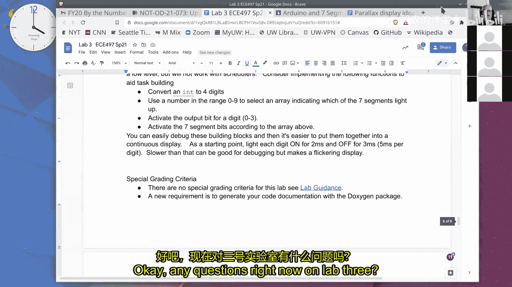

You you know， to really first study it and then we'll work on your serious questions。

 but anything right now that jumps out at you。I see something in chat。In task 2。

To do the action in task1 and the action in task 2 at the same time。Well， let's have a look。

Task 1 and two are different tasks。And it is asking。

 we are going to ask that you run them simultaneously。

Just like I did just now with this two tasks so。Yeah。

 I think you asked that before I demonstrate before I went over these。Configurations we're going to。

 we're going to test。Okay， others， anything else。I just wanted to know if you wanted them synchronously or not。

 But yeah， thanks。Yeah there this is this I think this table clarifies that don't worry we this is not by far your only chance to ask questions will be on Piazza just as much as before and you're going to learn a lot it's going to be a good lab and。

So I will see you guys next week unless there's more questions now I'll open it up to any questions on anything in the class。

All right， now people are dropping， meaning there's no questions， I guess。

Um。First， can we have like a like for example， either on Monday or Wednesday next week。

 we have a demonstration of of setting interrupts in a clock on the Arduino itself because I don't believe we've demoed that yet。

 I think maybe。Do we。Yes。I thought I covered it pretty extensively， Monday。Rewatch that video， but。

Why don't you jot down a real quick email of the exact things you want me to cover and I'll do it。

I see because I was referring more to the fact that because you know how for lab number one。

we did a demo about like we did it like an in depth demo like Thursday。

 I think like about how scheduling works that I think a lot of people were like confused about how that works so I was just wondering that next week we might it might be constructive to do like a similar thing like if a lot of you were running into like the same confusion I think that movie be 3 like like it's kind of like exactly what we did with lab number one just yeah。

Well， I didn't I show， you know， I showed， I thought I showed it working。

 Maybe I'm confused with what I'm showing the Ts because we're still discussing lab3。

 but I will do it， I will do it Monday。Yeah， because I think I'm gonna go ahead and like like give it a check too。

 because I think like on Monday， we haven't seen all this information about the Maa。

 So I might have also been confused about what I was looking at。 So yeah， right， right， it's okay。

 you know， I don't care what exact sequence you guys learn in， I just want you to learn。 Okay， so。

 you know， why don't you review Monday's lecture。 if that's not in there。

 shoot me an email and I will definitely that's fine。 I'll cover it Monday。

Okay， great。 thank you。

Anything else。

All right， I'll see you guys on Monday。