# 嵌入式系统导论：12：I2C 与 SPI 通信


在本节课中，我们将深入学习嵌入式系统中的任务调度。我们将通过编写代码来模拟几种主要的调度器，并回顾实验三的作业内容。

## 概述

本节课我们将深入探讨任务调度的核心概念，并通过代码模拟几种调度器。我们还将回顾实验三的作业要求，为接下来的实践做好准备。

## 调度基础回顾

上一节我们介绍了基本的调度循环。本节中，我们来看看如何实现更灵活的调度机制。

最基本的调度器就是一个循环。循环体中的代码会被重复执行。我们可能需要一些延迟机制来确保每个循环周期，例如，恰好是1毫秒。

现在，我们希望实现一些**暂停**和**延迟**功能。例如，最简单的任务是让一个LED灯亮20毫秒，然后灭80毫秒，这就需要精确计时。

## 函数指针

为了实现灵活的调度，我们需要回顾**函数指针**的概念。函数指针允许我们将函数作为参数传递或存储在数组中。

函数指针的通用声明格式如下：
```c
返回类型 (*指针名称)(参数列表);
```

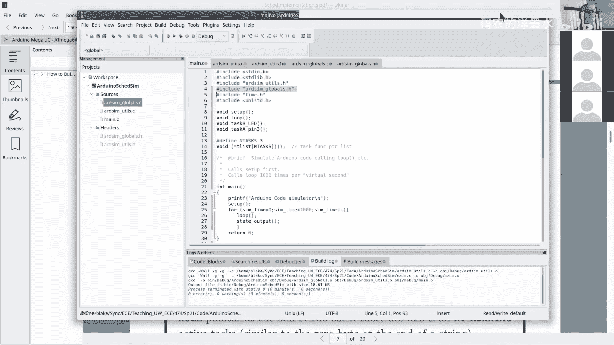


以下是一个更具体的例子，声明了一个指向特定类型函数的指针：
```c
int (*fp)(char, int, double);
```
这个指针 `fp` 指向一个函数，该函数返回一个 `int` 类型，并接受 `char`、`int` 和 `double` 三个参数。

在我们的简单案例中，任务函数通常没有返回值（`void`）且没有参数，这使得函数指针的声明更简洁：
```c
void (*task_ptr)();
```

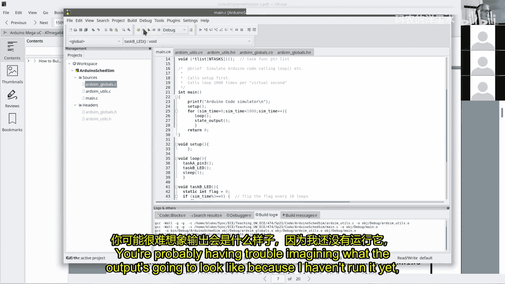

我们可以编写一个函数来启动由函数指针指示的任何任务：
```c
void start_task(void (*task_ptr)()) {
    task_ptr();
}
```
虽然直接调用函数也能实现，但将函数指针存储在列表中并遍历执行会更有趣。

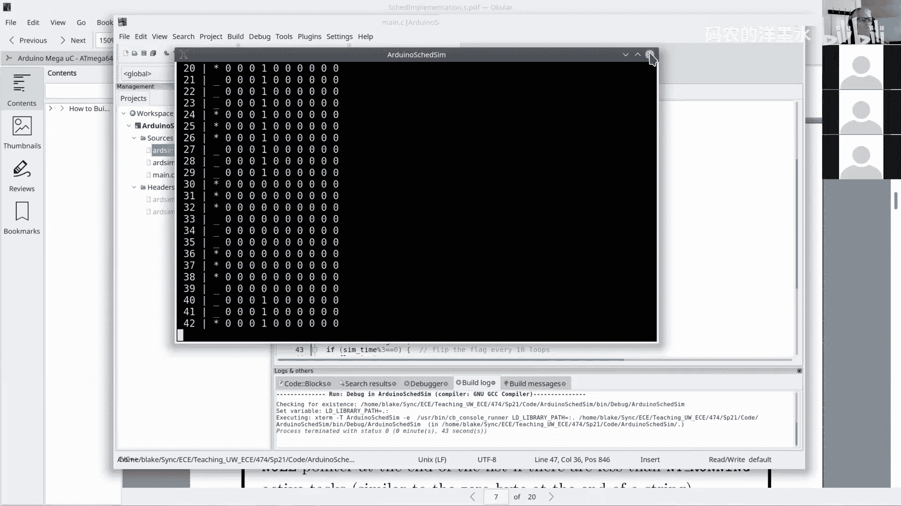

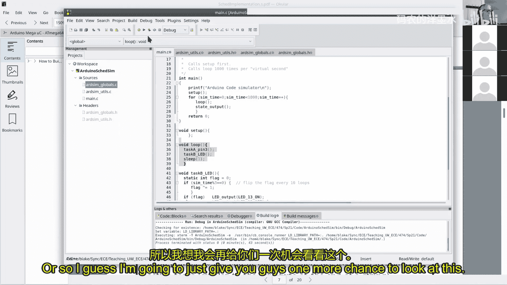

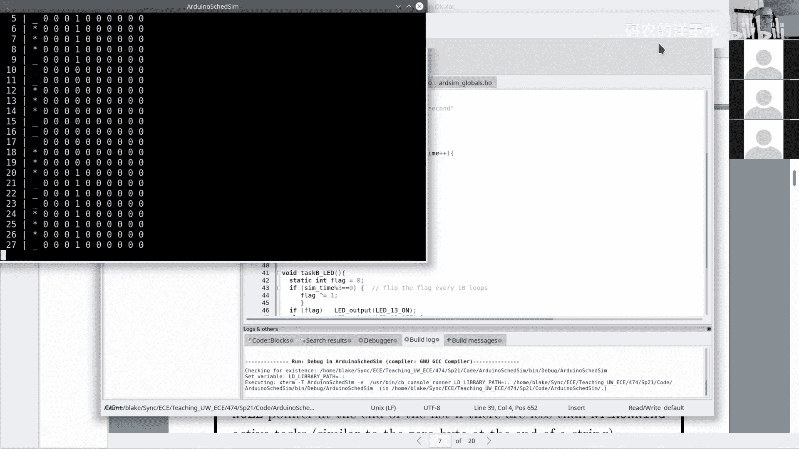

## 模拟调度器

为了演示调度概念，我们构建了一个简单的Arduino模拟器。它通过全局变量模拟硬件状态，并在终端输出结果。


以下是模拟器的核心全局变量，用于模拟时间、LED状态和IO引脚：
```c
int sim_time = 0;
int led_state = 0;
int io_pin_states[10];
```

模拟器提供了设置引脚、读取引脚状态和输出当前状态等基本功能。

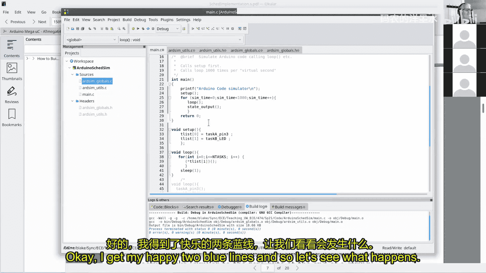

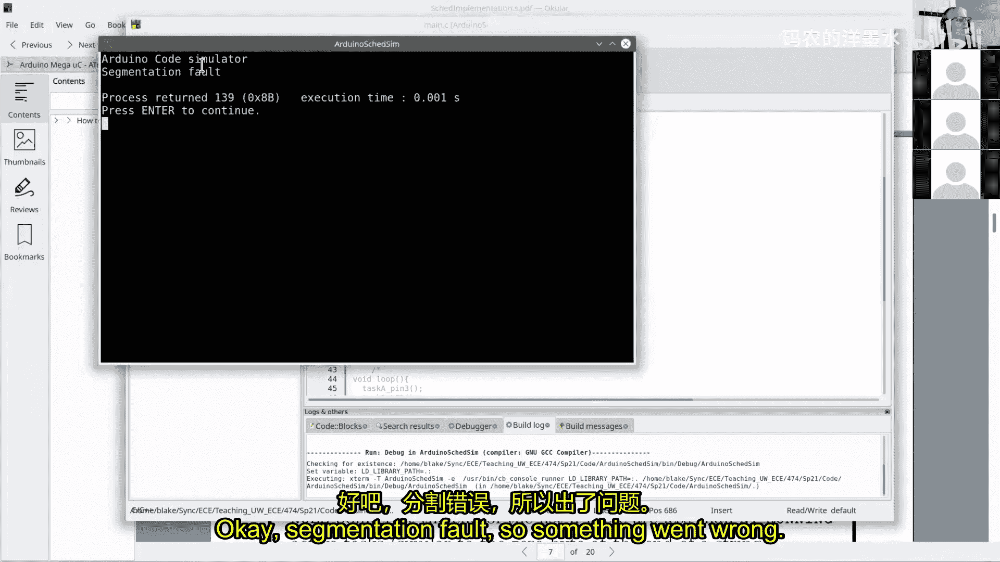

## 基础任务循环

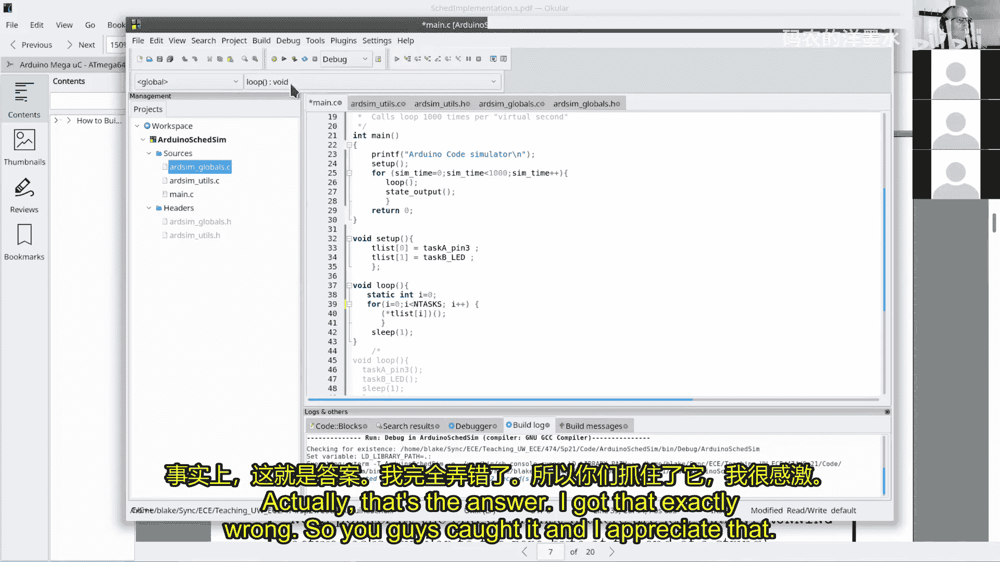

我们首先实现一个基础的任务循环，其中硬编码了两个任务。

任务A每10个时间单位翻转一次引脚3的状态：
```c
void task_a() {
    if (sim_time % 10 == 0) {
        flag_a ^= 1;
    }
    if (flag_a) {
        set_pin(3);
    } else {
        clear_pin(3);
    }
}
```

任务B每3个时间单位翻转一次LED状态：
```c
void task_b() {
    if (sim_time % 3 == 0) {
        flag_b ^= 1;
    }
    if (flag_b) {
        led_output(LED_ON);
    } else {
        led_output(LED_OFF);
    }
}
```

主循环中依次调用这些任务，并模拟时间流逝。

## 使用函数指针列表

为了使调度更灵活，我们使用函数指针数组来管理任务。

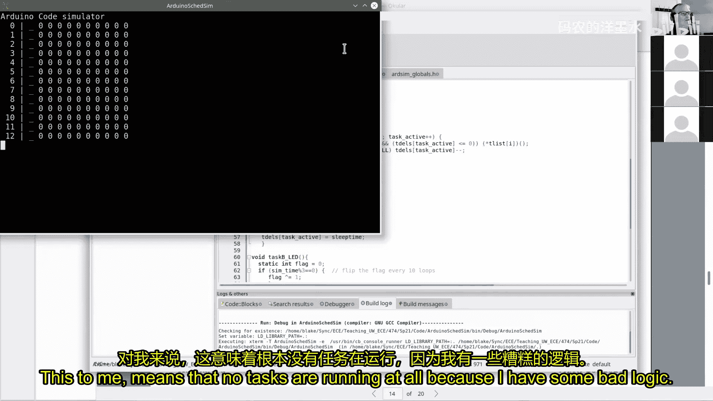

首先，声明一个函数指针数组并初始化：
```c
#define NUM_TASKS 2
void (*task_list[NUM_TASKS])();

void setup() {
    task_list[0] = task_a;
    task_list[1] = task_b;
}
```

然后，修改主循环，遍历并执行数组中的每个任务：
```c
void loop() {
    for (int i = 0; i < NUM_TASKS; i++) {
        task_list[i]();
    }
    sim_time++;
    // 延迟以便观察输出
    delay(1000);
}
```

## 实现任务延迟

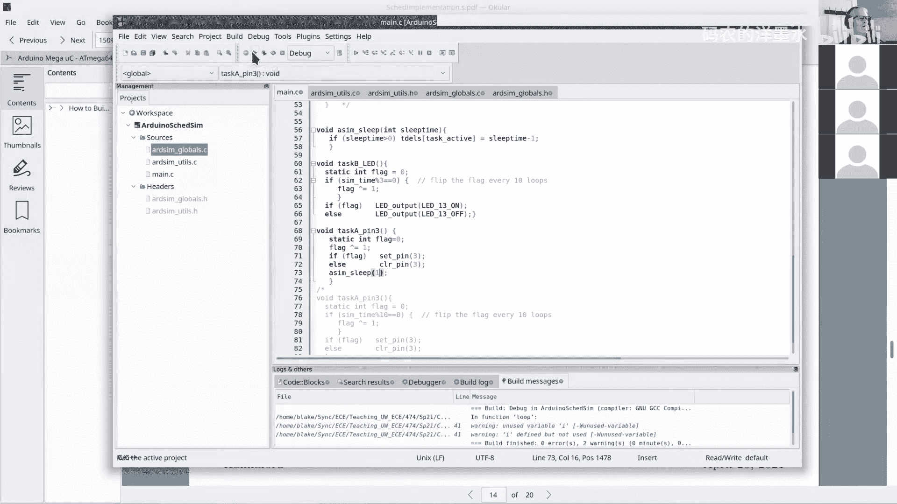

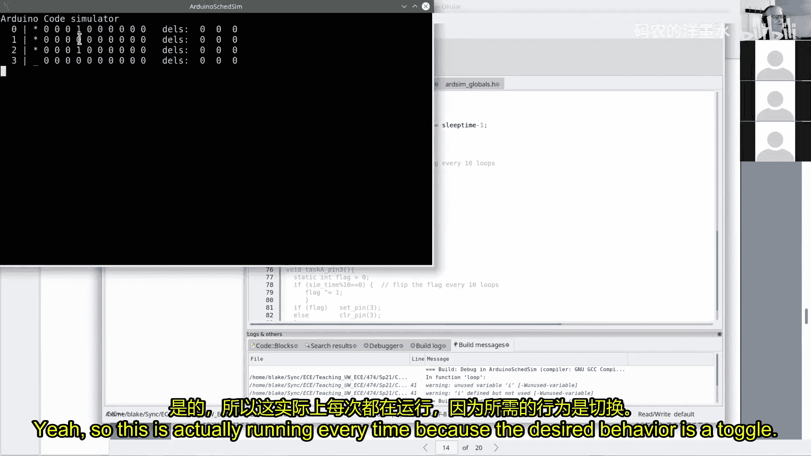

接下来，我们实现一个 `sleep` 功能，允许任务主动延迟执行。

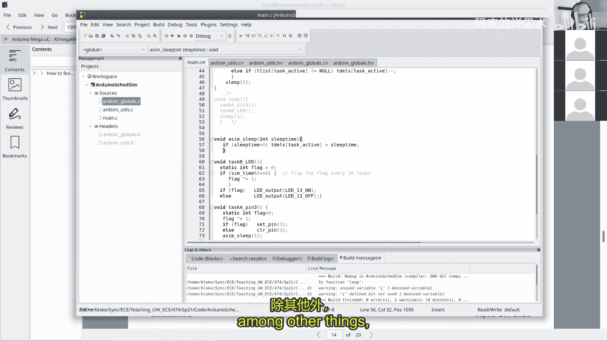


我们引入一个延迟数组 `task_delays` 来记录每个任务的剩余延迟时间。还需要一个全局变量 `active_task` 来标识当前正在执行的任务索引。

`async_sleep` 函数将当前任务的延迟值设置到数组中：
```c
void async_sleep(int delay_time) {
    if (delay_time > 0) {
        task_delays[active_task] = delay_time;
    }
}
```

在调度循环中，我们检查每个任务的延迟状态。只有当延迟为0时，才执行该任务；否则，减少其延迟值：
```c
for (int i = 0; i < NUM_TASKS; i++) {
    active_task = i;
    if (task_list[i] != NULL && task_delays[i] <= 0) {
        task_list[i]();
    } else if (task_delays[i] > 0) {
        task_delays[i]--;
    }
}
```

现在，任务A可以重构为使用 `async_sleep` 来实现周期性行为，代码更清晰：
```c
void task_a() {
    flag_a ^= 1;
    if (flag_a) {
        set_pin(3);
    } else {
        clear_pin(3);
    }
    async_sleep(4); // 睡眠4个周期
}
```

## 实验三作业预览

在实验三中，你们将把这些调度概念应用到真实的Arduino上。主要目标包括：

1.  **实现不同的调度器**：提供不同精度和编程便利性的任务调度。
2.  **使用定时器中断实现同步定时**：利用芯片内部的定时器，每毫秒产生一次中断，用于精确调度。
3.  **控制四位数码管（7段显示器）**：显示计数或频率信息。
4.  **播放一段旋律**：使用定时器生成特定频率的方波，不使用Arduino的 `tone` 函数。
5.  **实现任务管理**：包括任务的启动、停止和状态切换。

实验将要求你们组合不同的任务和调度器进行演示。例如，使用轮询调度器同时运行任务1和任务2，或者使用中断驱动的同步调度器运行另一组任务。

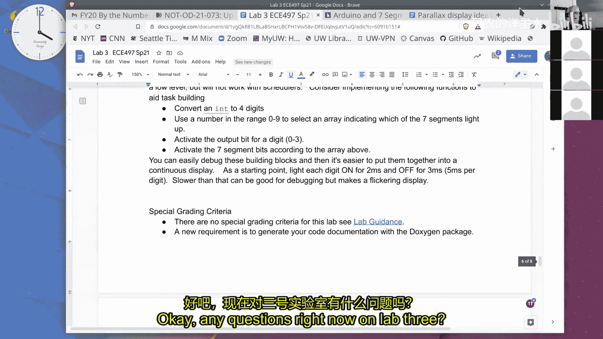

**核心提示**：考虑将复杂任务（如驱动数码管）分解为多个子任务（如数字转换、段选、位扫描），这会使调度和代码结构更清晰。


## 总结


本节课我们一起学习了嵌入式系统中任务调度的核心机制。我们从最简单的循环调度开始，逐步引入了函数指针、任务列表和延迟执行功能，模拟了调度器的基本工作原理。这些概念是完成实验三的重要基础。在实验三中，你们将在真实的硬件上应用这些知识，实现更复杂、更精确的多任务系统。