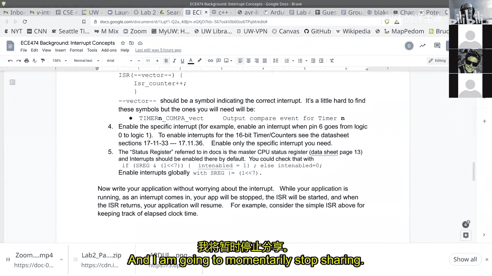
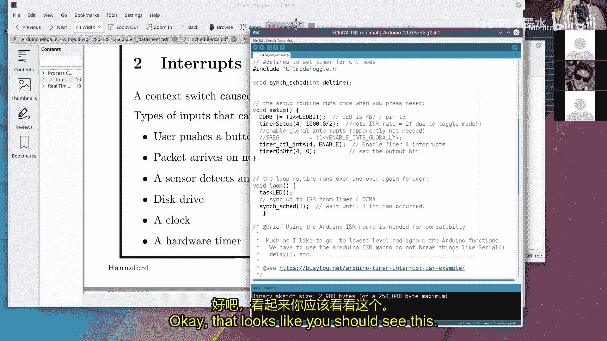
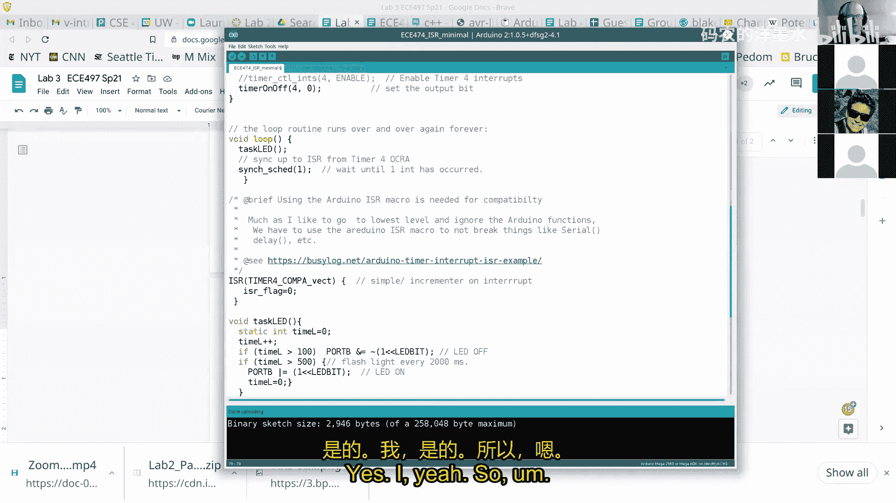
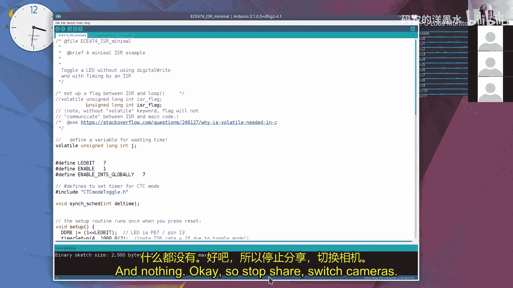

# 【全集 附完整课件】华盛顿大学 嵌入式系统导论 CSE474 中英字幕 p14 Lecture 13 - 期中复习 -BV1ALqnBWEeu_p14-

All right， welcome to5 44474 and。What we're going to do today is again solidify interrupts and ISRs。

 which we've talked about in sort of theory and are essential it's like the most important thing for lab3 and one of the most important things in the course and one of frankly the toughest things but with little care it's definitely doable and it's a super super powerful programming capability so that's why we're。

Working our way through it。Before I start in on some material。

 anybody have any questions or things they'd like me to address right now？

You can type it in chat if you want， or。Just raise your hand or just un mute， if you want。Okay。

 then we'll start sharing screen。And let me make sure I get the right screen here。

I'm going to start off kind of quickly reviewing。That interrupt material， which we have covered。

 but I so I won't I won't get bogged down on it， I promise you。Now， why don't I see that？

Well， this will give it to me。 I think， Okay， can， can I。

 can somebody just confirm that you see the document ECE 474 background interrupt concepts。

Yeah。Awesome， okay， so again， I would I want to point you back to this document。

 It's linked from lab3 and I think elsewhere。And definitely do not worry about interrupt or get stuck on an interrupt problem until you've read this as carefully as you can。

 Then you can be stuck。But then when me and the TAs help you。

 it'll just go faster because you'll have these fundamental concepts。So。嗯。😊。

You know we're going to fortunately for debugging and for working your way up the programming skill ladder interrupts can be disabled and are often disabled by default for example。

 those timers which we like to use they have the capability to cause an interrupt but their interrupt is disabled by default so it's not going to be causing you headaches unless you。

Or giving you the ultimate power until you enable it。

And the software which responds to an interrupt is your interrupt service routine。

Priorities are an important concept， but we're not going to deal with them that much。

 they're sort of。呃。Needed for bigger， more complex systems。Interrupt vectors， it's a fancy name。

 it just means a pointer to the code you want to run when the interrupt comes in。And that's it。

The interrupt vector table also sounds fancy， but basically interrupts are a hardware thing at first and they transition to software and there's for every interrupt and and our chip has I don't know roughly 100 or something possible not all or ever used but。

For every interrupt， there's a table in memory near zero in the address space。

 which is dedicated and reserve for interrupt vectors and so if the processor hardware sees interrupt number 37。

It looks up in the table， here's the address of the code that should be run when that interrupt happens。

 and we are going to write that code。So our software must do these things and certainly in order。

So we configure our device and for the work we're going to do what we need is to use the timer interrupts or let's just say we want to use interrupts to give us a period in our scheduler。

 which is always one millisecond， even if the tasks take different amounts of time to run。

How can we make it exactly one millisecond so we want to keep track of time independently and interrupt and hardware timers are perfect for that and interrupts or how they'll contribute they'll communicate with us。

So we're going to configure that timer and if we want one millisecond timing intervals。

 then obviously we'll configure it to cause and interrupt every millisecond using the same ideas that we did for driving the speaker almost exactly the same。

And we'll write our ISR actually this is。Sort of a more general explanation to do it in Arduino and more generally the AVR GCC compiler support that is。

The compiler that's underneath the Arduino IDE is the Gau C compiler， a very。

 very widely used open source。C compiler and C plus plus compiler。

And there's support for these this whole family of chips， AVR from AtML。

And there is a specific macro called ISR， all caps。To generate the code。For your ISR。

 And why don't you write your own function。I wish that I could make you do that because it's more educational it builds character。

 It's also hard because。Other code in A VR's library is going to require， is going to have state。

And that code has to have its state saved and restored very carefully。

When you interrupt when your ISR runs so that those other functions don't get messed up。

And the ISR macro。Is a is a。Directive to the C preprocessor。Which what it does is it says， okay。

 going to we're going to control this particular vector that's the name for the interrupt that is an official。

AVR name。And。The code we want to run is inside these curly brackets and the reason it's not a function。

 just a plain old function definition is that the compiler is going to insert some code at the beginning。

To save certain registers and states。And it's going to insert some other code at the end to restore that stuff。

And also return from the interrupt' it's going to do that in assembly language and you don't want to deal with that and it's going to do that right so you can't make a mistake。

And it's always done the same way。 So why not automate that process。 So that's what's going on here。

 So we're not writing all the code， but we're writing the meat of the ISR code。

And for some references， I highlight or I link to this blog post。

Which is an example of using doing ISRs with timer two。Um。And。More。Even better。

 I just finally found the authoritative。Manual for this stuff。Which is in the AVR Lib C， so this is。

The sea library for。The GCC version， which compiles for our target chip。

Are the family of our target chips and so this defines IR macro there are attributes we can use。

 but we don't need them。And for our purposes， and so you just write it like this， by the way。

 this is generated with deox and so it's clickable and so this is what deox documentation will look like for you and it's actually wrong because there has to be a closed parentheses here。

 this is how it looks。This is how your code should look and you put your own code there。

And there's some other cool features， if you're interested， read about them， they're not required。

But this is the cool part， this is the list of all these names for the interrupts that we want and what we're going to want to do is set up a timer just like we did last time and as you recall。

The timer has an output， compareare register。And。We use that to generate hardware outputs to drive the speaker。

 Okay， that's fine。 Now we want to use it to generate interrupts。

And so we have to refer to it by a name。If you look in the documentation of 16 bit timers on chapter 17。

 you can see that it does advertise that it has the capability to do that。And so basically。

 we're just going to look up the OC output compare register。A 5。Um。I think it's OC。

 Let's just look up OC first。In that table。I forget what I'm exactly looking for， sorry。

It's under timer 4。 Okay， let's just， Well， here we go。 It's not O C。 It's comp B。So here it is。

 timer four， this is your friend that you used to generate tones to the loudspeaker last time。

And but this is a specific name for the interrupt vector table location。

That it's going to put your ISR's pointer in。And so we just have to。

 if you want timer four to generate and interrupt， you use this symbol。

And I'm going to show you an example。 Okay， this is the vectors that this is what you put in that in place of。

This vector。Sorry。😔，Vctor right there。 Now， this is an interesting thing。

 I don't know why they don't。 They show the parentheses differently。 Oh， this is attributes。 Yeah。

 sorry， not the code。 So anyway， instead of ADC vector， you'd have that timer for O C A and vector。

As a symbol here， and then what you want to do when that timer over when the counter hits the counter value。

All right。But going back。To the document。 So anyway， you can dig as deep as you want。In there。

And here's this very， very simple example， so when this vector。

 which we will set to one of the timers。Occurs， we're going to take some variable that we have called ISR counter and increment it。

 and that's it。 That's it。 That's the entire ISR。And this is the way we can specify the comp A vectors if you may want to use multiple comparisons on the same timer with comp B and comp C。

 that's okay too， it's up to you。And then that sets the ISR into memory。

 So your system is kind of ready to go。But the interrupts aren't enabled。

 so the ISR is never executed， so then we enable it。And。There are bits in the registers that you set。

And this is a pointer to the data sheet exactly where to find those bits。Of course。

 only enable the interrupt you need because you don't want other interrupts to happen。

That you didn't write an ISR for。And then。It turns So then there's the status register， S rig。

 That sounds modest， but it's like the master control of the entire chip。And one of those bits。

 which is number seven。Turns on and off the entire interrupt system。

 so obviously it has to be turned on to generate interrupts。However。It turns out that Arduino。

Initializes it and does turn it on and we don't need to do that。

But you could check for it if you wanted， like with an if statement。嗯。😊，Right here。Okay。

 and then this would just say， oh， I recognize that interrupts are enabled or I recognize they're disabled。

Or you can change it and it's harmless to set it， but I found that when I comment this line out。

 nothing happens， it still works。Okay。And then these tips are you'll see them all over the internet wherever you look to try to get the magic key for interrupts looking online。

 which is what we all do everyone repeats these。These tips and keep ISRs as short as possible。

 do not use delay or anything like that in an ISR。Never use print statements or serial print in ISRs you're just going to screw your system up royally and it's not going to help you and so don't you just not just do not do that。

Um。😊，These statements take a long time， they create their own interrupts as the characters go in and out and the system will get confused。

Flashing LEDs is your friend， maybe wire up a couple of different colors and use those to debug your interrupt。

 for example， it can be awfully frustrating when you've got everything seemingly set up。

And nothing happens。And you're not sure if maybe your communication。

 maybe your logic is wrong or maybe the interrupt actually never happens and so you could have the first thing the ISR could do is flash an LED。

And then you if you're at least if your event is slow enough， you can see it okay。

 so make sure you figure out a way without using delays and so forth to slow that down typically make sure you generate the interrupt at a very slow rate that you can see。

Above 20， 30， 40 flashes per second， you can't see it， it just looks great like a dim L。

And then again， in you know last year and next year， we will use oscilloscopes to debug ISRs。

 it's much easier。And sadly， we're at home in COVID。These are good tips。 Okay， and in fact。

 these save me from a tricky bug。 So I'm going to just。Feature them。Right here。

 this particular stack exchange。And keep it short。Don't use delay。 Don't do serial prints。

This was a tricky one that I forgot， and it。It blocked me， and it's very interesting why。

 and I'm going to show you。Um。😊，Critical sections are something we're going to talk about。

But not worry about yet。And don't try to turn them off or on in the ISR， okay。

That extra code that's preended to your ISR will sometimes turn them off and protect your code from interrupts。

Okay， so I just liked that and I linked over to it not this first， you know， not the question。

 but look at this TLDR too long do not read or did not read summary and I like these points。

 all right。Um。These are are simplified Arduino functions that we do not want you to use because they take out the magic learning dust that you need to master。

All right。So let's actually play with this。And I am going to momentarily stop sharing。

And switch my camera。To this webcam webcam。 Now you see my setup。I'm not using the seventh segment。

URight now。And you can see that this is the main board LED， it's flashing once per second。

 and then there's another LED over here and I have a black pen because it's hard to see against a white background。

And it's not lighting up。 Oh， oh， my tripod tipped over。All right， then。

So I'm going to run some codes and show you what happens。And we'll go back to screen share。

And we're going to run， we're going to find some sketches that I wrote。 Oh， yeah。

 so I'll use this to quickly summarize at the end。And what I wanted to do was I don't want to you know just give you code to run and then short circuit your learning on the other hand。

 I want to show you something working and how it works。And so this is what I call a minimal。

ISR example。And right now you don't see it because I'm not sharing the screen properly。

Okay， that looks like you should see this。

And what we're seeing here。Is。An Arduino IDE。And yeah。

 so this is what I'm calling the minimal example。And the task here is to switch the LED without using digital right and with all the timing done by the ISR。

So the first thing we're going to do is this line here。 We're going to set up an int， a long int。

Called an I， the ISR flag。And。Why or what is this going to do， Well。

 we're going to keep our ISR really simple。 It's going to be driven by the timer。And when the。

We're going to use this integer to be common to both the main code and the ISR。

 and then the ISR can signal that an interrupt has happened by setting this to one。Okay。

 and this volatile keyword is very important and we'll talk more about why but what I was stymied for a while because I didn't use this and then what happens is your main code can't see this what the ISR is doing to the ISR flag and then nothing happens and that was very frustrating。

But I'll explain that it's a good learning experience to understand it and we're going to explain it。

I'm defining some stuff。And I'm this is a function。 I and I have some bits defined。In a dot H file。

 So this is the standard bits that you used before these are。

Control register for A and control register for B， they also apply to five as well or the other 16 bit timers and these are the this this is just explaining the bits and then these are how I configured the timer for CTC mode and toggling the output just this is all left over from playing tunes on the speaker。

And what I've done here is simplified this code by writing some functions to set up the timer。

 to enable interrupts and turn it on and off。 And that way。You did this already。

 but can I just wrote a function and it's over in this CPPP file which I'm not going to share with you because you need to learn to do this you've already done it for timer four I suggest you probably need two timers for La3。

So I just wrote this setup function， which can take an argument of either four or five。

For timer five as well as timer four。And I could generalize it to the other 16 bit timers。

 but I didn't bother。And so I'm setting up timer well。

 so let's let's look at our and here's a function prototype。

 so let's look at my loop first and here's the main loop。And we're going to have an LED task。

 which is going to flash the LED。 You're looking at it。When we switch back to the camera。You。

 you saw it flashing。And then we're going to have a little function that says wait for the scheduler and sync up to the one millisecond。

ISR event。And that way， this loop will run exactly one time per millisecond。

As long as the task LED function takes less than a millisecond to run and it will be much less。

And so how do we set that up so first thing is we're going to write the this is the standard board。

Saered on LED that comes with every Arduino， it happens to match pin 13 or it's electrically connected to P 13 and it's PB7。

 port B pin 7， bit 7。And so an LED bit is seven， and I could use the PB7 symbol here too。

 but I'm just emphasizing that we're using it for the LED and so we're setting the direction for output so that it can control the LED and then this mysterious timer setup you I am concealing it from you but you did do it already in lab three。

And I generalized it to multiple timers。 and then I'm setting it to 1000 over 2 Htz。

 And the reason is。That， I guess we could go back to。Well， I don't have it handy， but if you recall。

What we recommended for playing tunes on the speaker。Was what's called toggle mode。

And the output waveform generator on the timer。I guess I'm going to just temporarily not share screen and go back to my other camera。

Al right。😊，So as you recall， the timer had a waveform generator box which connected to the hardware output pin。

 which you guys wired to the speaker through a resistor。And that had a mode called toggle mode。

Which requires that each time the output compare register gets up to its value。Or I'm sorry。

 the timer account gets up to the output compare register value。

It toggles the output bit from 1 to 0 or 0 to 1。So that means that since the frequency was constant。

 it means that it's a perfect square wave with equal on and off time。

 and it also means though that the frequency is one half of the rate at which it hits the。

Counter value。So back then， if we wanted a 500 Hz tone， we had to set the。Timer to 1000。诶。

In order to get an upward transition and a downward transition on the output bit。

So that that would run at 1，000 hertz if we wanted a 500 hertz tone。And this time， though。

 we want each counter event， each time the counter gets up。

 each time the count gets up to the count compare value。 We want that to generate a。And interrupt。

And so that's a different notion of frequency， so we have to divide our frequency desired by two because at least my timer set up routine multiplied it by two。

Alright。😊，So we're asking for 1000 hertz， and I just write it this way to emphasize and remind myself。

Okay， when hands go up， I know my microphone died， not that I've said something incomprehensible or that you didn't hear it anyway。

 thank you for that。 any， if there are any questions。 So I'd be glad to take any。😊，ok。

So you should go ahead and write functions like this because it really tightens up your code and makes it more readable at this higher level and you already know how to do it。

If you're not doing that， and then this is the function that enables or disables the interrupt from the timer。

That's a function inside the timer， not in some other interrupt system。

 it's just a bit that says create interrupts or do not create interrupts。

So now we want to start them。And enable is just a one。

 and I wrote a function that you know sets the right bits。

When you enable interrupts for timer four or five。And this function was one that I used because。

Sometimes you want silence and if yeah， question， Oh no， no， we can't see you stop screen sharing。

Thank you。I can see it。All right because I have dual monitor all right i'm sorry about that so yeah。

 so this is the interrupt enable function that I wrote。

 but again this is where you look up the bits that you have to set to enable interrupts from the timer and it's just like the setting and clearing that you did before it's just a different bit for each timer it's just one bit。

For the timer， I believe， well， actually， it's one bit for each output compare。 So there's compare A。

 B， and C， and you can set any of them to generate and interrupt。But you only want， well。

 let' I only am using Compare A。And then on off what this means and I probably should think of a better name for it is that we used a hardware bit。

From the toggle mode waveform generator to can interface with the speaker。

 And now for what I'm demonstrating here， I'm not using the speaker。

 So this just turns it off by setting the DDR the data direction register bits for the hardware bits for the timer to zero。

 and so that the。The timer hardware does not。Generate output in this case。

 it doesn't even matter because I'm not wiring up to those pins anyway， but this just just another。

A function I have。Okay， and in in this H file， we're pulling in the function prototypes for those。Um。

Those functions。All right。And I was okay， and then the loop runs like this， the ISR。

 and here's the ISR so。Again， this is using their macro so it doesn't have like a type prefix。

And it's it's not actually a function definition。 It looks close， but it isn't。

 And here is the specific interrupt that I want to attach this ISR to。

 which is timer for compe vector。And that means when the event happens that compare a matches the timer value on timer four。

 that's when this will be triggered and it just has one line of code。Set this variable to 0。 period。

 done， return。So that takes only a few nanoseconds。

 maybe a cup I don't know what it takes and you know。

 in the lab we could figure out with the oscilloscope， how long it takes。

 but it's a few hundred nanoseconds， maybe。Maybe 100 nanoseconds really， really fast。

And then the interrupt is over and the rest of the code just runs。

And so now what is this function sync get， which's one I wrote because rather than cluttering up the loop with scheduling code or synchronization code。

 I just made it into a function。And this is。And note I have some deox comments here。

 I haven't actually run deox on this， but I plan to anyway， it takes a parameter D。

 which I'm calling with just one right here。And let's ignore D for now。

 assume that this is not even here， so just look at this code。This is the meat of it。

So while the ISR flag is equal to one。Keep running this meaningless math。Okay。

 so we're just sort of burning some time。 It's not， you know， we could， actually。

 I'm going to experiment with this。 We could just have an empty loop， and it will still run。But。

At any rate， we're just waiting effectively and killing time。

And since all our tasks have completed their cycle。

 it doesn't matter that we're wasting this time and blocking。But when the ISR， if you'll remember。

 the ISR asynchronously at a random time comes along and clears that flag。

And then this while loop will fail because they are， in fact， connected。

And then we get out of here and then we set it back to one。

But it's too late we're going to drop out of this sync ski and restart。 Now， that's ignoring D。

But I realized if we wanted to set。The period of the scheduler to 5 milliseconds。

 we could just put a  five in here。And then as soon as the ISR flag is one。

 we come back here and start again waiting for the ISR to clear it and we do that and subtract one from D。

 so this would go for five cycles of the interrupt。Before it returns to the scheduler loop。So。

 it's just a feature。And， but we have to be a little careful。Because we start the loop here。

 we complete one or more tasks。 Eventually you're going to jam tasks in there。

And then suppose I ask for one or five milliseconds。

This is all assuming that all these tasks completed with less than one millisecond of time。

So that the scheduler is accurate。Again， that's an assumption。 And you can， it turns out that。

Frequently， you test this with an oscilloscope。 So we might set a bit， you know， port。啊。Actually。

 I want to do one shift。Okay， so suppose I did this。And now I put in oscilloscope。Onto that bit。

I'm going to get some pulses。And the pulse starts just before the LED task and the pulse ends right after the LED task。

And now you can measure the length of that pulse and you know exactly how much time it took to do the LED task。

 So this is a thing you would do if you had if we were on campus or you had your own oscilloscope。

Assuming the port was properly initialized in everything。Okay， and so let's look at the LED task。

 What are we going to do， So what we're going to do is we're going to have a static integer time L。

 meaning LED time。And it's。Every time we get， we run it， we're going to increment it by one。

Meaning that's in units of milliseconds and assuming the scheduler is locked and synchronized properly。

 that's going to be a very accurate millisecond time。And we're just going to make some if statements。

 So when we get greater than 100。We're going to clear the LED。And it doesn't store any state。

 so it's actually going to do this over and over。But these operations actually are quite fast。 So。

 okay， that's a little wasteful， but it's not that big a deal。

And then if the time gets to 500 milliseconds， one half of a second。We're going to。Set the bit。

And we're also going to reset the。Time counter to zero。So then we keep getting called all of these。

This this whole process under any condition will exit very， very fast。

 It's just at most an if statement and a couple of very simple assignment statements。And。

But we've reset the timer， it's declared to be static。

 meaning it will keep its value between invocations of the function。

And so then we start this process over， So this is going to say that the LED will be on for 100 milliseconds。

And then， turn off。And then it'll be off for 400 milliseconds。And then it will turn on again。

And we'll start over。And so it's a total period of 500 milliseconds。

 So this should flash twice per second。And it should be on fairly briefly， 100 milliseconds。

And we already went over thechizingchizing synchronized the scheduler function。So that's it。

 This is a very small example of an ISR。 We can check it。

 and now I'm going to switch back or switch over。To the board itself。Except I'm showing。

So I'm going to switch to my other webcam。Okay， there it is。 It's actually running right now。

And so I'm going to build it and upload it。The lights are flashing。And it's flashing。

Twice per second， so if you want， we could count it and use our watches。

 but it's take my word for it， it's very accurate。But notice that the。

We need the interrupt to be running to cause this to happen。Just to prove it。

 let's say we don't enable the timer interrupt。Okay， so I just commented out the code。

 I'm going to show that and share it， because。I want you to see that。

So I'm right here and I commented out interrupt enable。 So now everything is set up exactly the same。

 except we don't enable interrupts from timer4 output compare a。

And so it's going to run the same way， the same speed， everything's going to be the same internally。

 except it's not going to cause interrupts， even though the ISR is set up。

So now we'll build check that and upload that， I'm going to show you what happens though。Okay。

 you can see it again， and I'm going to upload。 You should see the upload lights。 Yeah。

 there they are。 And now。Nothing。😡，Okay， it's still waiting。

The poor scheduler sinker is just sitting there waiting， doing things with J plus minus。

And never getting that little flag is never getting cleared by the ISR because interrupt was not enabled。

Okay， so any questions。 Does everyone understand what they just saw。Oh。

 I saw a hand go up on the other page， Lucas。Yes， so I think that so far。You've just demonstrated is。

It doesn't I might have missed it when you showed your screen， but I don't think a uses key。

The sleep， the sleep function， right？It does not It does not use delay or sleep Oh sorry I don't mean like the the building sleep I meant the the Moines the laptop is called sleep for  something4。

 I think it's when a function needs to sleep it costs that and it basically goes into its array and then that more advanced scheduler。

 okay。So that was， that's a function you need to implement later。

 but this is the simple the basic round robin， okay。I'm going to share the screen。

And I think I'll also pull up the assignment since you're referencing it， which is fine。Yeah， okay。

 that's for part two， this is a synchronized round Robin with an ISR and I'm showing you kind of a simpler one。

 Okay， so this I'm showing you basically this one except I'm putting in an interrupt based sinker right here。

But the difference is， like， if you go back， if we go back to that code。Um。

Like I told you that I have this parameter here where you could specify a delay。

 but that would delay all tasks simultaneously， so it's a completely different thing。

Does that makes sense。 Yeah， so yeah， I guess because you you've demonstrated interrupts and how they work。

 Now， for example， like for demonstration one in the lab specifications。

 whenever it allows us to do a round like a simple round robin。Cause I mean， correct me if I'm wrong。

 please， but I think the way that the lab is like like this part is written。

 it looks like we only need schedules for starting with part two， is that correct？

We only need interrupts starting with poll sorry sorry interrupts， yeah。Correct。So， the word。

The word interrupt does not appear in part one。And that's on purpose so that you can kind of get your tasks。

 you know， kind of make them work， make sure they're fast and then hack this delay value。

 put in some， you know this code that wastes a small amount of time what i'm thinking of is stuff like。

Whoops， this is minimal version 2， which we're going to cover in a minute。You know。

 it's like this stuff。And by the way， this is not trivial。 Okay。

 so I'm going to explain how it can be confusing when you write code that's designed to not do anything。

Because the compiler is trying to detect code。 that doesn't do anything。

And it's going to eliminate it to make your code faster。

And so if I'm writing code just to waste time， it's a battle of wits。

 but I'll show you how to defeat the compiler so that it actually does stupid wasting time work and that's useful for the next example。

U。So it's actually not clear to me if this code even runs because what the compiler is doing is saying。

 hey， this guy's doing all this math with the variable J。

 but then looking through their whole rest of the code， nobody pays any attention to J。

That means I can delete all these operations and save time and write faster code。And 99% of the time。

 that's exactly what you wanted to do。So it can be defeated and I will explain how。

But does that answer your question？Yes， yeah so yeah I guess that that does answer my question Excel thank you and well I guess one more thing on the side is the reason why I brought up sleep 474 is I mean I'm certain I guess you'll talk about it more I guess。

In in the upcoming no if you want me to talk about it more。

 the best thing to do is ask just like you're doing okay， so I will talk about it or I'm glad to。

 but I will share a screen again。So I mean， I I guess I can just tell I can illustrate it in the in the code that' I've got up here。

And I'm sharing screen。 Okay， so let's look at this task LED， right？

I'm using this thing where I'm forced， in effect， to keep track of time by myself。

And add one every time and every every cycle every time it's called and then I'm using these if statements and this is sort of a state machine that's yeah。

 you know it's a little tricky actually it looks you know it's not super hard to verify what it's doing but it's a little nonob like returning it off at the beginning and on at the end and yet it flashes it sort of feels like it shouldn't flash right and。

So。This is a little more cumbersome。 Wouldn't it be better if I just said， turn the light on。

 sleep for 100。Milliseconds and then turn the light off。And sleep for。Of 400 milliseconds。

That would be great。And that's why I want the 40474 sleep function。Does that makes sense。 yes。

 and I guess one specific question I have relating to that is because the lab specific patient's details that for something before sleep intakes a single integen as an argument and that is the number of milliseconds the task wants to sleep。

 I think And then for my understanding， it would then store that milliseconds into like an So it knows that hey。

 this task has requested to long。 Yes， and it's going decrement that until that task wants to go again。

 Now my specific question is the fact that。Is that sleep 474 is called by the task itself and the task gives it the amount of time amount of sleep however。

 let's say that let's say that we're implementing in a way that well because we have an array of 10 function portal so let's just say that for like hypothetically we make an array of buffer 10 to store like the different sleep values for the 10 different functions。

And when， one function calls。Sleep4 something4。 It gives it the value that wants to sleep。 So。

 you know， the value that the array should have， however。

The function also needs to tell sleep  for 74， its own index， right， because otherwise， not right。

 But like it's just， I'm just wondering， what is the intent way of doing this， Because like。

 if we're hard coding it， for example， for demo。2， for example， I mean， I mean。

 actually for all of our demo， our tasks are like defined。

 Like we're not like modularity adding more tasks and removing tasks so。Like technically。

 what we can do is just like。Hard code like what index it is。

 but I'm just wondering what what will be like the desired way to do this like because if we have an array that has to tell sleep4741 hold on was to sleep4 and two where it is in itself in that array of sleep values and since4 well hold on hold on So I guess we we worked on this in the simulated code a couple of weeks ago or week and a half ago and I Im pretty sure I addressed that。

Issue。hing is your， your scheduler is now going through a list of function pointers， right。嗯哼。😊。

ItIt's going down this list of function pointers and it's starting the tasks one after the other。

So the scheduler already knows what its index is， and it knows which task is running。

Soan do we just take the address of the function pointers subtracted with the first element of that？

Aray and then we get its index because like I'm referring to if we have a separate array to keep track of the sleep milliseconds。

 I mean， I guess I get that。But see， the point is you don't need a fancy point or arithmetic。

 if it's elegant and you could do it， but you don't need it because you just have a loop that's going that's incrementing the variable。

 call it I or task index。And you're incrementing it and using it to index this array of function pointers。

 right。And if one of those functions is running and it calls sleepep 474。Task index hasn't changed。

 You know which task is running， and you can use that same index into the delay array。I see。 wait。

 okay， yeah， that that would work。Oh interestingteresting， yeah， I mean that's that's my question。

 I always try the simplest way first。Yeah， certainly。Good。😡，These are great questions。

 glad you're asking them， anybody else。All right。Alright， so， of course， that's the minimal example。

And I have another example and I wanted to make an example where we maybe we have an ISR that's a little too complicated and ignores my advice to keep the ISRs as minimal and simple as possible what could go wrong okay。

 and so I found one that I've got another simple example almost as simple。

And we're going to have two timers and two ASRs and two LEDs。

And they're going to be doing their own thing。 and they're controlled by these ISRrs， but。

One of the ISRrs， we're going to not use so much programming discipline。

 and we're going to be a little more。Sloppy， and we're going to waste time in the ISR。

So now this is what I call minimal。 And now we're going to go over to minimal version 2。Whoops。

 that's minimal。 And this is minimal version 2。 and minimal version 2 is still pretty minimal。

 but not as much， okay， so。A lot of this is all the same。

 but we're going to have timer four and timer five。So in addition to ISR flag。

 ISR5 is going to have a value that counts up。Which is okay。And I've got some static。

 volatile long ints here， just for fun。And。Oh， I'm going to give you one more example with the old old code first。

Alright， because I was telling you this thing about volatiles。Oops， sorry。Okay。

 I've got the old example up。And in Maine， up here。

This is our flag and you saw that the ISR clears this and the main code sets it equal to one。

 and I now see a question from Oscar， which I don't think your screen is being shared today。Okay。

 let me do that again。

Thanks， good catch。 Okay， sorry， you know， it looks almost the same to me either way。

 and so I don't always see it， but I see my little green box and red box up here， so I'm good。

Alright， so volatile， unsigned long int ISR flag。So。

We saw that this flag gets cleared by the ISR and it gets set by the main code and that's how they communicate ands the main code gets stuck in a while loop and then as long as it's a set and then gets out of the main loop out of the while loop when it gets cleared by the ISR okay fine。

So just just I'm going to reload this because I did something else that broke the code。Yeah。

 I broke the code by disabling the interrupt so we're going to interrupt。

 we're going to enable those again。Check it， upload it。Okay。

 now I'm not going to switch to the camera， but it's blinking two times per second as before。

And now we're going to mess it up a different way。The only thing I'm going to do is I'm going to get rid of this volatile。

I'm going to keep my old one as a comment。And line them up。 Okay。

 so we got rid of the volatile keyword， and we're going to build it。 It still compiles。 It's valid。

And now I'm going to upload it。And nothing。

Okay， so stop， share， switch cameras。Just to emphasize this。There's absolutely no light there。

And otherwise， the code is the same。 All I did is I got rid of volatile。And what does that mean？

So we're going to put volatile back。You're not seeing this， but I'm going to upload it again。

And now it's flashing， Okay， so。That was impactful。 And believe me。

 I was scratching my head for like two hours about this one。Um。So let's go back to the to the。呃。

IS SR。 and basically， here's what's happening。 Actually。

 we're going to go back to the schedulers sinker。Which is this。

The compiler is looking at this code and saying， okay， there's something weird about this code。

Because nobody's modifying ISR flag in here。And。I know that it's common。

 it's visible to other other tasks， but only one task is running right now。

And so IR flag cannot change。 So why should this while。Be here。

 either we're running an infinite loop or we're not running an infinite loop。

 And I can optimize the code by stopping， by not testing ISR flag。Because。

I know that nothing is modifying ISR flag inside this loop。So why do I test it over and over。

 I can simplify the code， make it faster。But that defeats this purpose。So， we declare it volatile。

And that fixes the problem。Now， volatile is an English word， and it has two meanings。

At least two meanings。 One meaning is like。Alcohol is volatile， because if you spill it。

It smells bad。 It smells strongly， and it evaporates really fast。That's one definition of volatile。

The other definition of volatile is something that changes a lot。 So， for example。

As long as the poll numbers in the Democratic primary were volatile until most of the candidates had left the race。

And then they settled down。Okay， meaning the numbers change， they go up and down a lot， okay。

That's the meaning that's used here。 And it's saying ISR flag is going to be changing。

Maybe even in unpredictable ways。So do not optimize code by assuming that ISR flag will not change。

And so that's what made this work。Okay， any questions about volatile。All right。

So now let's go back to minimal V2。Alright， and now what we're going to do is some。Okay。

 so now I'm setting up two timers。 So this is the same setups of。

Arduwinino's IDE seems to really love mouse highlighting， I'll try to be careful okay。So basically。

 I'm setting them up identically， theres we're going to have two bits。

 the LED bit and an external LED bit。Which is， you saw it over by my pen there。

And then we're going to set up timer four to 1000 timer five to 100 Hertz。Um。Actually， oh。

 I optimized this。 This should be。1000 over2。It takes a float parameter。

Because we're not counting the toggling anymore which cut the frequency。

 which doubled the frequency cut the frequency in half anyway。

 this is the right way to get 1000 interrupts per second and then I can actually get rid of this set frequency command。

The reason there's separate setups and set frequency is because when we're playing a tune。

 we need to change the frequency with the same setup， but I don't need that。 All right。So。

We're enabling both interrupts。And we're also。诶。Not using the output bits。And by the way。To be safe。

 I put argument checking in these functions。 So let's say by mistake， I tried to enable interrupt 17。

 I mean， timer， I tried to set up timer 17。It's there is no time or 17。 Oh， Oscar。

 you have a question again， Oh， we can't see your screen again。Hah。I thought I was sharing screen。

I don't know what happened。How long have you not seen my screen？I think after。

 I think the camera overrdes your screen share， maybe， or maybe it doesn't。 I don't know。

 But ever since the you stop the demo。Okay， I'm sorry。哈。

I got to remember if I don't see the big grid， I'm not sharing the screen。I mean。

 I am sharing the screen Okay， anyhow， so I。Oh， I know。 Yeah。 Okay， okay。 So anyway， the volatile。

 we did that。So now we're in the second。Example， we're setting up two timers。So timer four and five。

And again， I have my own function for that so I can just use the separate timers。

 I have an external LED， as well as。😊，On board LED and I've wired that up to pin 10。

I'm going to enable interrupts for timer four and timer five。And Im going to turn on and off。

 I'm going to not use the direct output bits that we used for speakers。On timer。4our and five。

 we don't need that。And now we still have one LED task， we still have this scheduler sync。And。

This is the same LED task as before。And it's using the onboard LED， not the external LED。Okay。

 and then we're scheduling the same way。And now we have an additional ISR for timer 5。

And it's going to increment its value。 And then。It's going to do it a different。

 It's going to do the LED flashing right in the ISR。So let's study that。嗯。If the ISR value。

 this is this static variable， if it's greater than 200。We're going to toggle the external LED bit。

And then set reset the counter， reset the internal counter。And。Let's actually leave it at that。

 I'll explain this other stuff later， so I'm going to comment out all this subsequent stuff。

And that's the ISR。 So let's just verify that that works。We're going to check。

And I'm going to stop sharing。 Okay， I'm going to try to remind myself that we have the board camera now。

 I'm going to upload this。And now we have two lights flashing。And that should be visible。

 one by the pen and one on the board。And they're at slightly different rates。

Because of those of the 200 versus 400。Okay， so that works。Now we're going to get。

 we're going to violate our。First rule by putting a lot of computation into the ISR。

 I'm going to share screen this time， because I didn't forget。So what am I doing here。

 so we're going to waste some time in the ISR。And I've got a four loop， but it's a trivial for loop。

 It's only going to run once。And now I'm making some variables， and I'm going do some math。

And this changes every time because it's got eye in it。But still， the compiler is smart。

 and it knows that these never get used。But that's why I declared them to be volatile。

So they're going to be causing delay。 So this is a bunch of work。

 bunch of busy work that we're going to do inside the IR。

 And we're going to see how much of this we can do。And what happens， Okay， so I've precooked this。

 So if we say I'm going to make it three， rate， well， four。And I'm going to compile it。

And I'm going to stop screen share。And I'm going to upload it。 You should see the upload lights。

 Yeah， there they are。And okay， this is still working。That's fine。 Now。

 without going back to the code， I'm going set it to 40。10 times more loops of that math。

And I'm going to upload it。Now， this is an interesting phenomenon， which I honestly。

 I'm not sure I can explain it。The offboard light is still flashing。

But the onboard light controlled by a completely separate ISR， is not working。Because， well。

 I don't know exactly why， but it seems like。Maybe I， oh there， It just flashed once。

 but it was supposed to be flashing a lot more often。And so if this ISR is blocking interrupts。And。

It may be and taking a long time now it flashed again and it's stuck on instead of doing the right thing。

 So by using too much computation， this ISR has broken the other ISR。

And I just wanted to illustrate that to you。So you can see what happens。

 and these numbers are completely arbitrary。 I just got them by experiment。

And then if we go to 400 loops of this， every time an interrupt comes in。Of the math。Now。

It's just dead。And， oh， no， it lit up， but it's lighting for way too long。And。

So it's not doing the right speed。And it's killed the other， interrupt。And if we go up to 4000。

We'll see what happens。10 times more math。 And right now， none of them are working。

Just because we were doing too much in the ISR。And the ISR can be blocking other interrupts too。

So just to fix things if I go back to four。Four loops。Put it in。That's what it should be doing。Okay。

😊，Time for questions。To convince you guys to keep your interrupt simple。I'm going to share this code。

But much of its secret sauce is hidden， but I will share it。Okay。

 well I think thats that's the content for today I will stay on if people want to do Q&A in a smaller setting or less formally。

 and so thank you for coming。

