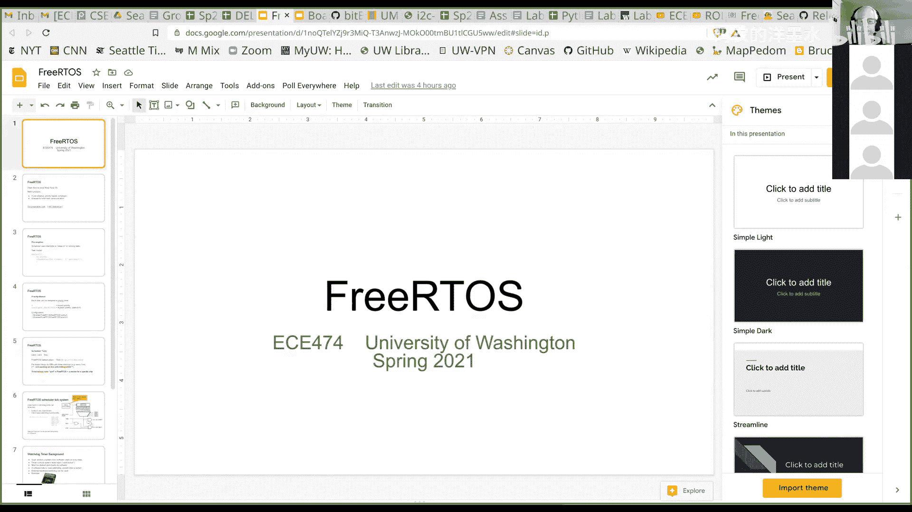
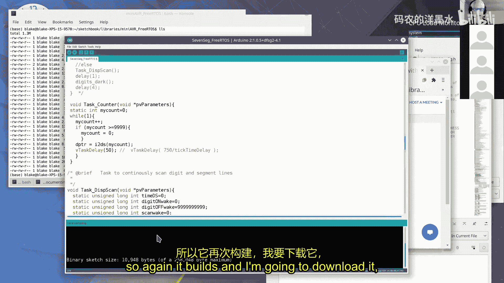
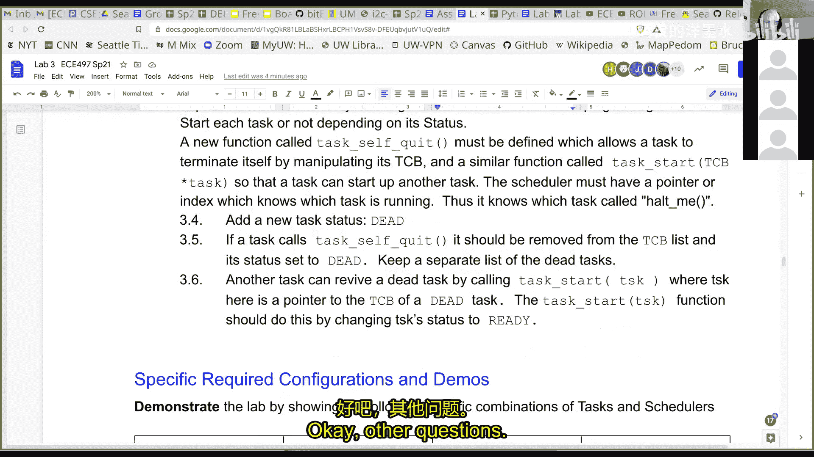

# 【全集 附完整课件】华盛顿大学 嵌入式系统导论 CSE474 中英字幕 p15 Lecture 14 - 实验3导论 -BV1ALqnBWEeu_p15-

Okay， so welcome to 474。 It's May 17th。And。I know you guys are working on the lab pretty hard。

He's a gamer actually no， I'm not， but I， I know good equipment when I see it。 Okay， so anyway。

So yeah， so keep up the good work and the good questions on labb3。

 somebody said that it was that there was not an active submit button。

 but either the TAs jumped on that and fixed it or I couldn't reproduce it in student view。

 it looks like that's working， obviously we want you to submit it so keep on us if it doesn't work。嗯。

😊，And also we are resolving for sure that we're going to get La4 released before the due date of lab3。

 so there won't be delays and we may even extend that due date to make sure you have time for it。

 it's going to be a great lab and we will start introducing it just a little bit today。

There's still a hand up。JaJa， do you have okay。What is the workload for Lab4 going to look like compared to Lab 3？

It's， it's really。A， it's hard for me to know their。You know。

 the target we're shooting for on the labs is about the same every time。

 and I know it's not always the same， so。You know， but it's it's an imperfect science to generate labs so it's targeted to be the same given that it also gives you more flexibility because there's going to be a mandatory component and a project component to the lab so the project component will be under your control and there's some criteria that projects going to have to meet but not all projects will be as ambitious or involve the same complexity。

And。We'll talk about that more， so that's the best I can answer that。U。All right。

 so I guess any other questions， comments before we begin。Okay， as you know， you know， and finally。

 one more thing， it's crunch time on lab。3。Of course。

 and the questions that come in to Piazza are fine and I thinkre we're more or less doing a good job keeping on top of those and answering them in time。

And one thing I would ask is if at all possible make your public。

 make your question public rather than private， maybe you're not even seeing that button or something。

 but if it's public then we only have to answer it once and everybody else benefits and hopefully nobody's making it private so that other groups waste time on the solution to a problem that we've solved so I don't want to see that I'm not accusing anybody of doing that intentionally far from it。

In fact， people are contributing answers to questions and that's awesome。All right， with that。

 I'm going to move on and share screen。

And。Let me know if you can see the screen， but everything looks like I'm sharing the screen。

So we talked about serial data transmission last week and it may have seemed， and it was in fact。

 that we were digging back way into ancient times and talking about like Rs 232。

 which is you know from the 1960s。Type data standard。And much of RS 232 is not used anymore。

 but the key thing is that the basic concept of RS 232 is exactly the same in the modern the most modern serial interfaces。

 which are I squared C and SPI。Some of which you guys have already used they're used extremely widely with microcontrollers。

 including Arduinos。And basically， they make the modern cell phone possible and we'll tell you why in a minute。

So this is a board from the 90s。And it shows a trend that was just choking off technological progress。

 And that is， look at how many pins are on this chip。 They just it's choking off the pins。

 And then the density of the board。 and then look at the PC board and so much space on this PCB is taken up just by running wires from all these pins。

And this is almost comical today， but。😊，Look how much space is taken up and how much basically the progress of miniaturization was threatened to come to a grinding halt。

Because of this issue of so many signals。This is a video card from way back。

 you know incredibly primitive by today's video standards and one of the reasons one of the things holding back。

 holding them back was just how many pins you had to have。Okay， now we get up to a Nexus 5。

 this is more like the 2013 time frame。And you look at this board and you don't see that。

 of course a lot of the traces are hidden， but you do see the traces and there' are fewer of them now this is probably also a multilayer board and chips like this are typically now this chip you see the pins around the edge okay and you see little wires going around not as many and then this chip you don't and this chip is probably what's called a bald grid array which means that there's actually。

A rectangular grid of little balls of solder on the bottom of the chip。

 and so they can use a 2D array instead of pins instead of a 1D array of pins。But still。

 there's not this vast real estate devoted towards parallel lines like we saw before。

And here's the SIim card interface for an idea of scale。And the camera down here。 So it's like。

 I think that's the camera， pretty sure。 So this is a lot of miniaturization。And， and again。

 and we don't， and we don't waste a lot of space on that。 Here's some other board for Google 5。

 Pixel 5。 So this is today's state of the art。And this is one of those tear down。 Actually。

 this is a good thing to look at。 If you've never seen these， here's a pixelixel 5。

And the teardown is a slideshow， so they take the screen off。

And then they start prying a few things off。With one of those toolkits。

 now there's many screws to remove。And a battery is you can see the battery takes up a lot of space。

 we all want a big battery in our phones for obvious reasons。And now popping a retaining clip off。

 that is the phone。Think about it。That is your cell phone。Not only your cell phone。

 but a state of the art。Top ti your cell phone。And so somehow and it's not just one chip。

 so these look these don't look like chips because they come in metal cans to shield them because of the radio frequency interference problem inherent in cell phones and and this also inherent in this tight packaging so the chips are inside here though and again this cell phone is。

Hundreds of times， thousands of times more complex than that graphics card from the 90s。 And yet。

 you don't see the wiring。What else can we get here？Flipping it。

And this is the back of the cell phone where you get camera port and a few other goodies for the cell phone。

Okay。😊，So that was a little tour。And so how do we achieve that。

 We achieve that by cutting the number of wires。 and this problem。

Was starting to become a parent in the 80s and Phils， the Dutch oops， that's not what I wanted to do。

Philllips， the Dutch Electronics Company， which has a new name at NXP。

 developed the first one I squared C Inter integratedtegrated circuit bus。

And we talked about buses before。As parallel arrays of lines。But this is a serial bus。

 And they figured out that because because you're。Just going from one chip to another on the same card。

Some of that noise immunity isn't needed as much， you've got very short runs。

 you've got better signal conditioning， so you can run this quite fast and so it's feasible to eliminate so many pins by sending serial data。

So I squared C is only two wires and therefore it's only two pins per chip。

And they're called serial clock and serial data couldn't be simpler。

So before we get further into both of these， we got to talk about terminology。

 I don't know why I'm double clicking stuff。So when they talk about sending data back and forth。

 you will see over and over the terms master and slave。

And those terms are very offensive to a lot of people， especially black。

 indigenous and people of color。And so we're not going to use those。

 We're just going to say leader and follower instead， Okay。

 because it's true that one of these chips will coordinate and the other one will respond。And。

If you're taking 398， if you took 398 for me， you know my journey on this。

 i've used those terms for years， you could look up look on Google Scholar you'll find hundreds literally hundreds or dozens of publications by me using those terms and my thinking has really evolved because I just。

Think that bottom line is， if people find this term triggering offensive and and and and suggestive of very painful。

Cultural memories and traditions。 It's really honest to honor that and push back at the standard terminology。

 So that's what we're doing。Okay， so here's an I squared C bus。 It's got these two wires。

 serial clock， serial data。It's got a microcontroller， which is the leader。

 and it's got three devices which are followers。And so okay， how does that work well the。

Microcontroller。Or actually， any device can talk on the data line。

And that's why there's an external resistor here， so these devices can sink current。

 but they can't source it， so they can pull the line low。

 but they can't raise it high and this is a way you can have different devices sharing the bus because。

When they aren't pulling the line low， when they're。Excuse me。

 when they're kind of like outputting in a logic one。Then another line could bring it low。

 another device could bring it low by drawing current through this resistor。For bipolar。

 you call this an open collector。Or an open drain。A bus。For Mosvets。

 And then the clock is generated by the microcontroller。 It's a one way signal。So。

 but it's asynchronous， well， it's not asynchronous because it has a clock， but it can be idle。

 so the idle state is when both lines are high。And then this event right here where the data line goes down and the clock line stays high is called a start condition。

 it's really an event， it's the transition from high to low。Of this of the data line。

And then everybody starts to pay attention。And data comes through。

 and then there's a stop condition which resets the bus from。

 which is sort of opposite the data line goes back to logic one。

But how do the chips know what the data means， So this is a packet， This is or a set of packets。

 This is set up here。And so the leader creates the start condition， which we just saw there。

By driving the two lines。And then it sets seven address bits。

And chips that support I squared C just come from the factory with a particular address。

Burned into them。So you want this particular DAC or then you look up what its address is and you write your code that way。

And then it also sends this eighth bit， which is read or write。

 meaning do does the does the leader want to。Get data from the device or write data to the device。

And then the follower， if it recognizes its address in these seven bits， sends an acronack。

Which is a one， if it's an act。So， then。That means that the follower has recognized itself and it's ready to either send data if it was a read request or read data if it was a write request。

 if that makes sense。Because these R and W are with respect to the leader。

So then we start transferring data。 and depending on which direction this。

Itit is the data line is controlled by the follower or the leader。

And then whichever is the other side， and this okay， so this line I drew here is oops。Mmhm。😊。

GodI'm not used to doing present mode， I guess。Probably should be a dash line and also a dashed line from the leader over here because if it's read mode。

 the leader would be sending these as or nas。And I don't think the X or Ns are based on a pary because there's only eight data bits。

 So I think this is just simply。I'm not sure how it detects an error。 If it doesn't act， though。

 that's an error。And this can be repeated， it's not really shown graphically， but this data byte。

Can be repeated as many times as necessary， which would be specific to the individual chip。

 like the individual device may have four registers of8 bits each。

 or it may just have one or whatever。And then the stop condition is asserted by the leader。And then。

 it's done。So you may， those of you who are paying attention may recognize a problem。

That there's only 128 possible addresses。In the whole universe of I squared C。

 but there's a lot more chips out there than 128。And so in fact。

 there's an interesting list at Ada fruitit of I squared C addresses。

And you know for each address there's you know here's one with four different chips so if the address is2 B hex then you've got this capacitive touch center you've got a sensor。

 you've got a digital logarithmic potentometer you've got a digital 10 k potentiometer you've got a temperature sensor and these are just ones that eight of fruit is interested in there's probably others let's see what the record is see 40 is a huge number so that's still that's kind of a problem I mean you may get lucky that your devices that you care about have different addresses。

 but you may not。So what to do。So there's a cup there's the main solution is to get。

Other bits involved and most chips have some kind of enable signal as an input。

And so here's an example of two chips， and they have the same address OX3D。

 and they're on the same icord C bus。And you use us additional pins to switch them on and off so they don't。

They don't collide with each other。Okay。😊，Okay， the other big one that's out there is SI serial peripheral interface。

And it's got the same it addresses the same thing， and Motorola was a much bigger semiconductor company back in the 80s and it is now or at least bigger market share and mind share。

And， you know， it' companies are proprietary， they don't want one company to set a standard。

So let's develop another one。 Oh， by the way。This is official documentation。

 I guess icecod C is kind of a copyrighted term。It's really simple to implement you can't they don't really enforce patents on it or anything。

 but it is owned by this company and we'll see where that shows up。

 but you get documentation excuse me， documentation from NXP。About the bus， and。

There are other modes that are less often used so。For example。This seven bit address is is limiting。

 so they have another mode where it can be a 10 bit address， but that's very rarely used。

 So this is the this is the more common。Way it's used。 There's a couple other features that。

From everything I can tell， they're just less widely used。So。SPI has four wires， not2。

The advantage is it doesn't have addresses at all so you can't run out or duplicate addresses。

 so that's the trade off。And the four bit， the four lines are MoI。

 which is microcontroller serial input and misso microcontroller serial output， and yes。

 I've adjusted the terminology。And then a serial clock， and a select。signal。

And because I guess it's a little more proprietary because' the best reference I could find is Wikipedia rather than some Motorola thing。

 So how does that work， So basically it's shift registers。

And data is clocked through a shift register from the leader to the follower。In every case。

 but it's kind of in this circle。 So in the process of writing to the follower。

 the leader also gets all the data from the follower。Kind of， kind of elegant。

And so how do you do multiple devices？So one of them is chip select， just like with I squted C。

And so the secret sauce is these chip select lines， which involve additional pins。

To the select lines on all these devices。 So three devices。

 one microcontroller and select individual ones。 and then the serial in and out lines are shared。

So this is good because you get individual access to the chips， but the negative。

 and in fact you can read a chip faster and you'll see the alternative is slower。

 you'll see why in a minute。And then the negative is you've got to use extra pins。U。

But there's another way to do it， which is， I call it the big loop method。

And so you just have one select。And you wire them in series in a daisy chain。Like that。

 So the bits come out of the microcontroller and they work their way all the way through So like your software has to understand this topology pretty well right so like if if there's 8 bits if device zero has one register of 8 bits and device one has 16 Bs and device two has 8 Bs。

You've got to shift out。32 bits in the right arrangement so that when you've clocked it 32 times。

 you get the correct bits in device zero and the correct bits in device one and the correct bits in device two。

And you know' you can I think you can figure out how to do that it's not super hard。

 but it's something you got to pay attention to and then also of course you read them in through here so you just got to remember exactly what sequences are wired up so that you can unpack them later。

So the good thing is you don't have those extra pins consumed。

 but it's slower because you've got to do them all at once。

 at least to read like you could imagine an application。Where you have to read device zero a lot。

 like really fast all the time。But device one is just once in a while you read it。

 and device two is just a special case。But with this wiring。

 you're going to have to read all of them all the time because in order to read device zero。

 you have to read them all。And so that could be an architecture decision。

 this is where you get this is where embedded computing is really embedded right because it's like this this decision in terms of PCB layout。

 it affects printed circuit layout because it's fewer pins and maybe it's even easier to route this than separate lines to all of these or whatever。

But the software and even the performance might be much。It might be quite impacted。

 especially if there's a sort of asymmetry and how fast you need to access all of these。

So it's like from the software to the printed circuit board layer， all those decisions interact。

 that's why this is embedded computing。On our chip， there's special hardware to support spot SPI。

 So here's the four。Bits better are pins， dedicated pins on our chip。And this is just。

 you know figure 21-1 from that data sheet， 350 page data sheet， and it's just like， you know。

 with the timers， there's control registers and you would set bits in here to control it。

And you would set， you put your data in here。And you either read it or write it according to what you're doing。

 and depending on who's hooked up to these lines and how many registers are hooked up out there。

 you will read or write a different amount of bytes。And of course。

 this can be set for an interrupt so that it will clock the bytes out at a certain rate。

 but it won't bother your code until it needs another byte to be uploaded。So anyway。

 it's sort of an automated process in Arduino in the A0 mega and you know。

 this is hardware that may or may not be present in different Arduino chips。

But mega is called mega because it has a lot of stuff。Okay， and there's also I squared C。

 But I think because of this copyright or proprietaryiness。In the name， they call it the TwiI。

 which is two wire interface。 Okay， fine， but it's compatible。And I interestingly。

 this is like a diagram that doesn't sort of read the same as all the other diagrams in the document。

 if you notice。Is a professional communication issue。You know。

 we've we're used to these from the timers and the other features of the。

8 mega where you see each bit， each bit has its name labeled and it goes to different places and you see all the connections。

And sort of what goes to what。 Of course， that this doesn't。

 this diagram is certainly not sufficient to tell you everything you know。

 but it has a lot of sort of detail。 whereas this one is a more of a block diagram。 It's okay。

 though， one thing you can learn is that these heavy lines， heavy outlines。

Are the registers that you're allowed to twiddle or access when you're programming？

And otherwise it's more sort of functionally organized and this is the bus。

 the data comes in here or goes out here。And you can set the bit rate right here。

 there's a pre scalear that should be a familiar concept， so using using detail。

To everybody yeah don't I don't know why you know it also I have to say it seems like this thing is more common on in class than in say a faculty meeting or something it may have to do with this screen share I don't know but it doesn't happen in my other meetings it's just you guys I think but at least i've got you trained to let me know now so thank you all right so anyway you can also get hardware support for IcordC slash twiI。

And then it's kind of， we can look at some software examples。嗯。

Again regrettably we're not going to use these we're not going to have detailed lab assignments on spy and icecord C I would encourage you to use them for lab4 if they make sense and some of you many of you used it for。

Lab 2 with the8 by8 matrix。嗯。😊，But I'll just sort of walk you through some of these and I apologize for the terminology。

 which is， again， I think you're going to see， mark my words。

 it's going to be slow because it's so baked in， but mark my words。

 you're going to see this terminology changing from these companies。So here's an SPI driver。

On GitHub。And。Well， that's just how to use it。And basically。

 they're setting up the they're initializing the spy device。Which is that device I showed you。

 And then this is DDRs。 So as you know， this is data direction registers。

 which is just making those pins into outputs。So they actually drive the bus。Um。And an input for。

Microcontroller input data。And then enabling those other pins。And sending a bite。

Is polling and waiting until an interruptive flag is set。But there's basically， yeah。

 so here's like sending a string over spy。While you go through the string until you hit that zero at the end。

And I think I can make this a little bigger， maybe that'll be easier to see I don't know。

 and then you send each bite and increment your string pointer。

 but I was looking I was interested in the lower level。Oh yeah。

 see the lower level is very simple because of all that hardware automation。

 so you just copy your byte into the data register。Done。😡。

It's sent and this is polling and this is actually software that would not work well with our current schedulers because this is just an infinite loop until the status register says it's done sending that by。

And so this means 100% of the time will be taken up by the spy data transmission。Which is wasteful。

 but this is a very simple it's the nice thing is this is good easy to understand code and it's in some applications you don't care。

Also in some operating systems and some schedulers。

 so we're going to see that this would actually be okay for free RTOS that we're going to use in lab for because。

Free RTOS is preemptive， so it can just bust in here and run some other task for a while。Okay。

 so that's this driver。 and then。Um。😊，To wire interface is part of the standard Arduino AVR library。

 which actually comes from， I believe it comes from。um。The the manufacturer。And this one's messier。

 And I'm really not sure if that's inherent or just sort of。

A different way of coding and I haven't dug in yet to see if that's right's it's using C plus plus hence the cP file extension。

 and that sometimes makes software seem more complicated， but maybe more scalable。

And that's with this。Semicolon thing is it says that there's a class。

 this is a two wire class and it now has methods that belong to it。嗯。😊，And so anyway。

 it's a set of functions to initialize it and to send data and setting timeouts and so forth and I won't go through completely through this。

 but。It's also there for you to。Look at。Let's see if there's anything。Specifically good。Okay。Yeah。

 so anyway， it seems like it's a lot longer to do essentially the exact same thing with a lot of hardware support than that other driver and I'm not sure exactly again。

 as I said， I'm not sure if that's strictly necessary or not。

 but that's what's in the Arduinos library。Okay， you will see on various web。

You know various things out there bit banging as an alternative what does that mean what it means is you just assign you don't use any hardware and you may have a different chip which doesn't have any hardware automation for Icord C or SPI so you may have to do this and so you just pick digital IO pins and assign them to those functions and then you write code that just raises and lowers the bits to generate the。

To operate that bus。And so， you know， the advantage is that's completely portable because it doesn't assume any particular hardware。

but the negative is it's quite it's much slower and it blocks all the other code， it doesn't。

 it can't be interrupt driven or things like that。And here's another one。 Sorry， this one。In GitHub。

 GitHub has，s in fact Git has this name master for the default branch and a lot of people are changing their branch structure to be Maine。

 Maine is a perfectly good name actually just to go back onto this subject。

 not only is master slave offensive to a lot of people。

 but in many cases what you find when you sort of start rethinking it and looking for a more acceptable and inclusive naming system。

 you realize， hey， wait a minute you know。Hetty isn't even a good analogy anyway。

 It doesn't actually really tell you anything。 And so it's actually doubly harmful。 And in a way。

 that's true of the master branch， it's。Themain branch or the default branch or anything any anyhow。

This one is just got。Some setup and then so here it's a low level thing where。

This code is flipping bits up and down the clock。The clock high， little bit of delay， the clock low。

 and then a little bit of delay。 So it's all right here。 And it's。

 that's actually kind of easy to understand。 It's just that it's slow and it blocks the whole。

This is really it， right， And this is one way。 This is sending it。

Well no it was for SI it's always too way because it's that loop， so this is kind of nice。

 it's simple to understand， but it's inefficient。Okay。😊，So yeah， it uses the bad wording twice。Okay。

 that is it for Iquad CN SPPI are there any questions about those two technologies？Okay。

 so with that I' going we're going to take a break until three let's say lets let's go to 325 and make it 10 minutes then we'll talk about the operating system we're going to install for the lab for projects and now that you understand what schedulers are and how they work we're going to use an even better one。

So I'll see you guys back in about 10 minutes。

All right， let's resume。 Welcome back。 I'm going to go So yeah。

 so what we're talking about now is free RtOS。 and that is a small operating system。😊。

That you guys are going to be able to use the question there's a question on chat from actually it's quite a while ago and I did answer it。

 but just in case， yes， we pledge that we will release lab four on Wednesday evening at the latest。

So there will be yeah， so that's when we're releasing it， okay。All right。

 so this is an open source mini operating system for little boards like the Arduino and has been ported to many。

 many different chips， all the different Arduinos and other boards like STM 32 and pick microcontroller and the。

Excuse me， many， many others that are out there。From what。From what you see online。

 it's got a lot of support from Amazon。com， but it's definitely fully open source with a very。

 very flexible licensing， so Amazon doesn't control you if you use it and I believe that it predates Amazon by。

Or at least predates Amazon's involvement by quite a while so。

From from what I can tell and I you know who knows， maybe it's controversial。

 but from what I can tell， it's just a good thing where Amazon's putting resources into supporting it。

 namely programmers who improve it。Okay， so it's open source， it's small so。

You knowIt's not as powerful as an embedded Linux or a stripped down version of Linux。

It's not intended for that。Market， but it's for very small chips and or。Chipps comparable to this。

The biggest difference you find when you move up to the more Linux based or even Windows and operating systems or Android。

But Android has Linux inside it and so does essentially so does the Mac at any rate。

The biggest difference is whether the chip supports protected memory management or not and in that case。

 each task is in a protected block of memory and it will be stopped if it tries to。

Write or read data outside its own block of memory so that means one task cannot break all the other tasks which is sort of a huge step up we still have schedulers like all of our schedulers operated on kind of an honor system so if any task wanted to or it was controlled by a malicious hacker it could easily without even the slightest effort it could easily just kill the system for example going into an infinite loop。

But。Many microcontrollers don't have the amount of silicon to dedicate to that function and so they operate like these more simple chips and for that you can use a much simpler operating system and save space so like the binary for the free RTOS is just like 5 k bytes or something it's just amazingly small。

For the kind of projects that we use。So the main things that it has is it has a scheduler which is preemptive and priority based。

 and we'll go into that in a little bit。And it has features called Qes。

For inner process or inner task communication。 So if we need one task in so far。

 if we need one task to。Communicate with another task or share data。We have to be a little careful。

 we have to say have a global variable between the two tasks and we have to make sure we understand。

When one task is done and the other task is ready and once you know for just a flag like when you see this bit do something。

 it's not that hard， but if you have a buffer of data that you need to process from say a camera or a sensor that acquires blocks of data。

Then you have to be much more careful that you don't the destination task or the doesn't。For example。

 start processing a half a chunk of data instead of a full chunk of data。

So Qes can manage that kind of stuff and you can your task can call a free RT call and say。

Let me wait until a cute packet is ready and then give it to me。And we'll talk about that a little。

 I'm going to go ahead and talk about the big picture before we dive into these links。

So preemptive is something we haven't done in our schedulers yet and it makes a big difference and it says interrupt the scheduler can use interrupts from its timer。

To break into tasks that are actually running so we all of our schedulers have relied on each task doing a tiny thing and then returning and by doing that over and over they get real work done but。

It's a sort of artificial constraint on the programmer， right？

You want a programmer to just function on one task。 focus on one task。

And not worry about all the other tasks and not worry about scheduling that's the ideal right so when you have preemption it really helps because you can write your task like this。

Oops。While one， so forever， just do stuff and then maybe if you want to do stuff periodically。

 just call a delay and keep doing it。Okay， so maybe flash and LED。

 So do stuff would be toggle the LED and the task delay would be5 ticks or whatever。

And but you don't even need to have the delay。Because that's where the preemption comes in。

You could just work。And the interrupt will break into your task and maybe start another task for a while。

 but come back to your task so you can finish your work。So that's quite a nice thing and it's yeah。

 it's quite a nice thing。And also priority base， so the task the tasks have a priority level and when we did that scheduler diagraming exercise a couple weeks ago。

 we saw times where you know a couple of tasks would be ready。And it was a little arbitrary。

 Which one do we run now in round robin， you just keep going around and that sort of fair。

 but fairness isn't always the goal。 and sometimes tasks are can just step to the rear of the line because their priority just isn't that high so you can implement that by in in this scheduler。

 there's a。Task descriptor block just like we did TCB， it's not called that。

 but you initialize that when you start every task， as I'll show you。

And if you give it a low a zero is the lowest priority and a four is the highest well。

 it's configurable， can have you can adjust RTOS to have up to 32 priorities levels that's kind of a lot but it starts out at the default of four。

 so you get zero to three are your priorities。And。Once you've installed TrTOSOS。

 you can set these things in the configurations and the variant doh files。

 which are in your library's directory where you installed any other libraries that you might use in an Arduino application。

So。Schedulr ticks。So we've been running one millisecond ticks very fast。

 on the other hand you've got to admit I've got to admit。

 we've got to admit that our tasks have been very simple sure sometimes they're challenging the program。

 but they don't exactly do machine learning or solve the traveling salesman problem or anything like that。

In free RTOS， the fastest option is 15 milliseconds。

And you can find out what your scheduler rate is by the port tick rate Hertz。Defined symbol。

And the versions that we will use are set to 15。And it's interesting to figure out。

 I personally have been playing around and trying to speed that up。

But it turns out you can't and I figured out why。So for faster things。

 we should do ISRs and we can set up a timer and do ISRs， at least in theory。

TBH I haven't gotten that working yet on this board。

 but the good news for you is I wasn't planning on assigning those anyway。

 so if I get it working i'm going to proudly show it to you。

 but I don't think this is going to impact you。Um。Another tip on free RTOS。

 a lot of times you'll see things people talking about ports。

In all kinds of documents and code and this is a different notion of port than we've been using so as you know the chip has a whole bunch of ports ABC D E F and G and each port is8 bits which map dependss and that's great and it's still true however in free RTOS this is this operating system。

Supports many different chips， probably dozens or hundreds。And。

What they've done and what operating systems have done for a long time is they factor out all the code that's specific to a particular machine。

And when you get into servicing interrupts and dealing with timers and things like that。

 every chip is different。And so to the maximum extent。

 all the free RTOS code is the same for every chip。Obviously。

 they really try to hide those differences from you the programmer。

 they want to make it so that you can develop in free RTOS and then if your boss or your company or you decide to switch to another chip。

 you don't have to write everything from scratch， that's their goal and I think it's overall successful。

So anyway， a port means porting free RTOS to a different machine。

So when they say port specific stuff， they don't mean port B。

 they mean it's specific to the Arduino 8 mega 2560 or the pick something or other or different chips so just watch that that'll save you a few minutes at least when you're reading the document for the first time。

So how does the free RTOS scheduler do ticks， we did it with a 16 bit timer。

 but if free RTOS used one of those timers， then the user could not use it and it would be hard to predict which one it was using and they would it would be hard to standardize。

Anyway， in the Arduinos they use this other timer which we didn't talk about called the watchdog timer and so I'm going to introduce that and it's。

A very important concept actually for embedded systems and so this is a good time to go into it。

So this is， I forget which chapter it's near the beginning like page  65 in the our data sheet。Um。

So the benefit of using this for the TC system of the scheduler is it doesn't use the main timers and therefore people just assume if people assume they're free。

 they are free that's good they're available the minus is you can't have watchdog timer functionality so what is watchdog timer functionality。

We'll get to that。 So as you build a port and you or adjust your preferences in。This file。

 I think it's in config dot H or it might be invariant dot H you can set what you want the scheduler period tick to be。

And unfortunately， from my point of view， the fastest is 15 milliseconds。

 but you could get it as slow as two seconds if you wanted。

And that's because this timer has a prescalear just like we've used in the other timers。

And it has similar divide ratios， but it's only 128 kilohertz oscillator。

 generally speaking watchdog timers want to run at slower rates。And we'll explain why。

So what's the point so watchdog timers are very widely used in realtime safety， critical。

 mission critical， medical， all that kind of embedded system， and they go way。

 way back and the purpose is to protect a system from a software crash because unfortunately those happen even if you think your software is perfect。

And the way it works is that a time and here's the thing you can buy them。

 This is an external example that you can just buy is's a piece of hardware in some ways。

 an external。An external watchdog timer is a very good idea because it's completely separate from your software development team。

 so it can't have any common assumptions。And so it'll just work。 hopefully。

 So the way it works is that this timer is connected to the reset button of your。System。And。

And it has an input， a digital logic input to it as well。And every so often。

 the watchdog timer has to be reset by a pulse。From your software， not a level， though。

So it has to be a pulse。 It has to be a level change。And。If the pulse is received。It resets。

 but if the pulse is not received after a certain time， the system gets a hard reset。And that way。

 if this is a temperature controller on a refrigerated trailer truck that's crossing the country with a bunch of stakes。

That are worth a million dollars headed for New York City。If that refrigeration unit dies。

 you lose a lot of meat and a lot of money。And if it dies because of a software glitch in a microcontroller that's controlling the ridge refrigeration unit。

That's a shame because it， you know what if， what if it's just a software glitch and you could reset it。

So you have this watchdog timer， you have to write your code so that it remembers every one second or every five seconds or something sort of modest。

 every  tenth0 of a second， whatever you think is right。It sends that pulse to the watchhog timer。

And therefore， the watchdog timer knows the software is alive and it does not reset the system。

But if the software gets hung in some task that goes into an infinite loop or the stack overflows or something and it just can't run。

 then the watchdog timer will just reset it and maybe maybe that was a rare you know maybe it runs most of the time just fine。

 but there's a very rare set of circumstances where that bug is exposed and in fact this is another thing that happens in those Mars Landers like the one that JPL landed and of course now China landed one they probably have watchdog timers2 but I've read specifically about watchdog timer resets in JPL。

Rovers， Okay， so even though they test it so much on land before in Pasadena， before they launch it。

 they think of every possible thing and they try it and they simulate the mission。

In as much detail as possible。It's just a little bit different when you're actually flying to Mars and actually landing on Mars and so they know that there's still a possibility the software could could lock up and so they have watched Doug timer and then when it wakes up from the reset。

 it sends a it sends data back to Earth and says， well。

 this happened and I don't know why but here's everything I know and it sends back the state of the whole system。

And then JPL decides what to do next。So anyway， it's a very important concept for embedded systems。

Where。Where they're critical。And external hardware is a good way to do it。

I'm sure that's what they do in the JPL one。And also another feature that's designed for security and reliability because。

What could happen， it would be rare， but it could happen is that some task in your system goes a little crazy and starts writing random bits at random。

And what if just by bad luck， it randomly reconfigured the watchdog timer to not function anymore。

Then the system could would easily hang up and the watchdog timer would not reset it。

 Now this would not be a factor with an external hardware based watchdog timer。

 but it would be a factor with this internal one in the chip。So what about that。

 so there's actually a special fuse in the andfuseses are bits that you can program one time and they're permanent。

And they then you if you want to change it， you're out of luck。

 you have to throw literally throw the chip away so you can do things like burn in a serial number or set a few permanent settings。

In a chip。And I didn't ever look up what the other fuses are on our chip that would be an interesting little thing to study。

 but there is a special fuse inside our chip called WTON。

And you can set that and permanently set up the watchdog timer so it can't ever be changed ever again。

You got to know what you're doing and debug your software also with in terms of the。

Onboard inside the chip watchdog timer， this one in particular。

 it has two different outputs which you can enable。

One is interrupt where it doesn't kill the system and reset it it causes an interrupt this is how RTOS is using it as a scheduler tick。

And the other mode is it can cause the hard reset。So obviously。

 RTOS is disabling that mode and just using this kind of like one of our other timers to generate a periodic interrupt。

Okay。That's why I said it's a minus here that this choice by free RTOS means we can't use this as a watchdog timer anymore in a meaningful way。

Now， there's also a possibility where you can。Turn both of these on。 This is a clever thing， too。

 and it can cause the interrupt。And then later， when the interrupt is done。

It can cause the system reset。And you might have software which would really like to save its state。

 perhaps with an error log and say， where was I when this bad thing happened？

And it could save that into the EE prom。And then， do the hard reset。

So that's another option this very interesting flexible timer has。Okay， I'm going to go back up。Yeah。

 so I said， I'm gonna show you。An app that I'm working on with free R T O S。 And as an example。

And I don't know if I'm sharing the screen right just to be sure I'm going to start it and stop it。

Here we go。 Okay， you guys should see an Arduino IDdeE interface if you don't， you know what to do。

And this is called Seven SeG free RTOSOS and so this is an RTOS demo and you have to include free RTOS this is one I wrote and we're going to set you guys up with a working demo app so that you can do the installation and easily verify that you've got it working。

You won't have to start from a blank。Screen， but anyway， you include freerto。h。

 which is all the definitions， you install it in your Arduino library。

And there are one of the problems and opportunities is that there are very many versions of different ports of free Rt to the Arduwinino and they have small differences and they have different names and so this one is Arduino underscore freertoOS。

 H and we haven't finalized that this is the one we're going to assign to you。

 but you're going figure you're going to get that word shortly。

And so I have a bunch of things for driving， you must have figured out similar seven segment stuff for lab three。

And now we're doing some setup。And this is where we get to。Free R T O S code specific setup。

So we're going to create tasks and this is this the arguments to the X for some reason。

 the3R2 of us calls begin with x and V lowercase x and lowercase V and I confess I don't know why。

But in any rate， task C is just setting up a TCB。For this task。

 And first first thing is this is a little funny syntax， but this is your function pointer。

For the tasks function。And then you give it a name。

And then you give it a stack size and as you recall the stack is where everything is stored when it does function calls and。

Not for interrupts that it will be a separate stack， I believe。

It doesn't count against your stack size， but this is one of the。

Sort of professional level embedded systems decisions is how much space do you allow for the stack。

 if you allow too much。You're wasting memory。If you allow too little。

 there's always that danger that the stack will overflow the available memory because it's hard to know in advance how many levels deep you're going to be making function calls。

 if not impossible。In fact， stack overflows have also happened on Mars and so anyway that's just an interesting little fact I forget what this one is but in all the examples I've seen it's null so far so that's what we're going to do and then you set your priority level。

So so in this case， blink is the highest priority。You you can guess what blink does and we're going to see the code and zero and there's a configuration of the max priorities and you know so zero to three is your range basically by default so this is the highest priority and then this last one is a。

A pointer。Where it will replace that， it will point that pointer to the task。

So it's called it's going to I think it's called a task tag so if you need to know the name of a task for some reason and there are reasons like you want to control some other task within your task。

 then you would put pointers in here and we'll try to if we need that we'll put us an example in。

But but when it's null， then this is ignored， but you notice that as this is there's no return value from task create so we don't。

Have a tag for it， a way to talk about it or label for it。But to first order for many systems。

 we don't need it。Here's another one to scan the seven segment display。I've turned it off right now。

 this is easier to。Do then with comments， because。It's one character instead of stars and slashes and stuff。

 So this is we will be getting to this， but right now it's turned off。And then there's another task。

 which just counts。And that will drive the seven segment display。😊，And then we start the scheduler。

 and we're done with setup。And。All right， I'm back。Thank you。But， I'm going to check。Chat。

 just in case。Think it's there， yeah。To。What happened to chat there？😔，Yeah， all right。Yeah。

 so anyway， many of the examples I've found， say at this。Point。Scheduller starts automatically。

And that comment is there。And I couldn't get anything to start until I actually manually started the scheduler。

And then， everything worked。And I think this is， again。

It's going to work slightly different on every port when it ports the operating system to each different chip。

There are slight differences， so I think that's what what bit us there。

 but the good news for you is i've solved that so this is wrong you actually have to manually start the scheduler。

Okay。And then in RTOS， the loop is empty， it's just nothing。So just leave it empty。

And then we have our tasks。 Okay， so， for example， task counter。It has account variable。

 which is static， that's important， so it remembers it each time。And then forever。While one。

 we're going to just increase the count。And if the counts greater then。

99999999 willll reset it back to zero since I only have a four digit display and then I have a function which converts。

The number， which is an ant into four digits。So because that's how I chose to implement this。

 later on we'll convert the digits to segments。And then we're going to delay for 50 operating system ticks。

😊，And since the tick is 15 milliseconds。15 times 50。Is 750。

 so it's going to be three quarters of a second and。Actually， I don't。Remember thee。嗯。Symbol。

 but I' will get that to you。Sometimes in。In examples， you'll see the following instead。Okay。

 and so this way， this will take we wanted 750 milliseconds。

And if we divide it by the tick time delay， and the reason I'm not actually typing it into the code is I can't remember right now the exact。

Symbol for this value。 But this is 15 milliseconds。 And so then it divides it。

 And now it knows how many ticks is the right value， Because， again， this is in units of。

15 millisecond ticks。Okay， so you'll sometimes you'll see this division and that's what it means。

 it means the programmer wanted to specify milliseconds。But the tick rate is not milliseconds。Okay。

And then display scan is not running。And actually I don't even need most of that stuff anymore。

 but the way we're going to do it is while one， we're going to go through the digit positions。

Want0 through 0 through 3。And we're going to light up the digit that's selected。And we're going to。嗯。

呃。Get the。嗯。Digit value。 This is actually。This is using a global， so it's a little unclear。

 but this is getting the digit。That we want to use like seven。So this is identify。0 through 9。

And then I have this big set of ones and zeros， which tells which segments are lit up for which digit value like seven is this and this。

 okay， and then light up the segments。And then we're going to delay for 15 milliseconds。

And then we're going to clear the segments and delay for another 15 milliseconds。

 So it's going to be on and off 50%。And then we're going to go to the next digit， and repeat。

And so we can call delays， but we don't have to return ever。

But that task is not and then there's various functions like this is converting the digits the four digit number into individual digits all right。

All right， and some of this is for lab three stuff， so I'm not going to share that code with you but。

Okay， so let's see what it does。 It compiles， and I'm going to download it。And oh。

 and I didn't show you blink。Find it。Maybe it would have been easier to scroll。Okay， task link。

And basically， it's very simple， so。The first time we execute it。It sets the pin mode， which is。

 I actually also did it in setup up， so this is probably not important。

This is just another way to write an infinite loop。I think wild one is better than this actually。

And then we're just going ahead and using Arduino functions。

Because basically I got this demo from these two folks。And so we set the built in LED on。

Oh here it is port tick period so here's an example so we we wait for 200 milliseconds。

 by the way this is approximate because it's an integer divide by 15 milliseconds so that's not going to work out exact。

So that's a thing to keep in mind and the comments off because I just wanted to speed it up I thought this was too slow。

 originally that was 1000 of course， and then we turned it off and we have another 200 so this is a total 400 milliseconds approximately with an on and off。

And right now， and counting is a simple task， too。I already showed that。We're just counting。

 resetting， and delaying for 50 cycles。Whatever that worked out to，7，50。 Okay， so again， it builds。

 and I'm going to download it， but I'm going to first switch。

I think I'm going to stop， share and switch to the you guys should go on speaker view so you can see my little circuit board better。

I think you're not going to be able to see the display update very well， but you'll see that we are。

Oh， I can turn this off。Okay。So I'm going to download。But it's not downloading， Why not。Uploading。

 actually。There it's uploading。And now you see the little light flashing on and off。

 and that's 200 on 200 off。Okay， and then now we're going to enable the display task。

And what do you guys predict how this is going to look， just spend one second thinking。

 how is this going to look？So to enable the task， I'm going to go from zero to one here。

And now we're going to also start the segain segment scanner。It still compiles。We're going to upload。

 It's uploading。And now， oh， it actually comes across at least what I can see if I pin the video。

Pin video。 Yeah。 so you can see what's happening。 Actually， this is reversed。😊，On my screen。

 maybe it's not reversed on your screen。But you can see， it's counting。And in reality。

 the segments are not reversed。And you see， it's very flicky。Okay。😊，And so that shows you some tasks。

Unfortunately。I found with lab 3 that you can't。F them and get rid of the flicker until you get down to about 5。

Milliseconds per digit。Which should be feasible for La three with our one millisecond scheduler。So。

 okay， I am going to。Wind up。 Oh， I wanted to， I think I had one more slide。

 actually or two to go over。Or one more thing from a slide。Oh yeah， right。

 so interrupt I want to implement an interrupt。Yeah。

 I want to interrupt and I want to implement an interrupt service routine to scan the seven segment display so I can do it every five milliseconds and make it rock solid and not flicky。

And so I'm working on that， but to be honest it's not working yet freezes the system and what are the why what what are the complexities and I just wanted to show you so this is what remember we used a macro before ISR and I told you that that appended and prepened magic codes to before and after your ISR to protect everything else obviously that has to be done exactly right and also that's machine architecture dependent。

And so this is what the code looks like。For I'm going to you're not seeing that yet。Okay。

 you should see now some a pound of fine in the upper left ISR down in the weeds。

 and so this is the code called port save context port again meaning。Specific to our chip。

And I think the problem I have is not having this set right so far anyway。

 what you're seeing here is actually aseler machine language where each line is exactly one machine instruction。

And because stack operations are so common。And they're done every interrupt。

 every subroutine call over and over and over， they are implemented completely in hardware and they're fast and so push R two means。

The second register in the processor， processor register to， push it on the stack。

 copy its value to the stack pointer， and then increment the stack pointer。

And so this is pushing all the CPU registers， and there's 28 of them。Onto the stack。

And I don't remember what LDS is， we're not learning assembler， perhaps a good thing。

But and there's these other instructions and I haven't really figured out what they do and the good thing is I don't need to know what they do。

 but I just wanted to show you that all this happens just at the beginning of an ISR to make sure that your ISR can use the registers without erasing what was in them。

Because after your ISR is over。There's a similar thing called port restorestore context。Or yeah。

 and the similar code。Popps them off the stack。In reverse order， because。

Whatever was put on the stack last is the top of the stack。

So that's a lot actually with 28 registers。 The good news is each of those lines executes in a very small number of。

😊，Microseconds。I don't and it depends a little bit on what instruction it is。

 but the good news is this takes very little time， but it is a lot of work and has to be done exactly right。

 otherwise the ISR will fail。Okay， that's all for today， except for questions， I'll throw it open。

Hey， professor， is it possible you could go through how exactly task5。

 like overall is supposed to run because it's still a little confused。

Have you been following the yes， I have been reading the piazza， okay。

 because we've tried to clarify it。Um I'm still a little confused yeah， that's fine。

 I'll I'll do what I can。U。Alright， and I'm going to share that。If I can find Zoom again。

Okay， you should see tasks for the lab3 document， everybody see that。

And there are a bunch of people already on the document， which is great。

So taskask five is the idea is that task doesn't do anything， it just controls other tasks。

And so it should start task one and just leave it alone， task one should do its thing。

 which is flashing an LED。And then it should start task two also。

 but after it runs twice it should stop it should stop okay， so let's see task two。

Already plays the theme twice and then stops and then it's done so that means it should run once okay because one definition。

 the definition of task two is playing the theme two times。So run task two。

 but it should then stop now you may have to modify those tasks just a taD to tell them to stop when they're done that task not not task one。

 but you may have to modify task two and tell it so that it。Asks to stop when it's done。

Which is one line and remember we talk about this up in the。Well。In一。Anyway。

 that's what that should do。And then。After task 2 is done， start task 4。

To count down for three seconds。And task 4 is combining 2 and 3。 So I， you know， that's it's。

 I can see that it's complex。And so。What's unspecified in task3。

 the seven segment display counts down until the music starts， right， And so what's unspecified here。

Is how long to take to count down。Before it starts。

So that would be countdown for three seconds and then start。Task。wo。And then there's the smile。

 it's just a different set of bits into the seven segment display。After the， after the the。

After task。C， part C completes。This two seconds begins after the completion of 5 c。

So it's kind of like at the end， there's a smile and that's it。Does that make sense？

 Does that clarify it at all。Yeah， I think I think I get it so。

So we should be building task four in a way that allows us to start it and stop it where the countdown is variable because right now I have it like hard coded。

And。I could hard code it。Like at first。Only countdown for three seconds instead of because。

Just when we have just task four， we have it counting down for four seconds。

 so that's how I have it coded initially。But I would have to change some of the code because here。

 here's if you read it precisely， okay， then。Task 2。Place the theme。

Pauses for four seconds and plays the theme again， right。That's what it says here。嗯，嗯。Okay。

 so it starts the theme immediately。And so what's asked for here。Is to count down for three seconds。

And then， start task 2。I'm sorry。Oh， I see why this is confusing。 I'm sorry， yeah so。呃。

This is after task2 is over。And。So， I guess what I。Yeah， okay， I see。I guess what I meant here。

 And thank you for the clarification。 And I'm going to。

I'll announce this that I'm making this change。What I'm going to say is just start taskask two again after three seconds。

Does that resolve it to you？Does the task for countdown have to be the correct timing？For example。

 since it's in 10 of seconds， it should be counting down from 30 to zero。Yeah。😊，Okay。I mean。

 you just write a countdown that takes any argument right yeah yeah yeah I'm just yeah that' was just basically it my question like would we be able to modify task for because？

Or just make a different function because that wouldn't really be task four in that way but。Yeah。

 yeah that that answers my question。 Thank you。嗯。I'll tell you what。You're right。 It's not task for。

 I'm just going to say。After task 2。Start a countdown for three seconds。How does that sound？

Yeah that that's a lot more clear thank you very much yeah。

 I'm sorry about that no problem no problem。So professor for5C。

 when we restart test two for the one last time， there would be no countdown for the interval between playing two themes。

 right？No， task2 is unmodified， right， y y。So oh， I see。

It would just be four seconds and doing nothing， is it？Yeah， I'll say that's acceptable。Okay。

 and professorsor I have a question about implementing task 5。

So currently my group have like a round Robin for task five itself。

 but we feel like that might not be the correct way or the way you expect us to do it。Well。

 here's the thing。Task 5 is only is only demoed on the DDS scheduler。 If you look at these， this。

 this is the specific demos you have to do。Does that make sense。So with any other scheduler。

 you do not run taskask five。Yeah， yeah， why man's so for DDS。

Our implementation of task five itself looks like around Robin。

 so it's like within task five we have an internal timer and then it would start those tasks like oh use the time delay function。

 use this the sleep function then task five。Okay， the point is to use the new features of the DDS scheduler。

Okay， I see。 And so， you know， this is just a general point。 And you'll see this like especially。

 you'll definitely see this with free Rt 2 is it。When you have a different scheduler。

 you have a different way of thinking about writing a task。

And you want to use the features that the scheduler gives you。To make your tasks work。是。Makes sense。

呃。Yep， I think I don't want to write a scheduler within a scheduler。

Yeah yeah that's what we've been doing and we think that it shouldn't be the case。

 but we couldn't figure out like what is the correct way to do it and one last question about the task self quit function。

Yeah， for the function I read on PSI you say that it should only quit the task itself。

 so are we allowed to pass any parameters into the function or it should be just be a void if you want another task if you want a function to kill some other task and make it stop you you should you can write it。

But it's not the same。Then how would it be able to queue itself if we don't pass in any parameters to this function。

 You can figure that out。 The DDS knows what task is running。 So when that is called。It will。

Change its status to dead。The scheduler can change it to dead。 and then it should return。 Okay。

 you know， it will return after that call to kill self。 but then there should be a return。

Right after that。In the task， I see。So then after that return， the scheduler says， okay。

 what task do I do next。And that's some other task。

 but when it eventually gets back to the original task。

 it will be in the dead status and so it will not be restarted。Okay。Does that make sense， Yep。

 thank you。 Great， good questions。 Everybody's questions are good。 and I apologize for the。

Confusing wording。Okay， other questions。

All right， see you guys on Wednesday， good luck with the lab。Oh， thank you。

 Professor by Sunny I actually okay， I do actually have a question I think of it。

First， the way it normally works is you ask the question and I answer it， and then you thank me。

 but this is fine too。Okay， I just wanted to quickly clarify just make sure I have my right understanding for the scheduler types so that the round Robin the the way that the tasks are built is like each time we run a task it's like a little tidbit of whatever action we need to do and then with the synchronized round Robbin now that we have the interrupts are the tasks now like the whole。

Function， or they still It only it doesn't change anything。 It's still， I like that term tid bits。

 We should call the tid bit scheduler。 Okay， it's great。😊，It's still going to do tidbits。

 But now at the end of the list， it's going to wait until exactly1 millisecond and then go to the top again。

And that way， all the tasks can count on， this is a 1 millisecond loop。Okay， so it synchronizes it。

 but it doesn't change anything else。呃，O。I think we were already doing that all right， cool， great。

 even better， Yeah， you're welcome。Hey， professor， there was another question in the chat。

 I was curious of what the answer was okay。About the format for the exam or oh yeah， yeah， yeah。

 yeah。To be honest， I've been working on lab 4， and I really want to get you guys launched on that。

 And then I'm going to。Just nail down all the questions about the exam。Okay。

 and and and we'll give you study guidance and stuff like that。

 but it looks like it's going to be an exam week in the scheduled regular slot。Okay。

 I can relay the information this have。Oh， thanks。 Okay， yeah。Excellent。

ok。😊，Thank you。 See you guys。