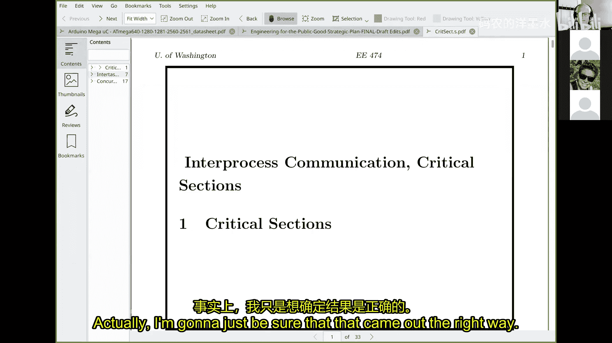
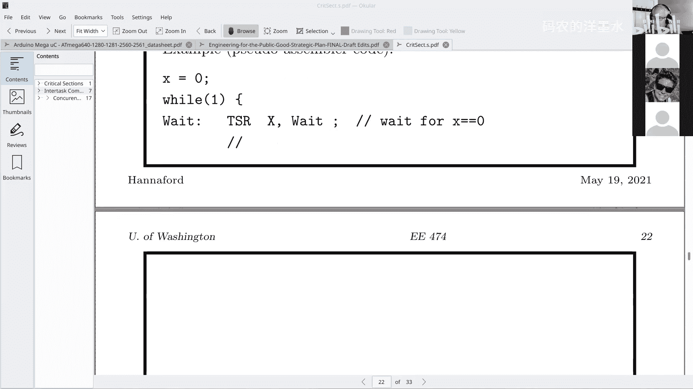
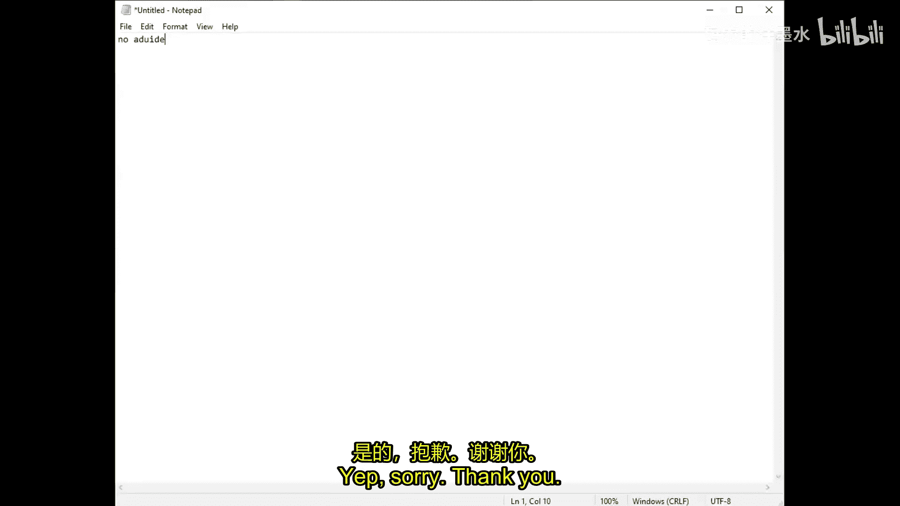
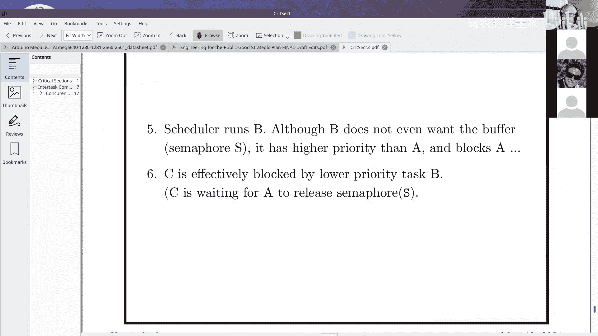
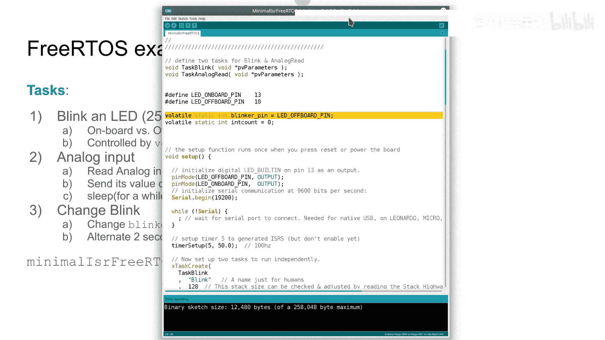
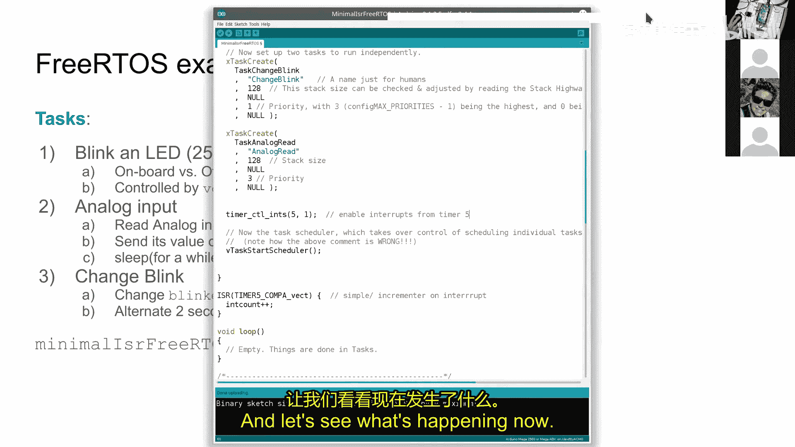
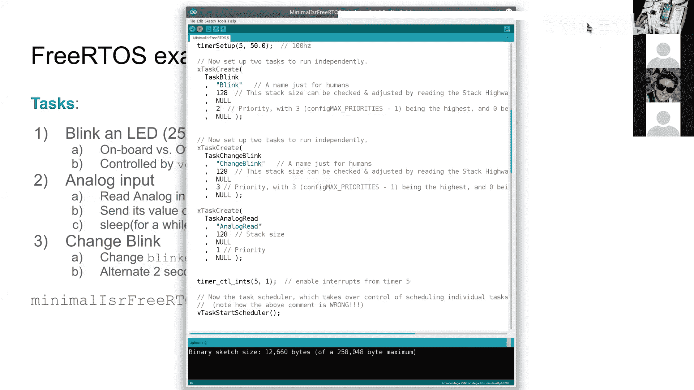
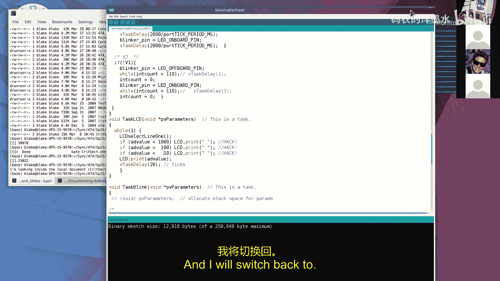

# 【全集 附完整课件】华盛顿大学 嵌入式系统导论 CSE474 中英字幕 p16 Lecture 15 - UART串行通信 -BV1ALqnBWEeu_p16-

Okay， so welcome back and。Welcome to class。 What we're going to do today is。

I guess first I'll just take questions Q&A that might be out there you many of you are still cranking on lab three。

 I guess。Anybody want to inject a question？Okay， we may have some people not even attending right now so they can work on it。

 but that's whatever it takes and that's where our recording comes in awfully handy。Okay。

 so what we're going to do today is talk about a continue with talking about RTOOS， free RTOS。

 and operating systems like it， which have a long history and are widely used in you know。

 sort of mission critical professional level embedded systems beyond hobbyist Arduino systems。

 but as we've seen， there's a port to the Arduino， and that's really a great opportunity。

For for learning here。And you know， one of the reasons is you guys have been struggling to learn how to write tasks that integrate with these different schedulers。

And there's two factors。 One is you've got to keep your task doing a little tidbit。

 as somebody said and then returning， doing a little bit return， little bit return。

 You can't break that discipline or you will impact all the other tasks。 And the other thing is that。

Clearly， you want to sort of standardize。 So if a company has a product。

With a kind of developed base of embedded code that and then they want to increment the product and somebody says。

 well gosh， let's use this new chip。You can see now from thinking about that 8 mega 2560 data sheet。

That you're telling the engineering team， if they're changing chips， it's like， whoa。

 Now everything potentially changes all those symbols， all those timers， counters， settings， modes。

 interrupts。That's a lot of work and those changes are going to propagate all through the code and they're going to be everywhere。

So instead， if the company is writing their code with a operating system。

All the most of the application。Will stay the same and it's somebody has to port the operating system to make that operating system run on the new chip。

And that's either a special team on the company that just gets that done。

 then the code moves over and maybe it has to be tweaked， but most of the heavy lifting is done。

Or it's a consultant who comes in and just does it。 Or the chip manufacturer says， don't worry。

 we did it。 Here's the code。 Now you can run your free Rt O S applications on our chip。

 And so please give us money instead of the other company。So that's the thing that can happen Okay。

 so now what are some other you know， key features of operating systems like this and one of the big differences that。

RTOS we've already seen is it's preemptive so you just write your code for your task don't worry about the other tasks。

 but RTs will stop and switch tasks when it thinks it's the right time。

So let us go to another window here and share screen。I thought I was able to see that。 But， oh， yes。

 I am。

All right， so I assume people can see the slides now。Actually。

 I'm going to just be sure that that came out the right way。

I'll just chair the desktop and then blow this up。That way I don't have to worry I'm seeing what you're seeing all right so inter processces communication and critical section so yeah another thing that's a kind of grown up big girl big boy feature of these operating systems is that you don't have to just use globals anymore to share data between tasks instead much better you can formalize a protocol for sending messages and standardize it for sharing data。

So we're first going to talk about。Transform transferring data because actually this is a mislabeled section and these are really old slides。

 it says I just did it today， but I just tuned them up today back in the day I actually。

Taught this using an overhead projector and those films。

 And there was actually what we did is we had a little。Graphics to represent。

The computer's memory and we actually had little plastic buttons and people were moving them around to move to to kind of have a give it a sense of reality to sharing data and moving it around between pieces and memory。

 So now I'm going to ask you to just do that in your imagination。For two reasons， mostly， though。

 that we're just not in person， we'd figure out a way to do it in person。 Okay， so this is a very。

Important or， you know。U。😊，Canonical way to think about data transmission between tasks producer and consumer so data one task produces data and the other task consumes it and you can easily think of a bunch of examples like a web server the producer is digging up data from the disk drives and the consumer is a thing that's communicating that data on the network。

Of course， each consumer is usually a producer as well， but we can sort of focus this down。

To consumer and producer。All right。So yeah， the human example is we made some grids on the projector and moved these tokens around。

So， you know， in pseudo pseudo code， which means what would a person？

How would you tell a person to do it we'd say if there's room。

 the producer add one of your items to the shared buffers。

 so we had a little grid of five squares and the producer could put a plastic button down there。

And otherwise， if there's no room， just wait。And the consumer had the opposite instructions。

 if an item's available in there， take one。And if there's no items in there， then you wait。

 this is very simple。And then going you know a little more to pseudocode。

 we have a buffer size of five， we have a thing called an item which is a plastic button。um。😊。

We have a struct for the item called， which has the。consumed item。

 a pointer or an index into this buffer of five， the next item and the buffer itself。

 and then we have kind of some integer indices which are like pointers。

And then so the code for the producer and consumer could look sort of like this。嗯。

While if you're the producer and your count of currently you know buffered outputs is greater and equal to the buffer size should never be greater。

 of course， then just wait， remember that a while statement with just a semicolon after it means just spin there and keep testing。

U。😊，Not doing the rest of this Then if there is some space increment the count。Produce the item。

And put the item into the buffer， according to your input pointer。And the input pointer keeps going。

 but then when it gets。To the end of the buffer， it resets the beginning。And since you're counting。

I guess actually this has a little bug in it， we also have to reset the actually no， this is not。

Okay so this is incomplete though， because this does not ever once the buffers filled up。

 this can't ever do anything except the consumer is a separate task。

 so it's going to be scheduled back and forth by this preemptive scheduler and pre assuming the count is a global when the count is zero。

 there's nothing to consume so you also wait on this condition in the consumer side。And then you。

 if it's non zero， you reduce it by one， you take the item out of the buffer and you've got your consumed item。

You count it， you move the pointer and you rotate the pointer if necessary。

And then you kind of consume the item。While you're waiting。So this is running in parallel with this。

 and it can be on two separate processors in a multi processor system also。

But this is a way that you can kind of buffer this so that both can work at the same time or can be scheduled at the same time at least。

 what you don't want is what sort of a built- in and assumption here is that producing an item takes a significant amount of time。

And so you don't want the consumer to just wait。While the producers consuming producers producing。

Ideally， this can produce a little bit ahead and then the consumer can work while the producer is also working。

Even on separate processors， but on single processors。

 it would be just scheduled back and forth according to the operating system ticks。Okay。

 so this is where we had people kind of mentally executing this pseudocode。And so that's interesting。

's not， it's much more interesting than you might even think。

So before we get to the the really complex part， we'll talk a little bit more about how you pass that data。

 So one way is shared memory that's kind of like。Global variables or shared buffer。

 which would be not global to everybody， but shared by just those two tasks。And ring buffer。

 PIFO and shared buffer are different ways that that could be done。Actually。

 really the ring buffer and the FiIO， the shared buffer， both of these are shared buffers。Okay。

 so if it's just one buffer and remember， a buffer is just a block of memory。

 that's all we're talking about。So okay， it can signal the consumer。

 the consumer clears the buffer and then signals back to the producer。If you have multiple buffers。

 then they can work simultaneously。And your producer works on A， consumer works on B。

 and then you just switch the pointers when they're both done。Double buffering。

The ring buffers what I mentioned before， you've got say five data storage buffers and you keep going around in a ring and the consumer sort of chases the producer if the consumer gets ahead of the producer it stops and waits or catches up with the producer。

And that's what this pseudo code sort of says。And it。It says， but gosh。

 the input pointer has got to be not equal to the output pointer if that ever happens。

 then the producer and consumer are working on the exact same buffer at the same time。

 that's an error。 And so that's where that's what this wild statement indicates。

And last in first out， it's a little more rarely used except。For stacks。

 stacks are used all the time， but not for this particular inner task data sharing。

Because this one is the last one that went in is the first one out and so then your data could get stale or you could skip you know the consumer might not see the data in the order that it was produced which may or may not be a bad thing the consumer may want only the freshest newest data and not care about the old data that's depending on the application。

We see that in medical robotics actually， where a remote robot， okay。

 if something happened with the network and it got instructions that are old。

 it doesn't matter it wants the latest ones。Okay。So this is really the same。 It's just that we。

Increment and decrement the pointer a little bit differently for the producer and consumer。Okay。

 message， message passing。Um。If the operating system supports messages。

 instead of tasks just winging it and figuring out a way to send messages between each other that is the programmers figuring out a way。

 you structure that and there is a official way that the operating system supports。

And then processes are a little， you know that's there's only one place to fix bugs instead of every application fixing them themselves。

Message passing， mailbox， cues we're going to hear about in free RTOS， these are different names。

 pipes， all these things are different names for slight variations on the same thing。

So an example might be a producer which。Works for a while and produces data， and then it says。

 you know operating systems send message to a particular process or task。

I'm using the terms process and task interchangeably， and this is actually sort of incomplete。

 You really ought to have a second parameter here， which would be。

Message buffer that contains the data in the message， but this is very pseudo code。Okay。😊。

And then just keep doing this。 And the operating system itself will take care of。

Managing pointers and stopping the producer if the consumer falls behind。 So that's what you want。

Another version， mailbox。 and， you know。嗯。Basically。

 you're going to see all kinds of things that are very close and not exactly the same。

 So when you go into free RTOS we'll learn their cues and they'll incorporate different aspects of this。

But。You your task may set up a mailbox and we'll give it a name。

Mailbox one to two and then statuses returned and that might say mailbox success otherwise we couldn't set up the mailbox okay。

Why wouldn't we be able to well， maybe the operating system can only do 10 mailboxes。

Because there's not enough memory。In your little tiny chip and so it run maybe the 10 mail boxes are already used up so then it says nope sorry。

 so then your system crashes， but you know why it crashed and you now know how to fix it。While one。

 compute and produce data post message to the mailbox name。

 So that would be this or maybe it returned some kind of。Ugly pointer to the mailbox that it sets up。

 and you would use that pointer， different variations。

And then process two knows the name of your mailbox somehow。

 knows it may know that it may share that pointer or maybe you do use an ASI string to indicate the mailbox。

 and so now we do something called pending on the mailbox。Which will just sit here and wait。

Until data is available in the mailbox and panned demandans wait。Like patent pending。

 meaning we applied for a patent and we're waiting for it。

So that term pen and so wait for the mailbox to have mail in it。

 it's like you know the university decision for your admission is coming in the mail so you like stand by the mailbox until a mailman comes。

All right。Um。Yeah， and now since since the operating system is handling this。

It can be integrated nicely with Schr， so if the sender is sending the message， it may you know。

 depending on exactly how it's implemented but what you may want it to wait and block until the message is received because I can't send another message。

Or it will see in F RTOS， there's a Q。Meaning a line。 And so there's a whole list of messages。

 and it puts your message in the queue， the receiver。Is reading them in the order they were put in。

And of course， the Q has a certain maximum length， so you will then block if you exceed if you fill up the queue。

And so the sender is sent to waiting。Set to waiting until the receiver gets the message or the queue fills up。

And then the scheduler will just skip it every time there's an operating system tick。

And the receiver is set to waiting until the mailbox has a message in it and then the scheduler will just not run it。

If there's no message。So that's nice because you don't have to worry about that stuff anymore。

It's taken care of and hopefully other work will get done， nothing will get blocked by this message。

In a more sophisticated OS just a little bit more than what we're doing now we're we're close that might be possible over a network。

 so maybe the PRc the the。AProcess ID includes a host name。

And then the operating system can send the message to another host and get an acknowledgement when the message is read。

That obviously opens up a lot of interesting capabilities。Same thing with mailboxes。

 they could be on another computer。Okay。😊，So now this is where we get to some hairy stuff that is important and。

To that can cause， I guess why the reason I call it Harry is because it can cause really obscure bugs。

 bugs that are hard to find。And we'll get into this notion of the critical section。

Why bugs can be caused。And how to fix it。So what is a critical section。

 a critical section is a short segment of code， and it's up to us to write code so that the critical sections are short。

USo having a critical section that's too long is one of those problem areas like ISRs that are too long。

And it's a short segment code which much must be done as a unit， it can't be interrupted。

And we saw preemptive operating systems can interrupt your task at any time。

But we can fundamentally break the logic that we went through in that pseudo code for producer and consumer。

If an interrupt can happen at any time and we'll get back to that。So in those examples we did。

 the classic example is。You look at that buffer count。

 let's say you're the producer and the buffer has five slots。So you test it and it says。

 and there's two producers， okay， that can happen too。So now your code says。

 how many are there any open slots in the buffer and you find out there's two open slots？

And then you start producing and filling up one of the buffers。But。Now， because of preemption。

 you could do that test， you could find out that there's free space。But then be preempted。

 another task now consumes that space or fills it， I should say， produces data and fills it up。

And now you get back to your code again and you think you checked and you found space。

 but actually it's not valid anymore。Because the code between testing and filling the buffer。

Is a critical section。So that， so we'll see some remedies， how to fix that， how to。

How to how to fix that。So one brute force method is to block interrupts or mask interrupts。

If you block interrupts， you can't be preempted。And therefore， that can't happen。

 No other task can mess with。The shared buffers。While your interrupts are masked。

So here's an example of pseudocode， you OS interrupt mask。

 which means stop the you know block interrupts， which would be a little different thing in。

Free RTOS， but in you know we could even just set bit seven or clear bit seven of the status register of the whole chip and that turns off interrupt。

Now we check is data available and the answer is yes。

 and so we process the buffer and then we set these flags appropriately and after we're done with all of that。

We interrupt， we enable interrupt again。So see here。

 if an interrupt occurs right there in that comment， comments don't actually take any time。

 but nevertheless there's a gap here， interrupts can occur in between any two CPU instructions and a given line of C code can easily be several CPU instructions。

 so it can be interrupted right in the middle of one line of code。Or between two lines of code。

But not if we mask the interrupts， so this is a solution。It protects our critical section right here。

 which is this whole thing。So it prevents preemption by the scheduler or an ISR might mess with the buffers。

 not because of a bug， it might have a legitimate reason。

At other times to work with those buffers or flags， but if it happens during that critical section。

 that will cause us a bug。So the pros are， it's very fast。 You just。

 it's one instruction to mask interrupt， block interrupt。 the cons are it's it's it's a， it's a。

A blunt instrument。It's brute force。 It's too greedy because that means all devices are blocked from doing interrupts。

 even if they have nothing to do with your critical section。Completely separate。

 they get blocked as well， and that will really hit that will really cause a hit to your systems' overall performance for no good reason。

Okay， so what's a better solution so this goes way way back the IBM 360 is a computer from the old and old and olden days you know a million dollar mainframe。

But they had this problem and they began to create a hardware solution。

And that's a machine language instruction called Test and set。

And what that does is it puts the testing。And the， then the decision making。

Right in the same instruction so it can't be interrupted。

You can interrupt on instruction in this machine language， okay。

 so it's all very fast hardware instruction。So， what this says is。嗯。😊，If this register R is not zero。

 jump to this address and do that in one atomic operation。

And so that's this is pseudocode for that machine language instruction。

 but it's not two instructions and therefore it doesn't， it can't be interrupted in the middle。

So pseudocode would be。This should be a capital X here， we set that to zero。

Yep， sorry。 Thank you。

um。😊，I don't know where that exactly happened。 I was looking at the slides and not the hands raising。

 but a lot of them raised。 So thank you for that。And yeah， again。

 I just don't understand why this happens in class and not in other zooms as much。Um。Anyhow。

This instruction。Is the sort of an atomic uninterruptible operation。

 which is the kind of like the smallest， most minimal thing that can effectively implement a critical section。

So here's an example where we have some critical section code right here like manipulating buffers and pointers and stuff。

And we protect it with this test and set instruction。Again。

 we wouldn't really have to use machine language or assembler in real life there could be a C wrapper around this and we'd have something a little more nice。

 but at any rate it just stays in this loop until the semapho goes to zero we call that a semaphore i'll explain that later。

 but this flag。And then， it can drop through。And。Now， after the critical section。

 we reset that to zero again。And but when it tests this。

 so the whole point of test and set is if r equals zero， r equals one。

That seems like almost like a pointless instruction， right or。But it's the L's。

 if its it instantly clears this condition。 So it does this jump exactly once。

And then somebody else has to clear it so as soon as this fails and we drop through x is not equal to zero anymore。

And all and all other TSRs on that same resource will block professorfeor are you screen sharing？

I thought I was。

When did we lose screen share， Good grief。Thank you。All right。

 I did not intentionally stop screen sharing。 Did you guys see this， this code before。Yes or no。

 it's a yes or no question。Yeah。All right。Okay， so at any rate。

 this little step happens instantaneously so that if any other task is running this TSR。

 it will block as soon as we drop through that's the secret and then we can just clear that flag to release the critical section again。

So fortunately， we don't have to do any assembly language。

 but that's kind of how it works at the lowest level。

So the pros and cons of test and set are it's super fast。You can do， because it has an argument。

 it can do lots of different resources independently of each other。But gosh。

 this is low level and somebody has to set up what what is X for each resource。

 I guess we still have to do that no matter what。This only allows one user per resource。

In some section， in some cases， which get pretty fancy， I admit。

 you may have three consumers be okay， but four consumers is not okay。

Even with a critical section of code and that's a little。

That'But we're not going to worry about that use case。Okay。So we call those。

 So kind of the operating system。Service， which is supported in many operating systems。Essentially。

 every operating system。In order to allow critical sections is called semaphos。

And it may be implemented using a test and set instruction or whatever the hardware。

 whatever is good for the particular hardware， it will use that to implement semophos。

And samaphores are like flags that militaries used to use to signal messages across the battlefield。

 or also a very close analogy is railroads， so you can imagine a railroad that has one track for northbound and another track for southbound and everything and that's great。

Except there's a mountain pass where it was super difficult and expensive。

 So there's only one track for both directions on the mountain pass。

Now you've got to prevent crashes and so you have these flags that say green or red and if you see red you have to stop and wait until it clears and it's a perfect example because that single track is a shared resource between the two trains and they cannot very。

 very bad things happen if they share that resource at the same time。Okay。😊，So in a typical， again。

 this is all pseudocode here， it'll be slightly different symbols wording for each operating system。

So we might set up a semi of4。呃。This isThis is actually just a function prototype， okay。

 so this is saying there's a function called operating system get a semaphore and it returns a semapho that's some data type or astruct。

And we can program it with， we can initialize it with any integer if we want to allow multiple processes to get into the critical section。

But for now， we're just going to think about one as the only value that we initialize it with。

For this for now meaning for this quarter。Okay， so then。We can set up a semaphore and establish it。

 and so we would say S equals OS gets semaphore1。And then we can on it so we can wait for that se4 to free up the resource to indicate the resource is free。

And of course， we can make as many semaphores as we want， and they're all independent of each other。

And we can post， post means。We're done。Clear， it's kind of like post。

The notice that the resource is free。And so after our critical section。

 we call operating system post with our particular sephore。So that makes it easy。

And so the idea is you figure out what's the critical section in your code。

And that's basically by walking through the code and saying。

What would happen if there's an interrupt right here on this line？

But you only have to worry about it。If you have a resource that's shared between two tasks in a preemptive。

Operating system also， if the operating system is non preemptive， like the schedulers we did before。

 this is a on issue。Okay。So you start with pending。And that stops you until the critical section。

 until the semapho is available。 So your code just stops here， waits。

 Then you run your critical section and nobody else can run it。 It's guaranteed。And then you post。

 and it's freed up。So the way a scheduler， a kernel or a scheduler。

 we're going to kind of use those terms independently or interchangeably。

 the way a kernel or a scheduler can implement that。

Is let's say that s equals zero means you have to wait and s equals。

 just let's say equals one means that the process that pens can go through。

So pending is implemented as follows。 will briefly disable interrupts system wide。

And then if the ifs is greater than zero， we can go。

 so then we're going to instantly subtract one from it and clear it back to zero。And then enable。

 interrupt。And then， return。And so from this test to this decrement is a critical section。

 but it's protected by globally disabling interrupts and enabling interrupts。

 But the big difference is。We didn't do that for the whole critical section。

 just for these two really fast instructions， and so it's more efficient。And otherwise。

 if the critical section， if the semaphore is0， it not greater than zero， but it is zero。

 now the task calling pan has to be stuck， has to be suspended。And so we'll enable interrupts。

 we'll set the task to waiting。And will store that semaphore in its task control block。

 So now the scheduler will not run it anymore， but it can watch this sephore。

 And if the semaphore clears， it can start it up again。And that will implement the pen function。

By the way， yeah， and that also only blocks the interrupts for this very， very small time。

And then at the end of an applications critic or a tasks critical section。We're going to post。

The semaphore。 So we just increment it and start the scheduler。 That's all we have to do。

And then now the scheduler may see that some other task is now ready to go。

That was pending on that semaphore。Okay， so that's this is an important operating system concept once you build up an application which is a collection of independent tasks that are sharing common data。

 which is extremely common。And you'll find in a lot of。

 as you start looking into free RTOS for La4 and Googling around and looking for examples and stuff。

 you'll see many critical section。Semaphorees used to protect them。When。When they're needed。So。

 summary。Critical section summary。Contention problem。Occurs under two conditions。

 if one of these conditions doesn't apply， then you're off the hook。

One is there's preemption due to interrupts in your operating system。And two。

 if all your interrupts are disabled and you're running a little Arduino LED flasher with no interrupts。

 nothing to worry about。诶。Two， two or more processes share a single resource。

So if that's not the case， you also don't have to worry about this。But in many。

 many interesting tasks， these two things apply。So the definition of a critical section is that part of the code。

 which if it was interrupted。Could cause a bug in sharing a resource between two processes。Typically。

 somebody's checking if space is available。And then， filling the space。That is a critical section。

 because if you're interrupted after you check。Somebody else might fill that space up。

And semaphos can protect critical sections from that bug。So you pin on the semaphore。

 you set up a semaphore。That's specific to that resource like that memory buffer。You depend on it。

At the beginning of your critical section and you post it at the end， and then you're protected。

And youll the concurrent tasks will run well。Okay， and basically the scheduler is using that waiting state to implement pending。

 so that means pending doesn't block all the other tasks。Pros and cons。

So they're specialized you get you set up whatever sephos you need per resource。

 so you never have to block except for that really quick blocking interrupt there's no unnecessary blocking of interrupts it's widely used you'll see it a lot in every operating system。

The implementation overhead is low or medium。Cons， we didn't see this。

 it can cause a priority inversion。What's a priority inversion Well this is an interesting thing and again。

 this gets to one the other thing that's new with。Free R T O S。

 that we're going to see is that tasks have priorities。

And so we can set a high priority task and a low priority task or。And levels of priority。

 And that's great。 But there's a thing with semaphorees where it can actually invert the priorities。

 And so， let's see this is a very classic。😊，Operating system bug。That。

That raises its head from forever， nobody's ever completely found the cure for this， I would say。

So let's say we have three tasks， A， B and C。And unfortunately with this example。

 it's opposite to free RTOS and free RTOS， the higher the number， the higher the priority。

 but in this example it's golf okay， so task A is the highest priority and task C has the lowest priority。

And。So。Let's say task A is talking to task C。And they use a buffer and a semapho。

So task C is running and it's pending on the samophore to get the buffer and now task C gets the buffer and it works on it slowly kind of like a producer。

 I guess it doesn't matter if it's a producer， a consumer。Now， while it's working。

 test A gets started。Which has the highest priority and task A also requests the buffer。

By pending on the semaphore。But it's got to wait for task C to finish。And。With task A still waiting。

 task B starts up。Now， task B doesn't need the root the buffer， it's not part of this semopho at all。

 but it's running。And tasks， you know， there's an interrupt。And task B is running。

 even though it doesn't want the buffer， it has a higher priority。That， oh， now I got this backwards。

 Okay， anyway， it's blocking。Task a。And task A is effectively blocking task C。

 So because B is blocking A， B is effectively blocking C。And that's called a priority inversion。

 So C is the lowest priority， but you know， I need to。

 I need to slightly fix this example because I think it's wrong because I think I got confused even back then about the。

Low versus the high priorities。 But the point is， the big picture is that a low priority task can effectively block a higher priority task because of pending on semaphoes。

 and that can cause a freeze for a system。 So I apologize for kind of mangling that example。

And remedies for priority inversion exist。 So you can do a thing called priority inheritance。

And the operating system checks all the pens and if a lower priority process dependss on a higher priority process。

 that it inherits the priority of the process that it's pending on。

And so that adds a little overhead， but it prevents priority inversion or priority ceiling protocol where you just give。

Like some very high priority。To any resource that's pending on the semaphore。And if you want to。

 I know it sounds like I'm obsessed with Mars Rovers， but this has happened on Mars in JPL software。

 so if you type in the words priority inversion Mars JPL。

 you can read all about it and exactly how that happened on a Mars Rover and of course they have super smart embedded engineers on the Mars Rover Team and so they figured out ways like with watchdog timers which we talked about where it can recover even though there was a priority inversion。

And of course， they can even upload new software to Mars Rovers if they have to。So all right。

 so that's the story of Semaphore's critical sections and a little bit on priority inversion。

And so any questions or comments about that？

It's going on in chat， Okay， screen share and so forth。Okay。And again。

 I'll post these slides I'm going to fix the example first， but post the slides and Ka。

 did you have a question or is that a holdover from a dead microphone。Oh sorry。

 I forgot to put it done。Yeah， okay， that's fine。 All right， so I'm going to take this a break。

 I'm going to take it until 3，30。And then we're going to go back and do some example Arduino codes with free RTOSOS。

 and you'll be glad to know that I got the ISRrs working that weren't working on Monday and so I'll show you how we can work with that So I'll see you guys in nine minutes or now it's eight。

All right， we're back。I hope， hopefully， I don't think this will really take the full remaining。

Hour or 50 minutes。 So let's try to get out on this nice day， and I'll try to go fast I。

I sometimes I have to go back and look at the video and see what I。

Covered or check one thing or something。 And boy， I， I strongly urge you guys to watch me on 1。

5 or 1。75， because。This time of the day， I slow down， but。

It it's a quality experience when you speed it up。Alright， so let's share screen again。

And。Great， so this is a slide we we had last Monday， and I still couldn't get the ISRs working。

 But now I've got it。 So that's the good news。😊，And we'll go ahead and again。

 I just wanted to show this again， we touched on a little bit of machine language today。

Or asemler and I just want you to get this flavor of all this stuff that's going on under the hood when you when an interrupt occurs and when you use that capital I capital S capital R macro for ISRRS。

That's fine and but Arduino is putting this stuff in right before your code and there's you know 32 registers general purpose。

Registers and its pushing each， each and every one onto the stack。

In order to save the context of whatever process is being interrupted。

And then just after your ISR is completed， all that stuff is restored off the stack。

 the program counter is restored off the stack and off you go back to the previous code。So anyway。

Yeah， so here's an example。 here's what we're going to do。

This is an example free RTOS application kind of like what I showed without an ISR。

 but it's going to have three tasks， it's going to blink an LED。

 we're all bored with that by now but it's reliable and you can see it happen。

So those are the good things about it。And it's going to have oops， I'm doing this again， oh boy。

All right， it's going to have two modes， though， it's going to blink， it can blink the onboard LED。

 but it can also blink an offboard LED。I forget if I exact， if I showed this exact thing before。

 I think not。U。😊，So it's a little fancier。 it's going to have a shared variable blinker pin。

Which can be set to the onboard LED or the offboard LED。And then analog input。

 we did this before and it sends it over the serial port and sleeps for a while。

And then we'll have another task called change B， and it's going to change that volatile static common variable back and forth once in a while。

 And then the blinker will do its thing on different different pins。

 So that's this minimal ISR and we're going to enable things one at a time to kind of get that that going So I'm going to modify I think I can probably share。

Over there。Yeah， now。Raise a bunch of hands if you cannot see the Arduino IDdeE right now。Okay。

 that means you can see the Arduino IDdeE right now。Good， okay， so we have this blank task。

 we have this analog read task， I didn't prototype the other task， but it's going to be there。

And then we're setting the pins， pin 13 and 10，13 being the built in pin。

 you probably remember probably know， we're going to have these two， these static。Vololails。

 which mean that the compiler。Does not。Try to get too tricky on optimizing their use。And okay。

 so then we're going to set up some serial port。 We're going to set it to be faster because I read somewhere that。

The default serial it can mess with things if it's too slow， actually， I don't know。

 I got it working at 9600 as well。This is a thing they they recommend just to wait on this this is。

A call that just returns one if the serial port's ready and there are some delays when you initialize cere and I just ran into that where this wasn't enough so I added a little more delay。

 but here it's enough。And then we're setting up the timer， I went over this code a couple weeks ago。

 I didn't give you the answer though， you're supposed to set up the timers yourself。

 I'm sure you've done it by now， but I wrote this routine that just saysSe up timer5 or timer for a particular frequency。

And I'm setting it for 50 hertz right now。And now we're going to set up this blink task。😊。

And not set up the change blink task right now。And we'll set up the analog read。

And we're not going to enable interrupts yet， Okay， so this enables the interrupts。

 but it's commented out。And we start the scheduler。

And so this is the interrupt we're going to have when we enable it is very， very simple。

 it's just going to count the interrupts like this。

Loop is empty because that's how all programs work in free RTs。And then here's our change blink task。

 I'll talk about that in a minute， here's the blink task。And actually， you know。

 I got this from some other example。 they have this declaration。Of the parameters。

 even though the parameters are a parameter。If that makes sense。

And I wondered what would happen if you comment those out and the answer is nothing。

 so I'm not sure of what what's going on there exactly。嗯。So again。

 I modified this from the guyss code。Which is this is kind of one of the default free RT example programs that's out there。

 but I I couldn't get it to work in its generic form。

 so use the one that I've sent out online it's in the files。Folder。

 and I'm going to more formally announce that when we release lab 4， which is almost done。 I mean。

 I'm， it's going to be out tonight for sure。 Okay， so I guarantee that。Alright， so。

Now we have our infinite loop and this is in the blink task in their version。

 they initialized the output pin here。And that's kind of a neat thing because like in free RTOOS tasks。

 the part before your infinite loop is kind of like your setup for that task。

 you could count on that executing just once。嗯。And then you have your infinite loop。

 So this is going to write the blinker pin to high and then wait for 200 approximately 250 milliseconds。

 If you divide 250 by 15， that's how many ticks it's going to be。Which works out to 16。

667 ticks of course you're only going to really be delayed an integer number of ticks so 16 times 15 is 240 so that's really a delay of 240 milliseconds。

Because we can't we don't have the ability to run tighter faster OSs ticks on free RtOS at least with the ports that we're using to the Arduino and then we set the pan low and we delay for approximately 100 milliseconds。

 So this is a fairly quick blinking cycle it's going to be approximately3 hertz right350 milliseconds。

 roughly a third of a second is the period。Roughly that we're going to see there。

So that' that's a very simple task and then we have the analog read task I left it on in here just didn't bother to comment it out。

And it reads an analog input。 Now， I have released a version of this for you guys， to try in。

I want you to have a correct valid working code application。

As you install free RTOS so you know for sure that you've got everything installed right。

And so you're going to have this， but we're going to connect a thumbstick or potentiometer to the analog input。

 and so you might use a different pin than seven， there's nothing wrong with seven。

 you could use seven， but if you use a different pin。

 be sure to change it here so that you're reading your modify the voltage that you're able to play with change and then this prints it on the serial link which serial。

The default serial we've used it before， it just sends data on the USB back to your laptop。

And then we're going to delay for half a second and we can play around with this delay， but。In fact。

 we will。So anyway， right now， the only tasks that are running that are going to run are blink and analog read。

And let's see our volatile blinker pin is set up for the offboard pin。

 so that means that it's going to blink an offboard LED and not the onboard LED。So let's check this。

 Okay， it compiles and I'm going to upload it。It's uploading。 I will switch to the camera。Okay， yeah。

 that's up here。

hoops。I cannot， okay， I have to stop the screen share。In order to get camera controls。

And I'm going to pin the camera。Okay， so you see it。 So anyway， right now。

 you've got a flashing LED that's connected to， I think it's pin 10 over here。And it's flashing。

 and it's about three times per second。And right now， this doesn't do anything。 Well， actually。

 this is working， but we have to share the screen again to go back to the console。Let's。

Share desktop 2。And now we'll start our serial。

Interface。And you can see numbers approximately two per second。 And right now。

 the I cannot do the camera。 and actually you should be able to see。诶。Yeah。

 you can see a little bit of the。Thing， and so I'm now going to play with the joystick or the thumbstick。

And you can see the numbers changing。Only one direction， if I go this way。

 it doesn't change very much at all because it's just one signal。So to the right， it's1， six， four。

 three， so there's very small value， a little bit of noise。To the left， it's。1000 should be 1024。

 I'm not sure what's going on there。 Okay， that's better。Like I had to push it in with my finger。

 the connection was a little loose when I release it in the middle， it's about the middle， Okay。

 so that stuff is working。And the blinking looks pretty constant and steady。

The date is coming in at about the right rate。Okay， that's cool。 So turn this off。 Now， let's。😊。

I don't see screen share on what I'm looking at， but I'm hoping you guys see it。

And I'm hoping you guys will scream if you don't see it。 Okay。

 so now I'm going to turn on the other task。 So let's。Get rid of this comment。

And the end of the comment。And so this is going modify this is going to switch the blinker back and forth。

Between the two。A lightight。But we're still not doing any interrupts。Okay， so。Did that upload。Okay。

 now it's uploading。Now I'm going to stop screen share so you can really see the screen bigger。

And it's over， it flashes off board for a while。And then it flashes on board for a while。

And that's working。 And if I take my word for it， this is still working。

And there is there was a change there， though。 Notice how now it's a little bit out of sync and it ends in the it switches。

 It stays in the on position when it switches over。And I'm not sure exactly what's going on there。

But it's not completely deterministic Oh also we'll see this later I have。

I added my long promised liquid crystal display with a serial interface and we'll demonstrate that in a little while。

Um。Okay， so。Back to the code。Let me share a screen again。So now let's， let's。Okay， so yeah。

 So now let's look at the change blink。And so what we did is we have two versions。

 version one and version 2。And only version one is enabled here right now。

 So that's what you're looking at。 That's what you were looking at a minute ago。

And so this says the blinker pin is the offboard pin and we'll sit there for two seconds and then we'll change the blinker pin to the onboard pin and we'll sit there for two seconds and that's our life that's what we're going to do forever and ever in this task。

And then the blinking task is going to blink whatever blinker pin tells it to blink。

So that's why it moved back and forth。So that's cool。 So now we're going to do it a different way。

 We're going to use an ISR to。😊，Strobe this switching or to to we're going to switch the left the two lights based on。

What's happening with an ISR， so the ISR is just really simple， it's just counting。

And so what we're saying here in version two， which is not version one。U。😊，So we can change this to0。

I guess I should have had a version number and tested for equality or something， but anyway。

 we're doing the same thing except instead of delays what we're using is a while statement。

If the in count is less than 110， just picking a number， we just sit here。

 This is one of these waiting loops。And then we reset the end count and change the pin。And。

Then we wait again for the interrupts to occur 110 times。At 50 Htz， that's about2 seconds， right？

And then we reset it again。And so this should be functionally the same。

But what we're going to do first is we're going to forget。We're going to forget。

To enable the interrupts。 So right here， the interrupt， the timer is all set up。

 The timer is going to be running happily at 50 Hz。But we're going to forget to enable to interrupt。

 And we're going to see what happens to our。Change blank task。 Now that version is。

Not true and therefore version one is false and oh this this version is going to run， I hate that。

I'm going to change it。Because this is just too awful。All right， we're going to do version two now。

And so I compiled it。 Everything's great。 I'm going to upload it。😊。

And then I'm going to pin my video， I'm going to stop the share。And it's already pinned。

 And so what's happening。 So it's blinking on the offward。And it is not switching to the other one。

On board。Okay， so now we know why we know what we forgot to do。Set up。Timer enable the interrupt。

And that's all we changed。And we're running， we're uploading。And let's see what's happening now。

Splinlinking on the board。 It's blinking off the board。Splinlinking on the board。

Splinlinking off the board。So now our switcher is driven by counting interrupt。

And we can still do this。 Let's verify that， for sure。I've got my serial thing。

 I'm not even going to show it to you。 The numbers are changing exactly the same as they did before。

I will say that。As I was developing this， I did have to tweak the priorities。

 So let's go back and take a look at that。Let's set the priorities to some different values。

So the priority， again， in free RTOS。How bigger the number， the bigger priority。

 So blinking was a two。Chaanging was a one， and analog read was a3。 So let's， let's mess with this。

 So let's go to one。And then change blink is a three and blink is a。2， and I will leave it the same。

 Okay， so that's all we change is let's see what happens。

We upload， stop， share。Good my cereal。I'll reset it because that seems weird。Now this is interesting。

 it's crashed， okay， it's not working。And all I did was change those priorities。

 I'm going to re upload it just in case。It is uploading。And it's just stuck。 So something's wrong。

 We have a priority inversion or something like that。 So let's switch these back。Reupload。

These are the original priorities we're uploading。And everything's working， Okay， so。

This is a kind of a good lesson， a kind of a warning。When we have a preemptive。

Priority based scheduler you do have to be careful how you set your priorities and tasks can block each other so I can't explain exactly why that locked up it may have to do with what's going on under the hood with the serial USB communication with the analog read task doing something blocking interrupts causing it could even be a priority inversion。

But that happened， okay， so。When you're debugging， definitely try your tasks one at a time。

 figure out ways to test your tasks one at a time。Add your tasks into the full system，1 at a time。

And watch for， you know， if you're confident that your tasks work individually。

 but they don't work altogether， now start looking at the priority scheme that you've set up so that's right there pretty interesting questions。

No questions。Okay。Well， we have one more。Save changes。 Yes， I say fixed it。

Oh that's interesting oh this is just showing up over here okay。

 so that was this first demo and let's see so we went through these different versions。And。Yeah， so。

 so I've covered this and we just did that。 So that's good。And then。

We also showed that things can block and you have to set the priorities carefully okay so that's covered and then I wanted to also add the liquid crystal display just to sort of add another challenge if you will and try to investigate you know does this really scale to more than two tasks is it fragile how how hard is it so I finally put the other LCD。

 put the serial LCD into my little experimental workbench here and this is some of these have a parallel interface but then this has a little actually it has a little microcontroller called a pick inside it on the other side of this PCB which is talking over serial and decoding the serial and driving the。

Liquid crystal with the parallel bits that need so that we don't need as many wires。

 but it's not an ice squared C and it's not an SPI。This is more like RS 232 and。

So that was an interesting journey to get that working。So。First of all， looking into it。

 there's many， many tutorials and resources online。 How to use cereal liquid crystal display。

 This one comes from ada fruit。 This one I bought like。

I don't know five or six years ago for a Halloween costume and it worked great and then it was sitting in my junk box。

 they're still selling them exactly like this， at least in the software sense。

And it's two lines by 16 characters。 and overwhelmingly， all the tutorials。In the。On the internet。

Use this thing called software serial， which I will start sharing again。

Okay，So serialal is a library， it comes with the Arduino， you don't have to install it and。

Its it allows you to use any pins， any digital IO pins or most digital IO pins for your communication。

 but it's software driven， so as you recall in serial communication the you have to take a single line and move it up and down logic one logic zero on a bit by bit basis for the data you're sending。

And so it's a little bit software intensive。 You don't have to write it。 That's the good news。

 but performance。😊，Not so sure， especially because the mega 25。

60 that we are lucky enough to have has four。Hardware。Devices to do serial communication。

 So there's really no reason。 The reason all the tutorials online。

Use software serial is that really the。The smaller Arrduinos like uno pro micro DuA。

 all those other Arrduinos only have one serial interface， which is called a Uart， universal serial。

 asynchronous， something receiver transmitter system or something like that Uart。

Most of the Arduinos only F1 and the zeroth unit is devoted to all that USB communication。

 so we're not allowed to use it and so there is no other hardware you SART on most Arduinos and that's why all these tutorials use software serial but we have four and so figuring out how to use that was a little tricky but it's good because that way。

There's very， very low overhead driving this LCD。So Arduino。

 we've all used serial dot to write back to our laptop， but we also in the larger Arduinos。

 we have serial 1 dot and serial2 dot all the way up to serial 4 dot。

So what I'm doing is defining the LCD display as serial3。

 and I found some demo code that I made into a library a demo code that comes from Ada fruitruit and I took out its loop and its setup and made it into a library and renamed it so that I can use all their functions and so we have this additional demo。

And this is it。Right here。 Well， let's see。 So I will。U。Sorry， I will escape this。

And close it and then pull this， whoops， pull this demo up here。And first， I'll show you this。File。

 which comes from these folks at Spark Fund a long time ago。And again， I stripped out set up and。

Loop。But this just has functions like clear screen。 and I preended the word the。Letters LCD there。

 select line one moves the cursor to line one， et cetera， et cetera。

 and there's scrolling and all kinds of gimmicickky things you can do and you can change the backlight and most importantly you can just print stuff。

And they have a couple。Every once in a while I hear sort of a change in the static and I just I'm just going to proactively assume that was the microphone going dead。

Anyway， so we have all these functions to work with and there's a dot H file that we'll include。

 and I just put those into a new library。So。And the simple thing I did was over here looking at the this new app。

 we have a new task， so there's still blink， there's still changing the blink。

 there's still the analog read。But we're in a more compact form， one more task， the LCD task。

And all we're going to do is take that analog joystick or thumbstick value and display it on the LCD at the same time that everything else is happening。

So， the LCD task。It selects line 1。And it prints the A to D value。

 We're going to have the A to D value be one of these volatiles。

That is able to be shared between the different tasks and you know。

 really you only need you especially need that for ISRs， but this is not an ISR。

So the we're changing the A to D task very， very slightly。

 So we read the analog input and now we're copying that value to the AD value variable。

Which is going to be used by the LCD task。And then these hacks here。

 and I'm going to comment them out and you'll see why I needed them。And then we'll explain that。

 So we're just going to select the line。 we're going to print the 8 D value and we're going to wait 20 ticks。

 which is， I don't know， a third of a second， right，20 times 150。20 times 15 milliseconds。So anyway。

 let's upload that。See what happens。And we're still flashing and we're still， okay， now。

 let me make sure that I'll stop the share so you can see a bigger。

And I'll pin this so you can see a bigger video。And now you see the numbers changing on here。

And if I go up to the left。They go up to bigger numbers。And unfortunately， if I go smaller。

They get mangled， so it should be like zero right now。But there's all that stuff there。And。Why。

 so what happened。So going back to the code screen。

this is simply because the printing function where we print this integer is very dumb and if it's a one digit number。

 it just prints one digit。And therefore， it puts it in the wrong place。 So I have these hacks。

That if the value is less than 1000， we print a space and that will shift it over to the right location。

And if it's less than 100， we print another space to shift it over。And I guess actually。

 we should generalize this algorithm。And print yet another space if it's less than 10。

 which can happen。So that it's always in the right position， this as ugly as anything。

 but it does work。So now I'm uploading again。And I will switch back to。

That。Labcam， if that's a thing。And so now when I move over to the right。

It can even display one digit values。Without getting all messed up。

And it's still printing them on the serial port， using the serial task。

And it's all interrupt driven and everything's working。

The lights are still flashing as they're supposed to， they look just about right。

And if I do a little more work， I can make a little cursor， go back and forth with the thumb stick。

But tune in next week for that and next week what we're going to do is use the inter processcess communication functions。

 so instead of using a shared variable global to send that value I'm going to use the cues。Okay。

 so let's see。 I'm going to stop。Oh， what I want to do is change picture， change camera。And so yeah。

 so that's going to be it， I'm going to throw it open for questions now and thank you for watching。

People are dropping like flies to get busy on the lab， which is great。

All right， I'll see everybody next week sunnyny unless you are sticking around for a question。

Alright。