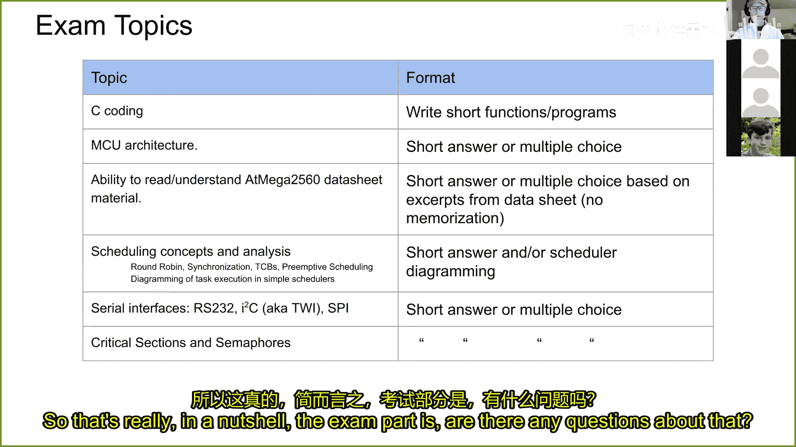
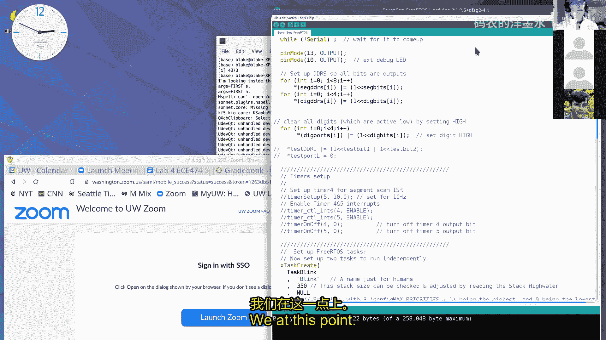
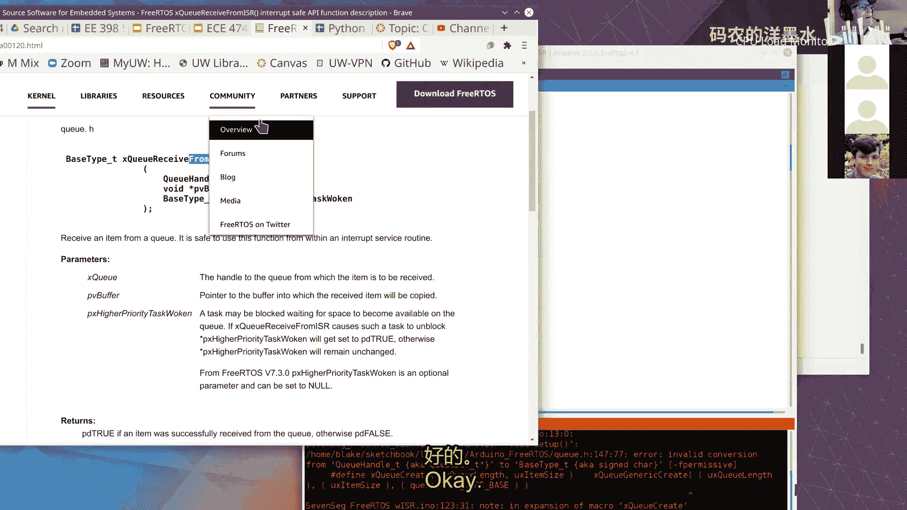

# 【全集 附完整课件】华盛顿大学 嵌入式系统导论 CSE474 中英字幕 p17 Lecture 16 - FreeRTOS 导论 -BV1ALqnBWEeu_p17-

The new zoom tells me that in a nice human voice。And。Then。We have two topics today。

Probably we will get done a little bit early today， which。Maybe you'll appreciate。

 And so the first one we're going to talk about the exam。 a lot of people have asked about the exam。

 and I promise to get to that as soon as I was。Done with La 4。 So we're going to review that。

 I'm not saying the exam is all done， but a lot of decisions have been made。

Between me and our great Ts so I'll go over that and then we'll go over more about using free Rto I got。

My final glitch is fixed for making sure that we can still use ISRs with all the cool features that free RTOS has。

And so I'll do more examples of coding and demos in free RT so that's our agenda for today before that any questions。

 comments or issues that we you might want me to address。Okay， hearing first of all。

 somebody just say good afternoon or hello so I can make sure you guys hear me。Good afternoon。

Thank you。 That means I can hear you。 Thank you， Leonard。 All right， and you can hear me。

 So without any more。Forities， I'll start sharing。

Okay， so looks like you should be able to see the screen and this is the update on both the exam and the participation grade。

 So going into this quarter， I announced this breakdown of points for the class。

And mostly we've stuck to it， but there's a couple of issues coming up that we ought to talk about so first of all class participation。

That isn't that just isn't going to work it's hard for you guys to participate in class and it's hard for us to measure your participation other than the labs and so forth so we're getting rid of those points。

Or let's just say those points。We're going to keep them， but redistribute them。

And then the exam needs some definition and clarity。

So here's what we're going to do so this is the same syllabus or breakdown and we're going to change these last three so lab four is going to go up to 100 points instead of 80 points and what we're going to do is first of all instead of just sort of magic pass fail you're going to get five points for 4。

1 without taking any points from the lab in fact those are added points。

And then we're going to add 1% 15 points more to the second part of the lab 4。

2 and increase our focus on the project， so these are extra points you get for the coolness and challenge level of your project that you successfully implement。

Um。So that's that's where 20 of those points go no more class participation grade and then we'll make the exam 50 points so that's。

How we're going to do that， so the total will still be 450 points。And we resolved those two issues。

So details， so we're going to do this at the official UW exam time。And that's in your my UW schedule。

And it's going to be on Zoom， so you should be on Zoom at the time that you're doing it。

 the exam will be two parts。And it's not that well， it's going to be two parts。

 they're going to be available simultaneously so you can address them in whichever time sequence you want to。

 they will be turned on at 230 and turned off at 420。

And so there's going to be a Canvas quiz with some multiple choice questions that you answer on Canvas。

And then there's going to be a written exam。And the total of these two。

 I expect the Can multiple choice quiz will be 10 to 15 points。It's not quite decided yet。

 and then the rest of the points will be the written exam。

And the written exam will be a document with some questions。

And you have multiple options for turning that in， you can take some plain paper。

 you could print it out and do the exam on paper。We recognize a lot of people don't have printers。

 so just blank paper where you fill in the title and the questions， question numbers。

 obviously you do not need to reproduce the question。

And then just write your answer and then scan those using a scanner or a scanner app on your phone。

You could type your answers into a document and make that a PDF。You could， if you really want。

 you could handwr on a tablet device and make a PDF。

And but we will not accept just taking a photos of your written work， because the。

I've tried and the quality of those photos is really hard， it's never good enough。

Even though scanner consent times is sort of starting with that and we're going to have a couple。

 if you've never used a scanner app on your phone， we will have a couple of tested and recommended apps that will send you。

 they're free， so that's not a big deal。And then the exam will be， you work by yourself。

 you will not surf or go on your internet while you're doing it， it's closed book and closed notes。

 but you can make a crib sheet and that you can you know from any notes， videos， materials。

 anything you want， you can create your crib sheet and you can use that in the exam。

And then the exam topics， this is approximate， but pretty close since the questions aren't written yet。

 C coding。You might have to write little functions or programs without running them。

Microcontroller architecture， short answer or multiple choice type questions on how a processor just like ours works。

 what pieces it has。Ability to read and understand the data data sheet that we've spent a lot of time on in class。

 that'll be short answer or multiple choice， but you do not have to certainly you do not have to memorize the data the data sheet that is every question will have the information excerpted for you。

Copiied， pasted from the data sheet with attribution， of course。

And then you have to answer a question about it， so definitely do not spend any time memorizing that data sheet。

But reviewing the parts we've gone over and your ability to answer questions about them。

Scheduling concepts and analysis around Robbin synchronization， task control blocks。

 preemptive scheduling。Diagraming scheduling， task execution and schedulers。

And the format would be short answer and or scheduler diagraming。Serial data communication。

We talked about actually， we also talked about USB that's in here。Don't forget USB as well。

And that would be short answer or multiple choice and also critical sections and semaphos。

 mostly just stuff we've talked about in lecture。But and you can read about in the reading。

So that's the information we have right now on the exam， which is。

Pretty much set and then I will also be definitely releasing study materials for the exam so I have lots of old exams that to greater or lesser extent overlap with this material so you know in some courses where I'm teaching it every year and this is year n plus one I just release old exams and solutions。

For for you guys to study， this is different because I haven't taught it in 12 years and we've changed things for obvious reasons and not obvious reasons。

 So you can't， you won't be able to just。If you just study those exams there will be material that's off topic and so I'm going to figure out a way to create study material that is right on target for this exam as soon as the exams done so watch for that stuff。

So that's really in a nutshell， the exam part， are there any questions about that？

Okay， and I will post these slides once I correct the USB thing。Excuse me。All right so。

Let's go back and review a little free RTOS。And show a few examples。

Okay， so。We did this task。嗯。Let's see， I。Yeah， so we did this task。 I showed it to you。

 and we got it running。 I'm going to update it a little bit。But basically we had these three tasks。

 we had an ISR to change the。Tasks。Change one of the tasks。And then we're going to add two things。

 One is I had the liquid crystal I mean I'm sorry the seven segment display running under free RtOS as a task and we had a fundamental problem and that is that it flickered too much let's see I'm going to。

Yeah， so we did this demonstration and I'll come back to this demonstration。

 but first the actually I don't have a slide about this experiment， so I will just go to the code。

All right， so here is a。I think。Let me make sure could some could people please indicate that you can see the Arduino IDE on my screen share。

We can't actually， you cannot， Okay， I'm going to fix that。Alright， I think you can now， correct。Yep。

 great。😊，Okay， so。Right， so this is what this is one of the first free RTOS applications that I showed you and we had I this is the same plugins。

 this is all details of the wiring for the seven segment display which was a lab three thing and I was porting that to free RTOS in terms of three tasks。

Blink， which is just blinking an LED display scan， which is。Driving the seven segment display。

 according to a four digit number created by some other task。And then a task counter and the counter。

 of course， changes the value。To be displayed。And。This counter was using， this is a global pointer。

That points to a struck an array that this is straightforward counting by the plus plus operator。

 it rolls over at 999， which is nice for the display and then this function I to Ds was converting an integer into four digits and so this is an array of four integers between zero and9。

And then this pointer points to the array。And then we wait for one quarter of a second。

That was a fairly fast counting speed。And this ISR was not used， I couldn't get it to work， actually。

And I finally figured it out， and it taught me something that will help you and maybe save you guys some time。

So。In our display scan， were looping through the we're running continuously while one。

We are I'll kind of move my head a little over。We are lighting up the digits。One at a time。

And then we figure out。This is our array of zero to9 values for each digit。

 so the Dvalue is the number that we're going to display in the current position。

 we convert that to segments which is just a lookup table。

 there's no algorithm to get the segments for a seven for example。We light those up， we delay using。

Free R T O scheduler delays。We turn off the digits， the digit。

 and clear the segments and move to the next digit and of course there's only four digits that we loop around。

So that's this task。And then there's little helper functions here and blinking as a big comment because I borrowed it。

But it's very simple。 So actually， I wanted to make sure I could identify the blink from the blink task instead of other blinks。

 So I made it a little more elaborate。It has it's on for 200 milliseconds， it's off for 50。

 so it's short its dark periods are short。And it does that four times and then it waits with the light off for 600 milliseconds and then it does four more blinks。

 so it keeps doing this， so it has this slightly unusual pattern。

 but that way I know for sure that it's not some other task that's blinking that I had lying around which I did have so okay。

So， let's。We， at this point。

I can stop the share and I can switch my camera to the hardware。And。

I'll turn this light off because then you can see the display better。

And I'll pin myself， this was the trick in the video。And then I'm going to， you can't see it。

 but I'm going to upload and I oh， I'll make sure you can see the lights。The upload lights。

It's an offboard LED bit。Okay， so upload， oh， it oh， it's not powered up so that didn't work。Okay。

 now the board is on。And we will try that again。Needs a minute for the serial port to be recognized。

Sometimes it helps to reset the board。Actually， it already has the code loaded。

 but I will load it again。Now it's uploading。And now， it's counting。

And this is actually we saw this before last week and it's， you know， it's working。

 but it's not very satisfying because there's a lot of flickr in the display and that's visible。

Certainly visible in person and it's visible on the video as well so。This was。Kind of problematic。

 because。I guess I'll go back to screen share。Okay， so you don't have to watch that anymore。

And there's a fundamental problem here。Within our scanning。Display scan。

We're already delaying the minimum amount that we can， which is one tick。And as you recall， in。

Mike in free RTOS， one tick is 15 milliseconds。And 15 milliseconds is just too long。 And furthermore。

 because of the way they implement。Free Rt on the Arduino。

 they use a special timer called the watchdog timer and the watchdog timers， unfortunately。

 the fastest rate it can cause interrupts is 15 milliseconds。

 So therefore we're stuck unless we wanted to really reimplement the port of free Rt。

 which probably isn't actually that horrible， but it's we don't want to do it。

 so and and also it would。It would not be the most friendly software out there because it means we would have to take over one of the timers on the A mega like probably one of the eight bit timers and yeah there's several of them but then the end user in the future is going to always know have to know that they cannot use that particular timer。

 whereas you know the watchdog timer is used much more rarely。Okay。

 so what's what's the solution so the solution is let's put this task in an ISR very carefully。

 it's a little more elaborate than some of the ISRs we did before。

 but what if we wake it up if we interrupt it every we cause and interrupt every millisecond which would be 15 interrupts per operating system tick and we drive the segments。

Using the ISR itself。Instead of a task， then we should be able to scan this display just as fast as we did before when we used our own round Robin scheduler with synchronization and we had a one。

1 millisecond period。So。Yeah， so I actually frankly struggled with that for a long time。

 even though looks like you just mouse the same code into an ISR。And I'll show you what happened。

But instead of running this one further， I'm going to open another one。Where I saved it。

7 segment free RTOSOS with ISR。And so what do we change here， Well， all of this stuff is the same。

We're going to， we have a debugging LED， which helped me。For the ISR problem。

And I put in a little test。 I'm going to make this faster。

But basically while we're still in setup here and just to make sure because I was so you know why isn't that light lighting up because of that I made it flash three times in setup to make sure the hardware was okay so this means every time I was running I never had the excuse oh the LEDs not wired right it's no it's your software okay so we're doing that。

And this is stuff from before， we're just setting up all the bits that control the seven segment display their DDRs data direction registers。

And we're clearing all the digits the way this works is it it the。I think it's the。The cat， the。The。

 the cathode。Is the digit the dig each digit is common cathode and you drive the anodedes to light the segments and so to turn on a digit you bring the cathode to zero。

And so we have to set all these digits to one in order to turn them off。Okay。😊。

And then we have our three tasks， so we have our blink task， our display scanning task。

 This time I've turned it off because we're going to use an ISR instead。

And then our task that counts and it counts up。And then finally， we enable the interrupt。

 we set up the timer。Timer4 to generate 1，000 interrupts per second。And again。

 these are functions that I wrote in order to talk to you about setting up timers without without explicitly doing it for you。

Okay。And then again， this counter is the same as we had before。

 it's going to count once per second now。And。Then we have our ISR。 So actually。

 I'm going to turn on this test code。At first， I was just testing it to flash the light。

 So this is going to。We're going to have we have a static， volatile global called ISR count。Actually。

 this probably could be moved inside the ISR as a regular static。 we'll try that in a minute。

But I know this works。And then every time the ISR is finished， we increment the ISR count。

And we use that to do timing。Relative to the ISRs rate instead of the operating system tick。

So if ISR count is between 50 and 250。We're going to write a low bit， oh， actually。

I do not want to do that because it's either or so I guess we'll turn off the。The display first。Okay。

 so the ISR。U。And that's actually not okay either。Because that parent。

 that curly bracket is the end of the ISR。And this is old junk oops。

This is old junk that I do not need， okay。That's clearer。 All right。

 so we commented out all this stuff， which is our new display driver。

 And so we just have this little test in the ISR at 1 kHz。

 We're going to be looking at this ISR count。😊，Between for 200 milliseconds， between 50 and 250。

 we're going to write a low。To the LED。 And if it's greater。

 we're going to write a high and reset the ISR count。 So we're going to have a 50 millisecond ISR。

Light flash。 and then a 200 millisecond dark， dark period。But no display on the LCD。

 so let's check this。It compiles。And we'll upload it。But first， I will switch， well stop share。

I'll upload it。 It's uploading。And okay， it blinked three times on the external。

And now it is blinking， the blank task is running。But interestingly。

 the external test light is not working on the ISR。Why would that be？Shoot。不。How did that happen。

Make sure I've got the brackets， right， I do。You know。

 an annoying thing with the Arduino IDE is you upload and it does not save。

And you have to remember to save。Sometimes you fix the last bug， and it works。

And you think you're done。Professor okay， yeah， is it because you commented out IR account plus plus？

啊。😊，See， there's always some smart person who helps me。 So let's let's get this and back in。

You know what， I knew you're absolutely right。We'll check it。 We'll upload。Again。

And now it's working。 Okay， so we get these quick flashes on the external light。Totally driven by。

 thank you very much again， totally driven by the ISR。

And this blink on the main board is driven by a task scheduled by the。Operating system。And so again。

 we'll go back to screen share。And we'll comment out the test code now。And enable the。LCD display。

But just to show you what's going on。Okay， yeah。 So now here。

We've defined some pound defines for how many milliseconds or how many cycles will be on and off。

 so it's not that we're off for four cycles， it's that we start with zero well we have states and I actually am not using these states but it just helps to read the code。

So we get in here if ISR count is equal to zero。We start the digit on state。

We add update if necessary， we wrap around the digit position。We like the correct digit。

 that's just the cathode for that segment， sorry that digit。We figure out what digit what。

What decimal number we're going to display in that digit。

And then we figure out what segments it has and we light up those segments。

And then that's all we do at the first when ISR count equals zero。Then if it's the digit on count。

 in this case， it's three， so three milliseconds later。

We turn the digits off and we clear the segments。And finally。

 the digit off count is after the digit on count， so we really only go from three to four here。

So only one millisecond， we will set the ISR count to zero and then I mean to minus1 and then increment it at the end。

 so when we start again with the next interrupt we will start over。Okay。

 so that's how this is supposed to work。 But I'm going to slow it down because I want you to see how that's working。

 So what we're going to do。Is make this more like。400。So it's going to actually。Yeah。

 so it's going to be on for3 milliseconds， but it's going to be off for。397 milliseconds。

Hopefully we can still see it， let's check it and we will stop sharing and upload。Okay。

 and it is working。It's just scanning very slow。seven。8，9。In fact。

 it's scanning so slow that the counting task is going faster than the display。

 so maybe I overdid it。Let's cut that in half。Uploading again。And now3，4，5，6， so6。

 five happened twice。It's definitely scanning too slow。 And I did that on purpose。

 So now we'll go back to the numbers that I liked。3 and 4。

 So it's on for three milliseconds and off for one millisecond。Total of 4 milliseconds per digit。

I'm going to save。And upload again。1，2，3，4。 And the did， I don't know how it looks。 Yeah。

 it looks on the video， too。 It looks rock solid。So it just looks like all the segments are on all the time because the human retina has fused those pulses into one。

1， Dc light。So we're able to do something faster than RT can run by。Adding a little more complicated。

 slightly more complex ISR， which is equal to our really what our it's pretty much the same as what our task was。

 but we added some timing information。Any questions about that？

Professor can you post that codes in case we want to use the seventh segment in our lab for？Well。

 I you know， yeah， I will because you've already done La three。So。

I will post some parts of it anyway。 A lot of it depends on these， this exact。 let's see。

 I'm going to go back to screen share。Before you be careful what you wish for。Because。

A lot of it is this magic right here。And this is very specific to the exact wiring that I used to wire my seven segment to my breadboard and so forth。

And so， like。You know， the segment G， I forget which segment segment G is。Is。

Pin 5 of my particular seven segment display and I put it into pin 47 of the megaboard and that works out to port L pin2。

 and so then all this magic has to be here for the ports going into this array so that I could do things like just make a loop through all the segments。

And so I will， I will。Publish this code。But you will have to get this exactly right for your own wiring in order to make it work。

So， okay。So that yeah， you help I made up my mind， I will publish it。m，Okay。So that's that。

 And I wanted to also。Go through one more thing about free RtOS and some of the API features。

 so let's see。Okay， there's no more， no more slides but。This is the。Wait a minute。

 Why can't I get this。Tab。interestingterest， okay， I'm going to stop sharing。

Get the tab I want and share again。Okay， so you should see a browser page on freerto。org。And the。

 the key thing is this API reference。 So this。Is your guide to all the things that RTOS free RTOS can do for you once you reengineer your tasks to work on our free RTOS。

 which is not that hard， sometimes it's stripping complexity out of your task to do it。And basically。

 the whole idea is you just put your code into a while one loop so that it runs forever。

And you pretend that none of the other tasks have to do anything。

And that's where the preemption comes in。From PR， R T O S。

So we've already seen a bunch of X tasks create， you give it。The pointer to your function。

 this is a function pointer or really just the name of your function is the first parameter。呃。

That is not the name of the actual function reference that's in your code and then this one is a string where you give it a useful name if you need a more friendly user friendly name。

you give it some stack depth and we can talk about that more I have not found stack size problems yet with any of the these things that you've seen me do if you really give up try making the stack bigger for a task if you really。

Unable to find what's wrong。 Oh， I forgot to tell you what was wrong with that thing that took me so much head pounding。

To solve。And。Yeah， so anyway。It was here。So。This， as you saw before， this is an interrupt vector。

Mac or the pound defined that's defined somewhere back there。That。Is the。Compamp a register。

Equality bit in timer5。 And this is the vector for it。And。This is not a good feature。

 If you compile this， it works。 Now， let's say by mistake that I typed in timer 5 like that。

With mixed case。Then we compile it and check it。Come on。 I don't want Zoom there。It still compiles。

And there's no error。And I'm not exactly sure why this happens， because that is an undefined symbol。

 I think。The map， I， I really honestly don't know why it it can。

 why it's allowed to not generate errors when this is an unknown。A poundund to。So。I， you know。

 I looked at that over and over。 It looked right， doesn't it， It looks right。 Well。

 it isn't right because you have to have the right capitalization。So it also compiles with this。

 the difference is when this is all caps， it works。 and when this isn't all caps。

The interrupt vector was invalid。 So the first time it got an interrupt。

 it just jumped off into some garbage， and the program froze。Anyway。

 I did find it by comparing carefully older code that I knew worked with this code。And。Alright。

 now one thing that。To lead in back to the RTOS API reference。

What we're doing here is this ultra simple ISR where actually this is in a different example。

Where we are。Just counting on a global。Vololaatile variable。

And this is a good example of why we need to declare it volatile， which we do appear somewhere。

And volatile means don't optimize compiler。 and the reason is。

Suppose you're a compiler and you're trying to convert this into machine language。 And you say， okay。

 increment counter。Well， that's cool， except。😊，This is dumb because nobody ever reads a counter in this function。

 and so I can just skip doing this and the program will run exactly the same。So。

That's actually incorrect because of the volatile or the volatile keyword prevents the compiler from that incorrect assumption。

And okay， so at any rate， but this still uses a global。And that's not preferred。

 you probably have been penalized in other programming classes for using global variables。

And so what we can do instead is send a message using this function。With a what's called a Q in。

Free RT will use the Q foot feature to send a message to whoever needs this information。

And that'll be a little more formally correct。 and also it'll allow the。Operating system to。

 for example， suspend tasks that are waiting on that information。So anyway。

 we've seen examples of task creation。And let's look at cues。So a lot of options。

 but there's only a couple that we use。Frequently。And Q， create a Q is。Like a message buffer。

Where your messages have a certain size can be very small， like an int。

 and the size of an int is two bytes。Um，Or it could be， you know。

  512 bytes of data from a device or something。And then you have several of them in sort of a sequence。

 first in， first out sequence。And this sets up the management of cues so that a task can put data into a queue for some other task and the other task can read data from the same queue and if there's no data in the queue the task can be suspended automatically until data is present in the queue so that's handy。

Okay， so one example of that is going to be in our。嗯。😊，Other free R T O S example。Which I'll pull up。

We'll open it。I guess I did this other example to try and get interrupts working and I did it。Right。

Okay， so this is the one we did with the blink task and the blink task。Will with the LCD task。And。

In this one， the blink task， we also have a task called change B。

Whi switches the blinker from the board to the external LED back and forth and we had two versions I kept somehow I keep fixing that and it keeps going back to the old thing。

Okay， and so first we did it with the operating system delays。And I'll， I guess I'll just。Oops。哼。

What the heck。Let's see if that works。No。Okay， this must be some incorrect version。

I am sorry about that。Okay。Can somebody， can you guys see this Arduino window on this current screen share？

We don't see any screen share you do not see a screen share all right， I'll fix that， Thank you。Okay。

😊，So， this one。We have blink change B and analog read and LCD， and let's build it。

So how did I lose that library？啊。😮，Oh。Okay， why。Oh， I see why I renamed it。That's my bad。

I made a special version。I felt I had to do that， how about this？Okay， but that's because it's not。

Importing the library。😔，Or is not spelled right。Oh， that's better， okay。

So now we are going to upload that。To just sort of remember what these tasks were。Okay。😊。

So this one is blinking alternately and according to the thumbstick。

There is a different number displayed on the LCD。And okay。

 so I did make a more up to date version of this。Which I will also show you。

Now that I know how to fix it。And it builds。And I'm going to download it。Upload it。

And you'll see why， okay， right？It's still working。And I just have a cooler display now because。

TheI can move this little bar graph。 I can move this little asterisk around。With the joystick。

The thumbstick。 And if I let it go， it comes back。And the， the actual A to D value is shown。

In the top row。Okay， fine。So what's going on here that's different。We will now share screen again。

And let's look at the change blank task。The ISR is still this simple ISR。

We're in version one of the change blank。 So we're just。

But what but we're doing something different here。 So first I'll show you in setup。

We're going we're going to build a queue。We're going to instantiate a queue。

 sore this has two it's two units long， it really probably could just be one。

And the size of the Q is just the size of an int。 So these units are very small。

And the Q is going to be called Q which LED。 That's my name for it。And now， when we get to。

Task change B， which is going to switch the LED pin between the board and the external periodically。

So here's all we're doing， so we're saying the pin is equal to the LED offboard pin。And then。

 we're going to。Add to the Q。The pin。And。I forget what the one is right now。

 I guess and then this has sent to back what does that mean。

 what it means is that the queue is two positions long and we're putting it at the input of the pin of the queue。

 not like cheating and putting it up at the front。I don't really like that name， but。It's。

 it's what they use。 So it， in fact， we can read it。 Here's Q create。

 But if we go back to Q management。Q send to back。 I mean。

 it sounds like you're sending it to the back of the line。 And in a way you are。

And so it says put an item in the。Post an item to the back of the queue。

And it's physically copied into the queue。 So that's of note。And。

Then another task can take it from the queue in order that they're put in。

 So if you want them to be taken in the order that they're put in， you have to do send to back。Okay。

😊，So we're sending the pinI number into the queue。And then we're delaying for two seconds。

And then we change the pin to the onboard pin and we send it into the queue again。

 and we delay again， so this is sending it back and forth。Okay。

 and we're still causing delay from the operating system or measuring time from the operating system and then。

The blink task over here。Is every time it's running in an infinite loop。It's checking the queue。

And it gets a thing called the pin message， we say we declare an integer pin message。

 and then we get a pointer to it。Each time。And。We。Use that pin message to be the pin that we're going to。

Set to be high。And we use that until the queue gives us new data and what this is is it means how long do we block waiting for new data and we're going to set that to zero because we want to check the queue but keep working in our task so exactly once in this 350 millisecond loop we check the queue。

For a new。For a new pin assignment。So that that's using the cues。Technique to。

 to this communication in a better way than globals。Okay。

 right now are there any questions about the how we use the queue。Oops。That's my nostril ca。

That's the better one。Any questions about using cues？And of course。

 you know the details you got to get from this。API reference。Okay。😊，And we'll do one more thing。

And that's to illustrate。One more aspect of these， Many of these。

Calls have a different form when you're in an ISR。 You're not allowed to use the same。Call。😡。

And so send from ISR means we're in an ISR and we want to put something into a cube。

And so that's going to be our last little mini micro project here。Let's， instead of。Using this count。

 And I haven't done。 I haven't pretested this yet。But let's make another cu to send the ISR time。

To the。Time manager。 But I want to do that in the other app that。That drives LCDs。

Sir are you supposed to be sharing your screen right now？Actually not yet， but。I am about to。

Because I don't have the app up yet。All right， you should be seeing。This。

 and this is the one where we have the seven segment driver， but this one is not the ISR version。

Yeah， this is the wrong one。Okay， and then。I will get rid of that other one， okay。

So now what we're going to do is we're this time that we have the。Display scanning task off。

 We could even just delete it from this one。 And we're using this ISR。And。诶。Oh yeah。

 So what we're doing here。Is we have this Dval， this D pointer， which is our global。

 that is the actual stuff to be displayed。And so let's continue to get rid of global variables。So。

We'll put that into the counter， where it's actually。Being generated。Oops。Okay， sorry about this。

 Where is my counting task， Here it is。Okay， so the D pointer is in here。 and instead of。嗯。

Just implicitly sending it， we're going to send it in a queue。To the ISR。

So that's actually backwards we're going to the ISR。 Okay。

 so first thing we have to do is set up a queue for that。

And we'll do that in the same place as the other queue。We didn't even have a queue。Okay， then。

So let's I do not have this API memorized， so we're going to get the manual up。

And we have to create the queue first。All right， then。And so then we will go back to the API。The IDE。

And I can probably get those both up。🤧哈。Okay。That's better。 All right。So。We'll set up the queue。Okay。

 so this， as you recall， we're sending an array of four ints。 I want to make sure that's really ints。

And it might have been chas because。We do not need them to be very big， but no I used ints， Okay。

 so because these digits are only between 0 and9， I could use 8 bit bytes to save memory。

 but I'm not going to worry about that So they're ints， Okay fine。

So that means that the size of an item in this queue is 4 ins。 It's an array of four ins。

And we have a name for this queuee now I'm going to experiment later and see if we can get to one。

Okay， so now whenever we count。Whenever we increment in the task counter right here。

We have to put that into， put the value into the Q。 So send to back。

And so we've now got a new D pointer。And we've got to X。X，q。Sand sand。2。😔，To back。

And the parameters are the Q name Q。 I forgot what I called it。Q disk value。And。The item。

Is this pointer， and so。It can be DptTR because it's already a pointer。I think it has to。 let's。

 I think it has to be cast to void。But'm， let's see if it doesn't。

 Let's see if we can get away with this。And then how many ticks are we going to wait？

After we send it and the answer is zero because we're already heading into a delay anyway。

 we don't need to wait。Okay， so the counter is putting values onto this tick。

 let's make sure that compiles， no， something's wrong。D pointer was not declared in this scope。

 of course。Where is D pointer in the setup。Oh yeah。😊，This was something I did to initialize it。

 we'll get rid of that。And。Q display value is not right。 I have to give that a type。

So just like the prototype， I have to say。Base type。T。Ce display value。 So in in your screen share。

 can you see both the Arduino IdeE and the API reference document， or are you just seeing Arduino。

Somebody。😊，You can see both great。 Okay， so I forgot that I had to initialize this with the base type。

 So let's see what that does。And X， Q， create。I must have spelled that wrong or something。

Why is that not there？huh。It's not finding， oh， I know that requires a separate include for some reason。

And we can see that in my other version， which has cues。And I don't recall why that was the case。

I think this will do it。No。Okay， let's try to make that avoid。H no。Okay。

 I'm going to look at my other one。And that should tell us。哈。All right。

 I'm going to have to get back to you on that one。But we got cues working on one of them。

I think I keep confusing myself on which。Which app has which features？And which ones I've changed。

 Alright， I'm going to， I'm going to， I've just gotten。Beyond what I can manage here。

So I'm not going to do that。But I'll， I'll get that back to you certainly Wednesday。So anyway。

 the point is to see。How we're going to use these cues。

 we already did one of the cues that did work and the the main thing I wanted to get across here is that when you're。

In this case， we're going to read from a queue in the ISR。嗯。😊，You have to use the special ISR。

Functions， like。Message。Message receive Q receive from ISR。

 so when you're in it's even inside the ISR you're receiving from ISR。

 it doesn't mean you're getting it from an ISR， it means getting it in an ISR。Okay。😊。

I'm going to wind up there and are there any more final questions or issues for today？Okay。

 good luck on 4。1 and I will see you guys on Wednesday。

