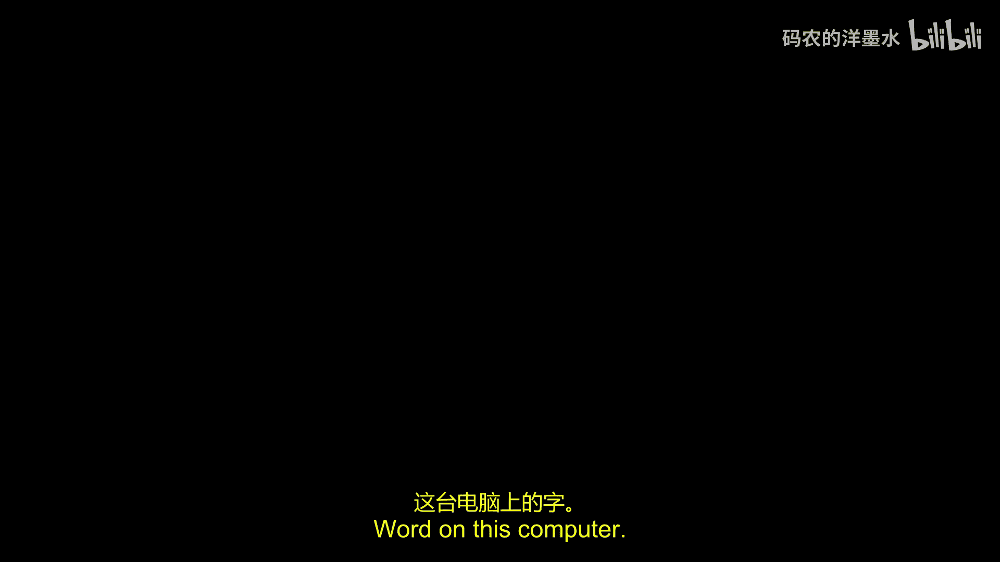
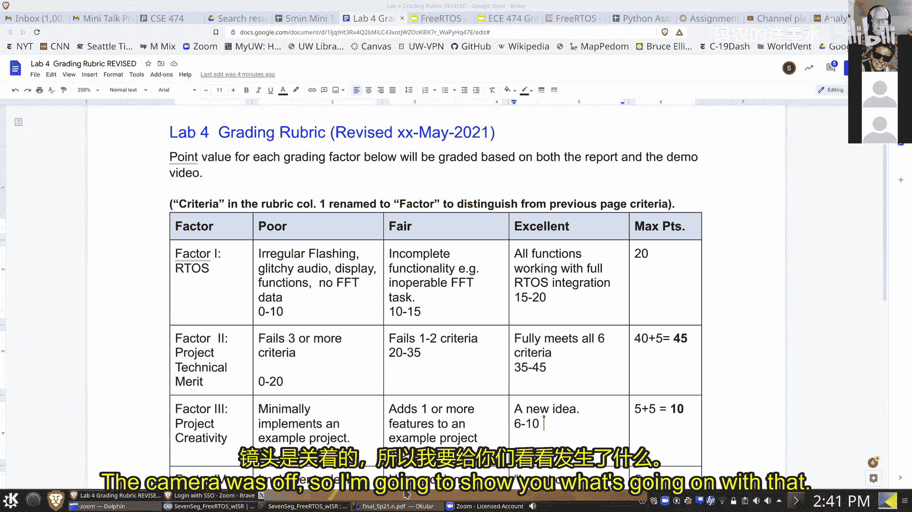
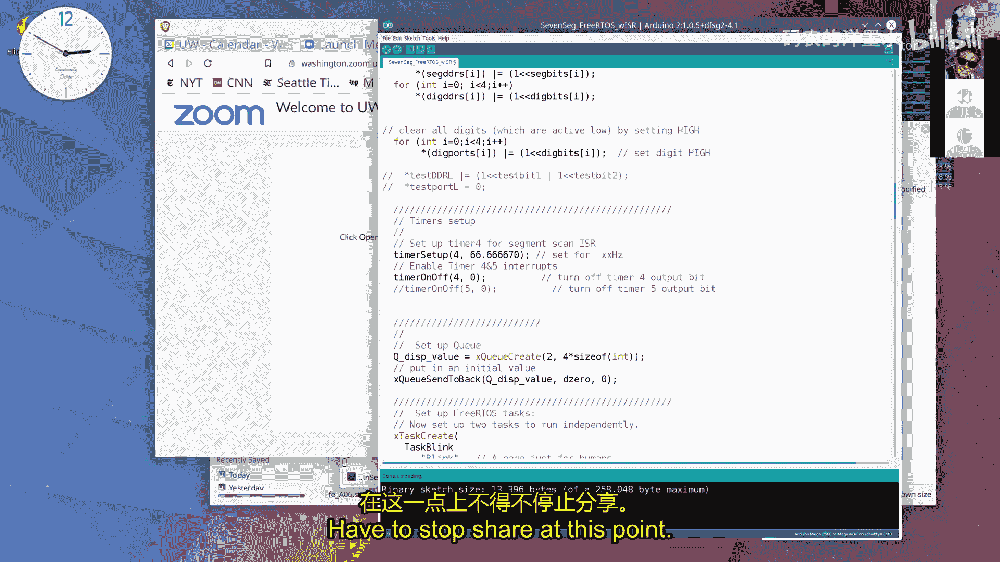
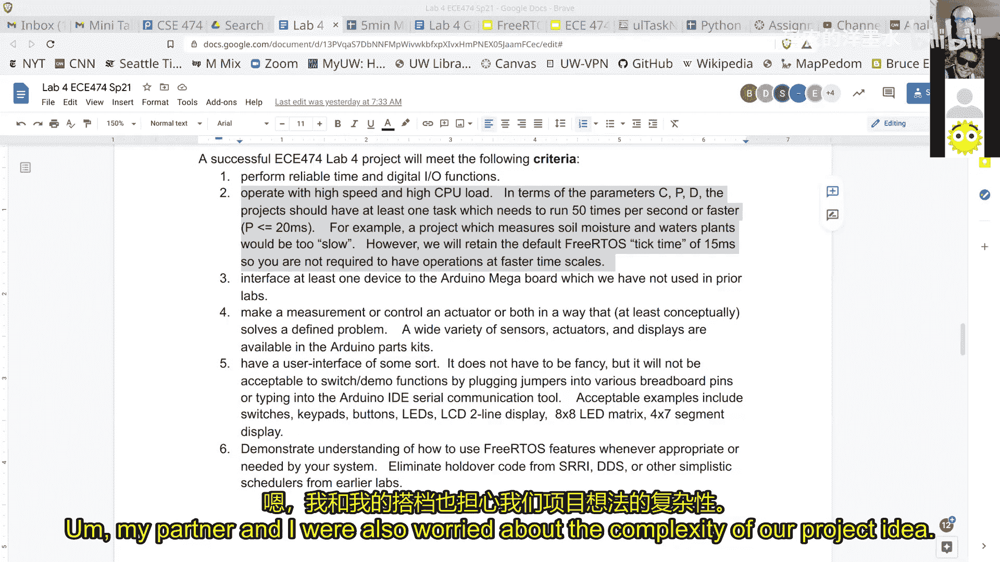

# 【全集 附完整课件】华盛顿大学 嵌入式系统导论 CSE474 中英字幕 p18 Lecture 17 - 关键部分与信号量导论 -BV1ALqnBWEeu_p18-

Or on this computer。

Okay， we are recording。So yeah， so today basically this is going to be a fairly brief class we're going to do an I'm going to update you on how we're going to distribute extra points to lab4 because that's an outcome of the replanning of points for the class there's no major replan in other words。

 we're still going to give you a grade by dividing your points by 100 so if you have 410 points。

 you get a 4。0 in the class I'm not allowed to give above 4。0 if you have 350 points， you get a 3。

5 etc as I said on the first day there may be cases where that system results in an average that is too low in which case I'll add an offset to everybody。

Or the opposite it may give everybody a 3。9 and then everybody comes down a little bit。

 but I think you'll find that the average for the class will be between 3。7 and 3。

8 and it'll be that's how I grade and you guys have worked hard and so that's what'm that's my target there so I don't think you'll be unhappy with your grade。

Unless you're unhappy with your own performance， which sometimes happens， okay。Despite effort。

 so first thing will be the lab， the the new lab grading， and I will share screen a little bit。

Can everybody see this revised rubric。It looks okay on my end。 So I'm going to assume you can。

And I've got the red and green box。 Okay， so one thing is this column。

 column  one used to be called criteria， but。WeI changed them to grading factor， because。

On the page before there's already criteria and we refer to， for example。

 fair performance on factor two is failing to criteria so that's。Just naming。

 and that's actually just clarification， not a change。 But anyway。

 first thing we're going to do is just basic project， technical merit。 How good is your project。

 does it meet the criteria that are listed on the previous page of the original lab and will not be changed。

 We're adding four points to that， I mean， sorry， five points to that。

We're adding five points to project creativity， again。

 putting the emphasis on the coolness and ambition of your project。

 but in this case quite creativity， and we have solving a problem does this actually at least approximate the solution to some real problem that users have at least conceptually。

 and there's a five that's not unchanged。And now we've added the project challenge level。

 There's been some clarifications on this or discussion in Piazza as well。

 how hard does the project have to be， etc cetera。 So that's a new category for 10。 So if it's。

If it's really easy and similar in difficulty to an earlier lab like lab three or lab two。

 then you don't get these points if it's ambitious and you add something and pretty pretty that's a stretch like say ethernet with a peripheral that's ambitious。

 so that's the full five to10 points。Makes me wonder does the does this board even have the power to do that and then you try it and demonstrate that it does that's great or you try it。

The board can't handle that task。But you you demonstrate through rigorous testing that。

It's not your software's fault。 The board is run out of capacity。 that's legit too。

 that's a legit project。And then the technical communication is still 10 points。

 so the total for the lab goes up to 100。Does anybody have any questions about this？Okay。

And this is a separate doc so that the TAs and I could converge on it and check it。

 and I'll merge this and update the official lab release right after class。Okay。

Then more a little more update on the final this is just just verbal， I'm working on it pretty hard。

 it still needs a lot of work to make sure it's right sized and everything and。

I am also going to release a study guide， which I'm also preparing and I'll release the study guide as soon as possible。

 probably almost certainly this week， so you can you know。

 and I am really aiming that the study guide and the test will look。Familiar， you know。

 so I don't like， I'm not interested in surprise test questions。 I'm not saying that the。

The test questions will be the same or slight modifications of the study guide。

But you'll see that there will be substantial overlap。 That's my goal。

 I want this to truly be a study guide for the exam。So I will release that。

 but it's going to be in the form of the exam questions。And then。

Just probably the weekend before the exam， I'll release the solutions to the study guide。Because。

I like to keep them separate because you really will do yourself a favor if you。

Hang in there and battle it out with the study guide questions as long as you can。Rather than just。

Think you know it。 Check it。 The answer was different。 Oh， yeah。 I knew that。

That's that's a shortcut we all try to take。 and it's so definitely， you know。

 go in there and wage war with the study guide。Before you look at the answers and I'll try to help you out by not releasing the answers right away。

Okay， any questions on that so far。Okay， so really just one final thing。

 which is that I kind of got stuck yes last time on Monday afternoon and I couldn't get the example to work and so of course I fixed it in like five minutes once the camera was off so I'm going to show you what's going on with that lab example。

Oh， I have a question on chat says， what do you mean by a new idea。

 how do we know it isn't something I've seen before？That is。Plake has seen before。Oh。

 I've seen it all。 Okay， by new。 I mean， it's new for you。

 It's new compared to the material that's in the class。And。Of course。

 if it's a popular project where there's a million of them out there on the internet。

I'm not going to be super impressed with novelty or originality。But。You don't have to surprise me。

As much as just。Try to be try to be original。 So， and again。

 I've also commented on Piazza a couple times people have asked。

Like what about using libraries from the internet that are released to support particular devices？

And yeah， that's okay。 However， you have to make it work with R T O S。

 free R T O S and 99% of those drivers that are out there。Are not designed with free RTOS in mind。

 so if the driver， if you're just taking a vanilla driver from the internet。

 make sure you thoroughly test it so that it doesn't like block interrupts and freeze your scheduler。

 make sure your schedulers really still working properly in free RTOS。That's where the work will lie。

And if you can't like if you can't make the online driver do that。

 then try to write your own driver within free Rt often that can be a lot simpler than it sounds because sometimes online drivers cover every possible thing that that device could do。

 but you're only going to use it in one way， so your driver only has to support that one way。

 for example， that's one way that。Writiding your own driver could be easier than。

Figuring out and adapting a downloaded driver。Okay， I hope that answers that and related questions。

Let's go back to that code， and I posted it。 you probably saw on an announcement。

I decided to release it so。This is， again， this is a fairly simple system with just two tasks。

 a blinking LED， not even， not even switching between the two lights。And a counter。Um。

Which is just counting up。A couple times per second。 We'll play around with how often it counts。

 okay。And。The counter now there's no LCD because the LCD is going to be an interrupt。

The LCD is an interrupt service routine。And this is continuously scanning the digits。

 the segments and lighting up the segments and doing that continuously。

 And we saw that if we use a regular task for this。

 it flickers unacceptably because the task scheduler tick in free Rt is 15 milliseconds and that's just not fast enough。

So we put this into an ISR。And it basically it keeps track of time in terms of how many ISRs have happened。

And we can play around with a subtick， right， because like we could set this for one millisecond and then these ticks will be milliseconds。

 but we can also change it。 And that was another interesting thing we I'll show you。

And so for a while， we light up the digits and。But the bottom。

 the key added value this time was this command here。Where we。Get a message。

Off of the Q display value。 And what we're getting is the a pointer to the four digit array。

 So it's an array of。It's going to copy four digits into this statically defined array that we have。

Here， and I've made them ants， they could also be bytes because digits only go from zero to9。

Possibly actually 10 as well because we have the ability to like the decimal point。

 which is like a10 value actually。It's independent of the digit， so。It's in addition。All right。

So anyway， we're not， but there's no assignment to use the decimal point。

And then the counter is counting。呃。Each time it runs， it's an infinite loop， it's just counting up。

And resetting itself for four digits。And it's filling up。

 it's converting its count value to the digits individually and placing them in the queue。

And what was wrong， one of the things that was wrong before is I did this correctly。

whichch is creating the Q and making the size of the message that goes in the queue。

 which is the size of four integers or four times the size of an integer。And that's correct。

But what I forgot to do was。Declare， right。Here。诶 the。Handle。That this display that this。

Poer to the Q is of this particular type， which is predefined by free RT so I declared this Q handle that was missing before and that broke my code。

And I couldn't figure out why so now we can assign the return value from Q create to our handle Q display value and now we have a thing now I mentioned that using cues is a little more formally recognized or considered better programming style than using。

Globals。But the way we have it implemented here we have to use a global for the Q handle。

 so the Q itself is the pointer to the Q is a global。

 but I think most people would consider this a better use of globals probably you can work around this in if somebody made a hard rule that you're fired if you use globals。

 you could probably work around it by setting up arguments for the task and passing the Q handle into the task as an argument。

Which is a feature that's documented there， but I'm not going to bother with it。Okay。

 so then we send initial value of 0， but I don't think that was the problem。

 The other thing then that broke is that。呃。D pointer was is no longer a global。 I took that away。

And so I had to supply it as a static or defined variable。

In various functions that used it when it used to be a global。 So once I cured those things。

 it worked。 And what we'll do is I'll show you that how this gets faster or how it smooths the display。

 so。嗯。😊，This is kind of a。Okay， so right now I have this set for。

But900 Hz because 15 milliseconds is the RT O S tick。 We could set it for one over 15 milliseconds。

 which I've got to actually work out。66。7 Hz。My little function for actually， I can go like that。

 My little function actually uses a float here so I can get it right。

 So now we we should it's uploading， Oh， I'll get to my camera。😊，I have to stop， share at this point。

Switch cameras to my webcam。

And pin my video that shows it bigger for you guys， so。Turn this light off。

So it's certainly flickering。That's kind of what it did。 Maybe it's even worse。 I don't know。

 but that's because， but we have the cure。 So without switching the screen。

 I'm going to set it to 800 Hz。This time and reload it。You can see it uploading and now it's 800 Htz。

 and now the flicker is almost gone。But on the camera and with my naked eye。

 I can still see a little flicker， especially if I move my eyes across the display。

 it shows up words。 So now we could go to 1000。And。Now， it's rock solid。

Both on Zoom screen and in real life。Okay， so we've got that going。 So that's really neat。

 And I thought I'd do one other thing， which is。We are in our task， in our blinking task。

 we're delaying for one second。And that means this is counting second。

 so what happens if we delay a  tenth0th of a second？Two things are I'm going to expect。 I'm not。

 again， I'm not showing you the code。 I'm just changing the。The task delay value。In the counter task。

So we it loops 10 times faster。 So of course， the counter we expect will count 10 times faster。

 but also it's going to send。Messages into the queue，10 times faster。

And let's see if the system can handle that， and I honestly don't know what's going to happen here。

Okay， it looks great， it looks like it's having absolutely no trouble sending messages in the queue because the only way the display ISR knows how to update the value is from that queue。

So， of course， we have to go up by another factor of 10。

 So let's see what happens if it's counting up 100 times per second。I tell I swear to gosh。

 I'm going break this thing。Okay， so that。That is not working。

Because I should be seeing stable counting here。2 digits from the。This should be once per second。

And it's somehow quite messed up。So now I'm going to go to a 50 millisecond delay。

 which is 200 counts per second and see what happens there。Okay， that looks right。I'm sorry， not 200。

50 milliseconds is。Is 20 counts per second。And that's， that's totally done right。 So anyway。

 somewhere in there， this is showing how much。We can pump data through that Q send mechanism well it's still working reliably and this is this is the kind of testing you should try to do in your project。

 try to push it until it breaks so you have confidence that you're well below that breakage margin。

 like if we go back to counting。诶。10 times per second。 We now have， you know。

 at least a factor of two safety margin on sending the。Sending the queue messages。Okay， so really。

 I'm going to wrap it up。Already， this early。Because I you know I think you've got what you need to learn to do well on this final and do well on lab for。

 as I said， I released this code so you should be able to run it。

But you will have the challenge of wiring up the seven segment LED display exactly the way I've done it。

If you want to see the displays， you can run this though and just verify that it runs。

 it'll twiddlettle bits but not connect anything。Um。But also， if you have a different wiring scheme。

 you could figure out how to adapt this or you could just write your own LED driver at the ISR level and see if that would work。

Or use it adapt it for other devices。All right， I going to I am finished。

 I am definitely leaving it open for Q&A if people want to hang around。Otherwise， thanks for coming。

Hey， professorfeor， could you just really quickly go over the X task notify in the free RT documentation？

Okay。😊，I will。 I have not actually used it yet。But I think I understand it。

You never really understand it until you use it。But， given that。Let's see what happened。

 Do you guys see the document free Rt page now， Yes， I just want to make sure I with two monitors， I。

 you know， I never， I'm never sure I'm sharing screen correctly。But yeah， so anyway。

 we'll go back to our API reference and task notifications。

And usually they give you a little more basic info on the first entry in here。And so， okay， so yeah。

 they and also they they're kind of recommending that this is a， I don't think that's here。

 but I was reading that they recommend that you use this instead of semaphos for critical sections。

 if you do need a critical section。Because I think they believe it's lighter weight。

 it has less overhead。I think， you know， you can assess for yourself if your project。

Is straining the CPU or not？And if it's not， you don't need to worry about overhead。

But if you're barely getting away with it， if it's barely satisfying all its task deadlines and so forth。

 then you might have to pay attention， but leaving that out。Yeah。

 here's where they they they're saying it's a lightweight and fast semapho alternative。

 but let's leave that out and just use it as notifications so basically。You。诶。You have to get。

 first of all， you have to get your task handles。When you create the task。

 So if you recall in my other code。Actually， yeah， I can pull it up。

We do not actually get task handles because you have to put a pointer in one of these two nulls。

 I forget which one it is。And you can look that up under X task C。

And it's of a pointer to a certain type， which is called a task handle and that's like the bar code for your task and so task create returns that task handle to you。

Okay， and so you would need to do that。And then now you can notify a task by saying notify task。

 you know， barcode 2，5，6，7，3。And then。That's that's this， this is the barcode。

 and it's of type task handled type。 Okay， and this is the value that of the task you want to notify。

And I think let's not worry about this give indexed it's kind of like a task could participate in three different notifications and get notified of different kinds of things and so that's why you would have an indexed version where you'd offset into an array of notifiers but let's get。

Notifications down first。 So we'll concentrate on this simple form first。

 So this is sending a notification。And then again， if you're in an ISR and you want to notify this is the separate version。

Again， because these tasks， these commands modify the stack and they do that because。

Free RTOS is preemptive and it's interrupting tasks whenever it wants。

 and therefore it has to carefully manage the stack and it's good at that and it works。

But it it's the stack is in a different state when you're in an ISR。

 and that's why they have different calls。 Okay， so that's that。

And then the opposite of give it notification is to take a notification。

 So here we're going to say that this is。To wait for a notification。

 and then there' are these two parameters。And。I am sort of reminding myself here because I've read it well so here's the parameters for taking a notification。

Um。This is the thing with。Okay， without the indexed part。

 So we're just going to look at clear count on exit and ticks to weight and what those mean。Okay， so。

If this is set to false。Then。The notification value is cleared or decremented。When you。Exit the。

 the command。And so， this is like。Giving back a semaphore and freeing it up。Right then。U。

If this is set to true。Then。It doesn't decrement it so or。Sorry。

 this I have to say I'm a little confused on this too。But。

So counting semaphores are a generalization of semaphorees where。

You can set the semaphore to like three， and that would allow three tasks to share the resource。

 but additional tasks would have to wait until the semaphore goes below three。And so this is a this。

Count is what they're referring to there。 We're going to be talking about the 0，1 case。

If this is set to true。Then this is set to， then the count is reset to 0。 if this is set to。呃。

If it's set to false。Oh， I see。 Okay， okay。I see it。So。This says。Clear versus decrement。

 So clearing sets it to 0。 Decrementing reduces it by one。

 So what you're going to do is not is use this。 You're going to set this to true unless you have accounting semapho that goes above one。

 which I do not recommend。So just set this to true and it will just clear the semapho when the call exits。

And ticks to weight。 So， yeah， so the basic idea is。Notify， take， blocks your task。

Until a notification comes in。And so you're waiting for a notification。

 but you can put a timeout ticks to wait saying， I'll wait， but after 10。Operating system ticks。

 I want you to return me and reactivate me。 So that's what this second。U。Parameter is。

So this says ticks to wait the maximum time to wait in the blocked state。

And so this is saying that the scheduler will know what's going on with this call and it'll block your task until the notification comes in from another task。

But you have a timeout。 I think if you set that to 0， it's infinity。Oh。So just to clarify。

 this is almost like a sleep function， basically， so if we put it at the end of a task it'll just。

Pause there until it's notified。Yes， you put it anywhere。 You put it at the beginning。

Then the task will start when it gets a notification from some other task。Got it。 Thank you。

 And if you， I guess you have to put some。Value in the ticks to weight。

 I don't think infinity is a feature they have。呃。But you could， you could read that。In depth。

 maximum time。Not consume any， see your task does not consume any CPU time in that blocked state because the scheduler is running other stuff。

And。So if you wanted to wait forever， you could put a loop in where it says where you wait for 100 ticks。

And then wait again。 And then if you didn't get。Activated， you wait for another10 ticks。

 I guess you'd have to figure out how you exited that。嗯。Yeah， I'm。

 I'm not exactly sure how you wait forever there， but you could put a really。

 really big number in there。All right， thank you， does that help？Yes， great。Good question， others。

I have a maybe a more general question or like in asking for advice sure So do you have any。

Tips or like ideas on how to approach asynchronous inputs。So like for example。

 using a remote or like pressing a button， like how to process those。Yeah。

 like some of the kidss have a little infrared remote。 but and that would be fun。 So， yeah。

 you set up a receiver， like an IR。😊，Photo diode， which may come in the kit I'm hoping and I would suggest interrupts there。

 right， So you're going to be spending a lot of time when the user is not pushing the button and generally with asynchronous。

 there's there's two main strategies。Interrupts is one。 The other one is polling and that is。

 you know， you every so often you keep checking it and polling kind of works， but it， you know。

 it uses up resources The advantage of polling is you kind of you know。

 your code may be slightly easier to understand， right because you。If you detect that bit。

 you know exactly where you are in the code， et cetera， et cetera。

And the ISR is more is is asynchronous still。 So you have to have a task。 But， but I think that。

 you know， free R T O is going be your friend there。

 Like you could have a very simple IR that on the first。Infrared pulse。

It wakes up a task that pays a lot of attention to the infrared diode。Okay。

And it could use this mechanism， It could use notifies， task notify， or it could have a message。

 potentially the ISR could go into a really tight loop depending on how fast the message comes in from the infrared remote。

 and I really don't know。 Yes， it'll be easier to debug if you have an oscilloscope。

But you also could write maybe special purpose， Arduino code。To。

Determine what the exact signal is from that infrared。Or maybe you get ideas from code that's online。

For supporting infrared remotes。And that's fine。 Okay。

 because integrating that with interrupt and free R T is going to be a legit。Nice project。Okay。

 does that help。诶。Yeah。诶。Yeah， I'm just like personally I'm still in the mindset of like system very where like we just synchronize the inputs before we put them into the system so I keep thinking about it that way。

 but like we're not in like HDL anymore。Well， right， however， you know。

 like we saw the the use artt peripheral in in the serial data consideration and we we never wrote code for it because like Arduduino has this right function that I chose to use。

And， and we just didn't have time， but we could just like we did for the timers。

 we could write code for the Uars。 And in theory， you could hook the actually。

 this might be a better way to go。 It might be that you could configure one of the Uars universal serial。

Data， da， whatever。 I don't remember what it stands for。

 but we used one to talk to the liquid crystal display in one of my examples and。It's already using。

The first one in every Arduino to talk on USB， but the mega is one of the few Arduinos that has additional ones and actually it may you know really U SARTs are designed for this exact purpose。

And it may be that you could， if you read that section， you could configure that usr to。

Get an input from the photo diode。And process it， synchronize it and cause an interrupt that would say。

 I have a character from the remote。That would be。 that would be the most powerful and elegant， if。

The bit sequence that comes out of the remote is compatible。

 Like it has 8 data bits and a stop bit start bit and stuff。ok。Okay， yeah， much to think about。

 Thank you。 right， But that would be， then you're leveraging built in hardware to do it just ver style。

 right， That's what the hardware。 That's what that internal hardware is doing for you and doing well。

Okay。Cool。Good， great question。Oh， hi professor。 I had like good。

Hi I was wondering if I could kind of pitch to you my group's idea for our project and surere still kind of like in the preliminary design of it and we just we want to make sure that we're picking a project that will like have us like we'll make sure like it's we're able to get full points for it does that make sense？

So basically we have three components that we're using。

 we're using like this pad number button thing， I don't know exactly what it's called pad。

keypad yeah yeah yeah yeah and then we have the LCD crystal display and a servo and our idea was kind of like a lock so like you whatever numbers you type in on the pad will display on the LCD and then if like the number correlates to a passcode then we like trigger a lock and it will like flip the servo to a specific destination does that sound I guess rigorous enough because we feel like I mean there's some good aspects to it i'm a little concerned that you could run this on a very slow schedule and it would still work。

U。😊，So I'd like to see if you could add a gadget in there that would somehow require some faster processing。

嗯。😊，You know， maybe there's a。A light beam， if you break it， it locks it instantly or something or。

Um。Yeah， so one one of the criteria in the page can， you know， I can pull it up。U。Not this one。

 but actually the lab for。And this is the still official release i'm going to move those that rubric in here in a moment。

But basically， we have project criteria。And you know， it needs to do something high speed。And。

So I'm a little not sure if yours， oh， I haven't shared the screen yet。 sorry， there's the share。

 So one of these criteria is high speed and high CPU load so。Think， think about that。 And， you know。

 there could be。What about a， what about almost like a。呃。I don't know。

 maybe a biometric security where a person somehow makes a gesture and it recognizes the gesture。

From a sensor， like。Like like the thumbs stickick， maybe you can teach a gesture on the thumbs stickick and it can recognize that。

I I kind of like that， you know， it's a little more， but it's still a lock。Right。

 so I guess just to kind of does does this like high speed。

I mean does this mean that there has to be something that the user is inputting that is being registered at a high speed or can it be like some sort of internal？

I guess process or internal task that's running well yeah， I mean I don't you know。

 in a theory you could meet this requirement by making an LED flasher that flashes at 100 hertz Yeah yeah and that's pretty bad because you can't even see that flash and。

It's pointless so but like if you were to do a gesture from the thumbstick you'd have to you know。

 you'd have to capture that at probably around 20 hertz to you know get the user's movement accurately and。

Then you'd have to have some matching algorithm and you don't want the user to sit around for 20 minutes waiting for it to decide and。

You know， now I do make a point here that， you know。

 u we're not requiring you to do ISRs that process faster than the 15 millisecond。

Tick time of free RT。It'll give you some nice challenge and difficulty points if you do that。

But it's not a requirement。Okay， I appreciate it and also saw that Seth put something in the chat that said replacing the LCD with a seven segment display would require higher speed could that be like an easy swap out there if I still use like the original idea。

Yeah， in theory， although I've just published the code for doing that。

 so it's you know I know that basically what you're you know what you will have to do is figure out that wiring scheme and get it get it right。

 but you know there's that。Okay， okay， yeah， I appreciate it。 I'll， I'll。

 I'll talk with my partner again and then we'll re discusscus。 And if I have any more questions Yes。

 definitely， you know， I don't mind making this interactive。Okay， yeah， thank you。Pazza， whatever。

 yeah。Okay， great。 any others。Yeah， my partner and I were also worried about the complexity of our project idea。

 could I also explain our idea absolutely？

So we were thinking of basically making like a fire alarm system with the temperature sensor and so we would read in like the temperature every 15 milliseconds and if it gets above a certain threshold。

 we would sound a buzzer and we would display like a warning message on the LCD display and then we would also like operate a fan to like try and like blow the temperature away。

And we were worried， like is that complex enough because if it's not。

 we were thinking of maybe adding like a remote control to like power off the system。Yeah。

 I think that sounds a little simple， right， I mean， you， you know。

 look what you've already done in lab 3， right， and compare it to that project。On the other hand。

I like like like with this previous project we just heard a very nice way to design your project is to give it a series of features that start simple okay。

 and then you're like really sure that you can implement your core project like read the temperature and turn on a fan and of course be careful because fans can make fires worse but。

But you know， reading a sensor。detectecting a threshold and turning on an alarm is pretty simple。

 I mean， that's almost as simple as flashing an LED。

And so you won't get big difficulty or creativity points for that but。

To build on that with more sophisticated features。Would be。嗯。It would would give you a base。

 And then you know， you can get， I also think that learning free RT from for the first time and beginning to use it。

Will will work better if you start with a simple set of tasks。 So for those reasons。

 I like the idea that you start with a kind of simple base。Then， you know。

 bite off some more difficult parts。 And if， if that fails， you know， you'll get some partial credit。

 but you'll， you'll have something you can be。Proud of， which is your core core project。

So you know if you start off and say this is going to be a time machine。

We know you're going to fail and at the end， you're probably going to have zero。

You're going to have nothing， right？ So so maybe you have a dial and a display。

 and you can dial in any year from， you know。1000 Bc to the present and display it。 Okay。

 that does that's not a time machine， but I guess that's a component you need for the time machine。

That makes sense。 Do you have any ideas on like， how we could increase our complexity。

I'm sorry how what about complexity how we can increase the complexity I think we're struggling on how to expand our idea Well look at different devices now there's another thing you know the devices like oh like the RFID reader you know that's a thing you can throw on almost any project right I've got a milkshake machine but it only works when you tap the RFID tag on it things like that。

Or。嗯。The other thing is background tasks， so like in lab4。

 we've got you figuring out FFTs in the background。

And it's a little bit artificial because we never look at the answers。

And see what the output is from that FFT。 But we want to get the experience of running a low priority task to kind of use up the CPU whenever。

It's not needed by high priority tasks。And so you could wind up building a complex system where。

 you know it actually maybe it actually uses that FFT for something。Like， like， it measures a signal。

 and then it figures out what's the strongest frequency in that signal and displays it like a frequency meter。

 That would be a frequency meter based on FFD would be awesome。嗯。U， I think I like the RFID idea。

 like maybe like you can scan the RFID to turn off the alarm。Yeah。I mean， you know。

 realistically the complex work of the RFID is done by a chip in the little peripheral that you get and so it'll talk to your system by Icord C or SPI most likely。

Which but that's still you know that's good if you interface that and we've talked about it but we haven't done it in labs so that's an you know that's a new thing so yeah。

 so I would you know that's that's the kind of thing that I would like to see thanks for that idea Thank you。

Another thing you guys could think about。 We haven't done this much。 but if you have the。Well。

 I guess it you know， it would require if there's a team where you guys are roommates or something and you're both vaccinated and all that。

 you could think about a team that a project that involves two Arduinos talking to each other。Yeah。

 I've actually met up with my partner because we're both near UW so that right and you know。

 also you could or you could just， you know， you may have like an older like an Arduino uno or a micro。

Pro lying around。 And then there could be some peripheral where they talk to each other and something interesting happens。

Okay， I think that gives us something to work off of so thank you Okay， great。Well。

 there's a few people left anybody else。 Are you just。

 did you just forget to disconnect and you're not even in your in front of your laptop or should I hang out。

 I have a non class related question。 Okay， so I don't。 Yeah， I don't know if Lucas， you want to go。

Go ahead。Well， I mean， I'm also sort of just in the brainstorming stage because like。

Cause it like anything I can think of at this point like。

 I think the approach that that what I'm getting at is just we start。

 we start with one functionality。 I know we just keep laying all functionalities。Cause。No know。

 I think that's like the only way to increase complexity because。I'm I'm just going through my。

 my like all the components I have。 and the others IR。

 there's like a motor that you can possibly drive with an external power supply to upload your window up。

It's a relay module， just this battery holder from don't know what it is。Yeah， I mean， there's a ser。

Try to try to think of those as tools that you could use to solve problems， right， and and then。

 you know， then the。呃。ASort of a。You know， if you just put random components together and drive them with random signals。

 that could。That could be challenging on a technical level， but it's not super interesting right。

 but maybe it's a like it's an advanced avant garde musical instrument or something that maybe it makes electronic music with a bunch of。

Motors and maybe motors are are hitting champagne glasses gently or something and making， you know。

 an electronic music machine controlled by this。I mean the other thing that I was thinking is because I think the aduino in addition to like outputting serial it can also intake serial and I think all we have to do with the computer is I mean I'm not sure about Windows but I think all you have to do on Linux I mean Uni is just you just。

I think you just write to the T T Y file， right， And then that will just send it directly to the or youino。

 I think。 So I think。I think it can maybe even talk to the computer in a certain way because I think all it needs is like a bash script that says echo and that's you can send in but like I'm not sure I just have。

A lot of options that I'm trying to trying to think。But the problem is。

 like any singular ideas that I have right now is it feels like it's a bit too simple。

 So I think we might need to。Combing stuff is the vibe that I'm getting， but yeah。Yeah。😊，I mean。

 I think you know serial communication between the laptop and the Arduino is a very good area for the project。

 we've only covered it in lecture but we have not done it in lab and so that's technical you know you will be solving new technical challenges so that's legit that's good I would encourage you to you knowuring figuring out you try to use those to perform some unifying function for the system like we heard about locks and fire alarms and you know what you can explain that to your grandmother。

Right？And so I I believe that's an important part of these projects admittedly it's only five points in the rubric because the technical details are what what you're here to learn and so。

嗯。I hope that helps right yeah I think I'm just going to discuss with my partnerer a bit more I thenll we'll see what happens。

 but yeah I think yeah or like a car alarm， even though maybe you don't have the ability to power this in your car。

Without a five volt adapter， but actually with USB adapter， you could power it in your car。

 but it could be a car alarm with a vibration sensor。Stuff like that。I mean， like。O，我闹试了好 much。

I forgot how much watt that Arrido can take， but I'm pretty sure like a standard battery bank that's capable of delivering 15 watts can power。

 I think。Yes。Yeah， you know， it depends on now there's a whole not。Aspect that I wish for years。

 I've wanted to add to this course， and we haven't been able to do it。

 but I would love us to be able to experiment with low power operation and。You know。

 have a competition between all the student lab groups like who could make it run the longest on a certain battery。

And with a defined set of tasks， and there's all kinds of tricks。

 you can read about them in the data sheet for reducing the power consumption of the Arduino。

And so this will take a little more electrical engineering。

 and it may be impossible in these COVID times because you need good instrumentation and stuff for your lab bench so I。

I don't want to get you guys too excited about that， but。

That's an area that I'm really interested in is low power as consumers。

 we all depend on battery life and low power is what you need for that。Yeah。

 that's allll be interesting， actually。 Okay， so I think I'm gonna take all those ideas and discuss with a bit more。

 Okay， yeah， thank you。Great。Yeah， so what's up Sun would you mind stopping the recording Oh of course not no。

 no， that's that's fine。