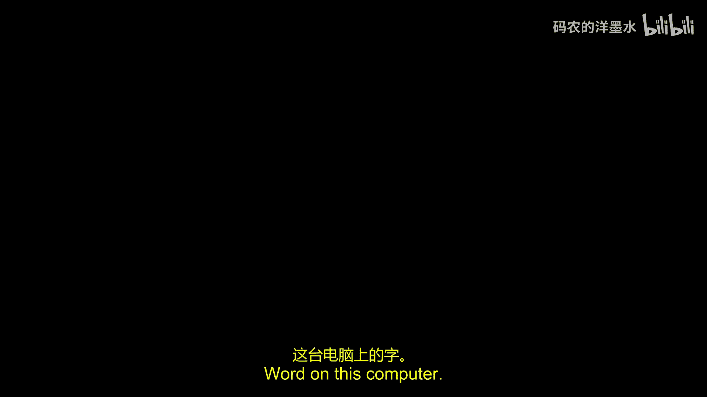
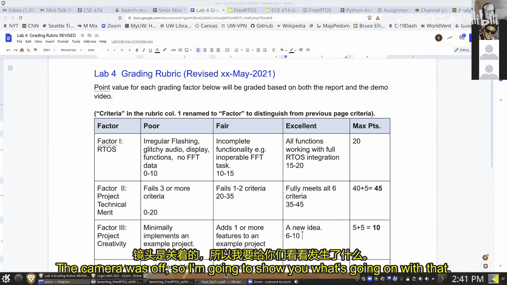
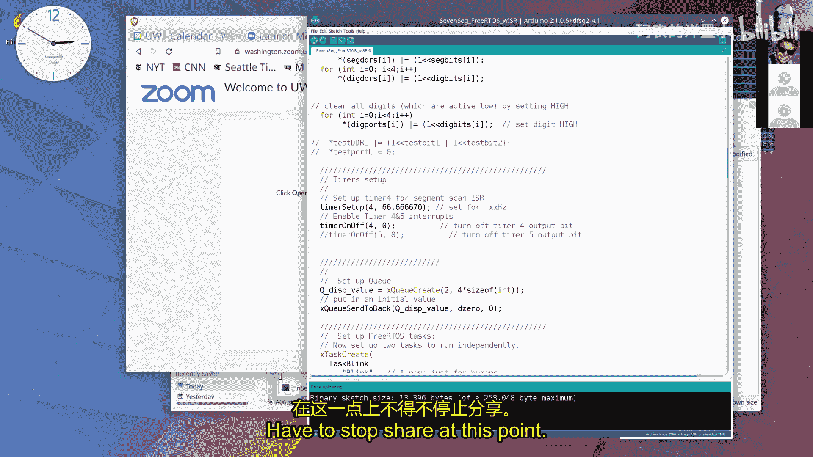
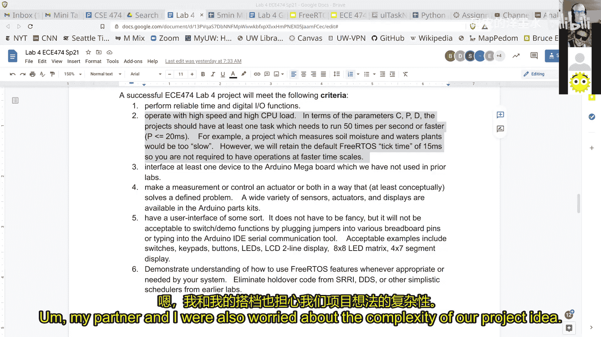

# 嵌入式系统导论：17：关键部分与信号量导论




在本节课中，我们将学习如何管理嵌入式系统中的共享资源，特别是通过信号量来保护关键部分。我们还将了解课程的最新安排，包括实验4的评分调整和期末考试的准备。

## 课程与实验更新

上一节我们介绍了多任务系统的基本概念，本节中我们来看看课程的最新安排。



首先，关于实验4的评分标准，我们进行了一些调整，以更全面地评估项目的技术价值、创造性和挑战性。


以下是更新后的评分因素：

*   **项目技术价值**：项目是否满足原始实验说明中列出的标准。此部分增加了5分。
*   **项目创造性**：项目的创新性和雄心程度。此部分增加了5分。
*   **问题解决**：项目是否至少从概念上解决了用户的某个实际问题。此部分保持5分不变。
*   **项目挑战等级**：项目的难度级别。这是一个新的类别，占10分。
*   **技术沟通**：实验报告的清晰度和完整性。此部分保持10分不变。

因此，实验的总分提高到了100分。这些调整旨在鼓励更具挑战性和创新性的项目。

关于期末考试，我将尽快发布一份学习指南。我的目标是让学习指南与考试题目有实质性的重叠，使其真正成为备考工具。我计划在考试前一周的周末发布学习指南的答案，以便大家有充足的时间独立练习和思考。




## 实验代码示例解析

现在，让我们回到一个具体的代码示例，它展示了如何在中断服务程序（ISR）中使用队列进行任务间通信。

这个系统包含两个主要任务：一个闪烁LED的任务和一个递增计数的任务。计数任务将其计数值通过队列发送给一个专门负责更新七段数码管显示的中断服务程序。

**核心代码片段**：
```c
// 创建队列，用于传递4个整型数字（代表4位数）
xQueueDisplay = xQueueCreate(10, sizeof(int) * 4);

// 计数任务将数字放入队列
xQueueSend(xQueueDisplay, digits, portMAX_DELAY);

// 显示ISR从队列中获取数字
xQueueReceiveFromISR(xQueueDisplay, displayDigits, &xHigherPriorityTaskWoken);
```
之前代码无法工作的原因是我忘记声明队列句柄（`QueueHandle_t`）变量，并且移除了一个全局指针，但没有在相关函数中将其定义为静态变量。修复这些问题后，代码即可正常运行。

这个示例的关键在于，将显示刷新放在一个高频定时器中断中，而不是在任务中。因为FreeRTOS的任务调度器节拍通常是15毫秒，这对于无闪烁的显示来说太慢了。通过将中断频率设置为1000赫兹，我们获得了稳定、无闪烁的显示效果。

此外，我们还测试了系统处理队列消息的能力。当计数任务以每秒10次的速度发送消息时，系统表现良好。但当速度提高到每秒100次时，显示开始出现异常。这表明我们需要测试系统的极限，以确保在实际应用中有足够的安全裕度。

## FreeRTOS任务通知简介

上一节我们使用了队列进行通信，本节中我们来看看FreeRTOS提供的另一种轻量级同步机制：任务通知。

任务通知可以被用作信号量的轻量级替代品，尤其适用于保护关键部分。它的开销通常比传统的信号量更小。

**基本使用步骤**：

1.  **获取任务句柄**：在创建任务时，需要获取一个`TaskHandle_t`类型的句柄。
    ```c
    TaskHandle_t xTaskHandle;
    xTaskCreate(vTaskFunction, "TaskName", configMINIMAL_STACK_SIZE, NULL, tskIDLE_PRIORITY, &xTaskHandle);
    ```

2.  **发送通知**：一个任务或中断可以使用`xTaskNotifyGive()`或`vTaskNotifyGiveFromISR()`向另一个任务发送通知。
    ```c
    xTaskNotifyGive(xTaskHandle); // 在任务中发送
    vTaskNotifyGiveFromISR(xTaskHandle, &xHigherPriorityTaskWoken); // 在ISR中发送
    ```

3.  **接收通知**：任务可以调用`ulTaskNotifyTake()`来等待通知。这个函数会阻塞任务，直到收到通知或超时。
    ```c
    ulTaskNotifyTake(pdTRUE, portMAX_DELAY);
    ```
    其中，第一个参数`pdTRUE`表示在退出时将通知值清零（适用于二值信号量场景）；第二个参数是等待的最大时间（以系统节拍为单位），`portMAX_DELAY`表示无限期等待。



任务通知机制允许任务高效地等待事件，并且在等待时不消耗CPU时间，调度器可以运行其他任务。

## 项目构思问答与建议

在课程的最后互动环节，同学们提出了一些关于最终项目的构思，并获得了一些扩展建议。

**项目构思1：密码锁**
*   **核心想法**：使用矩阵键盘输入密码，在LCD上显示，若密码正确则驱动舵机打开锁。
*   **建议**：基础功能略显简单。可以增加需要高速处理的模块，例如：
    *   用拇指摇杆录入并识别手势密码。
    *   将LCD替换为需要更高刷新率的七段数码管。
    *   增加红外光束，一旦被触发立即锁死。

**项目构思2：火灾报警系统**
*   **核心想法**：读取温度传感器数据，超过阈值则触发蜂鸣器报警、LCD显示警告并启动风扇。
*   **建议**：核心逻辑（读取-判断-响应）较为直接。建议在基础上增加层次：
    *   添加RFID读卡器，刷卡后才能关闭警报。
    *   加入后台任务，例如对传感器数据进行FFT分析，显示主要频率成分，做成一个频谱仪。
    *   考虑使用两个Arduino板进行通信，构建分布式系统。

**通用建议**：
*   **从简单核心开始**：先实现一个稳定可靠的基本功能，再逐步添加更复杂、更具挑战性的特性。
*   **利用串口通信**：实现Arduino与电脑的串口通信是一个有价值的新技术点，可以用于配置、监控或数据交换。
*   **思考实际应用**：项目最好能解决一个可以直观描述的问题（例如“这是一个智能车锁”），而不仅仅是组件的简单堆砌。
*   **探索低功耗**（进阶）：如果有条件，可以尝试优化系统功耗，探索如何让设备在电池供电下运行更长时间。

## 总结

本节课中我们一起学习了几个重要内容。首先，我们了解了实验4评分标准的更新，强调了项目的挑战性和创新性。接着，我们通过一个代码示例，深入探讨了如何使用队列和中断服务程序来实现高效、无闪烁的显示更新，并测试了系统的通信负载能力。然后，我们介绍了FreeRTOS的任务通知机制，它是一种轻量级的任务同步方法，可以作为信号量的高效替代方案。最后，通过项目构思问答，我们探讨了如何设计并扩展一个具有足够深度和复杂度的嵌入式系统项目。希望这些知识能帮助大家顺利完成最终项目并为期末考试做好准备。