# WasmCon-2024-p02-P02-Keynote---The-Wasm-Wilderness---Technological-Peaks-Weve-Reached-with-WebAss--BV18DjSzJE6r_p2-

Hi everyone， my name is Kate Golden Ring， and I'm excited today to talk about the Wam Wilderness。

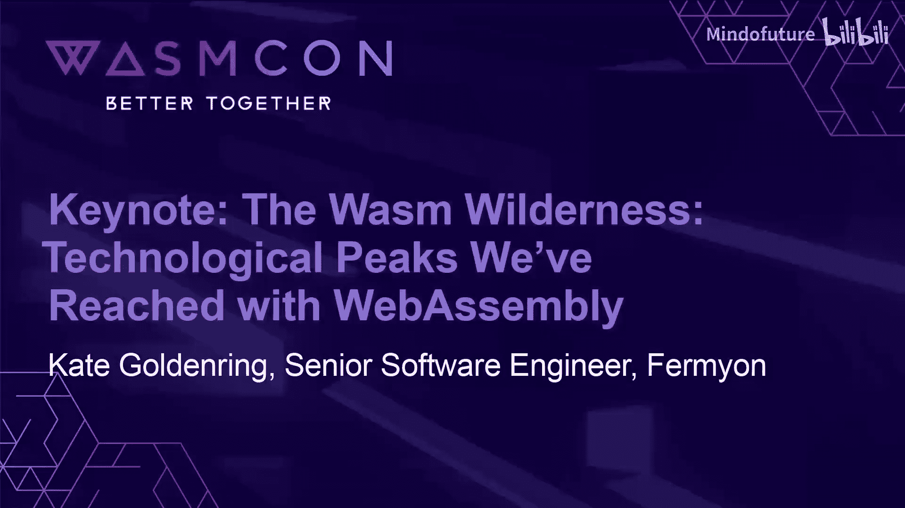

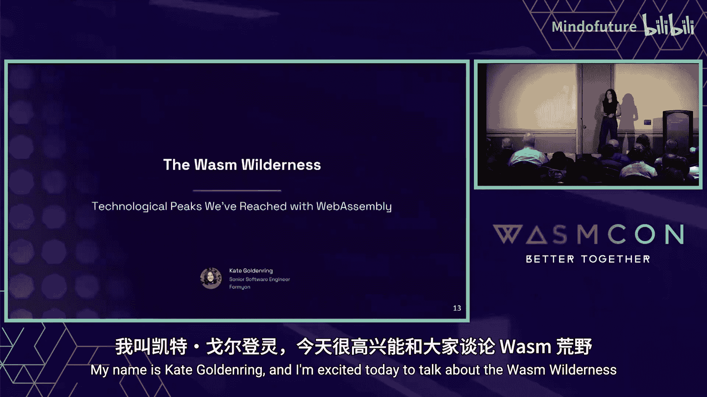

Like Nigel mentioned， I am a senior software engineer at Fermon and I've been lucky since the beginning of my career to be an open source software developer。

 I started out in the edge space focusing on Kubernetes on the edge and maintain a project called Ary。

 that's the CNCF project and also serve as co-chair of the CNCF IoT Edge Working Group and over time I got interested in this amazing technology called Webassembly and I've moved into that space and I am a maintainer of spin and SpCbe and am passionate about making the component model more accessible and serve as co-chair of the Bcode Alliance Docuation Sig。

😊，In general， what drives me is a passion for sustainability。

 so I'm always looking for ways to make software greener and that kind of relates to what I like to do outside of work。

 which is shown in this picture but I love being in the mountains and I'm an avid Mountaineer and actually when I'm not at my desk I'm oftentimes helping instruct mountaineering courses with my local mountainering Club and when I thought about this talk I couldn't help think about where we are which is Salt Lake City and these mountains are actually quite important to me these are the mountains my mom grew up climbing in and if not for them I never would have gotten into mountaineering and so that was on my mind while I was thinking of the power of Webassembly and this all melded together into me realizing that Webassembly would be a great person to climb a mountain with。

And so I'm going to take us through that， this wilderness of Wm and the fact that Webassembly has summ some major technological peaks and when you're going about learning to climb the mountain。

 there are a lot of lessons and techniques that you're trying to put to practice。

 and I noticed that these same techniques that I teach people in our mountaineering courses。

 Webassembly somehow has been using to summit each of these mountains。

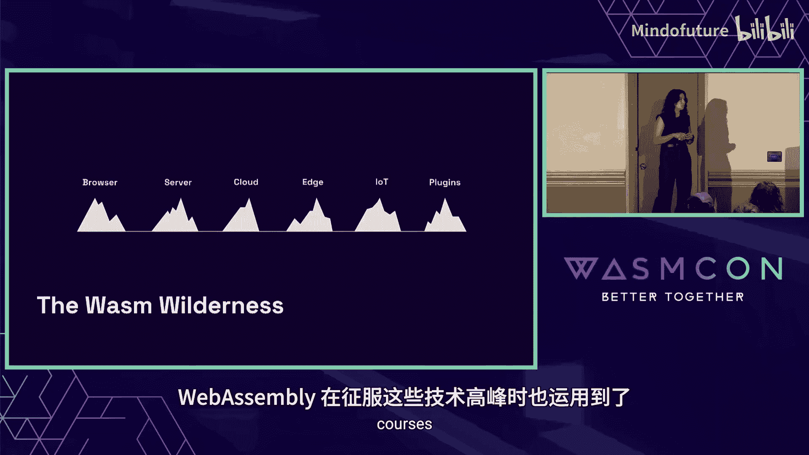

So to start。The first thing you do before you're climbing a mountain is you look at some trip reports。

 The idea here is that you want to learn from past climbers learn from their mistakes。

 their successes so that you can have a more successful climb。

 and that's what Webassembly did it was learning from predecessor technologies that tried to extend the capability of the browser such as Act X。

 Java， Silver light and flash and learned from some of the shortcomings of those technologies and extend beyond them and so all these technologies and up not being able to reach the summit because they did not quite have the security that they needed。

 they ended up becoming vectors for malware attacks and this in mind the authors of the Webassembly specification made it security specific。

 they focused on security when designing that specification and they also instead of being a proprietary system made it an open standard and beyond that in order to encourage more people to be involved with it。

 they made it concise and actually here on this slide is one page one singular。

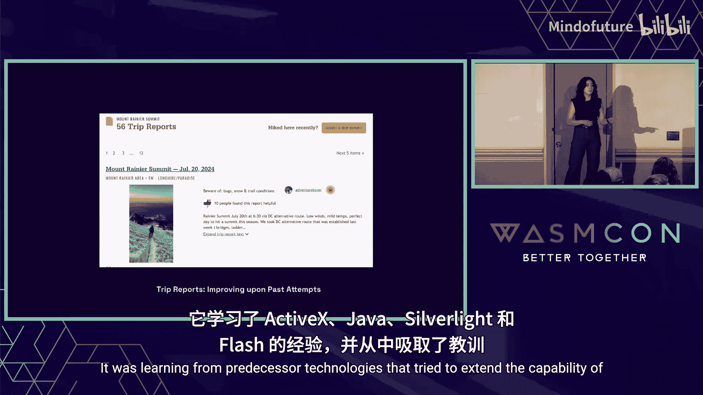

Page where if you can understand it， all these Greek letters， which I personally cannot。

 you can write a Webassely interpreter that can execute Webassembly。

 and you know it scientifically proven to isolate it in a sandbox。 And actually。

 if you want to learn more about this。 Luke Wagner is one of the authors of this paper。

 and he's coming up soon。 So feel free to save your questions for him。

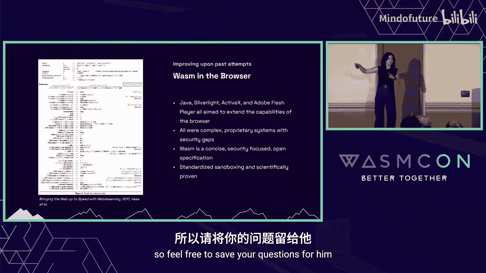

Another essential rule of going into the outdoors is bring a map。

 The idea here is that you want to make sure you have the resources you need。

 You're not going to go into a space in the wilderness unless you know you have shelter。

 water and a path forward。 And that's what Webassembly did as it was leaving the browser and going to the server。

 It brought a map， which was wi， the Webassembly systems interface。

 And what this did is it ensured that a Webassely component could access resources on the server。

 such as the file system， I O and HDP。

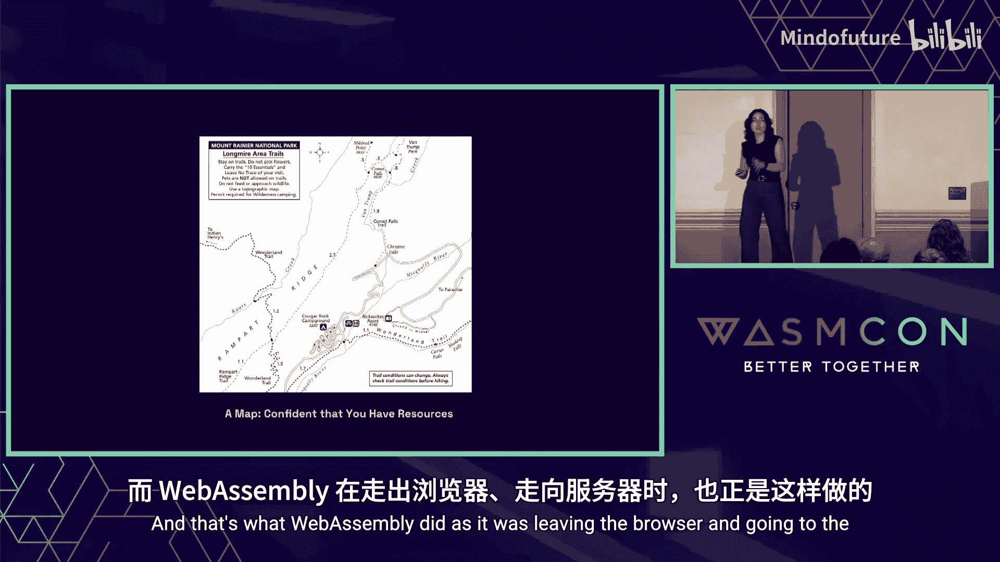

And it did it in a way such that now I can write Webassembly services that can receive H requests and send HB requests。

 and I know that if I run this on a Webassembly runtime that implements WZP2。

 my same application can run on any of these runtimes and act as a Webassembly service。

And all this sits on top of the semantics of the component model， which is another open standard。

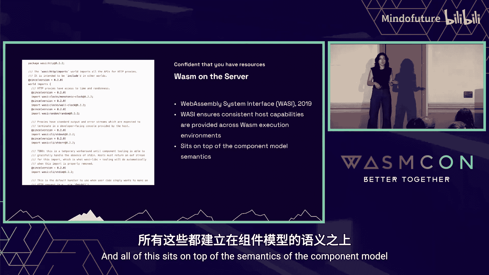

So if you're going to be a good tenant of the outdoors。

 one important thing is to stop the spread of invasive species。

 and if you've ever been at a trailhead， sometimes they have those big wooden bulletin boards with all of this information and it'll say。

 oh， this is a preview of the trail you're going on， maybe beware of bears。

 but sometimes naturalists will post up information about invasive species in the area and this is a bit controversial。

 but there have been some species such as the spotted lanternf where some people basically touted if in doubt。

 stomp it out， basically saying if you see one of these even if you're not quite sure that's what it is。

 kill it because we cannot risk this species spreading。

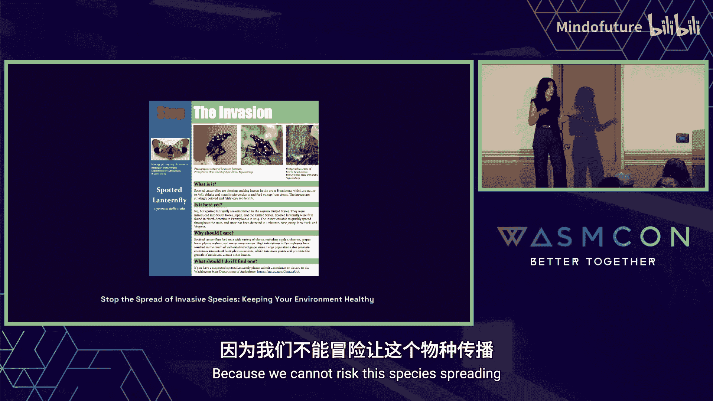

And this， if in doubt stomp it out is echoing in the background of your platform engineers。

 they're not going to let you run anything on that environment， there are guardrails。

 and they're only to let you run something that is isolated for this multitenant cloud environment and Webassembly is very good at keeping invasive species from spreading and that's because it has a secure sandbox and capabilitybased security。

And it is even more secure than some of the more pervasive ways of isolating your applications in the cloud such as containers。

 but it's also just as packageable， so webassembly components can actually be packaged as an OCI artifact just as you would a container and the Webassembly working group within the CNCF has done work over the past year to standardize that artifact layout for Webassembly OCR artifacts so that all Webassembly runtimes can now understand the same OCI format and execute your Webassembly component on that cloud or another cloud。

Also， WaAI is providing interfaces for cloud specificific webassely applications。

 so beyond HTP which we already know from the server。

 there's WAI key values being developed to be able to access。

 for example caches and WAI config to be able to access secrets。

 and so this means that across cloud platforms， your application could have access to the same resources without having to rebuild that application。

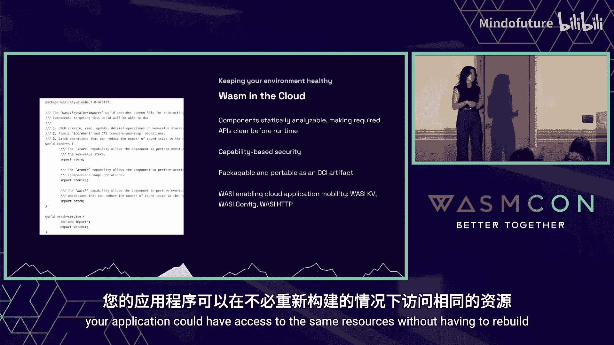

Another important part of climbing mountains is remembering that it's hard。

 it takes a lot of energy to get to the top of a mountain。

 and because of this there's actually a walking technique that mountaineers will use it's called the rest step and the idea with the rest step is you're either actively moving or statically standing and the point of this is that you're only using energy when you're moving towards your goal。

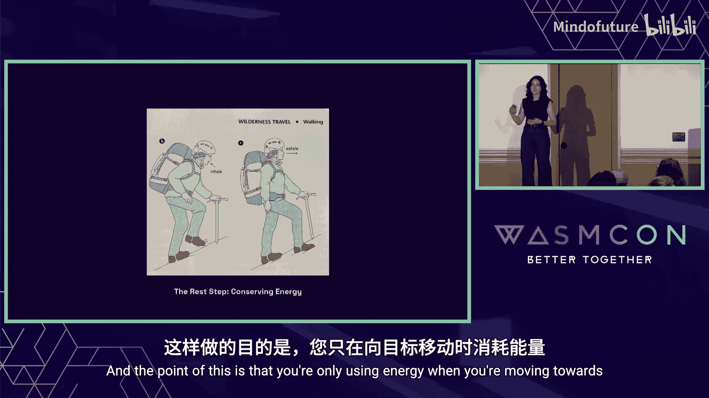

And Webassembly is very good at the rest up， and that's because it's unique in being an isolated form of executing your code that starts instantly。

 It takes less than a millisecond to instantiate Webassembly and start it less than a millisecond。

 So that means that when you don't want to be using it， you can tear it down。

 and then when you do want to use it， you can bring it back up and fully scale to zero。

And this is particularly important on the edge， where these constrained devices where these devices are constrained with how many resources they have access to。

 and opens the door for a multi tenant， secure， serverless platforms on the edge。

This image here is from some load testing we did on Fermion Cloud。

 our multitenant platform for serverless Web assemblymbly， where we issued requests to 10。

000 web assemblyly applications at once， and you can see the CPU spiked on that host and then immediately drop back down to its baseline with every single one of those web assemblyly components starting on request time。

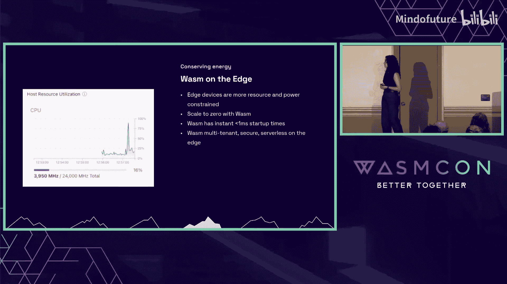

So beyond conserving energy by walking efficiently。

 another way to conserve energy going up a mountain is to carry as little weight as possible。

And one way that mountaineers do this is by optimizing the weight on their harness。

 And so instead of having a jumble of different gear that you're going to put on there。

 you want to have multipurpose gear。 And so this is my favorite piece of gear。

 It's called the pencil micro tractionion。 And you can use it as a pulley or for ascension。😊。

And Web assemblymbly is very good at being a lightweight multipurpose tool。

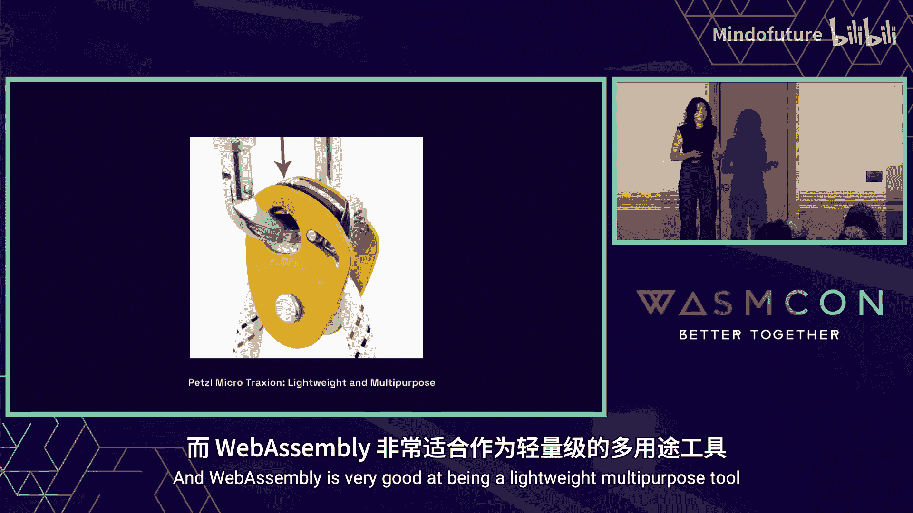

And there's no space that is more multipurpose than the IoT space。

 There are billions of devices online already， and by 2030 we are projected to have over 40 billion devices。

 and this space is vastly heterogeneous， there's different boards， platforms， SDGs。

 so it's really hard to be a universal embedded developer。

And sometimes you're limited in what languages you can use， maybe only systems languages like C。

 and what Webassembly does is as long as you can put a Webassembly runtime on that device。

 maybe a Minified one like wAhammer， you can then run a Webassembly application there。

 and you can write it in any language of you' choosing so long as it compiles down to Webassembly。

And one group that is working on standardizing this vastly heterogeneous ecosystem is the embedded special interest group within the Btecodeat Alliance。

 and they've been working on creating WI interfaces that are specific to the IoT spaces。

 and actually I really encourage you to stay to the very last talk of this conference where MiKil and Merlin will be talking about the research that they just published。

 I think a month or so ago about their experience using Wi USB and Wai I squared C on these embedded devices。

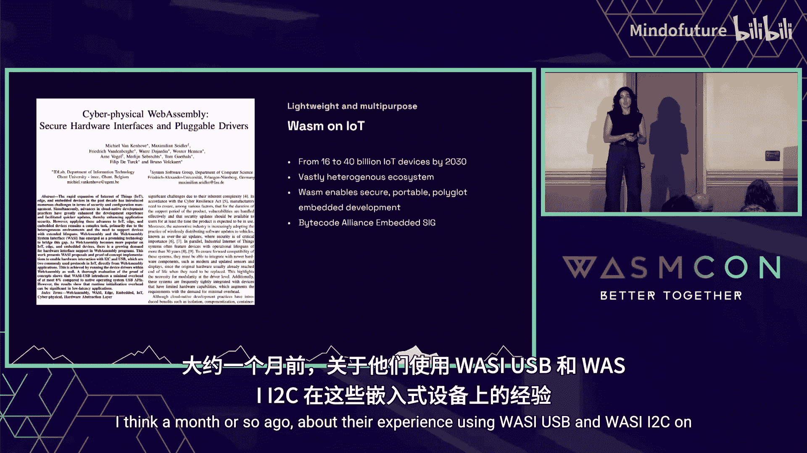

And for our final peak， it is one thing that is really important to remember is to find ways to get the most out of your destination。

 so this lake here is called Foggy Lake， and it didn't actually used to be that popular。

 but now it's impossible to find a parking spot and it's not because of the lake it's still just as foggy as ever。

It's because of the activities you can do around it that more and more people are discovering。

 So the peak on the left， that's called Del Campo peakak and the peak on the right is Gothic peakak。

 and a lot of people will come to climb those mountains。 And if you're not climbing a mountain。

 maybe you're camping along the edge of the water or you're bringing floaties to float out on top of the cold water。

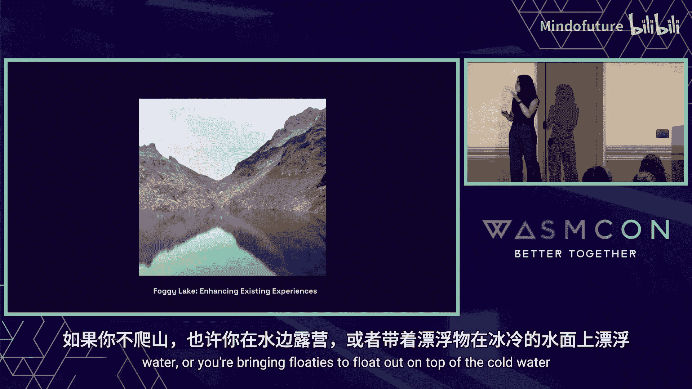

And Webassembly is similarly very good at enhancing existing experiences。

 and it is a common mechanism for providing plugins to existing architectures。

 and this started in the browser where it provided a way to extend it in a language agnostic and secure way。

 and now we are already seeing this in various different applications so envoy extensions provide a way to extend envoy gateway with Webassembly。

 and they are one of the earlier adopters here， Shopify functions you can write in any language now with Webassembly a way to extend your checkout experience there。

And code editors are oftentimes adding extensions as well that you can write using Webassembly such as VS code。

 and now the recently released editor is Z。And so we've made it through the Was and wilderness through all six of these peaks。

 and I want to remind us of what brought us through all of those。

 the kind of the bedrock of the mountain。 and that really has been the open standards。

 We started with the Webassembly specification that brought Webassembly to the browser and then we had Wi which enabled it to leave the browser and then we had the component model which made it so that we could have more higher level types for our Webassembly modules。

 and then we have the OCI artifact specification that's enabled us to unify packaging for Webassembly。

So I invite you to imagine a future where my application doesn't have to be limited to one technological peak or one technological domain。

 rather my application can move with me from the browser to the edge because it is portable， secure。

 and we have unified runtimes， and this is all only possible with the continued evolution of these open standards。

So with that， I want to thank you for joining me through the walls of Wilderness。

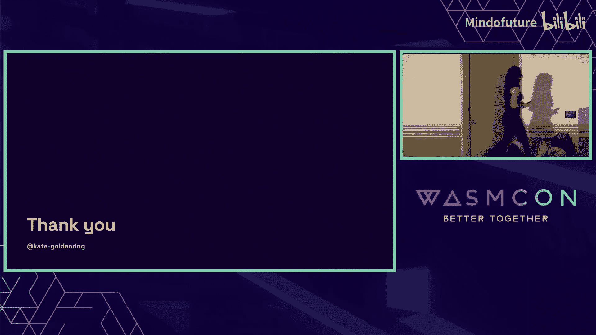