# WasmCon-2024-p03-P03-Sponsored-Keynote---Secure-and-Efficient-Sensing-Applications-with-Wasm---Da--BV18DjSzJE6r_p3-

My name is Dan Demetriria， I'm CT of Micar， and we are part of Sony Group that somehow dropped off the slide。

 which is relevant because we're talking about computer vision on the edge okay。

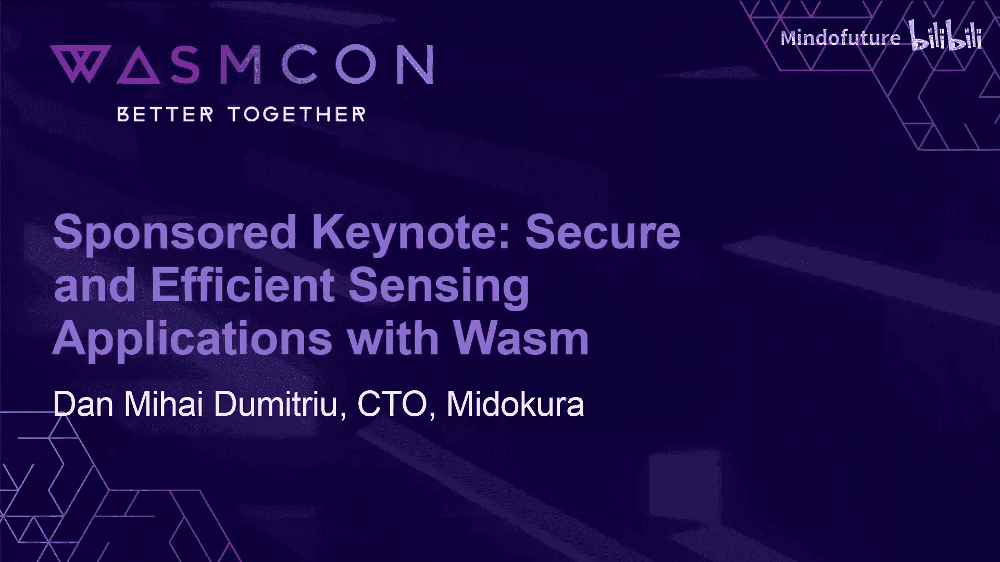

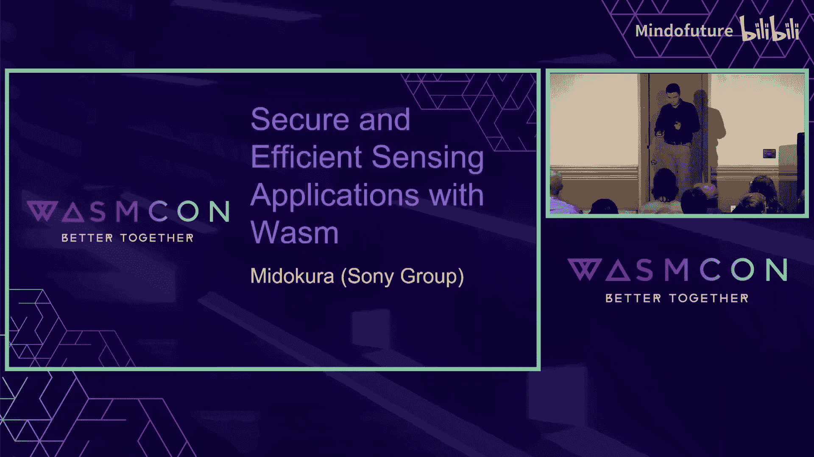

So there's a growing demand for EAI and computer vision that should be no surprise to anybody。

 and the problem is that given that the demand is growing so fast。

 the resource consumption is really huge， like if you have to transmit a bunch of video to the cloud and do all the computer vision over there that's just not scalable。

 so we're trying to push up to the edge。

Now， when we do that， we have a bunch of development challenges。

 which you're probably very familiar with， lack of compute resources， fragmented edge environments。

 security threats， and somehow poor development experience in embedded systems development。

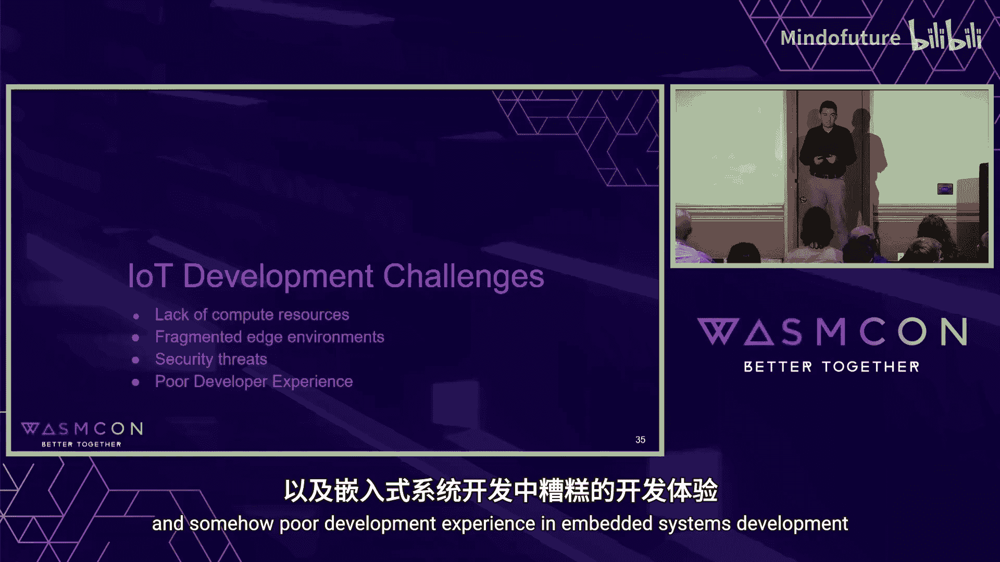

Many IoT devices or you say microcontrollers are super resource constrained。

 which I think we all understand， but maybe we forget because we're in the cloud native cloud world where we have lots of resources。

 as you can see some of these have minuscule amounts of memory。

 although by historical standards it's quite a lot right。

The other problem is that in the IoT space and embedded development space。

 there's a lot of fragmentation on many levels， operating systems， architectures。

 instruction set architectures， and communication protocols， for example。

 Webassembly does help with some of these。Lack of isolation is a real concern in these environments because we often don't have MMUs memory protection。

 the stuff that we're used to， and typically quite a large percentage of security vulnerabilities are actually related to memory problems and these are very。

 very vulnerable on the IoT environments。Now another thing is that embedded development is really dominated by CNC++。

Whi again shouldn't be surprising， these are the systems programming languages。

 but the problem is that nowadays a lot of the AI and data frameworks are mostly Python。

 so we have a bunch of Python developers don't necessarily want to delve into the CC++ world to do what they need to do。

 so we have this impedance mismatch。

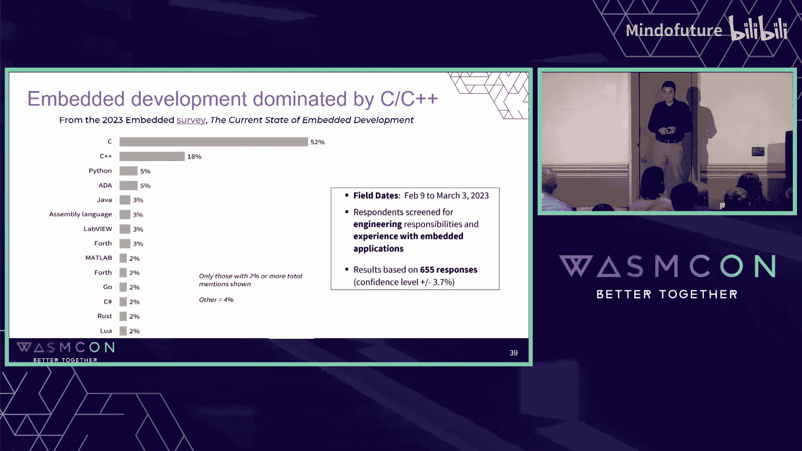

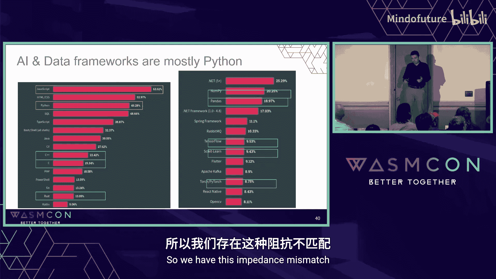

So Web assemblymbly for Edge and Vision App can solve some of these problems。

The lightweight execution environment， I'm gonna skip that because you all know what that's all about。

 we're using whammer， web assemblymbly micro runtime， right once run anywhere， quote unquote。

 not exactly， but at least that's like part of the way there。

 you know we're trying to ease the development burden， you know in terms of porting。

Hopefully to nothing， maybe two， not very much。Secued by default fault， that's a very。

 very important aspect here， which is that we can enforce the memory protection and we can also restrict access to interfaces that are not supposed to be used relatively easily in the webasse assemblyly environment。

 and finally polygo programming to get around that impedance mismatch between what the developers know and what the systems need。

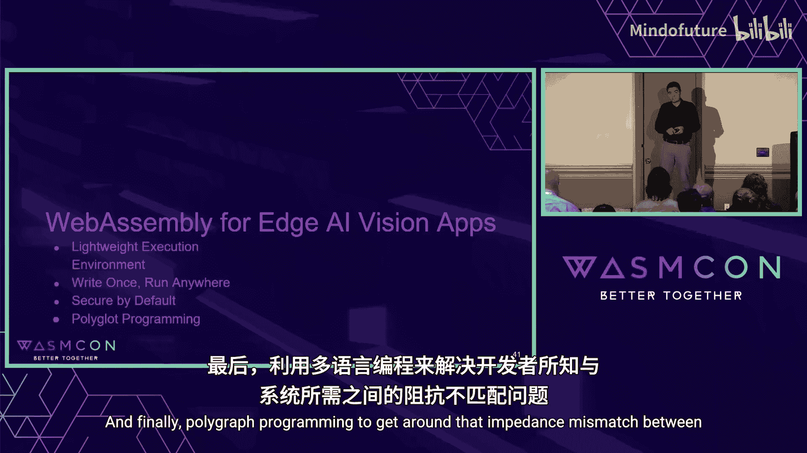

Okay， so the security model is a good fit for IoT。We can already use the Web assemblymbly memory protection and restrict access to the interfaces。

 we can do a lot more static analysis as well before that Python programming is， again。

 the interest in Python within the Web assemblymbly community is actually growing quite a lot。

And we've done a bunch of work to run Python efficiently within a WASM sandbox environment。

We've done several different ways， transpiling， running C Python fully。

 or straight up compiling C Python code into IntuAM。

And now P Wi is now in a tier 2 support of the C Python itself。

It's interesting and it's growing in importance。We're actually using micropyython at the moment。

 running inside the Wy sandbox。And we have a very constrained environment where we really don't need that much from Python。

 we don't need general purpose Python。We just need something like an nuy and basically that's enough。

So this is something that we can run currently within 1。5 megabytes， AOT compiled。

 that's still a lot for some microcontrollers， but we're making progress。

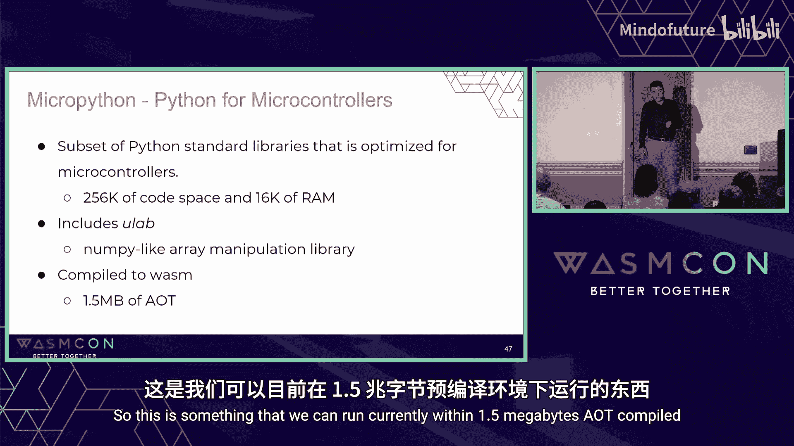

Okay， so putting it all together， you know， we it's kind of changing topics for a second here。

 but Sony has developed this intelligent vision sensor， the IMX 500。

 which basically is a DSP memory and the actual pixels in the same package。

 and this we can program to run AI models。

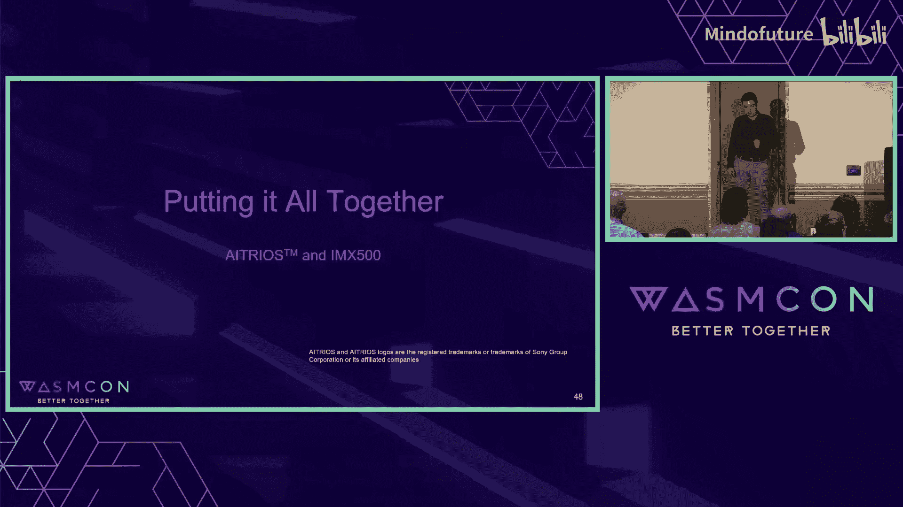

know of some sort， we use this in our IoT device that you see there in the bottom left。

Which you can see are our booth afterwards。And we built this device stack。

 which is using Webassembly as a key part of the stack so we can run applications on our IOT device on the microcontroller。

Right and basically with this in our local development environment。

 a developer can develop some application in Python， deploy it， monitor it。

 test it on the local device before uploading it to the Attrius cloud。For large scale。

 fleet management and so on。

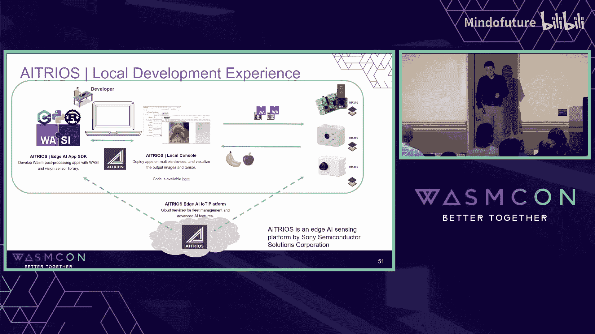

I was going to go through success cases， but we don't have time。

 so you can see those at our booth right outside this afternoon and tomorrow as well。

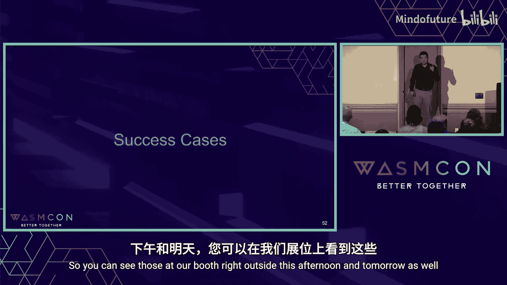

So sneak preview， we can run the same applications on different devices like Raspberry Pi or an ESP32 based microcontroller camera。

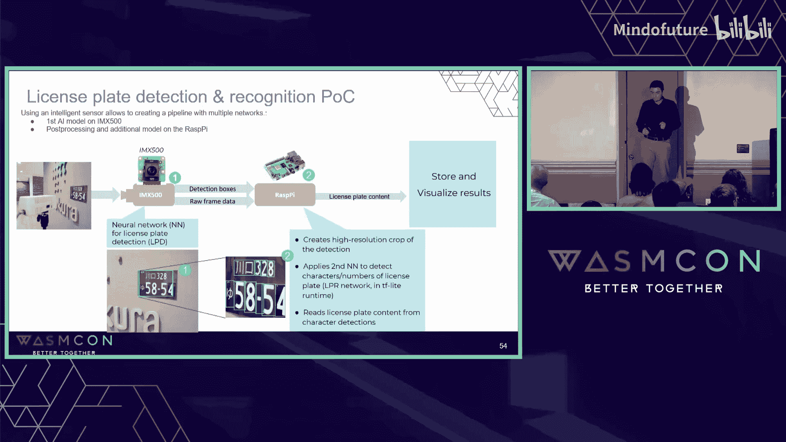

And that's it。 Thank you。