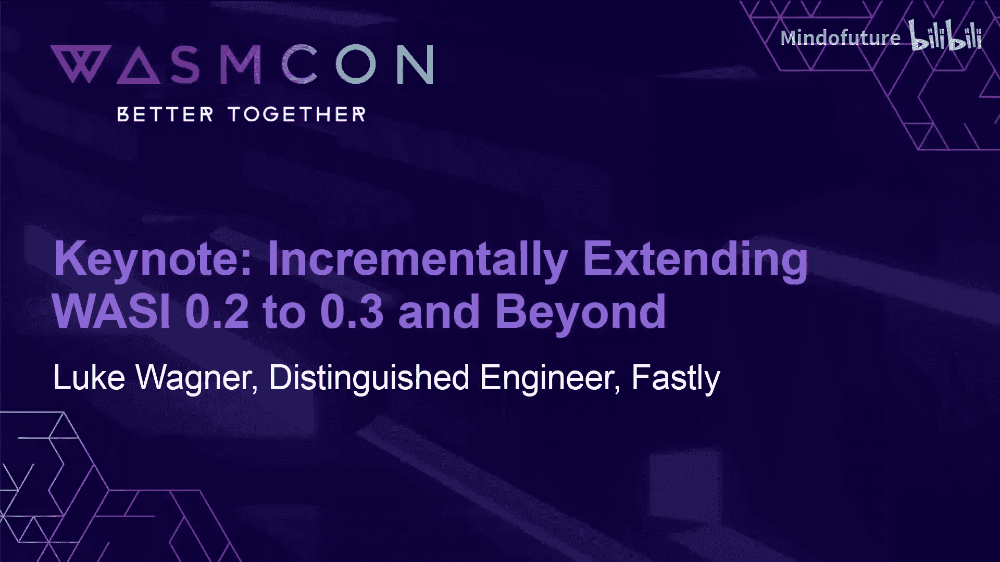
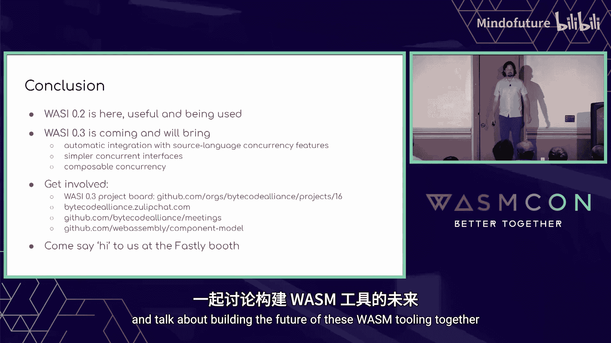

# WasmCon-2024-p04-P04-Keynote---Incrementally-Extending-WASI-0.2-to-0.3-and-Beyond---Luke-Wagner--BV18DjSzJE6r_p4-

Thanks for having me， so yeah， I'm going to be talking a lot about Wy。

So I should probably start by saying， well， what is Wy？

So WASI stands for Web assemblymbly System Interface and briefly WSI is a virtualizable collection of modular interfaces between WSM and the outside world that are in the process of being standardized。

And so WSI forms a natural complement to Webassembly Web assemblymbly abstracts over a variety of physical CPUs and allows us to write portable WASM code and generate portable WSM code that runs across these different physical CPUs but what about when this portable WSM code wants to talk to the outside world well that's where Wi comes in but what is the outside world and there's a like lot of variety of perspectives when we first started the outside world seemed like the interfaces provided by a traditional operating system。

 things like file system， sockets， randomness and clocks。

 but as we started to see WASM get used in more places are kind of view had to broaden？

As we start to see WSm going into cloud native places。

 the set of primitive interfaces looked a little different， it looked a little more like HTP。

 config stores， key value stores， blob stores， messaging， and more things。

As we start to want to WASM to talk to more different kinds of hardware。

 we start to realize we need new interfaces to talk to GPUs， neural networks， USB， I squared C。

 crypto and more things， and there's just more embeddings of WASm coming and so more interfaces necessary and hopefully what this illustrates is that we can't expect one host to implement all of these interfaces host me to be able to implement just the modular subset of that makes sense on that host so WSE is a collection of modular interfaces。

These interfaces are also virtualizable by design， because when WSM talks to the outside world。

 sometimes we want the outside world to be WASM itself， for example。

 implementing a high level interface like WSyHP， in terms of a lower level interface like Wy sockets。

And we're standardizing these interfaces why， so that we can build an ecosystem of shared tools。

 which lets us amortize the significant efforts in automating the laborious， low level error prone。

 security sense of stuff that otherwise we have to keep reinventing。

And this also lets us upstream these interfaces into the popular language tool chains and other popular tools that we want to have these interfaces be built into。

 whereas if we were some kind of bespoke project or a company specific interface and we tried to upstream them。

 they tell us to go fork ourselves with standards， we can like show up and actually get this stuff upstreamed。

And this gives us time to focus our efforts on building out our platform's unique value instead of duplicatively reinventing the tables stakes。

And standards also let us bring in deep experience from a diverse set of backgrounds。

 which ultimately leads to a higher quality results。But we're not done。

 this is something we're in the process of because we're practicing incremental codevelopments of the specification and the implementation。

 because history teaches us that if you do just one of these before starting the other。

 you get a bad outcome。And we're doing this via sequence of version releases。

And if you've been noticing WAy has in fact been releasing。

 so our last major release was in January of 0。2， and this is a big release contained within it。

 the component model which defines for us a composable language neutral unit of code。Contains ws。

 which is our interface definition language for components。

And using WW we defined a collection of interfaces that add up to this CLI command world。

 which gives us sort of a portablepoic C execution environment。

 but we also defined an HTP proxy world， if you look at these worlds like a Venn diagram。

 they intersect and that they both provide certain interfaces like clocks and randomness。

 but HP proxy naturally wants to speak HTP natively to the outside world。

 whereas the command world wants to speak in terms of file systems and sockets。So this was in 02。

 you， big release， so we celebrated and then took a break and then got back to work。

 and then August released 0。2。1。And the big feature here was actually the release process itself and all the tooling and runtime support that's necessary to allow smooth minor releases。

 as well as we added a few features to w the unstable and syncates to help us control that rollout of new features。

And then two much later， in August， we released 0。2。2， which added some OCI integration。

 which is really exciting stuff I'm going to be returning to later。

As well as this third deprecated gates。And in December， we plan to release the 0。2。3。

 and hopefully this will include the WSI Key value proposal。

 which has had a bunch of work put into it thus far。

AndSo the pattern you're noticing here is we have a plan to release every two months with sort of a train model。

 and so it's you know when features are ready they go in that release and if not they can just wait to catch the next train。

And so while it's not clear exactly what order things will happen。

 there's a lot of excitement and work on Wy Config， blob， messaging， cryrypto and Web GPU。

 and using all these new interfaces we can find a new bigger cloud world which extending that previous Venn diagram would be a superet of the proxy world。

 so there's a lot of exciting stuff， but concurrently with all this stuff is a zero3 release。

 which is s for some time in the first half of next year。

And the big feature here in Zwazi03 is N Async support。

Now don't panic this is not a big change like 01 to 02 was， that was big。

 this is not a breaking change， we're talking about an incremental addition of types and A options to the existing 02 component model binary format。

Such that all WAI2 components are still valid components in the WSZP3 world。

And we'll support both the WZP2 and WSZP3 interfaces side by side during the rollouts。

 but then eventually leveraging this virtualizability of WASZ interfaces。

 we'll be able to virtualize WSZP2 interfaces in terms of WZP3 so we can actually remove WZP2 from the hosts。

 reducing our trusted computing base while keeping all the existing WSZP2 code working。

 which is like the whole point of this virtualization。

And our goals with this native ASync supports are to automatically integrate with source language concurrency features。

 simplify concurrent interfaces。And make concurrent components composable。

 so let me dig into all three of these goals。Starting with language integration。So already in YZ02。

 I can declare a function load that say loads a model from a name string。

 and I can implement this with a variety of synchronous functions in a variety of languages now。

 but starting in 03 I can start implementing this with async function， so for example， and C sharpp。

 I'd be able to implement load as an async task returning function that because it's an asynct function。

 it can await a blocking operation before returning its new model。

And then I can import this load function from let's say Python， which can import load as a corout。

 which means in Python I can use a syncncIO to spawn multiple concurrent load tasks before gathering them。

 and so now I'm doing a cross language concurrent call fairly naturally that in the first load blocks here the second one gets to make progress。

And so I can do this for all the existing function signatures I could express in 02。

 but I can also express more function signatures using the new future and stream types。

 so I could write a transform function from a streamabbys to a streamabites。

And I could implement this and let's say JavaScripts with an nascing function that takes a readable stream。

And because it's just a built in readable stream， like built into the JavaScript standard library。

 I can use methods like pipe through and decompression Sc。And then I could import this from。

 let's say go， and go would allow me to have a transform function that takes a read only channel and then returns read only channel that can iterate over using my go built in syntax。

And here I'm showing a bunch of async functions but of course we want to be able to write and implement these interface and implement these interfaces in both synchronous and synchronous codes。

 so for example my C sharpp could be written just as a plain synchronous function like it would be today and the calling async Python still work so just that loads don't run concurrently they run in sequence or flipping it around。

 the C sharpp could be as sync but the calling Python could be synchronous and then again I just get two sequential loads。

Or I could implement that transform function using traditional W ellippsy。

 synchronous read and write calls that have been integrated with the underlying streams。

And I can call this from Go and it'll stream in chunks just like I'd expected to。

And thus for avoiding the what color is your function problem made famous by the blog post the same name by using the isolation of components to separate the asynct code from the synchronous code and let them interoperate。

Also in Weies Are three one to simplify concurrent interfaces。So just as a concrete example in WZ 02。

 HP needs 13 resource types and two hand learner faces and I don't have time to go into the full details of why but basically there's two stream types that have a direction on them。

 there's an input stream and output stream， and this kind of infects all the types that want to use them so we have to have incoming and outgoing request and responses bubbling all the way up to the hand learn interface faces。

 one takes an incoming request and one takes an outgoing request。

 and then we need some resources that emulate futures。But in WSZ03。

 I can have just four resource types which are kind of the obvious ones from the HP domain。

 fields request response and body， and one handler function which takes a request to returns a response like you might hope。

And the magic sauce， if you zoom in and is in the resource body。

 whose constructor takes a stream and whose consume method returns a stream。

 and so there can just be one resource body and everything else。And lastly in we 03。

 we want to have our components be more， our concurrent components be more composable。

And there's two types of interesting compositionality here， there's the first one， which is I say。

 is a more first order style Unix pipeline style composition where values flow in one direction。

And so for example， let's say I have an interface tools that has three functions， load。

 which returns a stream， unzip， which transforms a stream， and JQ， which consumes a stream。

So in JavaScript， let's say I could import these three functions and they're just three JavaScript functions and the return type load it turns into readable stream and that's the parameter type of unzip so I could just chain them together in one line of JavaScript using plain old function composition and that just works。

 and so in that one line JavaScript I've been able to wire together three async function calls so that the results flow into each other and the stream flows in one direction。

So this is a first order style of composition， where we can also express a slightly more complicated。

 but far more expressive higher order phar composition。

 which I'll call service chaining style composition。So in this。

 let's say we've got a world calledChainable handler which describes the shape of a components that imports and exports an HP handler。

 noting that this is the same handler interface， so the export of one chainable handler can be the import of the other one。

 allowing me to chain them。And then let's say I have three components that targets this world。

 allowing me to factor out caching logic from AB testing logic for compression logic。

 ultimately like practicing this UniX philosophy of have each component do one thing and do it well。

 and now let's say I want to change these components and there are variety of ways to do this I can do in the host in a variety of ways。

 but we've been working on a language dedicated solely to composition of components called WAC。

Standing for Web assemblymbly composition and in WAC I can say I'd like to make a compound handler built by composing these three。

 start with an HB cache， use that as the import of an AB tester。

 and use that as the import of a compressor， and then use the compressor's HB handler as the entry point of this whole composition。

And so now in those four lines， I've been able to express an async call stack where requests flow in in a streaming fashion from the compressor into the AB tester and the HB cache。

 and then streams flow out with the response body from the HC to the AB tester to the compressor。

 so a far more expressive form of composition， and we can express both this first order and higher order composition using WSZ03。

And the good newsesis is there's been a lot of progress towards this since I last talked about it。

On the design and specification sides， if you want to see a more technical walkthrough of how this works。

 I gave a presentation at Waaz Mayo called a Stream of Consciousness on the Future V Snc key in the componentent model。

 and it's still mostly technically accurate。And now though， recently in the component model repo。

 you can see the full G details， all the bits and bys of behaviors by going to the read mean and clicking a S support。

On the implementation side， Joel Dyce at Fermion， sitting here。

 has been heroically leading the charge。And first， Jill started by doing two successive prototypes to validate the basic design ideas。

 which are super valuable， ISis Wasfa and component Asynct demo。

 and then based on those going really well， Jill' is now working on a full proper preview3 implementation which you can follow on this Bcode Alliance project tracker board。

And I strongly encourage everyone to go see Joel's talk tomorrow。

 composable concurrency for Web assemblymbly components。

Then once that initial sport lands in WASM time in WASM tools。

 there's a bunch of work we can do in parallel。First thing is to extend our browser Pofilll which allows these components to run a browser and node today。

 and the cool thing is we get to use a brand new feature coming to browsers real soon called JavaScript Promise integration。

 which lets us do stack switching without the heavy hammer of As Synnccoify and for more on this。

 check out Calvin and Mendi's Talk tomorrow called Do More in the browser with WSM components。

And then we can do work on all these different producer tool chains that already have preview2 work going on to integrate them with this 03 stuff and each of these languages have their own different form of concurrent integration。

 their language， and so we can actually test this out this hypothesis that we can integrate this multiple languages and have them compose with Ru JavaScript C sharp Python and go。

 and so that should give us a pretty strong degree of confidence that we have a pretty good design。

But importantly， you don't have to wait for WSZ03。A bunch of folks are already using WSZ02 in practice。

 and for example， at WsMCon today， I encourage everyone to check out talks by the folks at American Express and Adobe on how they're using WSZ02 and components。

Produuccer tool chainins have started to integrate WZP2 Charp has WZB2 and upstream。

 and there's a componentized。net tool and for more on this。

 check out James's talk exploring C sharpp WASM components。

Go has WZ P2 an upstream tiny Go and for on this， check out Randy and Joe's talkWy to Go right once Run Any。

Rust has WASEP2 in upstream and in the carb component tool。JS has WSZP2 and componenton I JS。

 which is based on the new Bcode All Starling Monkey JS runtime project。

And Python has WSZB2 and component Ts pi， which is based on C Python。

Runtime have also started in grading WZP2。Of course， WSM time WSZP2。

 and WASM time is embedded in a number of other high level projects such as EngineX， EngineX Uni。

 SpCbe， WSM Cloud， hyperperlytes， and a number of others。

WAM is on track for WZHTP and Q1 and actively componentizing WSNN。AndJco Transranpiile is， again。

 this browser polyfill that lets you run components in terms of WSM 1。

0 standards haveve been shipping and browsers a node for quite a while。

There's also a bunch of exciting work that's been going on， defining a WASM OCI artifact layout。

That defines a canonical representation of a component or module as an OCI artifact effect。

 with the goal of taking advantage of the massive existing OCI tooling and cloud infrastructure that already exists。

AndThis has been developed by the CNCF T Runtime and Web assemblymbly Work Group。

with active collaboration and participation by the Bcode Alliance。InPart。

 there' is this WASM packageage toolss project which implements the WACage CLI。

 and WACage lets you publish and fetch components and w packages directly to OCI registries。

 and we're actually using WACage as part of how we develop WSI itself。

In that we're able to publish versions of W packages such as say WZHP0。2。2 to GHCR。

 and this lets producer tool chainins to pull in these new interfaces dynamically and bind gen them dynamically instead of having without having to update the whole tool chain to pull in these new interfaces。

 which is like really cool if from our this see Taylor James's talk container self WSm in the OCI spec。

So that's what's all coming before 03， what about what's after 03。

 and this is a lot fuzzier so take it all with a little grain salts。

 but I think the important thing is to address the major remaining open use cases。

There's a cluster of use cases around dynamic nested components and resources。Scoped callbacks。

Optional imports and collar supply buffers。It's also been a set of new coreasm features that have been added。

 since the componenton Hall started that we should adopt incorporating the A for optimal integration。

WasMGC is already shipping in browsers， so yeah， definitely that one。

 memoryory 64 just made it stage4 I believe， which means it should very soon be shipping in browsers。

Stack switching is receiving a lot of active work on by the browsers。

 and so this one is the next logical step。And then shared every threads is really cool。

 it's not going super fast right now， but whenever it's ready。

 we should definitely integrate it with that too。But ultimately lots more prioritization and scoping discussions are be had。

 so participate in those discussions and yeah。So in conclusion， WSZ02 is here， useful and being used。

 WZ03 is coming and will bring automatic integration with source language concurrency features。

 composable concurrency。😊，And simpler concurrent interfaces。If this is exciting when to get involved。

 check out the WSies Year with three project board， chat with folks in the B Code Allance Z of chats。

 join any of the Bte Code Allance meetings， you't have to be an official member to join those meetings and if you want to talk about design or spec。

 engage in the component model Web assemblyly component model Repo and lastly。

 come say hi to my colleague Leslie and I at the Fastly Booth and talk about building the future of these WASM tooling together。

