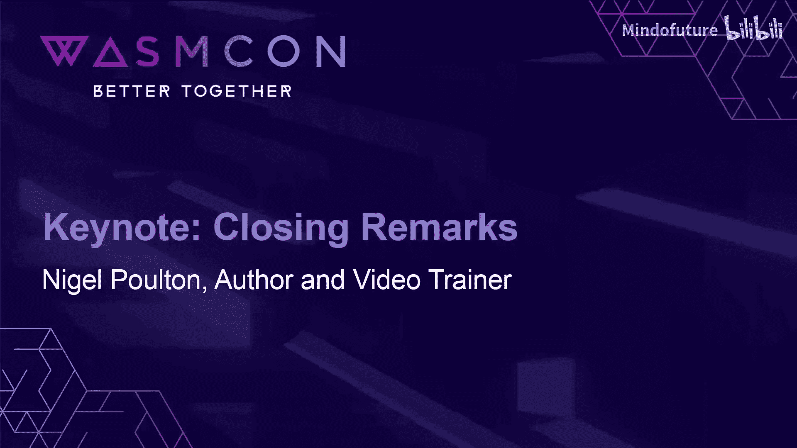

# WasmCon-2024-p05-P05-Keynote---Closing-Remarks---Nigel-Poulton,-Author-and-Video-Trainer--BV18DjSzJE6r_p5-

Thank you， Luke， Thank you everybody that's been on stage。

 Thank you everybody who has done the workshops this morning。 And thank you guys for being here。

 So just very quickly， we've got to break now until3 o'clock after which we've got three tracks。

 So in the three rooms around here just outside the showcase area there do encourage you to stay and attend those in the meantime as well spend some time mingling out there。

 do go and see the people at the booths。 So Kate and Luke and people who are speaking to us here are going to be around super approachable love to help you out after today。

 we're back in at 9 o'clock tomorrow as well。 So make sure you set your alarm clocks early and you get your coffee and something to eat before you come and know we're only at the kind of beginning of day one。

 but I want to put on your radar as well that after the event I think probably next Monday you're gonna to be receiving an email to fill out how you've found the event。

Give any recommendations so please do fill that out when you get it however to give you an excuse if you've got something some ideas that you'd like for future events。

 things that you would like us to add in things that you've liked from this event you are more than welcome to come and see me and give me your ideas and I will happily pass them along because we are super keen to make this event and this community in this ecosystem as amazing as possible as it can be for all of you so don't be shy to come and speak to people everybody that's on a booth out there is here to help you and if you've got any ideas and any suggestions come see me but go enjoy yourselves have something to eat and drink a coffee or something three o'clock back at the sessions and then we'll see you tomorrow at9 o'clock。

