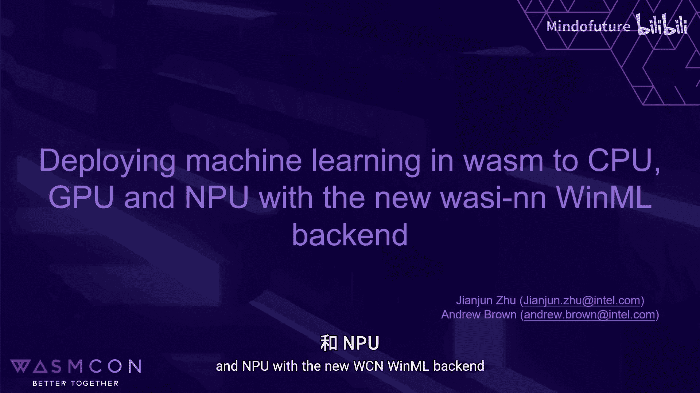
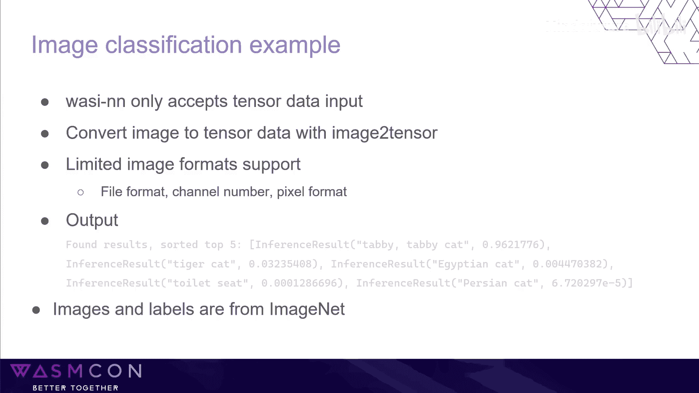
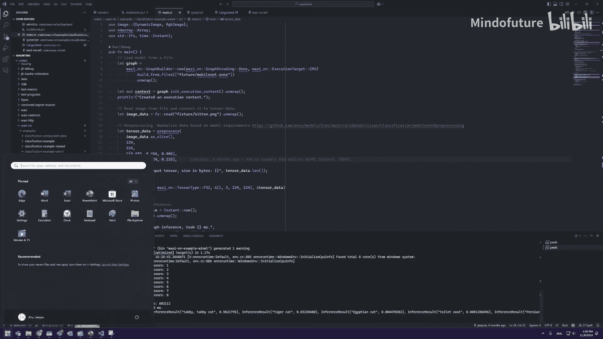
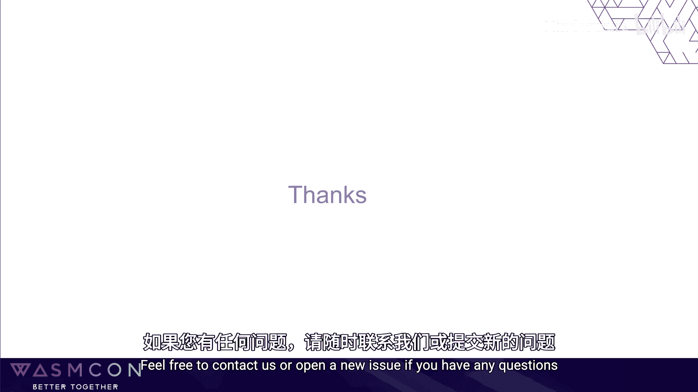

# WasmCon-2024-p06-P06-Deploying-machine-learning-in-wasm-to-CPU,-GPU-and-NPU-with-the-new-wa...-Ji--BV18DjSzJE6r_p6-

Hi， I'mianzhu from intel。 this topic is deploying machine learning in Wa to CPUU。

 GP P and MP U with new N win back。

We will firstly introduce VC N and Windows machine learning the WMl backend。

 as well as how this backend is implemented so you can add your own backend if you want to。

Then choose a target device cPU GPPU or MPPU。At last。

 we will briefly go through an image classification example about how to use what NMl backend to perform inference on different devices。

SC NN is Web assembly system interface for neural network that defines a set of machine learning inference APIs for Western applications。

With these APIs， WhatApp application just need to call a few simple APIs to load a model。

 feed input data。 Then the What runtime will choose a back end to run the inference and return the result。

For sometime， Albanmin was the first back implemented。But in the past year。

 more back ends were added as well。 includesnc the audit runtime。

 O M L and newly added by touch back end。B N is also supported by other Western run times。

 like Western edge， support even more back ends than Western time。

This is a simplified workflow for Russian inference。Depends on your use case。

 it could be much more complicated than this。For example。

 you may need to prepare your data before setting it as an input tensor。To start an inference。

 firstly， you need to load a model。Depends on the format of the model you have。

 the one run time selects a backend for you。Then feed the input with set input API。

After setting all input sensors， call compute to compute the inference。

It may take a few seconds or even a few minutes to complete。

Then youll be able to get the result by get output。Kindly note that what is currently in phase 2。

 So this A might be change in the future。Also， ASN APIs are defined in both weak language and historical weak X version。

V M L stands for Windows machine learning。 It's a built in component for Windows 10。

18 or 9 and later。Which means you can use it without installing any third party dependencies。

It's also supported by Windows Ser with desktop experience enabled。If you want to。

 if you want your application to support an older Windows version or Windows server without desktop experience。

 that's okay。 But stand alone， VML package needs to be installed。VML only supports al models。

So if you want to usemail backend， your model should be in on format。

One of the execution provider for V M L is direct M L。

 So it also supports direct to L compatible devices like GPU and MPU。At this time。

 MPU support is limited， but we are working hard to improve MPU support。

This slide basically introduce how we implemented the VML back end。

If you want to add a new backend for some time， it would be quite simple and straightforward。Firstly。

 let's understand the basic workflow of linear male inference。

Then we can map these steps to what C N APIs。Firstly， choose a device for inference。

For CPUU its simple， but for GPU and TU defined in what N。

 there is no one1 mapping from what N API to V ML API。So in the Wmail back end。

 we simulate all the direct X devices and check if it supports graphics。o系 computer only device。

If it supports the graphics， we consider it as a GPPU。 if it's a computer only device。

 we consider it as a NPU or GPPU。For the rest of the steps， it can be easily mapped。

So we just called the corresponding VML APII in V RRC N， VML back and implementation。

Since what time is written in rust， we also introduced the Windows R S cr for calling Windows API with rust。

这个。Although what provides a simple API for you to select the target device。

 it may not as easy as just changing the value to choose a different device in practice。

The reason is different devices may support different data types and different sets of operators。

Before running a model on a new device， please check your hardware supported type。For example。

 if you have a F 32 model， but the target device only supports F 16。

Then you may need to contact the model。 So take can run out the type device。

Ts like Ol may help you contact the model and optimize it for a specific kind of devices。

放大 the forecast for MPU support is not merge yet。Because Github CI doesn't support MPU。

It's harder to get covered by tests。If you want to try it， please check out full request 87，56。

This is an image classification example。 It's a quite simple use case。Tearn to reply too many steps。

 but it still needs some pre processing and post processing。

Let's take a look at the example。Firstly， we load the model from a file。The mobile that not好。

Then we create an execution context。And we read image from a file and convert it to test data。

The image is this one。It's a cat from Imgenenet。We prefer such the data。

 normalize it based on models requirements。Which is how the model is trained。

Will you set input to set the input tensor。And run the inference with the compute。

We use get output to get the results。The results are ideass and their probabilities。

The I D is not human friendly， so we need this file。Which contains I and labels。

They let us know what does these ideas mean。After post processing the data。

 we created the top five results。That's one example。The top one is tabbitt。

The probability is that more than 96%。We then change the target device。From g p u  to c p u。

We re compile the example and write again。The probabilities might be slightly different from the previous one because we change the target device。

But the top result is still heavy catch。

There are still a lot of things can be improved。 Currently， Ru F 16 support is still experimental。

For the internal buffer type of P 16 tensor 32。This is not efficient。

 but can be resolved as soon as F16 support is stable。

Another limitation is limited data type and kernel support。

Developers still need to understand their target devices first。

 so the model can be optimized for better performance and low power consumption。

Feel free to contact us or open new issue if you have any questions。

Thank you。