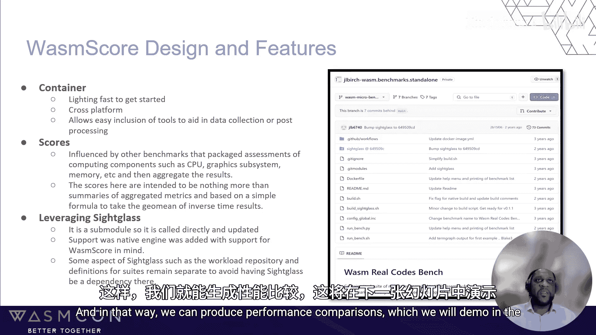
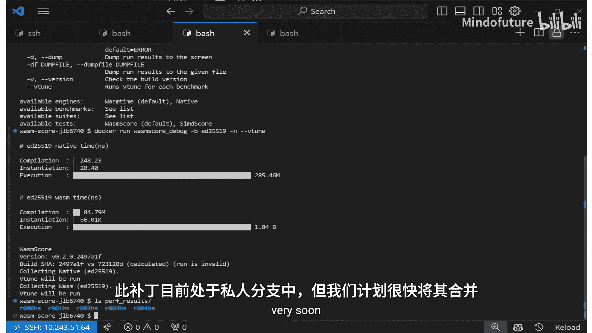
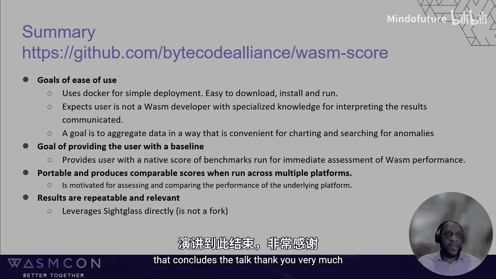

# WasmCon-2024-p07-P07-Introducing-WasmScore---A-Novel-Benchmarking-Tool-Targeting-Wasm-Efficiency--BV18DjSzJE6r_p7-

Hello， my name is Johnny Birch， and it is my pleasure to be here。

Today I want to introduce to you WASM score， a novel benchmarking tool targeting WASM efficiencyff and performanceance。

So the motivation。Well not everyone who's interested in WASM performance is necessarily up to date on Webassembly they may not be a developer or an enthusiast think someone from a marketing department or some other department but in any case you know they typically have questions such as you know you know what Webassembly benchmark should I be using you know which one can I use to track performance how well does Webassembly perform on platform X compared to platform Y。

嗯。I have a benchmark that runs in n seconds， but is this good or bad。

 what do I compare it to against？And you know， I've heard that WASM for example。

 has near native performance， but what does this mean， how near is near， you know。

 and specifically they want to know if their workload that's typically compiled to native is suddenly compiled to Webassembly。

 will there be a noticeable drop in performance？So what do we have today？Well。

 if you do any kind of GiHub search or you know web search。

 you're sure to find some sort of benchmarking effort for webassembly。

 maybe someone is writing an article and they need to have some performance data to back up what they've done maybe someone is developing a runtime or a runtime feature and they've created some sort of benchmarking you know driver and has benchmarks available that you can download and try but the bottom line is most of these efforts are one-off repository specific efforts that are not necessarily peer scrutinized and not inted on you know these are typically benchmarks done by engineers who are motivated as I said by you know an article or by you know some specific feature they're working on or some runtime but the point is it's very specific it isn't runtime agnostic it's not platform agnostic and it's not。

necessarily workload agnostic as well， it's for a targeted use case。

 but in contrast if you look at established programming targets， programming techniques。

 you'll see that they typically employ， they have established benchmarks that they can employ for standardized performance reporting and comparison think you know spec benchmarks for Java or C for example。

So what we currently have are scattered efforts and what we want is something more we want something that is accessible and novice friendly。

 we want something that is simple to install， run and has unambiguous， easy to interpret results。

We want something that provides a baseline to gauge performance you know。

 that means when we run a single run of this benchmark， we know right then and there。

How well our platform performs with Web we want something that is portable and produces comparable scores when run across multiple platforms and that just simply means it's okay to compare when run on platform X with ISO X compared to platform Y with ISO Y。

And finally， we need something that is reliable and repeatable。

 and that's the case with any benchmark， but specifically we want something that works for a variety of workloads and use cases and something that will basically be relevant to a broad audience right。

 we want something that can establish itself。So the last slide basically gave us our motivation and our requirements for what we want to achieve out of WASM score so that's where we start but the question now is what is the design look like how do we achieve this and for that question we start with our benchmarking driver so we talked about these one-off benchmarks that exist but one that isn't you know one of these kind of one-off efforts that is pretty solid iscyclLs socyclL is a benchmarking suiteened tool under the B code Allance project repositories it is well thought out it originally was used to help develop the Luccit runtime and eventually came under the purview for helping to develop WASM time so it's going through some redesign and some of those changes include things like having the potential for plugin。

With different runtime， meaning even though currently it's targeting WaM time。

 there is the potential to add other runtimes， it has many knobs for controlling run stability and it includes a variety of benchmarks that may cater to multiple use cases。

So that may beg the question of why not just add tocyclLA directly and that was considered。

 but ultimately it was determined that the end requirements and use cases differ enough。

So what is the design and some of the features that make WASM score what it is make it a little different than the driver that it employs so number one WSM score uses a container。

That means it's lightning fast to get started it's crosspltform and this makes it easy to include tools that can be used during data collection or postproces number two it uses scores this isn't necessarily novel but this is something that is useful whenever you have to aggregate a number of scores and you need to summarize those results and lastly as we said it leverages site class but it's not a fork of site class it uses site class directly as a submodule so you know when we were developing WASM score we include a native engine which is used in WASM score but we included that into sitey class so we iterate on WASM score and we also iterate on site class to make WASM score better so you know and another point。

Want to make is that some aspects ofcycl classs such as the workload repository and definitions of suites aren't included in WASM score they are kept separate so there's various things that are kept in various things that are separate。

So in a nutshell， the design is that we put you site glass and other tools in a Docker container。

 we configure the container such that we can dump results to the host or have access to the host to do things such as Perlysis。

 also in that container we have a Python script that drives the whole process of running the WASN benchmark。

 but also and uniquely is we have you know the compilation of that same benchmark to native。

 and in that way we can produce performance comparisons which we will demo in the next slide。

Up until this point， we've spent a lot of time talking about motivation and aspects of the design。

 but here we will show a quick example of how to download and run so to download is just as simple as a Docker pool command to retrieve the image。

So we'll do that now。After it downloads， we are able to run directly。

 so you can see here all of the layers being downloaded。

 So we've already done this ahead of time and so you can see on this tab that we've already kind of run the container。

 I'll scroll up here to the top。 So to run it again， this is just a darker run command。

 And here you can see the various benchmarks being run for calculating a score keep in mind that the native bench that you see here。

 So you see native time and Wasm time。 the native benchmarks are compiled in real time using the highlevel source of the benchmark。

 it's same highlevel source used to compile the pre-complid webassembly file for the benchmark。

 which is already included in the downloaded image so we don't compile。The wasm in real time。

 just the native。There's a limited number of categories and benchmarks being aggregated to create a score。

 but there are many more benchmarks available to run。

 and you can see the scores for you know AI infferencing， we have MeS Opr， Ackerman， Fibonacci。

 where we categorize these benchmarks and report the times inefency for each category。

You know these averages that we're using here are being used to calculate the overall WASM efficiency and execution score where higher is better keep in mind the efficiency score is just the ratio of the WASM performance compared to the native performance where individual benchmark performance is based on the inverse of time so in a nutshell an efficiency score of 0。

63 here communicates that the WASM executed at a 63% efficiency compared to the natively executed code。

Also， keep in mind because we are using a container。

 we can stuff whatever tools we need inside this container。So on this tab， in this case。

 we can see that we have a different。Wsm score container This one is a debug version where what we're debugging here is performance so in this case we've put here a V tune kind of performance analysis tool inside and you can see on the help menu how to use this it's for use with a specific benchmark So when we run the Per analysis is run on both the webassembly and the native so now instead of just comparing scores we can also get a quick assessment of performance issues between the two and do a comparison that way so you can see here the profiles are mapped to the host with this LS command the patch for this is currently in a private branch but we do plan to merge this very soon。

Well because we have both the WASM performance and the native performance， we can quickly see。

In which categories wasSM is performing well compared to native and in which they are not and keep in mind this ratio is something that。

Is comparable across ISIS plotting some data as you see here we can see some gaps。

 we can also see some outliers in the other way which can prompt some analysis。

 but the outliers here that I've highlighted Ackermen and ED25519， you know Ackermen for example。

 using the profiles that we could generate， we can see that a significant amount of time was spent in lowerring while with ED25519 the gap was due to function calls to support 64 bit multiplication which currently is not being done natively。

So that's it in a nutshell there hasn't been a ton of work done the past year but this is you know something that is slowly being iterated on so we want to be able to add additional scores Wy or CD for example and when we talk about scores we're talking about some sort of comparison I think that's the basis of WASM score having that baseline comparison so with CD it would maybe be scalar with WAI it would maybe be WASM or maybe it will be native additional runtime support if we add another runtime I think there's you know to do right now incyclL to add node you can imagine a suite of runtimes and we can even have something like an ensemble where we are aggregating the scores of all the runtime to get a generic baseline performance for a webassembly you know more benchmarks that's you know always something that every benchmark effort。

Lookinging for and these are always changing as use cases for Webassembly emerge better feature support。

 the profiling support is soon to be merged but we want to do a better job of aggregating results and there's other features that we want to add and of course increased participation you know you need more than a couple of engineers in order to have a good survey of what makes a good benchmark good ideas so this is something that we're always looking to improve on。

So in conclusion， we just want to leave with the address for W tour and note kind of the tenants that went into creating the benchmark so the goal here was ease of use。

 we use Docker for simple deployment we you know aggregate data in a way that's easy to digest。

 provide tools such as you know for。Pf analysis this doesn't expect the user to be an expert but it does give it enough tools to do analysis the goal is to provide the user with a baseline out of the box and we do that by having native and this is portable across platforms because we actually compile in real time so that we can get that native score for that particular platform and you know we need something that is solid results are repeatable relevant and for that we leverage site class that is tried and true we don't use a fork。

 we leverage it directly in any support that we need related to siteL we add to that project first before adding it instead of adding it to WASM score and that concludes the talk thank you very much。

