# WasmCon-2024-p09-P09-Wasi-Webgpu---Build-Beautiful-Graphics-and-Safely-Run-AI-with-Any-GPU---Sean--BV18DjSzJE6r_p9-

Today we're going to talk about WZ Web GPU actually very recently renamed to Wai GFX。

 We'll go a little bit into why learn how you can bring GPUus to Waom。

 You can build beautiful graphics and safely run AI with any GPU using a framework like this。

 My name is Sean Isom， I'm the founder of Rlet。 and I'm Mendy Bger， Se engineer atch。

 focusing on Wai GFX。 All right， let's jump right in。😊。

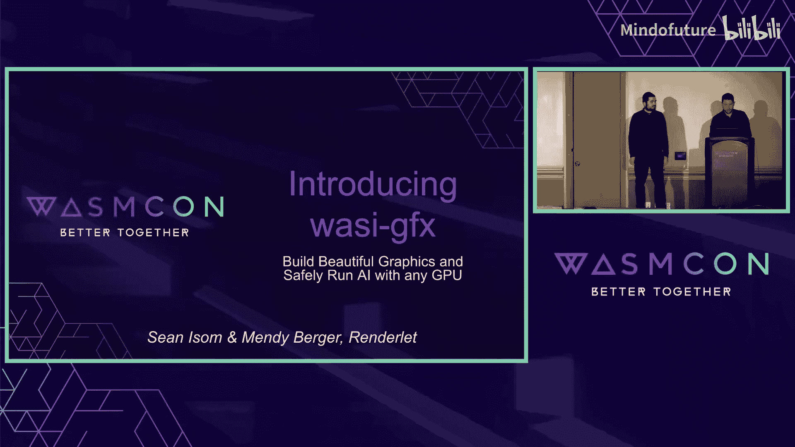

So how does WasAM work with GPUs today？Short answer is it doesn't。

And this is very intentional by design in WasAM， but obviously if you've used rich web applications。

 there are ways to do this， usually in a browser this goes over JavaScript bindings。

 so if you're to look at a framework like I scripton for C++ for example。

 this is a framework that lets you bring C++ code， compile it to Webassembly。

 bring it into a browser， run it through a JS host， for things like WebGL。

 they have mapped that to the GLES APIs， you can use those headers and communicate across the browser JavaScript bindings to the GPU APIs that are native to the browser runtime。

Similarly， in W GPpU， if you're in the rest community， this is this is exposed to WGpU。

 so you can run WGpU in a browser。 It has a backend that will allow you to go over the jobscript bindings into the backing browser APIs。

 So this is a system that works in a browser today， But what about different use cases。

 So in a pure wi environment， let's say in headless applications or desktop or server side or something like that。

 there's not really standardized way to do this。 You can manually expose functions from the host runtime。

 So various runtime will give you APIs to map native functions and to link them into Webassembly。

 You can do this for your own functions that are shadowing various GPU APIs。

 it's very granular and hard to maintain。You could export entire graphics APIs。

 like let's say you're mechanically translating direct deckX headers into something that's consumable by WM guests。

 this is the thing people have done， but that in and of itself is a security issue because if you're running third party code。

 there's nothing to guarantee that you can't access anybody else's resources that are on that GPU。

If you're looking to solve the security problem， you could mim copy in and out of Wasum linear memory and so you could handle all GPU interaction host site in your host application。

 you can build virtual command buffers and likewise。

 but suddenly you can see a performance problem start to crop up here where if every frame and your hot critical path you're constantly copying little bits of data in and out of Wasm just communicating over memory that can become very cumbersome very quickly so we need a better way to do this and that's what we're looking to do so through the power to component model and w we have a declarative IL that we can use to express things like host levelvel runtime to Wm guests and so we have mapped the entire web GPpU API and some other bits into Wi via the component model through mechanically translating the web IL into w so through this we're able to still in a safe still in a sandboxed way expose these GPU functions into。

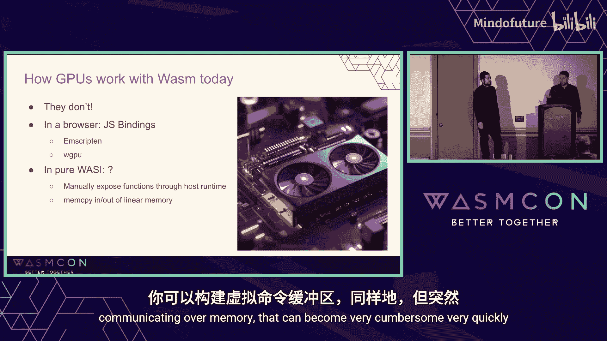

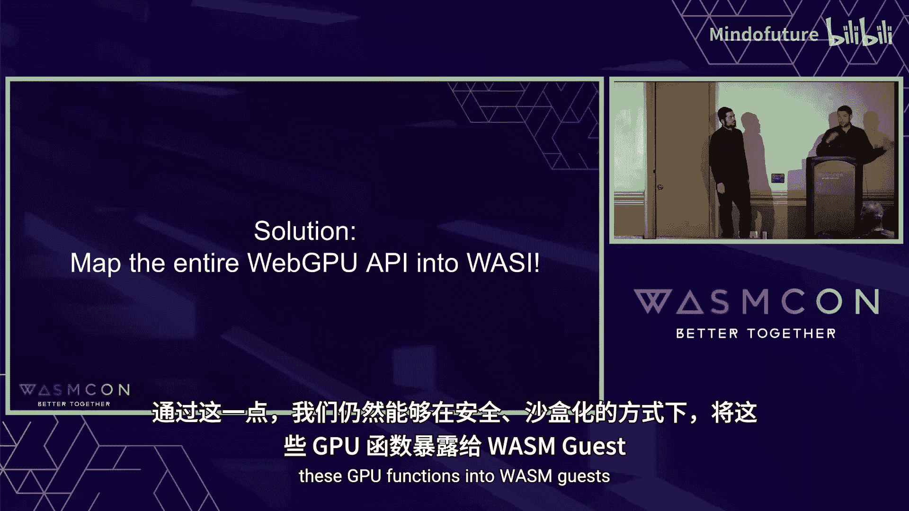

Awesome guests。Why do we need this obviously things are working as we've demonstrated in a browser pretty well today。

 but I would say that WasASM is most useful as a compilation target。

 not as a platform in and of itself and so because of that you can imagine all sorts of apps when you think of different runtime environments that might need to interact with a windowing system or visual layers composite on a canvas and so if you look at use cases like UI is anything like even this actually I'm in a browser now but if I was in a native app。

 something that would need you that would allow you to put data onto a screen onto a computer。

Headless graphics， headless rendering， for example。

 if you were to look at things like serverside processes。

 maybe you're rendering and Docker through OpenGL right now， the frames。

 your pixel streaming that back or you're rendering images or your streaming video。

 that's not something you can do out of the box in a webassely environment today。

Pluins are interesting， so we've got entire applications。

 but also if you're able to expose a portion of your app's internal object model to third party code and allow it to mutate specific sets of resources on the GPU。

 it opens up all these different use cases for different types of computing。

AI is probably the most popular use case for GPUs today we'll talk a little bit about it further in the talk WZ&N obviously is a framework that many people are familiar with for doing inference Webassembly。

 but there are other AI use cases that need lower levelve GPU access that might not necessarily be covered outside of the box general purpose GPGU computing。

 scientific stuff if you're doing maybe CFD simulations， things of that nature。

 you need access to a generic parallel processor and a streamlined version of the Web GPU API into webassembly is a very compelling model to build those kinds of apps and last we want to hear from you。

 everyone in the community， what other use cases are out there because we want to make this a general purpose framework that allows you to interact with GPUs for really anything in webassembly itself。

All right。So let's talk about how Wi GFX is actually structured。

 so Wi GFX includes the following parts， the following packages， Wi WebGPU。

 which is as John just mentioned， generate it from the WebIL。

 the web GPU Web ILs spec and there are some minor changes but they're mostly the same thing at least semantically but webGPU itself doesn't allow you to actually draw it to the screen。

 if you want to draw it to the screen， that's why we have Wi surface。

 and that let's you draw it to the screen， get basic user events。

 you can think of it as very basic windowing system or maybe a little bit like the HTML canvas element。

 but it's fairly basic and doesn't come with everything that Can comes with。Now。

 how do you connect Web G Ai WebGP with Wasi service。

 So that's why you would use Wai graphics context。 And we'll talk in a minute as to why you can't connect them directly when you want to have this intermediate stuff。

And Wai Tra buffer。Is a simple frame buffer API for CPU based rendering。

So how do you connect these packages？So under Web， there are lots of graphics API。 a few。

 theres Web GL。 There's Web GPU。 And if you want to draw it with it。

 you would draw to an HMI canvas element。And there are no alternatives to that。

But in W you want to be a little more flexible。 So we're starting with Wy surface。

 but we want to allow future windowing APIs。 There may be more full features or maybe something for VR。

 So we don't want to restrict ourselves just to Wasi surface。And at the same time。

 we also have multiple graphics APIs。 We're starting with the Wasi Web G P and Wai frame buffer。

 But in the future， we'll probably want to have other graphics APIpis。

 So how do you make sure that we can take any windowing system and have it work with any graphics API。

And that's why we have， we have quasii graphics context， and。

All it does is just takes a windowing system on one side， takes a graphics API on the other side。

 and the host is in charge of making sure that these two work nicely together。

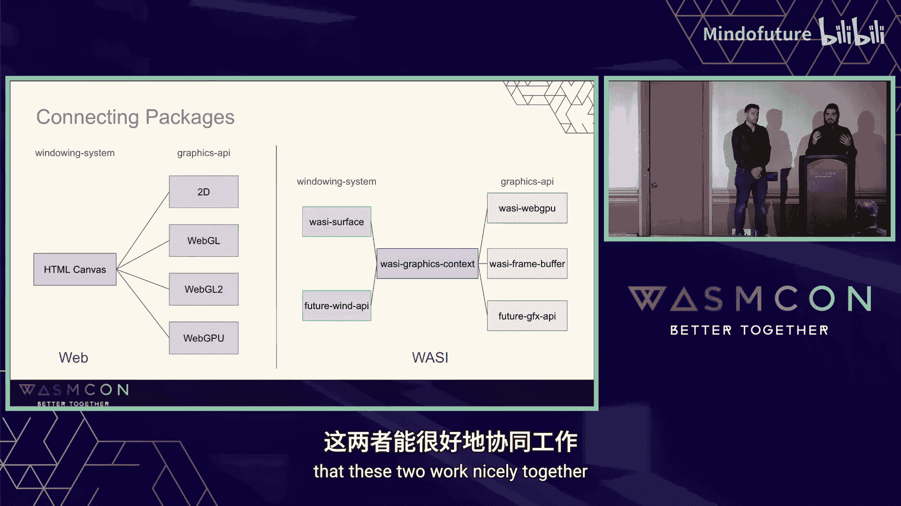

So let's look at an actual example of this working。 So W GPPU is a graphics library in rust。

 is it is the foundation of a lot of。Graphs libraries in the rust ecosystem。

 And it looks it's very similar to Web GPU。 And in fact， they can run on top of Web GPU。

 So the question is， can we run W GPPU on top of Wazi GF X as well and get an example running again。

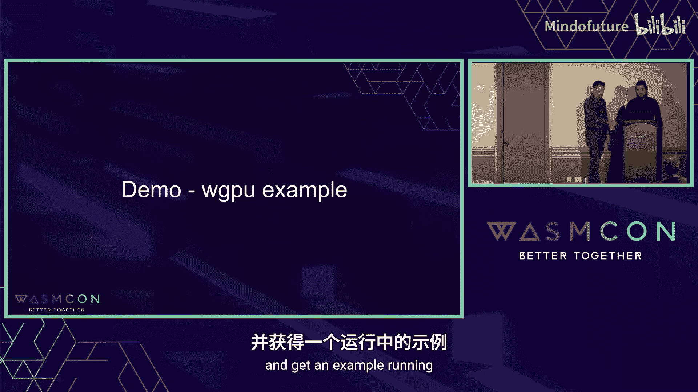

That's exactly what we have done。Yeah， so you can see it。Works really smoothly and。Runs really nice。

So yeah， we can do it。It was it。

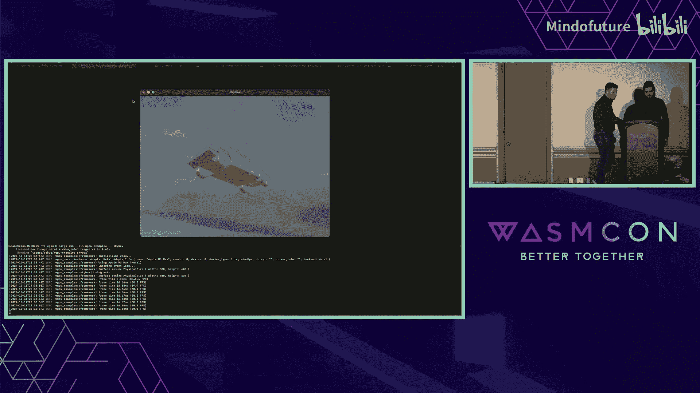

So weve looked at an example， but let's look at how the actual infrastructure looks like for all this。

 So let's start with a w generation。 So which is the IL that we use in the component model。

 So we take the Web GUus back， which is written in Web I DL。

 We wrote a special tool called Web I Dl to Wi。 and we convert the Web Il into W。

And then we do a couple of the transforms on top of that。

 Those transforms are mostly to remove parts that make assumptions about ja or about the web。

 So we make sure to remove those because they just don't make sense and wzi。Then on the guest side。

 now that we have a web GPU that with。Anyone can target it from any language。

And if you're writing using a language that already has a standardized way of dealing with Web GPU。

 like in Ru， you have W GPU and the native world， you have Web GPU that age。In those cases。

We're working on backends for those that target WebGP that which so that your existing code just compiles towai out of the bucks。

On the host side。You'll need a runtime that actually supports WZ GFX。

 we have a toy runtime experimental runtime called graphtime and all it does it embeds WasAMtime and Wi GFX runtime。

 which is our runtime extension that adds support for WZ GFX。

 WZ GFX runtime itself runs on the same foundation as Firefox uses for their web GPU。

 so it's a solid foundation。

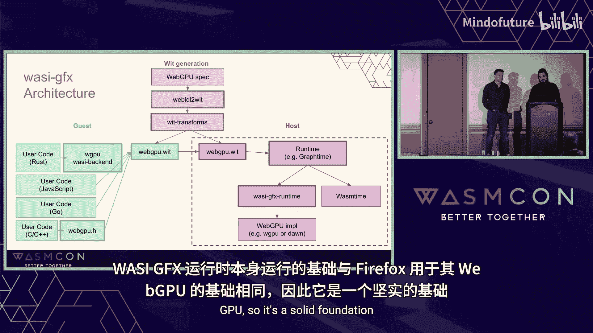

So we have looked at the architecture， we've looked at a basic example。

 but can't we run a more complex example， So Bevy is this game engine in rust。 It's very popular。

And it uses W GPU for drawing， but it has a lot more moving parts and a lot of bells and whistles。

 and we set ourselves the challenge， can we compile a full Bevy game into Wai GFX and as of last week we have managed to do it。

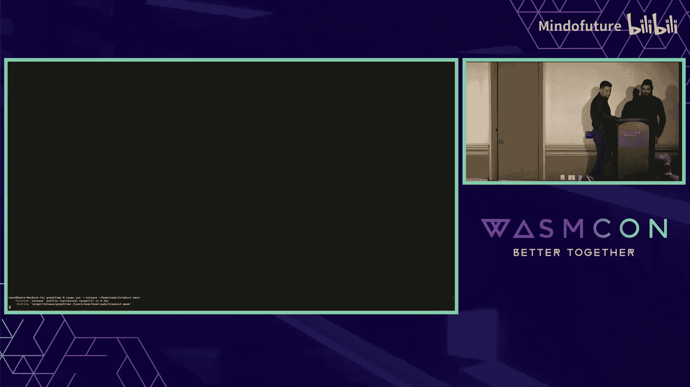

ItTake a second to link。Okay。So you can see it runs， you can play it ch。Pray。はい。

So we spoke about graphics， but what about AI， So if you've been following this the Wi ecosystem for a while。

 you've probably heard of WZNN。And WianN is really great if you want to run MLl infferencing on a backend that they support and they support most popular backends。

 And in those cases， you probably just want to stick with WianN。

 you're gonna have an easier time and it's probably going to be faster。

 But what if you want to run a backend that isn't supported by WanN yet。

 Or maybe you want to do training or more likely to than existing model。

 or you just want to have low level GPO access。 That's where Wi GFx as your friend。 In fact。

 you can implement WianN on top of Wi GFX。So for most cases you would probably end up sticking WZNN。

 but for the cases where you want more control， you would go with Wi GFX so let's look at a quick example of that as well。

 we'll try to run imprintencing of the image I can change light。

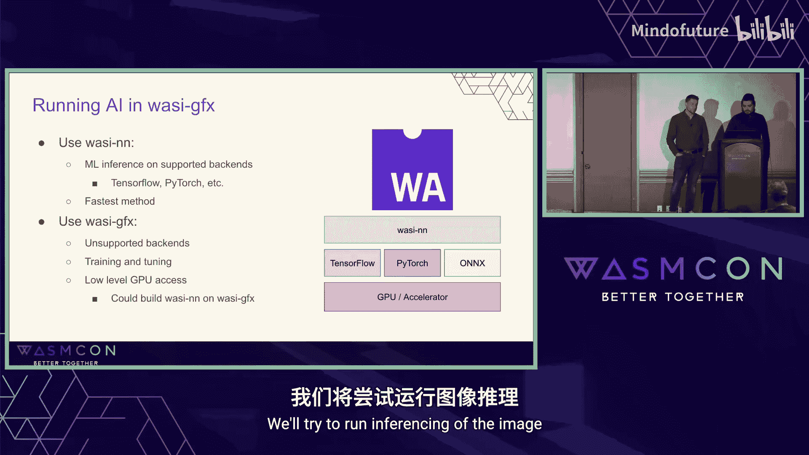

Okay， so we'll try to。Clsify this image， what is this image， so we see it's an alienr wing， whatever。

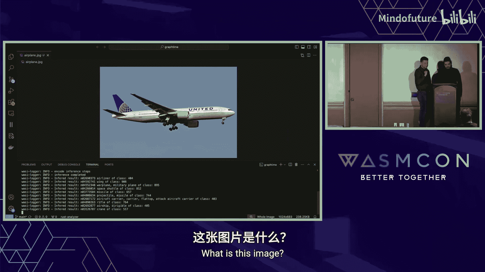

Switch back。

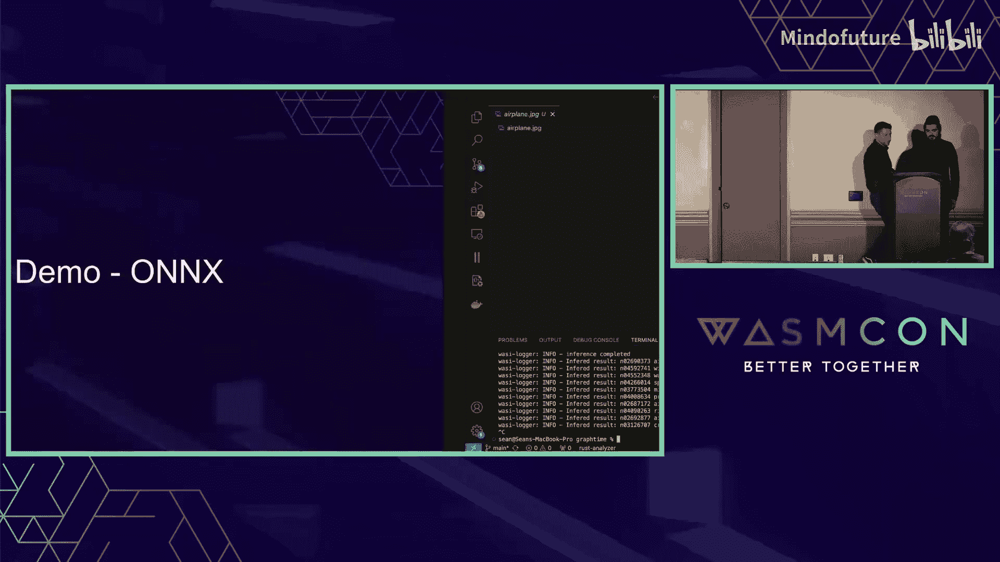

Okay， actually。Oh my turn cool okay so we've looked at some examples of building entire applications that are compiled to WZ GFX or compiled to Webassembly and can run on a Wi GFX host what about use cases for plugins or componentbased architectures where we want to maybe give guests access to write into existing applications so thirdpart code can often need GPUs with renderlet。

 this is something we're doing is building GPU portability layers that allow you to build plugins for things like design tools and games etc so if you're to think about what a plugin model might look like for graphics first you'd have to kind of define that host guest interface system over here we've got a series of components that are basically share within the w and bounds we hook up in interface and IL between them in order to exchange data across plugins and in the host itself。

Those plugins then are exposed and run through Wi WebGU and so with those you can create resources on the GPU fully sandboxed that are owned by the plugin and the app and that other plugins or other applications cannot touch and so then it goes down to kind of the model of interaction between the host and the guest and you as the author of a host application would want to think about what makes sense for a plugin so for a game example or an editor maybe we want to give plugins access to read portions of a scene graph or document model or different objects。

 maybe those are exposed via textures or buffers otherwise you think can also be exposed to CPU memory but the specific value on lock here is being able to do those through GPUs that plugin can write into specific defined buffers that are maybe created with limits as to what the plugin can do and then maybe the host app is rendering the data or maybe the plugin itself can actually render。

the data could write to a render target， maybe it doesn't change render target attachments。

 maybe that's disallowed， but it's given a window into a screen in order to draw arbitrary content onto a new canvas or an existing canvas so there's lots of different ways this can be used but as the author of an application tools like WZ WebGP you give you the flexibility to decide what this kind of like granular interaction between a host and a guest might look like。

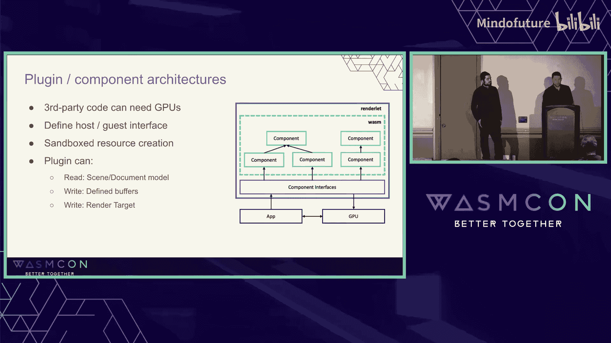

We'll give an example of this with some of the stuff we've built inside Rnderlet。

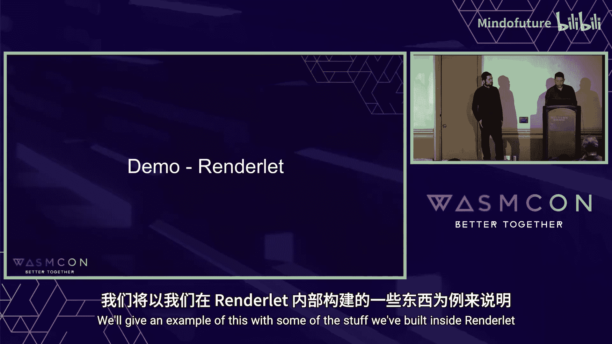

I'm going to do a demo I'm going to do demo of something called procedural modeling here。

 So with this in a web editor here， like in something you can imagine like design tool。

 we are going to build a 3D model and so there's better tools for this than this little view website but here through procedural modeling we've built a series of mathematical expressions that allow us to generate graphics data And so instead of like having somebody go and tweak and put a bunch of polygons on a screen and like blender or something we're going to write code that lets us do that。

 So here I'm going to change this to extrude to the height value and。

You'll see cool so we have taken a rectangle and we've grown it into a shape and it's textured and colored and et ceter over here。

 we're going to go to another tab， here's a more complete example if you' to look at what a building might look like。

 we've got a series of steps and operations that define both the code that generates the graphic data for that as well as the rendering pipeline。

 so how we might shade that， how that might look in a scene。

Another major addition here in the second tab is we have defined an interface in terms of exports from the host to the guest。

 so we've said that this is data we've defaulted it here but we're providing from a host application that changes what is being rendered inside this right now。

 this model that is about to become a plugin so we can compile that to a WasAM module takes a few seconds because ILium is slow and we will download that and I've already actually got an application over here in a BM that is designed to host these plugins so we've taken the same rendering pipeline that was there in the browser and now I'm going to I've already got set up to load I'm going to load that。

And there we go。 So we just loaded a bunch of buildings onto this existing applications canvas is like a map viewer。

 for example， right so and you can see these look the same but different。 a few things have changed。

 for example， they're colored， their size differently and so all these things were for you go back to here like part of this plugins interface we're able to parameterize between the host and the guest what we're able to use and how many times we're able to run and regenerate this data based off of this plugin structure So you can imagine you could take this you could build a lot of different kinds of objects。

 a lot of different kinds of scenes with this Another interesting thing is that was unitidirectional so we just generated data in a sandbox way。

 put on the GPU， the host app used it。What if we want to communicate back and forth between host app and a guest？

We got one more example here and I'll spare the details as weve we've added an expression to this here and so this is allowing us write access into a shader the hosts is attaching and in here we are performing some calculations that are going to do something very cool。

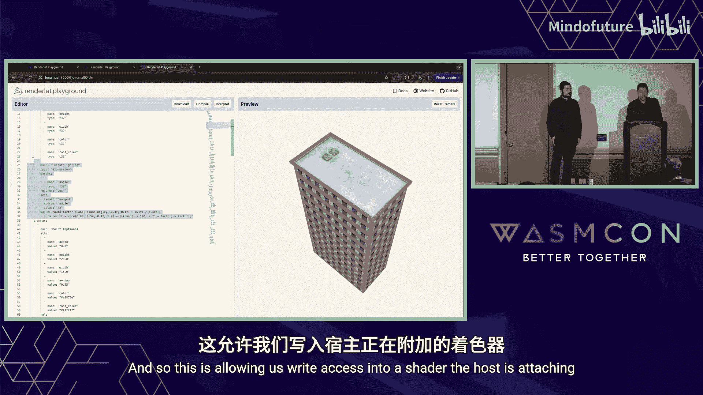

Okay， so if you look at geographic scenes， often you'll implement lighting models。

 so here we have like realtime atmospheric scattering so as like the angle of the sun changes。

 it gets dark， but what we can do。Is as it gets darker， we can change the lighting。

Inside the data that was generated。And you thank you it looks really cool。

 but all it really comes down to is this little chunk of stuff that's getting compiled with the Webassembly module and all we've done is Im not showing about hostt app code but host app we've mapped one parameter in the shaders constant buffer we're able to plum that through all the way to the Was and module it's able to take input。

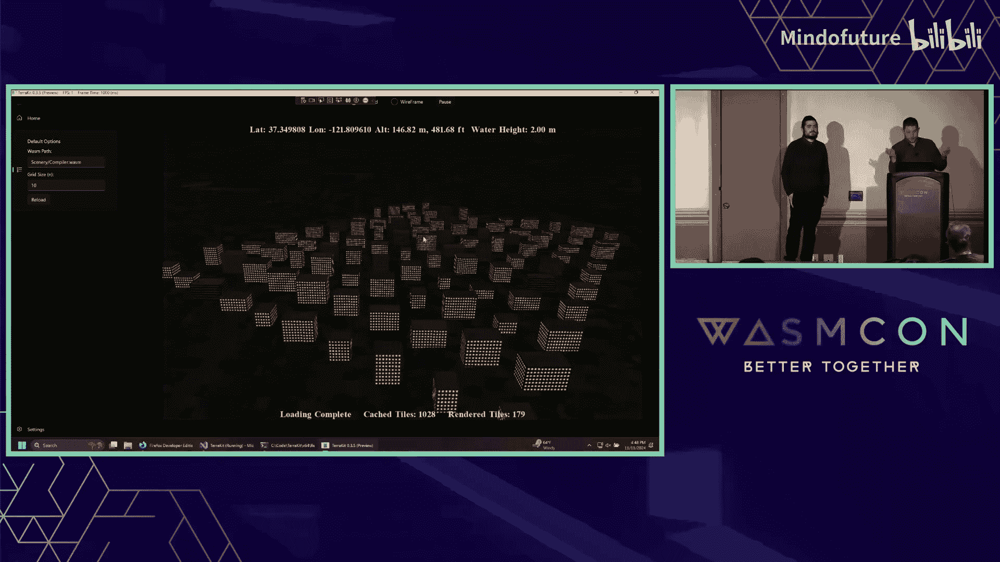

Generate data。Put output and so this is all we're able to do all of this。

 the power of things like Wai Web GPU and in the Wi GFX project to host these arbitrary GPU components that are running graphics code。

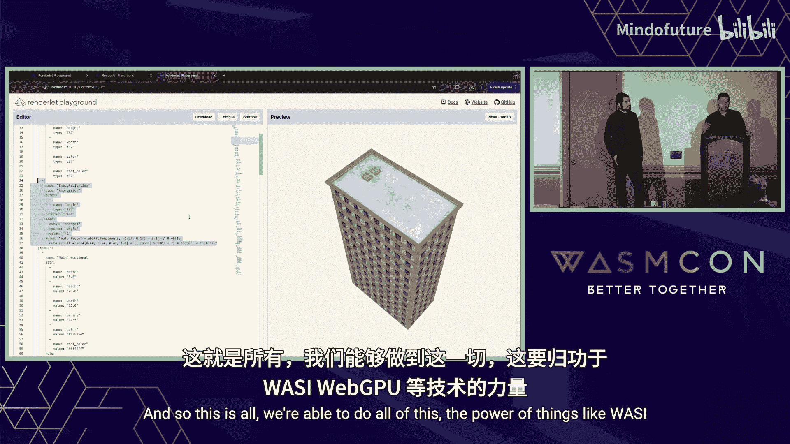

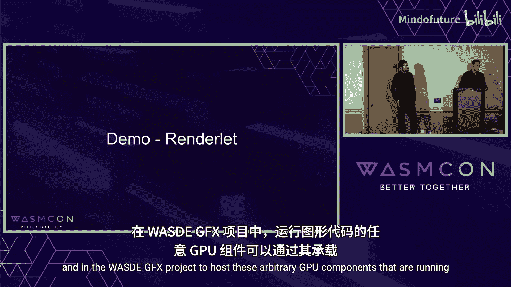

Okay， so Wa cool demos want to talk a little bit what's coming next for Wi GFX itself in the spec。

 we need to finalize the actual spec in the w， so this has come a long way in the yearishh we've been working on this。

 it's stabilized a lot， but we still want to hear from you。

 we want to hear from the community on what's missing， what needs to change。

 what needs to happen to make the spec usable for everyone。We're working on C binding。

 so the WebGPU working group has standardized on a webgpu。

h file that they want to use for other language bindings as well as for C++ itself。

 and so that's currently being integrated into the various web GPU runtimes but by us providing bindings for that。

 any app that is C++ or written against C bindings that can work against the WebGpU API will be able to work on a WI GFX host out of the box。

Similarly， we demoed earlier the WZ GFX backend for WGPU。

 we want to get complete support for that and get that upstream back into the WGPU project。

And likewise for Bevy， this is kind of very early days with that。

 but we want to get support upstreamed into Bevy Engine as well。

 the goal with all this being take a game written in Bevy， you produce a WAM module with it。

 can run a browser， can run into a wZ GFX hostt。We need to complete the runtime implementation of Lausy GFX itself。

 kind of 8020 rule here on this， most apps run， but there's a lot of very just low- levelve bits that are being mapped across to the WGU as a runtime and across the WGpU。

W so we're looking to get 100% compatibility at the webGPU spec so everything works as you would intend it to and we're getting closer on that。

I might have heard Luke So are some of the excellent ones today about what's coming with P3 with that。

 we're looking at getting Async for the component model， and so in Web GPPU。

 certain things are implemented as JavaScript promises and async APIs。

 so we want to bring full first class support to that into WZ GFX and WZ Web GPU as well。

And last a lot of new cases that are coming in things is like accessibility and VR support。

 different types of input methods and even lightweight and full windowing in UI system。

 so we do want to hear from the community on what can be supported from the spec out of the box and what can be added to some of the reference implementations or even as third party components to enable a larger ecosystem for this space。

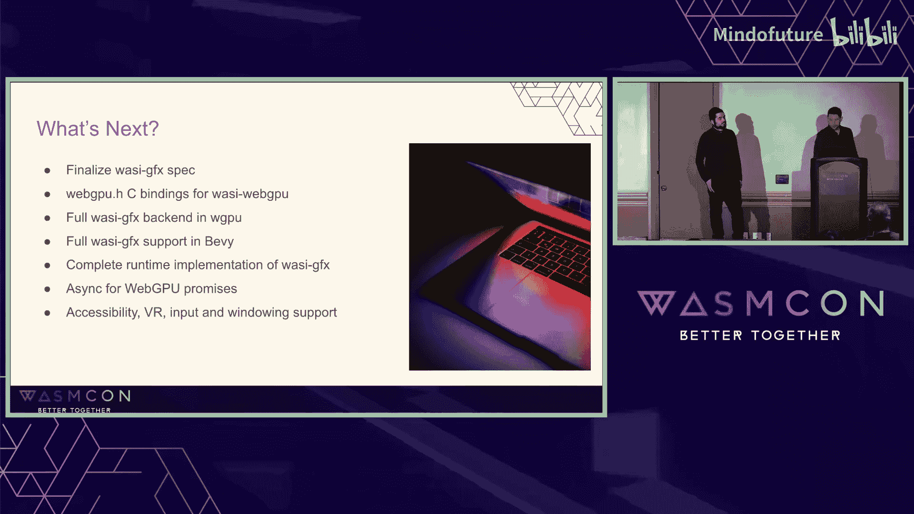

And that's pretty much it so we're happy to announce that as of last week WZ GFX is now a phase two proposal and come a long way。

 so still got a long way to go， we want to hear from the community。

 we would love help with implementation， hear about use cases。

 if you go there there's some resources including all the demos and some information on how to contribute。

 we meet every Tuesday， open meetings， we want to hear from you I'm Sean， I'm Mendy， thank you。

And I think we have plenty of time left for questions。 So questions， anyone。

Someone want to run this mic down there。Thank you， David。Thanks。2。In terms of Windows system。

 are there any examples of running Windows system on Web GPU， for example， like。

X server or Vland server or web GPU or something。 Do you know any examples of running Windows。

System or with CPUU would Yeah like X 11 or something like that， yes。

I'm not aware of anything like that， but that would be really cool。Correct me if I'm wrong。

 there's nothing technically stopping somebody from doing this。

 there's a lot of implementation work that would be necessary to support this yes。

 so no no examples of it yet， but hey community come contribute we want this it can support it yes。

Thank you。Up here in the front back there first。Hello。

 thank you for the talk I wanted to ask so you showed how smooth it's running on GPU。

 but have you guys compared like the same samples running on CPU like mean I mean？

Do you see that it actually improves hint or like there are like loads of optimizations needed so far。

I think your examples shows that Yes， I have done。I was best say， don't quote me on this。

 but this is talk is being recorded。 I have done some rudimentary benchmarking that is about 85% of native performance like like unsandbox CPU performance that is a highly variable。

 highly implementation dependent asterisk star etc。

 we need to do some much better benchmarking specifically against like I think on the WGPU side specifically against WGPU So I expect being in the state that it's in there's going to be some performance hotspots。

 but I don't think there's any major technical impediments other than maybe some of the even talk about with memory mapping that are standing in the way of。

OfSolving some of this problems but I think the question was about CPUU versus web GPU right but I think Sean answered the question basically like basically benchmarking GPU against CPUU like if you got improvement yeah okay thank you。

My question is sort of a follow up on that so this is actually utilizing the GPU in the like let's say it's an NviIDdia GPU or AMD GPU what performance so I want to see like if you push it to the limit do you see like what kind of GP utilization do you expect down the road this project will be able to achieve and do you think there's a difference between what GPU vendors you' are using on the client side？

嗯。So， what was the first question？What kind of GP utilization do you expect this to achieve There are a couple of challenges that we have to overcome like avoiding any copies。

 but if we overcome those， I think we're going to be close we're never going to be actual native but I think we can come really close because we're generating actual shaders so I think。

The shades are almost。 They do have bounce checks， but。This shouldn't take too much。

I think we can get close I agree。 I'll just add to that that I think it's almost more of a fundamental question for both for web GPU and how it is implemented in the spec and for the web GPU implementations like WGPU because ultimately we're just building on top of those and also like the patterns like if apps are like forloing over massive scenes on the CPU you're not going to have high GPU utilization regardless of what you're doing。

 but if you're doing GPU driven rendering then。You know and like support for that like multi-draw indirect I think just landed and dawn this last week so's there's stuff coming I don't think I guess to like more directly answer your question。

 I don't think the specific bottlenecks for GPU utilization are going to be because of our utilization of wm I think it's going to be like the underlying standards and implementations we are piggybacking on top of as well as like the architecture of apps that are built on top of this layer and not say that there's no performance penalty。

 there's a performance penalty， but it's like small percentages across the board is not fundamentally。

Changing how apps interact with the GPU。Great， thank you。Back there。On the performance note。

 like you were talking about。The browser， like basically this as a De web GPU is a JavaScript API。

So for Bevy or people using WGP and like Ru now。Do you expect that to get faster because it's not going from Webassembly to JavaScript。

 Do you see a path for that to get faster just in a browser？

Like for the browsers to use something that's more direct。I think there's a path there， Yeah。

 but it's not happening anytime soon Okay， for in the browser。

 we willll need JavaScript for the foresee future。 I don't think there's anyone working on actively like avoiding JavaScript bindings。

That's reality Okay， unfortunately， I guess it's sort of a question for like Wi in general would that like improve like interfacing as opposed to going to JavaScript So if you're not running in a browser。

 then and you're running directly in Wy then in that case yeah definitely you get rid of all those bindings。

Got it like there is a。Maybe there is a future world where browsers actually support WI APIs out of the box like that is right if that happens。

 that is a very long way off， I think we've seen some really interesting things as steps along the way that can still help。

 but those are specific to like。In map and， you know。

 like maybe some changes in Web Gp API itself to like avoid。Shadow Co is in UNA arrays。Hey guys。

 I'm trying to understand more of the difference between WGPU and WasC GFX。

 and I'm also trying to understand。Where Egui， E G U I is at。诶。Relative to。

To what you guys are doing。So。Yeah， that's a little bit confusing。 similar names， different things。

 W GPU is a library， a rust library that is very much liked Web GPU。

 and you can actually Firefox runs a Web GPU on top of W GPU。 So it's just the library。

Was it GFX as a standard that we're working on？Which takes the Web GPU。

 which is the web spec and just brings that into Wi。 So hopefully that clears that up about Igui。

 I actually have a local example if you want to look at it。OfCompiling Igui towai。

 I tried to like mess with that a little bit。 Yeah， Yeah， sure。 Can you show it now or afterwards。

 Let's do it afterwards。 It's on his computer， not my。 Yeah yeah， and。More specifically。

So like WGPU can run as like the backend and Firefox for Web GPPU or you can run it right now like in native code on like desktop。

 for example， what we can do then but that's like untrusted just like it's a native application right so like what WZ GFX can do is as a Wi hosts allow webassembly code to execute like in a desktop or elsewhere and and access through the WebGPU standard WGPU's functions as well so it's like a sandbox webassembly way of accessing WGPU so you could do this today on native this is a webassembly layer on top of that。

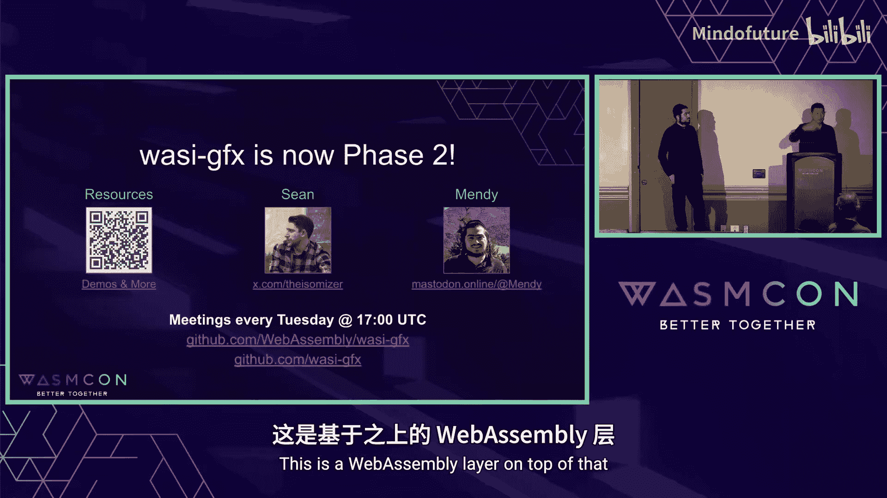