# WasmCon-2024-p10-P10-Next-Level-Powers---Enhance-Your-IDP-with-the-WASM-and-Dapr-Hero-Team-Up!----BV18DjSzJE6r_p10-

I want to talk to you about I called it here。 a little bit click Beaty。

 So I just wanted to improve my chances that the committee is like， hey， that sounds interesting。

 So actually， the idea is， okay， let's level up our existing I piece。

 our internal developer platforms and say， okay， how we can integrate vm and Depper to deliver the best value for our customers。

 So it's a little bit more on the platform engineering part。

 And I found it very interesting because now let we go to the next step。😊。

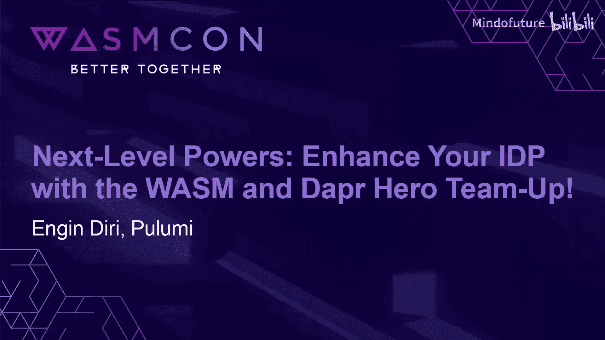

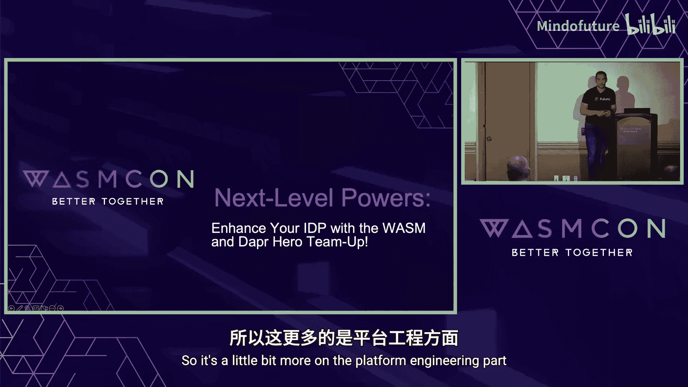

This is probably something you may or may not experience already to， to bootst a new project。

 So it's depending on the size of the company， I'm coming from Germany as you can here。

 So depending on the enterprise， you， you working it， It could be a very easy thing calling somebody。

 It could be something very， very difficult。 and you don't know where to go to bootst a new project。

 And this could be from the source side， but also from the infrastructure side。

 or if you figured out the way， that's also something。 I mean。

 I worked in a place We had service now， So you created your service now ticket。

 And then you played the second game， the waiting game。So quickly to myself， my name is Engendiri。

 as I mentioned， I'm from Germany。 there are a lot of social sphere zone。

 the latest edition of my social blue sky。 So you will find me also on blue sky。

 if you're actively there。 I'm working at Plumi as a customer experience architect。

 So really being with a lot of customers in the presales area when they already signed and they're like。

 hey， let's do this，'s Y Z and so， can you help me I love cloud transformation cloud enablement。

 this is really something and continues continuous build continues deployed。 It's my forte。

 So as you can see， obviously the talk will be a little bit more surrounded for how to enable how to extend your platform。

 your infrastructure， your landscape to give your internal customers， your developers access to Wa。

 And if anybody here is from the developing site and it's also interesting to see what your DevOs people platform engineering people do in the background to deliver you。

😊，The best experience。So I will go through different topics。 Of course。

30 minutes is not enough to give you a really， really deep view into every pieces。 But here I try to。

 to， to slice every part of the platform engineering to。

 to end the end to create this this package that you can consume and that you can deliver your vm application on your internal developer platform。

 okay。This is something you may or may not see in your company with some extras。

 Maybe some pieces are not there。 Some pieces are already present。

 So we have three different groups of people working on here， we have the security team。

 the developer team， the operations or S E team。 and then the developer team。

 creating now the application and then committing it， hopefully version control system。

 And then depending again， on the setup in your company。

 there is a C system reacting on this push on the version control system and starts to to create an artifact running tests and all the types of test should be there。

 And then when the artifact is great hopefully a C D process also kicks in and deploys your application to the to the to the infrastructure of your choice。

And then comes to next point， adding or leaving stuff like automated load testing。

 So you have all the supporting tools， monitoring。 you may or may not automatically have it connected。

 or you have to call some people in my place， I worked before in Germany， for example。

 we had to call the penetration test people extra。 So this was really calling them up。

 And then the development team already dissolve the project was done。

 And what left was the project lead。 And then he had to to deal with the penetration testing team。

 which gives them an Excel sheets。 And yeah， horrible stuff。 So this is。Again， a typical thing。

 And now you add now the whole CNNCF landscape to this。 And I present this slide every time。

 And I I wonder myself， will I ever become an ambassador for the CNCF。

 Probably not because I always show this like it's something bad。 But yeah。

You get this completely overload of tools。 So what is the best tool。 And now think about this。

 If you're working probably for a startup， it's maybe easy to， to remedy a bad decision。 You say， oh。

 that was not the right tool。 but being in a larger enterprise。

 a tool decision is crucial because you start to train the people you start to maybe acquire support thing。

 So getting the right tool on board is really， really something complicated to enable。

 your delivery your workload you want to achieve。And now think about what I presented before this typical way。

 but it's not always one way。 We have different， different ways。

 So we have one team deploying on on a cloud infrastructure with a serverless approach， cloud。

 run Lambda， whatever it's actually used。 Then we have another team probably running everything on Kubernetes。

 So we have to handle this Kubernetes delivery。 Then another team creating maybe workload for different for a multicloud strategy。

 So we have also to handle this。 So as you can see。😊，It's get complicated。

 So everybody does on its own stuff。And additionally， which we not mention all the time is shadow I。

 So then we have also people who just create randomly infrastructure or things in the cloud because they have access to this。

 And then we have also to deal with this。 So now comes the situation。

 What was one of the things people come up and say， okay we have now this requirements。

 we move into this away from the Swiss admin world to a Devops world。

 We come with the things you build it。 you run it。 but we also find out you build it。 you run it。

 as you can see， gets very complicated。 And people do maybe stuff which they should not do or don't want to do this。

 So we come now into the realm of platform engineering。 Yes， that's the new term。 you probably heard。

 And if you later on this week Also at the Q at the main event。

 you will get a lot of talks also around this。Quickly， reminder what is platform engineering。

 So there are different different definitions。 I'm not claiming that this definition is enough。

 And depending on who you ask or from which vendor do they are。

 they give you maybe a slightly different feedback。 So in this case。

 platform engineering improves developer experience and productivity by providing a selfservice capability with automated infrastructure operations。

 So that's very cool。 I put this intentionally in because for me。

 it's very important to emphasis the developer experience， because at the end of the day， we。

 as a platform engineering team， we want to deliver our internal customers， Aka the developers。

 the best developer experience they can get。😊，So。And the CNCF， of course。

 is also working on this topic。 Again， this is a huge topic。 And you should really。

 if you're interested dive deeper into into the pieces。 So there is a working group also going on。

 They created a white paper here around the platform engineering and the platform working group。

 And then you see they come up with this nice diagram to say， okay， we have different layers here。

 We have the platform interface， T tools。 I'm not want to play here。

 The kingmaker is something backstage。 And then we have the platform capabilities for infrastructure code crossplay Pummi Terraform。

 you name it。 And then everything else on this one to say， okay。

 external secrets operator for secrets， identity management and so on。😊，Okay， so。

Let's talk a little bit about the responsibilities of a platform engineering。 So we just mentioned。

 Yes， there are some requirements。 Yes， we need to design。

 I did I put this intentionally everything as a wall of text because actually。

 there's another point I found again， more important。 So yeah。

 designing and implementing the infrastructure， automating all the deployment processes。

 providing troubleshooting support because hey， if I'm going to use your platform and you promised me to take care of delivering my workload。

 I have a question on this。 I want to have somebody to， to talk to monitoring and all the stuff。

 And the last point is something which sounds like casual yeah， staying always up to date。

 That's the reason meet at these places。 But yeah， it's also important。 But again。For me。

 a most important part， what will be the decision making if your platform will be successful or not is that you deliver the best developer experience to your customers。

 AK， your developers。 This is the most important part。

 So if you come back to your place and check with your platform engineering team。 See again。

 if they really listen to you and they really see you as the customer。

 and you have a direct channel with them and give them feedback。

 or they collect feedback for delivering the best possibilities。

 So one ingredients is already done here。 We talked about the platform engineering。 And yeah。

 that's a team。 Now we come to the next part。😊，Why we are already here。 I love this one here。

 I love how confident he walks in with his moustache。 I don't know if you know， friends。

 It's a little bit an older series。 So who's this confident coming person。 And， you know。

 the new new new person here。 And I would say here， we come now into v。😊，Web assembly。

So I'm probably sure you saw this one3 million times。 So I will add to this counter plus one。

 this famous tweet from Solomon Hiikes to say， hey， if Vam existed in 2008。

 we would have not created Docker and all this stuff。 And there is some truth in it。

 And probably you already knows， because youre here at Va conzo。

 I don't need to really deep dive into why you should v。

 So I still again put some benefits here out and say， okay， what are some benefits here of Wa。

 Why I think it should be consider in developer platform。 So we all know the fast start times。

 This is some point I really enjoyed this much here around in the milliseconds。

 the neo native performance lightweight very small size。

 So there were some comparisons to say if you really want to deliver something very， very small。

 you go into the kilo area。😊。

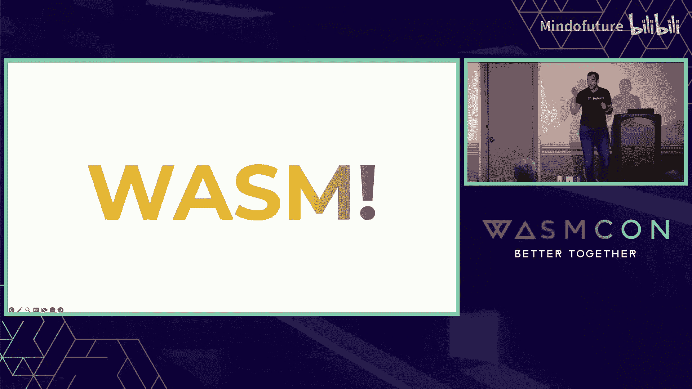

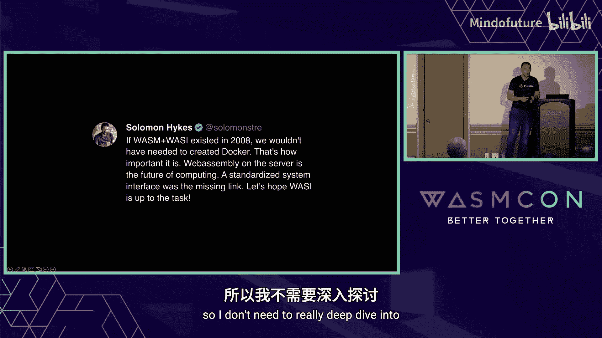

Convenience and versatity， versatity。 So the the promises built once run everywhere。 I mean。

 we heard about this in the Java world and so on。 But here we have something which really works delivering it on arm architecture。

 X 68 architecture。😊，And then， of course， here， the security aspect from sandbox by default。 Again。

 I hopefully， this is all stuff you you already know because you're here at the Vasm console。

 You're already into the ecosystem。 So it was just a small reminder here。

And now we come to the next point。 So Okay， we know Wasm is a cool thing。 We see the benefits of it。

 and we could probably our developer teams already approached us and say， hey。

 can we get Vasim also delivered as a service。 So here there is a project It was announced this year at Cu Con Paris that it's now part of the CNNCF project landscape。

 So it's spin cubebe。 This is an important part now of the of delivering this service for our developers。

 So again here。😊，Spin cube。 What does it consist。 There are many， many talks。

 I think also a cubeecon around spin cube in a more detail。

 So spin cube consists of different pieces here。 We have the spin operator。

 which takes care for deploying our spin applications。

 We have a shim container sh that we can run here our vasm workload on on container D notes。

 And then we have our runtime class manager so that we can install the runtime， the Vaasm runtime。

 and then we have the spin cube plug。 It's not hundred percent necessary that you need to install this。

 for example， In my approach。 I really went down the Yael way。

 but you can also use the spin cube C I to then create here the Cubanet deployment。😊。

How does it look like， So we have here our application development part with the spin CI so we can create spin new。

 we can create the scaffold for our project spin build spin minus U to build it locally and so on spin registry pushes then to push this O C artifact。

 It's not a container is Oci artifact。 we can then push it to internal registry like Jfrog。

 or we can push it Do hub， for example， depending on what we do。

 And the last point is see our spin cube scaffold。 As I said， you could use this。

 you could also create the Yaml or as we going to show you the part of the platform。

 we're going to create cube cutle apply。 And then the spin app gets created。

 the spin operator It like oh yeah， hey， I can handle this definition of knet because it's extending the API with the spin up CRD。

 I know what to do with this。 and then it's going to schedule this。😊，On our Kubernetes cluster。

With all the magic behind。 Okay， so second ingredients we already find also out， we have spin cube。😊。

So now we want to deliver again， developer experience。 We want to deliver the best possibilities。

 So let's take spin cube and bring it to the next level and say， okay。

 how we can help the developers to even be more productive and think less about everything surrounding them。

 not leaking any implementation details or something like this。 So theyre like， hey。

 I need to know about a specific pop up mechanism。 So for this， we have Depper and kedda。

 So we will throw also Depper and caedda on this one。

 And here I don't know if you're familiar with this this is from the French revolution is the Triium Fiat。

 So I created now our spin cube tiium fiat。 So we have Depper caedda and spin cube。😊。

So shortly again， why I think that Debra kda and spin cube is the perfect couple the perfect triple。

 So Depper is our distributed application runtime。 The good thing。 And again。

 this is very in a nutshell to say， okay， with Depper。

 we have now the possibility to abstract infrastructure way So de can focus on their application。

 So they get something injected。 It's a sidecom mechanism。

 They get a sidecom injected into their deployment automatically from the Depper operator。

 What they all need to do， hey， they know there is a component of type pops up。

 They even don't know if it's a Kafka。 if it's a rabbit M Q or something like this。 they know。

 there is something they have an SD K and you an API to communicate inside the application。

 but don't need to think about this。 So again， making life of development easy。😊。

And Depper is built on the E model， which allows you to think about your code in terms of communications or who communicates with who it's a really。

 really interesting part。 So Depper helps us here to create this abstraction。 As I mentioned shortly。

 Depper consists of different building blocks。 So we have something for state management。

 we have something for pops up， security， observability and so on and so on。

 all with the think that the development doesn't need to know the real implementation。 it could be。

 as I say， the Rabbit MQ or Kafka and so on。And yeah， the components are modular。

 So you can just implement them。 And here you can see also every generic thing like the state management。

 And at the right， you see some product which could be behind secret management。 You have keyw。

 AW S secret manager or a hashiko Vol。 So very interesting。 But me as a developer。

 I don't need to think about this。😊，So and now comes the next building block here。 It's Kaar。

 it's our Kubernetes based event driven autoscalealar。

 So now what we can do now is we can plug this kar scalar to something specific to say hey please Kaar listen to my rabbit and Q。

 for example， or listen to my Kaafka topic。 And if there are certain amount of message on the queue for example。

 please scale up my deployment。 if theres nothing I could say， hey， please scale it to0。

 So that's very important。 So then I can say， okay I don't have any unnecessary workload running because there is nothing to do。

 And if I get some， for example， a peak because there's a black Friday event or something around this。

 I can then tell my deployment。 hey now you can completely scale up。

 And now combine this with spin with this easy with the fast spin up times you can really create a system which can automatically scale completely in horizontal。

 And when the workload is completely managed and everything is back to normal。

Or back to the threshold， we think it's normal。 it can completely scale down again。

 So now we see some of the pieces of the benefit。 if we stick them together abstraction of infrastructure。

 scaling on specific events， scaling on specific situations。

 I have combined with spin cube to deliver our Wenberg load， it's perfectly fine。Why is Kaar so cool。

 Yeah， it makes auto scaling really， really simple。 So that's one of the points。 It's event driven。

 That's what I also like very much。😊，It's a huge number of built in scalrs。 you can really select。

 There's everything I even created。 They have an H TP Scr I created also a Mincraft deployment where it will scale down the Mincraft server when there is no connection going on。

 So that's really good。😊，The last， yeah， one of the parts is save the planet。 Yeah。

 that could be also something reducing。 So I would say not save the planet。

 but maybe save your your wallet because you maybe don't need to pay so much anymore。

 And it's vendor agnostics。 So that's very cool。 again， CNCF project。 Okay。

 so now we got the next point the next ingredients。 let's talk now about our hopefully final one。

 which we need to before we head over to the demonstration， is then golden paths。

 So our road to success。 We know now everything is there。

 But how we can deliver this now as a platform engineering team to our customers。 So what is this。

 And one of the things you may heard is the term golden paths or paved paths。 where we say， okay。😊。

Let's deliver something。 So what is the idea behind this。

 So what we now offer as a platform engineering team is we offer our form of a prearchitected and supported way to build and deploy a piece of software。

 that's very important。 So prearchitect mean in conjunction with our customers。 we come up to say。

 okay， let's build a golden path together， they give me input what they need。 you know。

 which plugins whatever。 And then I will add this， for example。

 with things I have from my security department。 So I could say， okay。

 let's use distro less container to reduce any Cs or lets us auto inject in our Jenkins pipeline or let's auto inject in our Giths。

 Github workflow。 Let's auto inject for example，3 or another scanner just to find vulnerabilities because this is maybe something development team doesn't care or don't have the time or the knowledge about this So I can take care of this taking the input from them adding the input from。

The security team from other departments inside my company and create now this this golden path。

 And I give out the promise now that it's supported that's very important。

 supported is really important because when the people join now my golden Per。

 they can be sure they get the best feedback around this。 they get for example。

 also upgrade information when I create the version two of my golden Per。

 I can tell everybody who early adopted version 1， for example， hey， this is the way to to upgrade。

 This is maybe a breaking change and so on。 and this is how you keep always on the golden Per because then I can support you every time。

😊，But， but but， but， we don't want to become a new ivory tower because that was also my former company。

 always the fear of development。 they going to clamp down my freedom and on。 So no， no， no。

 it's not like this。 So you get support， But you have also the way to break out of this。

 but you have to be sure that as long as you stay in the supported way。

 you have always the perfect way for production。And but you can also leave off this。

 So that's also a thing to say， okay， we give people the freedom to leave this supported way。

 They have to be then completely aware。 Then when we leave this golden path that you cannot call me and ask me for help and so on。

 again， real life， he will call this manager， En doesn't help me。

 And then my manager call me and say， hanging， why you don't help these people。 I know。

 But most of the time you make it clear to the people。 Okay。

 you can break out because you want to try something new， We want to foster innovation。

 So you can but be sure that I'm not help cannot help you 10 percent like I would with a supported golden Per。

So。Question will be done like， okay， that's nice。 So what isn't a golden Per。

 And the longer I stay now in， in this business， the more I realize， yeah， it's really true。

 it depends。 So it depends before I was like yeah， it's a lazy answer of people。 But now I find out。

 no， yeah， it's not like that easy。 So， yeah。

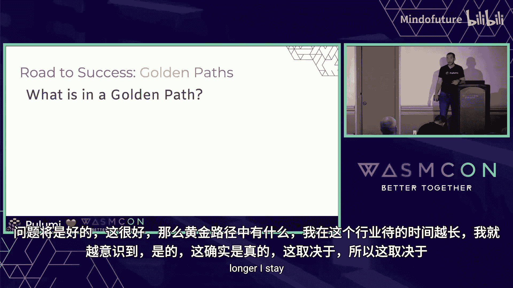

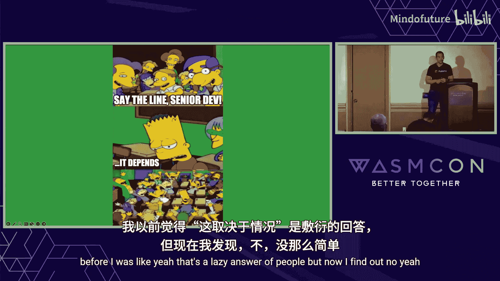

It depends。 What isn't a golden Per。 It depends and what is more in detail。

 It depends what you're going to deploy。 So there is no really like， hey， this is the the recipe。

 This is a silver bullet。 if you follow this， this is always a golden Per。 listen to your customers。

 So because now we come also into subject to say， okay， we treat our infrastructure as a product。

 we treat our platform what we create as a product and also communicate with the stakeholdersholder security and so on and our customers。

 developers to find the best way and to create this golden pers together。

 maybe there is a guild or something already in your place you can connect and get all the information and feedback。

 But there are some minimal things which should be。😊。

In a golden in a golden path to create your internally developed application。 again。

 I put it here as a wall of text。 So one thing is a repository template。 So you have example。

 your Github template and have a workflow folder and maybe have a cookie cutting for your go application or cookie cutting for your rest a pipeline。

 as I mentioned before。 So the people can just really start they order this golden。

 And then everything gets deployed， transformed with the template engine and theyre ready to go important is also the manifest to deploy the application depending again。

 of your runtime here in my case， it's Kubernetes。 So there will be some kind of kubernetes hel or customized files lying around the infrastructure to deploy onto it's also something to say。

 okay， if I'm going to build a static application maybe already ordered order when they execute the golden is free bucket or the ver sale or what you're going to deploy here observabilityities baked in。

 This is also something。😊，Which sometimes fall from the table， as we say， in German。

 So this is also activated。 and most important part is security。 So as I mentioned。

 having3 V or something like this already installed or taking care that you use chain guard image with zero CV Vs。

Okay， at the end of the day， Ka， we have now created this year。

 We have now our internal developer platform where we have our platform engineering teams to think about the picture from before。

 So now we have a platform engineering team which create， which builds now services。

 We have our developers who consume the services。 and theyre using the platform we created。

 which has different layers， security， Devps infrastructure operations， automation。

 and of on top of it。 Then we have all the different products， which we maybe integrate into this。😊。

So Gitlab， Zona cube and so on。And most important is， here。The platform， it sounds sometimes easy。

 but the platform should be still flexible enough to react for new trends。 as we can see。

 for example， here with Wam。 It should be extensable。

 Cloud agnostic and composable That some of the requirements。 I would have for the platform。

 It should not be something like， hey， I start already with maybe cloud agnostic in mind because my company is really on azures of why is the need So again。

 we don't do stuff which we don't need。 So maybe cloud agnostic will be not in the focus at the beginning。

 But we want to be very flexible。 Okay， so we talked also about this point。

 And now comes the big question， everybody is probably asking again。

 what problem does this text solve。 So what are you trying to do here。So。😊，It's a good question。

 It's a good question。 So I can only mention here also Matt Butcher from the CEO of Fmion。

I hope I quote him right because it took a little bit time to to find out who coined this term to say。

 okay， Vam is considered as the third wave of cloud computing。

 So we know the first wave was virtual machines。 The second wave are containers。

 And we know now it's the third wave is Vm。 So we stay at top here and we take care that all the benefits I mentioned before and all the benefits you may be already experienced because you start using Vasm are enabled and are able to deliver to our developers。

😊，And the next point， which I found interesting is to say， okay， we now enabling。

Our deaths that they use vim in a golden path in a compliant and supported way。

 So because maybe they already started to work on this and so on。 So we find out， hey。

 this is very interesting for the company。 So why not take it early and provide this golden path。

 As I mentioned。 and have it then delivered to our developers and then they can start work with it。

 Okay， so now I made the foundation。😊，Just in time for the demonstration。 So here' is the Q R code。

 I will also show it again for the demo code。 the slides will be uploaded。 So if're not。Copi it now。

 you can check it later。 So the demo architecture， again。

 platform engineering team using here in this case。

 Plumi infrastructure is code to create the cluster， the hub cluster。

 which will be the first thing we're going to deploy is Argo CityD。And backstage。

 So these things will be deployed。 What Arbo CD is doing then going to a Git repository and install Gi ups weigh all the things we need for our platform。

 So having an external secrets operator， search manager Postgre D be Depper and all the stuff get everything gets deployed automatically via Gitops。

😊，And the next point， the then then comes the development team。

 again go to the platform and order the stuff。 Okay， so。

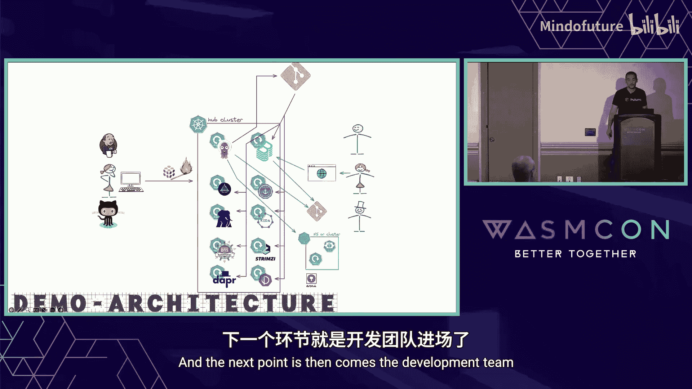

Before we lose too much time。So， this is。Okay， this is not ArgoC， sorry， so let me。

Let me mirror my screen， because then it's easier。So okay。So this is when you log in into Argo CD。

 and then you execute the the code in my in my repository。 So everything gets deployed。

 the Giubs way。 As you can see， if I do a change in the Giths repository， it will react on this。

 So this is the Argo CD view change a property and automatically Argo CD will detect this and deliver it。

 So be cover here。 This part， the delivery part of the thing。😊，Coming now to backstage。

 So backstage is here installed。And we have a different properties here。

 We have our user I created here now， a typical company。 We have here different。Departments。

 you can say， okay， we have infrastructure teams and so on and so on。 So now most importantly。

 is now， let's go here to the cr part。 So we can see there' is the， the template。

 the golden path I created。 It's the microservice with Depper and spin cube。 So I can go。😊。

Let me go back here。So let's go to templates because now I have I created now this transparent template of a golden Per。

 so the team can click on it。 they can look up the source code。 they see now here， the template。

 they can gain confidence in the golden path。 they can create a pull request if something changes。

 Its not up to date。 So here completely transparency of our of our golden Per。 and they say， hey。

 that's nice。 That's good。 We're going to use this so they can go and launch to the template。

 and then we can collect some information。 again， this is completely up to to you as the platform team。

 which information you want， for example， here， deploy Kafka you are Yes， no and so on。

 which name space I would like to have again I enter here some random information。😊。

Then I can create which Github repository I would like to do our Azure DevOs。 and then we make again。

 la， la， la， that's not important。So we see the information so everything self-sf。

 this is something that the development team can do on their own as one of the stories I exposed。

 they click on create， they see now here the creation mechanism and hopefully yes。

 it's working let's go to the open source repository we see now that everything is transformed my WasmCon applications of the template gets transformed into real code I filled out all the information if we go to customize we see now the namespace is set so all the properties I said the people are good to go now they can just start to code because everything is already wired up and。

Again， I can also see now who owns this。 So I see now in my component catalog in backstage。 I see。

 hey， this is all the applications deployed here in my company。 Let's see the Vaasm con。

 And then we see who's the owner， we see the team， the infrastructure team and so on。

 we can click on the infrastructure team， we see now the members of the team and what services they own。

 Okay， that's also working。 And now before I let you off the hook about this point。

 let's see what I created as a demonstration for the Vaasm。😊，So everything is deployed here。

 as you can see， my， my external DN S， everything is set up， and I deploy here now。嗯。

That drug generator， because that's why not。 And you see that the backend is completely scaled down to 0。

 It uses a Kaafka in the end。 So let's head off again。 I'm using it own dog food。

 So I'm using here now my deployment。 So I can see now the Kafka queue。 I see the topics I created。

 So I would like that you folks。😊，Head to this Q R code and just generate one。

 So you don't need to enter anything。 It's just to， to execute。 you know， the request coming in。

 and hopefully its work I s if it does not work， I'm。I have to resign my job。That's。So。

 but we see now something goes on now here in the， in the deployment。So yeah。

 we see it gets deployed， so there's the first stuff coming in。And let's see on our Kafka。

 we see the topics。Let's see on the message， we see also messages coming in。

And we see the first code comes in。So let's see we can see also the backend scale now to 5。

 I remember it was just before0。 So because there was nothing going on。 So I set everything to 0。

 And now we see workload pick up because I set up here everything to。To， to， to use here the。Okay。

 so why he's returning here zero， which somehow we killed the demo again。I'm so unlucky with this。

 okay。Maybe it's too much going on。 Okay， but still some's coming in。 So it works。

 Maybe we just killed a little bit the API end point。Okay。And yeah， that's the the demonstrations。

 So it should normally fill。 I did a dry run at my company and everybody worked with。

 But somehow this is now。Not working anymore。But it did at the beginning。

 So the idea was of this application。 Yeah， it has different parts and then connecting to a that joke。

 API endpoint， getting the latest that joke。 and then creating also an image using the open API image generation。

 Let me try again， also on my side。

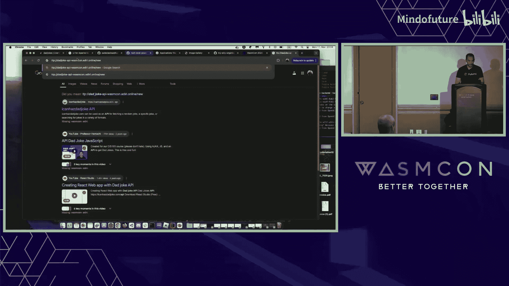

How to tip。Okay。I don't know why it doesn't generate a UI anymore。 Okay， so let's head back。

 but it worked for the beginning， okay。So play from current slide。Okay， so we saw the architecture。

 We saw the different parts going on。 We saw the motivation of it， why we should enable this。

 So I gave you a little insight about platform engineering and how we can provide vm as a service or as a golden power for our internal developers。

 and yeah。😊。

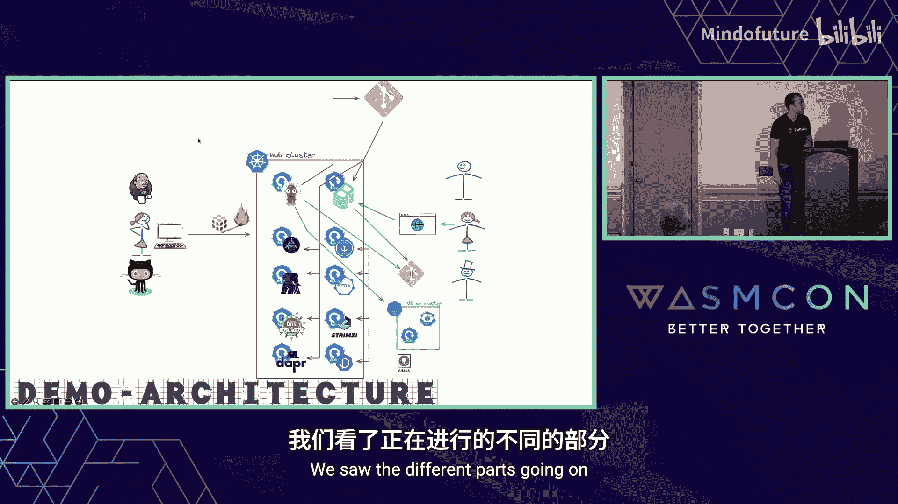

I'm open for some questions。👏Thank you。I have this microphone。 So if you want to know something。

 I can share this。Sorry。And it's。Yeah， I mean， yeah， that's。Publicly available memes。

 sometimes also from my sick mind coming up some dnk memes， but yeah。That's a thing。Okay。

 then if there's no question， I。Thanks for the talk。 Yeah， I was curious。

 Can you talk a little bit more about how you manage infrastructure。 So you had this application。

 I think at one point you were selecting a CAfka cluster。

 I'm wondering how does the topic got created， Is it in the D specification or is it somewhere else。

Okay， that's a good point。 I jumped a little bit over this。To notre bore you too much。

 So let's just have a， because everything on my place is done via。

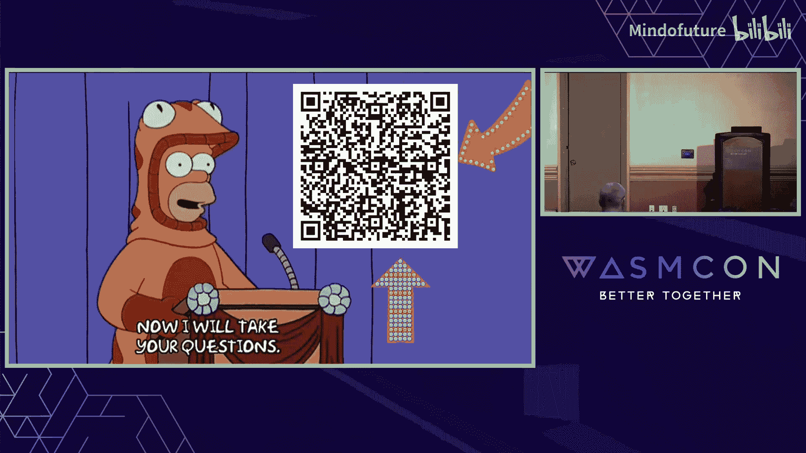

Where is it via Kubernetes。 So in this case I did not need to create now dedicated infrastructure。

 but what I could do now， let's have a look into our deployment。

So this is the application and we have here the customized folder。

 this is what I prepared for the demo。And we can see now it' I create， for example， Kaafka。

 I have a Kafka operator running。 So everything is really on Kernet。

 So when the team orders the Kafka as part of this golden Per。

 there's also this definitions and I can set up the topics and so on。

 So you could see in my backstage I just preselected some。 but I could go deeper， I could say， hey。

 if you check Kafka， I will ask you now also how many topics you want。

 how many partition should and all this or maybe I abstract this。

 I say okay asking for partitions again， leaking some of the implementation details。

 let's talk about t-shirt size， I could say to the team I could say are you expecting a high volume topics or something So you could prepare everything with zookeeper zookeeper less and so on and so on。

 but the development team they don't care they say okay I need a topic which I can listen to and subscribe to and it should handle following amount of message for example。

 and then I take care they could say I want a production grade Kaafka。 So I take。😊。

Ass a platform engineering team when they take production in the selection。

 that it's already scaled out with three different brokers and all this stuff。

 but everything happens here。If you say I would like to。

 to also let people order the infrastructure you could use， for example， Plumi。

 you could use crossplane also as part of this template and just execute this stuff。

 I hope it makes sense， okay。Deeppper， okay， good point， Depper is here， it's an annotation。😊。

So what I do is I just annotate this。 And then again， I could activate。 I could ask the team。

 you want to use Depper yes or no， and then activate this here with the annotation。

 and I have also the Depper components here again， because I use the Depper Kubernetes approach。

 there's a Depper operator。 And then I just deliver the component。

 And you can see now it here the pops up and it used the internal Kafka service address of my Kafka I deployed to connect。

 So again， very easy stuff。 So now you see things makes completely sense when you template things and so on。

 Okay， if when there's no other questions， I let you off the hook and wish nice conference day and yeah。

😊。

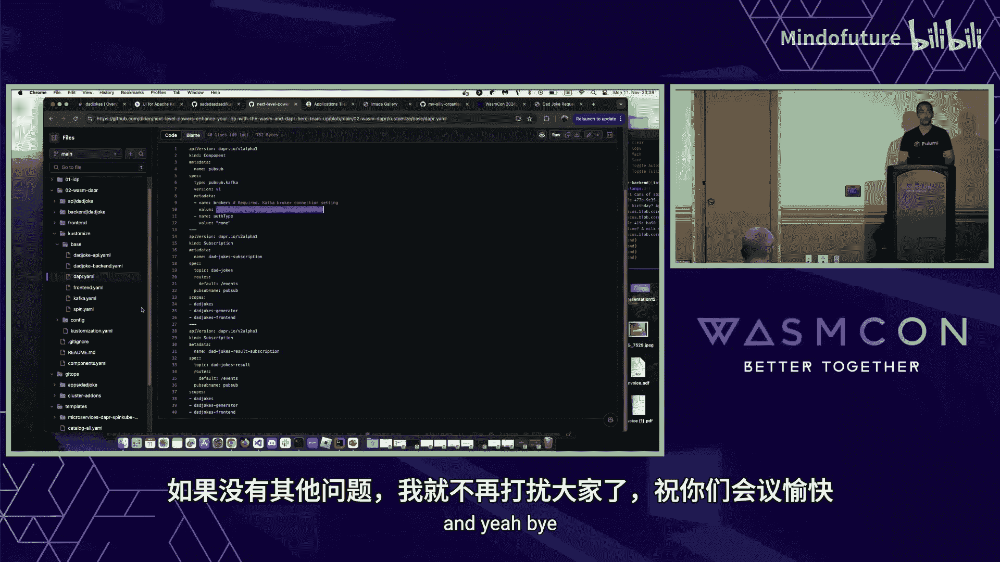

By。