# WasmCon-2024-p12-P12-Unleash-the-Power-of-Open-Source-WASM-on-a-Hyper-Distributed-Clo...-Colin-Mu--BV18DjSzJE6r_p12-

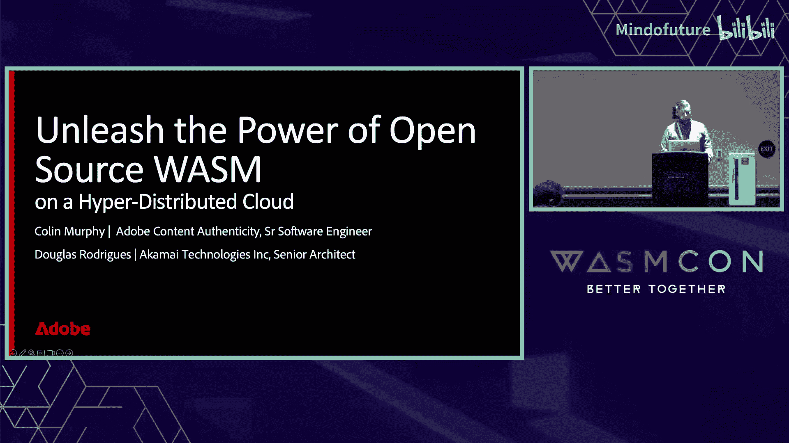

My name is Colin Murphy， I work at Adobe， and this is Doug。 Doug works at Akaai， say hi Doug。

 Thanks everyone。

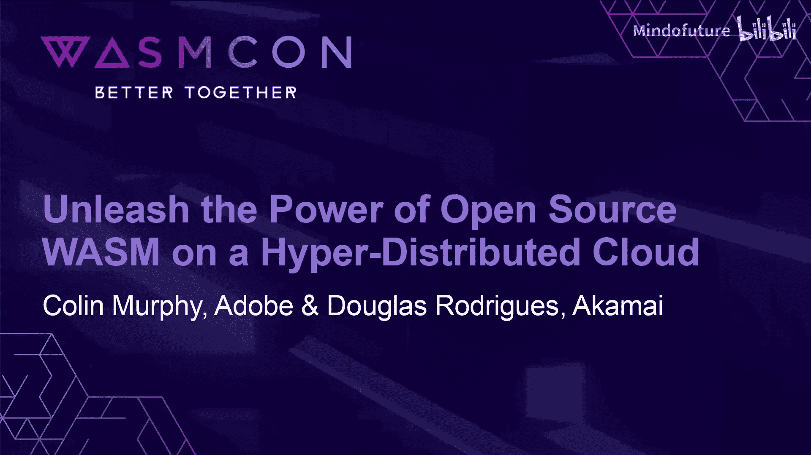

He' got to make sure his what Mike works。 Okay， so let's go。

 let's go an uninventive and somewhat wordy title。 I think I got workshopped。

 So we're doing our best here。 Allright， so I'm gonna ask a few provocative questions and maybe unfortunately。

 insult people here。 I'm sorry。 probably not。 but you never know。

I'm going do some exposition dump about what why what I do at Adobe。

 And then I'm going talk about our demo。 So its really about the demo。

But you know just laying the groundwork here， so there'll be a little bit of knowledge。

 and then there'll be some demo。And okay， so the first you。

 provocative semiinsulting question is why isn' an Adobe using edge compute。

 And I can tell you one reason it's not， and it's not from lack of trying on my part。

 I think I've tried to get us to use every single cloud provider out there。 I'm talking with Doug。

 So you know， the journey continues。 But why aren't we。 So I did I've tried to ask the question。

 I've been at Adobe for a number of years now。 So I know a lot of people， and I asked that question。

And this is what I got。So it's too different from other programming。 right， you're a Java engineer。

 you work on spring go。 that's what you do。 And that's how you solve problems。 right That's。

 that's a lot of Adobe for the serverside problems。嗯。呃。

If you have a really good use case for edgedge compute。

 it takes a whole separate group of people deploying that or becoming subject matter experts in that particular framework。

And then they have to in somehowhow integrate that in。

 and now there's coordinating those deployments of that with your deployments。 I mean。

 there is something to that anyway， like we have a lot of static assets right。

 but edgedge compute seems more like serverside compute， serverside programming less about assets。

 So it's just different。 It's like another thing you have to do right and then just lack of capabilities right and you know that lack of capabilities。

 by the way， it's why we all that's why there's a wast cotton right we're trying to add capabilities。

 edgedge computes a big part of that right' it's no coincidence right that the last two people up here we're to fastly。

 Luke gave a talk， he works it fastly。 we've got Cosic。 we've got Fermi on right。Serverside compute。

Edge compute， right。And we're trying to improve that。 We're trying to improve those capabilities。

 and then。You know。I I want to why have a quote from one of the people。

 And the last thing you want to do is spin up another Kubernetes， right？ So I'm sorry。 I'm sorry if。

If that's your thing。To make people spin up more Kubernetes。 But that's， you know， it's a lot。 So。

 so， you know， so we want something。 Okay， so let's just say， what do we want， You know。

 what do we want to to have use edge compute， Okay， well， it's got to be multi tenant， right。

 we're not gonna spin up a separate。A separate whole set of platform for every team at your company and you want ideally。

 you really just want this to be a service。 right， There's a reason that EKS isn't a fully managed service。

 It a reason AKS isn't a fully managed service。 It's because Docker and Kubernetes are not made for multitenancy like Webassembs。

 right。You want it to be global。 You don't want to be deploying。To every single cluster。

 you don't want to be upgrading every single cluster all around the world。

 You don't want to be deploying， you know， this is our。

 you know this is our package for this cluster。 This is our package for this cluster。

 This is you're right， you don't want it to look and I already explained that you don't want it to look too different when you deploy to edge。

So it's global， Wasm cloud's global， but the lattice stretches across multiple Kubernetes clusters or deployments of WasmC。

 right？嗯。Oh yeah， sorry， a conflict of interest statement， I'm a maintainer of Wassmclo。But。

 you know， I， I came to that， you know， because I like it。 And then so Wam cloud stays up to date。

 right， Wasip P2， that comes out。 it's in Wasmclo， right。

 You want the latest thing to come out of the Btecode Alliance and the W3 C subgroup for。😊，挖机。

It's going to be an awesomeom cloud。 And then， you know。

 then we get the Web assembly benefits of efficiency， which hopefully。

 if you've heard any talks today， you've gotten that and the security。All right。

 so here's the exposition dump。 I work for the Content Aentity Itiative。

And it's a consortium that promotes an industry standard for provideance， metadata。

 so provideance means like where did it come from， and we call that content credentials to help curb disinformation and increase trust and transparency online。

So we have camera manufacturers。 We have editing software。Adobe。

 we have social media platforms like Meta。 We have media companies like the New York Times and the Wall Street Journal and many。

 many others。 It's a big group。嗯。And we have this thing called the C2 B。

 which is another organization that has other companies in it。

 and that has open source libraries and tools。 And we have Adobe services around those。

Ho it source libraries and tools。Okay， so that's what you want to know。

 so you want to know the whole idea is。Ideally， somebody takes a picture。They edit that picture。

They publish that picture picture， and then you somehow get that picture， right， You download it。

And when you download that picture， you can easily see。That chain that chain。

 So those things that are happened are recorded into a manifest。

 and that gets signed and can be verified。 And so that。

 you know that this is what happened to this image， Like。

 what is this image and where did it come from， Where did it， How is it edited， that kind of thing。

So it's not， It doesn't solve the whole problem of like， here's a random picture。 Is it true or not。

 It's just saying， hey， I know this is true， right。Okay， so the cool thing about。C2PA， C2 PARS。

 it's an open source library， you can， whatever we'll have some notes， I think at some point。

 so it's open source， C2 PARS， it's a rust library。

 which is really nice because Russ is a great language to compile the Web assemblymbly。

We have lots of use cases。 We have got Web。 So we've already got that。 That's working。Web wasm。

 we've got server use cases。 We have servers that run rust。So hopefully at some point。

 they'll be wzi， and then we have embedded use cases。 this stuff runs on cameras。

 we're trying to get this into cameras and other devices that produce content， right。

So it's really just， and then we also have multiple SDKs。

 so there are SDKs for Python and JavaScript and node and C and rust， obviously so you know。Great。

 great wasm use case。 Like some， we could maybe make a component and we could not have to make all these SDK someday。

 right。And you know， in the other thing with open source。

 we can really forge a path for others to follow。We can collaborate with the trailblazers。

 we can share our code， which is really easy when you're trying to solve a problem。Okay， so。

There is a service， a service ace， content authenticity initiative。

 C2 P service that we'd like to have。 It doesn't exist yet。

 but it would be solve it would solve this problem， which is。

They take know they use the right camera， they use the right editing software。

 they put it on the right media site or the right social media site， and you click on it。

 guess what happens。 You don't get any of that provideance data right now unless you have some sort of specialty service。

 which they exist like Adobe stock， Adobe Firefly， but for the most part。

All that metadata gets stripped out。And when you download an image， however you download it。

 it's usually proxy。Through a CN， Aka， or what have you。And。

 and that that resizing of that image strips out all the metadata。 and you don't get it。 Okay。

 so that's the problem I'm trying to solve here with this demo。We're gonna。

 we're going to download some software。 Let me say we're going download an image。

And that C2PA is' going to resize that image and the C2pa and that resizing will be recorded。

And then it will be signed。 And you will have that as you download the image。

And what's really interesting about this use case。Is it doesn't really work in the data center。

 and it doesn't really work purely on the edge。So you run it purely on the edge。

Adobe Adobe's signing keys are very highly prized， and we do not want those things just living anywhere。

 So we use AWS for that or cloud HSM。And we don't。 so we can't live on the edge。

 And then if we put it in the data center， now all this traffic from all these sites is now going through our VPCs and our V nets。

 and we're paying for networking costs right and and you know， video streams， things like that。

 that stuffs。Willll rack up some bills for you， right， So it would be prohibitively expensive。

And also， the cool thing is it has to， we have to have something， talk receive a request on the edge。

 do something in a data center， and then have it come back out to the edge。So that that's hard。

 right that'd be very difficult to do with today's edge compute。Okay， and and so yes。

 I did already demo this in Amsterdam a year and a half ago。

 but just in case we have any repeat people， it was a lot different so。A year and a half ago。

 I had fork nine different crates。It was only kind of half working。 I didn't have validation。

 It was obviously was Z P1。 There was't no P2 yet。And it was all just running on my laptop。

And so I'm not really demoing that， hey， you can use。

 whereas before I was saying you can compile something to Wi and it can do something。 Now。

 I'm saying you can compile something to Wi and run it across。 In this case， a Akaai， Geo and AWS。

And have it actually work， fully work。And also now I change jobs。 So actually I'm on the team。

 so I can actually make this a product， hopefully。

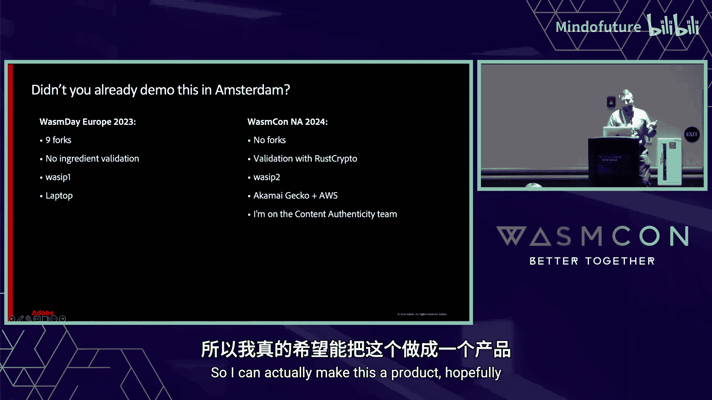

Okay， so yeah， so I kind of already explained it。嗯。There's a get。Request it you want。 you basically。

 if you look at that get request， I'm telling it to pull it down an image from somewhere。

And I'm telling it what the width I want it to be。嗯。So。That's happening at the edge。

Everything's really happening at the edge。 And I just kind of have this like placeholder。 hey。

 I want to。I want to store this image asynchronously in S3。嗯。In the real use case， of course。

 there'll be that KMS piece that I talked about before。And also， we've got a C DN in front of it。

 thankfully。 So if somebody tries to hit it， this， this URL is not the right one because I don't want you to crash my site before it start。

 but。But don't try it。But who knows where it goes？But yeah。

 we have a CN in front of it to help with the load。So even even once you see the URL。

 if you were so inclined， hopefully， it won't bring it down。And so also not to。

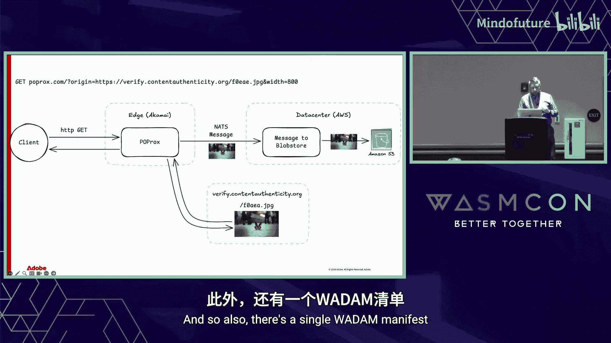

There's a single wouldamm manifest。Well dam is a tool we have in Wam cloud， and it's a single yaml。

 You know， we like Yaml here。 We are all cubeecon， right。😊，We like Yaml。

 there's a single Yaml for this application， it's got a few different pieces in it。

Ass two components and four providers， but it's a single Yaml， you can deploy it to an endpoint。

And all of the web assemblymbly， all of the WaASm clouds， are updated。

And you can target something for Akama， you can see there on the one on the left。

It's targeting Akaai。 This is I Agamai。 And this is what I want to run on AWS。 So really declarative。

 you know， Taylor， who worked on it。His Taylor here。 He's not。 Taylor， are you here。 No。

 it's not coming to my dogss。 Okay， I'm just going to know， tell him he did a great job。

 It's out here。But yeah， we call this helm4 jokingly because he worked on Hehelm three， all right。

So yeah， you apply this and it just goes out。Everything just works。All right。

 so I'm going to turn it over to Doug and I'm going to get a glass of water， thanks。Thank you。

 calling。So。What I would like to talk about is the vision that we have for the evolution of these cloud deployments to enable solutions such as the ones that call inscribe first I would like to start with these core cloud model it' the typical cloud deployment that you're most certainly familiar with。

 you have a couple of locations in this case， tens of locations and you have the illusion that you have virtual essentially unlimited capacity available to you。

 you can always request more resources and you can run your applications without any limits put in place。

The next were trying to introduce this concept of a distributed cloud。

 we're not only talking about to of locations， but having applications that can ideally run in hundreds of locations much closer to users in a hopefully not so different environment from the perspective of the developer We're still going to offer you a generalized compute resources Was and web assemblymbly is a technology that's phenomenal for this type of solutions since it's so lightweight and can run well in environments where you are naturally resource constraint。

And then to combine that we have the original edge type of deployment。

 this is what traditional CDN companies offer， you may be familiar with worker type of solutions where you run a little bit of code very close to the outer edge of this cloud where your customers access your website or your application or solution。

These solutions are great they run everywhere they are very ubiquitous。

 but one limitation that we often see here is you are often limited by the idea of writing your code in such a way that you're implementing a processing in the request response transaction works great in some scenarios but not everywhere and with this type of solutions we're seeing enormous potential to implement unique in use in creative solutions as to leverage the best of all these layers of what we've been calling this hyper distributedbuted cloud。

And to give you a more material example， I want to go go over another scenario where we're implementing distributed composition of the services。

 and I have them color or coded here， mapping to the layers of these preview edge that that I described to you。

 So the idea here is essentially to implement a product recommendation feature。

 that's based on weather forecast。ItDoesn't have to be weather forecast you may have a better way to know what your customers may be interested in。

 but actually is this case that this specific implementation lends itself very well to also highlight the ability of making an external API call。

 and I'll talk about that in a second。But I want to walk you from the right to the left you see the request enter into this ecosystem and at the edge layer where you have these thousands of locations code that you convert runninging thousands of locations you do some very basic processing at the initial stage which is just accept to request in and use an IP geolocation service to know where your user is that's not the type of geolocation data that you have like enabler browser to share this is essentially course grain geographic data that we can have by essentially looking at where the client is connecting from this is a database but this is a local database every edgedge server has a copy of the database is very static and essentially a lookup in a file that you're performing。

Next， we are going to use a global router to call a WasASM service。

 that's where we have the bulk of our logic， but I want to highlight the important role of the global router here since we're talking about these green component。

 this WasASM component being running eventually in hundreds of locations。

 you need to be able to connect your end user that may be anywhere in the globe to one of these hundreds of locations efficiently。

 you want to send your user to a location that is available healthy and that is geographically close to your user。

Why， because you're often interested in leveraging the benefits of this platform to address one of two circumstances。

 The first one would be low latency。 You want your pages to load fast。

 you want to provide a responsive experience to your user in the second aspect is you want to avoid moving too many bytes around this wall stack right not only I like to call out that this translates into two types of inefficiencies。

 the first one is that you're gonna to have low application。

 your users are the performance is going to hurt and the second is theres cost involved in moving these bytes around especially when you're leveraging cloud providers to do so theres often data transfer fee associated with your services so if you can move fewer bytes around。

 you normally can to request faster and you can save with your cloud provider bill。

And then this green components is WaM components is what I wrote to play the role of an orchestrator here。

 if you will， he receives this request that remember had user geolocation data available uses this geolocation data to call the weather API from weather gov openly accessible API There are two arrows there because it makes two calls one first to resolve the location and the second to resolve a forecast for that location and once that forecast information is return I'm going to use this information to do a lookup in a product catalog that I created is just a relational database here for really no special reason any data source can would work just fine but I'm going to use what is your shortterm weather forecast to lookup product recommendations if you're going to have warm weather I'm going to recommend you something if you're going to have if you have cold weather in the forecast I'm going to recommend something else。

So data at high level is how all these components integrate。Yep， all right。 So that's in the demo。

 So what he's describing is in the demo。 We put a lot of stuff into the demo。

 So hopefully we can give through it。 Now， we got 50 minutes。 We'll be fine， Allright。

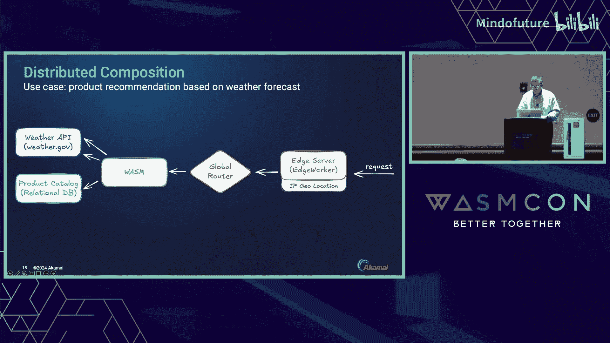

Ook。Dry mountain air。Okay， so this is the web page， and I'm going to。Refresh it。All right， let's see。

Okay， well， that was great。Really fast。 Thank you， Con delivery networks， Okay。Doug just said it。

 So I'm gonna to kind of go over what Doug just said， and he can correct me。

 He can jump in with his mic。Any time， okay so。We have a localized weather forecast。Which he。

Which you talked about。 And we've got recommendations based on the temperature。

 So I think we picked it。 I don't know，50。 what was the temperature 60 around 60 degrees。

 So maybe it's that warm outside。 I don't know。 But blame the weather service， if it's not。

And so if it's above 60 degrees， we have certain products。 And so earlier this morning。

 there were different products here。And that were being shown。And so then。

If we look at this picture and we inspect it。with the content authenticity website。

Conent credentials do org， we can look up what where you know， the provenance of the data。

 of the image， so。It was taken by a camera that didn't have。Any sort of C2 BA。

At capabilitiesapbilities， right？No content， instead of nothing。

 And then it was put into Adobe stock。And signed with Adobe credentials on November 4th。

Of this year and then actually when I downloaded it and then。

It was signed on the edge on the Akaai edge with a test signing C because I'm not putting Adobe credentials in my demo。

 so sorry you're going to have to do with this orange thing。But yeah。

 and so it was signed on the edge Y Wasm Cloud running on Akaai。All right。And then， the other one。

Was generated by Adobe Firefly。And then signed by that， then resized my。

 by that proxy running on Wast cloud at the edge。嗯。Doug， am I missing anything？Wna收低。

just to showOh yeah， I have more I want to say。Oh。Got it。Thank you。

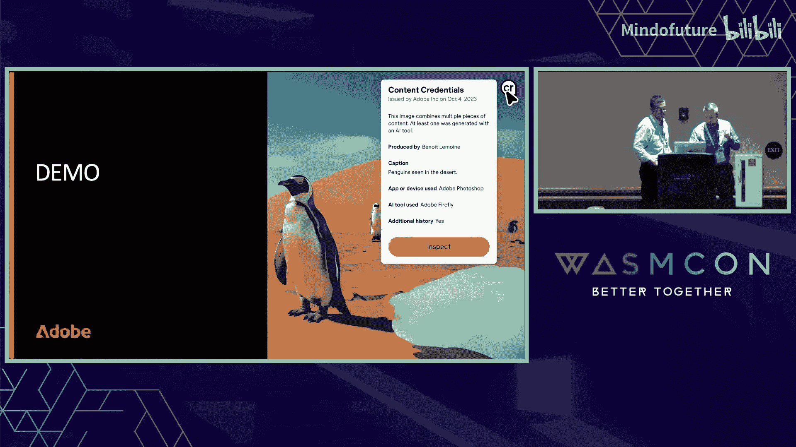

开唔知。Let me I'll skip over to the。Just so you have a look at what this looks like for the weather forecast that we're not getting。

So you see the difference in the product recommendations。

 And just one quick call out here to the performance numbers we were observing。

 I really think this excs。 If you think about it， what you're seeing there is a bunch of handoffs we have code running in three locations edge distributed in core one relational database involved two API lookups。

 I think that having these numbers in something that is， by the way。

 not optimized for performance yet Yeah， we're running in a single edge location and a single AWS data center。

 So is we're on the cheap here。 So I don't know。 but yeah。

 so this is this is one so there are the front end has。

Your database has three edge locations should the database is centralized。

 but the database is green service the Was in service we running in three different locations across the continental United States。

 and then the signing service runs in only one。But so in， you know， in a production use case。

 we'd be using many， many different edge locations， and we'd have really good localized results。

 And just the fact that you can actually put in a URL here， I switch it。 I switch back。This。

 we do not have this capability within。This capability right here。

 where you can just put in a content， a URL and a with。And then。Get back， there we go。Okay。

Ne to warm up the cache first。 Okay， but here。 So this is you know。

 so this is all being done server side。 So it's fetching on the server side。

 not it's not a client side library。Yeah。And this should worked too。It might take a little longer。

But yeah， so。U。Yeah， so it's all doing on server side， which is really nice， especially， you know。

 as you extend this out to further to more things like AI and that kind of stuff， right。

 there's some devices you want to be running it locally on the person。 like if they have an M3， yeah。

😊，But do the AI， do the model inference there if they don't。

 know if it's a 10 year old Android phone。You know， run it on the edge， right。

 these are the kinds of things that we can we want to be thinking about， we want to be doing。Yeah。

And then I've got， yeah， I do have a couple more slides， just kind of where we're going。

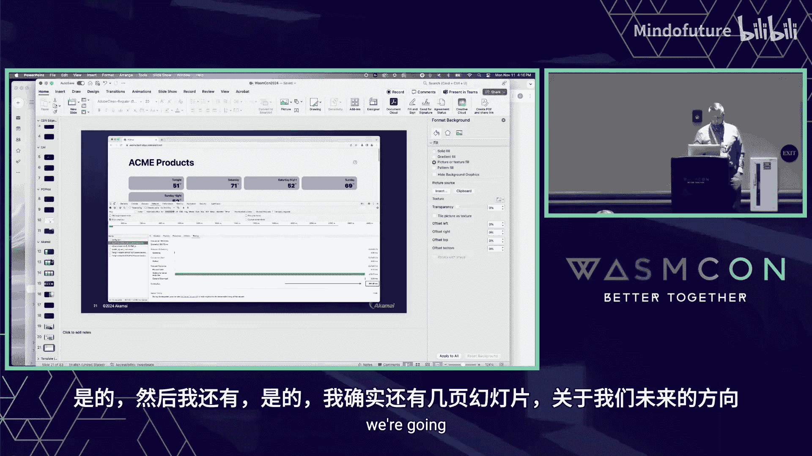

Hopefully， Ccon， E U。呃。

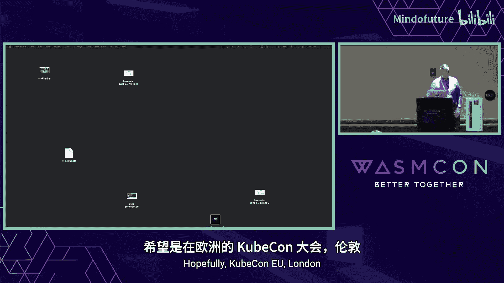

You know。ItLondon， its in London， everybody。

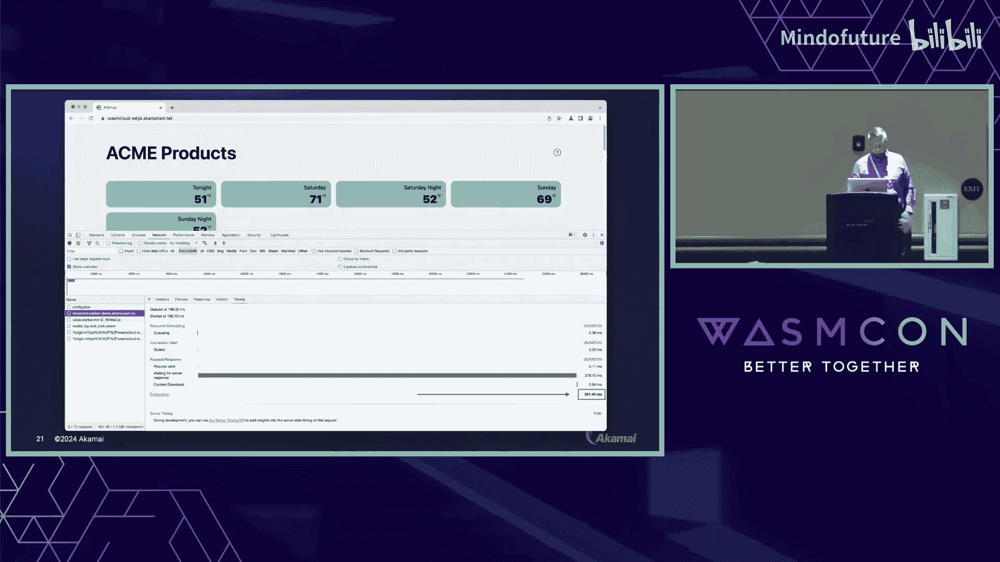

So。Yes， so in the future。We would like to get some sort of a spec for bundling of static assets with the application。

 some kind of universal spec across the CdNs。And。Just general Web assemblymbly。嗯。

I want to migrate services from Kubernetes to Wam cloud。 right， We got to work on embedded use cases。

For， and。I actually publish a C2 B A component。 So right， heres。

 here's like an interface that we can publish。

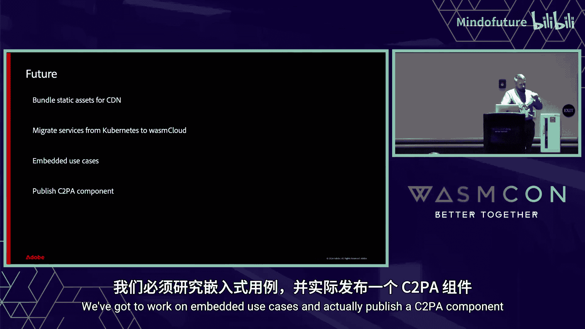

We can generate this interface， generate this component and put it out there。

And then people who want to use content authenticity， C T B or CPA API。

They just can use this component。嗯。So yeah， that's cool。

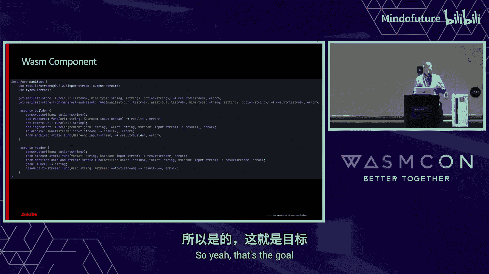

Right， so， and then they could use that for embedded use cases， kind of but the the。

Cart before the horse， but there's a lot that needs to do happen before then。But that is the goal。

 right， so it's a really good laws and use case， web embedded and web services。All right。

Anything else， That's all okay？Thanks， everybody。

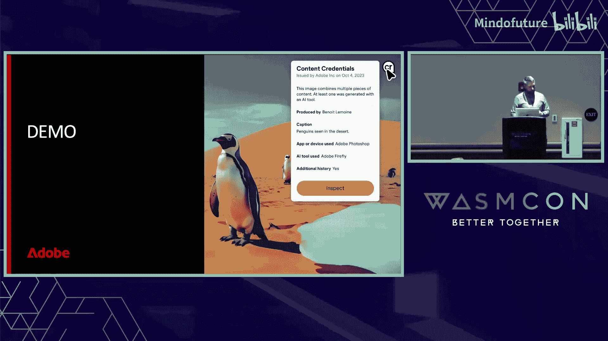

And we have eight minutes if anybody is any questions。And you can try it。 why don't you try to， Oh。

 did I。You guys saw the website， right？When I was sharing。You saw it。

 I wasn't just clicking on my own， okay， good。All right， yeah， so India yeah。

 why don't you guys try it and break akamai for us。And generate some bugs。嗯。Yes。あ、さ。Authenticity。

 yes， the team I joined a month ago and is， and I'm going to now be on YouTube has my wrong answers。

 But yeah， okay。Providance。差不多是。大ベす。Oh， how does no， this is local to the asset。Yeah。

Would be able to。something that would be able to detect change。 Okay， so that's yeah。

 that's different， that's a different part of content authenticity that if you watch Adobe Max。

They will tell you can pull up Adobe Max They talked about that other side of things where like， hey。

 does this look like something that you have a database of。

 But that's not what this is And I I'm not qualified to talk about that。 But yeah。

 point you to Adobe Max。Please wait for the mic。Get time。Yeah。

 question on the component diagram that we were looking at earlier。

 like so it had like the ad servers and wasn't cloud。 and it had the database in the weather API， so。

Oh， look the website， the page I just switched from， Oh no， it' like the component diagram。

 I guess in one of the slides， the component diagram。Okay， theres a diagram。 this one。 Yeah。

 that one。 So okay， am I correct in assuming that Wam cloud is running on the E service or Yeah。

 that's， that's what we're doing here。 Yeah， yeah。 So I mean， that seems yeah， so。😊，Yeah。😊。

Yeah in this particular example you have the first edge server just doing the enrichment of the request for you and then Wasm cloud is distributed on the layer that's marked in green so there's a lot to edge compute and just CDNs in general and does's walking you through those different parts and how they interact with Web assemblymb module WaM cloud。

In on the CDN， there's actually a lot to it。A lot to this demo in terms of cN stuff and to elaboratelaborating your question。

 you may be asking yourself like wouldn't it be obvious to run Web assemblymbly at the initial edge server too you have different cloud providers that some of them provide this capability。

 we're looking into this type of evolution we see very good prospects again given how lightweight web assemblyly is being able to run it and how secure by default model so it lends itself well to this first processing of of this tiered of this layers of delivery network。

 if you will， while we don't have this capability running specifically in web assemblyly today。

 we're looking into ways of making this happen and to be the true value of architecture or this model is you can have web assemblyly code running in any of these tiers you know I think I like hearing earlier today that。

Webassembly escape the browser but it can also run in the browser right so imagine that you can write your own component and how you can run a piece of it or a version of it in the browser。

 you can run it in this outer edge， the first one that you do your client interact with is a more centralized edge that has more resources。

 more dependencies and even your core locations or then you have all your data there， you have GPUs。

 you have harder specific resources so to me Web assemblymbly is really it is evolution that will let developers reason about their application to business logic once and then identify bits and pieces of it that can be deployed and install in dislocation。

Does does that help。 Yeah， that does I was curious maybe follow of question because like is it wasn't currently deployed in all of Aka service because not。

 not on all of， this particular case is I chose three locations of our general offering to run the service。

 so， so what we did here can be run onkaai today。O。YeahGo it in for you guys。 I remember there。 Yeah。

 so this is a thing。 So we ran Waom cloud。 So actually， so in AWS， it's running on E S Fargate。😊。

Theret clouds running on E S Fargate， I end then in。

Akaai is running on Kubernetes in your environment that is One of thems running in Kubernetes。

 One is not。Alright， so we theres a lot to this service。 But yeah， this is， sorry， this is the thing。

 this is the takeaway is that you what wast what we couldn't do before and now we can do， right。

 It's a big， it's a big jump。Before you could not do this on Cdns。

 And now you can run this kind of thing on Cdns。And have it connect in with your data centers without sharing credentials。

 it's just a direct connection through NAts。On the Watson cloud La between your different locations。

 So I that that's。The problem is I've given this talk a few different times。 And like for myself。

 it's not new anymore， but it's a big deal。It's not possible before。All right。Co。

The educations running。So'm sorry， right？Your authentic or any image Yeah where actually the authentic is running is in the browser。

 No， it's it's running on the edge。It's running an edge compute。

 Akamai has many different locations in which they have compute of different tiers that dug laid out。

 and you can run things here。So that's where it's happening。 Like everything's happening there。

 It's all serverside。 even though it uses Webassely。

 it's running a serverside web So Webassembly and。And even though it's localized to you。

 it's localized to you on the server side。So follow up。

 so you are actually authentic the result of the edge。W are you receiving from the edge。Yep， yeah。

 all the processing happening in the YouTube mean obviously。

 there's a part of this is in the browser。 I mean， it's pulling in a web page that's feeding it static assets and an image。

 but that's all server side。 it's not client code that's doing anything other than。

Receiving the image， you know。Yeah。

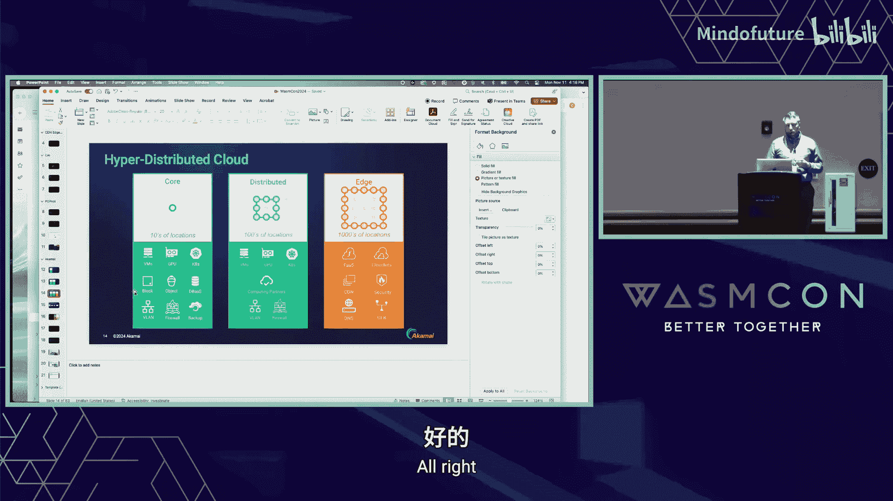

Right。So go down in history， this is a big deal， okay， thanks。

