# WasmCon-2024-p14-P14-Protecting-Wasm-Workloads-with-Confidential-Computing-and-TEE...-Drasko-Dras--BV18DjSzJE6r_p14-

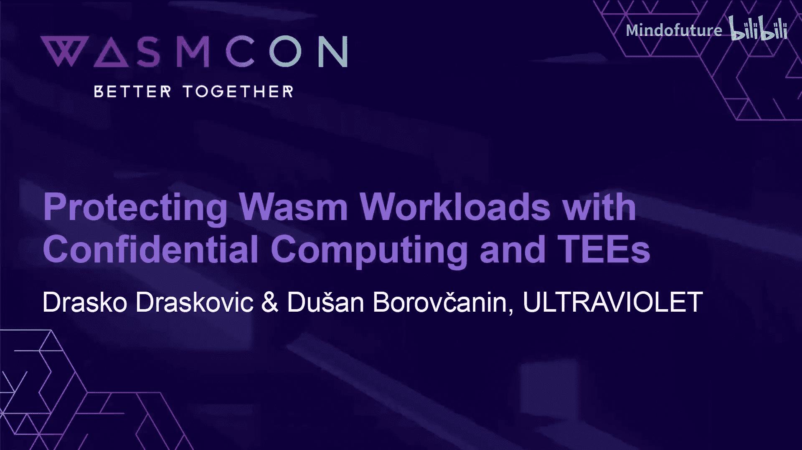

Yes， hello。So let's start with this talk that is called protecting Wa workloads with confidential computing and Ts。

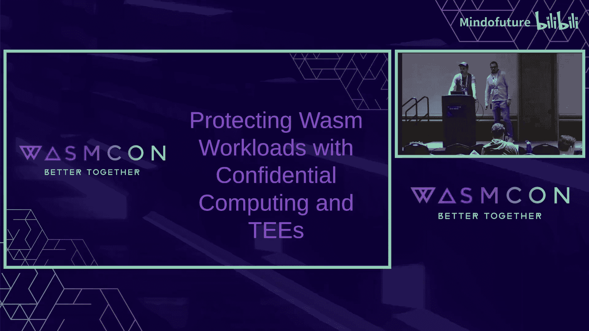

So my name is Da Koarko， which I'm a CEO of a company from Paris that is called abstract machinesch that is doing a lot of research in the domain of FiotT and also confidential computing。

 cybersecurity。And I'm doing this talk together with Duchen Boochni。

 who is a city of company called Utraviolet from Belgrade Serbia， so in Europe as well。

And Ultraviolet is one of the key European players when it comes to confidential computing。

 a member of confidential computing Consortium within Linux Foundation。

 And they are doing a lot of work there。So the agenda for this talk。

 what we want to present today is basically how do we protect a wasn based workloads with confidential computing。

 and we want to look at it， especially from the aspect of AI or some more complex algorithms。

We'll talk about also one of the solutions that we are developing and adapted for one EUu project that I will mention。

 then we'll talk about what kind of was and workloads we are using for our AI algorithms and then Du will do the demo which I think you will be very interesting。

 So let's first do a first very lightweight introduction into confidential computing I try to go very fast through those slides So I don't know from the audience how much of you have been maybe exposed to already to confidential computing there is you know like teas and if you have been using it if not so many then then I'll spend some time in explaining the problem that industry is facing and that is practically protecting data in use So the protecting data in transit is a solved problem protecting。

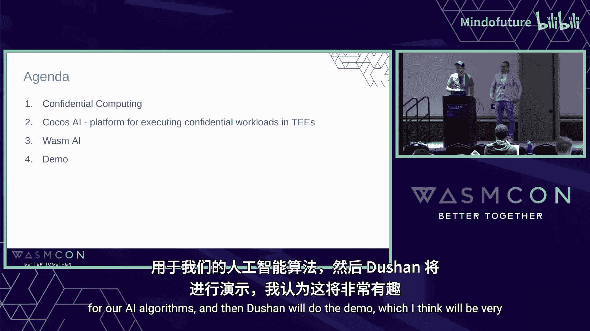

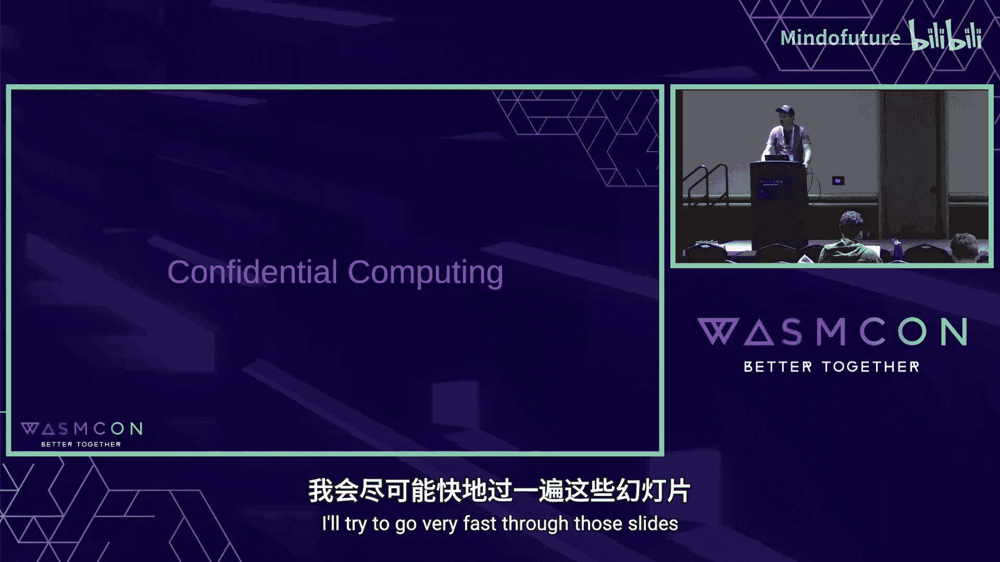

Data in addressed is also， you know， we can encrypt the data on disk。

 but when the CPU needs to use the actual data， it needs to read it from the ramen in the clear text。

 So the data is not protected at that moment。 anybody can dump the the ra and get the confidential data。

There are many ways to not many， but there are few technologies developing in order to prevent this from happening order to find a solution for this problem and one of them very popular is purely cryptographic approach。

 a method that is called fully homomorphic encryption that's been developed from been practically discover or confirmed in 2009。

 so it's relatively recent but very challenging cryptographic technology it has some drawbacks and one of the drawbacks that it's still very inefficient for considerable workloads like for AIML algorithms。

And another promising technology is called confidential computing， and it's hardware based。

 So this solution is based on the CPU extensions that now all modern vendors are providing Intel。

 with S G X or TD X， extensions， AM M D with S EV SM。

Arm as well with arm confidential computing architecture。 There are implementation on risk5 as well。

 a keystone and cove a new proposal for this architecture and so on。

 it is a promising technology in the sense that the Ram the the Ram between the VM that is a confidential VM and I mean。

 between CPU and Ram。 there is a cryptographic process that is happening on the fly。

 And so basically the portion of Ram that the VM is taking is always encrypted。In that sense。

 we can imagine that we can do a centralized， let's say machine learning where we can bring the data and the model。

 let's say for the inference within the trusted execution environment or that VM that is that has its ra encrypted or we can even do the decentralized federated machine learning and very different scenarios。

 However， you know those Ts， typically today they act as a bare metal VMs。

 And so basically that means that you don't have an underlying operating system。

 you don't have a hardware abstraction layer and this is what makes things difficult。

In order to provide this higher abstraction layer， typically you would put some kind of， let's say。

 Linux operating system。But the problem is also that you want to keep so called trusted compute base very small。

 And then。The it it is really a question what， what is the minimal， let's say。

 runtime that that can be provided there and have a reliable。Polyglot applications。 and this is。

 of course， you are recognizing a good opportunity for web assembly。

So I will also tell you something about the Elastic AO project and it is a project that is looking for solutions for these kind of problems。

 It is a large scale EU project over with 13 organizations that are that are some of them are big corporations like Erickson or Telephononica。

 some of them are research institutes universities as well as startups。

 it has a reasonably big budget of 5 million euros and it's a three year research project。

In this project， we are really focusing on， on researching。

The orchestration of Web assembly functions。 So function as a service with with the new 6G telecom infrastructures。

But also， we are very interested in confidential computing and including the confidential computing nodes within that orchestration。

😊，So as Elastic project researches for the options or the good solutions that can solve the problem of enablers for the confidential computing。

 one that is very well established， but unfortunately，As an open source， not in a perfect state。

 it is donated to the Linux Foundation， and it's called Narchs。

 and Narchs is really oriented towards Wasm and running wasnm within trusted execution environments and especially deploying those VMs。

 which is not trivial task to do， especially when you take into account that those VMs must be atest and there is a process that must happen。

 So its hardware based at the station So they must be properly set up and runtime within the so wasn runtime within the these VM must provide sufficient。

Caappabilities。To run different types of services to。

 to have a networking enabled eventually a file system as well and so on。

 So Narchx is one extremely interesting project that is today within confidential computing Consortium within Linux Foundation and an object of research of Elastic project as well。

😊，The other solution that we are developing and and researching。 It's called Coco AI。

 It is a platform that is built by ultraltraviolet and is something that Duhanville demo。The Coco AI。

 on the other hand， is focused more on a multiparty computation。

 a secure multiparty computation where multiple parties do not trust each other so that you have an algorithm provider and date potentially multiple data providers that can combine data sets。

 and then the secure enclaves for trusted execution environments look like a very good candidate。

EThat can provide absolute confidentiality where this data exchange can happen and where algorithms can be applied without actually revealing data to any of the other parties。

So Cocoa AI is trying to solve a bit different problem， but it nevertheless。

 in order to solve this problem， must provide the runtime and hardware abstraction layer。And today。

 Cocous AI is providing multiple runtime， some being a pure Python interpreter that can run。

 of course， AIMl workloads， Docker Linux bin， but also runtime through wasn't time or whatever other runtime you pick because it building on the top of the minimal Linux distribution。

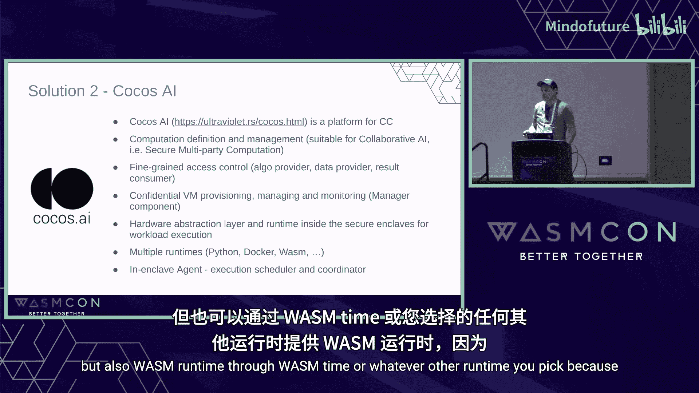

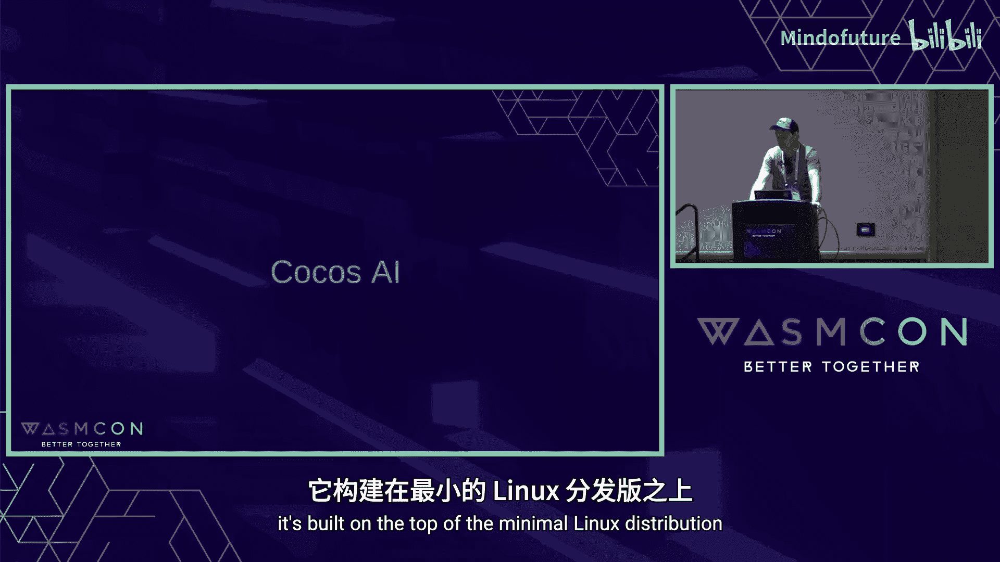

So I will very quickly go through this P say architecture of Cocoia so that you can understand the demo itself。

But as I mentioned， there are multiple， typically in let's say。

 there can be multiple hospitals which need to exchange very confidential data and AI company that can provide the algorithm。

 And so then the confidential VM or the trusted execution environment can be a place in which they can upload the data and the algorithm。

 the algorithm can be executed， and only the result， let's say。

 the inference result or the model after the training can be returned to whoever is the designated to be a result consumer。

In order to achieve this， we need to have some kind of way to spin up the trusted execution environment because it is in the essence。

 virtual machine， there needs to be some kind of VM manager right。

 but the one that is capable of spinning that certain type of virtual machine that is confidential virtual machine。

Within the confidential virtual machine now， because it's really a sealed box where nobody cannot access to it。

 but can only upload the data eventually through the TL S connection。

 we need to have not only the hardware abstraction layer。

But we need also to have some kind of agent that would coordinate this multipart。

 secure multiparty execution and accept different workloads sorry。

 different data sets and the algorithms and， and kind of have a state machine so that it can start the executions once all the different。

 let's say hospitals uploaded， their data sets。So。The， the， the， I quickly mentioned， you know， the。

 the manager itself。 So it。It is you need to build some logic into it so that it knows which kind of secure virtual machines to deploy。

 and then this is architecture dependent because you can have AMD。

 which has CVS& technology or Intel that has TD X and so on So manager is also capable of abstracting different architectures。

 The agent， as I mentioned， is there to serve as some kind of coordinator so that you can upload different data sets and the algorithm。

 of course， and then。Be capable to start the execution。 But one of the key。

Topics of the confidential computing is so-called remote attestation。

 So remote attestations are done by hardware。 they are the measurements are done by by by the trusted execution environment or by the CPU extension itself。

 and then the measurement of the whole let's say boot process of the VM is provided as an attestation report or measurement to the verifier who can then contact the different types of endorses。

 depending on the architecture and the vendor that is providing the verification of the measurement and then really be sure that there is this type of VM。

 a confidential VM that is running only this type of a software system within the enclave and then that we can be assured that we are ready to upload the。

Or to upload the algorithm only after the attestation is done and verified。

So the agent that I mentioned must also have and has logic of doing those remote attestations and in the particular case of Coco AI de attestation is built into the process of establishing the TLS connection So within a TlS handshake and is standardized by ETF so-called Ros group。

 remote attestation groups for the standardization of this of this technology and it's something that is called a testt TLS。

SoIt's very new standard that is still in development。 so as I mentioned。

 there are multiple support for different workloads。

 but we will focus today on WasSM and in order for us to test and make a proof of concept and develop further we need to find some good library on the top of which we will build those algorithms in rust and one of the best we found out there is called burn AI and it is somewhat comparable to Pythtororch or other interesting libraries it supports both CPU and GPU so GPU support is interesting from the perspective of confidential computing because in itself now GPUs have a very similar problem is that the calculations done in the GPUs themselves must be also done in encrypted portion of RAM so they need to have the same。

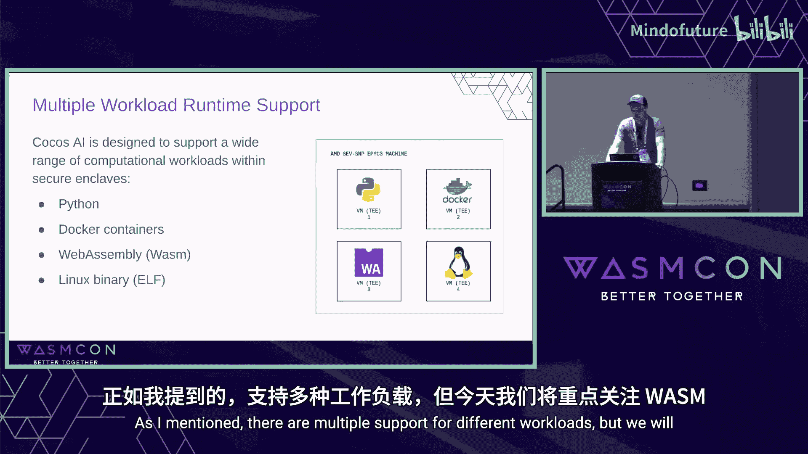

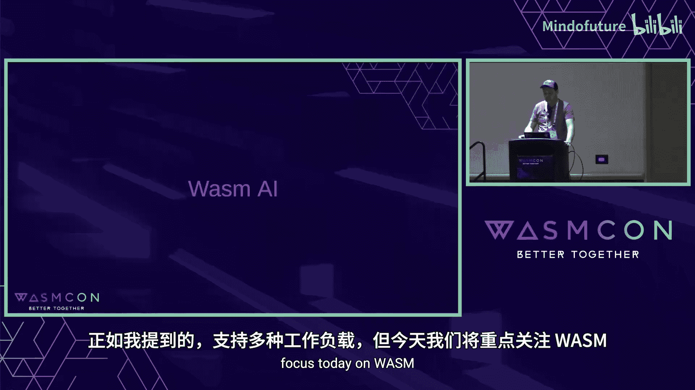

Ca， only few GPUs on the market have these capabilities。 today。 one of them is very hard to get。

So it'ss very difficult to develop further and to test these， these capabilities， but basically。

We use this library， and then you will find a lot of examples that are built with this in order to test the the confidential computing in the ultraviolet repo。

 And there there are blog posts that that that that have been published that will explain basically what you are seeing in the demo。

 And now it's demo time and Duhan will show you how this all works with the confidential VMs。

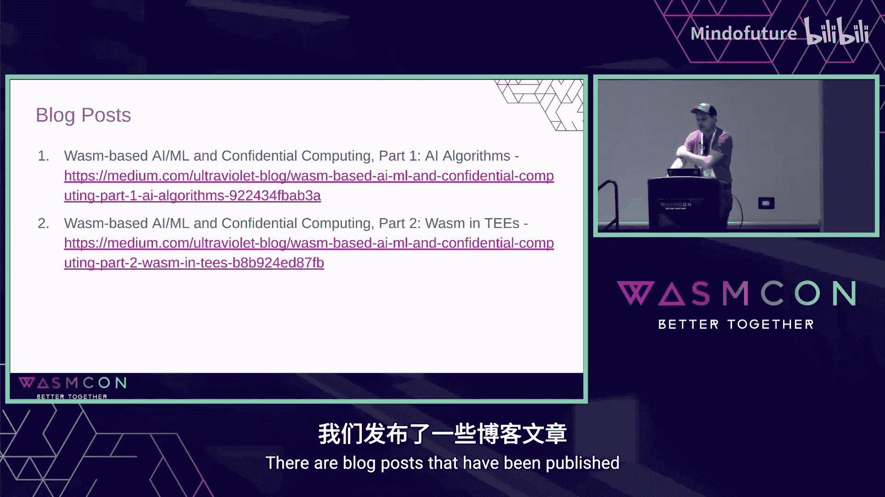

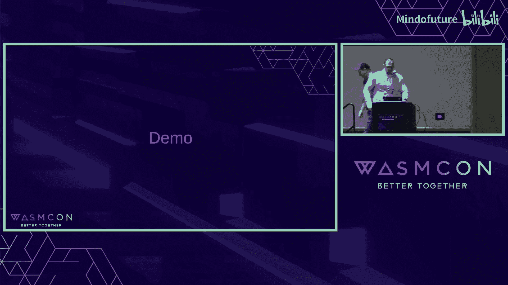

Thank you， Dshko。Okay， so first。

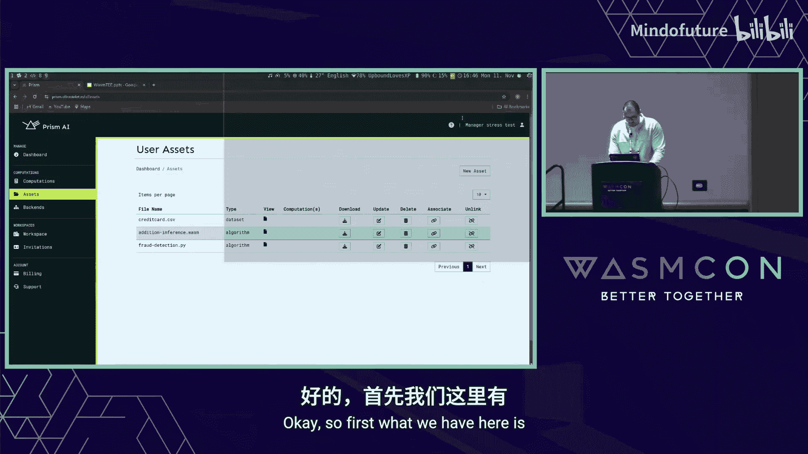

What we have here is。I will show you the N data set， optical character recognition。

 I know it's not so inspiring example of the machine learning， but it's very good for the demo。

 so what we did we use this burn library to train the model， I will not train the model now。

 this is just how how it looks like I have already prepared the model and then we have built we have built the inference version of it。

呃。So what I did here is I actually prepared a version of Was binary that will do the inference using this model that has been trained using Burn Library。

I have also prepared the data， so we will be doing doing it on this particular particular image so this is number four。

 and I need to prepare also， I have prepared that particular test data so that it is practically converted to by array。

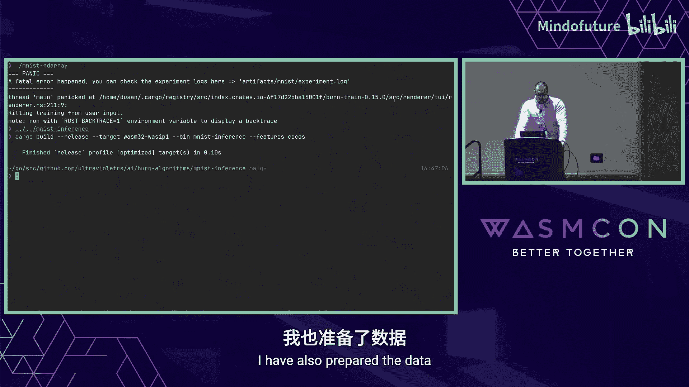

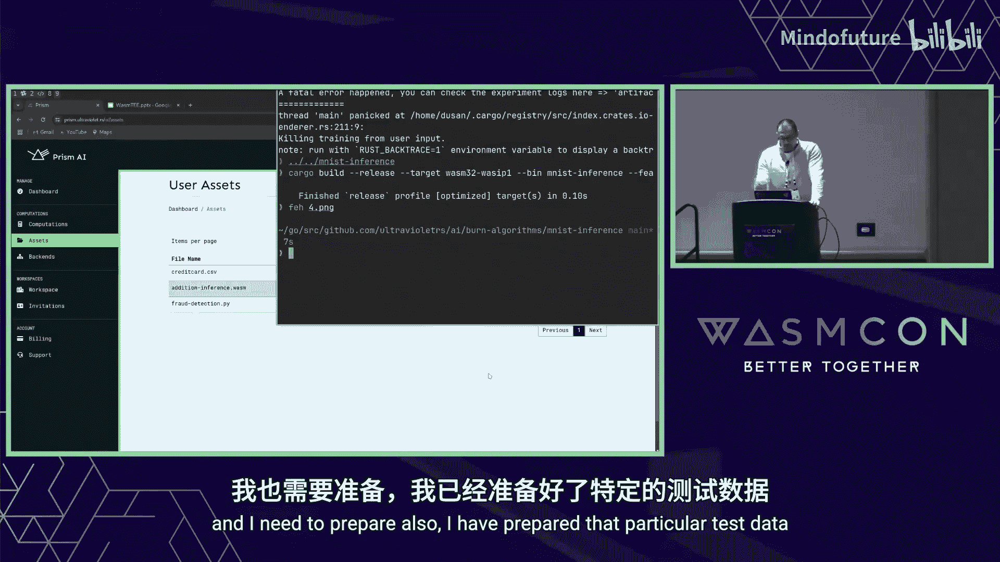

Nothing nothing spectacular。 And it is just as suitable for the as the input for， for this。

For this demo so for this algorithm so this is what we call PriM AI which is practically cloud services built around cocos。

 coco AI that provides some additional some additional functionalities I will now create first asset and the assets are actually two things it's either it's either algorithm or a data set and since we are working with wasm binary was an algorithm I create an algorithm。

 this is just the file name is actually important because that will be the file that our agent mentioned in the previous slides Josh mentioned that is running inside and is practically controlling what's happening in insiderus execution environment or rather in this operating system that we have created in Linux minimal Linux distribution that we are using will execute。

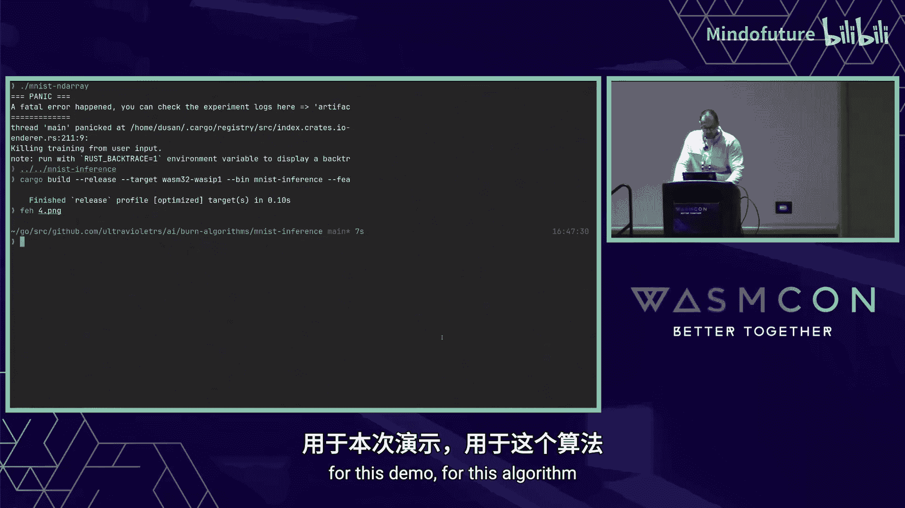

So the file name is also important， and then there is a checkun that I need to。Calculate。So。

The checkon is used to verify， to verify if the the actual uploaded， uploaded algorithm is。

Validd  one。 So now I have created the asset， and I need to create the。Computation， next。

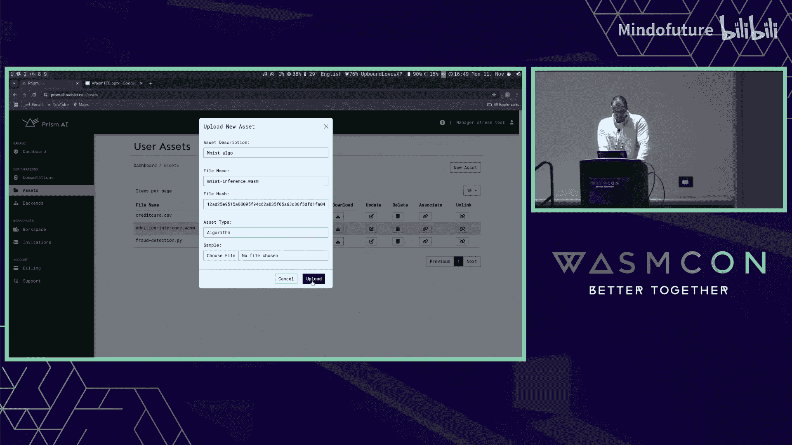

Okay。

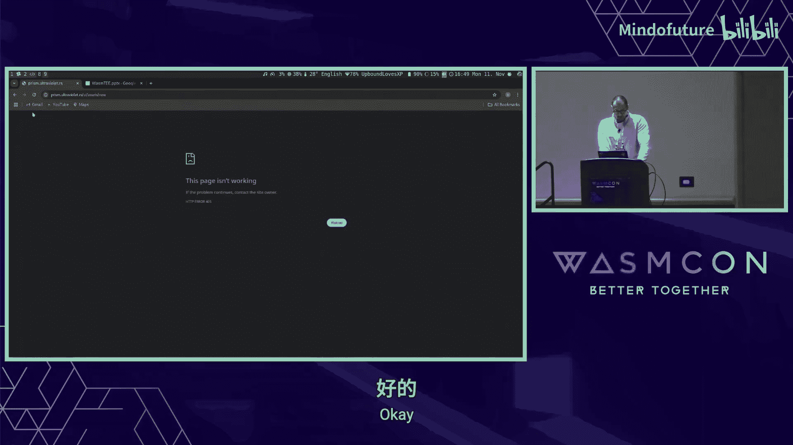

Let's try again。This happens in live demos。Okay， I have created the asset。I have actually two。

 but either， either one will work because for as long as the checks sum is valid。

 it it should be should be good。 So now I will create new computation。

 Computation is actually specification of the workload that will happen inside the。

 So this is just the the metadata that are related to the workload we are going to， to provide。

 So I will create。Let's it。demomo。We will not have any dataset providers because this will be only protecting the Was workload。

 so we don't need any data sets in general， this is a collaborative platform so that you can have different data and algorithm providers and even result consumers and those different parties will come together and provide relevant materials in order to have the computation。

To to create a final result and then the result consumer or consumers will be able to fetch those results。

 which usually usually are either results of the which well have here。

 results of the inference or results of the training， really the model， so I will be the algorithm。

Provider。And I will be resolved consumer。Now， we get to choose the backend。 Backend is。

Backck in this actually the physical machine with trusted execution environments enabled and our manager component running game。

 this is the real physical machine in our private data center that has this setup and so I have created a computation now I will have to link let me just double check which one。

This will work。I have the link to。

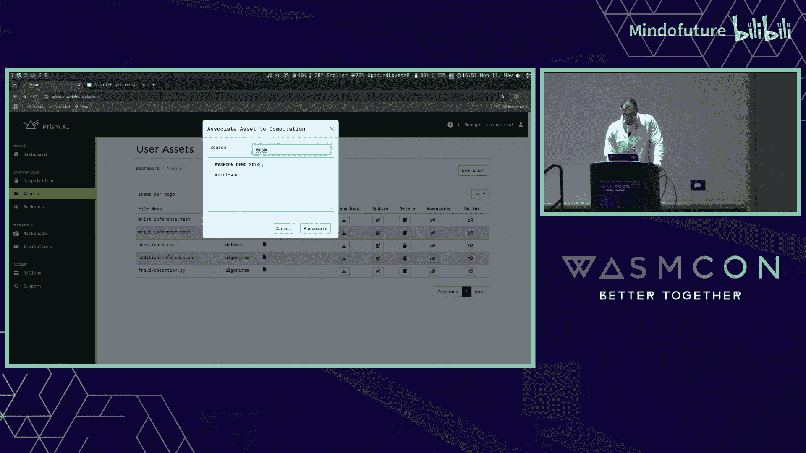

Assoiate practically created the algorithm to the computation you can see here that I need to provide my public key so first。

 in order to later access the agent that is running insiderus execution environment。

 I need to upload my public key in order to establish mutual TlS with the server agent server that is running in in T and I can do that by creating keys。

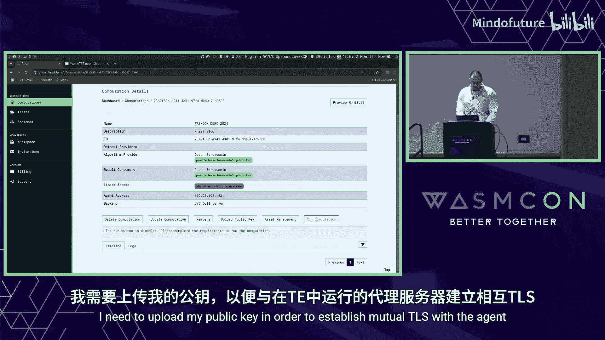

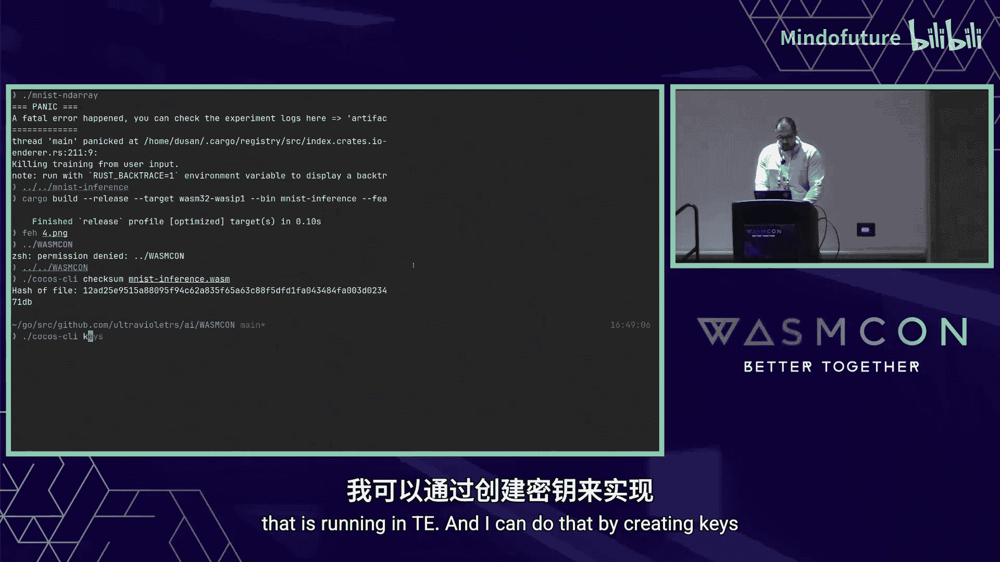

With our CI tool。 And then。I will need to upload them。

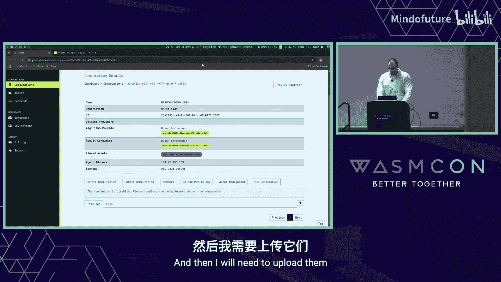

Well， to upload public key。

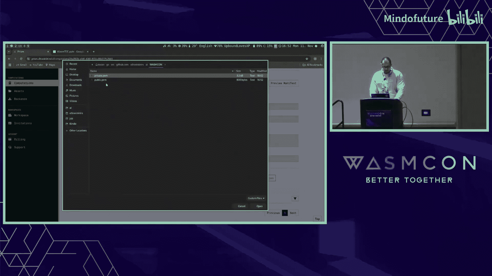

And once that's done， my computation will be ready to run。So when I click on the run。

 what will happen is the our cloud components that you you are seeing here will start。

 we'll communicate to this manager component and upload the manifest。

 the computation manifest that will that will that has this algorithm in it and also has the my public key so that I can establish the connection to it and has me as a result consumer and algorithm provider so that I can upload the upload the algorithm and also later receive the receive the results。

 And when uploading the algorithm， I will need to specify that the algorithm is actually wasm so because we have a different different run times。

 you get to specify which algorithm you get to specify your private key because to establish the connection and you get to。

To specify the data that you are sending as the arguments。

 so you can see here that we are uploading algorithm that is this one inferenceist。

 then we have this private key that I have just generated。

 it wasn't workload and this is now uploading the algorithm virtual machine provision we are already because this is a very quick inference the results are already prepared and I will now consume results。

And once results are consumed， we have this agent a state machine。

 so it says that computation is complete because there is only one result consumer mean and I have already consumed a result。

 so now I can stop the computation。Bear in mind that stopping computation actually kills the virtual machine and removes because virtual machine in virtual machine everything is we have a file system。

 but it is inran file system。 and since Rammy is encrypted everything that's happening inside is encrypted and also since we have this mutual TlS and this policy that is bound to computation manifest we have safely and only I could could actually upload the data set and only I could consume not data。

 but the algorithm and only I could consumer results because I was the only only one who uploaded my public key and then I can results。

 and。

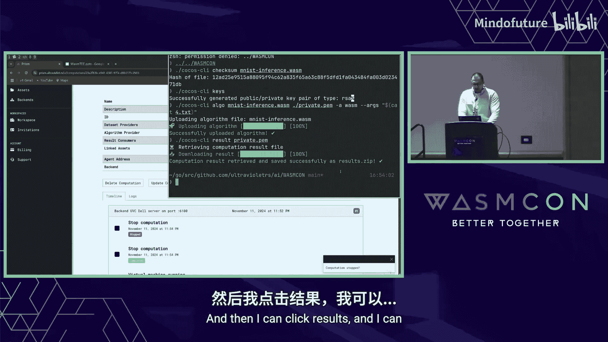

I can。And we can see that it is indeed number four， so this is the result of the evaluation。

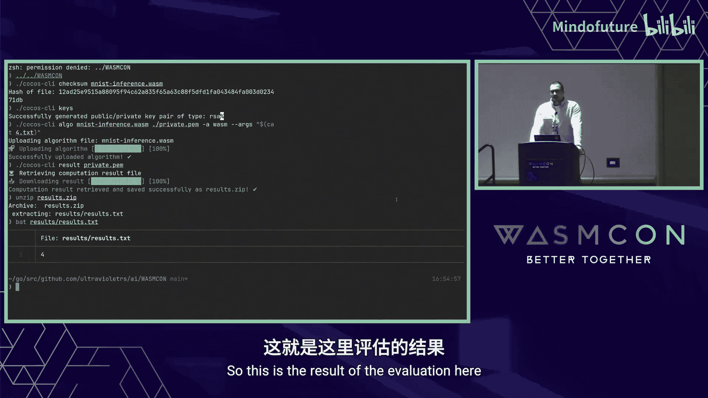

Here， so yeah， this is the demo and now we will go through next steps related to both Coco AI。

 but also the whole problem of running wasn't runtime since Srus execution environment。

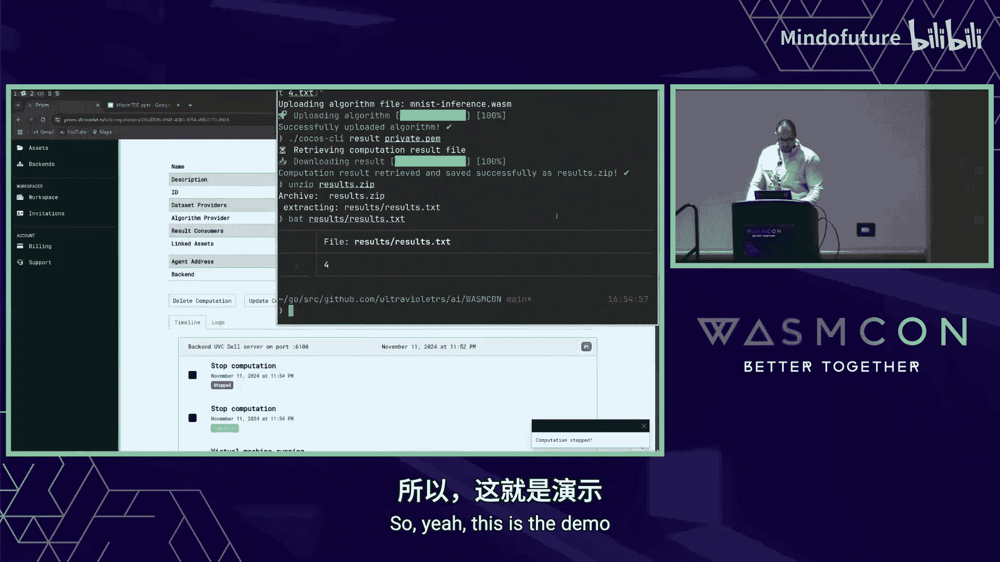

Yes， thanks。 do some。Deも。呃。The future work。The project。The research that we are doing。

Is really looking forward to enabling more the Narchs and especially the micro kernelnel that is actually sitting below the ciscos and actually doing a proxy of those cisco between WasM runtime and the Linux operating system then we want also to research other potentially Uni kernel approach with some other Uni kernels like Hermit corere or using Uniiccraft to build a Linux Uni kernels or even inspecting SCL4 micro kernels。

 the elastic project researches the orchestration over IoT devices。

 So Zphyer Rt is also potential higher abstraction layer there that can run at leastwamer or some other Wasm runtime。

Then the orchestrator is really big question big research topic because we need now not only the orchestrator that can orchestrate the wasm workloads over standard nodes。

 but we need to take into account the trusted execution environments。 and they， as you saw。

 demand the attestation So the attestation procedure gets into the problem of the orchestration。

 So the orchestrator must be built in that way。 And finally， you know。

 maybe we can re use the work done within CNNCF on the confidential containers and use Wasm instead of docker over there。

And finally， as I mentioned， Rik5 is very interesting architecture to us。

 especially when it comes to the IoT space， and we want to work on supporting this better and especially running confidential computing and bo inside confidential enclaves on a riskk5。

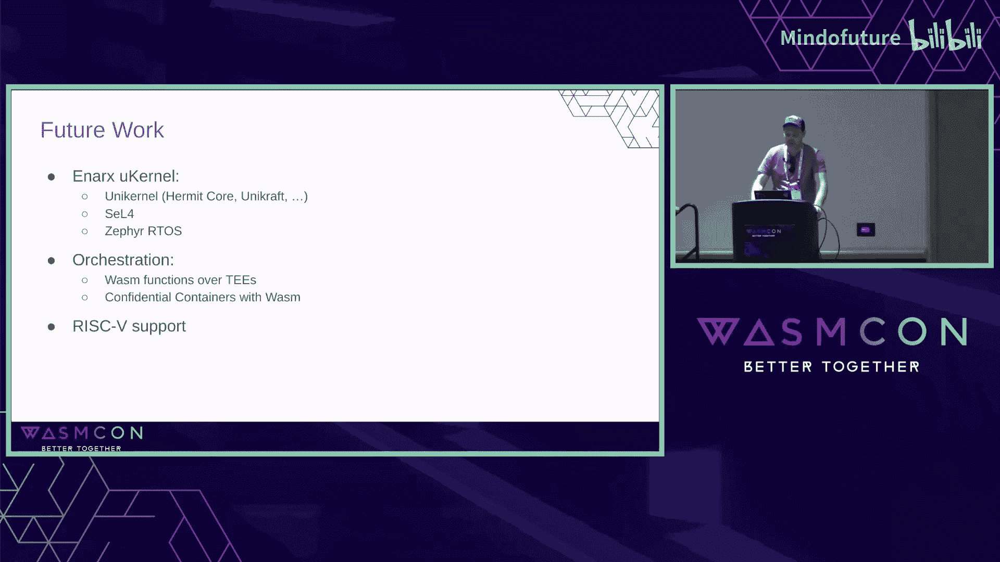

And this concludes the talk that we had so we can take a few questions if there is still some time。

Thanks。Thank you。都关系。There are no questions， then。I guess it's。End of the talk。

 maybe just to mention since we didn't sit it in the demo。

 but very relevant and very important part here are these mentioned attestations and each time you you establish the connection with trusted the execution environment actually what happens is alongside with this mutual Tls that is like a standard we do also this attestation remote attestation includes many steps and it's a topic in itself so we will not get into details but it is practically the verification that given software is running on the given hardware and you can trust it and there comes to play this particular our Dell machine our。

Private， private instance。 So you need to have the hardware that that。

Supports trusted execution environments in such a way that you can do these attistications。

 Now currently there are only only well， the most popular is this MDSV&。

 but there is also the Intel TDx。 and hopefully there will be more and also hopefully there will be more on the consumer grid。

 this is all server CPUs and when it comes to running specific Qua runtime。

 it's very simple and easy to change Wam runtime in our what we call hardware abstract layer in our Linux distribution currently we are running I think QuaS match。

 but it can be any So yeah that's also very very important part particularly related to des and running workloads and Ts。

I just wanted to add that because we had time。Great， thanks。 then thanks， everybody。 Thank you。

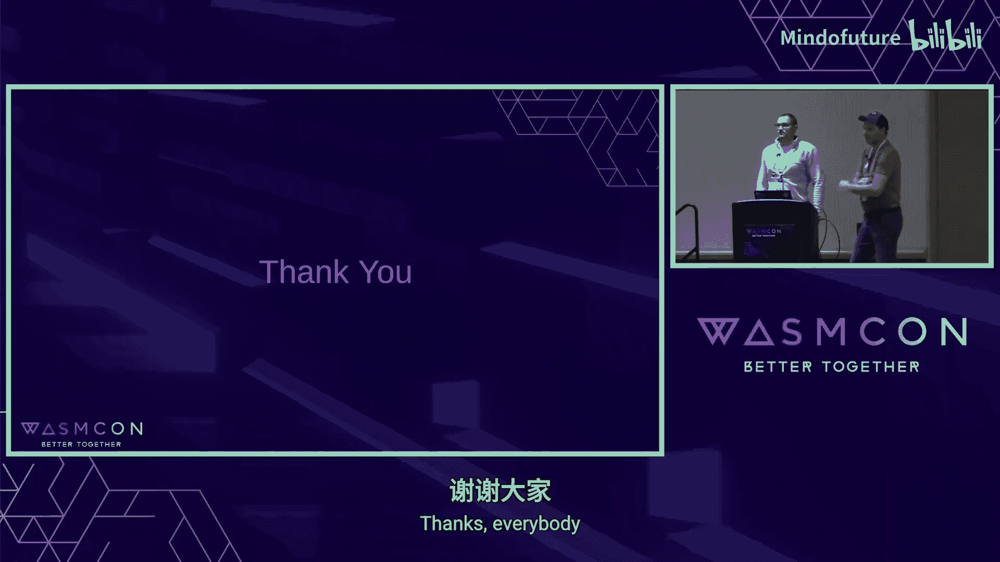