# WasmCon-2024-p15-P15-A-Walking-Tour-of-Wasm-Tools---Alex-Crichton,-Fermyon--BV18DjSzJE6r_p15-

I think it's about time。 So I'm gonna go ahead and get started。 So hello， everyone。 My name is Alex。

 And I'm gonna give you a walking tour of Wm tools。 Sorry。

 that was the bestiteration I I could come up with。 So first off， what in the world is Wm tools。

 This is a C I and a suite of lowle libraries for manipulation of Wm modules。

 This is a open source repository in the bikecode All。

 we accept many contributions to anyone who's interested in adding various subcoms of things。

 And the idea here is that there is a lot of functionality baked into a single command called Wm tools that has lots of subcoms internally to explore a Wm module and see some functionality within that。

😊。

This is very similar to other projects， such as Wbbit or the Wm binary toolkit or binaryararian。

 not the compilation side of binaryararian， but more of the tooling and converting between text and things like that。

The major part of Wam tools as well， is that this is the underpinnings of the Wasm time runtime itself。

 So the binary decoder， the binary translation， binary reading， a lot of testing。

 I'll be going over a lot of those in this talk and giving you a demo of how all this is working。

 But so the intention here is that all this is intended to be used in Wasm time and theory production ready in that regard as well。

😊，So this is gonna come to the other walking part where I'm gonna do。

 a little less walking a little more typing。 So Is show everyone my typing prowe here in a browser or a terminal。

 Alright， so let's say we want to explore a wm file。 So first off。

 we're gonna start with some rest code。 So we have thisrus code and we want to compile it to Wm。

 So'll say hello do。 target for wm through2 Wy P1。 if I can type it correctly。

 This pops out a hello do wm as you might expect， we can run a runtime like wm time and it prints out the message that we expect。

 But what we're curious about here is what in the world is inside this is inside this module。

 So some of you might wondering in the world am I doing right here。

 this is the actual contents of this module， although it's binary。 This is not that intelligible。

 This is just a lot of stuff going on there。 we can take a look at the actual hex bys themselves。

 we can see that， we've got some binary bys。 We've also got some askIs。 But again。

 this is the binary format for Webassemb orre not really intended to read this。

 So this is where wm tools comes in。😊。

So we have a suite of subcommands here we can take a look at。

 But let's take a look at this print subcomman and kind of see what's going on there so we can print this。

 this module。😊，That was a lot of text that just flew by the screen all at once。

 So there's a lot going on here。 So let's just redirect this out to a file。

And then we can take a look at the file itself。This is the structure of a Wm module internally。

 which is the actual text form of the binary formats。

 This is all corresponding to those bytes we were seeing。 We see lots of stuff about Wsm here。

 So the text format loves to use parentheses。 We've got Wm things like types， imports， tables。

 globals。 and we've got functions here， instructions。 we can kind of scroll down。

 There's a lot of stuff here in this Wm module。😊，Com down here to the bottom。

 My editor is a little bit slow， but we have all these kind of big binary blobs here going on。

 This is what we were seeing at the end there。 This is the data sections and custom sections。

 And specifically， we've got some debug info here， which was kind of large。 But in any case。

 this is sort of taking a look at the outside of a Wm module。

 looking inside of it and kind of seeing what's internally。

The next thing we can kind of take a look at， though， is perhaps this validates subcommand。

 This is where a random blob of bytes is not necessarily valid wises and binaries。

 You have to actually have a validation predicate on it。So if we took look。

 take a look at Wm tools validate。It has a couple of options。

 but we're mostly just going pass an input and we take a look at some feature flags， for example。

 So if we validate this hello do Wasm， nothing happened。

 But it turns out this if we're gonna run that one more time。 whoop。

 I can't really actually type very well right here。This actually returned to zero return code。

 The lack of output here means that everything passed successfully。

 So what we can do here is we can pass in this features flag because to control some wm features going on here。

 as well as revert this back to the original wm proposal itself from the days of your。

 So here helled wm with the features here。 we can see that this is no longer valid module once we turn off these features。

 So clearly， this module uses some features。 I'm curious as to what。

 let's try and take a look at this。 This is saying this binary offset inside the module。

 But we don't really know exactly where that is。 And so we can use this P or print offsets option of the print subcomd。

 So we can run wm tools is print P of hell wm that produces way too much output。

 So we'll put it in hell one more time。 take a look at that。

 And if we look for three I'm gonna go back up here。 So 3 E something All right。😊。

So this offset 3 E0 is falling in the middle of these two instructions。 Now。

 if you're not familiar with this， this is turning out to be the call indirect instruction actually changed in encodings with the reference types proposal。

 So you can just kind of take me for granted on that。 And I'm gonna pass in reference types here。

So we'll see what pops out next。 So this is saying there's another function that is failing to validate。

 But we can see here we've got a nice foul name here。

 We've got a line number here kind of at the edge with this blown up font and everything。

 But if we take a look at that 70 C 7， we can see sure enough。

 This is the memory do copy instruction from the book memory proposal。

 So we can do this all one more time。 Pass in bulk memory See one more thing in 9 B 43。

 And that is another instruction from the sign extension proposal。

 which was after the original W module itself。 So we can pass in sign extension。

 And we can see here now it has validated successfully， there is no error message。

 And we're going to go。 I this sort of a way it can sort of explore W a modules。

 see what it's using or kind of pinpoint where it's going wrong inside of the module。😊，Now。

 if I can not actually do weird things in this， the next thing I want to take a look at is。

 I was showing you that if we print this module， it's kind of big。

 There's a lot of stuff that just flew by there。So if we take a look at the print subcomd again。

 we can see it's got this skeleton argument， which can kind of help us explore this module at a bit of a higher level。

 Pass that in here。 And we can see that the debug info was replaced by dot dot dot。

 All of these functions are replaced with dot dot dot。

 And we can just sort of scan over and very quickly see what's going on inside of this module。😊。

The first thing we'll see， though， is these function names are kind of gobbledyg。

 not exactly easy to read。 This is the mangled form of a function name。

 as you might expect on native platforms。If we want to get rid of that。 Well。

 it turns out there's a subcomman for that as well。 We have it demanle here。

 So we run wm tools demanle of hello Wasm。 This is gonna try and print a binary file。

 but I'm on a terminal， so that wouldn't work very well。 So I'll request the text format。 And again。

 all this stuff kind of flew through here。 So this shows the next another feature of wm tools we can pipe commands together。

 So I can take the output of this and pipe that back into print with the skeleton argument。

 And by not providing an argument here。 We can sort of see a chain of commands as we're kind of building up this over time。

 So we can see here， we've got our dot dot dots like before。

 And now we've got these nice demangled function names that are much prettier。

 We've got these less thans， it kind of looks a little bit more like native rust in this regard。😊。

Now， so the next thing I want to show you is if we take a look at this actual file itself。

 That's pretty big。 That's a 1。7 MB module for hellello world。

 That's a lot larger than kind of the the very small modules you were just seeing in the embeddedbe talk just before this。

 So， for example， let's try and explore， why is this so big。😊，So taking a look at Wm tools。

 we have this ob dumpump subcomman， which is sort of a poor man's version of the native version of Obdump。

 But what if we try and run that。Pas an ob dump with Hello Dawasm。

We can see that it's it's telling us the sections of this Wm module where they are in the Wm binary。

 how big they are and how many items are found inside there。 So this， for example。

 has 181 functions inside this module。So looking at this column over here。

 we can clearly see that debug info is the problem here。 This was I compiled without optimizations。

 This was not stripped out。So I wonder if we can actually just strip this out。

 So we have a Wam tools strip sub commandd。And this takes the Wassm file is input with a couple of various options。

 Let's just take a look at the stripped output of hello dowasm。

 And we can do our piping again to take a look at the object dump of it。

 And we can see that the data the debu of sections are all gone now。

 We do see that the custom section name is still there。

 so we can actually request that all custom sections are deleted。

 And this would actually remove everything。 And if we actually take a look at the size of this。

 that is 54 k， which is much， much smaller than the 1。7 MB we started with。😊。

We can also do things like we can。 if we take a look at this。 We can pass a particular rex。

 So we can say if we only want to delete the debug info sections。

 we can kind of type out the various syntax for debug info name。

 We can pipe that back into W and tools， Ob dump。 And we can see that our custom sections。

 such as name producers and target features were preserved。 But the debug info is now all gone。😊。

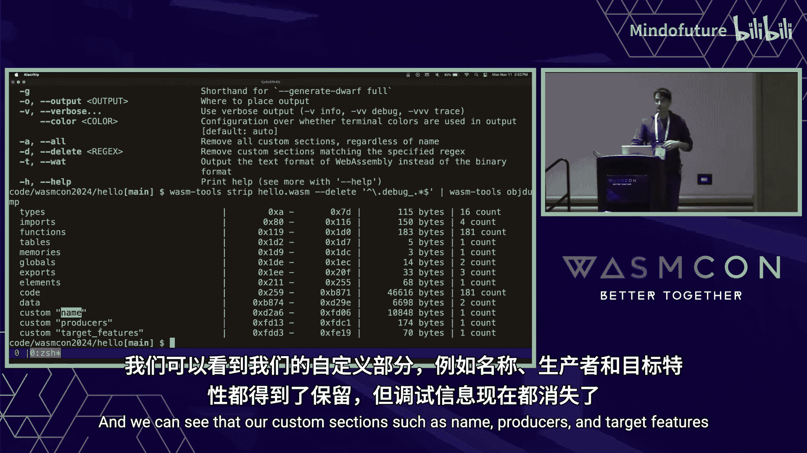

So this is sort of the basics of working with hellello of working with Wam tools。 Oh。

 I could walk now。So as we saw here， there are many， many subcommands inside of Wam tools。

 We can explore them with the dash H。 We can explore them within each subcom itself。

And all of these subcomds are kind of taking Wm， outputting Wasm。

 And they have the option of either working with text or binary。

 You can kind of redirect the output to a file or you get the and standard it out by default。

 This kind of standard out means that we can pipe these commands together。

 We kind of build up these chain of commands locally。

 which is kind of useful when you're kind typing something out。 and you just kind of， oh。

 I want to add this on。 I want to add this on。 You kind want to interactively work with whatever wasm module you're working with。

As we saw， there's a little bit of color， not a huge amount of color。

 but the idea is helping make it as easy as possible to understand。So next。

 now let's work a little bit more with the text format of Webassembly。 We've been seeing a lot of it。

 But I want to actually show a little bit more， Not quite like that。op， here we go。😊。

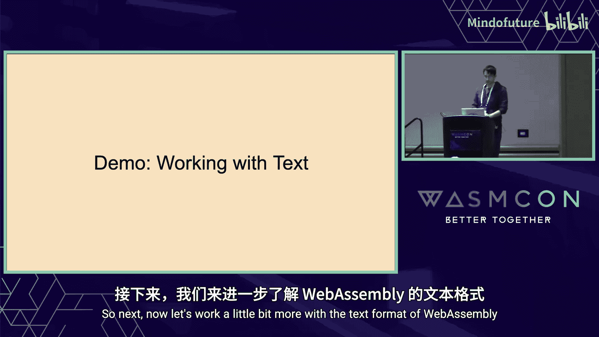

So we'll come over here to the text format。And we have a sample module that I have prepared here。

 So This is a small module。 We got these parentheses。 We got some types in here。

 We're gonna just add two numbers， and return the result here。

So I'll put here that here at the bottom so we can keep it on the screen。

 And the first thing we want to take a look at is converting this to binary。

 This is where this parse subcom comes in。 so we can run Wm tools parse add， and we can put it in Wm。

 So sure enough， that pops out this a Wm file。 We can take a look at it。

 and we can see that it's significantly smaller than the text format。 We can validate。

 and see that it is indeed a valid Wm module。 But this brings us to the next aspect of I've been feeding a lot of Wm binaries to these commands。

 But we can also feed in the text format。 All of these commands are intended to be sort of used locally during development to kind of make it a little bit easier to work with。

 So this will transparently compile the text to binary and then validate that。😊。

This is a bit of a problem， though， Or let's say if we made a mistake。 we try and validate this。

 This says that the offset O X 2，5 is invalid， but that's in the binary。

 which doesn't actually translate back to the original text format itself。So help out with that。

We have this idea of generating dwarf。 So during the process of compiling from the text format to the binary format。

 we can generate dwarf debugging information to point back to the text format and see what pops out。

 So I passing the dash G flag here。 we can see that this error message now has a phone name。

 which is our a dot w。 And it's got a line number， which is line 5。

 So this is the actual offending instruction here。😊，This is a bit of a synthesized function name。

 So we can， for example， put on adder here。 We can get that to show up with adder。

 So it's the same error we were seeing before， but with extra information。

 this is very helpful for sort of exploring large wm files or large text files。

 If you make an error somewhere in the middle of it。Now。

 the next thing I want to show you is another part of a text format called the WS text format。

 So we'll keep quick out of this and we'll take a look at WS。

 This is the upstream text format for tests in the spec repositories for Webassemb。

 So if you're writing a wise and runtime。 if you're writing a tool that processes Wm。

 you will typically want to run against these tests to try and make sure you can process all of those binaries。

 This looks very similar。 But what we can do here is we can say we want to put various assertions inside here。

 So if I invoke the ad function with 32 dot constant 1 and 2。

 then this should produce the result of three。This is the text format where you can just add a bunch of assertions。

 You can define more modules。 You could link things up。

 but this is sort of kind of I'm not gonna go through all the details here。 But if we， for example。

 pass this to Waanttime， which I'm not gonna demo too too much here。

 This didn't actually do a whole lot because it it passed。 But for example。

 if we wrote down the wrong thing， this is gonna to say we expected for。 We got three。

 but this is a bug in the test。 we'll just go fix that here。So what。

 what do we actually have in Wam tools for parsing this。 We have this Json from W subcomd。

 So if you run Wam tools， Json from W of a dot West， this is gonna split spit out a blob of Json。

 I'll make it a little bit pre here， Prettier here so we can actually see what's going on。😊。

And we can see that this is derived from the original ad dot west。 But chiefly。

 this is actually parsing this all for。 This is in a much easier way for tooling to to consume。 So。

 for example， we have this ad dot 0 that Wassm， which was printed out here。 And if we print that。

We can see that we've got our original Wm module。 This is what we were actually looking for here。

 And then if we look elsewhere in the Json， you can see this assert certain return with a one。

 a2 and a3 in all those various aspects。 So this is much easier for your tools to parse with just Json as opposed to dealing with the entire text format of Webassembly and the tests themselves。

😊，And there's one other small piece before I go along。 So I wanted just to point out。

 we've got this ad dot wt。 And so this is， if we actually print ad dot wt， we find something curious。

 which is the top on the bottom， Don't look the same。

This is showing some of the kind of niceties or sort of the sugar that's in the text format。 So。

 for example， this type was implicitly defined by just simply putting the type on the function itself。

 This export was kind of defined in line here。 And we can also go so far as to look at the folded instructions。

 which that means past this。We can actually render the instructions a little bit differently as well。

 So we can have a nice ad instruction here， which which is a little bit easier as for us as humans to read。

 because the operation comes first and the arguments come a little bit later。

 These two modules mean the same thing， but it's kind of depending on how you want to write it。

 It makes it a little bit nicer to， to work with these modules。

 depending on what you're actually working on internally。

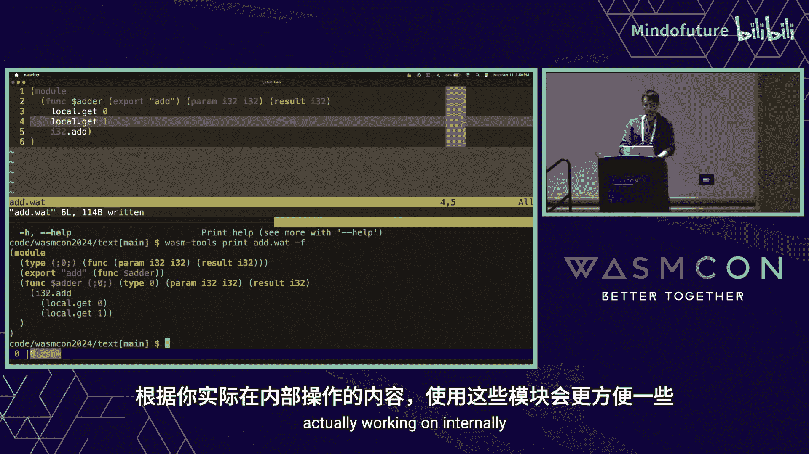

So。That's sort of kind of the summary of working with text and wm tools is that a lot of these subcommans will transparently take both binary and text。

 The text format has a lot of sugar associated with it。

 which makes it a little bit easier to both read and write。

 We can sort of debug with debugging information and dwarf debugging information to kind of see what's going on internally with these large W files as something goes wrong。

 And I definitely want to give a shout out Json from W subcom is very much inspired by wits to json subcom。

 I definitely give a shout out that F Keith here actually implemented that in wm tools recently。

 So many thanks to Keith for implementing all that。

 So this is sort of the basics of working with text and working with both the Wm the Wm binary format or in wm tools itself。

😊，So now I want to show you one of my favorite topics， which is testing Webassembly。

 So let's say you are writing a runtime again。 I realize not necessarily everyone is doing this。

 but I'm a little biased， but you're writing a rewriting or runtime。

 You want to write some test cases。 You want to generate some Wm modules to actually run against your runtime。

 If we take a look at Wm tools。 It has this Smith subcomman。

 which is helpful entitled a Wm test case generator。😊。

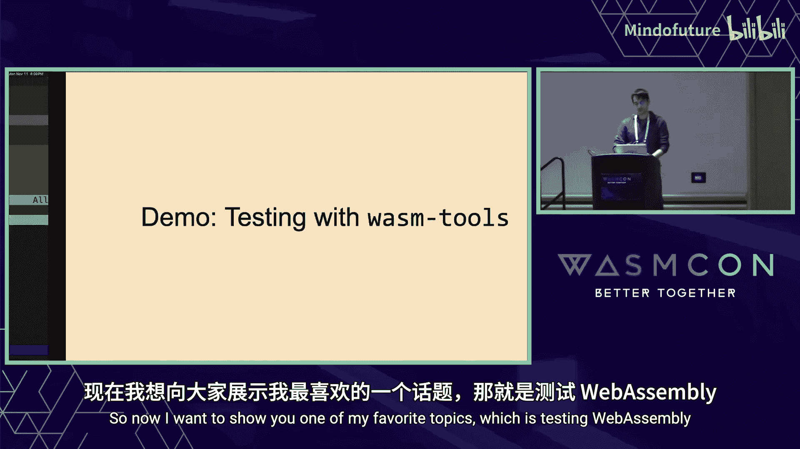

So if we take a look at Smith， This has quite a few options associated with it。

 There's all sorts of ways that we can control and customize the output of the actual module itself。

 But what we're most interested in here is this seed。

 This seed is a sweet just kind of some random input。

 And the idea is that this will deterministically be used to generate a wise module。😊。

So let's try and just run that。 So we run wm time， Wasm tools， Smith。

 I'm just gonna feed it some random module， some random data here。

 So I'll just take  two kB from random。 If I can type you random。 I have a terrible time doing that。

 We're gonna print the binary format。 But on a terminal， we want to see text。

 So I'm just gonna keep running this。 And we can see that every time we're generating a completely different Wm module every single time。

 The interesting part here is that if we try and validate all of this。

 Pi into Wm tools validate All of these are valid Wm modules。

 So all of these are different but specifically valid wasm modules that's sort of the nice property of these generated modules。

So we can sort of customize this as well。 Let's say we want。 let's say one type。

 and let's say five functions。As we run this， we're going get different functions every single time。

 But we're always going to have at least one type at at least five functions。

We can then customize this a little bit。 Let's kind of run this a little bit。 Yeah， there we go。

 We got a Cindy instruction here， but I don't want to actually use Cindy。

 So I'm going turn off Cindy。Oh if I can spell the word false。 and then we we come up here。 we got。

 we got some tail calls， but I don't want tail calls。 Let's turn that off。

So this is showing how we have a lot of control over with the various options here。 We now see。

 for example， a G C proposal so we can turn that off。 We can say G C enabled is false。 again。

 if I can type false。 So we have this all these ways to control how this modules generated。

 We can also do things such as we can limit the entire classes of instructions to， for example。

 just numeric instructions。 This means the functions generated just street line code， lots of numers。

 There's just kind of generating random values， but there's no memory here。 There's no control flow。

 But we can add in control flow。 And this will add in blocks。

 And we got some exception handling tables。 We got some loops。 This is sort of all， again。

 random modules being generated here。😊，One of the most interesting things I want to show you as well is also the idea of allow in functionss。

 I want to turn that on。 So I was showing that Wassman Tool Smith is always generating a valid module。

 But what this is doing is it's taking random data in the input and just putting it in the output function。

 Now， naturally here， we can't even print this because this is no longer a valid Wassm module。

 But this is very useful for testing both the happy path of a valid module and also the invalid path of a completely random module。

😊，So let's actually take this。 I'm not going to do the text format here because I want to output binary。

 And let's put this in outasm。 If we try and validate this， this is probably not going to validate。

 This is a type error。 And as was expected， we just kind of put random data inside of a function。

The problem， though， is， I wanted to explore this a little bit。 So let's take this 7，5，7。

 So'll print a dash P out Wam。 But everything is truncated here。 This actually didn't get very far。

 This actually didn't get into the modules because this is specifically invalid。

So this brings us to another subcomman inside of Wam tools called dump。

 where this is sort of a low level inspection of what's going on inside of a Wm module。

 so we can run wzen tools dump over out dot wm that generates a fair amount of outputs。

 So let's put it out in out dot dump。 Let's take a look at dot dump。

 And then then if we look for our 7，5，7。 I can't type 5。

 apparently we can see here that this function starts with this I 32 do E Z instruction。

 But that is not valid Wm。 This actually needed some inputs。 And again。

 this is just random data as inputs。 But we can see that， for example。

 this is just an invalid output code。 This was just happened to be I 32 reintert F 32。

 And this just happened to be a local set for a local 20。

 So we can sort of use this allow invalid functions to sort of explore the invalid cases。

 and we can also use this dump subcom to kind of take a look at the actual Wm modules themselves。

The next thing I want to show you is the next thing related to testing， which is mutation。

 This is a wm test case mutator。Now， if we take a look at that。

 we can see that it also takes an input。 So let's just pass that back in。 Let's from the text。

 we'll do a dotwam， and we'll just mutate this and get the text。So we can see here。

 this looks like our ad module from before。 but this function type is brand new。

 If I keep running this， it's actually gonna keep generating the same module。

 And that's because it's using the exact same C。 This is just like Was and Smith。

 where the same transformation is always being done。

 So you have to pass in a random C to get something else。 So pass in a random number。

 we can see now we got a custom section this time， nothing was applicable。 This time。

 what did happen。 Oh， we replaced a local with a constant0。 This time。

 I don't actually know what re mutated。 But in any case， every time we we run this。

 we're gonna get slightly different mutations。Now， you might be asking yourself， why is this useful。

 starting from an interesting test case and then kind of mutating it a little bit further to motivate this。

 I want to show a bit of a case study。 So I have here a pretty old version of Wm time。

 This is about two years old at this point。 I also have this test case。

 where if I run Wm time that we we needed a feature at the time。 So Wam features memory 64。

 which I have a tough time typing， This is a bug inside of Wm time。 This is a panic。

 This is a panic inside of Wam times code generator。 So this was a bug that was found by Wm To Smith。

 And now we want to see what is this bug， actually， So let's take a look at it。

 Take a look at test case 0 that Wam。😊，That was a big module。 We got a lot of functions here。

 We got a lot of Sdy here。 We got a lot of big functions here。 We got a whole lot of functions here。

 We have no idea where this bug is。 This is a very large test case。 We take a look at this。

 and this is。3 and3 and a5 kilo。 So this wasm tools shrink subcommand。

 We take a look at it is specifically trying to preserve a property of interest about a Wm module。

 such as in our case， triggering a compiler bug。 This takes a predicate， which is a command。

 which I've already written out here， where it's gonna be the exact same imification we saw previously with the wm time and necessary flags。

 This is the input to the script。 And we're just gonna look for the word panic。

 That's we just want we want to panic here kind see how far this goes。

 So we can run wm tools shrink over test H with test case0 wm。 And we are off to the races。

 internally what's happening here， is this is actually running wm tools mutate and making a small adjustment to the module every single time。

 It's then running our script to see is this still interesting。 And if so。

 it's keeping it if it's smaller。 So we're iteratively shrinking this internally here。

 And we can see that each shrunk version is outputting the smallest version at the end。

So if we take a look at the text format here， we can see we've got a bunch of exports here。

 but we're already down to almost one function。 We already removed most functions in the module。

 And so the shrinking process is probably figuring out that we don't actually need most of these exports。

 We probably don't actually need this function at the end with justin unreachable。

 So we take a look one more time。 We can see all those exports are gone。

 And the second function is also gone。 I know that from running this a few times that136 bys。

 This is the end of w and tools shrink。 This is the shrunkdown version。

 which is much more digestible， much easier to work with。

 And so we have a much smaller test case here。 We can also even see that after this B R table。

 All of these functions are actually dead dead codes。

 we can actually manually run this a little bit more。

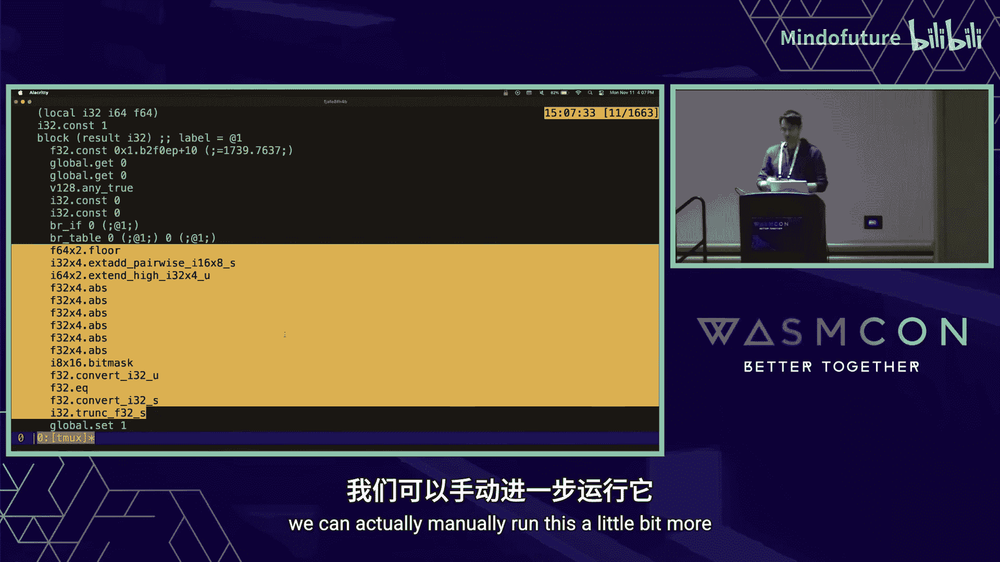

But so that's sort of the overall of testing in wise tools。

The high level idea here is we can run the Smith subcom to generate random modules。

 We have all sorts of knobs to control how this module looks。

 depending on which run time you're voting against or kind of what you want to be testing。

 And they can also mutate these modules， make them a little bit more interesting in a slightly different way and then shrink them if they're a little bit too big to kind of debug to kind of see what's going on。

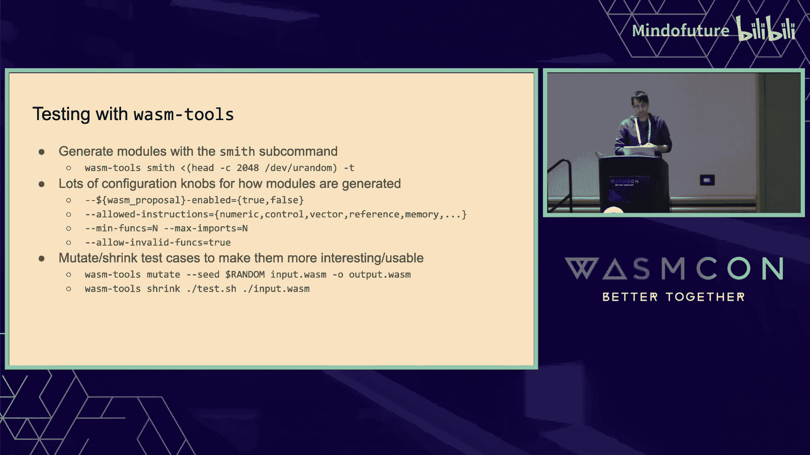

So this brings us to the final demo I'd like to do of components。

 I do a lot of stuff with components。 So I can't do anything without actually talking about components。

So we have here a simple component。 This was again， the text format。 But for components。

 we can see this is very similar to the core module text format。 So we got these parentheses。

 We got this component container， and this is our ad module from before。

 The the difference here is we have this instantiate where we can instantiate our core wasm module and this lift where we're taking the original core wasm and kind of putting it in the component model type system。

😊，So I'll put this down here on the bottom so we can still have that。

One of the nice parts about w and tools is we can actually pass in not only the text format to all of these top of subcomds。

 but also components。 they all transparently work with both components and modules and out of the binary or the text format。

 So we can validate it， we can print it， we can we can actually look at validation。

 And then if we turn on， I think component model。 No， we want component model。

 If we turn off the component model feature。 I'm dealing with various shell par issuess。

 But this is an error saying if you don't actually turn on the component model。

 you can't actually validate the component model。So what's going on here is this is all kind of the same things we were seeing internally。

 but we also have this component subcommand。 So we take a look at that。

 We can see there's a couple of new subcoms we haven't seen before。

 but specifically centered around components， primarily this wit embedding a new。

 which is creating a component。So what I'm gonna to do here is I'm gonna run Wm tools component w over this component。

 And we can see this is the interface。 This is the w I DL specific to components。

 which is the type of this component。 So it exports a single function called add。

 We can actually come in here。 We can change the S 32 to U 32。😊。

We're on the component with command again。 And we can see we've changed the type of this component。

 as it looks like to the outside world。What I want to do here， though， is I want to take this。

 put it in component dot w。 I want to take this module， and I want to put it in module doette。

I'm really having a really hard time typing today or spelling and。

 and never really that good spelling。Alright， so now we have our component dot w and our module dot wh。

 And what I want to do now is go backwards。 I want to go back to the component。So for that。

 we're going to use the component embed soap command to start off with where this takes first the w and then a wm。

 So we run component dot w and module it out we。We'll take a look at the text format again。

 And we can see this is our module as input。 But we've added this custom section。

 This is sort of the extra piece of type metadata， which we're using to actually create the component。

 This is called the component type。 And we can see a little bit of what's going on here。

 but this is mostly binary。So we can start using the piping again so we can pipe in。

 pipe this into W and tools component new。 We want to take a look at the text format of that。

 And voa， we have our component back out the other side。 This is， however。

 is starting from the corewise module coming back out to a component。

 So we can see here that custom section for the type metadata is gone。

 We have our producer section though， for just sort of tooling going on here。

 And we can also see some the component originally didn't actually mention this type or it didn't mention this alias。

 we could have some sugar in this component text format as opposed to internally。😊。

So the next thing we can actually keep on piping this。

 We can pipe this into Wm tools component w again， get the w back out。

 But w can also actually be viewed as text format as well。

 So this is the w document being rendered as Wm in the Wm type or the Wm component model format。

 This specifically is using the type section and is a way that we can distribute w documents both as Wm text or Wm binary。

 So we can emit Wm here。 but Ill have to actually print that so I can print this here。

 And it's the same thing we were just taking a look at。And we can， of course。

 continue to pipe all this along again。 So I tools component w。 One more time。

 we could just kind of keep getting the same wit document out this again。

 kind of piping along and kind of building up these commands as we go along。

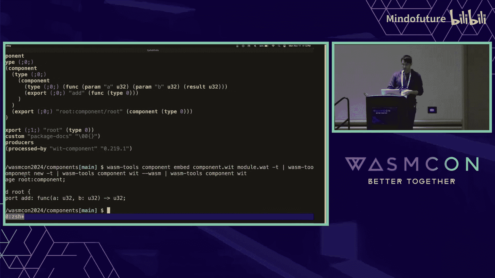

Sorry， That's all we've got for components for now。

 The general idea being that we have a lot of support and top level commands for both components and modules。

 The sort of creation of components is done through these sort of low level embedding and new subcommans。

 not necessarily on the C in essence。 I'll talk about the libraries in just a moment。

 And then w is a essential part of the component model tooling right now。

 which deals with both the many formats of wit。 we can of sugar w。 Take a look at the w and form。

 distribute that work with all the kind of Swiss Army knife of the w subcommand。😊。

Now I was saying at the very beginning that the Wassson toolsols project also has all these crates。

 So this is where all of these subcoms that we've been taking a look at are also part of crates that are in this repository。

 So if you're writing a rest project， you can very easily pull these off of crates I O and use them internally。

 if you want to parse or print or parse text or generate tests。

 This is particularly useful for example in fuzzing where you don't necessarily want to spawn a process。

 You want to just actually generate a module internally right then in there。

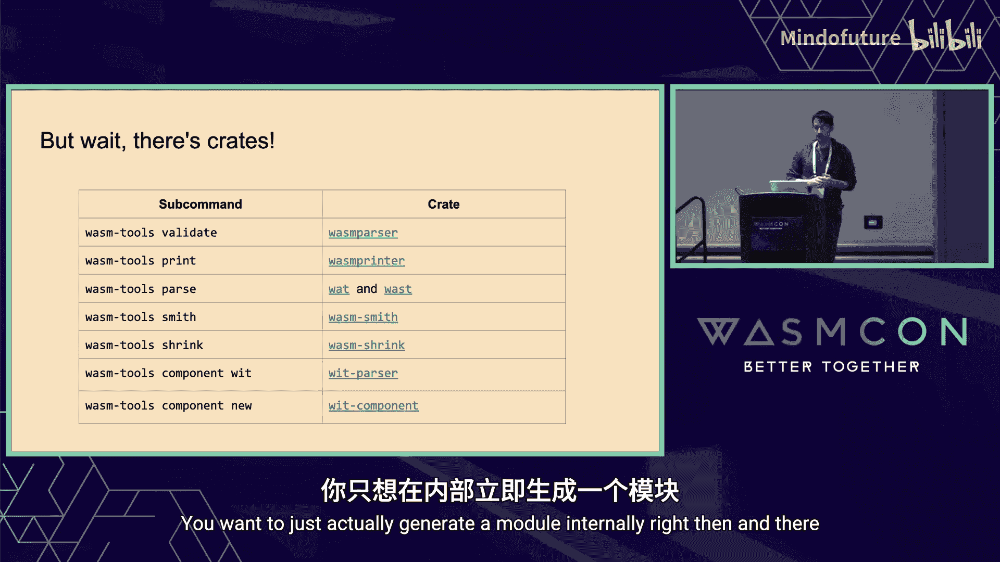

Now， I've got one more demo because it's always fun whenever you have anything working with Wm so we can actually compile wm toolsol to Wm so I can take a look at this。

 And I can run wm tools， and I can validate it against wm toolsols wm。 And sure enough。

 it is indeed valid。 But we can go one step further， we can run Wm time。

 We're gonna give it access to files。 Wm toolsol wm validating if I could type validating wm tools wm。

 So this is wm time running wm toolsols compile wm validating wm tools wm。

 when we get access to all the other fun stuff like we can print it out， get a whole bunch of stuff。

 We can dump it out。 We can do whatever we want there。 Basically， it's kind of a fun demo。

 you can actually compile all this run it on the web。

 We have a of a web demo for a few of these subcoms， but not necessarily all of them。

 And it's always just kind of fun to compile things to wm。😊。

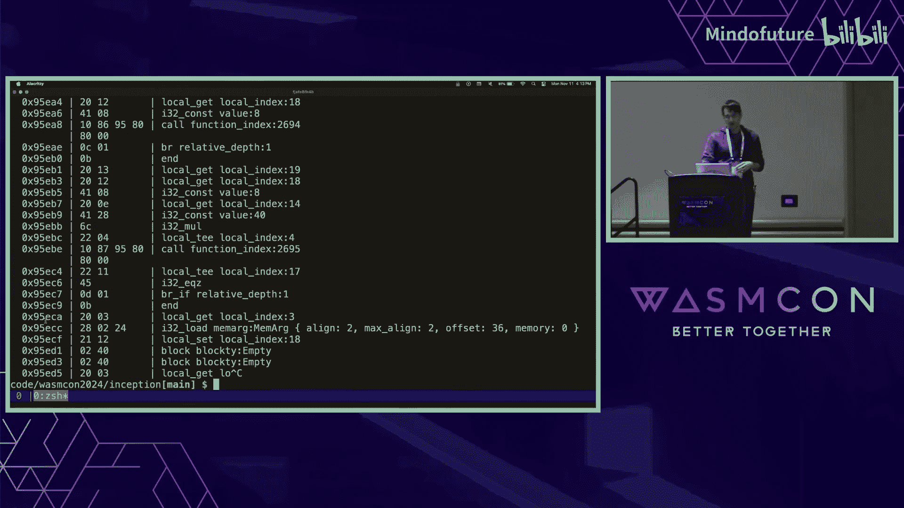

Sorry， that's what I have for now。 Again， This is a open source project in the B Code Alliance。

 We're always welcome to many contributions， whether you want a new subcom， a bug in a subcom。

 A flag in a subcom or anything you would find useful in debugging a w a module and experience。

 I'm also happy to answer any questions about any of these topics here。 And， yes。

 thank you for coming。😊，All right， Any questions。Sure。あと。For example。

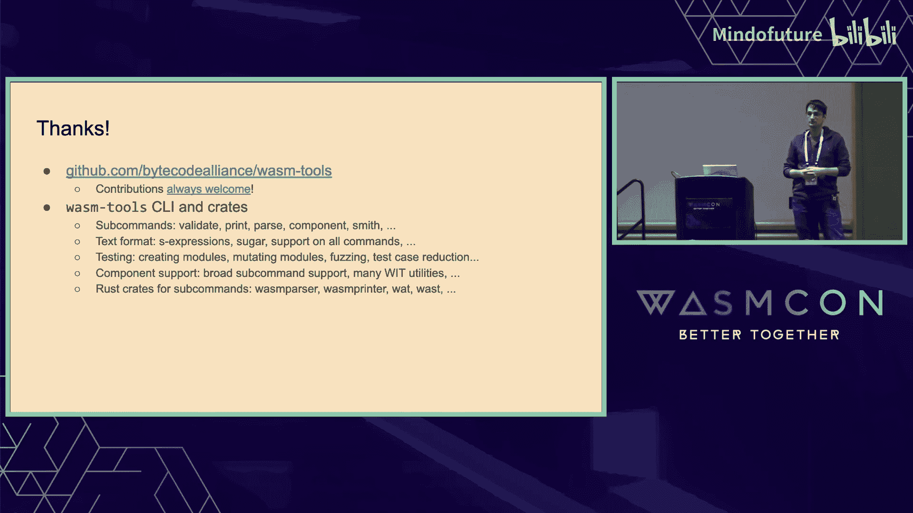

大。インデックス。は。Sure， so do you mean like mapping sort of this binary form of w document or the wzen form of wit document kind of back to the core Wa module itself。

By。商品不。イデす。放都走。Inンdex。I see。 So like， what is this0 here。Yeah， okay。

 so this is where the component model text format has quite a lot of indices。

 just like the core wasm text format。 And what I might recommend is I didn't actually go over this。

 but we have a name unnamed flag in this。 And we'll see that this spits out。 for example。

 this is type 0 and that corresponds to this type 0 up here。 So if you ever curious about indices。

 that's a great way to do it and kind kind of explore this。

 This also makes it much easier to edit because you can move things around。

 You don't have to worry about type indices because it's all got names。

 So not exactly going answer to your question。 But this is at least that0 was a type and you can explore from there。

😊，Perfence。Any other questions。Alright， I'm gonna give you all a WA module。 And you have to。

 I'm gonna expect a quiz due by tomorrow of what that WA module is。 Thank you for coming。

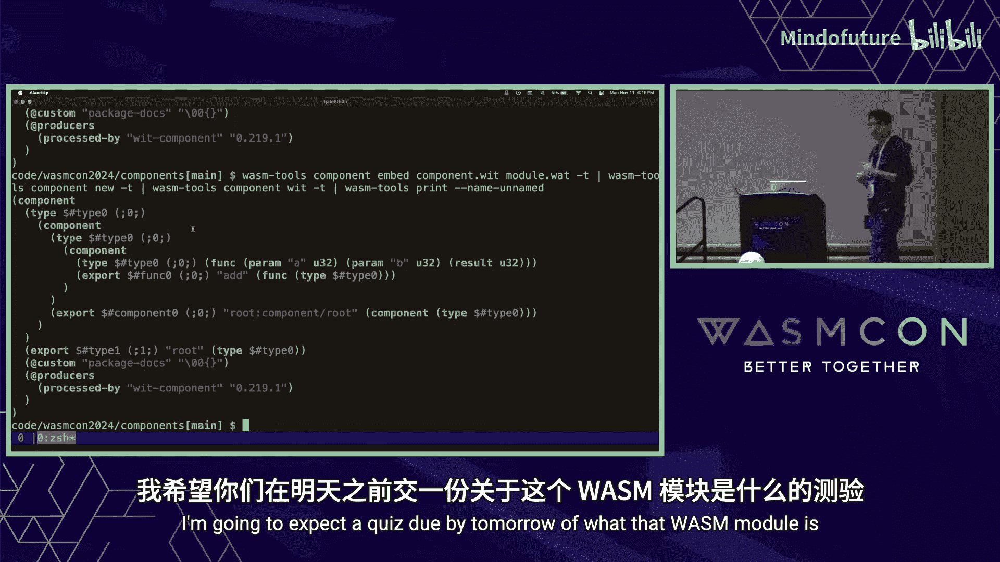