# WasmCon-2024-p18-P18-Lightning-Talk---From-Server-to-Client---Ruby-on-Rails-on-WebAssembly---Vlad--BV18DjSzJE6r_p18-

O， let's start。 That's the last session for today。 except the closing keynote。

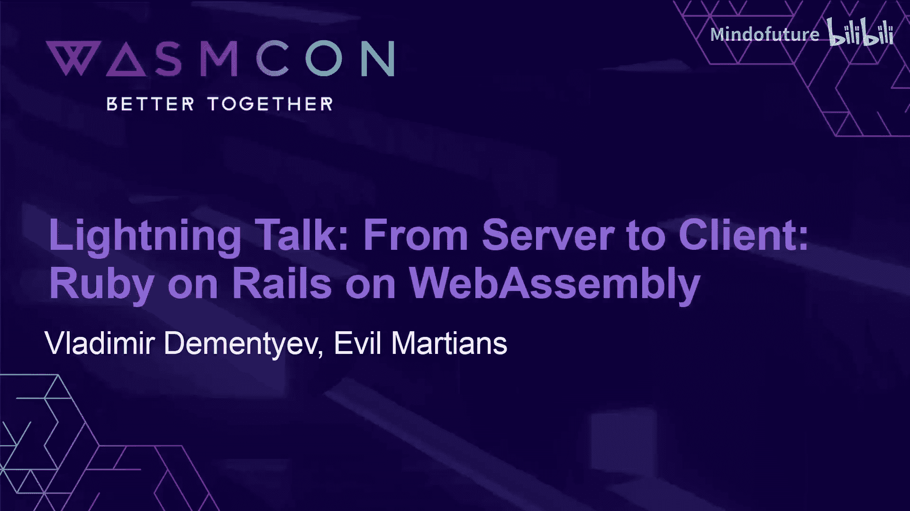

And I'd like to bring us down to Earth from all the clouds， edge serverless。 Oh。

 its actually going to be some kind of serverless， actually。

 But let's talk about good old client server architecture and how。It relates。 It can be related to v。

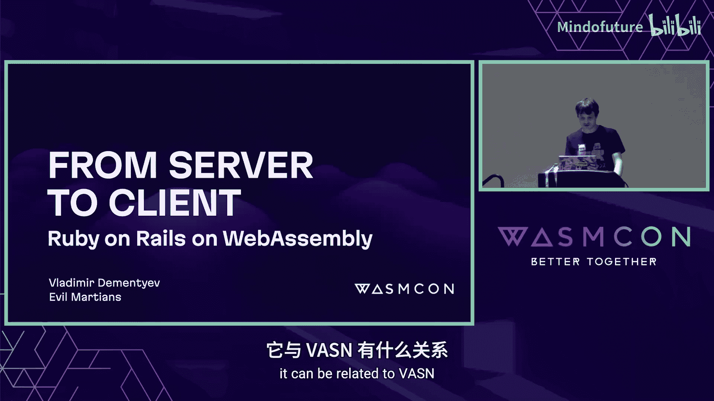

So we're going to talk about crs， rubian rails。Ithi is bit surprising， I guess， for most。

Of the attendees of these conferences， because rail is a full stack and Thai cloud web framework。

And what does it have to do with the plasmas。Let me start answering this question by telling a bit about。

Myself and what Im doing。啊。My。So my name is Vladimir of Vova。 I'm an open source developer。

 I must have focused on Ruby and Go， but also related to Ruby side。

 So kind of boring server side stuff。 Nothing interesting。But I found a place。

 but I'm being paid for doing open source， a company called Evil Martians。

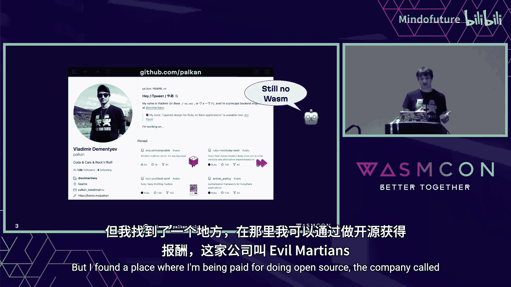

And that's our legal name。 That's not a nickname。We consultancy。

 we're helping startups mostly of different size and age。

 some of them are not already non startups anymore， but anyway， mostly in developer tools。Oh。

Specialization， and that's where we actually， first time met Ba in production in the project called Staag Blas。

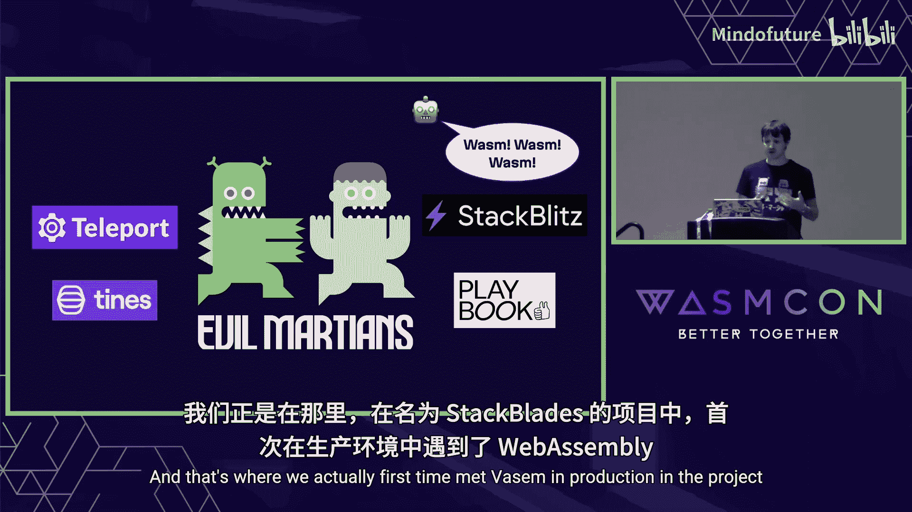

A few words about stagbls。 Stagbls is and browser I D that。Built on top of web containers technology。

 which is， of course， built on top of V， and it allows it to run full stack nu JS applications right within your browser。

 So both parts， a server， a client， everything just works。 everything is great。

 And we've been working with them quite a while already。

 And we started thinking at some point that oh， would would be nice to have something similar for our favorite language。

 Ruby。😊，So we started investigating and we built kind of minimalistic sta blades like playground for Ruby called Ron Ruby Devev。

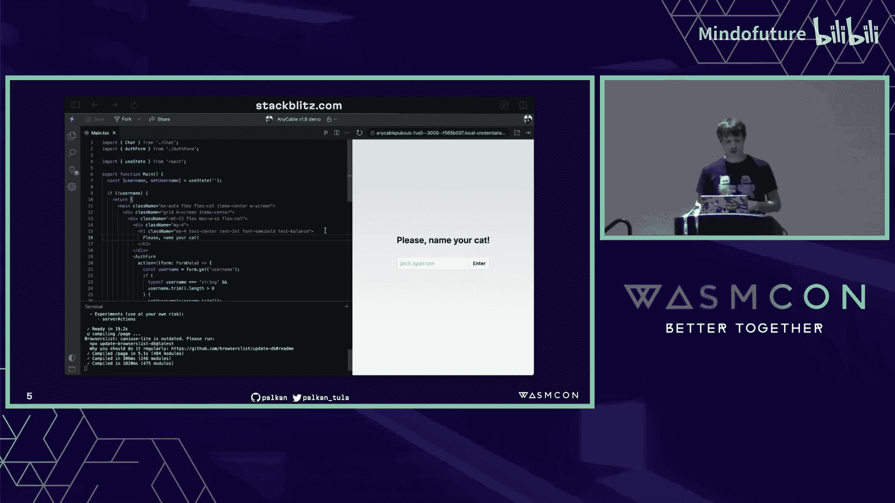

It also allows you to install dependencies on the fly， run Ruby code， manage files， and so on。

 and all within the browser。And。Actually， turned out that running Ruby in the browser。

 like a server side language is not a big deal anymore because about two years ago。

 Ruby officially started to support Boombils and Boi， so。At this point， it's currently only was UP1。

 but P2 is coming soon。 So Ruby is was。Compliant， and we can use it everywhere。 We can use plasmasma。

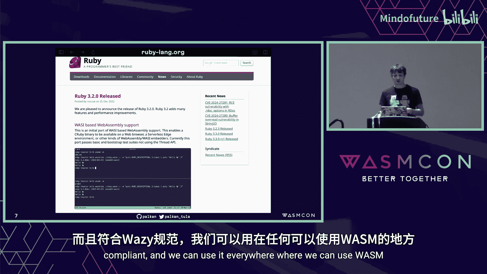

But coming back to the topic。Ruby on rails。It's more than just Ruby， right， It's a web framework。

 and Web framework is just part of it as a language。 And there are many other components。

 So let's take a look at these components。

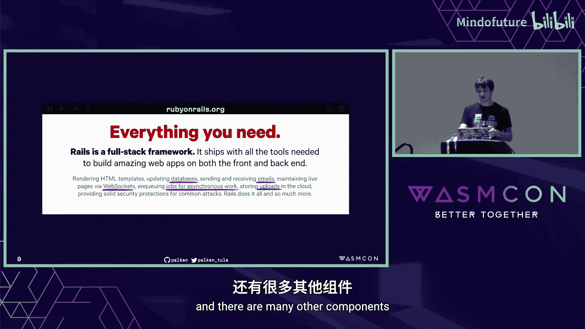

First， of course we have a platform of language and that's Ruby in our case。

 then we have dependencies， libraries， they call gems in Ruby World。

Some gems rely on negative extensions， reading in C or rust。

But that's not a big deal in terms of vastmification。

 because that's already covered by the official review wasn't built so we can manage dependencies。

 the native extensions。 Well， not all of them， but must。Could be compiled into vase module。

 So that's good。 But that's not the the whole stack of the rails application。

We have some system level dependencies， some native tools like， for example。

 for processing images or dealing with some other stuff。We have， of course， database， right。

 We need to do with databases。 We need a web server to handle HtP requests because it's a HTP oriented framework。

We。Need a storage to keep user generated files or assets to serve。

Like JavaScriptscript and CSS and so on。We also have background tasks。

 and we need some kind of queue implementation to manage them。

 And we usually call external APIs from our web application nowadays。 Theyre not like closed systems。

For all these components。We need to。Figure out how to put all of them into browser， right。

 because thats that's actually the most important part of the Web location there。System as a whole。

But we deal with the framework。 And usually framework。 what is， what is the framework。

 frameworkrawork is a combination of some abstractions ready to use。

 They's just pureau code abstractions， some concepts， whatever， and infrastructure。

For these abstractions to use particular implementations。

And the good framework clearly separates those two。

 so you can easily switch from real implementation to another without sacrificing your application code。

That's what， in my opinion， defines good for frameworks。So how good is rails？Well， I would say rails。

Is almost perfect。 Most of the components are heavily abstracted away from their implementations and backed by the corresponding。

 like sub frameworks。 But there are still some parts of the rails application that are not。

Really could be separated from the implementations。 First， is a bundler。 It's our package manager。

 Well， it's not a part of rails。 It's part of Ruby。

 but we need to figure out how to deal with it when we go to the browser。 And then it's， for example。

And that HTP library， which is library for performing HTP request。And good thing about Ruby。

 If we have something not abstracted away， we can just patch it。 whether it's a by the library。

 the standard library， a Ruby VM itself。Ruby allows you to kind of tweak any part of the wrong time。

And this， together with the rails architecture， makes rails own bars impossible。

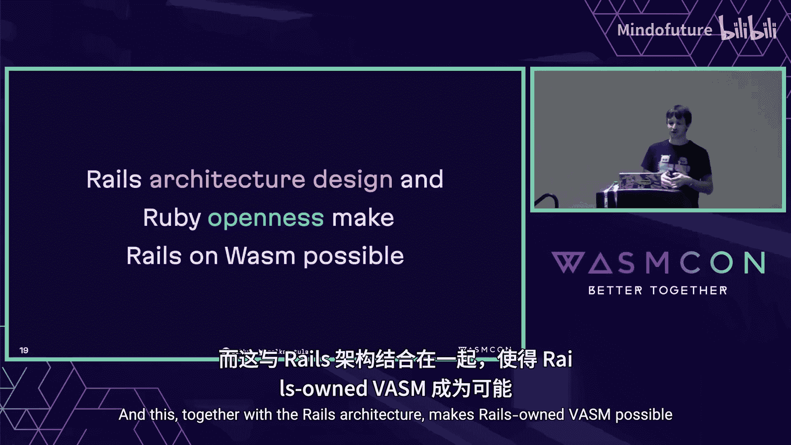

So， let's。See how we can bring rails from Hello world to the browser。In just a few minutes。Well。

 I'm going to show you a quick demo。Of creating a U rail application and turning it into。

Fully self contained Vasm application that could be executed。

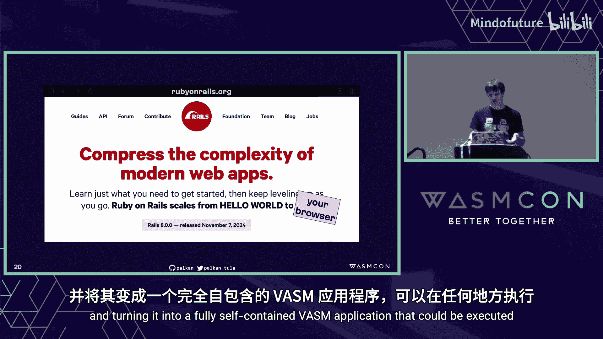

Anywhere。So， yeah， my demo is pretty quick。 I'm not going to call live coding。

 So we create a Ras application。 Rails new creates a lot of stuff。

 especially this since the last version that just arrived like a few days ago。

 We have everything from databases to deployment。 We don't need much of this stuff。

 but let's keep it。Then we generate some models for application。 So we built in a reviewcon app。

 an application that allows you to see the list of talks and left some rating and write some comments or whatever some just random demo I come up with。

 So with a few commands you can generate this cafolded app like we call it in rail。

 So just some boilerp like list。

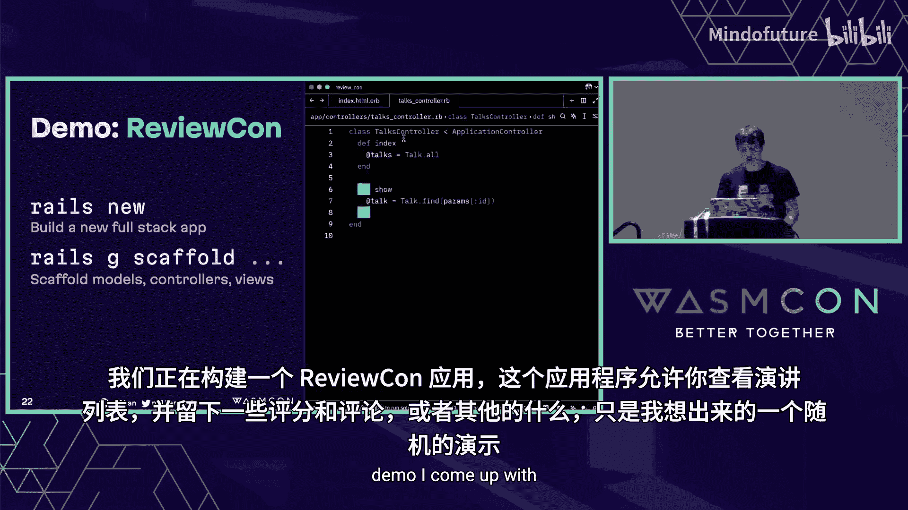

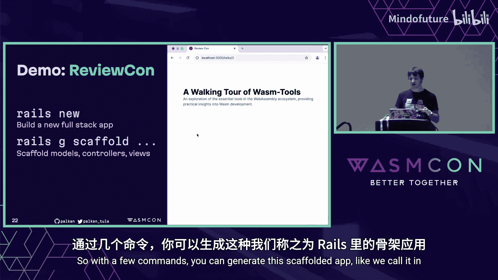

Some forms for creating records， for updating them， and so on。

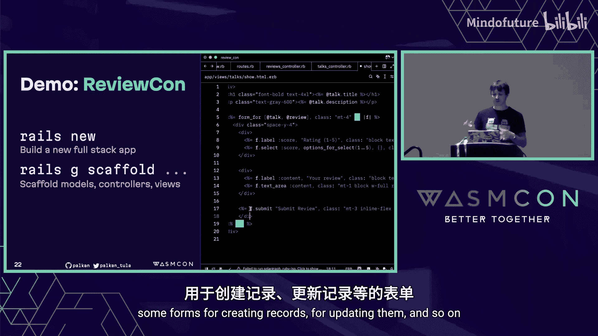

That's kind of the basic application we have。Now， just a tiny bit of。Beauty， we can make it。

Look good with the help of some AI tools。 Don't worry about it。

 So that's the application we're going port to the browser。

So basically just two screens and a few actions， nothing special。 And to do that。

 we also don't need to actually write any code just execute some commands。

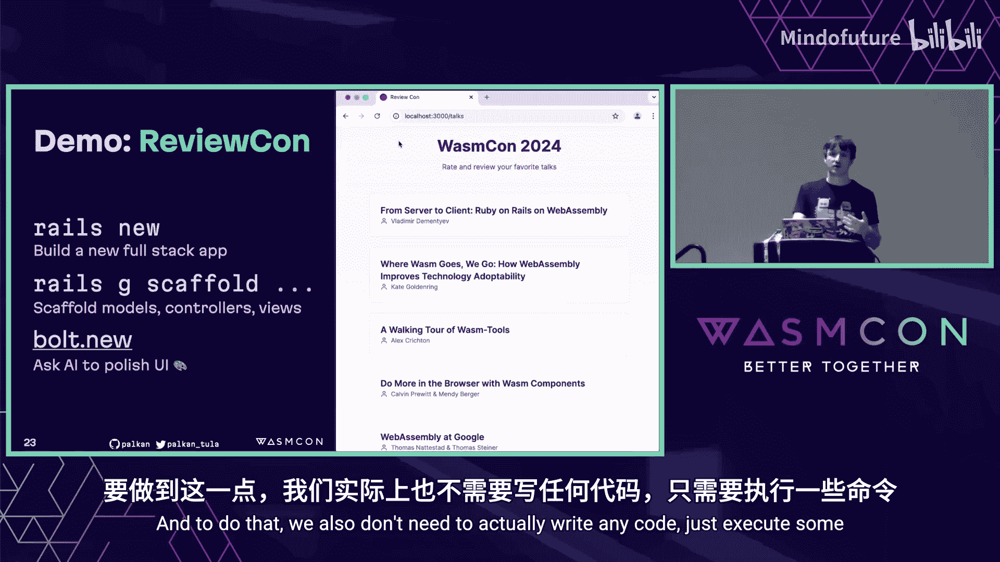

So we use the Vasmin Fire railils toolkit， so it's a kind of a package that brings Vmin compatibility to rails and a set of commands to generate all the required stuff。

 So it comps Ruby， along with all the dependencies into the V module。

 you see like a package all the dependencies so it could be discovered by the Ruby VM within Vasmin。

Then we generate a simple launch or boot application。

 It's just a ja application with an index HTML TMl and a service worker definition few。

Vs about it in a second。

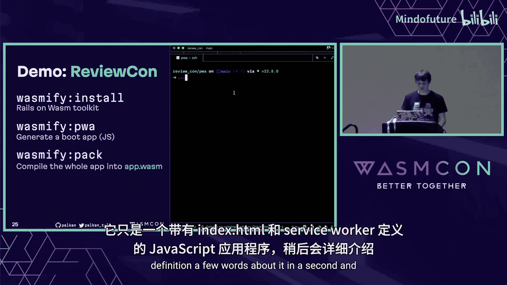

And that's how it works。It initialized a rails app。And it's ready to work in your browser。

 So the same app， just without any code changes。Rans， luckily。

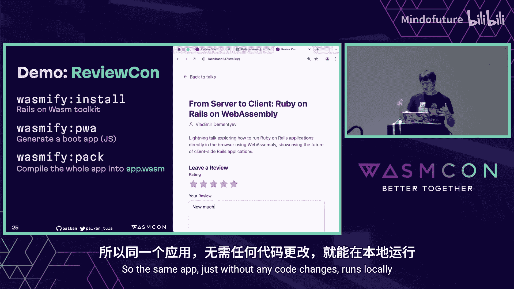

So。One point， we can also add some。 what's important like when you're building a hybrid application。

 for example。

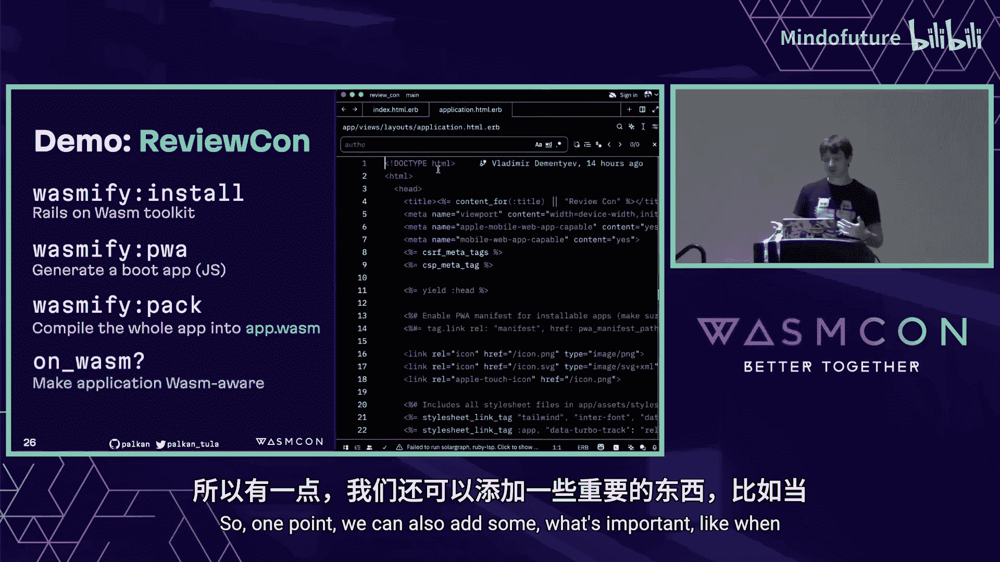

The application notes when it's runs on B or in a regular server environment， so you can。

Disable sound features or tweak day behavior if you're running in a separate platform。

 And here we just fill the app in the browser。

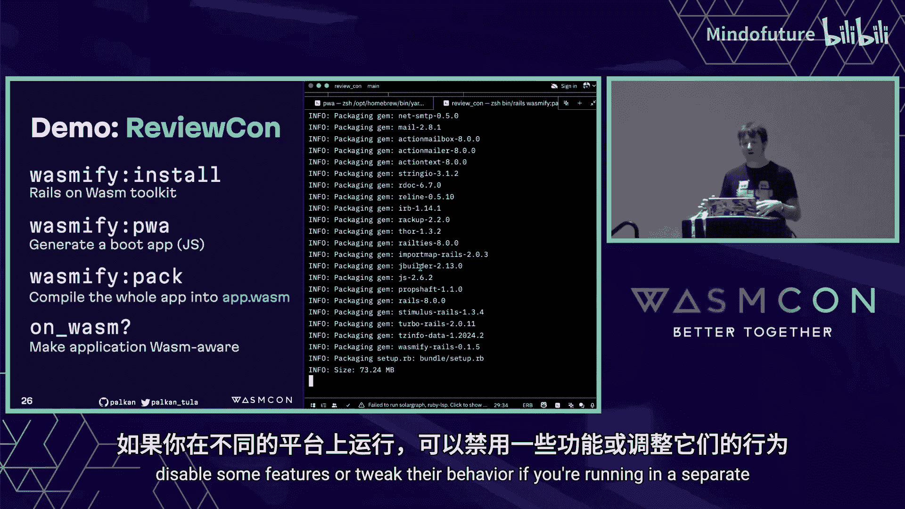

And we can see the changes in effect。So that's a very quick demo of。

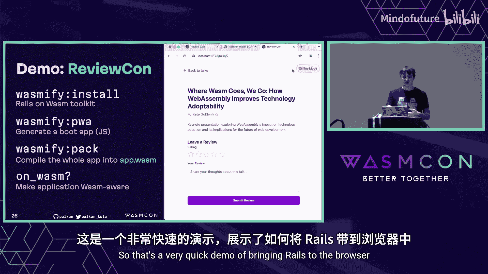

Bringing rails to the browser。And just demonstrate that it's possible， you can try it yourself。

It's sexually available。Online。But don't use your mobile device yet because it's likely to crash because Safari has some problems with stack size。

 was Ruby。 Well， we're going to talk about it probably in the Q A session。

Let's dig into some details， maybe。the things work。 So we let's go back to our architecture diagram。

We have many pieces that are not yet。 Well， awesome。Ready in terms of rails， how we。

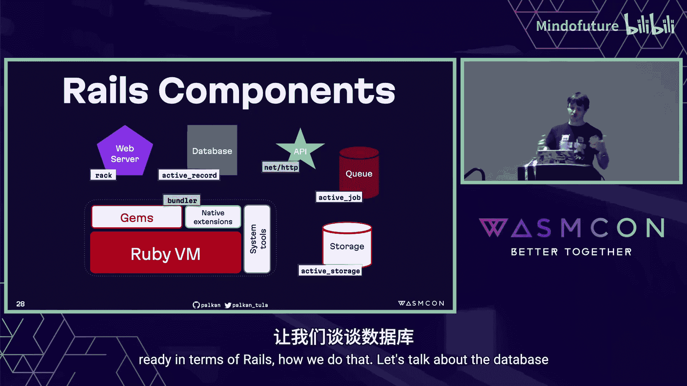

Do that。 Let's go about the database。 So that's。Simple rails today is bats all in on Selite。

 Everything runs。 every component of rails use SQelite， and SQLite has an official vas board。

 So we just create a separate database adapter， like it's called in railils Site vm。😊。

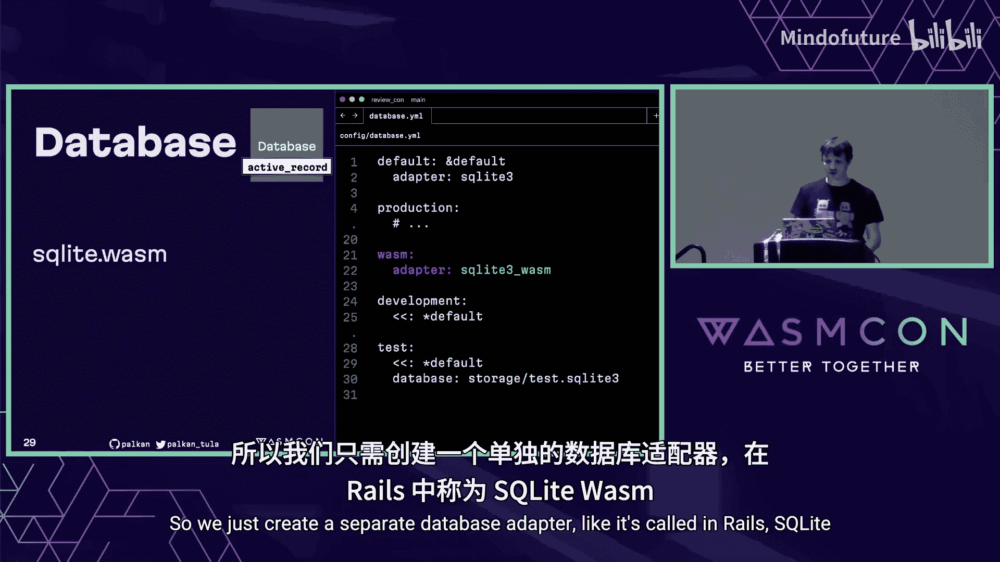

And it's。Just like a couple hundreds。All lines of code。Because。We can。

Weuse most of the functionality of the server side， like SQL light adaptaper that use C bindings。

To grade our own， because it's only ended up with just a single。

Call to the outer world to exact actual queries against a database。 And for that。

 we use a javascript interface， which is the way we going Rubyba。The actual interfaces。Pretty simple。

 We just define cable functions， too and format the output in the form。 we want to。

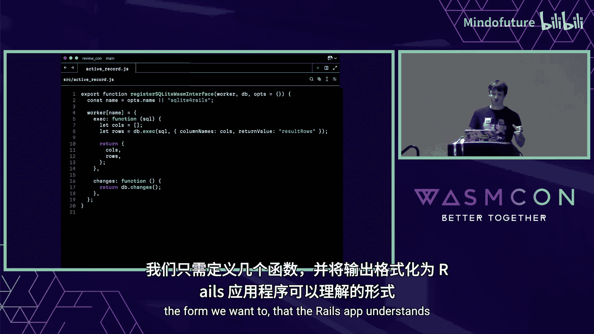

That the Ras app understands。Similarly， we can do with Postgress and PGite and from the rails application perspective is's just changing the adapter in the configuration file。

 so you don't need to change anything else。 It's going to just work Yes。

 you have to manage the database yourself and the browser or whatever runtime you use it。

 but that's out of scope of the rails app。

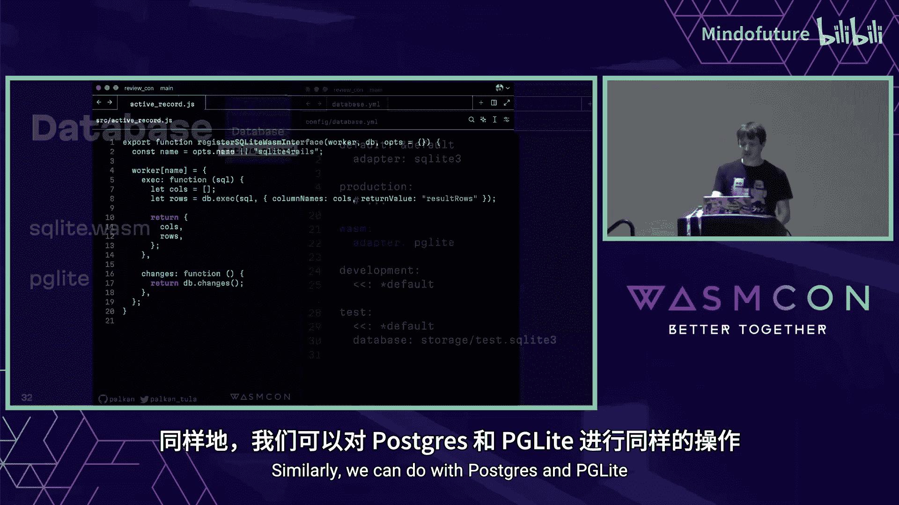

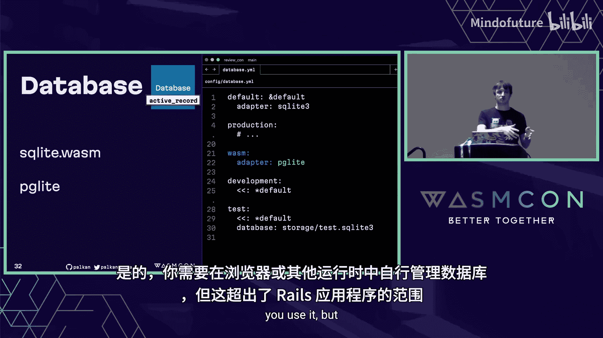

Another important component is a web server。 And here we use a service worker。

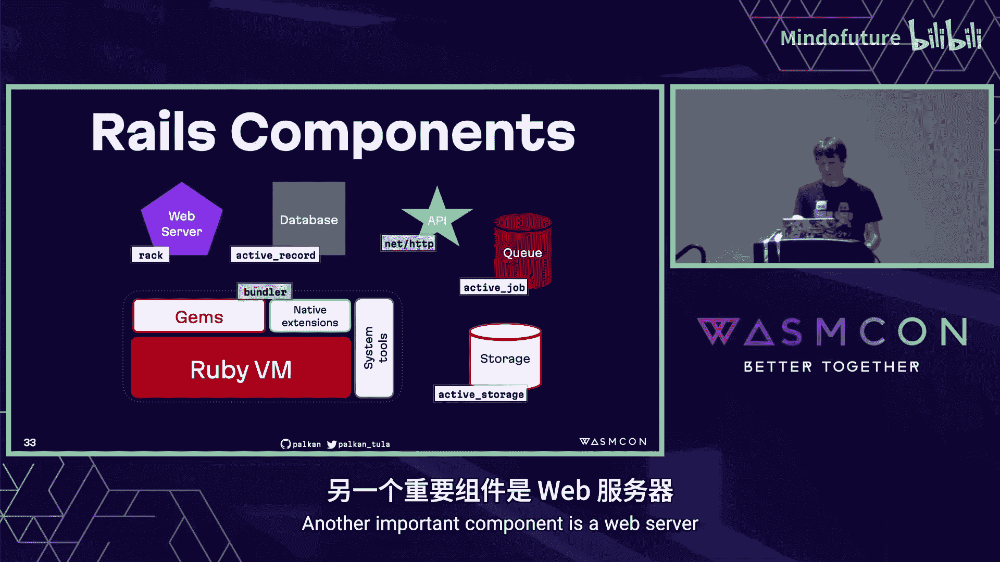

So service workers allows you to intercept HP requests， that's a fetch event。

And what we do is we implement。Common interface for Ruby applications to serve H TP。

 So every Ruby web application use this rack。Interface。And we just reim it in jascript。

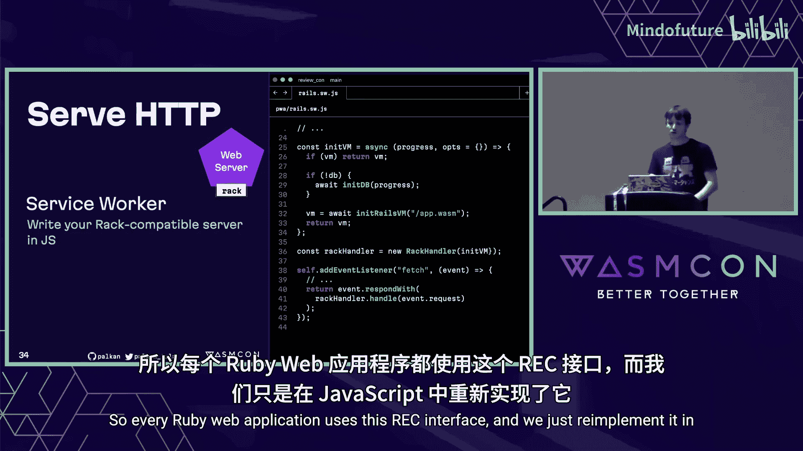

That， well， a lot of。Ruby related in jascript code， it doesn't matter what's inside。

 but actually it just translates jascript request response objects to rack response。

 request objects and back and forth。 So and that's it now since we have a common interface at the ruby side and we have a translator at the ja side。

 which is。Use it， and our service workers serves requests for the rails app running within V。

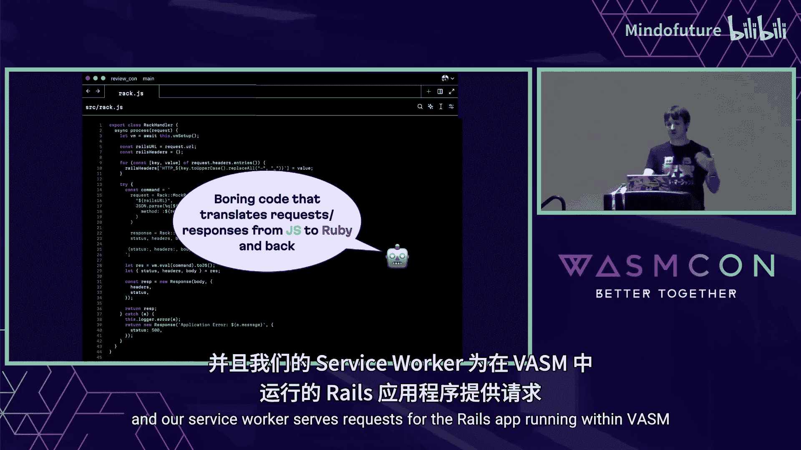

There are of course some tricky parts like how to serve files， how to handle multipart form updates。

 how to manage cookies， we managed to kind of serve all of them， but that requires some hackery。

And of course， wheneveracP2 is going to be ready for Ruby。

 we're going to just shape an HTP productsx implementation for rails and probably find some universal service worker that's going to just work with any app。

 not only Ruby and rails app。 That's kind of the plan for the future。

So we have a few more components and not going to go into deep because I think you figure out the idea。

 So we have a。Component in the framework， which supports different adapters。

 different implementations。 We just write implementation。 That is v ready and use it。 So for storage。

 we can use file system， API in the browser or original private file system。

 which is really good for that use case。 for background threads and communication between them broadcast channel API is working good。

 we can even process images right within the browser using v and pours of webs or image magic。

 So everything is possible。 everything is。😊，But tricky today because we're just at the very beginning of this。

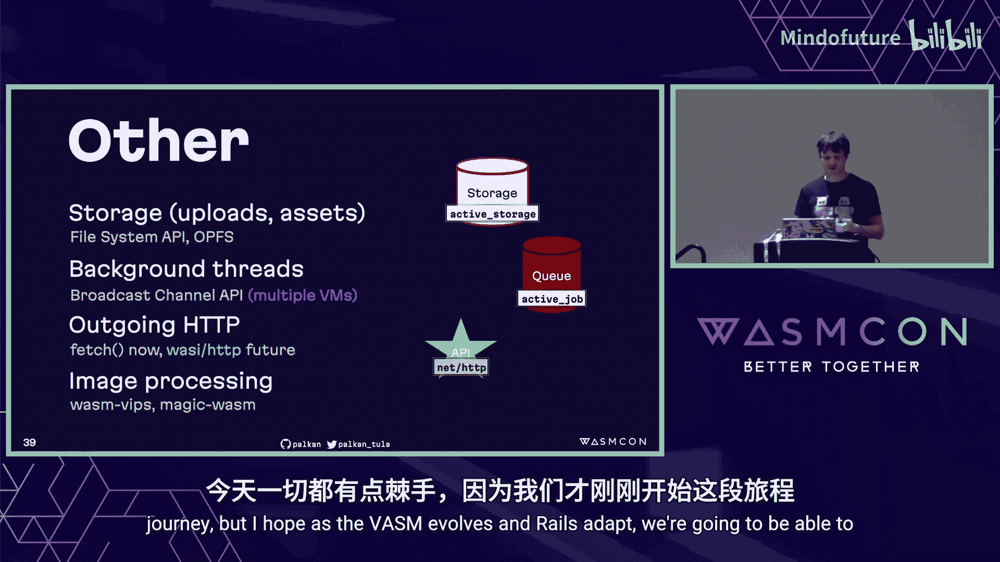

Journey， but。I hope。As the vsmos and rails adapt。We're going to be able to do that much easier。

As a result of my work of this， I wrote a handbook whichs still in progress with all the。

Recipes and guides on how to deal with particular problems related to running rails in the browser in different mode like offline first。

 offline aware apps and so on， and the good thing about this app it's Els running within browser as well is a fallback because it's served by a rails application。

So it's both a guide and an example。You can check it out because， well。

 it contains a lot of hackery around vase in the browser。

But the biggest question and the question I think everyone is asking from the very first moment。

 I mentioned rails。

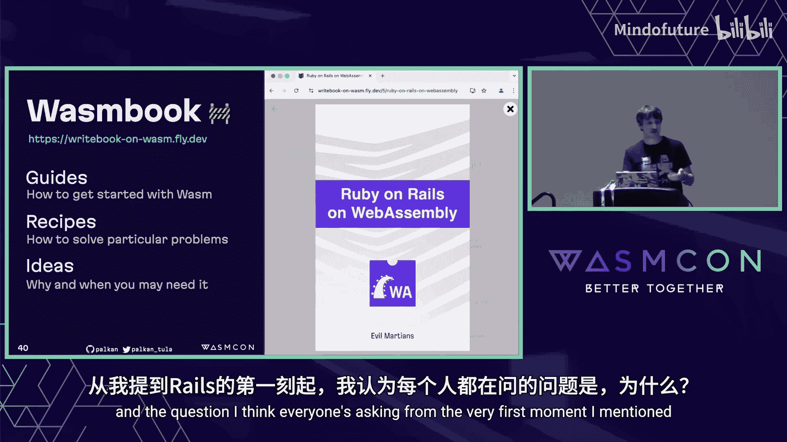

Way。So， like， you know， well， I started talking about this stuff like early as this year and the feedback。

😊，It's kind of different。 Like some people say， oh， wow。

 I couldn't even imagine running rails within browser。 That's cool。 Yeah， that's cool。

 And there are some skepticism as well。 Let's go it like that like a British skepticism。 Oh。

 why do you need to。😊，Compile a dynamic language into。Ouril is like VM， which is interpret whatever。

 whatever。 It's going be slow。 It's going be。You， heavy， like hundreds of megabytes。 No one needs it。

 just use thrust。 whatever。 Well， I think。All the points regarding the bundle size， like module size。

 sorry or slow or odd。Not worthy， because they're just temporary。The technology is evolving。

 And we see like we just。Basy P2 not everyone yet era。 And it's many。

 many levels before even By reached 1。0 and the runtime I evolved win as well。Like G。

 C and Freds maybe someday going to be there。 And most of these problems are't going to be solved and。

We just need to keep。Pace with the evolution of the technology。

 Be prepared for that and start looking for。Real， like use cases for。

Bringing full featured web frameworks into browsers or other Bell assembly runtime。

But why I'm doing this， why I'm doing this just because its fun， like， you know。

 because solving problems that no one。😊，Even tried to solve is always inspiring that what makes me still being a software engineer and not someone else。

 that kind of work。 and another that already kind of mentioned。

 it's for pushing boundaries for both sides。 I want to make rails be aware of this esoteric use cases and make it be compatible so to stay a good framework with clear separation of abstractions and implementations。

 And I want to Va developers to be aware of this use cases， Bsm is not only for not browsers。

 but clouds， right today。 there are more use cases for V。

 And that's the point of us being portable and interable。And of course。

 there are some practical applications， I think， that could be。Could benefit from going。

To the browser， close it to the browser。 First of all， it's not really applications。

 but what I call it like try learn， reproduce apps。 Everything related to educational。

 like tutorials， bug reproduction scripts， online playgrounds。Where we can just take for example。

 try a new library and experiment with it within the browser without installing and figuring out how it works。

Really。Well， I think that's the most beneficial。Point of bringing。Software to the browser。

 so make it。More accessible。Of course， there are some applying aware applications I call them。

 so the application that would benefit from having more than just static HTML served when you're applying。

 but allowing you to interact with the browser maybe some data intensive application like email clients。

 so you can browse your history， search， and so on。There is a category I call data paranoid apps。

 so like you don't want to keep your data anywhere only on your machine。

 but still want to use some interface and call some external APIs， for example。

 to pull data or synchronize and an encrypted form and of course there are also desktop apps I think rails is a great framework because of its active record component that allows you to describe business logic in a very concise way and manipulate all the data and that could be helpful to improve the productivity for desktop application builders。

So。My point here is。Don't stop thinking about serverside frameworks as the thing that could be only executed on your server somewhere in the cloud or in the data center or whatever。

Serverside just means the role of the software and the communication。

 It's not the place where it's going to be executed。 So you can your browser is could be a server。

That， I think that's。All of my talk。My two talks， two lightning talks。

 but we still have time for questions。 if you have some。

 I'm pretty sure there could be some if you're。Followed that talk。 but that's it。 Thank you。Oh。

This is amazing weather。Thank you。I want to know。Just for clarification is the entire application。

Compal wasnt and。Entirely。Yes。So， sorry， yeah， that's go ahead。Like， yes。

 you can have local first applications。Go来。我我。What happens when this application is supposed to serve？

Like collabo。Like real time。And how do you deal with the persistence of their data？Yeah。

 that's a good question。 So let me repeat it。 So first question is the whole rails application runs within the browser。

 Yes， that's the whole rails app in the single vast volume for now。 And the second question。

 how to deal with。I would say like data synchization between users when it's not a personal application。

 but it's a multiplier application。So yeah， so there are a few strategies。

Depending on the level where you want to implement the synchronization， I mentioned Pitete。

 So Pite is a project developed by the electric sQl。Company on whatever。 So they offer this。

Data synchronization at the database layer。 So basically。

 you connect your P light in the browser to your server。The electriccyclql protocol or whatever。

 And it synchronized the data between clients automatically。 So you have a instance。

 like Postgre instance like server instance， like masters instance。

 And it allows you selectively synchronized data between clients and so on。

 so that's one of the approach。 You can use Pite for that also with top just yesterday with Cbase folks。

 And actually with CGB and Cbase， you can achieve。The same result。

 because it also allows replication， automatic replication of data between databases。

 server side and client side。 That's one of the options。 So it's a database level。

And there are other options at the application level。What you can do。

 that requires some changes to your architecture。 So you can go all in with event sourcing。

And model every interaction you have is an event。 And then you just replicate logs of the event between the client and server。

 You need to deal with conflict resolution and figure out this part。 But thats。

 I think that's depends on the application and。What levels increase grade you want to achieve。

 Because in some cases， you probably the。Potentially conflicting changes could be just dislow at the local version。

 So like you， your， your local version is kind of might have limited set of features。 So you think。

 oh， this is something that's not going to work offline。

 So let's just disable this and let use and let user also go back online line and work with this， so。

I think。They should be compromised I don't really trust in the full featured local first stuff when everything is locally。

 And then it's synchronized。 I think that's why I go like offline and aware applications that you have subset of features available to the local copy and then you have a server。

 you still the primary use case when you want to collaborate with someone is going online。

 So that's a primary use case for this I。 buts data， you probably think data。

 but well I don't know how it's gonna to work on larger projects。

 So like all these demo projects were great。 but whenever you go something real。

 that's could be tricky。 But there is another option。

 you can just make parts of the application available in the Va build。 So not everything。

 So that also like in the example， I show this come back。 So the book。

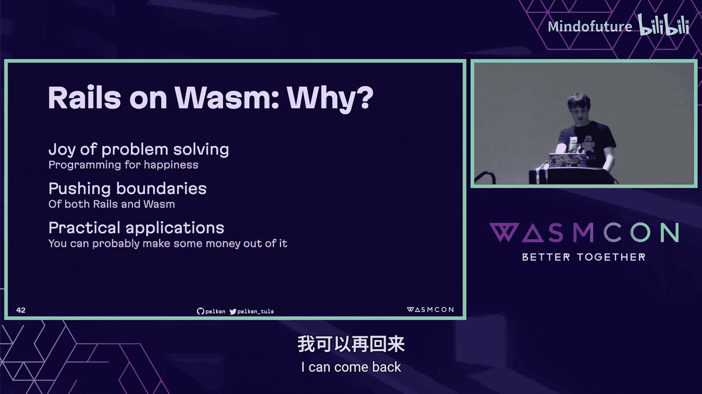

It's just a rail application survey markdown， and the offline version just have all the contents。

Including images and so on， and you can read it whenever you want。

 So make available offline for like a feature could be implemented this way。

And you don't need to do any changes in your code， except from probably configuring your roads or whatever。

 So this could be usable online and this only offline and this only online。

Would you say I need to swap out the sequel light？嗯。Yeah， speaking of databases。 So the question is。

 if you want to have multiplier application。Canen used to use cyclide。Well， so for SQLite。

 there are also projects like SQLite related that allow you to replicate data between databases like Lightstream。

 I haven't heard of Lightstream being imported to VaM， but I think that' is actually possible。

 So and that means that even with SQite， you can also achieve some levels of synchronization。

 But the question is always dealing with conflicts and how long you can go offline and so on。

 So for every independently or whatever you use to build your offline first application or local first dealing with this stale clients is always a problem。

But you can implement， as I said， synchronization at the application level by using like a replication log in your。

Own code。 So that could work。 And maybe in Europe， there could be cases that where only。

Like most users are heavily read only users。 So then do not， or they modifications， for example。

 when I'm reading a book of watching videos， I'm not changing any information related to other users。

 So I'm updating my progress。 for example， some views count or whatever。

 So this could be safely read。Kind of replicated by just reissuing HtP request。

 you can just keep them in the log locally。 And then whenever you're online。

 you just serve them send them again to the rail server to reflect the changes。

 So that's another strategy。

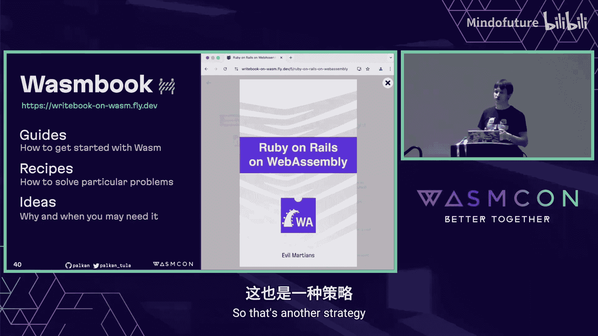