# WasmCon-2024-p19-P19-The-WebAssembly-Component-Model---Rocketfuel-for-WebDevelopment-and-APIs---T--BV18DjSzJE6r_p19-

Just to make very sure you're on the right room in the right session。

 we are talking about Webassembly component model and how we use that for our APIs。

 how can you use that for APIs and we do a little bit of demoing I hope we can do all this stuff in 30 minutes is's a lot to go through in about 30 minutes a little bit about myself。

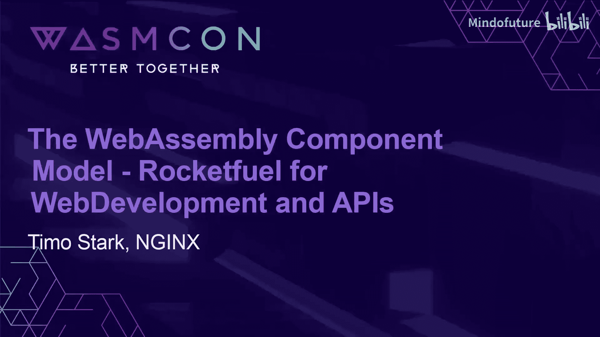

I have yeah started with all the computer and cloud stuff when I was 13，12 or 13 years old。

 and then I worked for Volkswagen and Audi worldwide for quite a long time as in different positions from software developer system architect。

 I think that's what they called it to me。 it was a Linux system administrator。

 then I've joined a5 an Engineex and worked in product management for EngineX till no。

 till spring this year。 And then I made a crazy decision to join a small German startup as a lead of engineering or head of engineering。

 And that's what I'm currently doing。So a little bit about the promises。

 what we will learn today or what we will go through today。 So， first of all， from the session。

On the website， we say we do a deep dive into what Webassembly component model is and discover its inner workings。

Thisclaimer as deep as it is possible in 1520 minutes。 Okay， then we understand why w。

And the ecosystem surrounding the concepts are very。

 very important for the Web assembly component model。

And then we do a little bit shedding light on how that works under the hood and do a practical demo。

These are the promises。 if you agree with these things and you think that's why you are here。

 then you can stay here。 Otherwise you should go and see another session in another room when you're not interested in these things。

Which is fine Okay， I think the promises and the agenda is kind of redundant。

 We will do a little bit of a theoretical background behind what is web assembly and component model。

 and then we look at the tooling， how we can compose components together and what is work and WAC and wreckage and what else and then we do a little bit of demos。

Show of hands， Who is the first time attendee of Wesmcon and has never worked with Wesm before。O。

 perfect。 And who is it like， who would count himself as a Weim newbie。Okay， perfect。Okay， so。

Reason for that is you have to， especially with Webassely and this whole ecosystem。

 you have to do it。 I can tell you a whole day we could have started at 8 AM this morning till 5 AM tomorrow。

 If you just hear what I'm saying。 and maybe take notes。 This is good。

 but you have to practically doing it。 This is what I can tell you after working for almost three years with Webassembly。

 you have to sit down and do it and feel the pain and the joy of things that are finally working when they' are working。

😊，A little bit of history when I was working at Engine X。

 we have started the implementation into Engine X as a proxy server， as well as N X unit。

 And I did some research。 And while I doing research， I created this word crowd or cloud。

 however you want to call that。 And this is massive。 Like there are a lot of different things。

 you have probably not heard before。 And with the Was in Preview 2 or the Was in Preview 2。😊。

There was new stuff。Coming to this thing， spin from Fmion was was part of this word crowd before。

 but the whole thing of components and W and wackage and Jco and workss and WaM tools。

 And this list can go on for forever。The amount of things we will come across in this talk and the ecosystem for Webassely is huge。

 It's like diving into a completely separate world of engineering and cloud computing。

 not kidding This is。This is like I remember when I first heard about Docker in 2017。

This feels similar， where you hear and see something that is so different that you have never seen before。

 This is probably what you will encounter when you start learning Webassembly。

Little bit of the basics about Webassembly。 And I'm pretty sure you have heard that。

Over the course of the day a couple of times， but just repeatedly。Say what Web assembly is。

 Web assemblyly is a binary instruction format for a stack based virtual machine。

 This is not super important， but it can be helpful if you consider。

What is basically a stack based virtual machine， What is this assembly format and Web assembly。

It in its design， says it's a portable compilation target for different programming languages。

Enabling deployment on the Web for their client and server applications。Okay。This this slide。

 when I first， three years ago， heard about Webassembly。

 and I read these definitions about what is Webassembly， stack with virtual machine。

 binary instruction for men。You can write it in several languages。

 compile it to this binary instruction format。 I was like。This sounds somehow familiar。 I was like。

Scratching my head。 And I remember it was in the middle of the night。 I was like， this is。

 this sounds like something I have read years ago， like a long， long time ago。

 And I was going to my bookshelf。 There was a almost very dusty book in it。😊，Any of what？

I was like the Java code reference， like on the first three pages。

And I've not took a picture of the book， but it's literally what Java said like I don't know。

20 years ago， because Java is a binary instruction format for a stack West virtual machine。

 If you compile Java or Kotlin to a war file or a jar file At the end。

 What the JVM is doing is just reading these binary instructions executed。 It's nothing else。

 it's similar， It's very similar to what we are doing here。

 maybe that can create a little bridge in your head from what is the old stuff and what is maybe the new stuff。

This stack based virtual machine for binary instruction format it is basically something。

That you have might heard 20 years ago， okay。So what languages can be compiled into Webassely core modules。

If you would like to make notes， do this and make a note about what is a Webassembly core module and what is a Webassemb component and know they're not the same。

 Very important。Web assembly core modules can be created by。

A wet file this what is basically a specific language where you can write this binary instructions in a text based format and compile it to a Webassembly binary。

 It's like a very， very simple text file。 Then you can use rust and see and go and Python and jascript and Kodlin to create this core。

Moduleles。I have a table in a couple of slides where we compare what is a module。

 a core module compared to a component。And why W and Web assembly system interface。

 short Wy is super important。A little bit。Right now about this。

The only data types you're allowed to share or you're able to share within core Web assembly binary are trivial data types。

 floats integer。 That's it。😊，If you would like to share。Data within core module， without using Wi。

 without using the w stuff we are using in the component model。

 And we will come in a couple of minutes to。You're limited to integers and floats。

So what you would you do when you would like to share and string array of data。

 Anything that's a nontri data type。 Well， we have implemented this in Engine X by ourselves before we worked on the component model。

And in Web assemblymbly for core modules， there's something you might have heard called linear memory。

 And that's where you share data with this sandboxed environment in your Web assembly system。

 So what you actually do is， and I have put this slide out of this presentation。

And would just make a note，10 seconds on the， on the verbal line。

 Line memory management by yourself is not painful。 It's not joyful。 That is really painful。

 So if you don't want to do it， don't do it。 right， That's why I lost so much， so much hairs。

 And that's why rummish all the weirds are red。😊，Head。

 because we do stuff like this most of the time。One sentence about linear memory。

 linear memory is this part of memory that the Wasm sandbox has access to。

 So if you would like to send nontribal data types to this core Wm binary。While it's running。

 you send data to a specific memory page that is allocated inside of the sandbox。

 You send data to it。 And the only thing you do is basically sending rawbys in。

 And this makes it possible to communicate with these functions。

 because the only thing you need is a trivial data。 You need a pointer to a specific memory page。

 And you need an offset like a length。 How many bytes are you sending into this memory page。

 trivial data types。 This is the communication for Webassely core modules。

But this is not what we do today。 We talk about the joyful Web assembly component model， and。

You have heard about Wi today， right？ Have you heard about Wy today。

 I think everybody have heard about Wy， So we are not explaining Webasse system interface again of like the fifth time。

But what I would like to do is to give you this high level overview。

About what is the Web assembly core module in the second column and what is the component in the right column。

Abstractation layer is what we say， low level and a higher level， because for a higher level。

 we have this width files， for example。Then how can we operate with， the， with the core modules。

Just and this is， this is the thing。 If you would like to come like。

 to talk from one core module to another， the only way of doing this is with this linear memory management。

 painful， really painful Inter mode， import expert with trivial data types like integer and float。

And。In the component world， we have wit。 We'll come to this in a second。

Depenency management is not a thing in with raw Web assembly binaries。

 There's nothing like we will see in the component model in a second。And the。

Binary format is basically a standard reant binary for the reant binaries and for a component。

It is basically a wrapper around and。Web assembly binary。 But this is on the next page。So now。

 finally， thanks， Wemclo， for this great picture。 I'm always using it and give great credits to the people of of Wesm Cloud。

 because that's an amazing picture。😊，And I don't even try to rebuild it by because I would rebuild it in the exact same way。

 and that would be not nice。 So credit to the people of Wemcloud for this amazing picture。

 explaining what these components are。😊，First sentence containers are components are containers for modules。

Which express their interfaces and dependencies， via it。If that sounds unfamiliar， no problem。

 we will come to this in a second。And components are self describing units of code that can interact only through interfaces。

 instead of shared memory。So if you would like to export or import data between those components。

 you can do this by its defined interfaces。And internally。

 the component could include multiple traditional or core Web assembly modules。Or other components。

And we will do this in the demo。 Okay， so we have learned a component is basically a wrapper around。

A core Web assembly binary， which makes it easy to carry around， to deploy。

 to stick on top of each other。 Okay， think about you have。Apples or any kind of fruit， whatever。

There is a specific reason why they sell food in net or bags in the supermarket。

 because it's not easy and not trivial to carry around 20 apples at home if they are not packed in like an inconsumable and carable format。

 makes sense， right， So 20 apples like this， this wouldn't be nice。 Same thing for component。

In some sort， right， So component is kind of a net around a Web assembly core binary。

So we have heard about Whit for a couple of times today。 the Webassely interface type。

 Webassely interface type。 It is not a programming language。 It is not a scripting language。

It is a description of contracts。 It is a description of an of worlds and packages and data types。

And why is that so important， Why is w so important。Which。

Explains what a component that implements this wit。

 And this is something we do in the demo has to basically implement and。

And and expect to be called in terms of data types and stuff。 We have a hello bo component。

 This is something we'll implement。And then you will see why this wit stuff is important。

And don't be afraid of Wi I remember the first time I heard about Wi files was when we have implemented the Wi Preview 2 components for H TDP using the Web assembly component model for Engine X unit。

 And I saw these Wi definitions for wi H TDP proxy。 And I was like， holy cow。 What is that looks。😊。

This looks complicated。 It really isn't。You read the documentation at least once， maybe twice。

 And then remember what we have said at the beginning。Get your hands  dirty。 Just ride with files。

 create your own components， createate a hello bo component。 What we will do in two minutes。

 Just do it。 A small thing。😊，Don't start with something complex。

 Just go ahead and use and learn the techniques of stacking these things together。

 deploy and build them small things like the hellopop thing we do in five minutes。So。

 the w files are basically。Contracts， okay。Out of these contracts with。Tooling， we create。

Interfaces or。Binings for rust， for example。 And when you come across the documentation。

 you will see something that is called a canonical A BI。The application binary interface。

 in this canonical binary or application binary interface is。

And contract where both components agree on and say， O， look， if you call this function。

You have to accept in string or in lists of specific data types。

 And the W file is independent of the programming language。 super important。

Independent of the programming language。 And then you generate bindings out of this w file in Ru in the demo。

 we use w bindgen。 That's a rust thing。 So we generate bindings out of this wit file for rust。

 If you do this for go or for Typescript。You take the w file and you generate your bindings for Tpescript。

 specifically。 Okay， super important。 And out of this bindings， we generate this canonical APII。

 this binary interface between the components that they can exchange。Exchange data。Okay。

 this is a little bit about tooling in the demo， we will come about work。We will come about Weck。

 We will come about， this is interesting as a German， I would say W K G。But the。

 the US people I'm talking with， they say it's wackage。And it's wackage because K G is packaged。

 And that's why it's wackage。 Okay， that's what I've learned today。 So W K G is wackage。 If you yeah。

 fine， Okay， let's agree that is the wreckage thing。

 And we will do some wackaging in the demo as well。 Okay， good Working with components。

 This is like an illustration of what the documentation is saying。 How do you work with components。

 authoring a component is we create a component。😊，Composing is like stacking things on top of each other。

 And running is， you need a run time to execute your component。You can use random on time。

 You can spin。 You can use spin cube for Kubernetes。 You can use engine X unit and a lot of others。

 It's just the subset of runtime I have used and distributing。Components， this is super。

 super important because what is the most important thing。

 I have to make the Web assembly component consumable by others。 Okay。

 so we put it to a work or an O C I based registry。And we in this demo。

 we will use W A dot F to look into binaries and things like that。 And this， I think， is enough for。

 for words。 Now we do some， we do some demoing。Okay， so what we do here is we firstly do。

We check a little bit the， the width stuff。So we do have something here that is called Ho Bob。

Composing components。And there is a hello， Bob。And in hello， Bob。We do have a wit world。

And is that the wide thing good enough for you， I think it's better than dark mode。 Okay。

 so what we see here is it is a package on the very top。

 And then we define an interface in the world。 asset very generic， very simple。

 Nothing complicated in here。 The package basically has a namespace。 And then the colon。

 and then a package description and， and specific version。😊，When we now go to W A do death。

 for example， here。

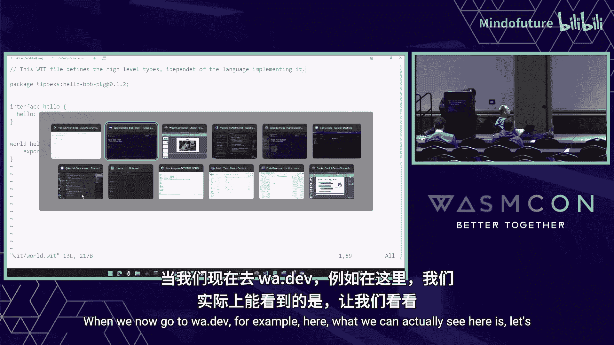

What we can actually see here is。自己。

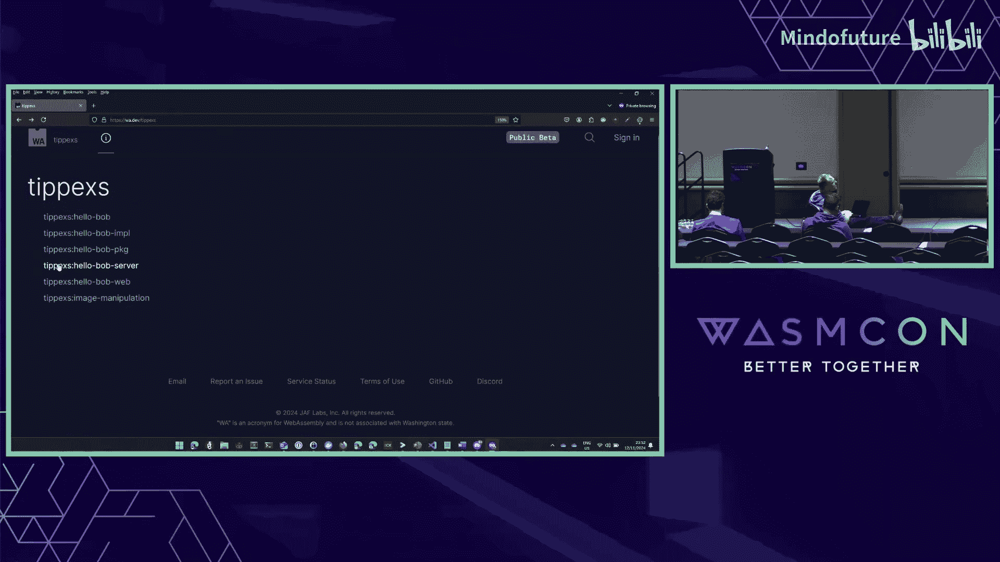

Here is the Hello Bob package。And this should match what we see here， right， Hello， Bob package。

 And this is that。 So W A Def is something that's created by the， by Danny from Jeff Labs。

 You've probably heard of。

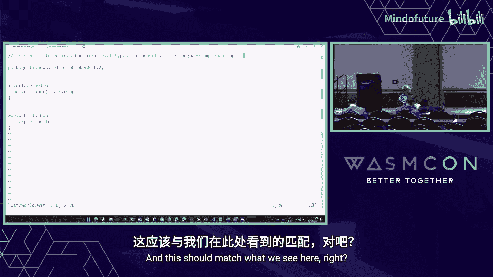

Session from him earlier。 And what it basically does is you can push a package。

 It analyzes the package and give you a very nice UI where we can see what is actually going on。

 Very important。 Take note of this wit here， because what we do when we work with packages。

 We try to separate the concerns。 What we see in this green is a w definition。 So this is a contract。

 Inent of the programming language is just the contract。 And what we do is we define a world。

 It's called hello Bob。 And it has an export。 and export is literally what it means it exports a function。

 It provides a function that is named hello。 Okay， and。😊。

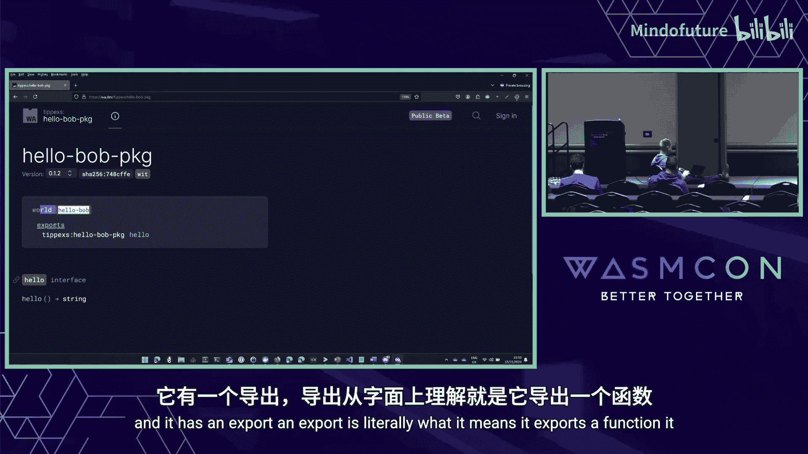

This interface is something I like to do because it keeps the world definition clean。

That means I can have multiple functions and structures and complex data types in an interface。

 I can define an interface， and then I can have my world。

Pretty slick and pretty easy to understand because it exports and give interface， okay。So far。

 so good for the， for the width definition。Next thing we can do is as soon as we have the Wi file。

 we can use the wackage W， K， G thing and publish。This。World or build it first。

 So there' is W K G publish。 No， build。And we say build， and then we give it a whit deer。

And then what it basically is doing is it generates a Web assembly binary like this one。

 And then we can push it to the registry。 I'm not doing this because I already pushed it。

 And then we see that is here， wit。

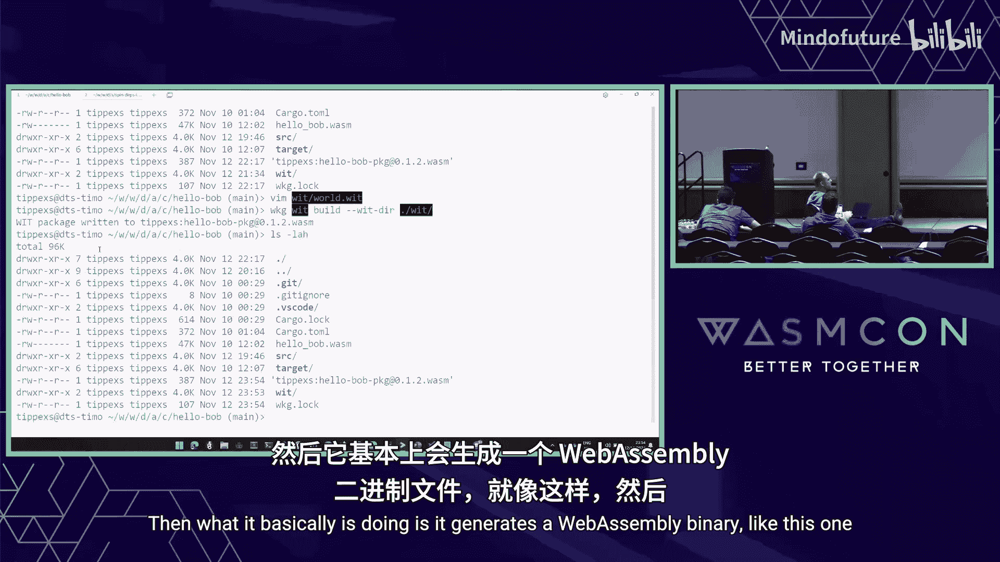

Super important。 That's why I'm standing up on stage and say this very clear。 This is a w package。

 This is not a component you can run anywhere。 that clear。 This is a definition of an interface。

 This is nothing you can run。 That's why it is called wit。 We will see a component in a second。

 but this is not a component in it inner a workings。 That's a wit。Definition。Alright。

 so the next thing we want to do。

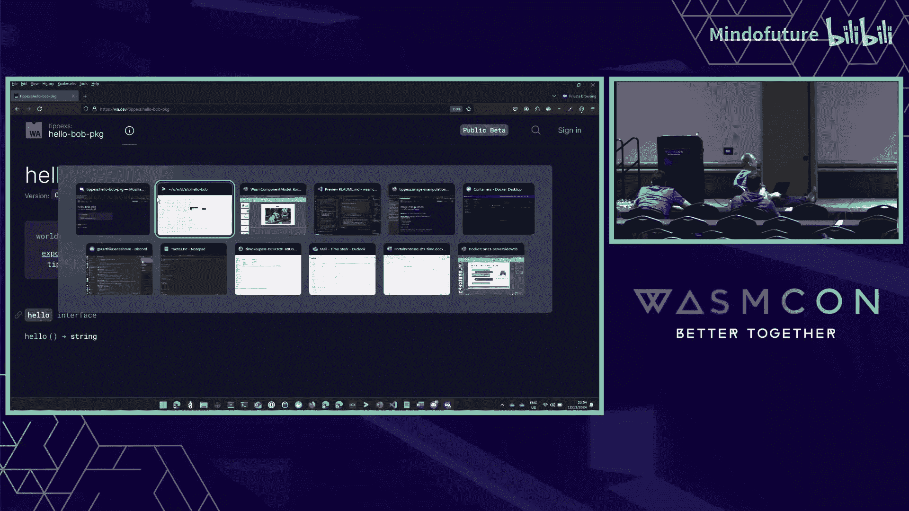

Is we would like to call in business implementation， basically， that implements this contract。

You can。Use the w file in a cargo component in the cargo component thing。Or you can target it。

 And this is what we do。 And the reason why I like it this way is I can use a command called cargo component new。

Also not doing it because I've already done it。 But what we can see here is doing this。嗯。

We do cargo component new D D lip， super important。 Never。

 ever forget the dash D lip when we're talking about Webassembly components。

 I've done that a couple of times。Not good because it will not work when you don't create a library。

 And with D Targ。We point out the cargo command。To say， target this specific。

Inter that's in the wrong one。 That's the Web1。 We need the package one， but the idea is the same。

 okay。We create this。 And then。It creates and， it creates a specific cargo package。 And in our case。

 it's the business implementation of Hello Bob。 So we go into the Hello Bob implementation。

And implementation is literally what it is， what it says。 It is。 when we look at the cargo tunnel。

We can see， it is targeting。The hello bo package， we just saw。

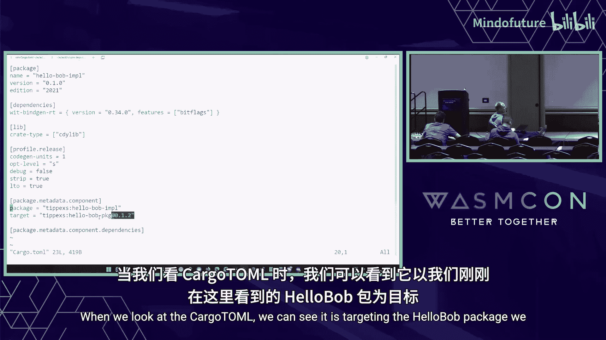

Here。Targeting means。And I'm， yeah， you can judge me because package is is a shitty name。 We should。

 This should be an interface or type or something。That is not called packaging。 That's my bad。

 But hello， Bob type or types。 and we target this。 And what this component is doing。

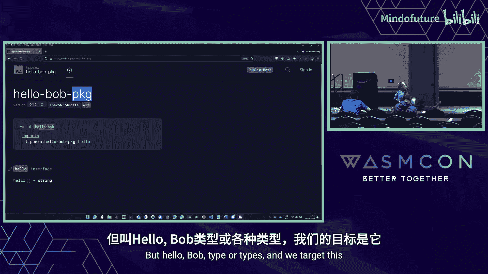

It is implementing the business logic。 And we saw on W A dot dev that we must implement a function that is called hello。

So when we do source std。Lib， oops。Vim sore slip or S sounds good。 We see here。Our bindings。

 And then we implement a function that is hello。And yeah。

 what should we do with the hello bo component？ We say hello bo， right， That's， that's what I mean。

 Keep it simple。 So where are the binding coming from。And this is the important thing。

 why I like to keep this or to do the w files or the width definition separate from the implementation。

 As soon as you type cargo component new。It will generate all the files for you。

 And the first time you build the component， it will generate the bindings for you。

 So that means in the source directory。There is a file called bindingdingt R， S。Okay， again。

 something important to say。 that's why I'm here， Ho。You type cargo component， new dash， dash lip。

 dash， dash target， something that is available on W A dot death。 And then you hit enter。

Next thing you do， you open V S code or you use Vim or whatever go in the source directory and。

The binding dot R S file is not there yet。Because with the components。

 when you use cargo component new， the bindings will be generated the first time you build the component。

Okay。So， what you do is。I recommend this。 You initialize your component。

Next thing you do is cargo component built。You build it at least once。

 because this will give you in V S code when you have the rust analyzer installed or when you use V and have some。

Shady， interesting things and vim that you can see what is possible in rust and what bindings are available。

 It will read the bindings， and you will have code completion and stuff。 Okay。

 so my pro tip is cargo component new next thing you do without even implementing anything cargo component built。

 Because this will generate the bindings。 And then look， it's super super easy easy。

 You see them on exports。 Then you see the tip X thing。 then you see the package name。 hellello。

 Bob package， and then you see the hello， And then you see the function that is called hello。

 So it's like reading through this tree and say， okay。

 what is the the actual function that I have to or the type of the function I have to actually implement。

 And this is what we see then in the。😊，Implementation， when we do Li R S。We have。Tex， hello package。

 Bob， Ho， and then。This is already there when you generate the component using cargo component new。

And here is this rusts function called unimlomented。 So you cant build it。 There is nothing in here。

 but this interface is there。 And how do rust know that this is a string。Pro， pro question。

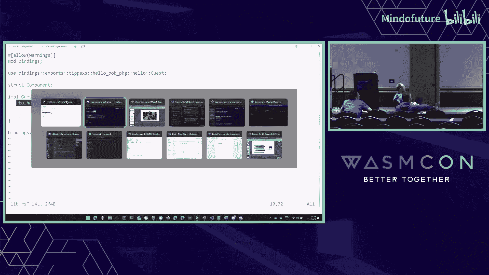

Because the w package we used to generate the bindings from had this data type string。

 That's why Rus knows it's a string。 If it's a list and object。

 and this is not bound to trivialal data types， the w definition language has a huge thing of of types。

 Booleions and characters and strings and objects and lists and arrays and whatever you can think of。

 because out of this w file， we generate nontrival data types per language we target this definition。

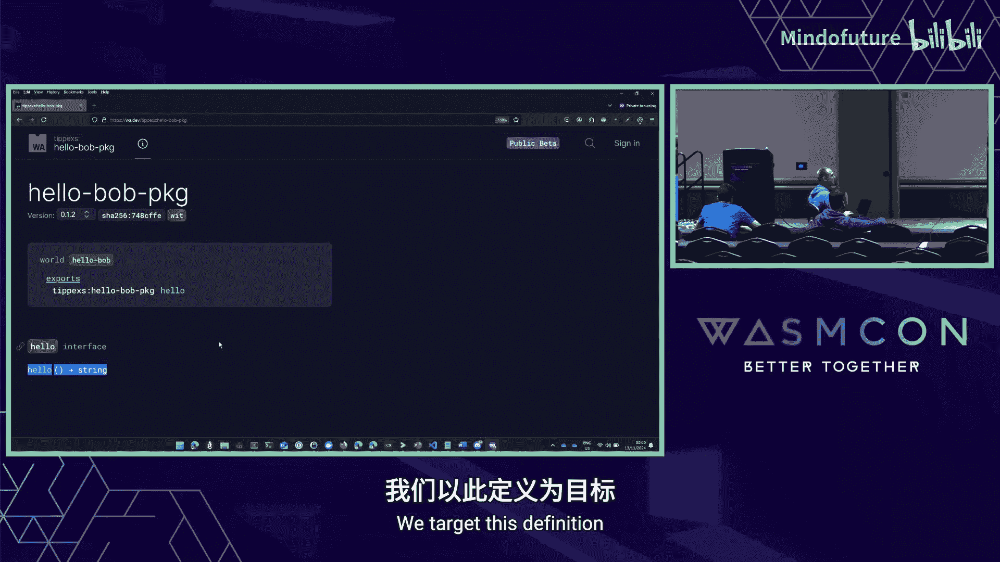

Okay， so we have implemented a very complex function that is。Printing or sending back hello， Bob。

 and。Next thing we do is we can now build the implementation because this is a component。Okay。

 so now we can do is cargo component publish or powergo component built。Dash that release。

This will build the component。And this is the actual component。 Okay， soup， now this is a component。

 and this is something we can also publish and have' already done this as well。

 So this is the package。😊。

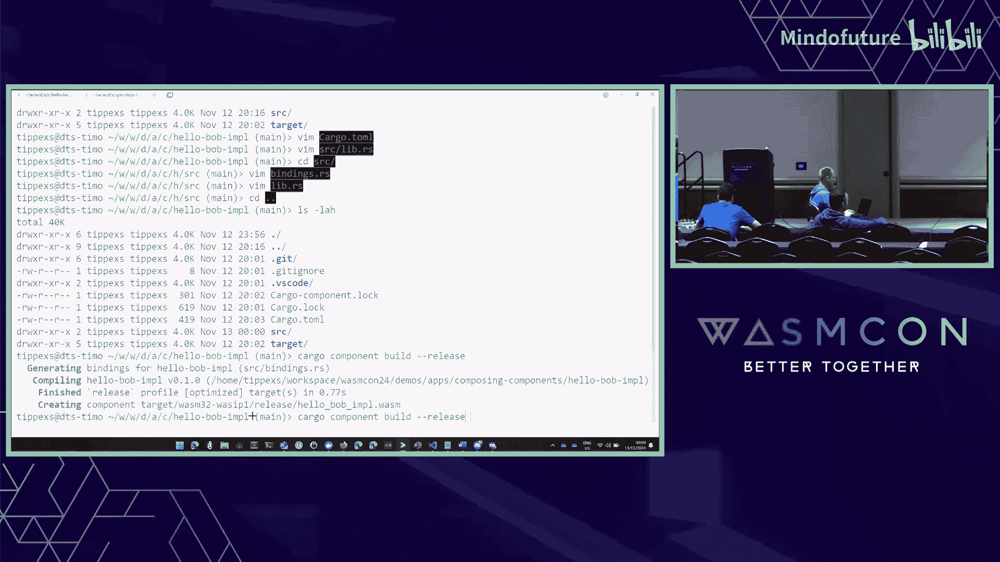

And this is the implementation。 And one thing that I think stood out here is。Now。

 it's saying on the top right， right next to the shot 256 hash， It is a component。 Okay。

 it's not saying it's a wit anymore。 Now it's saying it's a component。Stay clear。

 So this is a real component。 The other one was an interface definition。 This is a real component。

 Okay， so now we have a component that just prints out hellello， Bob， amazing。

 next thing we want to do is we create。 And this is something I can definitely do in three minutes。

 Next thing is， we would like to create an H TDP based component because I am a Web guy。

 I would like to have a web server when I send a get request to it that prints out hello Bob by consuming the component we have just created。

😊。

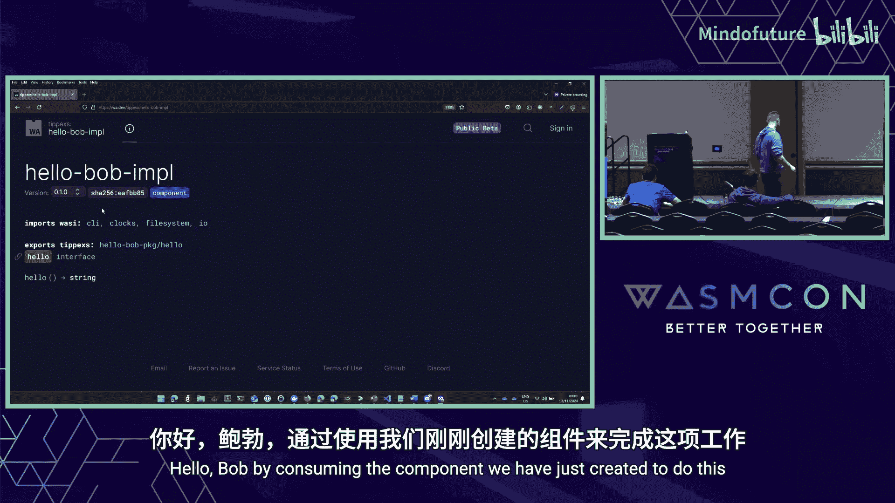

To do this。Is， again， same idea。First of all， we define for this component。I like to define。嗯。

A w file。So we start again with a very simple definition， saying we have a package。

 and then we import the hello function。Import means to this component。

There is an interface or a contract defined for the hellello Bob package。

 And this hello bo package is。The ex this has the export。 hello。 And in this component。

 we import this function binding。 And why composing these components together Web assemblyly or the Web assemblymb。

 the the， the W tooling is smart enough to know， okay。

 this contract is fulfilled by this component and the other。😊。

Contract is fulfilled maybe by another component。 And then we include the Wi H TDP proxy world。

Just to be able to send HDP requests and responses。So it's the same for the Ho pop world。😡。

Similar complicated， right。 Next thing we do， we build it and we publish it to W A dot death。

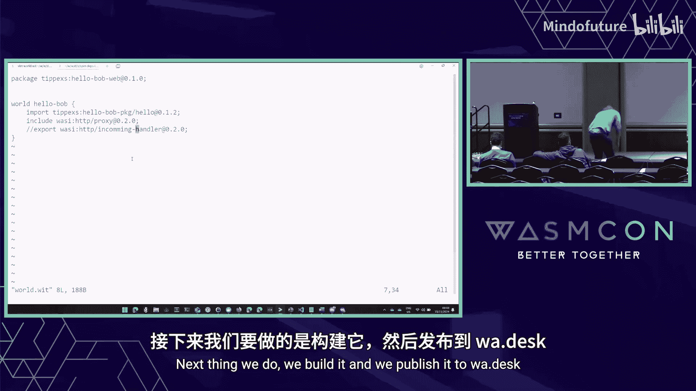

Hello， minions。

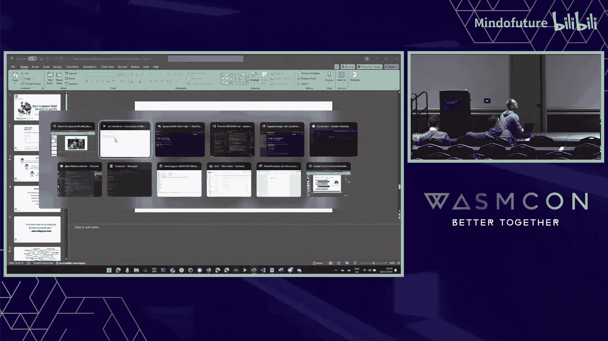

So we publish it。Again， what stood out。It says whip， width and not component。 And so again。

 this is an interface。 Now we can program and implement against this interface or contract from any language that is supported by the component model。

 Ru， Python， go。😊，Whatever， okay， interesting， what it says here， what is the export。

 It is an H GP incoming handler。😊，Incoming as an export。

 because we send an H E P request to this component and receive and response。

So we export the incoming handler because we receive an HP request。

 That's why it says incoming handler， not outgoing handler。 That's sometimes an interesting。Problem。

 you have to think about the component。 The component receives something。

 and this function must be exported to the runtime。 Okay， that's why we export the incoming handler。

 Okay， good。 and in the import， you see on the very first line， we say， hello， Bob packageage。

 the hello function。😊，O。Now we do， we did the same thing。 We built this and we publish it。

 And now we need to， actually。

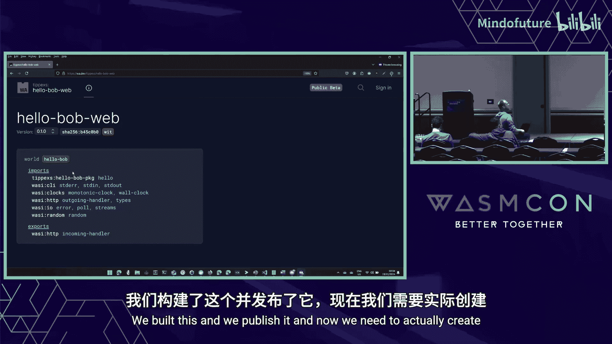

Create。Our server component。And that is the hello Bob server。The hello， Bob where is this ever。

There is the hello Bob。Web。So， and this is now the final component。 And here。

We created this hello Bob Web component。 again， with cargo component new， and we target it。

The width definition of the Web， not the hello pop thing we did previously。

 But now we would like to have this H EDP handler。Okay， so in the implementation， same thing。

 We have the bindings and in the。This year， now， this is a little bit more complicated， but it's。

Simple。Just use look at the very， the very first lines where we have the use statements。Remember。

 we targeted the Wi HTDP。Definitions， that's why we import everything we need for the H GDPP request things。

 And then we use the Tiex Hello Bob package。 Hello， hello thing。 That's what we just published。

To the registry。 And then we implement the handler。 And when you see the line。

 I'm not sure when I do set numb， or we can actually see the line numbers。 Let me see。Se new。

 perfect。 So line number。14， we see this hello function。

And this hello function comes from the hello Bob package where it should print Ho， Bob。Okay。

So what we actually do in Rus knows is because of the bindings dot R S file and the bindings are generated manually L。

When we target that component and then say cargo component build， we'll build the bindings。

 And because we have the bindings， Rus knows that in the bo package is a function that's called hello。

 and that returns a string。Okay， good。When we build this now。So you can do the exact same thing here。

 You can say cargo component， cargo。Okay， forget about it。 cargo。Component build release。

So that means we don't use the request。 We can use underscore。 so then we don't have a warning。

 But now we have this hello web Wam thing。 When I do Wam time， surf。And then where's my mouse here。

 and we would do this。Because it's a component that targets the。Yeah。嗯。Okay， so now it's saying fine。

 that's an actual component we can learn in wasn time， but。You imported this hello thing。

 but there's no matching implementation found for the linker。

Because what we did not do yet is we did not include the Web assemblymbly binary that has the implementation of the function in this。

 we did not compose。The two components together。That's why it's not working。

 So that's the final step。So， and this is pretty easy because what we have done before is we publish the component web。

End the component for Bob that says hello， Bob to W A dot de。Right， and now there is a very。

 very cool tooling。That's the We and package manager， called Wck。Not wackage， but Wack。

And the weck thing。And this is need， because if you install W on your machine。You can type this。

And as I made the packages public。Without even having anything on your machine。

 anything else like Wck installed with this command， Weck plug， plug， T X， Hello。

 bo implementation and the server。With this。Command， we stack both components into each other。

 We create a new component called service dot Wsm out of the Hello boop implementation and the bo server components。

😊，Okay， and this is important because we remember the bo implementation。 we saw W A F is a component。

 and the bo server is a component。 And now we combine both components into each other and get a new one called Service at Wesm。

And when we do this。There is a service that Wem。It should be already here。Service Wem。

 There is a service Wem。So when we run this， where some time。啊。然。Service dot Wem。

So now it's listening on HEDP port 80，80。Isn't it bigger？We curl。Does it say 80，80， perfect。Okay。

 and says hello， Bob。So what happened？The request hit the component with the Wi HDP implementation。

 the handler。Called the component with the export Hello Bob。

The function we have implemented in the other component just returns the string。 Hello， Bob。

 And because it returns the string， Ho， Bob。We can see here， hello， Bob。

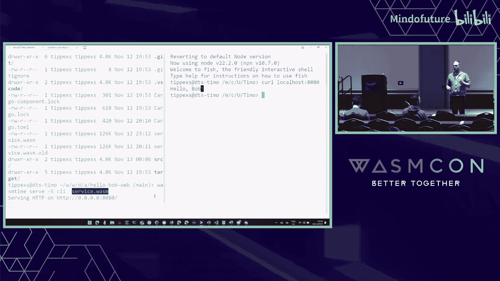

Okay。And the only thing that matters， absolutely， that's the most important thing。

Is then when it comes to this。Stacking of components and creating of components。Very important。

 That's my last word。When we stack the components to each other with this web command and plug。

 we used actual components。 We used implementations， like。The implementation and the web。

At this ever。This is a component。This is a component。The package is a type and web is a type。

These things， Hello boop Webb are super important when you type something like cargo component new dash dash Li。

 dash dash target。 and this target means what interface， what contract are you going to implement。

You're not targeting a component。 You're targeting a w interface。 Is that clear。

 That's the most important thing when working with W A F， with Wc， with。

Plugins with putting things together。 Keep it strictly separated。

 Have you with definitions somewhere and see them as contracts you define。

And then have your implementations separately。 And if you use trust。

Make sure you do something like cargo component， new Li， dash， D target。

 and then target something that's on W A ort F or somewhere else。

But make sure that from your rust project， you target this implementation。

It's a lot easier for you in the development mode to otherwise you have to change version numbers and things by yourself in the cargo Auto。

 It's just not as efficient as you do on this。 And you get free documentation on W A dot death for your Wi files。

Any of your developers can go here and look。 and you have the possibility to do this private and public。

 They are private packages and public packages。 I have made all them public。 So if you go W do dev。

 search for Tiex， you'll see all my， all my things。 And then we can actually。

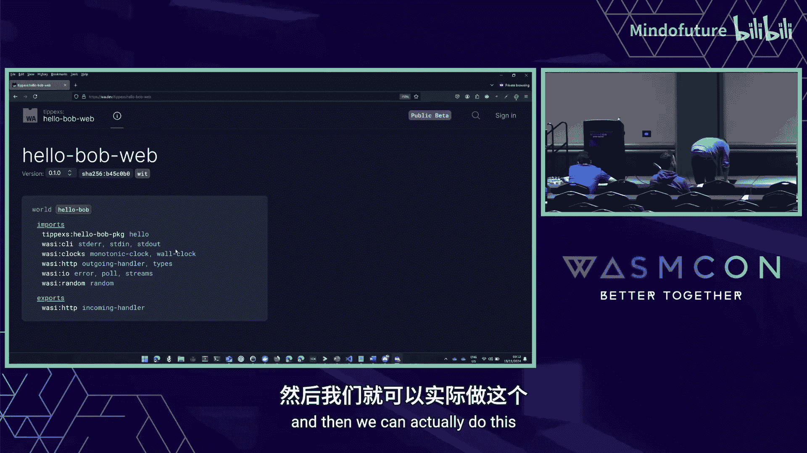

Do this， okay。So， then， thenh。Where we do use， that's fine。Questions。

Do we have time for questions like a minute。Well，Sure， O。

Just a quick one would you publish the service dot WSm as it another like a composed component or is that bad practice Sorry。

 that was can you Would you publish the service dot Wm component that's composed from the other components or is that bad practice You should only publish the。

Small pieces。嗯。You could totally publish the service。 WeM to an OCI registry， for example。

 and pull it from an OCI registry so that you can directly run it using WasSM time or Sp。

 for example。So you can definitely publish your final compos component。 thanks。这子。4。Okay。

 if there any more question， I will be around today tomorrow。 Otherwise， I hope this was helpful。

 and I have explained it well enough。 perfect。 So and then thanks for attending。😊。

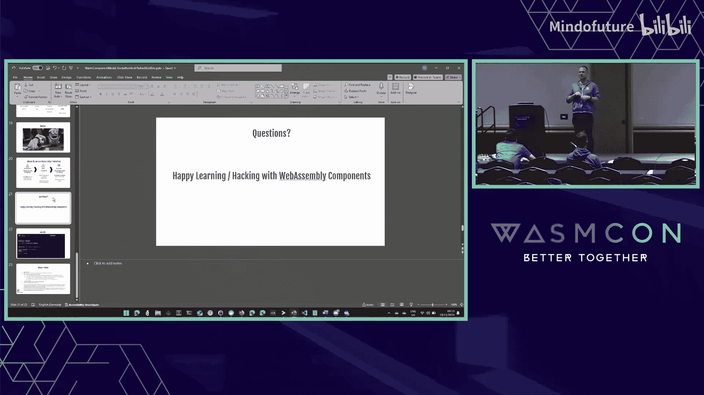