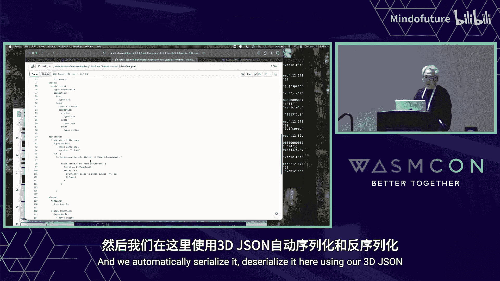

# WasmCon-2024-p20-P20-Integrating-Apache-Arrow-on-WASM-using-Component-Model---Sehyo-Chang,-Infiny--BV18DjSzJE6r_p20-

Hi， my name is Se Chang。 I'm a CTO and cofounder of Inion。Today。

 I'm going to talk about our experiences integrating Apache Ar to using Wasazing component model to our product。

So let me just kind of go over just quick recap of what is the component model just。G everybody。

30000 foot。Basically， component model is allowed to virtualized execution。In a guest。

 what we call a guest， whether it is a rust， Python and and JS。And using a magic up width interface。

Allow it to basically emvoke any of the guests from one language to another language。

And not just that， but being a call to outside。Using a w interface。Things like HTP， files。

 GPU to any side outside the world。And what， what are those reasons is one is like I said。

 a language interpreterly。Security and sandbox。Porability。And。And allow you to reuse the component。

 regardless of language。Now， this is sort of a wi。 I don't know if you can see it， speck。Da。

That support vary widely variety of standard system calls。And system miles， fast system suck us。

And also other things like cloud services that， and it。

There's a lot of you stuff that have been added on。 Now。

 most of these interfaces are designed for invoking or building microservices， O HC services。

 And you see a largest example in these conferences elsewhere and integrating into cloud services。

Now。What I want to talk about is they're using a component model for to build that build own sort of a data stack。

So one good example is a structured data stack， so this is a well known roadmap of all the different kind of tools and platforms around building a data stack called what I call structure。

 meaning that it deals with the structured data。That。From both batch and streams。

Aly to process the data warehouses， build the dashboard metrics。 There's a。

 a lot of tooling and stuff there。But end of that is not that much different from microservices because you have to do transformation。

 You have to do filtering。 There's a lot of common compute stuff。 Besides that， if you don't。嗯。

Sort of a kind of a height or not talk about the data layer， the storage site。Now， other one is。

 of course， that everybody' is talking about general AI stack it's the same story because general AI stack is a little bit different because we are dealing with sort of AI model。

 you prop engineering， integrating with the different kind of models。

 but end of the day you are dealing with manipulating。Data， in this case， you may be know。

 dealing with the vectors and tens and other stuff。 and it's。Same， same， same kind of story， right。

 transformation。 So you're dealing with the same concern， right， So end of day。

 you have to do some kind of compute。 You have to manage all that stuff。 So all the things stuff。

 we that that advantage of。A component model applies there。诶。

Now we've been working on this is protocol called state for Dataflowlow。

 which is a streaming process engine。That deal with the real time data。And。

 and these are some of the alternative that we are trying to build that as a lightweight alternative to。

Product like a patch Bea， carfa streamam， Flink，'m let show how much you guys are familiar with this。

Basically， these are dealing with trying to build a real time analytics， like fraud detection。

Prodecttive maintenance and integrate various different sensors and edges。And end of day。

 the streaming process engineers is all about transformation， this transformation logic。

And based on such state。So it's the same story， transformational logic。

And this actually end up being and very suitable for using component bottle and in our cases。

 we're building。Ced to building， this is called event driven architecture。

That we are building that entire is all the data is。ItCan be modeled as streammobil events。

 and using that you can actually build an arbitrary complex。

 any kind of computation for the data stack。So we tackle what we learned from the complaint model from the left side and applied to our state operator。

 so we tack those things and we actually replaced the computation logic here into our operator。

So instead of having to run this in， for example for like if you run in big data in Java Word。

 of course this is run in JM， or even a specialized Python code。

 we run in a component model and a save execution engine。

And we also can access the basically other kind of resource that complain about with HTP。

 maybe we can talk to GPU or key value。Now， this。The challenges， of course。

 that we dealing with the state。's we're going to talk about that using an A arrow， as an example。

Yeah。So now what is？Use cases for using the Apache arrow in here。

 basically when you're dealing with things like flow detection。

 you are dealing with basically trying to detect pattern of things in multiple time window。

So you partition the data into different time interval and you count them。

Based on certain and you know， for example， like this critical transaction。

 you're trying to detect whether certain transactions happen， for example。

 collected by that location。 So if。If somebody trying to withdraw the C card in Paris at the same time in London。

 at the same time， that's one way to obviously will tell that' that's a fraud or not。

So in the way we kind of do it it says through a data frame， which is。但系但 when来。

sortrt of go overview， so basically the data frame is really one of the popular structures for using analytics is rarely used data sciences and machine learning community。

 you know Pas and Spark and Pols。The basically is to build similar to the table。

 you build this data in terms of a series of data。And you can think of columns。

 and you put together this is called data frame。And they're allowed to do very complex structured data analytics。

Okay。Now， these are designed to。Run in a vertical column。 You can see that is made of series。

 which is a column。 And the reason why is because this is for the analytics is because the building。

Da data in column formatted is much more efficient， it's typically 10 to 100 times faster。

 so that's why it's very popular in data science community and you can actually leverage using you don't even actually have the GPU。

 you can actually using a CD in your regular CPU to accelerate this。

And that major difference between the role and the column， as you said。

 you build a data buffer in in terms of columns。 So so instead of having to。

We have a data structure where you build out seriously in terms of fields。You build it。

 you groupped us same fields in the same location。That allow you to fit those data into the same register。

Yeah。Now， so that comes the question is， how do you access this data frame in our guest。

 So obviously one of the things that the first to explore to us to what if we use a share of memory？

So because the guest， the idea， the main things they drug is we want to make the user experiences seamless possible。

 so if somebody from the panda， a developer wants to use the data frame。

 they are already familiar those data frame API if somebody wants to use whether a Ru or goal or even a JavaScriptscript。

 they should be able to bring their own data library。

So that means that which easily the most probably the most simplest is to bring that memory into the guest。

So the first thing I kind of like the first experiment was to using it of the share memory。

 so WaASM has a standard called share memory。That is designed to。

Share the memory between guests and host。 So basically， you build up a memory infrastructure。

 and then you can expose the guests and the host simultaneously。

Now this is what the arrow coming in because in order to share this memory。

 each of this language has a different maybe a format。

 so this is what the arrow kind of solved at a problem so its。

It's becoming a standard for sharing column data between different toolings。

 So instead of every libraries provide their own format。

Each of those libraries consume the same data format called error format。

 which is basically there's a standard for laying out this in terms of that and is pretty much widely supported。

So the first experiment is to put this shared memory into the error format， so you write this。

 the host， whoever wants to write the data， write that in a error format。

 and then the Python example for curve has already has the Pada library already has the way to import those library into the Python the Pada library。

Now the。This isSo if this works。We need to build a kind of adapter for sample and rust。

 where you have to import this library in a format in a guest。To bring that into the Ru gift。

Then you can actually then actually execute the PolOS by the way。

 is one of the popular rust library for accessing a data frame。

So once that data memory is inside a guest。You can actually run this Pols code just like。No was code。

Okay。However， there is some challenges into this approach。Because the first point is that this。

A proposal is， this is already implemented in the Western time。

 however most of these gas is designed for JavaScript。

 is to share between the browsers and the JavaScript client。

So it doesn't seem to be supported by other languages like Rut and Go and other Python。

So after doing a kind of experimentation at Dune， it doesn't seem like this is widely spotty yet。

Okay， so the next is to walk around is to copy the buffer。So instead of having to she the buffer。

 you copy thearrow buffer into the guest。And then you can consume the same way。

 so you still have can consume this buffer inside a Python or rust， a data frame library。

But you're copying some data。 Now， assumption is that。

This buffer size is fairly small because when you're dealing with this operation， real temperature。

 Sovan of data is to be not that big。Because you know accumulate a huge amount of rules。

One infectedffect things as you chunk the time。So。So。So this allowed so this， however。

 had to build a width library。 So this is a we library to kind of wrap thisarrow buffer in a weight format。

So using this API， the W API， the guests can copy thearrow library and you can see this is pretty much one to one translation of Aero spec becausearrow is made of this list of arrays and each of the arrays is a type so you have I32 I64 a34。

 all the arrays are same format。So with this， and then there's a column of metadata that defines what the type is。

So with that， you can actually copy this into guest library and actually access it。Okay。So however。

 the challenge with this also is that this adopter was end up being quite complex。

And you have to build this adapt for many languages， not just for Ru。

 because we happen to use a rust， but for Go and pandas。

And it requires- and if you are dealing with something like a drone。

 you have to also copy many tables。And also the biggest issue is you cannot deal with the large table。

NowMost of time is the tables are small， so it's not a really big problem， but in certain cases。

 when you're joining certain operations table with some historical data。 in that case。

 they one at the tables and they're being fairly big。

So and other the complexity of tooling as in terms of some like a Ru guest library。

 the libraries tend to be fairly complex， so that cause a lot of build issue， time to build。

So this was kind of up to that。Let's come out with another alternative。

So the new strategy is is tomorrow modelarrow as a resource。Yeah。So。嗯。

I'm not sure how much component researchers are really aware of kind of pop。

 but this is one of the most powerful features of component model。

Which is to represent the external resource as a kind of arbitrary blob。With a handle， Basically。

 you give a handle， and then you can actually emvoke functions。And then， you can actually。

Pass his handles around。And this is kind of similar to how for example。

 how traditionally like Windows， and used to have those handles and an other system。And this。

 resource can be abitrarily complex， right， It can be data frame， but it can be vector， tensors。

 can be anything that you can imagine。The biggest difference is that with this other kind handle it' a fully type。

And on this， the example and the resource are kind of a lot of by examples on the。Ba by array。

 but you can actually represent an arbitrary your custom data type。

 so this end up being a very powerful way to do it。Okay。

So idea is to model this arrow as our type interface expose that to the guest and they can consume without having to build adapters and so forth because the we generate adapter for you the only downside is that。

Now you can no longer use sort of a language specific data frame API that already gives you。

 we kind of have to use this with interface face， maybe we have to build other adopters on it you trade off。

The complexity with the。K of a limitation。And this is I'm still trying to figure out what our limitation and how far we're going to go with this。

So the way we kind of approach was to build this has the data frame is it has a multiple so has a few parts。

 So first is expression right so with the data frame the power of data frame is you can actually build this query expression using program API right so you don't have to use a SQL right so that's the whole one of the benefit of this data frame you apply is you can use your whatever language to build this expression So kind of model this is from another popular data frame lab equal data vision。

Which is kind of simpler than other one， other library things like a Pols to build this expression。

 so end up building this kind of expression tree right So if you look at the right one here。

 theres filterilthy expression。That consist of binary， basically age3。It has operators。

 and you can actually have to build out this one， basically expression fee。So that's the one aspect。

 So that's one part。The second part is actually the data from itself， right。

 So you represent it as a resource。And you can run basically。

 you pass the run here and you pass arbitrary this AC3。To whichch creates another data frame， right。

 So you can when you run it， it creates another data frame and returns another handle to you。

And you can do select。You can distort and you can get a shape。

 right shape means that what is the size of the columns and the roof and so forth？And then。

And then the other one is， is that if you have now you get a， you get a value， how do you iterate。

 right， So you don't want to get。If you get this data frame express that you this table can be a lot of raw right。

 so another one if we turn on another handle which is a raw one， so raw value。

So this is a role iterator， so similar to a lot of concepts basically iterator。

 it is to iterate the values right so once you get the data frame， you start with a sum beginning。

 it can tell you when it's beginning an and， when to skip and when to get the value。And this value。

 which is literal， can be any。Ely values。And the lastly， which is the sQL interface。

 So this is another way to do， which is that。To since the data frame API can be the program grid。

 but also it's convenient to。Sent a SQL， right you can actually send a sQL and actually express it actually run it。

 And so and it can be any arbitrary SQL expression that our whatever implementation of the data frame that that we that we implemented。

 and we end up using a polar API because it has a very flexible。

 But we could also provide to use the data vision or other kind of providers。

 So here this is executing。 and this is running inside a guest。

So this is running inside the gas as the Po of del plaators。Okay。

 so this is a full example of our aggregate operators， right， which is to。Basically the count right。

 so once we get the time series， the part by the time and count number words。

 or this is a very example of the accounting words， get the top 10 roles。

And once you get the roles that we iterate and once we iterate that we transform into something that we operate into Jason。

 so if we for that could be sent to the dashboard， that could be sent to either downstream expression so this exercise like four different parts of data frame API。

 you run a SQL， you run runs， a s mark to get inspect。

 what kind of the values you have and then you do the next。Okay。

And I'm just gonna give you a simple demo of our。Alto running and hopefully this works。

So this demo is basically what this is。Here。It's designed to consumer data from C Helsinki to I。

 so we actually take the consuming events from C I。Pulling the data as a stream on real time。

So we have two topics， remember everything in our cases everything streams， so if you do。比较。す。Okay。

So， this is。The real time events coming from Heski and basically attracts the metro buses。

 different vehicles and it gets a speed and loan to an latitude。

And what we want to do is when I compute the last， you know， the most highest you know。

 the top five vehicle。By every five minutes。 So let me just hear。Then we run this， our competition。

 So our SDF basically can It's a chain of operators， and we use this Yao。You can see this type here。

Vehicles， instead。And services。And then we did some kind of transformation。And we partition data。

 and we compute that data， and we average out。To order the speed by 10。

And each of this operator is runs Wa。And so because of us。

 we can actually run this in a very light speed and skin scale。So let me just run this one here。I。

And。So we have a UI。こか？And this。Its representation of this graph of these operators running it。

And you can actually now look at the sta。And this is。

Computing this stat that evaluating this expression on。One a real time。

 And this is should be the top here。Computing here coming out here。系。If you do。

And if you can see an output here。Sure。Sorry。Comp this is something here。

Oh let me see if something's not right， let me go and run this again。Okay， it's working。

So demomo got here， and you can see this output is coming from average child here。

So if you look at it very careful。Okay， so here it's a vehicle speed。

 this is the top five vehicles coming here， and if you watch this one carefully。

Sorted by the pass Id， the vehicle sta here。And it hazard things like event details。

 route and what speed。So that's the demonstration of running that data frame operations inside West。

And then。Now， there's other things that we are kind of exploring。

 things like integrating vectors and tens and that kind of M models to represent that as part of our。

About。Our products and other kinds of that that。嗯。That will actually explore the thinking of at the next stage。

And this is a link to our project， if you want to interested in how that works。Okayay。And that's it。

Plus。Thank you。Questions， sure。Yes。Yes。Yes。Yes。So this is So basically the SS support tube。Yeah。

 yeah。 So that's right。 So because didn't have a lot of time to go over because the part this part of aspects was that this is。

In lineSo basically you can actually write a disc code in inline or you can actually bring another component。

You can actually build using a ro or Python because it wasnt component in any tooling and bring it happen to it this is in line just easier to。

 right？And then the SDF， what does you see it goes generate this stack and then compile this code it and create a Westernson component。

And。And that one unique thing about this， the way we do the w is that this operator。

 everything is a fully typed because here you see this one here operators， it takes。AVicle right。

 assign timest， So which is to operators to take the extract the timest from the event。

And this is a BP， and the BP is the vehicle stack property here。

So this is actually the model coming from equity。And this。

We have another connector that I haven't shown you。

 thatre actually materialized they actually take their flow equity into our phobia topics。

And we automatically serialilize it， desilize it here using our 3D Js。

