# WasmCon-2024-p21-P21-Distributing-and-Running-Containers-for-Wasm-Enabled-Environments---Kohei-To--BV18DjSzJE6r_p21-

I'm Cohe Tokudaga from entity T T Corporation， and I'm recently working on Web assembly and containers。

 And today， I'll talk about recent workss for running existing applications like containers on Wa enabled environment。

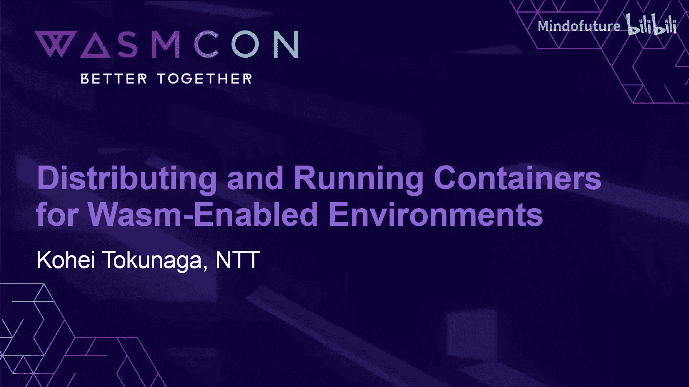

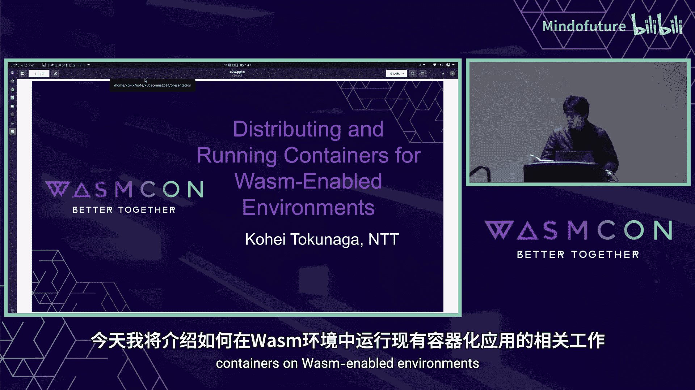

So this is a summary of this stock。 container to Wa enables to run containers on Wa with CPU emulation。

 and containers run on Was and browsers。It supports container to Western conversion。And also。

 it supports fetching and running a modified container images on browser。Without conversion。

And we've also experimentally added support of Q M U running on browser。

 We aim wider range of guest architecture support， including。Arc 64。

And we also expect a performance benefit by QM U。 for example， J compilation or utilizing of multico。

So first of all， why putting up to Wa？So first benefit is we can div well known appss on brothers。

 so。For example， for demo of applications on browser， demo， dev environments， et etc cetera。

 And as shown in the slide in community， there are civil services or projects that enables users to run applications on browser easily without installing applications on the host。

And also Webasse is a portable centerbox。We can run uned quote inside Wa VM without giving direct access to the host。

 and Wa ecosystem also provides interesting tools that that sound useful for existing applications outside browser as well。

 as listed in this slide。But porting up to Wa is。Not easy。

The main reason is Linux based apps need reimplementation to run inside Wa VM and what model lacks Linux compatibility。

 for example， it doesn't have for or exact support。And。So here。

 can we make porting apps easier by running un modifiedified Linux applications inside Wam VM。

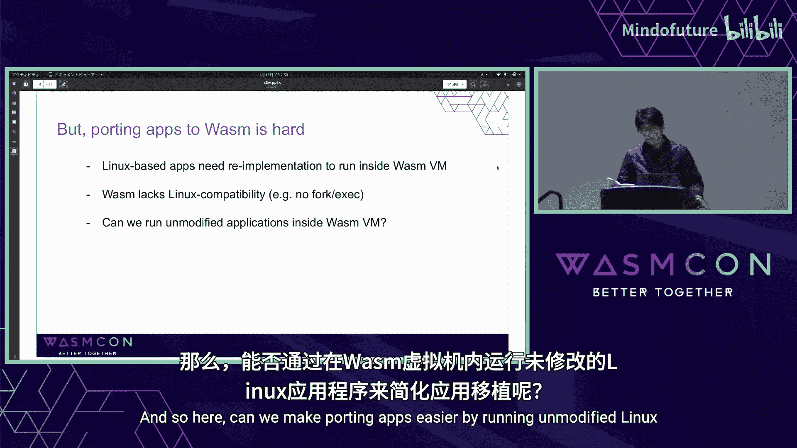

So here， container2 Wason comes in。

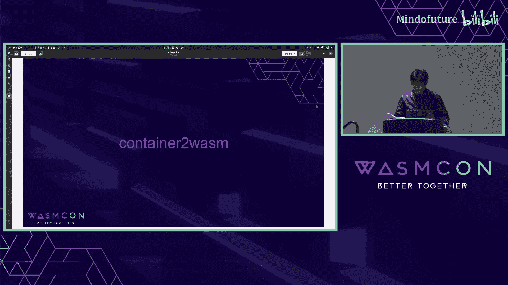

Container Wasm is a tool to run Linux based containers inside Wam VM。

 Now unmodified containers run on real Linux on emulated CPU。

And it also supports networking for containers on browsers and Wai。And also。

 it support what is directly mapping。And here are some examples on this slide for running containers on Wam。

First one runs container on Wa time， which is a assembly runtime with support for Wasi。

 and second example runs containers on browsers。So。How does it work？As shown in the right figure。

 container to Wasum uses CPU emulators for running containers on Wa。For x86， so。So， I mean。

 containers run on real Linux on the emulator CPU and for X 86，64 containers。

 box emulator is used and for risk 5 containers， tiny M U emulator is used。 And in version 0。7。

 recent version， we added support for using a Q M U and Q M U provides wider range of guest architecture supports。

 I will talk about it later。 And for more details about。Conttainer to Wa internal。

 including directly mapping networking。 Please refer to the documents on the reportpo。

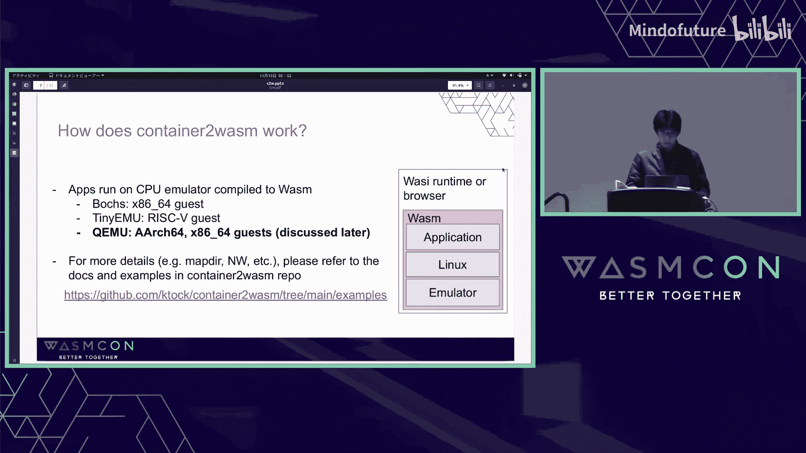

So。

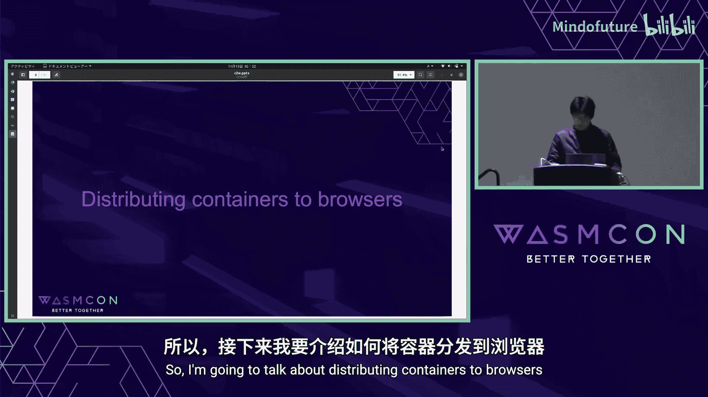

I'm going to talk about distributing containers to browsers。

 so container to Wa supports two ways for distributing container images to browsers。

 The first option is pre convertting containers to Wa bulbs。As shown in the left figure。

 container to Wason provides C to W command for converting a container to Wa and b。

And once a container is converted to what glove。It can be uploaded to a th。

 then browsers can fetch and round them。And second option is to directly distribute O CI container images to browsers。

I'll describe it this in the next slide。The container to Wa supports fetching and running container images inside browser。

 So conversion of container image to Wa b is not needed。As they shown in the right figure。

 a component called I mount running on a webwalker。

 and it fetches and uns and modified O or container images inside browser。

An unpacked image is is mounted to the container via emulator。

And browser directly fetches container images。 So the server needs to allow code access as far as I know。

There is no public container registry with course supports as of now， but you can still。

 still try this configuration using private registry。And。

Image Valai also supports a technique called Laplling。

By E is the image that enables container to start before the entire image content is becoming locally available so it can shorten the time to start a container。

So this is a demo of fetching and running。Unmodified Con images on browser。

Without the image conversion， you can also this on your own machine following the dogs on the ripple。

And。On my main， I have a private registry on local host。

 and there is open a 2404 image on that registry。そう。To check it。

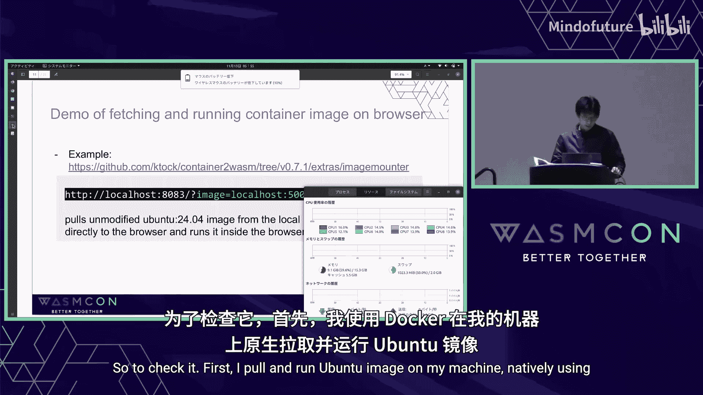

First， I pull and run a bunch image on my machine， natively using a docker。 This is very。呃。Okay。嗯。

All right， so the night can run， we want to image natively。

So it shows that this is a going to 2 for awful image and。Next， I run the same U image on browser。So。

I'm already running a server that serves image monitor。Explained in the last slide。

 And when I start image mount on my browser， that page fetch open to 2004 image from the local host to register directly into the browser。

 then run it。

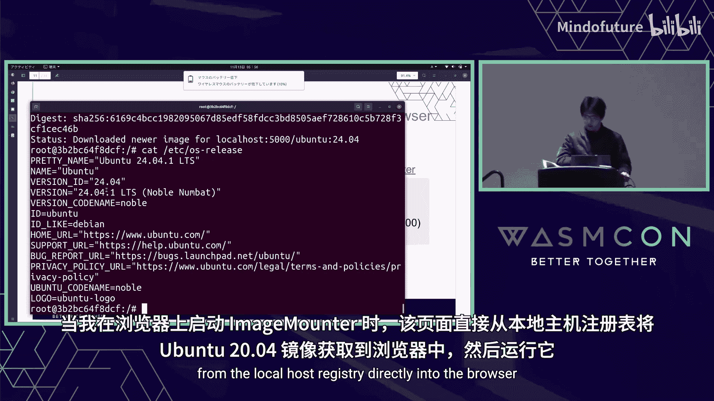

So this is the the URL。 So here there is a query for。Image on the registry。

So what I need to do is just。Copy it and。Paste it here。So。

 so currently rather fetches and uns open to 2004 image。

 and it pulls to 24 or4 image from local host register on my machine。 And okay。

 so shell prompt appears， and I can check。Allright。 So it went to。Image running on the browser。

 So both of Doca and the browser pulled the exactly same content image from the exactly same registry。

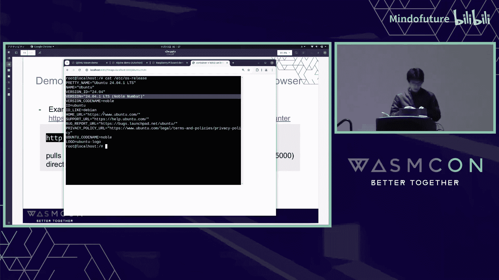

给搜。As I mentioned earlier， Con recently added support for using a QMU。

 I'll talk about it in the following slides。

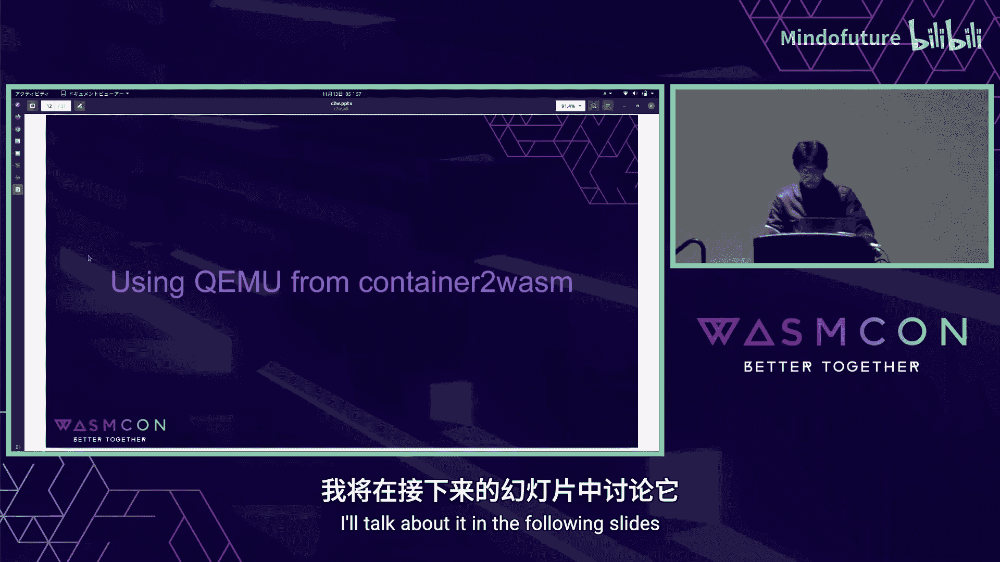

So first of all， what is QMU？QMU is an open source emulator by Fris Belard。

 as is shown in the right figure， it emulateates wide variety of CPUus， including X 86 arm risk5。

 and also it can emulate variety of machines。Including boards。And the QMU is portable。

It runs on a variety of host CPUus。 and QM U also has performance benefits by supporting J compilation of binaries and multico em utilizing of multico。

Why do we want to use QMU from container to Wa？By using QM U。

 we expect to get a wider guest architecture support， including X 8 664 and ARC 64。

And the also performance benefits of QMU by G compilation and multicoa utilization are also。

 of course， sounds beneficial for our use cases。But we are trying to run containers on Wa environments。

 and Q M U currently doesn't support Wam host。 So how can we use Q M U for Waom host。

So we've experimentally imported QMO2 browser， we call it as QMU Wasom。

And this is a port version of a Q E M U system emulator using M script1。

 And it runs 64 B guests as well。And it also supports J backend for Wa。

 and it enables multi utilization。The picture in this slide runs QA Mi Waham or browser。

 and it runs Arc 64 Linux。So QMU has a Git binary translator， or Giit compilation called TCG。

 TCG defines IR or intermediate representation。Guest code is translated to IR by front end and IR is translated to the host code by backend。

As a shown in the right figure， this enables QMU to support a variety of guests and host architectures。

And TCG also supports multico utilization。On the host。 and this is called MT TCG or multilated TCG。

And to support Wa on Waomhost， we added Wam backend for TCG。

This is a for so this bucketend takes IRs and translates them into Wa as they' shown in the right figure。

And WaM VM has Harvard architecture， so even if backend generate Wa code or memory。

 it is not executable yet to make it executable， browser APIs can be used。I listed two of them。

 Webassembly dot module， takes a buffer of Wam code and compiles that code。

 and the Webassembly dot instance takes a module and gives a set of functions defined in the Wam module。

And。Once we get functions of the module。It can be exposed to the QMU module using a table functionality of Wam。

 so Mscripting allows to access functions on the table as a function pointers。

 so QMU can call Wa modules entry point by just calling it。And。Actually。

 Giit compilation based on browser API is also used in other emulators on browser as well。

 for example， V86， QMU。JS。But they only support Sa to beat guest as of now and they are single threaded。

 so we've added 604 beat guests with empty TC for deal with practical use cases。And Ill。

 I'll also introduce with emta in the later slide as well。

And we've also enabled P thread support of M scriptin to enable MDTCG。So。In Q M U。

 a unit of instructions to translate is called translation block or TV。And in Q M U。

 a list of a unit of so。TCギブ， I mean Tギブ。TBs to wasn backend and wasnt backend translates the TV into an executable wasn module。

So Wam backend translates an IR instruction to the corresponding Wa instructions。

And we've also implemented 64 bit instructions for IR。

 This is actually necessary for supporting 64 B guests and M T T CE。And for example。

 as was shown in the figure in this slide at I 64。I R instruction is translated into I 64 dot add what instruction。

And the what'm called also continues。Get and set instructions and they are actually needed because Wam backend binds each IR variables to wasn variables and instruction in WasM is stack based one。

And QMU's memory and helper functions also shared were imported to the WaM TB module。

 so memory related IR instructions can also be translated to WaM code。

And cold in TV sometimes needs to call functions provided by QMU， for example。

 for finding the next T to chain。These functions provided by QMU are called helper functions and one them called can still access necessary helper functions provided by QMU by importing them。

However， there are several considerations when creating one modules for each T。

 first one is that compilation overhead， it can't be ignored。

 and it slows down the execution of the guest code。

And the second one is that browsers are not capable of creating thousands of modules。

To mitigate for these considerations， QMU WaM enables both of WaM backend and TCI。

T C I is Q A use IR Interta。And all the TVs run on TCI by default。

 and TV is running only TVs running many times are considered as like a hot TV。

 and they are compiled to us。And in the following slide。

 Ill show the performance benefit thanks to QMU's G and multico support。

This experiment measured duration to G ZP compress 10 MBby random data using P Z P Z。

AG ZP implementation with multiproces support。 So benefits of multi support cannot also be observed。

 And this uses P Z X 3，6，64 binary and runs it on the emulator inside browser。

And this experiment compares QMU WaM and box ported to browser with Emscriptri 10。

 box is a portable X86 emulator with interpret app Lo and actually container to Waum ported this to M Mcri 10 as well and container to WaM uses box for X8664 containers by default。

So this is the direction for running P Z。Box took over 40 seconds for completing the command。

But the QM completed this command much faster。And we enabled forth thread M TCG， so。

And performance is improved more in this case。And the QM U was can be experimentally used from container to Wa for R 64 containers。

 Con to Was uses QM U Was by default with dash dash to dash jet Fl and X A 6。

64 containers can also use QM U Was with an additional flags。

 And please note that this is still in an R stage and experimental feature。

 And there some several limitations， including networking is not enabled aovna。

 and pre initialitialization， like Wr is not enabled。 So it means。Every time starting a container。

 it takes long time to start for fully booting the Linux kernel and VM。 Im called to start。

So next is the demo of running。Arc 64 container inside browser。So， yeah， different fun so。

In this browser， Kmi Wam is running another a emimulator。 And this runs alpine container。Ark 64。

 and Shell prompt appears。Here， and。Using a your name one。You can。

 can confirm that this is an Arc 64 environment。And。

OS release shows that this is Aly container is Al O。

 And you can also see the root file system located at slash。So。

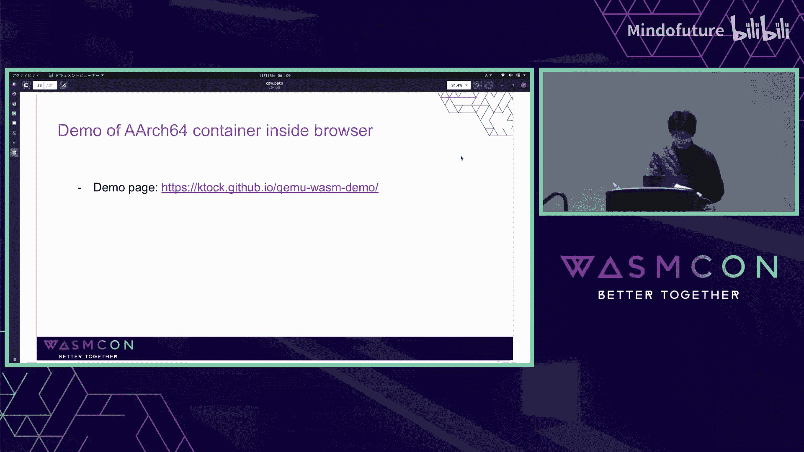

Finally， I'll talk about use cases and future walk of container to Was and。

QM feature box of container towards when QM was in the following slide。

 and the running container on browser is a very generic functionality。

 So I believe this can be used for variety of use cases。

 including V S code extension for running containers inside the browser。

 and there is actually already an experimental like implementation of this plugin。

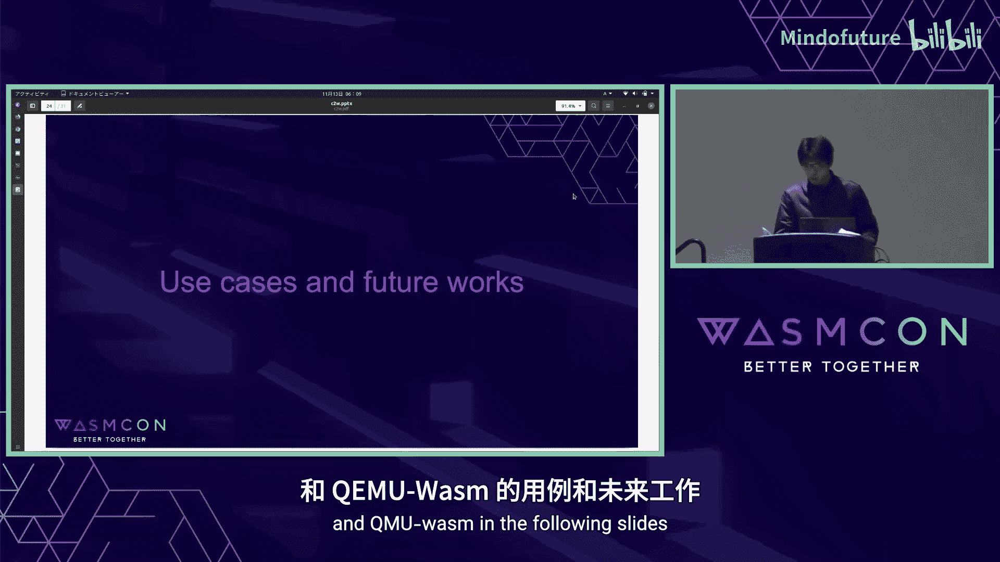

On Github and another use case would be interactive on browser demo with emulated machines。Again。

 this is all society。Demo page。40th， and。Another interesting use case is sandbox execution environment for containers。

And also application debugger runnable inside browser， who want record and replay de bucking。

These kind of use cases also sounds really interesting as a target use cases。And。

Another possible use case is boards on browser。 So use cases of QM U Wa are not limited to containers。

 Of course， and a variety of machines， including boards。

 are also usable thanks to QM U and example of。Eulated Roberry pie board is also available。

On QMU wasn report。So as I shown you the right figure。

 emulated Rasberry Pi and RasB Pihan run can run on browser。

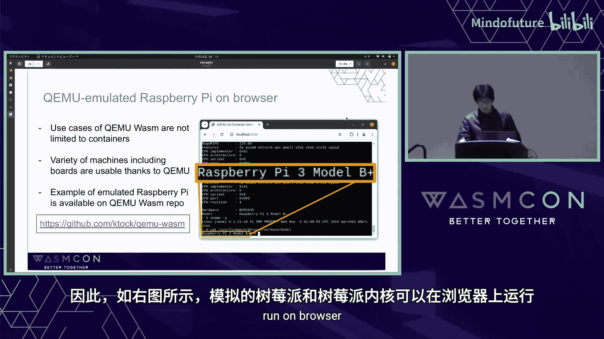

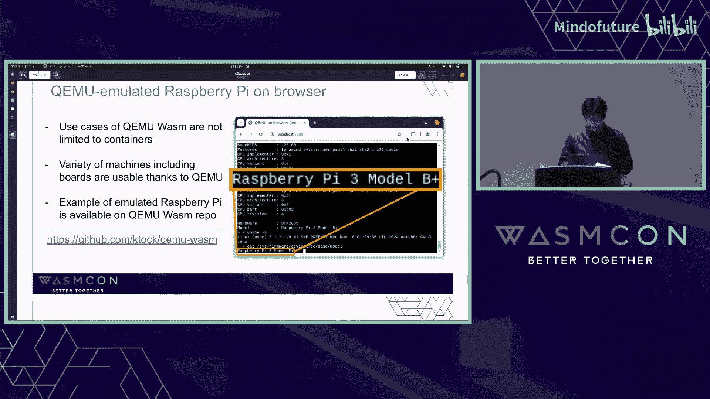

So this is a demo of running。Ratherably pipeboard inside browser。

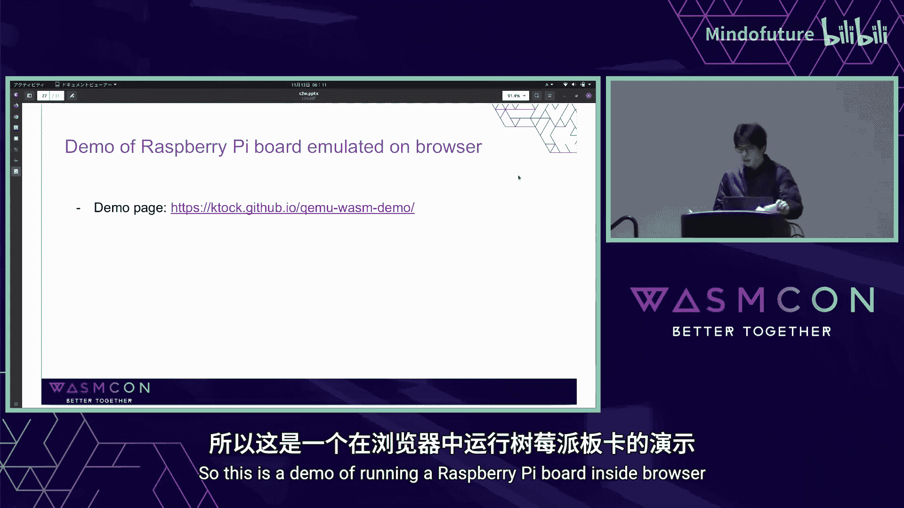

So again， QM U Wam， QM U Was is used as the emulator， and this runs busy box in the raably by board。

 emulated on browser and using a。You name Quaant。You can confirm that this is ARC 64 environment。And。

And from CPU info， you can confirm that this is a raspberry pie environment。And also。

 you can also get the board information on the Cs。So it shows this is a。Ratherably by environment。

And。Of course you can see the root file system at slash。

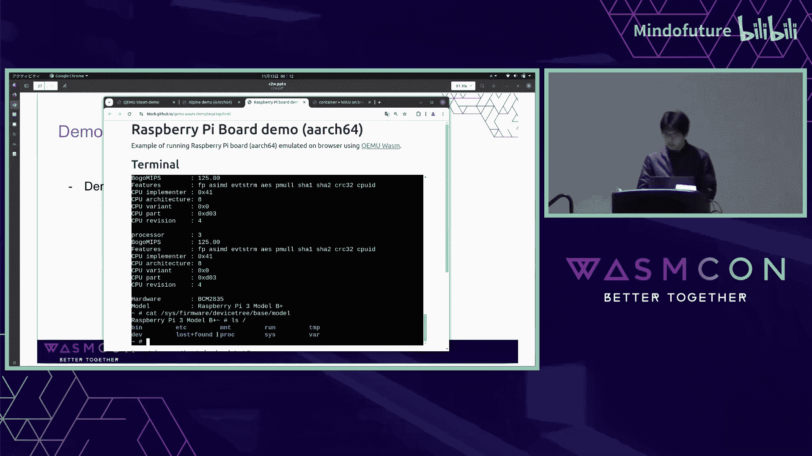

So container to Wa and QM U Wa are still in an early stage of development。 There several。

Future works to be done。First one is performance and stability improvement。

 I mentioned several limitations about QMB Was， so we need to fix them and the further improvement for Wa backend of QMU Was is needed。

And。Integration with AO T approach sounds also interesting。

 There is already an analog compiler called E EF conf。

 that is for Linux or 60 for ELF to Wam A O T translator by my colleague Ma Yohiura and another feature work is integration with more QM U features for example。

 enabling more guest to C use machines networking or graphics and also currently QM Wa。

Doesn't run on Wai。 So running on Wai is also possible future work。

And integration with ecosystem is also very important when it comes to running operating system on browser。

 it needs to access to package reportss like A P K opt。呃。And， but。Unfortunately， currently。

 there the doesn't allow cor access。 So this is， so integration of package reportss with browser environment。

Are needed。 And also codes are allowed container register are also expected。 Currently。

 Con register leads， public one doesn't support code access。 So to。

 to successfully access to register on inside browser code allowed container register。Or need。And。

To encourage discussion around this topic， I'm proposing container towards as a sandboards project to CNCF。

 This aims to filling the missing piece in the ecosystem as a solution for compatibility issue。

And this also aims to be a neutral community for discussing container to water migration。

And this also tried to encourage collaboration of containers and water。

So if you are interested about this topic about this proposal， feel free to reach out to me。

And in community， there are similar works similar to this project。

 as I mentioned in the previous slides。V 86 is X 86 compatible on browser CPU emulator by Fabian Hamma。

 It supports wide variety of guest Os and also supports G translation of bin using browser APIpis。

 It currently currently doesn't support X 86，64 guests and Q do do J S。

 It also QMed to browser by an There and angle。 and it supports G translation or T C using browser APIs。

 but it is a single sed and it doesn't support 64 bit guests。

 So QM U Wa focuses on practical use cases like X 86。

64 continental applications on browser and M T T C。So this is a summary of this talk。

 container to Waom enables to run containers on Wam with CPU emulation。

 containers run on Wasi and browsers and it supports container to WaM conversion。

 it also supports fetching and running modified container images on browser without conversion。In a。

We've recently added experimental support of QMU or browser。

A wider range of guest architect architecture support， including Art 64。

Is achieved and also can we observed a performance benefit by QMU。

 by Giit compilation and utilizing of multiqu。So I think that is all。 thank you very much。So。

 I think5 minutes。Left， do you have any question？Yes， please。Sorry， yes。

 if you don't mind waiting for the microphone。Hey， great talk。 I was just curious。

 Do you see a possible future where these could。Replace serverside container usage in production environments。

So， the question was。那个 replacing server side content usage with this with this technique。

 that sounds really interesting。 use case， for example， like offloading similar。哎。For example。

 for in terms of like own browser one browser demo use cases。

 of course server side server side is completely server side like a server side。 I mean。

 we ver machine is completely not needed everything runs on browser so but aside from like a demo use cases。

 for example， like offing function applications or functions or。Yeah。

 building building blocks to browser。 that sounds also interesting use cases to achieve that。

 I think， further improvement of performance for this technique is required。 But yes。

 ofloading several existing likeava side component into browser。

 That that is also sounds a very interesting use case of this technique。

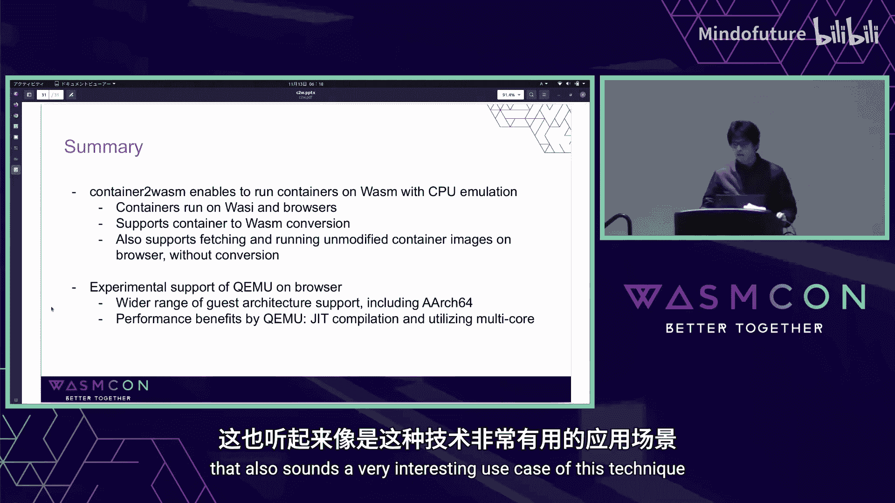