# WasmCon-2024-p22-P22-The-Future-of-Green-Cloud---Serverless-WebAssembly-on-Arm64-Archi...-Kate-Go--BV18DjSzJE6r_p22-

My name is Er Williams， I'm a senior engineer slash dev advocate with Apire Computing。

Hi everyone， my name is Kate Golden R and I'm a senior software engineer at Fermion。

 where we do a lot of serverless Web assembly work。

And our topic today is the future of the green Cloud。

 serverless Web assemblymbly on the Ar 64 architecture and as you can tell from that title。

 we're going to be talking a lot about you know green architecture and just to kind of go through this real quick。

 you know set up the problem we know that global warming is happening。

 it's a big issue throughout the world but we still need more and more compute and this really does affect people communities around the world are being forcedd to decide between having data centers and all the good jobs that they create or housing。

 for example， in West London there's going to be no new housing until 2030 and this is so that the electrical infrastructure can catch up。

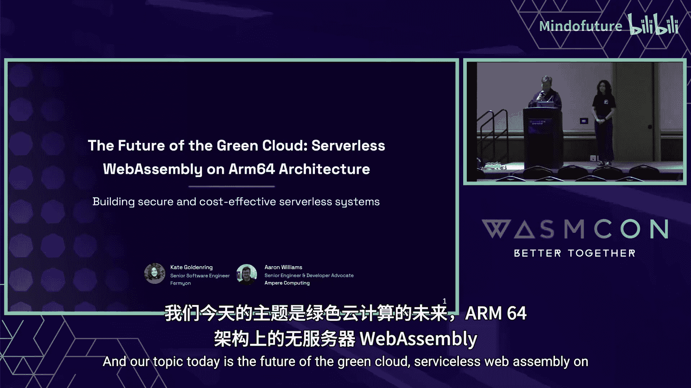

With know， with all the data centers that are put in there。 And I do want to kind of。In this quote。

 I do want you to kind of look at a couple of these numbers right now in a data center Iraq is about 10 to 14 kilowatts。

 that's kind of the standard， but these new data centers are being put in with 60 excuse me。

 40 to 60 kilowatts per rackC。And that really adds up to a lot more energy that these data centers are going to be consuming。

And really， just to kind of start this off， you know， what can you do about this， right。

 You're not going to quit your job。 You don't control the building of data centers or even how they look。

 but。What you can do though is control how your code is written and what architectures you run on it so you can look for ways to improve efficiency and the first thing you need to do is understand that you actually can do something right if you can't do anything you're not even going to look at it。

And then you need to know how to measure。Your carbon impact from the code that you write。

 how and then actually how do you do this and then try to make your best choices about how the software platforms that you run。

 run ones that are more efficient and same thing with the heart， the hardware side。

And that's kind of what this whole thing is is to give you guys the power and let you know how you can make changes。

 So this is from the Green Software Foundation。 So for energy efficiency。

 this is the idea here is to use less electricity while you're running your software。

And then second choose your hardware on that same thing so that way you're using fewer resources to perform the same tasks and that hardware is also more efficient and the last thing is really to be aware of the carbon how you're doing it so is there stuff that you can do like simply change times of day of when you run your tasks and things like that。

 but also region shift move from something that is carbon intensive to something that is much less you has a lot more solar。

So how do we measure this stuff？Well， the once again， from the Green Software Foundation。

 the software carbon intensity is simply R by excuse me。 You can mount of carbon by R。

 and the R there is kind of。The resource， meaning processing an order。

 some unit that you're running your software， so I can't use my hands。

And then now with the carbon part， let's break that up。 Let's move inside of that。 So in here。

 this is the emissions of building the chip and the hardware itself。 So this is， you know。

 when it comes into the。Data center， all the carbon that has already put in there。

 your your software is going to be charged for the amount of how often you use it and for how long you use it。

And we already went through kind of what R is and then the operational emissions We'll break that into E and I I is the carbon intensity of the power coming into it once again。

 this is， you know if your plans， excuse me if your D is next to a coal plant。

 that's really bad next to solar that's much much better and the energy。

E is just the energy that is consumed by that actual software。

 So the best case for your software is to use to use the hardware as least as possible。

 and then for that hardware also to be as sufficient as possible。 So fast software is great。

 but if it needs to idle in between starts and stops。

 that's not good because you get charged for all of that energy from the time that your program starts to it ends。

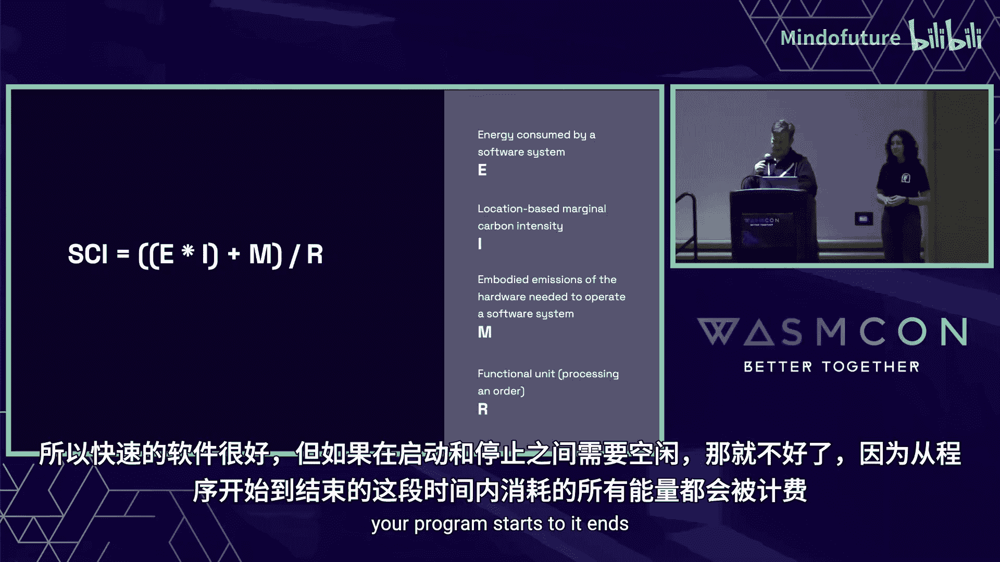

So now that we have this software carbon intensity formula and we know that that is the equivalent of E or operational emissions。

 the amount of energy I need to run something embodied emissions。

 the amount of emissions created in order to create that hardware that I'm running it on。

 How can I bring down the O and bring down the M。 And how can I have a green software stack for my application。

 And so we think a green software stack has four parts。 One。

 you can choose and to implement your entire application with an efficient programming language it' a bit hard one to do。

You can choose an application architecture that is density oriented。

 so it makes it so that you can run as much as you can on a piece of hardware。

You can choose an isolation mechanism that is fast switching。

 so it starts and tears down as fast as possible， and you can choose to run this all on top of power conscious infrastructure。

 So we're going to walk through each of these four and talk about the software you can plug into each part of the stack to get that green software stack。

For starters， there was research that came out and was updated most recently in 2021 that basically took the same application or the same program and implemented it across various programming languages and then observed how much energy was used in each of those languages It found that implementing your application and a language such as rust would make your application use 75 times less energy than implementing it in a language such as Python and so this is pretty powerful if you as a software engineer want to write code that uses less energy。

 however， we don't always as software engineers get to choose what language we implement our code in sometimes we're using legacy code or are tied to certain libraries or maybe our company just doesn't use that language so this is a great approach to take if you have the power to take it if you don't there are other options such as your application architecture and the goal here is really to do as much as you can with the same amount of hardware。

I've seen waves of this over time。 We've seen how originally this started with the virtual machine。

 where now I can write monolithic applications and I can scale them next to each other。

 Then we move to the microservice model， where actually。

 I'm breaking my application into separate microservices so I can scale individual services instead of needing to scale the whole monolithic application to meet needs of all the load that my application is getting。

Then we saw serverless come to be where we're scaling individual business logic units or individual functions of our application。

 and now we have even more precise scaling， so that way we can have even more accurate scaling and get even more out of our hardware。

However， serverless hasn't fully achieved what it set out to do。

 we haven't gotten the density we wanted out of it。

 and part of that's because existing underlying technologies of serverless do not scale to zero。

 and so ideally we can get an even more packed server。

 go from that one serverless image to the next and we can find a technology that can support that。

So talking a little bit about the problems with existing serverless。

 so underlying technologies today that are used for serverless。

 one of the predominant ones is the microVM， which is what is behind AWS lambmbda。

 microVms can take up to a second to start if you do cold starts。

 which means that you end up waiting longer for your isolation mechanism to start then you do actually executing your code so the workaround for this is for AWS lambmbda。

 they say don't worry， cold starts only occur in1% of ins。

 but if you look at that from the sustainability perspective。

 that means that they're pre-warming 99% of instances so that means they're using resources on the host before you're actually executing your code。

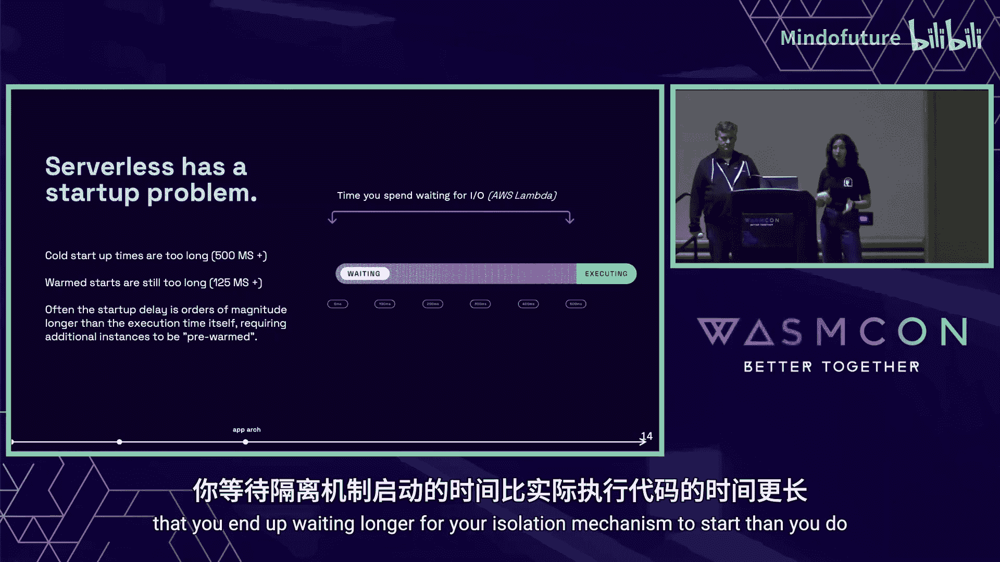

And that is because we have those really long cold starts。

We have a similar issue with containers when used in the serverless architecture Azure functions is backed by containers。

 and Microsoft research found in 2020 that the cost of keeping these applications warm。

 so keeping the containers running was prohibitively high for Azure functions and that's because the functions were getting requests about one time per minute or less。

 so it was just enough that they had to keep the containers warm that they couldn't tear them down because it takes so long to bring them back up。

And we're at Kubbecon， so to talk about this problem at large within Kubernetes clusters， on average。

 69% of CPUU cores in Kubernetes were unused， and so we're not getting the most we can out of our hardware。

 and so we need to find efficient application architectures that help us utilize all that we can from our hosts。

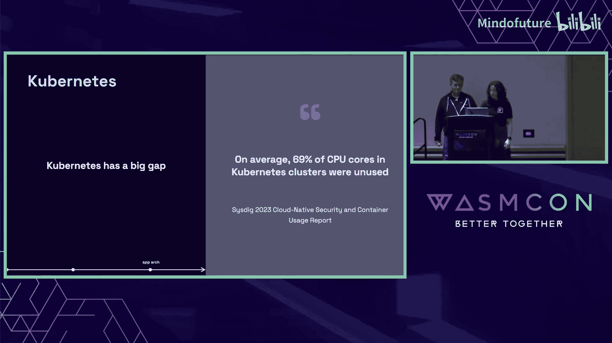

So going back to that picture we saw each of those application architectures and now we know the underlying technologies under each of those so what's that underlying technology under the scale to zero serverless and you' probably not surprised we're at Walencon。

 it's webassembly and Webassembly is an isolation mechanism for our code。

 so it works in multi-tenant environments just like predecessor technologies such as microVMs containers。

 VNs themselves， however it starts in less than a millisecond and many of you probably already know this。

 but for folks who might not know what Webassembly is。

 it's a way it's a portable compilation target and what that means is I can take my favorite language of choice whether that's goR。

 Python or maybe JavaScript。

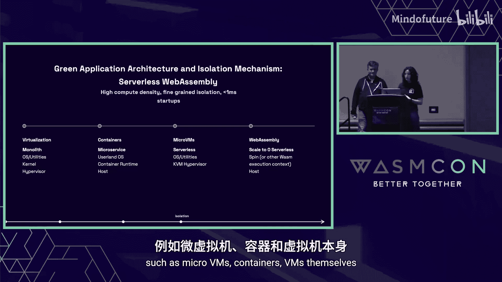

And compile that down to this dotwam file， and I can take that dotwam bycode and run it anywhere where I can put a Webassembly runtime。

 whether that's on the edge or in the cloud， whether that's on a certain OS or a certain platform。

 it's portable across all of those platforms and architectures and regions。

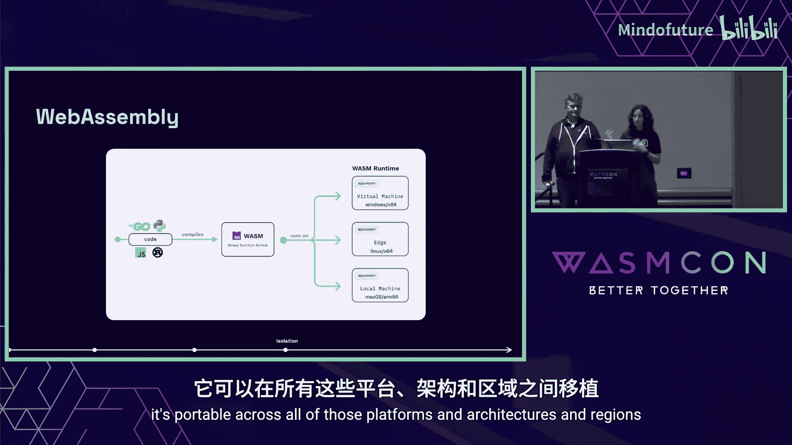

And going back to why this is our scale to zero solution， Web assemblymbly is isolated。

 it fulfills that requirement that we need for serverless。

 it has a secure sandbox and capability based security which ensures that you only get access to host resources that you're explicitly granted access to。

 it's portable， like I just mentioned it can go everywhere， which is great for all of our DevOs。

And it's very small if you are to implement an express JS app and containerize it。

 that can be around 300 megabytes， that same application as a Webassembly component， three megabytes。

 and if you're using something a language such as rust that could get down to 200 kilobytes。

And as we know， that startup time is incredibly fast with Webassembly。

So how can I get started doing this with open source tools Spin is a project that I'm a maintainer of that my company Fermon。

 has been working on for three years now and it is a developer tool for writing serverless webassembly applications and it aims to make this experience super simple it's three commands spin new。

 you scaffold your application， spin build， you now have your dotwason file spin up。

 you're now serving it locally so let's go ahead and quickly look at that experience We're going to have to do a little bit of a window juggle here for our screen mirroring here we are We to our terminal。

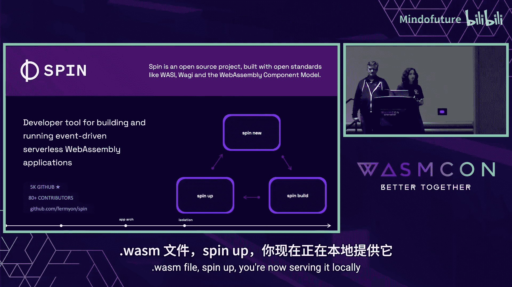

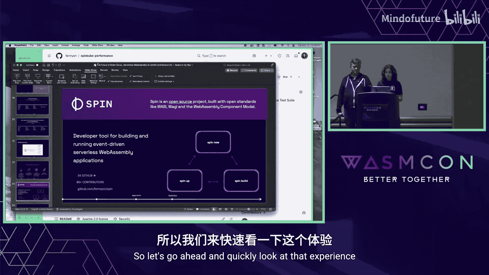

Let me clear this all out。That looks decent sized。So let's do those commands。 Let's do a spin new。

These are all the templates spin provides for you， you can also implement components and languages other than these provided。

 but I'm just going to go ahead and use a template and you're also choosing what is triggering your serverless application because serverless applications are event driven so we see HTP here Redis you could also do MQTT triggers you can directly invoke with commands。

 you can even plug in your own trigger with the spin but let's do HTTP since Kubcon and there's a lot of Kubernetes developers will go ahead and do go。

And just pick a name for application， maybe hellello spin。And some description， I'm sorry。

 I'm not very creative。And then this is where you say， what triggers your application。

 You can have it be the wild card for that entire for your whole application。

 or you can choose a specific route for your HTP request。 I'm going to choose hello。

And now we can go into that directory that's been scaffolded for us。

And we'll see here that we have a go application that's been created for us and our spin。mal。

 this is the spin application manifest， let's start there。

So this is what this describes the layout of your spin Webassembly application and here you can see we have one Webassembly component that's triggered by HTTP requests to the route hellello。

 you can see what resources are allowed to this component because we have capability based for security this component is actually not allowed to make any outbound requests we could add hosts here that it can make outbound requests to。

 we can also add SQLL databases it can use key value stores， etc。

 and then we have the command for telling Sp how to build it which we've scaffold for you as well。

Let's go ahead and look at our actual application。 This is just an event handler。

 and all it's doing is returning Hello Ferm on。 We can customize this。Let's just say hello Wasmk。

And then we do our next command， which is just that spin build。

 So now we're taking that go application and compiling it down to webassembly and now we have that main dot wm and then we can spin spin it up locally。

 and now this is spin is waiting for request and for every request it gets it will load that Webassembly module into linear memory and execute it in its sandbox for every single request we get finite levels of security So let's go ahead and just hit this with some bombumardier for five seconds。

 so we're issuing request after request after request saying hello hello hello。

And we can go ahead and see。On average， we had a latency of 3。38 milliseconds， and we， we created。

370，000 web assembly components in that amount of time。 we loaded and sandboxed and executed。

 and I realized that it was really hard to see what was happening there。

 so let's just do it once right here。So that's what was happening every single one of those requests。

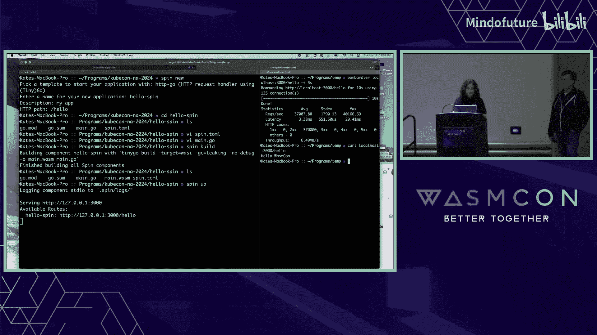

So with that， let's go ahead and。Go back to our presentation。

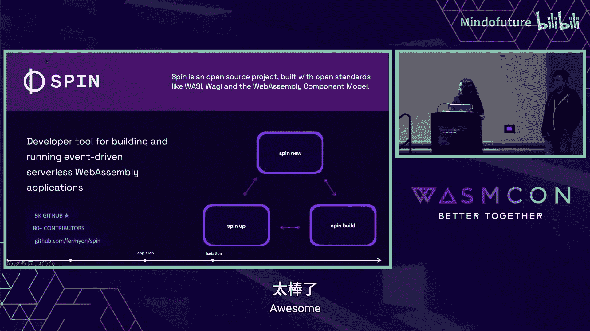

Awesome。And like I said， not just HTB triggers， you can trigger your serverless a drivenven applications with whatever triggers you choose the plugin or any of our existing triggers。

 and we just did this locally， that was exciting， but we want to put this somewhere so you can run spin on Fermon Cloud which is our multi-tenant platform for running serverless Webassely or you can run it on Kubernetes with SpCbe。

 which is an open source project that was is a conglomerate of work from four companies Microsoft。

 Suusa liquidqui Re and Fermion to make it easier to run serverless Web assemblyly on Kubernetes and we actually just announced two days ago。

 there's a marketplace offering for installing this in Azure on AKS if you want to just we test it this morning it takes like six minutes and you have Kubernetes cluster with SpCubbe installed ready to run serverless Web assemblymbly and you can also run SpCbe on EKS GKE wherever you can put Kubernetes。

A little bit about Spcube， I mentioned it's those four projects， but it's the classic。

 what it's powered by is this container D shim， essentially we're telling container D to execute Webassely instead of containers under the hood and that the top level of it is a spin operator because of our Kubernetes and everyone loves operators and that's basically making it so that you can declare and yaml what you want to be running on your Kubernetes cluster。

And now that we've talked about where you can put this。

 let's go to the fourth part of our green software stack， which is the architecture。

And so before we start with the infrastructure， let's just go through some quick terms that we're going to go through that we'll need going forward。

 one is performance， and this is just quickly or simply flops， this is how fast your trip is。

 how much you can just push through it， no restrictions know nothing。

Performance per watt now we're starting to put that restriction in there is how efficient this is the simplest analogy for this is think of a dragster doing a quarter mile。

 you don't care， you want the speed of it， it's absolutely wasteful you from how much fuel goes through tires。

 everything like that， completely wasteful but absolutely really cool and fun to watch go down the thing。

Once we put in that limitation of w， you know how much is this doing per unit of energy now we're really starting to care kind of on a day to- day basis the next thing is performance per rack this is how many servers you can put in there and what they're made of so you're taking that server and you're kind of expanding it to a rack。

嗯。Poin of view then I mean you really can then take that to how much you can put into your data center but data centers are wildly different from each other and everything like that and the last little bit is the kilowatt per wt excuse me kilowatts per rack This is what I was telling you at the beginning most data centers that have already been built have a rack of about I think it's 12 to 14 kilowatts。

But what they're now doing is is because of GPUs and AI and X 86 servers that are getting just so。

Massive and you so much energy is that they're doing this。

 they're putting in those 40 to 60 kilowatts。

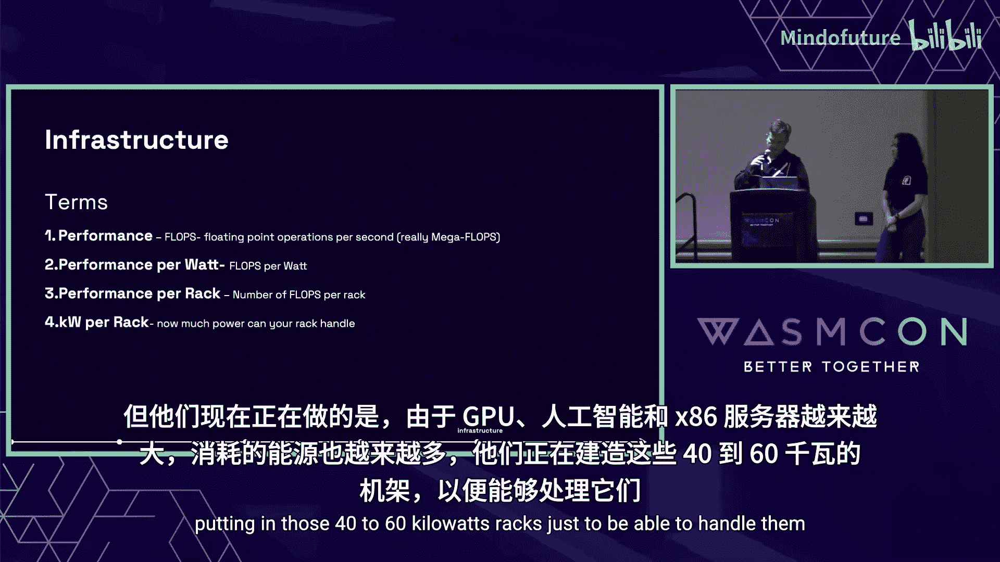

Racks just to be able to handle them。So as Kate was talking about about utilization and density and how we do it。

 this is the hardware side of that， so we need chips that once you start once you start them up and putting a load on them that they can handle it and their performance stays。

 so this red line here this is arm 64 this is an arm 64 server。一。Can handle that。

 And it's pretty linear as it grows。 If you look at X 86， around 50%， it really drops down。 I mean。

 it's still growing。 I mean， it's still doing more work， but it's becoming less and less efficient。

 Why is this。 Well， this is one of the biggest reasons is ST， which is simultaneous， multithreading。

So on each of the X 86 cores， they actually give you two virtual cores， right？

And so now you have to split， which is great。 up to about 50%。 they're not really， you know。

 50% load of the server。 They're not really worried about it。

 You don't need to use SMT once that starts happening。

You have the problem of one of of a noisy neighbor it's called a noisy neighbor problem and simply what that means is if somebody one of the threads blocks to go get a resource or doing IO or anything like that。

 it has to pause right and that also means the other thread is now blocked so now you have two block threads。

On arm 64 servers。It's one thread， one core。 This is why arm 64 servers have so many more cores。

 and it's very core dense。 and so this can happen to more load。

You get the predictable performance that you would expect out of it。

And so we really need that high utilization because this means less servers。

 and we have to build less things。

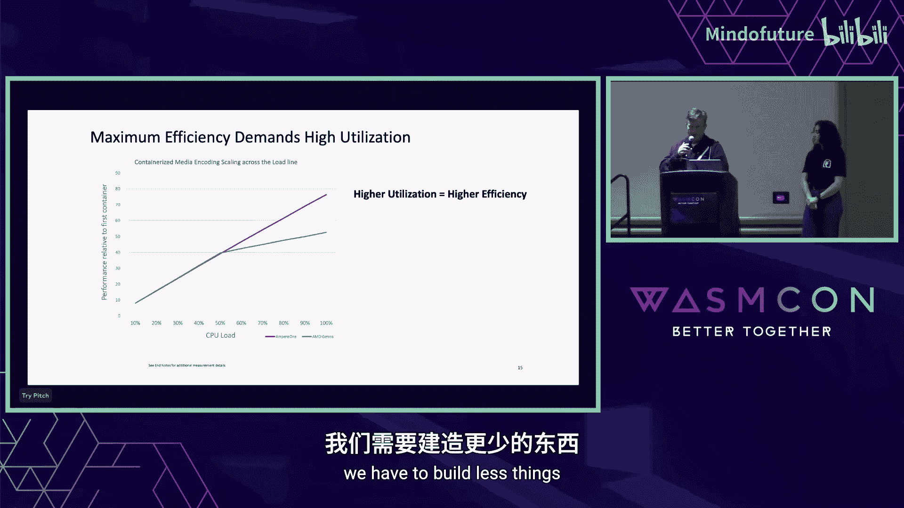

All right， so let's kind of show a little quick little example of this。

 and it's simply how many CPUs do you need to do 1。3 million requests per second？And。

If you look top line is Intel， it's 82 CPUs， and our thing we're making the assumption that this is two CPUUs per server。

 so that would be 41 servers。And then what we're going to do is we're going to stack these into Iraq rack。

 we're going to give this the perfect scenario of where you don't have to put space between the rack。

 excuse between the servers to make sure things are cool。

 we're just going to pretend for everybody that everything's the best case scenario possible。

Then if you move down to A 64 arm 64 servers。They only need 18 once again they needs 36 CPUs to do it。

 but only 18 servers why back to you know SMT， other things for the throughput of getting a thing anyway is now the reason these things are stacked this way and this graph is this way if you notice that 18 servers will fit into a 42 U rack。

Versus you will need three for that Intel server， just once again， trying to be more， more dense。

 more better utilization， both of CPU， the silicon itself， and then the server and then the rack。

And this really adds upop。And this adds up a lot。 so now if we think of those Intel servers。

 they're at 850Wts per server， and then we need 41 of them， simpleple math。

 multiply it together and we almost get 35 kilowaWts per hour。 That's a lot of energy。

Versus on the Ampere ones， the AR64， that is 18 times 705。

 so it's 150 less already per server and so many less servers to begin with。

 and so now you end up with that 1212。7 kilowatts， which is once again enough to put into Iraq。

So it's still one rack。So kind of wanted to kind of have a little conclusion slide here。

 and it's kind of really obvious is you guys do have the choice or have some options when you're building your software if you use a more efficient stack for that like Wam。

Great， that's better。 that's going save energy， save carbon。You know。

 great if you have a choice with your hardware if you choose arm 64 servers。Once again。

 that's better， but if you can combine this stuff。You know building Wasm on arm 64 you end up with a much。

 much better solution and now for some cool demos Yeah so let's go ahead and look at the combination this part of the matrix that we want to be at the Wasm+ arm64 when we were releasing Sp cube this text is unfortunate when we are releasing Sp cubebe we wanted to help people who are using it in their clusters to be able to test their production applications to see how they were doing performance wise and so we created this performance suite that if you're familiar with K6 it's a tool for load testing applications and has an operator for Kubernetes we essentially are using that with our Kubernetes cluster configured with spinC and ran a series of load tests and created a repositories that people can use those load tests and also add their own and the way it works is whenever we want to run a load test。

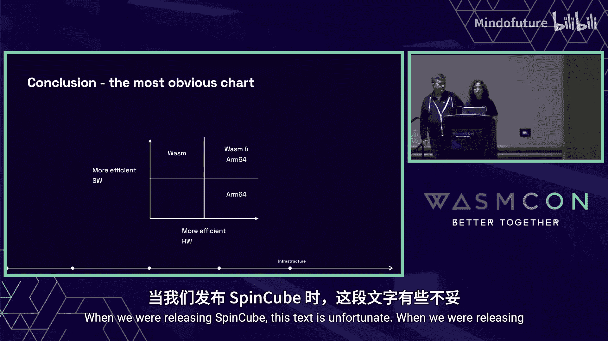

Releasing a new version of that container DSim will come in here and create a new one and this test is pretty extensive。

 it terraforms an entire cluster， it installs F cube on it and then it runs a bunch of tests and so instead of going ahead and doing that we've already have one that's completed that we can look at and obviously add the P for the ApiR nodes there and this is all on AKS and you would just put your datadog dashboard ID there there's also Prometheus setup in here if you wanted to use that so we can look at a previous test and just go to that datadog dashboard and kind of see what the results of it were and you can see we're using pretty small nodes because we don't want to because they're kind of expensive runs if we used two big of machines so it's about8 gigabyte and two core machines。

And one of the tests we run to see how language tooling is improving in the Webassely ecosystem is if we take the same hello world app across languages。

 how fast does it execute and so this is something we're just keeping a tab on to kind of see and we'll see if we go back to our first part of our greenstack it still matters what language you choose that still does help with the speed of execution of your code another one we do is as we scale up the number of replicas of our application。

 say you want to use po out of scaling with spinCbe you'll see that we're still staying flat on requests per second which we were curious to test out and then here is the one that's interesting which is ramping the request per second you can see the CPU usage as we ramp up just immediately drops down after the test too so we're scaling all the way back down there so this was just a suite that we've kind of have to get started and are hoping to let it grow naturally for assessing the performance of your Webassembly application。

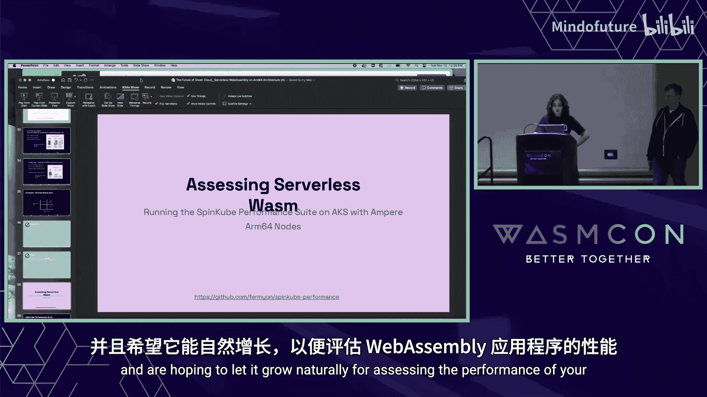

う？And if you just to kind of summarize someone who's。

Walked through this and done this basically experiment of okay。

 I was using containerized serverless and wanted to move to serverless with Webassembly。

 the ZeIS group did this and once they moved to spinCbe。

 they were able to reach a higher density without losing performance and what this resulted is they cut the cost of compute by 60% and part of this cost cut was because once they moved to Webassembly they had higher density。

 but they also could choose what architecture worked for them so they switched to Ampre based VMs and Azure which were less expensive as well so moving to Webmbly gives you that flexibility to constantly change your architecture decisions。

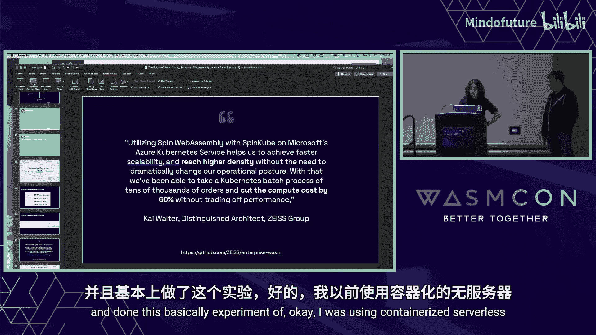

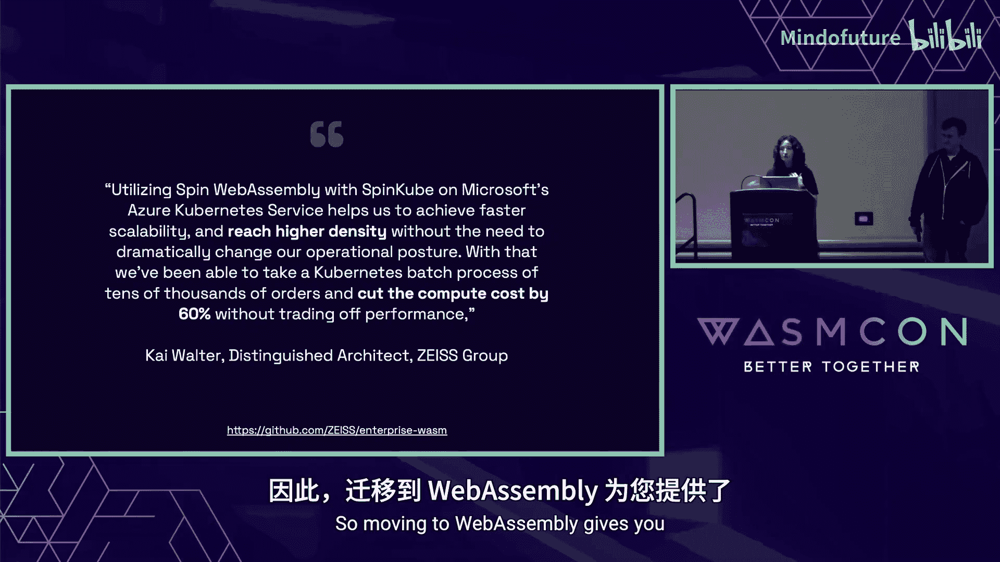

Finally， if you want to interact with more Webassembly we have a really cool demo that's going to be all across the show floor today。

 Microsoft， Fermion， Apire and Akaai are all participating and we're going to have a sound sensor at each of these booths don't worry it's vibration-based we're not recording you and what it's going to do is basically that sound sensor will capture the level of volume that each booth which will then send to an MQTT broker and then we have an MQTET triggered spin app that's going to grab that value and persist it in a SQL database and then a backend component that will then be able to serve time period chunks of all those sound values and then a front end that displays it all very nicely on a chart and the idea here is we can gauge how much people are engaging with a booth based on the amount of sound happening at that booth so we'll be able to have a line for each booth might get a little competitive but see which booths have the most sound and activity happening around them。

So definitelyfin check out those booths， make some noise at each of them。

 maybe a lot at Fermions and see if we can get a really cool chart going in there。

 all powered by Webassembly。

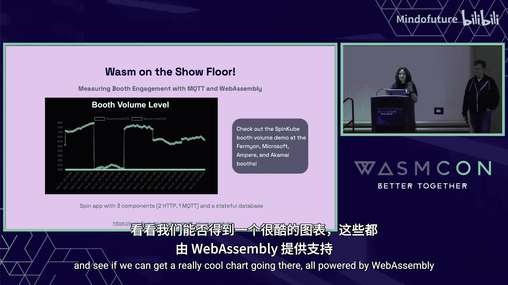

And with that， you can also find us on the SpCbe channel on the CNCF Slack。

And we appreciate all of your time， thank you。If there are any questions I have a mic and running around。

 but since I have the mic first I'll ask a real quick question。

 Sure can you automatically set up to figure out where is the best place you can run on spin cube are you talking about where is in what region is the most sustainable Yes we don't do that for you。

 but a lot of cloud providers do that for you and there's a lot of tools out there that will help you understand what region to run your application in that's using more sustainable energy whether that's a certain area of Europe that has more wind or solar but we don't have anything to help you with that？

So I have a question about spin。 very amazing demo。 I'm wondering。

 what is the support like for like third party libraries when I'm working with， let's say。

 Typescript or Python Web assembly for example， I'll just give a concrete example， for example。

 if it's a H TB handler that processes image。 And when I was doing in Docker。

 I would have to install some like system dependencies at the O S level。 So are these package。 Well。

 these package be supported when I move to spin。Yeah。

 what exact library support is supported in each language ecosystem is a really good question and that's across the entire language ecosystem not just specific to spin but for example with Python one that a lot of people asked about as pandas which recently Python now has support for so over time we're adding support for more and more libraries for image analysis and basically image changing we've done already some I know we have demos where we've done basically changing the filter on an image or you know making it vintage looking and all of that so I know we've found ways to do that and that was in JavaScript but I don't know the exact libraries that are capable of doing that and whether we have support for those specific ones but that's certainly a great question to ask within spin has a discord so if there's a specific example you want to do definitely check out discord there and we can look at exactly how you would make that happen does that depend on the maintainer of these respective libraries or is that an effort that。

I don't know Web assemblymbly or a spin would take care of down a road Sometimes both I believe for NPI that was an effort for componentized pie so that nothing the maintain of NPI had to do and then other times you may need to change your library to target for example was HTP or something like that if you wanted it to be more native to the Webly experience but a lot of times the library maintainers are left ignorant of it which is the best case scenario okay thanks。

Hi， my understanding of 32 and 64 bit was them。Is a little bit flawed and lacking and I'm just curious if the utilization optimizations that you guys were showing。

 was that using 32 bit wasm and how does 32 versus 64 bit？Plan to server our utilization。

I am not sure on 32 versus 64， I'm pretty sure we were using Was in 32。

 but I don't know how we would see performance trade offs between the two of those。Yeah。

 that's a great question to ask and one place that would be a good place to get the answer to that would be in the B code align seallip to see if people have played around with the difference in performance there。

So can you compare this to other solutions like K3S like where does spin pick up and Kubernetes leaves off I heard the container D reference but are you able to make a quick comparison to something like that like what was the like K3S for KS they try to compile all of Kubernetes into a single binary Yeah spin cube works with K3S so K3S uses its embedded container D like you're saying kind of brings everything together into one package but that container D still has a configuration file and basically under the hood what we're doing is we're updating the container D configuration file so that it's aware of the spin runtime and so when it sees the spin runtime class it executes the container D shim instead of run C and Kubernetes has native support for that with its runtime class type and the runtime class manager that's a part of spin cube does all of that for you so it will go find that container Dconfig file based on the runtime so it knows where。

3 yess update it and then you're good to go Okay apollo up so like how how much more portable does that make this。

 for example， could it be used in the local dev or dev container scenario like if you wanted to deploy。

 say to an artist machine for a game scenario you know they're not very technical they want to get set up you want everyone to have the same dev environment Kubernetes has been a little bit heavy do you think something like this could。

Make inroads there。I'm not aware of the efforts to put K3S in a dev container。

 but my thoughts would be if you can put K3S there， you probably could put us on top of it。

 but I would also recommend in that case maybe just using spin as well。

 which is what we like about spin is that you have the same exact developer experience locally as you would running it in the cluster so you can just execute it locally in your environment and it works across your language tooling so I'd probably just use spin instead but I would love to see someone put K3S in spin cubebe inside a dev container and try it to Lastly does it work with like traditional like Kubernetes CI like could I use calico or Cium with it Yeah so the networking is all above spin cubes level because what is happening is that it is running as a container the po it's still within a pod scope so it still has a pod IP and everything so all CNI above that still works just as normal。

Thank you very much for the demo so I have a question。

 so if I have an application that really doesn't need to scale to zero。

 but just need to scale up and down。Is there any benefits that would get going to one investors staying in Kubernet ways and optimize autokiter。

Would you describe the application that doesn't need to scale to0， but describe。

 but just scales up and down is basically a long live service， something like that。

 Yeah my personal opinion is if it's a long live service。

 there's not as much benefit to using Webassembly because you're not getting that tear down tear up。

 But if you still want to use it as the isolation mechanism。 It's still great。

 And you could use that instead of containers。 but you might not be interested in that trade off to all that is open and available to you using a container instead。

