# WasmCon-2024-p24-P24-Bootstrapping-Ecosystems---Unveiling-the-Power-of-the-Component-Model---Osca--BV18DjSzJE6r_p24-

Alrighty， hey folks， my name is Oscar Spencer， I am coauthor of the G programming language and I'm also a principal engineer at F5。

 My talk today is Boottrappingyems Unveiling the power of the component model。

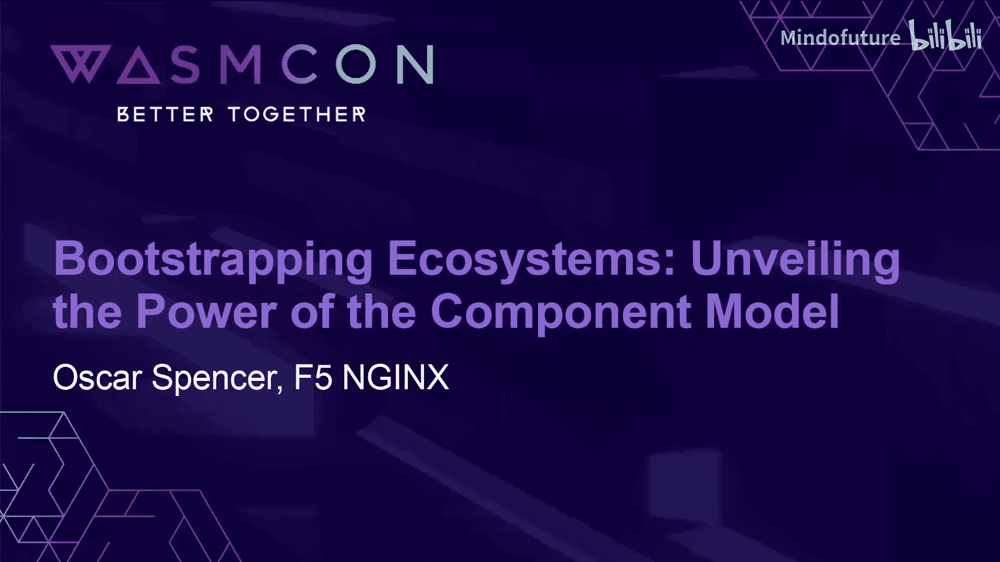

So first up。😊，Is the language， so I want to introduce you guys to a programming language called Gin and it started as just a weow seedling back in 2017。

 and it's a strongly typed relaxed functional programming language made just for Web assemblymbly。

I said to myself at the time。As a language nerd。If I were to make a programming language and have anyone in the world care about it。

 it would be right now in 2017 with Webassembly being turned on by default in all the major browsers it was what I thought would be the only way to have a successful project and conveniently enough some people thought it was cool and so we're still building it to this day at this point in time we've got seven different people who actively commit to the project which is pretty sweet it's been amazing to continue building this out and be a part of the Webassembly ecosystem。

So in terms of what the language actually looks like， this is some grain cone。

 and we do a bunch of concepts from functional programming languages so you get things like really thinking about being data first and having algebraic data types。

But also， we think about。Imairative programming styles， too。

 because we understand that not everyone can have this purely functional。

 amazing language that we all know and love。Unfortunately， we realized that's not what the world is。

 So we say， okay， let's actually include things like four los and have things like let mute。

 So you can actually do mutation in the language as well。😊，Now。

 this has worked out really well for us。 Folk like the language。 and that's great。

But building an ecosystem is really freaking hard。 So when you use a programming language。

 you really expect there to be quite a lot， right So the first， of course。

 is a robust compiler When you write some code， you really do expect that that code will compile into a binary that will run and do the things that you told the code to do。

 right。And that's the first one。Second is a solid testing and debugging experience， right。

 like you expect to be able to actually figure out what's going wrong with your code。

 you hope that you're not writing a bunch of code and just being left stranded with nowhere way to actually debug。

Syntax highlighting your favorite code editor， we don't think about it because we take that for granted right you install a brand new IDE。

 you install whatever package for jascript or whatever and hey you've got syntax highlighting。

 if you write a brand new language you actually have to go write that syntax highlighting engine and that kind of sucks that you actually to go do that sort of thing and the next is a language server so when you're actually writing code in your editor and you get that little squiggly line under something that says hey this thing is wrong or this method doesn't exist。

 that functionality comes from a language server which is yet another thing you have to implement。

And then of course a full package manager and registry。

 so when people write packages for your language that they want other people to consume。

 they expect to have a place to publish them to and pull them back down and build projects with them of course。

 and last it is tons and tons of available libraries when you look at different language ecosystems like you look at the Python ecosystem。

 for example， what's the best thing about it， there's a package for absolutely everything。

 no matter what you want to do， there's a library for it。If you look at a language like Ruby。

You feel so good as a developer when you write Ruby code。

 and a lot of that is you go and look at the standard library and there's a function that does the exact mapping and filtering that you're trying to do so you can actually write that one liner and it feels pretty freaking good。

 right？So。There's way more that goes into building a full language ecosystem than just writing a compiler。

And of course， I was a little bit stupid thinking， oh man。

 I can just actually write a compiler and then that's it。

 but now you have to build all these other things too。So we went all in on Webassembly for this。

We don't compile through LOVM or anything like that。 We go straight through。

 there's a project called binaryarium， if you all are familiar with that。

 which allows you to compile binary IR to Webassembly， and that's what our compiler targets。

 So we're going absolutely straight to WASM。But can Webassembly help us at all in trying to build out our ecosystem because people like the language。

 they think there's a lot of really good fundamentals。

 they love how it less than design programs and reason about code。

 but we just don't necessarily have all the libraries yet。So that brings in the component model。

And so the component model gives us high level types for Web assemblymbly and enables us to compose modules together。

😊，That's actually a big deal， right， because if you think about it。

If you could have access to any library that was ever written for Python from your Ru cone。

Or if you were writing an app and send man， I really want to use those cryptography libraries that are written in go。

 even though I'm writing my app in JavaScript， that would be absolutely huge。

But this is actually what the component model gives us， right。

We get this through the the component models canonical AI。

 It describes a particular data format that every language can compile to that then allows them to seamlessly talk to each other。

I don't know how involved y'all I've ever gotten in writing fFs between languages before。

But it sucks like imagine like if you're writing some ruby code and you want to use some code that's written in C。

 the code that you have to write to actually make that happen。

 it's a terrible time that the component model gives us staff for free。

 That's this concept of free SDKs as we've been calling it。

 that as long as you can use Webassembly and use Webassembly interface types。

 you can generate bindings for these languages and get a free SDK for any language。

So that cross ecosystem library is sharing。Is what is actually huge and what I think is fundamentally going to change how we develop software。

 The fact that you can pull in libraries from different ecosystems at will。

So this is a slide from our friends at Cosmotic。 I think it really shows so well what software development is going to continue to look like in the beginning on the side where we've got just the PC。

😊，As a developer， not only did you have to worry about writing your app。

 you have to provide the libraries， figure out what operating system was going to run and even provide the physical hardware right you have to go buy a server stick it in a closet somewhere and actually deploy your code onto it But then we got into the realm of VMs right where now developers weren't worried about the hardware anymore now you just have to say let me prepare this Vm let me get this together and then I can just deploy my apps onto it and that's great。

 And then the evolution of that was containers where we don't even care about the VMs anymore we're just deploying some containers and they run somewhere else。

 and then that sort of fast forwards into Kubernetes and Webassembly components where we're not worried about that at all。

 We're simply worried about building our apps we don't even have to worry too much about what the libraries are and that's what's pretty huge in the component model。

😊，So the important part of this is Webassembly interface types。

And known as w and Wi is a super developer friendly format that allows us to describe what these interfaces look like。

 So basically， as long as you can write an w interface for something。

 you can automatically magical generate bindings between multiple languages。

So I'm going to show us a little bit of that。Which gets us to the beautiful live coding section of the demo。

So here I've got an app， this is an app that is written in grain， which is pretty sweet。

This is an application that compiles to WAy HTP proxy。

 which you've probably heard throughout the event so far。And what that means is it can serve HtTP。

 like that's what it means。Here I've got a user record。Users have a name and they have an avatar。

 which is an image or in that's bytes， and I've got a list of users here。

The single user's name is Klaus， and this is his avatar。

 I was too lazy to read it from a file so I just inland some bytes。 if you're curious。

 those bys are smiley face。It's pretty cool。And we've got this users to JSON function。

All it does is it maps over the users and creates a JSON object form， and it gives them the name。

 and the value for that name is a JSON string of the user's name。And the avatar。

But that's where things get a little bit tricky because we've got an image here and images are binary data。

We can't put binary data in JSO。 We just doesn't work。 It's not in the JSON spec。

 So like any good engineer， what do we want to do， Well， we can just base 64 and code it。So。

Let's do that。

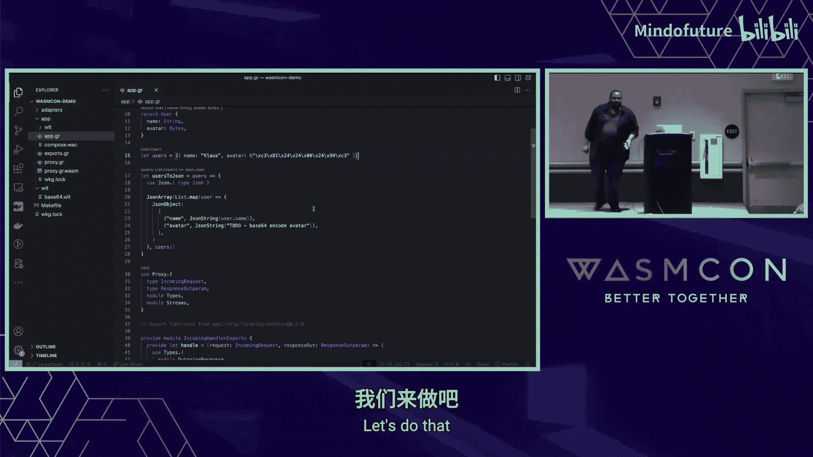

Let's go over here。Let's go to the grain website。Make this a little bigger。

Let's go to the documentation。And in the standard library in the B section， there's bigantt。

 buffer and bites。But there's no base 64。And that's a little rough。So looking here。

 there's a ton of libraries here。 So the grain team has been hard at work on writing standard libraries。

 but there's no base 64 standard library。 So me as a developer， what do you expect me to do Like。

 am I going to go write a base 64 library Like that seems like a lot。

 I'm just trying to write an app that serves a little bit of JO And this is the problem that new languages have。

 You just don't have that ecosystem just yet。😊，So we need a way to use base 64 now。

I think the big question that I'd have is is there another language ecosystem that has a base 64 library and I think there are plenty。

 I bet Ru has one and I bet it's pretty fast so let's be1 developer right now is select an open source library I'm going rust base 64 top result on Google this is how you select open source dependencies looks top result on Google is there's a basease 64 crate for rust and if we come down here and we look at some of the examples。

 yeah we can decode base 64 and we can encode base 64 but this is a RE library so the big question is can we use this rust library and our grain code obviously when rust is compiled and when grain is compiled they have two completely different ways of talking and speaking about data。

But we can use the power of the component model。Ticking these two things to work together。

 so let's see what that would look like So coming back over here to our application。

 we're going to write a wit for this。

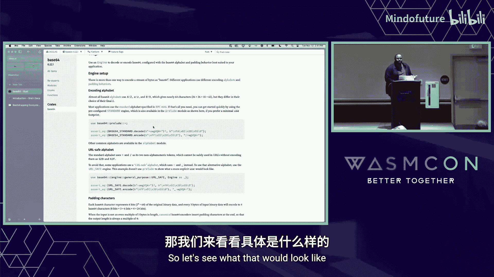

And so to write our wit。We need a package， I'm going to give it a name and I'll just use my GitHub handle。

 which is O Spencer。And we're going to call this base 64。And let's give a version as well。

 And this will be 1 dot0 dot O。Easy PC。And we're going to need that pay 64 interface。

So let's say interface， page 64。And for this interface， we need an encode function。

So encode is going to be a function， and that function is going to take some bytes。

And those bytes are going to be a biter way。 And the way we type that in the component model。

 that's a list of U8。So the list you ain't。And then that's going to return for us a string because that's going to be our base 64 encoded thing。

We also need a decocode function， socode。That's going to be a function。

 it's going to take some base 64。That's a string。And it's going to return to us， presumably。

 a list of you eight。ButIf we actually stop and think for a second。

 the problem with this is we're not necessarily going to always be able to decode any string from base 64。

 it had to be valid base 64， right。Let's do some little bit of error handling here。

 So we'll get a result。And in the OK case we will actually get those bytes， but in the air case。

 just for general purposes， we'll just use a string。

And that's our base 64 interface that was pretty easy to write and so now of course in the component model we have this concept of world so we need a couple worlds。

 so we'll first have the imports world and this is where we import the base 64 interface so we'll do import base 64。

Thats pretty easy， and then we also are going to want to supply this base 64 interface from another component that would be the rust one。

 and we can call that the exports world， so world exports， we export base 64。

And that's actually our entire w definition， that's really all we need and if we can compile this from that rust code。

 then we'll actually have a component that does this that we could potentially use from grain。

So with this， let's go ahead and build that， I'm going to use a tool called Wackage and Wackage is a tool that we use for publishing components and component types and also pulling them back down。

 so we'll do Wackage w build。And that built our 1。0。1， our 1。0。0 interface。

 and let's go ahead and publish that， so'll do Wackage， publish O Spencer May 64@ 1。0。0。

And let's see that conference why I work。Let's go all right and they published so for where these things actually get published you actually have a choice there are war registries or webassembly registries so registries specifically for webassembly and there's OciI registries and war can publish to both in this case I published to a registry that some of my friends created and it's called W。

 so let's go take a look at that and we'll go to w。

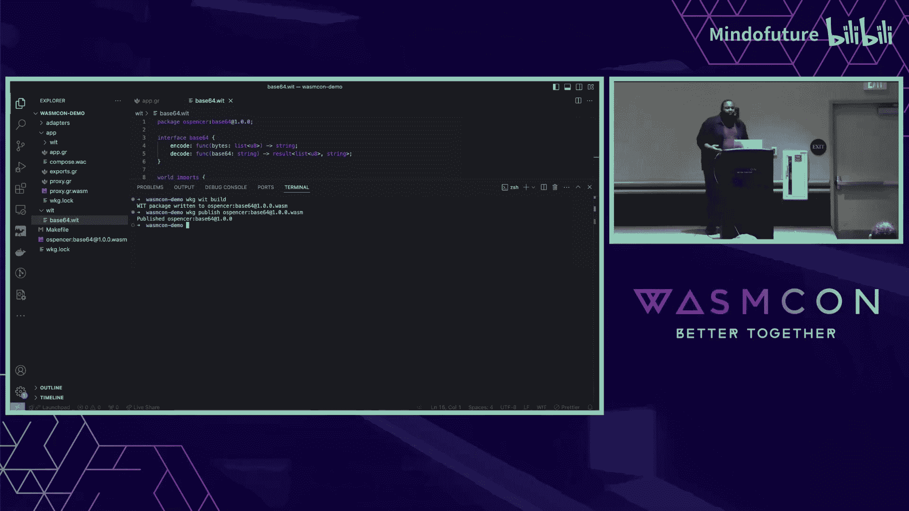

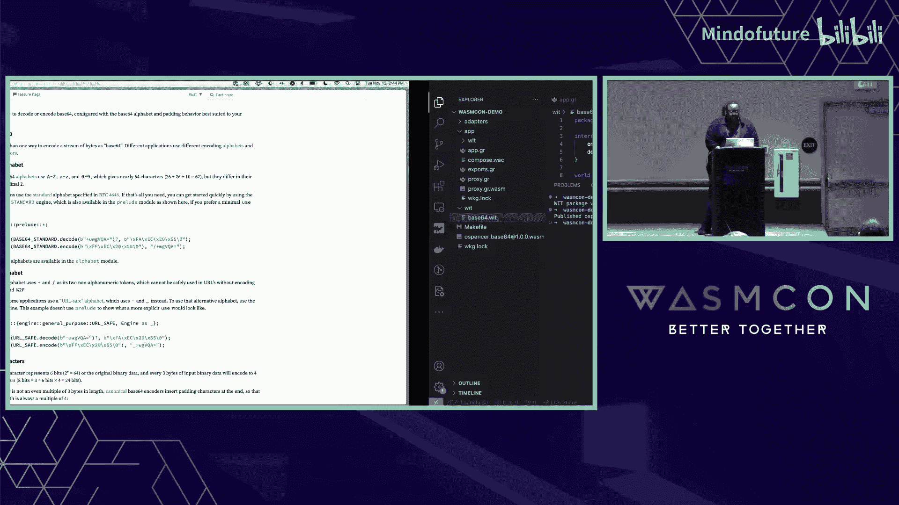

And let's search up， oh Spr oh there it is right there， base 64 and there's the interface。

 we've got two worlds， we've got the imports world， which imports base 64 and the exports world。

 which exports base 64， and we see our interface there。😊，So we managed to build our wI interface。

 we published it to the registry， that means we can use it from some tooling。

So let's take a crack at actually implementing that rust component。So coming over here。

 we're going to use a tool called cargo componentent。

 which is an easy way to scaffold out a component for you to implement。

So we'll do cargo component new， let's call it base 64 Rs for Ru。

 and it's going to be a library and we're going to target a world and the world that we're going to target is that Openencer。

Bay 64。Exports world because we're going to export。 I think that's everything that we need there。

And we created that base 64 Rs package。 Let's take a look at what that generated for us。

So if we look in here， go to SRC and a library， this is a stop out component。

 the two things that are unimplemented here are the encode function and the decode function。

 so if we can manage to implement these two things。

 then we would have a valid component that produces that base 64 interface， so let's try and do that。

Let's go to that base 64 folder， the name of the base 64 crate that we saw was called base 64。

 so we can just do cargo， add base 64。And that gets us that there， so that should be pretty easy。

Let's also one thing which is not super demo friendlyriend。

 but we got to do it is the rust tool chain will produce a Wy Preview1 module。

 but we need a Wy Preview2 module because that's the that works with components and there are adapters you can use that just left Preview1 components into preview two components which we'll just do by specifying an adapter and so the name of that is Wy snapapshot。

Preview1 dot， proxy dot Wm。And let's just go ahead and copy that。So we'll copy adapters。

 Wysnapshot previewion。 proxy。waAM and we'll copy that into the rust folder so that way we'll be able to find it。

But okay， so we've got that all together。

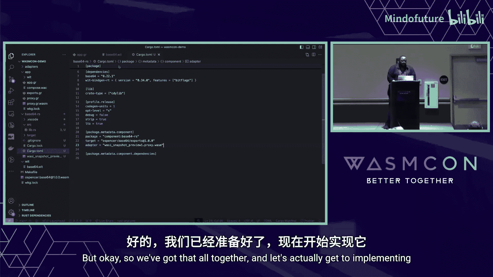

And let's actually get to implementing this now， So going back to that documentation。

 we're just going to do some good old copy and pasting， so we'll come in here。

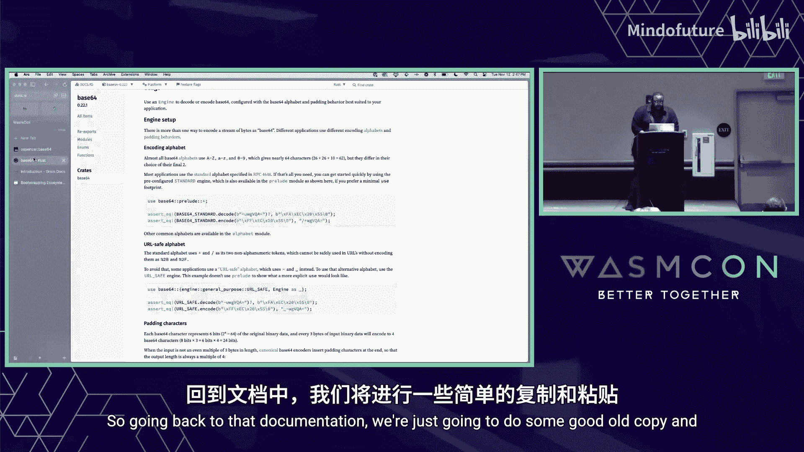

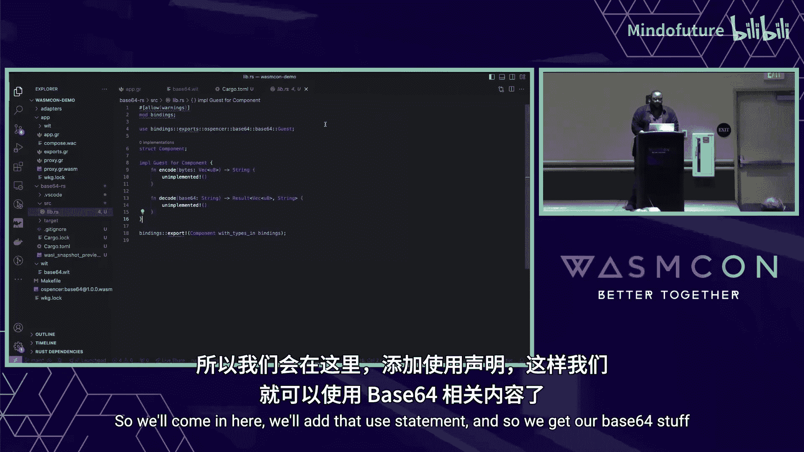

We'll add that you statement。 And so we get our basic4 stuff。And then we need this base 64 standard。

 which has these two methods on it that we need， and so implementing encode is base 64 standardard dot encode and we will encode the bytes that is our input。

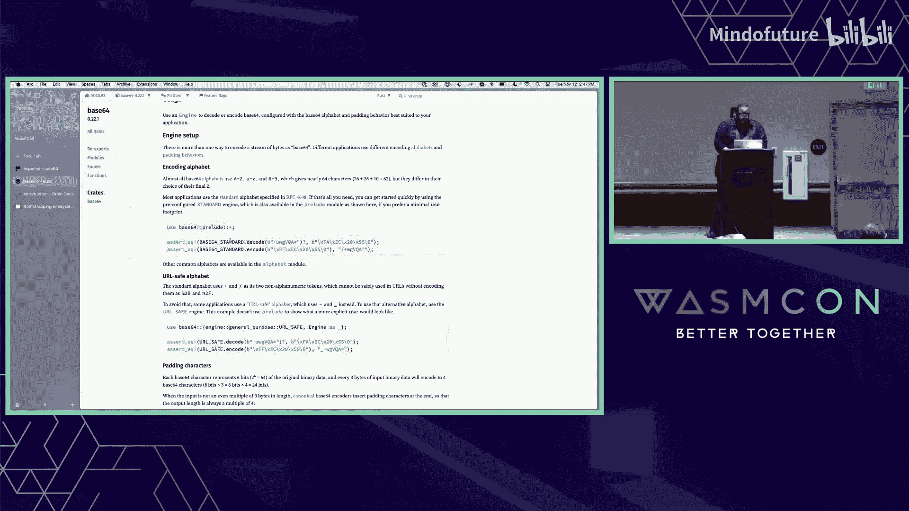

And that's our entire implementation of encode nice so let's figure out how to implement Decode again。

 our base 64 standard and this time will decode and our base 64 input。

 but there's a little bit of a problem this returns a result which is the type that our w interface set is a result in the OK cases evacuate which is fine。

 but the error cases of decode error。We wrote in the interface that it was going to be a string。

 so we can just easily map that so we can just do a math error and we'll take the error。

And we'll do Er dot2 string。 And that should be good。 I think that's everything that we really need。

 So let's try and go ahead and build that。 I have a sneaky make file for demos。

 but we'll do make base 64。😊，And that just calls cargo component build and then it just copies the W and F back up。

But we just built that component and allegedly this component satisfies that base 64 interface that we were talking about。

 but we have a way to check if interview managed to catch Alex Kitton's talk on a walking tour of WSM tools。

 you would have seen him do this too， but we can use WASM tools。So WSm tools， component， W。

 and then we'll pass the base 64 component。And there's some extra stuff in here。

 but here's this root world in here and it imports some wy stuff must to be expected。

 but the important thing is it exports that base 64。

So we've generated a component that provides that interface， S。 So now the next question is。

 how do we use that on the grain side。😊，So we're going to use yet another community tool this time it's called Wbygen and Wbygen is a collection of different binding generations for different languages。

 I will admit that the grain support is not yet upstreamed。

 but if you're interested you can absolutely come and talk to me after or join the grain discord and get you access to it。

But we'll do w， bindgen， grain， and then we're going to pass our w interface。

 which is this Bay 64 interface。And we're going to target the imports world because we're going to import it。

That generates some code for us。 Let's copy let's just move the imports to our app folder and we'll call it base 64 do GR。

 And let's actually take a look at what got generated for us。

So that's this right here and this is like a bunch of really gross code and like this is the type of code that you would have to write if you were figuring out how to make this stuff all work。

 but this code got automatically generated for us so we didn't have to do when you work to get this it's just here So the question is is like what does that actually look like using it ingrain well let's come in here and we'll do from。

Baase 64。grR will include， and since the name of the world was imports。

 I know the module is called imports， but we'll just alias it as basease 64 imports。

And then coming to our users to JSON function。We can just say use base 64 imports and then module。

Baase 64。And if we take a look at what the interface of that module is， well。

 it's exactly what we said。 it's an encode function that takes bytes and returns a string and a decode function that takes a string and returns a result。

 so we manage to just generate some grain code that just made it look like any other grain module so it doesn't feel any different it just looks like hey。

 this is just a module I can use now so we can call those functions and we can do that to complete our implementation here。

So we can get rid of our2D and we can do base 64 dot encode code。And we'll encode the user dot。

Avatar。And then that's our full implementation there and so I didn't show you all the rest of the code here。

 but it's just HTTB handler and all it does is it calls our users to JSON function and calls JSON to string and returns that as a body so that's it so let's go ahead and save that。

And then。Before we build this， there is one more thing that we'll need to do。

 which is there's a wit for。The actual grain code that we're going to write because I did say this was targeting WasSI HTTP proxy。

 so we do need to include the proxy world， but we're also including that imports world because we are importing the base 64 code。

 so this world here is just a union of those two。So let's go into the app folder。

 and then we'll just do a Wack edge fetch because we just published that。Wackage wit fetch。

We just published that 1。0 interface， so we need to actually pull that down so that way I can find it。

And then we'll come back out here and then we'll make our app and so all that's doing is it compiles the grain code with the grand compile command and gives us the WASM module。

 but the grain compiler doesn't even yet support components。

 which is the hilarious thing about this there's just a bunch of community tooling that allows us to create components using yet again WASM toolsol。

 so WASM tools just embeds that wit that I just showed you into the module and then WASM toolsols component new lifts that WASM module。

 that core WASM module into a component。And so that gives us that component。

 and we'll also use WASM tools， so WASM toolsol， component W。

 and we'll take a look at what the w interface of that looks like。So in the app folder。

 our app component。 WSM。And if we scroll up to that root world that's in here right here， this one。

 yes， it exports that Wy incoming handler because it's going to handle requests。

 but it imports that base 64 interface。We now have a grain component。

That imports this base 64 interface。 And we also have a rust component that provides that base 64 interface。

 So now weve got to use the magic of the componentr model to actually link these two things together。

 And for that， we'll use a tool called WAC， which is Webassembly compose。

 and it's kind of hilarious because you can just Wack modules together。 It'ss a good time。😊。

But let's go ahead and do that。U。Real quick， I'll show y'all。

There's a description language for WAC that allows you to describe what compositions look like。

And here is what one of those WAC files looks like。

 where essentially I want to satisfy this base 64 interface， so I say， okay。

 let's instantiate the base 64 component and that's going to be the rest one。

And then we instantiate our app component and we satisfied the base 64 interface with the base6 interface。

 base 64 interface from the other component， and then we export that Wy agent to be handled。Now。

 this seems super complicated， and I admit this is complicated。

 especially since we're trying to do something that's a pretty basic composition。

 So the way you would normally use WAC is you'd feed WAC。

 this WAC file and your components and it would do the stuff and figure it out。Conveniently。

 there's been some developments in the recent months。 There is now a part of Wack called WACplluug。

 which WACplug is smart enough to just figure it out。 so you don't even have to write this W file。

 I only wrote it so that way y'all can actually see what it would look like if you had to write one。

 but we don't even have to worry about this。 So with that。Let's do WAC， plug。

 and the component that we want to plug is that grain component that we wrote。

 So app and it is our app component WSm。And we want to plug it。With our rust component。

 so that's our base 64 component dot WASM。And let's just name that app dot composed do OAm in the root directory here。

And WAC instantly plugs that component for us。 So now if we do a WAM tools component。

Wt on our app dot Com dot wm。And we scroll up to that root interface here。

We're still exporting that Wy HTP incoming handler， but notice there's no longer the base 64 import。

We've plugged that with the other components， so we' composed these two components together to create our one larger component that has all the base 64 code from rust。

 but the rest of the code is written in grain。This is that big deal that I was talking about because。

 yes， I'm showing you it with grain。 but you can do this with any two languages that support the component model。

 And that's huge。 You can just start using whatever libraries you like from any language with some small exceptions。

 But for the most part， this is exactly how it works。 So the good question is。

 can we actually run this and show that one app all working together。😊，And let's do it。

 so'll do WM time Ser， which is a command built into WM time that allows you to serve components that target WASI HGTP proxy。

So whytime serve， grain is a functional programming language and we use tele callss。

 so I'll turn on tele callss and we'll need to turn on HTTP。And we'll pass our app compose。wam。

And that starts running on port 8080。And so now if I come over here and I curl it， curl local host。

80，80。Well， there we go。 We've got our name。 There's a string， and we got our avatar。

 which is a base 64。Encoded image。So this is massive。

 We managed to use a Ru library and a grain library。Together。And so let's take a step back here。

And realize what we did。In about 20 minutes here， we realized we didn't have a base 64 library。

 So we went just Googled Ru， B 64， clicked on the first result。 saw there was a library。

 We wrote a wt file。We implemented the Ru component。 It was two lines of code。 You saw me do it。

We then imported that into our grand code， and then we can post it all together。

That took me 20 minutes up here on stage explaining all of it to you and showing a bunch of unnecessary details。

 but if you actually were to go and do this yourself， it maybe take you five minutes。

 I think that's absolutely massive and huge for what we can accomplish with the component model。

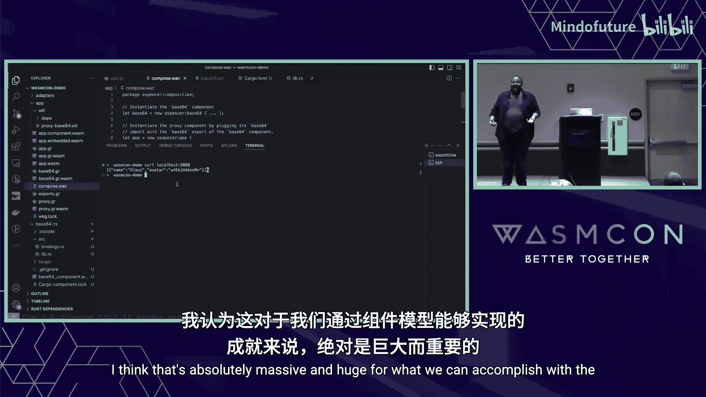

So with that。We get to go back to slides。

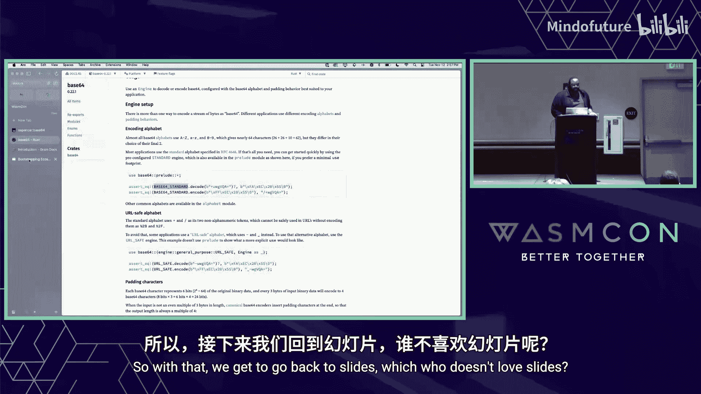

Wch who doesn't love slides。And I'm going to tell you how you can get involved in everything that's going on。

So first is getting involved in grain if you're interested at all in programming languages。

 if you want to write a compiler， come hang out with us， we're pretty awesome。

 if you want to work on tooling like syntax highlighting or a language server to give everyone those really happy squiggglelies。

 you should absolutely come work with us and again the standard library I showed you we still don't have a base 64 library spend online time writing this talk I'm writing base 64 library So we need folks to actually come and work on this kind of stuff。

 So there's so much to do regardless of what your skill level is when it comes to compilers or language ecosystems。

 So this is our website at grainling or enjoying our discord server Also throughout all the community tooling I've showed you it's all open source。

 please please please if you're interested in WSm tools like just go explore WAm tool see what's there look at w stuff go figure out what's going on。

 go contribute to WASm time， go contribute to Wackage because all these tools are necessary to building this full ecosystem that we really want in Webassembly。

😊，And with that， thank you very much。 this is my blue sky handle， I'm not on the other app。

 but that's the okay， so if you can follow me on there and otherwise that's it。 Thank you so much。😊。

哎。Questions， I think。So if anyone has any questions， happy to answer。Yeah。Yeah。

 so the question was when I ran the WasAM time Ser command I passed a couple of additional flags and what exactly were those。

 so the dashW flag for WasSM time allows you to pass turn on a specific web assemblymb feature and so in this case。

There are a number of features that were not a part of WSM 1。

0 like so just core WSM as it launched in the browser in 2017。

 one of those features is tele callss and great news is tele callss。

But tele callss these days are phase4。 They're pretty much ubiquitous。 So I just turn on the feature。

 And so that's all that is。 The other one was turning on the H TTP capability。

 which actually I don't know if that was actually necessary for this demo。

 I think that specifically is turning on the capability to make outbound HTTP requests。

 which we did not do。 So I actually don't we can test it。

 We can just take a look and see if it works。😊，But yeah。

 I don't think we need that one because we weren't making any outbound。So let's go here here to that。

And yeah， it looks like it's and then we can call it yeah because I think that one's only necessary to turn the capability to make outbound request。

 but yeah， if we were trying to make an outbound request and we didn't pass that。

 why't I wouldn't let you do it。Yeah。消。The different package managers for the different programming languages。

Rs has its own package manager like， but this in some way is is a bit of a duplication。

 but then cross platform duplication。 like how， how do you see these integrating。Yeah。

 fantastic question so the way I imagine it's going to play out is much of the tooling that you saw me typing on the command line。

 those are all actually libraries meant to be used by the different language tool chains。Ideally。

 the situation is no one actually really has to write w。

 Maybe you might have to write a little bit of w， but you won't have to go generate bindings and stuff like that。

 The language tool chains will actually do that for you。

 So we're already starting to see this happen with rust to the point where I showed you cargo component。

 That was actually pretty easy where basically I said， okay there's this interface cargo component。

 I want to target this interface。 it generated all the code and it generated the component for us。

 So that was it。 So that's kind of the model that will see all the other ecosystems do where we'll also get to the point where you can just specify a component as a dependency。

 You can just say， hey， I'm not depending on this library。

 But instead I'm depending on this component。 and it'll come with a w file and it'll generate that code for you to just use as though it were any other language library within the language。

 So it's gonna take some time to get there。 but we'll definitely see that throughout the even for grain we have plans for our package manager to implement that functionality there as well。

 So that way it makes it super easy for folks to consume components。Yeah， and maybe if I can。

 maybe even more high level question right now， a lot of the demos that I see。嗯。Work。

But work by because the person doing the demo knows its specific tools which specific flags。

 Also the flags that you added to was some time to run it， for example， as an outsider。

 it's an incredibly confusing ecosystem partly because it's evolving so rapidly Yeah for sure to me in some way。

 it feels as if there is a need for more holistic higher level strategy of like how are we going to fix the developer experience at an ecosystem level Yeah and I absolutely promise you folks are working on this Like they know it's a big issue One of the things I'll show you super quick was component book。

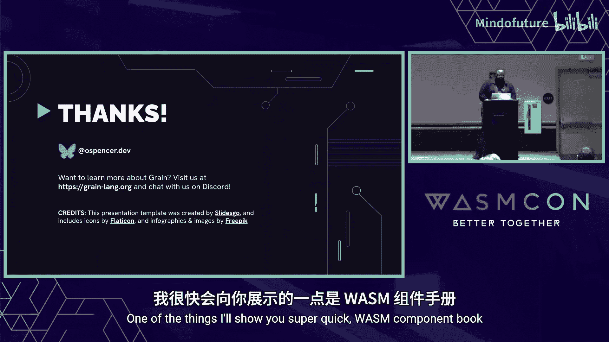

So there's a full component model book of documentation that goes over much of the stuff that I said here so this is like the early start of that of just explaining hey here's everything but ultimately we really do expect much of the tooling to disappear and just to integrate into developers existing tool chains like we really don't want developers to have to go figure out how to write a WAC file for example。

 like developers shouldn't have to do that so folks are definitely on the case and it's only going get better and better over time and that's where we need people to come in like especially if you feel like hey。

 something wasn't clear go add documentation to the component book so other folks know how to accomplish the same things that you accomplish。

All right。There's one question back here。 this is a very high level question？

We're looking it was really interesting talk and congratulations on getting your demo to work。

 it's harder than it looks。嗯。I was wondering on a higher level。Okay。

 we have the different components。 We， we've added the width， use the width。

Compfired different components， different languages written in different components。Ideally。

 but how would that all come together these different components， I mean， they're connected together。

 they're looking at that now。But as far as the end use front end application。

 what would that look like？YeahI mean we know how to do that we know how to do this。

 but what's end result going to look like Yeah， so I think that's an interesting question and I think it really depends on the particular application。

There ends up being interfaces like these one off ones that I just wrote for this particular purpose。

 but mostly the Wy interfaces are kind of the big ones that you expect different hosts to actually implement。

 So I mentioned Wy HttP proxy。 And that one is for any Wm component that knows how to serve HttP request。

 So a lot of tooling already knows about this So that's how I was able to use Wm time and say Wm times serve。

 That's a perfectly happy server to serve this Web component that I wrote but tons of things that this。

 you can run that same component in Ferm and spin。 you can run that in ingenex unit。

 I announced earlier today that Nx is gonna get support for this。

 So you could also run that in inex proper as well。

 And so it's really about those highlevel world that we expect run times to say okay I provide this world as long as you conform to this then we can run。

 And so you'll see that in different places like in the browser of okay。

 these are the browser things you get are running like even if。

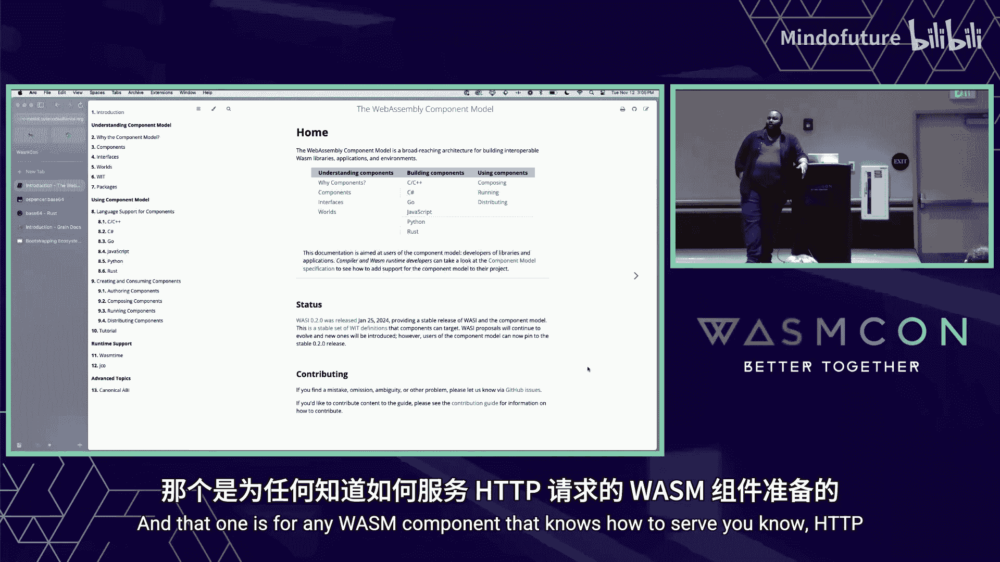

You are going to talk to a database somewhere and there are special WSM modules for that it would say okay。

 this is the standard way we talk to databases， so it's largely going to be those high levelvel interfaces that you're going to target and then the one-off interfaces are really for when you're doing stuff like this of just I want to use this one library here。

 but I think that was getting at what you're asking。

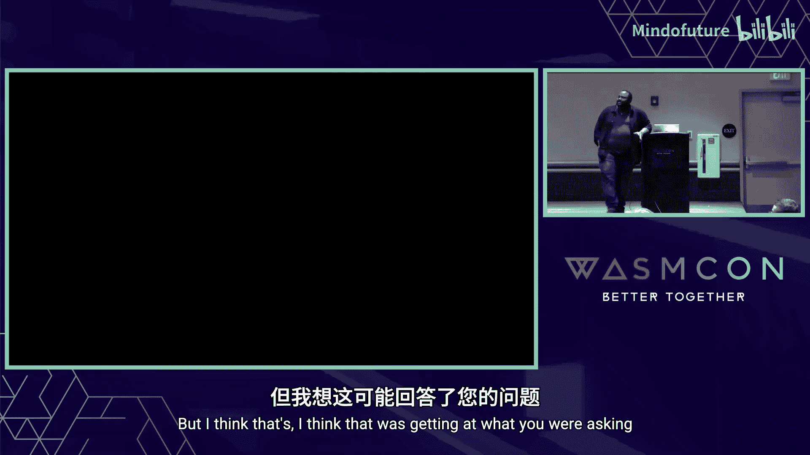