# WasmCon-2024-p25-P25-Exploring-C#-Wasm-Components---James-Sturtevant,-Microsoft--BV18DjSzJE6r_p25-

All right， well， welcome to exploring C sharpp Comp。

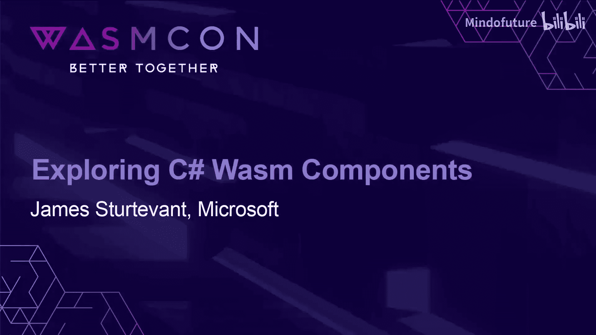

I'm Jamesme Stvant， I'm a software engineer at Microsoft。

 I'm a contributor to the Btecode Alliance and also a maintainer of Ron Wi。

 which helps you run WSM components in Kubernetes and we're gonna be talking about component tiesnet today。

 one of the maintainers there and 98。3% Iron Man very recently。

 my daughter likes to remind me of that that the swim got canceled and so I didn't quite become a full ironron Man。

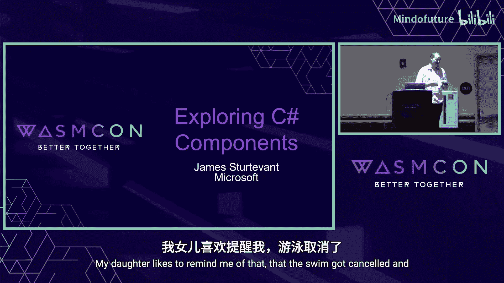

So we're going start off pretty slow today and build as we go。

 the idea here will be to take a look at how the tools work and then build a deeper understanding of what they're doing so that later on when we use the more advanced tools。

 we don't feel like it's just magic。So we're going to take a quick look at components。

And w we'll look at how dotnet adds Wy support。 and then we're going to do some binding generation as well as look at how dotnet simplifies the developer experience and talk a little bit about what's coming next。

One thing I want to mention is that。About a year ago。

 you weren't actually really able to build Wi components。

 And there's been a lot of work over the last year。 so this a lot of this is still pretty early。

 and so help out where you can。😊，So let's start with what a component is。

 This is gonna be a pretty simplified view of what a component is。

 but I realized that not everybody understands what the component is。

 And I wanted to make sure we have a good mental model for when we dive into the code and start to work on it。

So it all starts with some code。The then we can build it into a component or a module。

 But that module has some challenges。 There's only about four types in the WA module。

 and there's no way to interface with the ex external world。

And so the way that we solve that in a component world， it is to import something。

 So we can import an interface， say， H TP and that H TP。

We delegate everything to the host or to some other component。 And we just say。

 when I want to make a request out， I'm going use this H TP interface and make the request out。

So that solves part of the problem。 But the component doesn't know how to be。Called。

 there's no way for it to be called at this point。And so we need to export a run function。

 and that run function can then be called by other components or by a host。

So then we can introduce a host who knows how to call the run function and also exports that interface of H T。

P。Once we do that， we can then run that component。Now。You。

 you have another team that comes in and asks for some headers added to all of the requests going out。

 You could go in into a host and modify the host and add those headers。

Or you could add an additional。Component that exports H TP and then imports H TP。

It will just add the headers and then delegate the rest of the host。You put those together。

 and your component looks very similar to what it did before。 You can create the host。

And now you can run that component， and you've got that additional functionality without changing the host。

So hopefully that gives you a kind of a mental model of how components work with the host。

But why would we use components。We want all the WAM benefits across platform， fast， secure， small。

But we also want to interface with the external systems， as we saw there。

We want to be able to share the functionality across teams and across different systems。

And then there's some really interesting things that come out of this is that we can statically analyze a component。

 make sure it doesn't have access to critical components like maybe our key value store。

 if it was an external component that was being imported in。

And then it simplifies development pretty greatly。 So imagine having a component。

 And the only thing you have to implement is this handle function。Why C sharp in components。 Well。

 you love C sharpp。 It's got a special place in my heart。

 It was the first language that I developed in professionally and really learned a lot there。😊。

Actually generates Wy 0 dot 2 components out of the box。

 So you don't have to compose it together with an adapter component or anything like that。

 when you build it， you actually get the Wi 0，2 component。

And then we have dotut API support for Common Wy interfaces， C I， HP。

 We're going dive into that a little bit later and talk about how that actually comes together。

And now the thing we're also gonna look at is componentizenet。

 which helps you get all these things started， makes it much simpler than what we're gonna see initially。

So there's essentially two flavors in dot net right now。 there for Wy support。

 The first one is monoo。 It's very similar to the blazer。 It's an interpreter。

 you can do reflection in it。 it comes with SD DK。 you get stack traces。

 and I have to say that it is an experimental support。

 So it is not something that you're gonna be able to call up and get deep support。

 It's all through Github and things like that。The other flavor that has support right now is a native A O T。

 This is in the runtime labs。 It has a potential for faster startups because it's compiled ahead of time。

It has it typically has had the first implementations of Wi coming out coming out。

 So it's kind of a place where people will experiment and try things。

 and then it gets upstreamed back into the runtime。And this is done mostly by the community。

 It's not in the actual do net runtime。

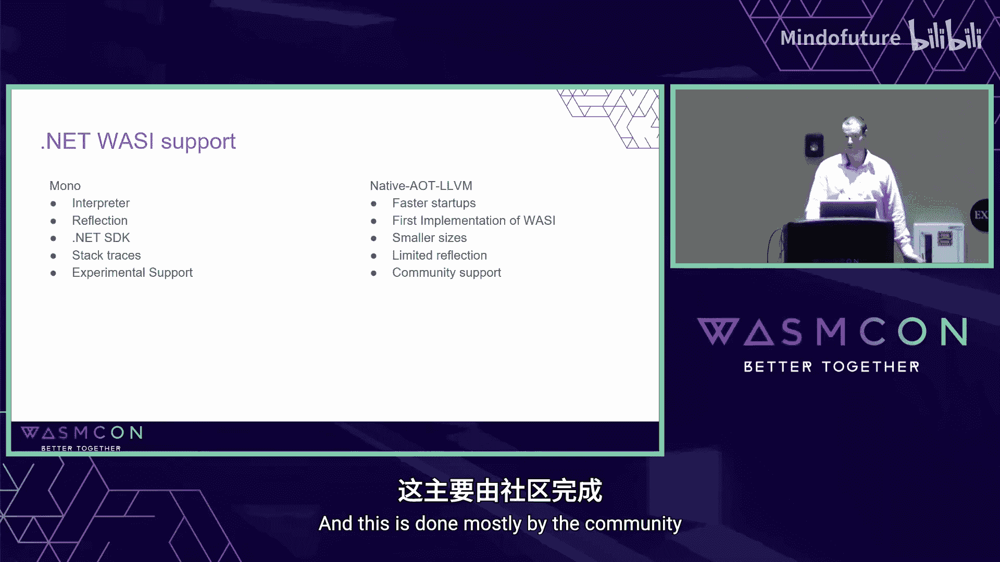

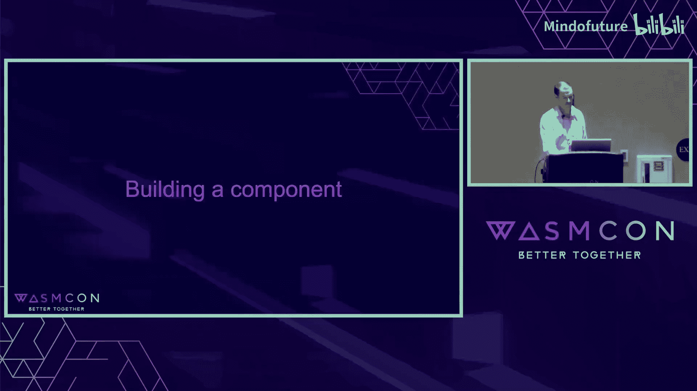

So let's go ahead and build a component。So we talked about the component。

 and this is essentially the shape of the component。 It has imports and exports。

 They can actually be the same thing as we saw previously。 but we need a way to define what。

The imports and exports look like， and then。The Wy world， the way we do that， is through wit。

So here you can see there's an import for the ad function。

 and export for that for the other function。 And we've got that interface and the shape of the component that we're gonna be working with。

So。We got to be able to translate this wit into C Shap。

 So the way we do that is through some attributes。In C sharpp。

 we export them so we can use this attribute on top of a function that says this is the name of the function that if you call it。

 you will get this implementation。And then on imports， you're going to see DLL import。

 It's very similar to doing a DLL import in any other project。

 The additional attribute that we have there is the Wm。Import linkage。

 And that's going to just give a little bit extra metadata to let the compiler know that this is going to be called by a Wm component eventually。

Pretty simple。Well， W has a whole bunch of different types as soon as you get into this。

 And so you got lists， you got results， you have to know how to translate between the linear model memory model inside the component to these lists so that we can use them in C sharpp。

 And then you also have to lift and lower those。 And so this gets complicated very quickly。

 So you're not going to want to necessarily put all of that code in there。

 So here's an example of lowering a list down a list list of strings into C sharpp so that you can then use it later on just like you would in a list。

You can see there's quite a bit of stuff going on in there。

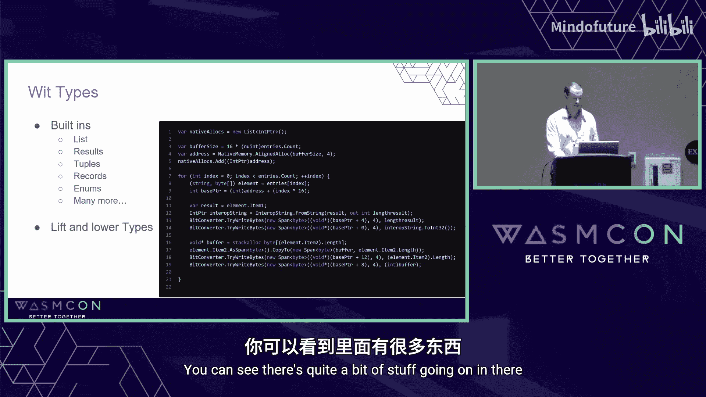

That's where W bindgen comes in。Whiit binden takes the wit。You run it through it bygen。

 and you get some C sharp coming out。And it's gonna look very similar to those initial ones that we saw。

 but it handles all the different types for you。 handles all the lifting and lowering。

 And then you add a little bit of code。And you compile it and you get a component Wam。

So there's a whole bunch of tools that you need to use here to get this all working。

 So today we're going to be using the native ahead of time compiler。 we'll use W Binegen。

 We'll use WASM tools to inspect the component and then we'll compose components using WAC and then you also need to have a WZ SDK and your system。

 So let's take a look at what all of that looks like。

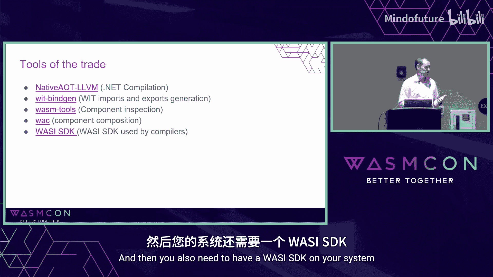

And again， this first demo， we're gonna do this all manually。

 And then the second demo will go and see how some of the tooling and how dotnet can help simplify it。

Okay。it started playing？

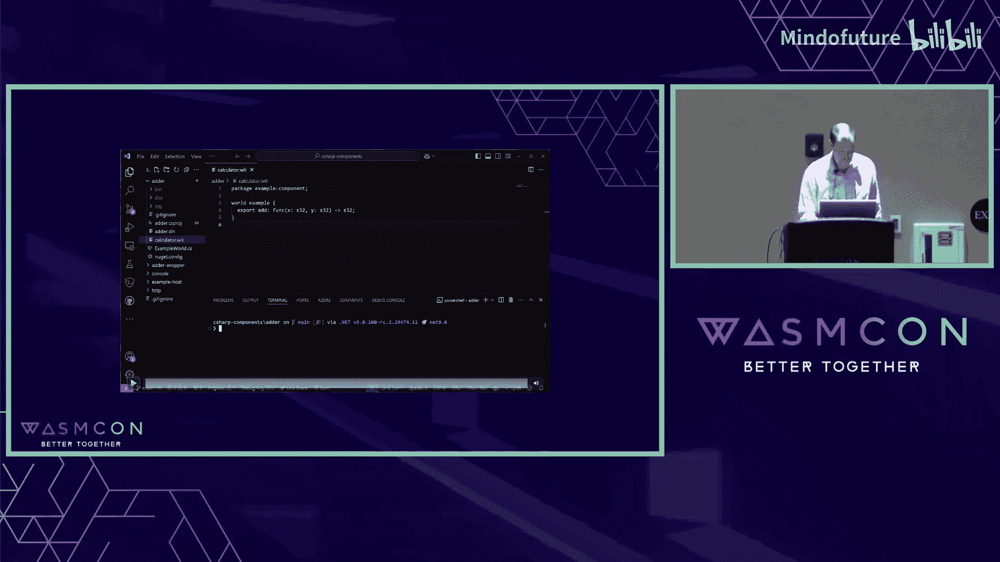

Okay， I think we're started。 So this is a simple world。 It's a simple export of that function。

 It's going to take two integers and return an integer。And in our CS S Pro， we did a dotnet new。

 and then we're going to add a little bit of extra additional properties。 The first one is， hey。

 we're going to go target the Wi target so that the compiler knows that it's going to generate a Wi binary。

And then we're gonna to say we want to be self-contained because we want a single binary。

 We don't want all the DLLs kind of all over the place。 We want to all packages up nicely for us。

 We're going to include allow safe blocks。 This is needed for all the bindings。

 and then we also need the Wy SDDK so that we can compile it all together。Next up。

 we need to add the native ahead of time compiler that's going to bring in the appropriate things to compile down to byte down to WSM and then we need to link in the w。

 And this is pass off to the Wy SDDK so that it knows how to actually。Put the W and binary together。

Now we can go ahead and publish this。 and when we run publish， we get a binary。

 the one last thing I did here was the D publish is just a little helper so that I didn't have to type as much when I'm copying the files around。

 So let's go ahead and take a look at the wit for this file。If we look at it， we should。

 we expect to see an exported function， which is that exported width file that we had there。

 And if we don't include this particular line， we would actually， it would all compile and look good。

 but we wouldn't actually export the function there。 So it's super important to call that out。

 And this is the implementation， we put that unmanaged callers in there and the wasm export。

 And you can see， this was a really simple function， really simple way to get it started here。😊。

And so there's an example host that knows how to call that export and。

 and then print it out to the console for us。 So we're going transition and we're going to create a component。

 and we're going compose it together with the other component。

So we're going to switch switch over this wrapper。 And in here。

 it's going to be very similar to what we did before。嗯。你。

W is going to look a little different because we're gonna wrap it So we're gonna create something so that we can export the sorry。

 we can import the exported ad from the previous one。

 and then we're gonna re export it for the the host。Now， this time。

 we're gonna to use W bindgen to actually generate the code。

 So we pass W bindgen C sharpp and pass it to w。 And we get a bunch of C sharp bindings coming out。

 These are a little bit more involved。So you'll see there's an interface。

 and this is how we know the thing that we need to implement for this particular world。

 And then there's a bunch of extra type helps that we're actually not using in this particular instance。

 and then we have those very similar functions with import and a。

I think there's water coming down from the ceiling。So the implementation。

 we're gonna go over and import it。 I actually found this， this is exports。

 And we're using an import， which is kind of funny。 I think because we're using a raw export。

 it there's a bug in the binding generation that。😊，Forces that to be in the exports namespace。

 which is just a bug that we can fix。 We're gonna wrap it。 If the answer is 42。

 We'll print out some extra information。So here it's building。hoops。Oh， man。Okay， can't fast forward。

 This happened to me last time I did this too， I thought I tested this and it worked。嗯。

So I guess what happens in the rest of the demo is that we compose them together using WAC and we get that for extra information printed out。

 we'll see this again later in in the next demo So we'll go ahead and get st So if you're thinking hey that's a lot of steps and that's a lot of tools to use You're right。

 there's a lot of moving parts here And so this next part of the presentation。

 we're going to see how does donet help make this a little simpler for us to get started with。

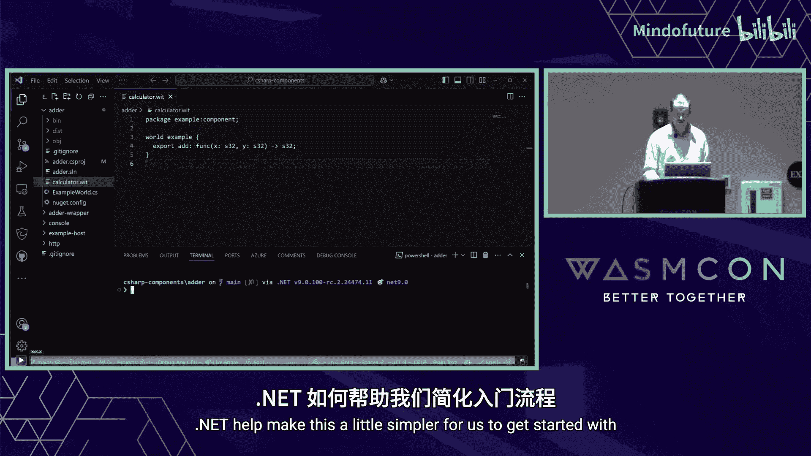

So we've gone through Wwors。 we did a very simple w world where we expect exported a simple function that did some addition。

 But these worlds can get complicated very quickly。 and there's two that ship with Wy 0 dot2。

 The Wy HTP。Is one of them。 and the C I is the other。 And there's many others。 There's TCP messaging。

 Bobbstore， Wiclo。 There's a whole bunch of different implementations out there that you can bring in。

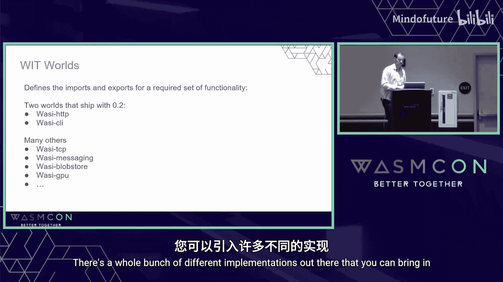

This w world code and sorry if it a little small， is fairly challenging。

 there's a lot going on and to implement the code， you get these bindings and then you got to go use these bindings。

 and the C sharpharp code to use these bindings looks pretty ugly if you look on line 7 there。

 there's a result of a result of an incoming from some future thing。

 and then we have to unpack it and check if it's okay we have to do all these extra steps and this is because the way that w types kind of interact with the result types and things。

And so。We don't want to necessarily do that to make an HP request。And so， in the。We。

 we really want to make that more like developer friendly。And so in the dotnet libraries。

 we've encapsulated that behind the scenes for you。

 And so now you can just use H T P client like you normally would， create it， Add some headers。

 make the request， get a response back。 and you don't need to change anything。

 and dotnet will take care of generating all that kind of nasty code that we saw behind the scenes。

 So。You don't have to necessarily know how to all the different wit types and things。

And we can see that again with TCP。 So there's a TCP client。 we call connect on the host in the port。

 we get the stream， we send the stream off and we can use it like we would in Dont。 And again。

 there's a very complicated code， unwrapping results and things behind the scenes。

 but we don't need to manage that ourselves。

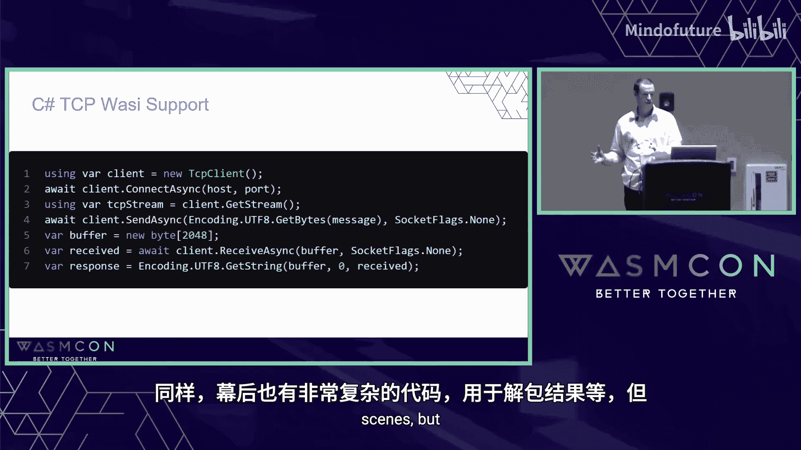

And then component size thatnet brings all those tools that we saw in the last demo with by andgen。

 WAC， all the various things， the SDK， and make sure that it's all set up on your。

 your system without you having to necessarily do much。

And so and then it also automatically generates the W bindings。 You can point it out a W file。

 It'll generate the W bindings for you， make sure it gets all compiled in。

 make sure that W is linked into the Wy SDK。And then。Pulling down like the WZHP interfaces。

 there's a whole bunch of w that you need to know。 We can store that in an O CI registry。

 and the tooling will help bring that down locally。

 And I did a talk with Taylor Thomas yesterday on this。

 and we demonstrated how we could build it on a Windows machine， run it on a Mac。

 run it in Kubernetes， run it in several different platforms。 And so you can check that out there。

And。Finally， we can also automate some of the composition of the various components together for using the component I onnet。

 And you get all of that for just adding a single package。

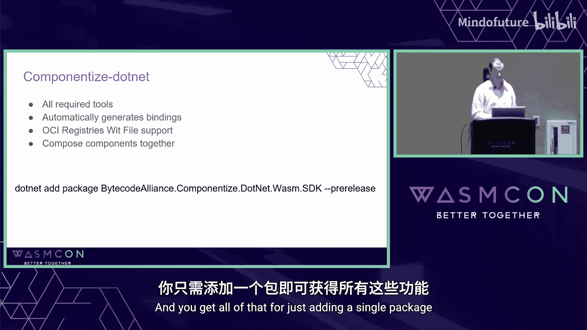

Alright， so we're going to dive into this demo。

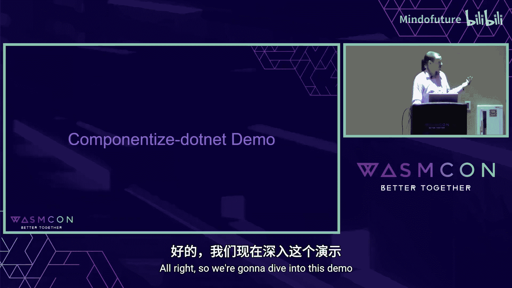

This time I won to give a ahead。Okay， so I did dotnet new。

 And only thing I added here was the runtime identifier and the self contained。

And then we're going to。Oh， and I mentioned the EX Z there。

 and that that's going to become important in a second。 We add the Dont componentize package。

And again， I've got that published step there。We write our code just like we would。

 So this is the HTP client。 We make the requests and we can even use asy weight。

 There is a little small thing here。 then this should go away over time。

 but this is how we enable asy weight is we've got this some tooling underneath the hood in the library。

 And right now we need to add this extra little bit of code。

 but that should go away once as support comes into the dotnet。 sorry into Wi。

So let's go ahead and publish that。Component。This is going to go ahead and build。

And what I want to call out while this is building。Is we haven't written any wit。

There's no additional libraries that we added。 There's no W bind in。 There's nothing there。

 And the only thing we did was say， hey， target Wi And and the rest of dotnet figured out， hey。

 you're targeting Wy。 We're gonna find the right W files for you。

 We're gonna link everything in properly and you're gonna get a WSm component at the end。Okay。

 so let's take a look at what that w looks like for the component that we just built with HP。

If we look at the WASM， we're in a C， an import for HCP and an export for run。 Now， again。

 we didn't necessarily explicitly ask for those， but it was smart enough to figure that out。

And you'll notice that in the previous demos， we didn't have that Wy HTP function in there。

 so now we we've made a request。 It is randomly going out to the or it is actually going out to the HP endpoint and getting a random result back。

 And so what we're gonna do now is we're gonna link in some more some w。

 We're gonna show you how w is used from componentized thatnet。 So excuse myself。

 It was a lot of code to type out。And so， O， so we've got this new wit。

 We've got that simple example world。 We're going reuse the components that we， we built earlier。

We go over the CS Page， The one thing we add in here is components。

Net componentize net has this w property that you can say， hey， use this w。

 and it's going to find the wit that you found。 and then it's going to invoke w bind end and link everything in。

 And then finally， instead of having to manually call Wack every single time at the end of our component。

 we can use a target that specifically。Runs after publish， finds the previously composed binary。

 and then it。Wow， it links those together。 sorry， I'm getting rained on right now。

There's a water fallinging down my back。So when it this publishes， behind the scenes。

 Compize that net will go find that W file。 It will execute whip by gen against it。

 This is where it actually all lives。 And then it will bring that in when it compiles。

 So if you do need to go look at the underlying C sharp that was generated。

 it's there and you can have access to it。And the last thing we did was inside our function。

 we did an import again and called the component。So let's take a quick look at the w that was generated for that composed component。

Here， we see Wy HDP and Wi C I。 And the， even though we just had some wit that imported the。啲诶。

The adder function， We don't see that here。 And why don't we see that。

 It's because we actually composed those two together。

 And so the actual end and shape of that component。Doesn't have that in there。

 If we go and look at the console， This is before we compose them together with Wac。

 we can see that we didn't actually have that import。 And once we put them together。

 the end result was the one that we were expecting to come out。Okay。

So we'll go ahead and run this in Wm time。we want to run the component if we ran the console right there。

 it's actually not going to work because we don't have all the requirements at the OAI player So it called out to 142 and 42 and finally 40 plus2。

 which is what we coded in the previous one gives us that answer to light so we added that additional metadata So we just composed together a whole bunch of components and we didn't have to interact with any of those tools underneath。

So the last thing we're going to take a look at here。Is the OCI support。

 we're going to go switch over to WSEHTP。And here again， we're， instead of creating executable。

 we're going to create a library because there is no actual run entry point。

We're going to link in the Compize dot net。 And then we're going to add the link the w。

 But we're gonna add a couple of extra properties。 One is the world that were targeting and the registry that we want to pull that w down from。

And so this is one of the worlds that's shipped with Wi。

 and so we bring it down and when we publish this， it's going to go out to the OCI， bring down the w。

 It actually comes as a w package。 We'll take a look at what that looks like in a second here。

And then it's going to call whip bindgen on it。 It's going to generate the bindings。

 And then we can implement our H TP for that。So we can see in just a moment， yeah。

 this is the w package。Wt is can be encoded inside an actual Wm component。

 And that's the preferred way to do that。 But we can see that Wi mindja knows how to generate it。

 And we get all of the， the bindings for the proxy world right there。Next， we go ahead and。

Go into the namespace where we have the ining handle that we need to implement。

 We add a little bit of metadata and give a response and then。We can go ahead and run that。

 We're going to see it's on HP 8080， switch over。And we can make a request。To curl。

 and we'll see hello， from C sharpp。

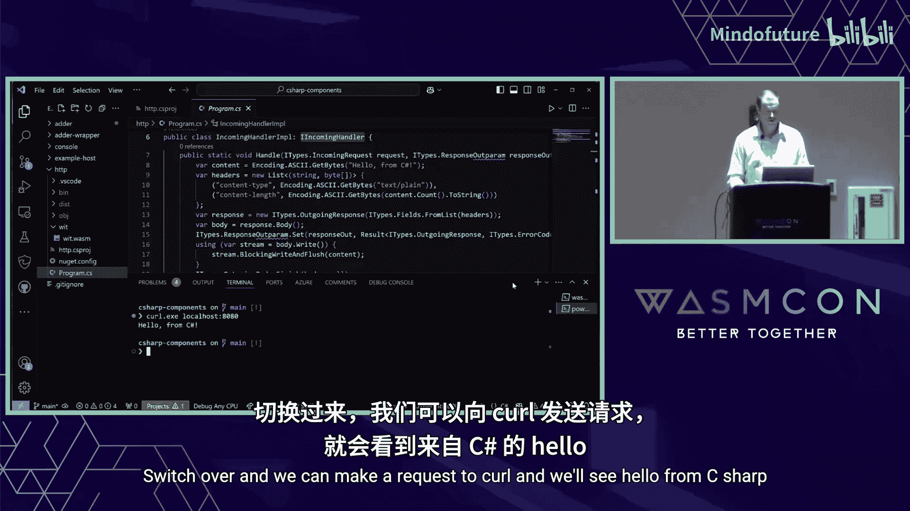

Okay， cool。So hopefully that shows you how Dette can actually simplify building these components。

And component Iizenet can help you with some of the tooling around W Bygen and integrating your W files into existing projects。

So what's coming up next， I last week， I started to look。

 and we have a whole bunch of different projects across a whole different bunch of places。

 And so I've created this new。Project and GitHub where I've kind of compiled together。

 they're not necessarily fully prioritized right now。

 but it's something that we'll be working on going forward。

 I wanted to put this up just so that folks know that if you're interested you can come help out with some of this stuff and also get a sense of where we are with the implementation for T sharp。

And then one of the really cool things and we have the implementer in the room here， Pavo。

 he is working on some debugging support， and so you can F5 on your project and step into your component。

 which is pretty pretty cool，s I think it's still pretty early days for that。

 but it is being worked on。

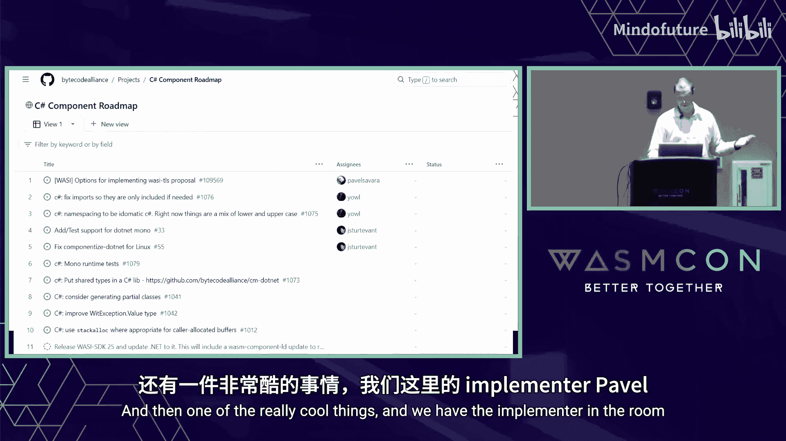

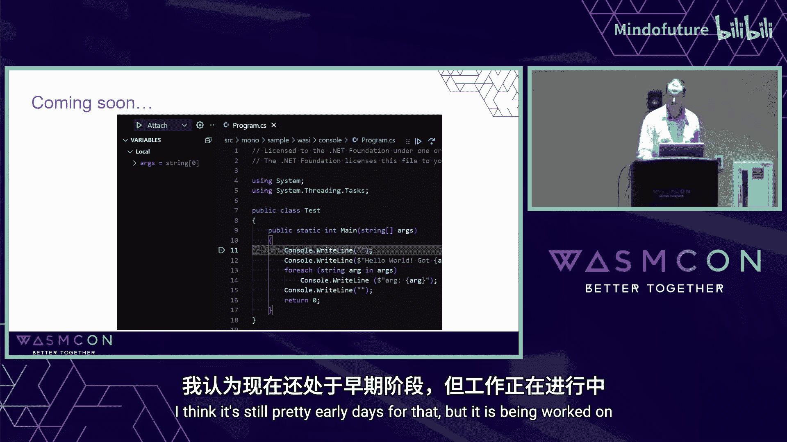

And then I wanted to say thanks to a bunch of contributors。 A year ago。

 I knew nothing about components。 and I raised my hand and joined the Btecode Allance C sharpp group。

 And all these folks have been very welcoming and have taught me a lot about how all this stuff comes together。

 And so and no particular order up there。 there's a whole bunch of people。

 there's many others that have been helping out。 So just want to say thank you。

 And call out that like if you're interested， you don't really know anything about this。

 come join the meetings。 ask us afterwards。 everybodys very welcoming。

 And there's just a ton of work to get involved in。 And I started out adding some unit tests。

 And now I've got a couple contributions in works for the runtime。 which is kind of cool。😊。

So go ahead and get get involved。 Try it out， give some feedback。 It's still very early days。

 There are rough edges。 and were we're looking for feedback on how to improve the overall experience。

 I get a link to the project board there。 And then this Q R code is a link to the sharp subgroup meeting so you can join and get the information to join those and come say hi。

 And then you can reach out on the Zoo up chat。 There's a C sharpp。😊。

Channel in there so that you can come and say hi， but you can also just， you know。

 reach out to anybody there。And that's what I got。I guess we can go to Q& A。Got one over there。

We got a smooth。Yeah， sure。 Yeah， I covered a lot in a very short period of time， yeah。系诶。

One thing so looking at the。わし。I was wondering， is there a direction？到点。Yeah。

 it you showed down at a higher low。Lower level what type。来。Yeah。

 so the question was looking at the HP interfaces that we showed and we showed we have some higher level and we showed the outgoing。

 is there a way to potentially do this type of thing with ASP donet applications。

 And there are prototypes out there of folks who have done this spin has a nice SDK that wraps up some of this stuff and gives you exactly what you're asking for。

 There's nothing in the runtime itself right now， and I don't know if there ever will be。

 but thiss definitely potential in people arguing it today。And I guess the。

The big value add there would be if I could take existingnet ASP coordinate。

Code written in that middleware style and be able to bring that over directly without switching to a new SDK。

 that's there's quite a bit more that needs to come in Wy before we can do that type of thing。

 Async support。 and then as well as threads to be able to fully bring things over like that And then there's a proposal out there right now for Wy Tl S。

 a lot of projects will probably be calling SQL。 and you're going need that type of we added TCP。

 but you also need Tl S on top of that to do things。 So。

That actually probably do'vetail us to the next question， do you know？

Outbound GRPC connections might look like that be on T L S or on top of H TP or yeah。

 So it's actually being discussed on top of H TP right now。 Okay yep， so we got HB2。

 and there's a discussion in the Wy HTP spec for that particular question。啊。That's again。了解。

Yeah and just I'm going to repeat it just for the audio。

 the Pavo had said HB doesn't currently support H22 HB2。

 it's a gap that we know and is being worked on and eventually we will be able to implement GRPC through that pathway。

Awesome， the next one might be more of a native AOT questioner or not， but do you know。

 is we dynamic link a lot for setting upquerian databases， is that supported？

WithI don't know the answer to that one， but I can follow up and we can get a question afterwards。

 I'm happy to answer more questions。 I just want to make sure there's opportunity for other folks to ask questions。

 as well。😊，And we can catch up afterwards Okay have the last one if that's okay yeah。

 right the last one is Blalazer has a native integration where you can take like Z code and pilot it into your WM component through the Mscript and SDK usePNvos Are we going have an equivalent one for。

😊，Dotnetcompized。net viawa SDDK I think I got that's coming down the line Yeah， so the Compized。

net is kind of the early iteration of this so we can iterate quickly out in the community。

 but then eventually dotnet is like the upstream project is actually working on getting all that kind of built into the entire platform。

Sorry， I was just asking if you could repeat the question from previous。

 what was the name of the library and what was the usage so before the last question it was a question I think was it weasel about dynamically？

Not the PMO one or。嗯。just asked。Native libraries， yes。So in the pla environment。

Should I just reiterate the questionnaireer？Yeah， yeah。

 the question I asked was Blaazer has the ability to take a native library。

 something and compile it with them scripting and call that from Blaazer。And the question was。

 will we have that same equivalence for using the component model。

 can I make a component that uses WS SDK， composum C library， and link it in all？

And I'll give an answer， So the Va SDDK is LVM C2 chain。

 which is in a way similar to what Mscriptipon does and from dotnet perspective。

It's a very similar built process that we are giving to the to the SDK。And so。

 it will eventually work。I have to say， this is statically linking。Your native library。

 together with the document runtime， in this case， mono runtime。

I don't really know exactly what is the situation on the LVM side。

 but it will be probably very similar。Yeah。And I think we had one more question over here。

 and then I think we need to。Leave the room for thanks， thank you。For the garbage collection。

 does it use Wasum GC？It does not currently。 Yep， that's in the works eventually。 Oh， it's not。 Okay。

 Pap's shaking his head。 It's not。I can try to explain。 So current state of the Wa GC。

Doesn't have all the features necessary to support。

Needs of dotnet ramptime to implement garbage collection。

One of the those which I remember is interior pointers。 So in， in dona。

 you can have pointer into middle of some。Data structure。

 and it will keep the keep alive the whole thing。And that's not currently possible with wasn't you see？

That's just one of the gaps。 There are a few more。 and so it's unlikely that we will go there。

Thank you。Cool， all right。 thank you， everyone， and we'll see you next。

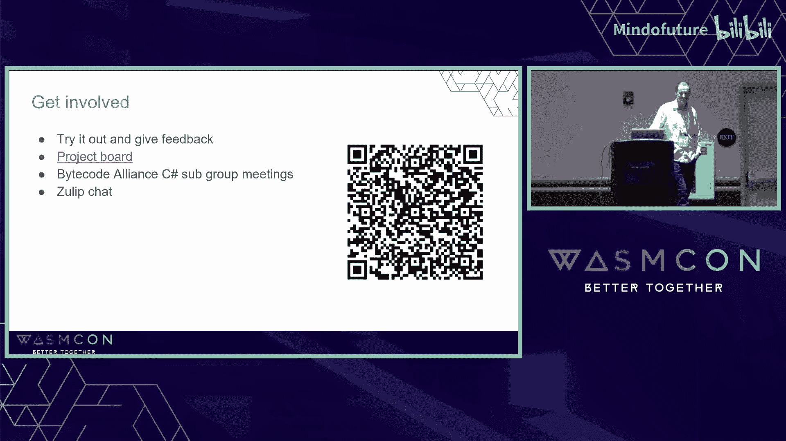