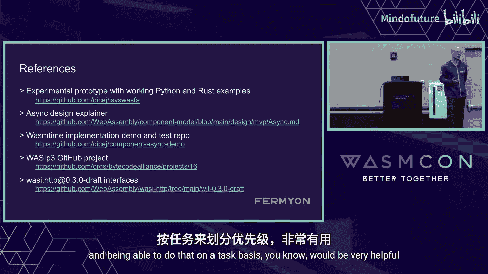

# WasmCon-2024-p26-P26-Composable-Concurrency-for-WebAssembly-Components---Joel-Dice,-Fermyon-Techn--BV18DjSzJE6r_p26-

My name is Joel Dce， I work at Fermion， I'm a software engineer there。

 primarily working on improving the guest language support for various languages for Web assemblymbly and Wi。

And today， a part of that I'd like to discuss kind of the ongoing work we're doing to make WI better。

 particularly with respect to concurrency which is such an important part especially of cloud computing。

 where you're talking to HTP servers， you're talking to key value stores。

 you're talking to databases， etc ce， and you want to be able to multiplex that。

 you want to do more than one thing at a time and one of the big selling points of the component model is the ability to compose。

 it's right there in the name components， you want to compose them。

 and being able to combine those two features being able to concurrently do multiple operations at the same time and compose multiple units。

 each of which are doing that is a pretty obvious thing to want。

 and so we don't have a great story for that today。

 but we're going to have that coming down the PiikeCCare。So we'll jump into it the agenda here。

 I'll start by just kind of giving a quick overview of the limitations of WiP2 which we actually knew about before we even shipped it。

 there were no surprise but we had to ship something and as an old colleague of mine said you don't sit on value you know if you've got something valuable even if it's not perfect get it out there and then iterate so that's what we did and now it's time to iterate and that's what P2 or P3 is all about the goals for that will be the next segment and then we will look at sort of a quick design summary if you caught Luke's keynote yesterday he went into quite a bit of detail on what the design looks like and he's got some other presentations from WA Mayo and earlier that you can look up on YouTube to kind of get the full picture and then also give some links to the component model Repo where we're doing all that design work in the open。

And then we'll look at some code examples， this is the part that's really interesting to me。

 what does this look like in Python or what does it look like in go or rust or CSharp。

 that's super important， that's all part of the polyglatt story that makes Webassembly so exciting to a lot of people and then finally we'll look at the implementation status and look at ways you can help if you're interested in jumping in。

Okay， so the limitations WIP2 again， no surprises here。

 but we did have to postpone some of the goals we had for the final kind of1doto edition of Wi。

 to get something out the door， the big thing is WziIO。

 I was just talking with Mindy the W and Wi or a Web GPU guy and was talking about how he wanted to virtualize WziIO Po and how difficult that was and it is truly it's a difficult thing。

 it's also kind of it's limited in the sense that you wanted to do intercomponent communication。

 not just with bytes but also potentially higher level data structures like records and so on。

And then you also it's been a challenge to implement efficiently and idiomaticically things like back pressure。

 which you would expect for any sort of network stream turned out to be a little bit awkward in WZP2 and so mapping that to idiomatic standard library functions in most languages turned out to be difficult WZI poll this kind of gets to the heart of what makes composing concurrent components so difficult basically only one component can really call pull at a time。

 which means you're blocking any other components that might want to do work。

 and there's ways around it but they're really awkward and they cause essentially information leakage where you'd have to have pullable from one component to the other。

 so that other component can kind of pull on the first components behalf。

 and it doesn't really match the sandboxing model that we're really going after here。And then WHDP。

 Luke went into this in his presentation， but the API is big， there's a lot of redundancy。

 basically separate APIs for incoming and outgoing resources， and then streaming middleware。

 which is something really important， like if you're trying to do some sort of transformation on the body of a response turns out to be prohibitively difficult to do via composition。

 and there's various workarounds people have come up with for it。

 but we really want to tackle the problems head on。

So the goals kind of fall out of those limitations， the first one， pretty nonnegotiable。

 we've been you know touting WSZP2 is something that's ready to use and it really is。

 and we want to make sure that continues to be the case even after WSZP3 comes out so to that end we're making sure that WSZP3 is fully compatible the first step being that host would support both of them at the same time。

 and then later on we can virtualize WSZP2 in terms of WSZP3 so that the host doesn't have to support the older APIs natively。

The headline feature is composable concurrency， essentially being able to take each of these languages event loops。

 you know C sharpp has its own event loop for managing tasks in a asy weight manner go has its basically green threadreading or sort of multi-threading go routines being managed in a lightweight runtime ja。

 they all have these event loops， essentially what we want to be able to do is provide the primitives necessary for these guest event loops to defer to what you might think of as a higher level event loop in the host which can kind of see everything and manage everything and make sure that you know when each individual languages or each individual components event loop runs out of things to do。

 it can basically defer back to the host， the host will decide， okay。

 maybe there's nothing any of the components can do if we're waiting on network traffic or whatever。

Or it can say， oh yeah okay， thanks for deferring to me。

 I'm going to actually give some CPU cycles to this other component that can make progress。

 so it's essentially creating maybe you could imagine a hierarchy of event loops here in the limit。

And then because I mentioned Go and CSharp， those are great examples of kind of two ends of the cooperative multitasking spectrum at one end you have Charp and ja and rust and a lot of others that are using stackless coroutines and what that means is you don't need to have a dedicated call stack for each task。

 the state， the state machines that represent these as saint tasks can be persisted to the heap and so you can essentially use the same WASM call stack for all of them whereas gores and maybe Java fibers involve dedicating a stack to each of those that has some real nice ergonomic benefits and it's a tradeoff each one has its merits and when I to support both for WZP3 and we'll talk more about that。

 and then idiomatic language bindings。one of the challenges with SSCP2 is， as I said。

 there's a bit of an impeded mismatch between kind of what the low- levell bindings that the W bind gen would generate versus kind of what standard libraries want to present in their interfaces and we want to kind of create a convergence between those make it feel like a natural part of a developers' experience。

And then finally we'll deprecate WziIO， essentially。

 we're moving what WziIO does today down into the component model itself。

 which kind of feeds into the other goals。Okay， and so just a quick aside here。

 some of you have been in this community for a while can probably already know the answer to this。

 but you might be wondering if you're new to this， why has shared everything or shared nothing rather composition so important。

 the one that people have talked about in the past couple of days is polylot composition Christristoff's presentation that preceded mine went into kind of the you how difficult it is traditionally to use kind of the lingua franca in the programming world。

 which is the CABI in a safe way such that you can kind of provide idiomatic interfaces on both sides of that interface。

 and it turns out that that w kind of hits a pretty good sweet spot there for Interop。

The other big thing that I don't think gets talked about enough is this sandboxing model。

 the fine green sandboxing model， of course， Webassembly has always been about signboxing from the beginning。

 the component model kind of takes quite a bit further in that you can essentially divide up your application into different trust domains。

 if you will， and so this kind of goes back with the embedded folks we're talking about of mixed criticality and this could have to do with different kinds of resources。

 CPU resources it can do with regulated data， HIPA data， credit card data， that sort of thing。

 essentially being able to pass around opaque handles to things across component boundaries。

 and then be able to assert statically that components which should not have read access to critical data do not and those that do have access that those are identified。

And this all feeds into supply chain security， people talk about logg for J and the fiasco there。

 if your logger shouldn't have network access， don't give it network access。

 limit the damage that a third party dependency can do。

 which lowers your stress level if there is a vulnerability。And then finally。

 although this isn't part of Wi preview3， the intention is that in the future we'll have runtime instantiation and the ability to have a parent component restart its subcomponents on the fly in an Erlng style supervision tree。

 which is pretty exciting。Again， all in the service of limiting the blast zone。

 limiting the damage a misbehaving subcomponent can do。so quick design summary again。

 I would defer to Luke's wonderful presentations on the details here and you can always read up on the component Po Repo。

 but just quick high level thing well we're introducing a new async KBI for both imports and exports that can be used for functions。

 the stackless one involves provide a callback which allows the host to essentially deliver events。

 asynchronously to that component as they happen， the stackful one essentially says。

 okay do a blocking call and I will suspend here speaking as the host guess you can go ahead and do a blocking call and if I need to do if that turns out to be a blocking operation that needs to block on the network or something I'm going to go ahead and suspend the stack that was involved in that call possibly。

Use another stack， this is where stack switching， the course stack switching proposal comes in to call back into you again because by using the Saync API。

 you've essentially declared that you are reenttrant and being capable of handling concurrent multiple stacks concurrently executing in that same instance。

And then another big part and this one's a little bit mind bendending。

 but it turns out to be kind of the linchpin of the design and super important is this task return taskdo return built in and what that allows a export to do is when the host calls the export。

 it can call taskO return to return the value and then continue executing additional code。

 which is I say it's mind bendending because it's not something we're used to at the source code level when we're writing C code or Charp code or Java code because the idea is that you return a value you're done。

 know you've you've given execution back to the colee and so you might wonder what this looks like in Python or C eta。

 and we'll see that in a moment。But it's very powerful。

 especially when you're returning one of the instances in the next two types here。

 which are stream and future because if you're returning either a stream or you're returning an object that has a collection of streams or whatnot。

 being able to execute after you return that value allows you to then feed values to that stream。

 and that turns out to be the idiomatic way to do things like Wy HTTP， return a response。

 the host can start sending that response off of the network。

 and then you can start feeding content in the body via that stream。And then future， same idea。

 it's like a degenerate stream， you just use it once， it's like a one shot stream。

 but just think in terms of channels like if you're coming from the go world or the rest world。

 these are basically channels that you can do intercomponent component to host or vice versa communication。

And so as a case story study， this is a case that Feron cares a lot about and you know Ingen X and others the contrast is pretty crappy there。

 sorry about that is WHTP and to me it's like it's a really good example because it actually uses a lot of these new features that we're adding and because we pushed a lot of this WyIO complexity down into the component model and also refined the interfaces。

 we've been able to vastly simplify as I think。Luke said yesterday we've gone from like 13 resource types down to four resource types。

 big improvement， it's very symmetric， you use the same types and the same functions to do outgoing requests as you do to accept incoming requests this is a summary but it's actually not that much more complicated than what I have in this summary like there's a couple extra functions。

 getters and setters kind of things you would expect but you know this kind of gets to the heart of it。

 we have a body object which sort of encapsulates the content。

 the body of the request or response and then trailers if you've seen that in HTB2 if you do GRPC that's kind of a big deal and then each of the request and the response can take a set of headers and a body and know there's a couple other things of status codes and stuff like that but but it's pretty simple it's basically what you would expect an HTP API to look like。

And so those were the types and then these are this is basically the interface for WHHP， its handler。

 and again this serves the dual purpose for handling an incoming request， if you export it。

 and it handles outgoing request if you're importing it and then a proxy pretty simple。

 you import handler and you export handler， you can do both directions。

Okay so what does this look like so here's a Python example we're just writing some streaming middleware here so we don't want to buffer the whole response。

 but we want to essentially stream stream a response of an upstream request handler stream that body and we're going to compress it we're going to use the deflate compression algorithm and we're going to compress it and so what that looks like in WyP3 is well the signature here is just what we saw in the last slide we take a request return a response and so this gets to okay what about task return like if we return a response。

 how do we in Python then do more work after we return that response and that's what this spawn。

ThisThis guy right here， this spawn， can you see my cursor， Maybe not Anyway。

 the second the last line there， that spawn function， basically we're going to spawn an async task。

 which will stream basically read the incoming。Body from the upstream request handler that we deferred to and then compress it on the fly。

 you know， chunk by chunk and so that spa， that thing that we spawn is essentially。

 you can think of it as a background task that will continue running after we've returned on the last line there。

And otherwise hopefully pretty straightforward， we add an extra header。

 I'm omitting some details here we should probably like if there's a content linked header。

 we might want to remove that and change it to chunk encoding but there's only so many lines on this slide to make it readable and so this is just the compressed thing it's basically you the bind in would generate essentially these byte stream reader and byte stream rid types in response to the interface that basically says stream of UA stream of UA will specialize on that giving that by streams are such an important thing we' make sure the binding generator generates idiomatic code for that and then we just go through in the loop read the bytes compress them any output and then at the end you always have to flush the compressor make sure that you get any final bytes there written out then。

And then we're done。And that's the code for doing compressing middleware。

So that's what and you'll notice we've got the Async and weight stuff if I go back here real quick。

 know we're using async， we're using a away at multiple stages so we're essentially using this stackless cooperative multitasking that's built in to Python。

 I don't know when it was introduced， but it's been out there for a while and you can use all the the infrastructure in the standard library。

 the Async Io Library for composing tasks， running them in parallel。

 doing Forkjo types of operations and if you're familiar with that paradigm in Python that you'll feel right at home。

So let's look at what this looks like in go， as I said earlier。

 go in contrast does not use stackless co routines that uses stack full cors or go routines。

 and you see on the second to last line there you a very common paradigm is to do multitasking via the go keyword and that allows us to do essentially what we're doing in Python with that spawn call。

 to launch a go routine that is going to take care of streaming that body and doing the compression on the fly。

And so otherwise， you the pattern looks very similar， you know。

 go has a different way to handle errors， but overall the code hopefully feels very idiomatic。

 I guess and in particular this idea we create a new by stream and then pass the transmit end to the go routine that we're spawning there。

 and that's very very idiomatic， the idea with go is don't communicate via memory don't share memory。

Don't communicate by sharing memory but share memory by communicating so that's what we're doing here and the big difference here。

 the thing that I really want to emphasize here is that you know whereas go routines and go channels tend to only make sense within the go runtime we're now communicating component to component using the same paradigm and the sort of same idiom and the other end might not be a go routine。

 it might be a Python program or a rust program， etc。So that's pretty fun。

And so this is the compressed function， you just using the standard IO write and IO Read interfaces in the G standard library and the built-in F library to do the compression the air handling here isn't great。

 we probably shouldn't crash if there's an IO error。

 but I again I didn't want to spend a huge amount of time on this example and build it out like I would a real world system。

Okay so implementation status we're making good progress on this， Luke mentioned this yesterday。

 I created a couple of prototypes， one that was just still is worth looking at， it's not worth using。

 but it's worth looking at because it does have some kind of fun examples in both Python and rust that actually work that do this sort of concurrent and composable IO。

 the specification was just merged， the modification of the specification to support the Async ABI futures and streams was very recently merged as last week into the component model repo so take a look at that if you're really interested in the details under the hood and then I have posted draft PRs for WASM toolsols with bindin and WASM time for the guest and host side of things stuff works don't actually use this for anything serious they're actually。

Security issues with my patch there's a very long checklist of things that need to be done before it's even reviewable nevermin mergeable but we are making great progress there and we do have some cool demos that work and so next steps we are going to work on I'm going to take the lead on getting those PRs cleaned up。

 reviewed， merged， that's going to unblock our ability to start implementing support in WZP3 for the new Wi essentially the superet of WZP2 that is WZP3 but in order to do that we do need to update the w interfaces for example。

 Wi file system should the3。 or the 0。3 version of Wi file system should use the builtin streams and futures rather than the WiIO versions which we're deprecating again emphasizing。

You'll still be to use this as a developer you'll still be to use the WZIO stuff and the existing02 interfaces those aren't going away but so we're going to start defining that and then Jco support so we want this to work in the browser we want it to work in node we have kind of a selfdlared as a WS subgroup self-dlared criteria to have at least two implementations before we can consider moving it to phase4 so that needs to happen and then already been talking with Guy and Calvin and others about what that looks like Calvin's been doing some great work on JSPI integration and JCO which will be very much relevant to this implementation and then updated binding newgens for other languages。

 I think this is super important， it's very important to me personally because I think this is like could make or break WASM success is how great how good our per language tooling is and we also really want。

to make sure that we can deliver what we said we were going to deliver in terms of idiomatic bindings and runtime integration。

 and there's enough differences between these different languages。

 how they want to do things that will only really know we've done that successfully when we've actually done it。

m I don't have a lot of time here， so I'm actually gonna if you guys are interested in the gritty details of the WasM time implementation。

 I can go ahead and ask questions at the end but I want to maybe come back to this kind of want to read the audience here but it's kind if you want to geek out on like details of implementing stuff in WasM time we can definitely do that。

 The one thing I did want to point out because it's relevant to Krisrisof's presentation just now is you essentially he was talking about zero copy situations where you've got large byte buffers that you need to transfer across some bus or some network or something and you really want to minimize copies and so the really great thing is the design of WZp3 and the component model underpinnings where essentially conceived with interfaces like。

You ring in mind and so if you're not familiar with how you ring it's this new hot interface in Linux for doing IO in a way that minimizes system calls which have become very expensive a specter and so on mitigations and what that means is the vision is that a future version of a Webassembly runtime that implements this and implements streams。

 could potentially essentially allow the guest to allocate a buffer that then gets passed to the kernel as an own buffer that can then be copied into from the network card and then there's no need to copy from say from kernel space to user space and then from host space into guest space we just we write the byte straight to where they belong。

 so that's the vision here there's nothing in the standard that would prevent that it would just be an implementation task at that point。

Okay。Let's see so if you are interested in kind of getting involved in this effort so far it's been kind of almost a skunkwork thing where we're just kind of getting prototypes together and you know kicking the tires well you can certainly help with that kick the tires I've got links to both prototypes and a demo repo that uses the same code that's in those PRs I mentioned。

 and then definitely say hi on the Bcode Allance Zoolip chat if you're interested in helping out and we do have a GiHub project board that you can check out and see what's in the backlog and we're happy to kind of mentor and or just discuss design concerns etc。

And just got a bunch of links here。 And I think I'll go ahead and wrap it up there。

 Any questions or comments， concerns。8ible。Easy ones。啊啊。句无悲。Maybe you compatible啲。Okay。

 so the question is first question is， are we going to make the WyHP 0。3 interface compatible with 0。

2 and no？Wish H toB2， sorry thank you。 Okay， good clarification with HDB2。 Yes。

 so there's no immediate plans the I believe until might have an update on this but because he's been working on that。

 I think we're going to do that before H to be03。 And so anything we do anything we address in 02 will be addressed in 03 as well yeah。

All lot going away。It's going to be deprecated as part of WZIO。

 so not immediately and the expectation is that we'll be able to virtualize it in terms of WZP3 at some point。

 that part is a little hazy to me to be honest so we'll have to see what that looks like the alternative is basically WZP3 is going to have this notion of task IDs which have the same sort of rigor as pollable resource handles in terms of nonforigibility and that sort of thing。

 they'll mean something a little bit different and actually way we're calling them waitables because they could be tasks or they could be future or streamreadrite operations。

 but they'll operate similarly and you'll be able to do things like you implement aposss poll or select in terms of the primitives that the component model provides。

That was kind of my hospital。Okay。Check the lips。Yes。Yeah， that's a good point。

 I't know if I put that on the project board yet， so I need to do that if I haven't already。

 yeah Wyippsy will need to be updated to use the new stuff。Other questions？Yeah。Oh。It is let's see。

 which one yes， it's the third link on this slide， sorry。

 I did make some changes like an hour ago to the presentation。Okay， yeah。

s in both it should be in that one too you， and I'll upload the latest slides as well。Chris。Thatスます。

A custom。Yeah， you're asking if you could have a customized scheduler。

 are we talking about like in a host in laation or in the guest？I was like。没必要。Yeah。

 and you're probably coming at this from an embedded standpoint。

 like you want to be able to like maybe handle interrupts or something， you know。

 in an efficient way and that sort of thing。 Yeah， I mean。

 my mind has always been in like a wM time implementation so far。

 which we're kind of thinking more in terms like cloud computing and that sort of thing。

 but know I am aware of going on， especially in the rest community using asy way know in a very lightweight way to handle that sort of thing。

 yeah。I think so， you can definitely write your own implementation of this as long as it conforms to the API。

Is there any specific concern you would have about kind of implementing these primitives that I could address？

Okay。Sure。Yeah。关一下。Possibly， yeah。Yeah， I definitely think I mean you can write this scheduler again。

 I'm coming from the rest perspective where you they don't have a built in runtime。

 you can provide your own runtime and it could be based on interrupts， et ceter， and yes。

 the interface that we have defined for WSAPP2 or sorry for P3。Basically。

 it makes no assumptions about it being based on some particular algorithm， so yes。

 I think there's flexibility there。Yeah。Right， and so my question for you。

 okay so and to repeat the comment question here is what's missing is task prioritization。

 being able to especially in a realtime context， you've got some things that are infinitely more important than others so there's nothing built in right now in the design and by the way this is a great time to give feedback it's not said and stone in any way I should have said that right up front。

 you know we're very open to making changes， perhaps part of what you're getting at here is maybe you want the guests to be able to kind of define the priority and communicate that to the host。

There is no mechanism for that right now， but I think that seems like a really great idea。嗯。啊。Oh。

Yeah， yeah。Absolutely， yeah， so just repeating this for the recording。

 there's existing embedded frameworks and positives itself allows you to specify thread priority and be able to do that on a task basis you would be very helpful。

 so yeah I agree with that。

