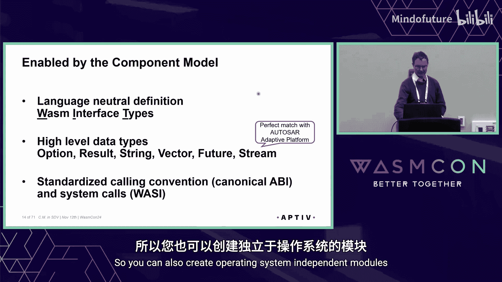
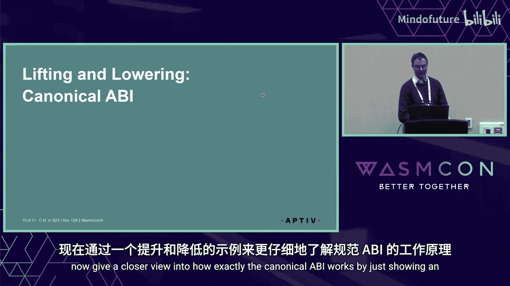
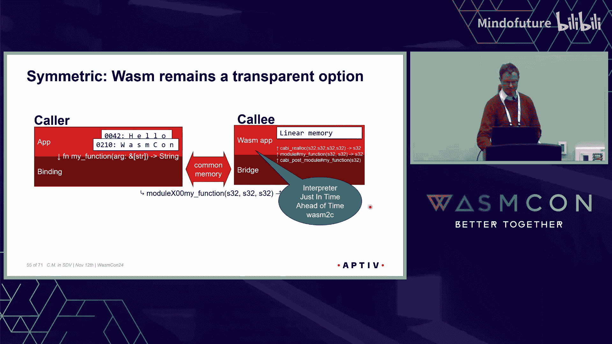
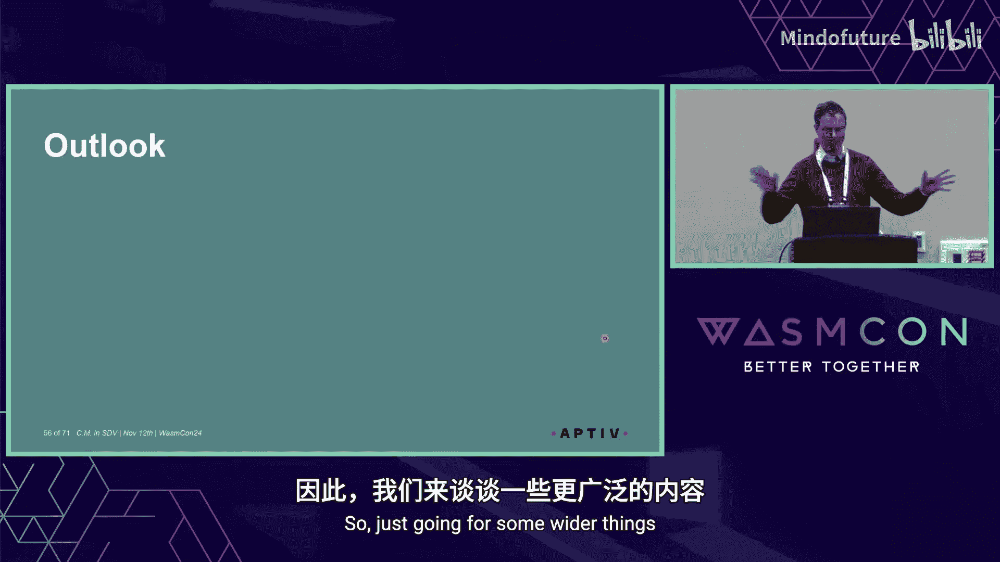
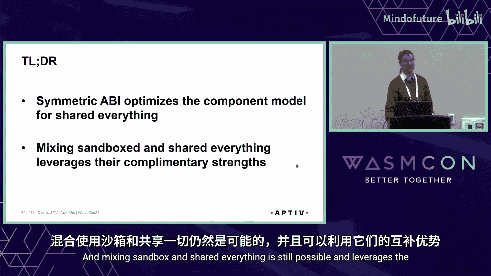

# WasmCon-2024-p27-P27-Component-Model-in-Software-Defined-Vehicles---Christof-Petig,-Aptiv--BV18DjSzJE6r_p27-

My name is Koof Peti， and I would like to present you。

The' usage of the component model in software defined vehicles。

 and half of that presentation is actually about native components。

So I will first present to you how Webasse assembly and the software defined vehicle work quite well together。

I will introduce you to the component model and give you a quite in depth look into canononic lifting and lowering works。

Then I will just switch semantally to something non web assembly， which is a native binaries。

And I will just tell you。How we can optimize the lifting and lowering towards a shared everything setup。

 which is exactly what native binary enable。And this is the thing I would call symmetric AI and that I will give a quick outlook about。

Topics which I did will not cover within this talk。So just a statement at the beginning。

 Web assemblyly helps softly defined vehicle quite a lot。So， let's see。 This is a。

Typical hardware architecture for softly defined vehicles。

 This is quite modern because it has two central vehicle computers， the red ones。

Which are typically PC like architectures。Then roughly one half to the edge of the car。

 theres these green ones， these are zone controllers。And these are typically either using OrX。

 a microcontroller or an arm cortex M microcontroller。And there is two to four of these。

 and then there is many sensors at the edge of the car or at the windscreen or whatever。

 And these sensors are very versatile。 So they have a lot of different CPU architectures。

And so as you can guess， this is quite a challenge to write softwareer。

In a portable way for all these different。Architectures。

 even though this is already the streamlined version。

 so older cars have much more versatile things in there。

So let's just go for the classical containers， which are typically used with。Softly defined vehicles。

These classical containers are architecture and operating systems specific。

 and the sad thing is they only work on two out of the many controller units in the car。

 mainly the central vehicle computer。So we can only place our software， which we developed。

Onto two out of these many controllers。And also， we have to take care of using the right operating system and the right CPU architecture。

So。4 Web70 componentss。 on the other hand， these components fit everywhere。

They are quite lightweight and they're also capable of running on a microcontroller。

 and there is plenty of microcontrollers in the car。

So now we can see we place a lot of them on the central vehicle computer。

 a few of them on the edge controllers。 and then each sensor basically gets its own program to run on there。

Weasse assemblymbly also enables running untrusted third party code quite well and to result at endangering the overall car architecture。

So it fits quite nicely to the softly defined architecture。You can move。

Some programs which you really need at power down， for example， intrusion detection systems。

If you power down your car， if you turn off the engine。

 you really would like to have the central vehicle computer turned off because it draws a lot of power and so you move your either phase out your programs or you move them to the edge where these more efficient low power devices are located。

And of course， you turn up or down some of the sensors。

You can also do a similar thing once one of these controls actually start failing。

So if you figure out something is broken and your software architecture is capable of doing that。

 you could just migrate that software to still working。Controller and of course。

 assuming that you can prioritize with the remaining softer capabilities。

You can also run these components on the edge， without recompilation。This is also。

Similar to deploying things in shadow mode or red blue development。

 where you just take a copy of an already existing software。

Put it also in the car and then just run them side by side and compare the results of these。

And this is really facilitated by just using the component model and the well defined input and output per types which are used there。

You can also just move everything to the cloud， and that， of course。

 is what is typically called a data to twin。So let's take a closer look at the component model。

Here we have an application of a publisher subscriber。

 an example of Autozar Autozar is automotive open system architecture。And。

You can see it's three components。 These share some interfaces。 They are linked together。

And it's a lot of autozar and interfaces there。 There is some interfaces regarding threading because this is a C plus plus program。

 We cannot run without multiple threads。And we also have some Webassese standard interfaces。

 the Vasia Opo， for example， which also gives an indication that this is an Vai0。2 program。So。

 and we can run this components in the car all。We can't just place them in the browser。

And add a bit of。Poer。So here， for example， we have an。Asultment of HTML interfaces。

Elements which we can use to just call， for example， just call mess it on the radar。

 So it's a virtual radar。 It's just。Giving out。Random data。

 so it's just to display the capabilities of the publisher subscriber。

It's not a real realword system。 We can see the application output on the top left， and we of can。

 of course， do all the things we really like to do when we are debugging programs in there。

 We can just put break ones into the source code。 We can single step。

And inspect local variables and inspect a call stack。

So this one is very interesting because it already combines two languages。

 It has the C plus plus source code at the bottom。And all the rest is written in jascript。

 So this already uses。Component model to combine two languages。So， these are the。

Except things the component model gives。 It's a language neutral interface definition。

 which is Web assemblyly interface types。And these high level data types， option results， string。

 vector， future and stream。 So there's already 0。3 in there。

These data types match quite well with the AutoR adaptive platform data types。So it's a good match。

 And this is also why we really prefer this weaponassembly based types for an interface definition over classical things。

😊，Which right， using C interface between rust and C++， and that of course。

 was a lot of effort and difficult to get right。And with Web assembly interface technology。

 it really gets quite easy。Especially when it comes to ownership passing of values between C plus+ and C and and trust or any other language。

And the calling convention is standardized。 So the canonical AI is being used。

 So you really have a binary interface between these components。

And the system calls are also standardized， so you can also create operating system independent。

And melanries。

So I will now give a closer view into how exactly the canononic AI works by just showing an example of lifting and lowering。

So if we just take this start， its we define a function。 It's called my function。

And this function takes a string as an argument and returns the string as a result。

And on the left side， we have the caller， which is a component which just calls into the runtime。

 and the implementation is in the right component， which is the implementinger component or the call。

The caller， the application calls into the binding， which is autogened from the bit。

Then it crosses the runtime。 Then it will just cross the in on the right side and call into the implementation。

So let's take a closer look at how this stream。Travels between these components。

The application starts with a string of memory。 We just assume that it's located at address 42。

And exactly， this information is passed to the binding。

So this string slice of the myfunction definition， which is the rust interface between the application and the binding。

 which is generated。Just receives the address and the length of the string， So 42 and5 characters。

Then the binding will prepare an area where a result will decide。 So this is the return area。

And then passes these three bits of information to the runtime。

 So it calls the myfunction function of the runtime。Which is imported from the runtime。

And passes the first the address of the string。Length of the string and the address of the return area where the return string will be stored。

So nows the run time。Makes the call into the call the implementation。

It cannot directly pass the string because Colla and Colley do not share memory。

 So both of these are sandbox。 So we have to make a copy of the string within the callley address space。

So we first allocate for this， we just call the CAABI reallocation function。

 which is doing all the allocation。And the first two arguments are not of importance。

 It's basically a null pointer So there's no or existing memories buffer to extend。

 we just want a new one with the length of five characters and an alignment of one。

 which basically means we don't care about alignment。So。Our colony will allocate the memory。 So now。

5 bys somewhere within the memory are allocated， and it's。Ex at address 68。

 and this is what the binding returns towards the run time。

So now the runtime knows about the source address and the destination address。

 both are within different memory areas， so it would copy the string from the call。

 from the memory space of the call into the memory space of the call。Then。

It knows which address to pass is my function。And so it will call into the binding with the address and the length。

And the binding will just forward this information to the function itself。

So now we just arrived halfway。To implementation。We cannot now see that the string is passed by ownership。

So bylu。 So the application now receives ownership of the string。So it can free it， it can her it it。

Now， the and the string at address 68 is in the ownership of the application on the right side。

So the application just returns another string， we just return vcon， so we just allocate a memory。

In this case， it's actually a third address 210。And pass the address and the length back to the binding。

The binding。Can only we return a single value。Which is a limitation of the current implementation of the component model or of assemblyly。

And so we have to store these two values at a known memory location and just return the address of that memory location。

 And so this one now returns to 130。And so。With the runtime just reads the two bits of information from the address 230。

 which is the location and the length of the string。Remembers it？

Now we need to allocate within the collar because it's another memory again。

 and we need to copy it over。 So we now allocate 7 bys on the left side。We just receive a new buffer。

 which is its location 4 and40。And now we can just do the copying。

 So7 characters from the S S 210 on the right side。To the address 440 on the left side。

And now basically， a string arrived in the choroller's memory。

We can now set up the return area where it's exactly noting the address and the length。And then。

We can clean up on the right side For that one， we just call a post function。On the myfunction。

 And this one just receives the same argument which was previously returned from the myfunction call。

And so it knows to freeze the string at 2 under 10。And it knows to just get rid of the return area。

Because it's no longer used。So now on the right side， everything is clean。The string。

 hellello string， the argument is still in the ownership of the application。

And the runtime can return to the call。So the binding has already all the information in there。

 there's no return value for that call。So it just read out from the return area and passes the string。

With the length back to the application in the string object。So， now。

Both applications own their strings， and the call has finally passed。Just doing a quick recap。

Coller and callly， theres plenty of functions with different calling directions。

 So basically between the app and the binding， it's always quite easy。

But between the binding and the runtime， there is more functions which get called。

 and it's typically a location and freeing function and the invocation of the function itself。So。

With all this in mind。We know to actually want to go for a different place。

We want to compile this to native。 We don't。Want to use Webassely any longer。

Because Webassetmbly has a small penalty and inefficiency。

And we just want to go for the maximum efficiency just to save cost on the controllers in the car。

So we just trade the sandboxing。For higher speed or higher efficient energy efficiency。

Native binaries provide the maximum CPU efficiency because the compiler can really target towards it with maximum amount of information。

And， of course， the unchanged debugging and deployment experience for the programmers is also quite interesting。

It enables us to mix languages my name overhead， and we will just see that there is some optimization we can do when we modify the binary interface。

😊，And we can always transition to and from Webassembly by just recompiling to native or Webassembly as a compilation target。

So if it just takes the same setup and not change anything and compile it to native。

 we have an executable on the left side， which is doing the call， which contains the main function。

Its links to a shared library， which is justbra the runtime。

Which will do all the logic between the two components。And on the right side。

 we have the implementationm shared Library。So it's two shared libraries。It's a bit complex。

 It looks a bit unclean。 So there was an interesting question on whether we get can get rid of the mesh。

 Let's see。The component model in it mixing languages， so。嗯。

We are looking for a way of just using the C plus plus application with a stack written in rust。

So ST is basically a runtime environment。The autoar adaptive application is fully defined in C， plus。

 plus only。And so this API is fully defined by this standards body。嗯。We need a small adapter。

And then we go for language neutral。And now we can exchange both the upper part and the lower part for any language we would like。

 And in this case， we just exchanged through a lower part for a rust stick。

This uses asynchronous methods and events using Vai 0。2。 So it's full of pollables。

And it's a native binary。 And when I run this one， I get a nice output of that application。

 It's similar to the one which I showed running in the browser。

But we have four or five different binaries， which are used here。

Those of middle ones are the ones written in C++， this is the application code。

And each of these applications outputs a main function that， of course。

 maps to the run function of AZ。And so we have a main function which we'll just call。

 which will just create a new thread。Then call the main function of the publisher and then just call the main function of the subscriber。

And these two needs some infrastructure to talk to each other， basically。

Operating system equivalent of the Vai clocks and poll。

 So waiting on events and setting time out and similar things。And the stack itself。

 which is the logic for doing the logging execution management。Healthkeeping and all these things。

So this is real。 This is the output。 and this would not have been possible using this more complex setup。

But for that one， we just used a simplified API。An ABI， in which I would just present。

After taking a closer look at the symbols。So， it's。Still。Some imported symbols。

 the four four at the top are imported。 And this one is basically the symbol which matches to an resource。

 So we have a construct。 We have a deor， and there is a method in between。And at the bottom。

 we have an adjust function which returns the future。 and because it's Vay 0。2。

 we don't have native future types。We just have to mimic futures by just some resource object。

 which acts like a future， which means we can subscribe to it and get it palable。

 which we can wait on。 And then we can just get the value。Sadly。

 these symbols do not map well to native， so we just need to escape。The slash， colon and brackets。

 which are part of the normal symbol。Things。So let's take a closer look at the symmetric API。

 which is an optimization。Of this call， because we know caller and collie shares the same memory space。

 so they have a common memory。Does this she everything？So we still have the same。

Interface between the application and the binding and the implementation and the binding。

And let's see whether we can get rid of all the functions beside the one doing the call。

 And maybe we can also get rid of the mesh。哦 ran time。So we just allocate the string。

 We allocate the return area。 We just pass all of these as arguments to the callly directly。

 So now we make a direct call。 there's no run time in between。And。They're the binding。

Just takes these values， makes a copy because the function expects a string as an a call by value。

And then just passes this new L allocated string on to the application。So to the application。

 there's no difference。This one just returns the string。We can now， we know。From the call。

 from the call information that 420 was the address of the return area。

So we can just store the information here。 So the 210。

 the address and the length into the return area。There's not a lot of bookke involved。

 but conceptually， we are just passing ownership of the stream from the right component to the left component。

And when the。Function returns。It just the binding just reads out the information from the return area and passes the string。

Back to the application。 So to the application， there's no difference。It just works。Fully unchanged。

And the interesting part is also， this is an unchanged import APII。

So we just take the A BI as it's defined on the left side。

 and now just use it also between these two components。And that map quite well。

If we want to go a bit further。We can also make the calling convention between the application and the binding symmetric between downwards and upwards。

So if we just pass a string slice。From the binding to the app， whenever we call into the application。

 this is， of course， an API change， so it has to change the source code。

Then we can get rid of the copy on the right side， and we can also see this is basically the minimum of copying which we need so it's extremely efficient。

But。If we just exchange。对。Linking between the executable and the shared object for a different shared object or for a different executable。

 we can add full insulation without changing or recompiling that we neither the callli or the collar。

So we just use a new connection dot SO， which mimic the co dot SO and provides all the functions。

And we just use an executable on the right side， which invokes the call。

Whenever the call just signifies so over some form of communication， mostly。Eternet。

Inter processcess communication， something like that。

 So we can still use full insulation by using this API just as a runtime option。And。

We can still embed。Vasse components into it。 So now on the right， I just took an。

Unmodified Webassembly components。 So with the canonical APII。

I add a small bridge between the symmetric A B I and the Canononic A B I。

 and which also just contains the interpreter invocation。

 So the the ways of running the epicassembly。Interpreting it。

 all we just use buzz to see as seen yesterday in Dominics。Presentation。

And so adding Web assembly for full installationulation is just a runtime option we can put it at an end point in time。

So， just。Going for some wider。

Thinkhings so。Using Webasse assembly interface typess without Webasse assembly。En some unique things。

 You can use zero overhead plugins， for example， for doing plugins within aaz time or un embeddeded。

By just creating shared librariesries for these。And you can create a stable interface between rust modules。

 which would work across compiler versions。Rus， is notorious known for not having a binary compatibility between compiler versions。

And since both sides don't have a sandbox。The plugins can use all of postsss。

 which is both a good and a bad thing。 So if you don't trust the plugin， it's bad。

But if you trust the plugin and the plugin wants to do all the network lifting or just interfacing with hardware。

 then it's quite neat because you basically do not have to。

Write your implementations on the host side， so it gets more easy。

So these are the things which would。Clearly， be beyond the 35 minutes possible for this talk， so。

If you want to really use C++， you need multi threading and exceptions。

When I deployed this for the first time around one year ago。

 it was really a bad experience and to add a lot of things there。嗯。

We also designed a symmetric resource A， as you can guess from the example I just showed。

 which already uses resources a lot of at that time especially for the futures and streams。

This is also just taking the unmodified import AI。I have a working prototype of asynchronous calls using this native one。

 And this one is also just using the。Imported A BI。

 So it's just using the one with three arguments has three pointer arguments and returning a value between0 and4 S3。

And this worked well。 It's three two we sold。For function safety。

 we would need to do some zero allocation because allocation is notoriously unrealreliable when it comes to timing。

And if we want to do As， So advanced driver assistance systems like cameras or radarers。

We really want to move a lot of data between this component， so we would actually need a zero copy。

 sandboxed environment。Using shared memory。There's some prototypes for all of this here。

 you can find some more information。 So I do have a fork of us tools in with Banjaon at this Sthub repository。

There's an issue for the symmetric AI， which was not that active in the past days。

And there is the prototype of flat data types， which we would need for shared memory。So just。

 to summarize。Very quickly。Sysymmetric APIBI optimizes the component model for the shared everything case。

 and it's fully source code compatibleible。And mixing sandbox and shared everything is still possible and leverages the complementary strings。

