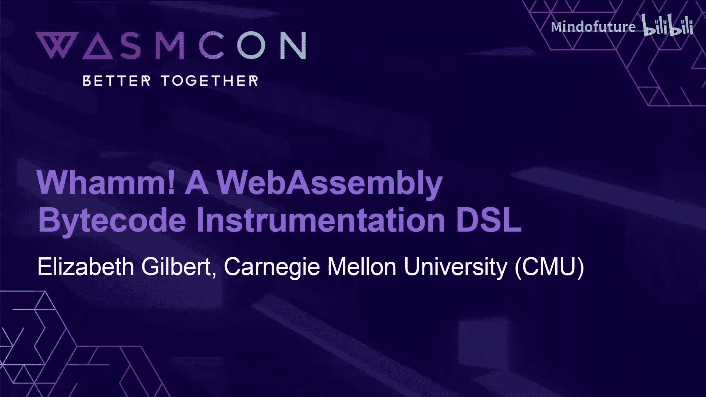
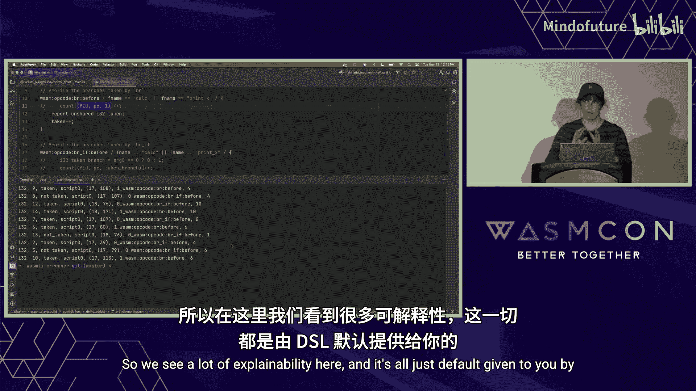
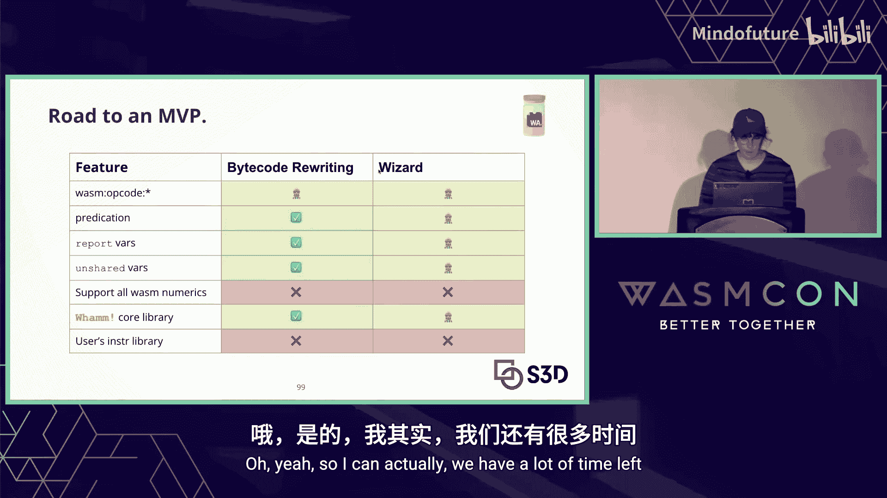
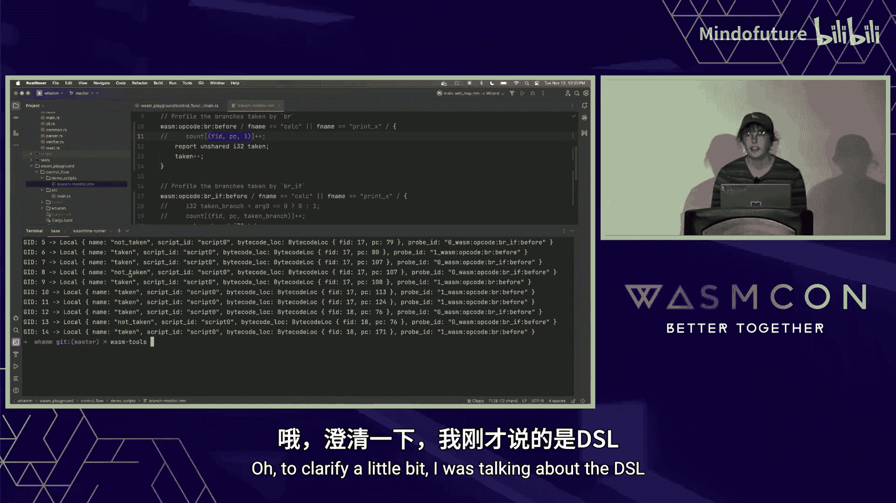
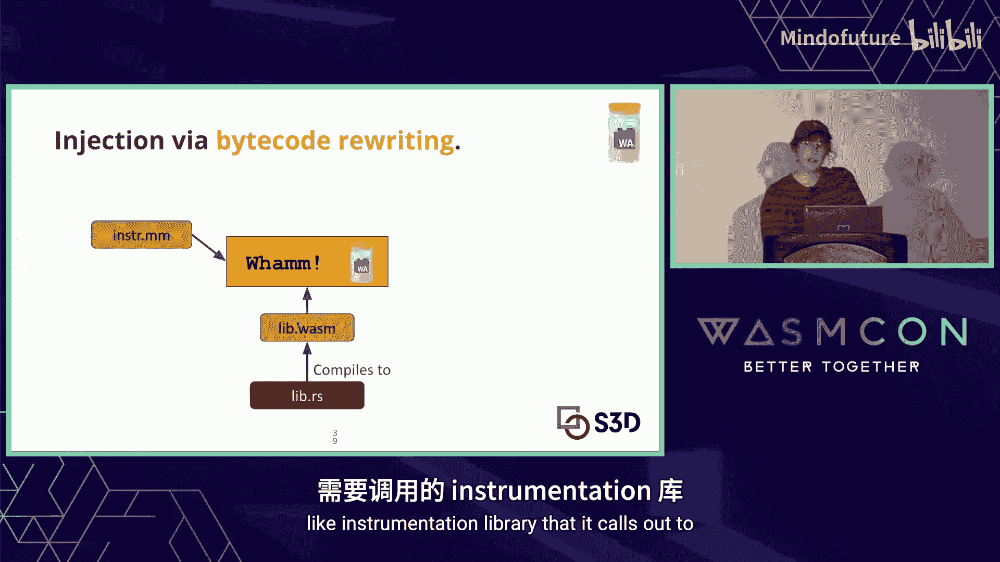
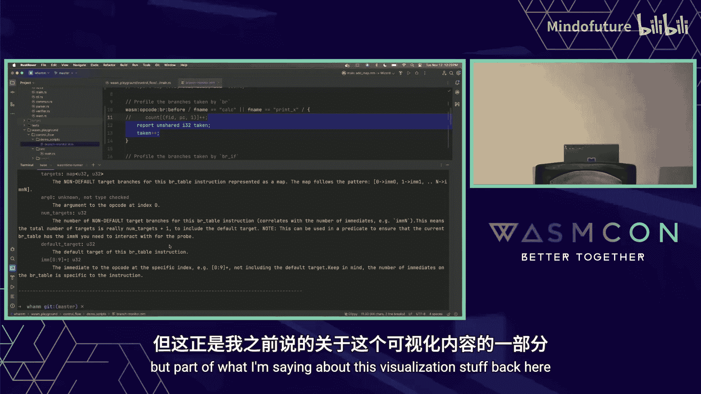
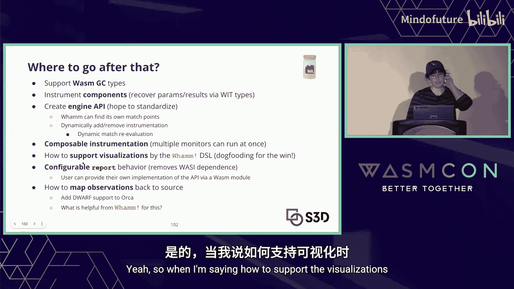
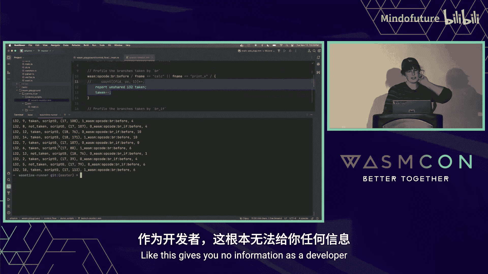
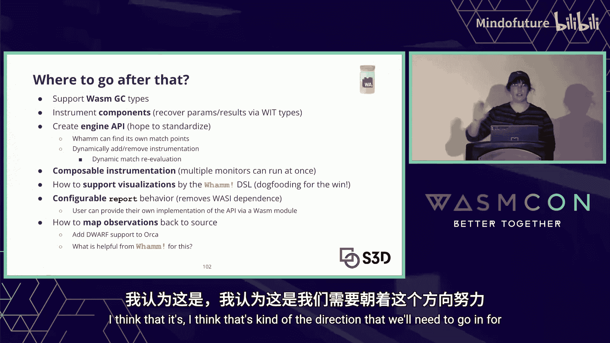

# WasmCon-2024-p30-P31-Whamm!-A-WebAssembly-Bytecode-Instrumentation-DSL---Elizabeth-Gilbert--BV18DjSzJE6r_p30-

I'm Elizabeth， I'm a PhD student in Carnegie Mellon University I'm going to be talking today about WAM。

 which is a WSM Bcode instrumentation DSL I'm advised by Heather Miller and Vi Tetzer if you know either of them let's get started first off。

 what is WM I it an 80s P group？

No well it is technically but we're not going to talk about the day I it a popular seizing technically yes。

 but also we're not talking about it today， but that's a great idea for a logo。

 WAM is a new instrumentation DSL for Web assemblymbly that abstracts above the injection technique so you can inject your instrumentation by interfacing with some engine what WAM does is interface with the wizard research engine right now because that's the only engine that currently supports managing your instrumentation for you。

Or you can perform byte code rewriting， and this is done through a rest library called OrA。

So what's all this jargon， why does this even matter in the first case， Let's dig into it。First off。

 we can all agree that debugging is really difficult。

 especially when you're trying to debug something like Btecode because it's so low level。

And Webassembly by code is growing beyond the browser， which I'm sure everyone in this room knows。

 and it's lacking in tooling， but we're wanting to change that fact by enabling building tooling for Webassembly。

So what are some example tools that I'm talking about for one， we have dynamic analyses。

 so displaying flamegrass for two developers， displaying coverage statistics about your code as it runs。

 displaying control flow information， so showing the different control flow that occurred as your Web assemblymbly bytecode executed。

And then there's also debuggs stepping through your code。 It's very helpful， as you all know。

 for developers to be able to do this。And we can build all of these different types of tools with instrumentation。

 and what I mean by instrumenting a program is injecting some code into a program's execution to do some operation。

 which is intentionally high levell and generic to encapsulate all these different tools that you can build in this way。

 it's really limited by your imagination。So there are lots of approaches to instrumenting bycode。

 and let's zoom into the approaches that are currently being used by WiIM。For one。

 WAM can instrument via Btecode rewriting， and when I saved bycode rewriting。

 it's literally injecting code into the original source。

 so let's say that I'm wanting to probe this call bytecode in my Web assemblymbly module。

Then I would literally inject more bytecode into my Web assemblyly module to perform some monitoring of that bytecode as it gets executed in my engine。

And we built a new rest library called OrCA to perform this Bcode injection。

 this is our repository if you're interested， I know there are some people here that are actually using OrCA。

 which is cool because I'm glad that it's not only me that is using this RE library。

ORCca replaces wrus， that old library is currently not being maintained and also doesn't support the component model。

 so we made this new RE library， which I think is more intuitive for debugging。

And the reason why we called it this is because an OrRCca is a walrus's natural predator。

 which is a really fun play on words that my undergrad and grad student created。

I think that the API is more intuitive and it's just easier to debug your instrument in modules here。

WAM can also instrument via the wizard engine API， it interfaces with the wizard engine to dynamically attach callbacks to your application as it's being loaded by the engine。

So let's say again， that we're probing this call that will attach this callback。

 which is written in the Virgil language。 So this is the language that is maintained by Ben。

 who is one of the he's like the creator of the Wizard Research engine。

And so when you are executing this bytecode in your engine。

 the engine would see it there's a callback attached and call this function to looks like increment account。

 so it's counting the number of times that this call was executed dynamically。And of course。

 as always in software engineering， there are trade offs here。

 you can interface with an engine or you can do byte coie writing。

 but you have to consider what it really means when you do so。

 So if you're using instrumenting by interfacing with an engine。

 then you're tying your instrumentation to only being able to run on that engine， so this callback。

 it can only run on top of wizard。Whereas with bycode rewriting。

 you can run your instrumentation anywhere， you're just injecting more Webassembly bycode。

 which when I say anywhere it's with some slight caveats because you may be creating more dependencies that your engine must supply。

 but in general， if you don't add more dependencies for your domain。

 then you can really run your instrumentation anywhere。

So when you're thinking about these strategies， you have to choose one that makes sense for your specific domain to write your instrumentation in。

But with WM， you have the best of both worlds， right like you can interface with an engine when it's available or used by code writing for everything else。

 So you write instrumentation once and then WM takes care of your injection strategy。

With a small caveat， because there are some events that you may want to instrument that are only instrumentable by an engine。

 so thinking about things that are not observable in bytecode in bytecode you can't see when garbage collection is occurring or thread management。

 you can't even observe when a program is going to exit so if you're wanting to instrument these events。

 you can only do that through an engine。So let's take a look at the anatomy of instrumentation in WM。

For one， you need to have a script that specifies where you want to inject your instrumentation。

And if you need to have。Like more language capabilities that the DSL doesn't provide to you。

 you can optionally pass also a Web assemblymbly module that the compiler can use to inject your logic as well。

So it's really just these two things。Where to inject， what to inject。

And then when you're injecting via Bcode rewriting， you also supply an application。

 so the WAM compiler。We'll look at the match rules that you specified。

 where to match your application， look in the application for those points。

 and then inject the logic， and output a now instrumented application module。

Then when targeting the wizard API， note that the appwam is no longer an input to the compiler。

 instead the compiler outputs this generic monitor module that then the engine is supposed to look at the application and attach these callbacks that are specified by the mats that are encoded inside the WASM module that's the output of the WaM compiler。

So the key takeaway is it compile us to either target。

So here's an example monitoring when with the syntax。

 you may notice it looks similar to the D language for D trace。

Because it's inspired by that with bit。So here's your global state， you have where to match。

 so look inside my application where you see a WASM op code BR if。When to insert。

 so you want to insert before the BRf and this location of my application by code。

And then we can further constrain that match。So PC is a global that's provided by the WAM compiler。

So this will get defined， PC means the PC offset within a function， so within a function。

 if I see a BRF at PC offset 25， then this match role will apply and it'll inject this logic to run dynamically。

So how it injects again by codewriting， compiled to WASM and inject directly。

 or for targeting wizard， we're wanting to attach this callback right。

 but the way that wizard takes instrumentation right now is through that virtualrgil language but we're wanting to think through how to retain portability here we want to think to a future where hopefully other engines will support instrumentation and being able to manage your instrumentation for you。

 so we don't want to tie it to this language that's specific to wizard we're thinking to this future。

 so what if we encode our callbacks in a WASM module so let's dig into how we actually do that right now for wizard but looking to the future。

So we have our global state， which can be emitted as globals in the WASM module。

Then we have our body just compile that to Web assemblymbly and inject that function。

Then we have our match rules and this is a little bit more interesting right like we have to give context for where this callback needs to we apply at our application。

 so we do this through just placing it in the import name right now。

So the engine will take a look at this， find different WASM off code calls in their application。

 and if it does， it'll attach this pro body callback。

Then we have the further predication to further constrain our natural。

And since we have the Web assemblymbly language， we can just compile this expression to Web assemblymbly and return a Boolean result。

And then we encode that also in the export name， so saying to the engine， hey。

 when you see a Wamov code call， I want you to also evaluate this predicate and conditionally attach callbacks based off of whether or not the Brazil is zero or one。

True of false。But there's a little wrinkle here。If the predication involves dynamic data。

So this is static data， the argument won't be known until runtime。

 so there's a little wrinkle here right like this is evaluated statically。

 our application isn't running when we're actually trying to find the locations in our application to attach our callbacks into。

So what do we do here instead we can do an analysis to split the predicate in the static and dynamic parts。

 so all the static predication would be inside this predicate function that's run statically at match time。

 and then the rest of the predicate， that's the dynamic predication can wrap the body of our probe to conditionally execute it at run time。

And we can do some interesting optimizations here， I'm going to dig into it right now。So for one。

 like I said before， we can categorize the subexpressions as static or dynamic。So for this example。

 that's the statican dynamic。Categoryries use。In the simplest case。

 if the expression relies on dynamic data， we could just evaluate dynamically this entire predicate。

 but there's some static part to this。 So we can do something better where we further do an analysis in the compiler when we're targeting。

AAn engine interface。So for the static and dynamic sets， let's generate truth table cases。

Here's our two tables。Now we perform constant propagation for each of these truth table cases to figure out how we can optimize。

So here's the truth table for static part of the predicate。Let's do some constant propagation。

 so you've substituted A as true， and this simplifies down to true because of short circuiting。

And then with false， we just get the leftover part of our predicate。

And then we can do a similar thing for the dynamic part。

 we just do constant propagation with this true table case。Evaluates the true and so on and so forth。

 so here's what we have so far with these different truth tables for the static and dynamic part of redication。

Now we collect these results and simplify to see how we can optimize our predicate。So if A is true。

 we know that we can skip the dynamic predication entirely。If A is false。

 then we need this specific part of the predicate to execute dynamically。

And then this gives us no new information， so we don't really even have to do anymore more with this dynamic part。

So this is what it winds up being if at match time。We execute these， and we see that PC is 25。

 then we can attach a probe callback function where it doesn't even have a wrapper around the body。

 it's just it executes the body because we know the expression evaluates to true。

Whereas if it's false， then we need to attach a pro function callback that has this wrapper around the logic to conditionally execute it at run time。

So notice here that we've removed dynamic checks for every match site and sometimes it removes all the dynamic checks so it can make your instrumentation run faster through some interesting analysis by the compiler。

So back to our engine integration design， let's zoom in on this matching rule real quick because they can get pretty complex pretty quickly because they're having to request different pieces of information from the engine。

 and I agree with you like this is pretty gross engine implementers aren't going to want to have to add this parsing and processing to their engine so what if we just expose an API where the WAM monitor can find its own matches and attach its own callbacks and that's a great idea。

 maybe an API like this where it's able to look at the application get the state from the application that it needs and dynamically add and remove probe callbacks as it needs to。

So we're wanting to look into how to actually standardize an engine API for promoting portable instrumentation across Engine。

En up talking。Let's do a little demo because I'm excited about it。

Feels really small。Is this big enough？Cool all right， so let's see how cool this thing is。

 we're going to write a branch monitor to see dynamically the different branches that are taken by branching op codes in the Web assemblymbly compilation of this rust code。

It's very basic， very short。So let's write a little branch monitor。We can do。Well， okay。

This is the CLI， we're going to use this command to get more information about branching op code events that are available。

嗯。So we're going to get information， we want to learn about the functions and globals that are available for this specific match rule。

😊，These are branching instructions， so let's create a Gob match for the branching instructions that are currently supported by the WIM compiler。

And this gives some really nice output to see which events are available。

 you may notice that this isn't all the branching opcodes and that's because I haven't had time to support all of them yet but we're getting there。

 so let's look at BR and BRF events specifically。So for one。

 we want to profile the branches that are taken by BR。

We want to inject the instrumentation before this PR executes。And we're going to do a similar thing。

 but instead of BR， it's going to instrument the BR if Op code。All right。

 so we want to do some further predication here， let's say we want to only see what happens with the branching op codes in the CAC in the print X function specifically。

 because rust creates the custom names section， we can depend on the names of these functions。

And WM gives you this global that will provide you the name of the function the probe is located in。

So we can predicate using this。Where we want to only instrument the BR instructions that occur inside functions with the name。

 Calc or the name。Print X。And we want to do this also for the BRF instruction。All right。

 we also want to have a global that you can keep track of the information as it happens dynamically。

 so let's make a net map called Count。That keeps track of this。

So what I want to do is also tie the values inside this count to the function that was instrumented。

 the PC offset within that function that the probe was applied to， and the branch that was taken。

 so this is going to look like this。And it's going to map to the number of times that it was taken。

So branch is an unconditional branching out code semantically in Webassembly。

 so we know that it's always going to be taken， oh， I forgot it。Make this is of U32， U32， I32。

And it maps to an I32 count。Cool， so in a BR， it's unconditionally going to take a branch。

 so I know that count。At these globals that are provided by my WM compiler again。FID， PC。

 the take is going to be， it just means one for the purpose。Of this branch monitor。

 we're going to assume that if it's a one， it means that the branch was taken。

 and then we do a similar thing。And BR if， but BR if is conditional and is's contingent on the value of the top。

On the value of the top of stack。 and that's provided。Through when？Ass arg zero。

So we're going to conditionally increment the taken branch based off of Arg zero。

So if arg zero is zero， I know that this branch was not taken。

 whereas if it was not zero then it was taken。Cool， so now we have a branch monitor written in WM。

 let's do the instrumentation。嗯。Okay， so we're going to say， hey， when。

 instrument the application at this location， so it's just the compiled output or the compiled WASM module from this Ru code。

Using the following script， which is this， this script right here。裤。Now I can run it。

And I see that there's a lot of output here， but I actually don't have any monitor output and the reason why is because we haven't put any logic to report anything that happened and what's nice is that there's a language feature for a type of variable called a report variable and when where you can just add this and it'll report to you。

 the default behavior of this report variable is to use WI to print this to the console。

So what we need to do is now that we've added this， we need to re instrument our application。

 it's just doing bycode rewriting right， you have to re instrument to inject the different behavior。

Let's rerun it。Whoa， we have more outfit cool right。

 so now you can see this count variable is reported and you see that there are a bunch of flushes and that's because remember how I said you can't observe an application exit inside WAM that would only be visible by the engine。

 so instead I'm just flushing every time that count variable is dirty。😊，So we see your account。

 we have your script ID， so that's like the idea of the script that comes from。

 we also see that this isn't populated。And this also isn't populated。

 and the reason why is because this is global state in our branch monitor。

 it doesn't have any explainability from coming from specific probes。

And then we see FID PC take branch。 So at FID 17， PC offset 107。

 this branch was not taken four times while our。Application executed。

So this is like not very readable， right？We've made some nice other language features。

That automatically make things more readable to you。

So let's say that we want to reimplement our branch monitor using something called unshared variables。

So let's make a new unshared variable called Take。What unshared means is for all of the points that this probe is applied in my application。

I'm going to have my own site variable， like instantiation of taken。So in。

And you can have shared or unshared， so if it's unshared。

 then all the different sites don't have access to this same variable。

 They have their own instance of it。Whereas if it was unshared。

 then they would globally have access to a single take variable。So if I reach this BR。

 I know that taken gets inced。Then we can do a similar thing in BRf。But now it's possibly not taken。

Based off of top of stack， the similar logic。If the top of stack。Is zero。

Then I know this branch was not taken。Whereas？The top of stack is not zero then I know it was taken。

Ys。So this is already a lot more readable， right， we don't have all this weird like Tple FID PC stuff。

And what's really nice is when you run this。You have a much more readable output with a lot more explainability to it without all of this weird。

 just like a ton of flushed map values。So inside here we know that we have a probe that came from the BR if probe。

 so if we were to look at FID 17 PC offset at 79， we would see a BR if instruction and we know that the branch was taken zero times when the application ran。

Whereas if。We see a BR at a PC or sorry， FID 17 PCS at 124。 we know that branch was taken four times。

 so we see a lot of explainability here and it's all just like default given to you by the DSL。

Cool， now that we have a cool demo that we went through。

 let's talk a bit about the MVP that we're gearing toward right now。

 this DSL is very much under heavy development and we're hoping to have the MVP done in the next like month I would think depends on how much time the next projects work require for my class that I'm taking right now but we've gotten really far right。

 we are almost done with the MVP for bike hoodry writing and we're only going to add more capability to the wizard time。

AndI do want to caveat right now the system requirements for this DSL require that you have multimemory and that you're able to run on top of WI and WAI is because of the report variable behavior that it uses right now but we have plans to work around this that you can configure your own report variable behavior so instead of flushing to。

The console， maybe you want to flush to a file， maybe you want to stream over the network or push to a database or something。

 I wanted to make that configurable for people。And where to go after that， like support WAM GC types。

 instrument components， create this engine API that hopefully can be standardized across engines。

 we want to have composable instrumentation so you can apply multiple instrumentation monitors at once to a single application I also want to make cool visualizations with the dynamic analyses that we're creating so the developers can actually debug their code so what does that look like from a visualization support side for the DSL I don't know yet but we'll figure it out。

Configurable report variable behavior， how to map observations back to the source， so OrRCA。

 we're trying to make it to where if you instrument a module。

 OrRCA will retain those changes inside the dwarf metadata。

 but obviously like Df isn't necessarily the whole answer here。

 not all languages used dwarf so what is helpful for WAM to ensure that you can map your lowlevel observations back to your source code。

So let's take a step back and look at developer tooling from a bird's eye view。

If we have many languages that can compile to Webassembly and with WAM。

 you can write instrumentation once and support a really wide domain of applications because of being able to interface with an engine or by co rewriting to support all these other domains。

 like that's a really powerful capability for people that are interested in developer tooling。

 So what I'm saying is let's go hack the planet。Anyways。

 when Amazonon development will be available soon， I'll take any questions people have right now。

Yeah。So there's optimization。Yeah， so Alex was asking about the overhead that instrumentation imposes。

 I don't yet， so I'm going to be writing a paper on this at some point。And what I was going to say。

The performance overhead is going to obviously be different based off of targeting bike cory writing or targeting like interfacing with an engine。

 there are also some interesting optimizations that already showed you about optimizing predication or doing Jit and transtification of W probes on the wizard engine side。

The measuring of overhead has a lot of complexity there that'll have a lot of more numbers on when it's further along。

Yes。So asking again， were there probes themselves little Web assembly binaries？

Like the functions that ran in response to one of the， let's say， like the branch。Oh， yeah。

 So I can actually， we have a lot of time left。 This took less time than I thought it would。

 I can actually just show you for right now。

It literally just injects around the location。 I want to make it cleaner to where it injects a function body call or a function call but。

What is the was？Oh， to clarify a little bit， I was talking about the DSL。

So if I was I'm understanding and maybe I'm understanding incorrectly here。

 but the DSL that's like the sort of hooks that are getting attached。

 what is that compiled down to right like yeah the coach camera so when I talked about。Wow。

 this is long。Yeah， so。I haven't built this capability yet。 that's coming along。

 So all of this was literally just written in the DSL language。 I didn't provide any。

Like instrumentation library that it calls out to， so this probe of logic literally just gets compiled into Web assemblymbly op codes and then those get injected by the work of framework。

So if you were to look at a B instruction in the Web assemblymbly， like app out dotm。

 then it's going to have like。This。Increment right before it， like in line inside the bikecode。

I don't know if that answers your question Yes， it does。 I had a little bit of a follow up thing。

 What do you think about making these probes individual like was modules and then trying to like so rather than。

Rather than combiningiling them into the binary， but instead combininging them as separate binaries and then connecting that。

 like sort of grouping those binaries together and then using them。

 like sort of making them self contained。Yeah so that's kind of what I was talking about with's making it bit cleaner。

 you would still have to have a call that happens at that point。

 but yeah you could either do that by injecting functions or by importing functions at the boundary of the module at the application and then you call out to that imported function so yeah。

 there can be like some cleanup that instead of just directly injecting to the function。

ThankIt would also be more debugable if you had more。

It would be more obvious where your instrumentation is because you could see these call sites instead of。

 oh if I do a side by side comparison， I can see that here is my original application。

 here's that VR instruction， and then boom， like this is the chunk before it。

 so it'll just be cleaner if it looked like that。Thanks。Yes。Where are you going to send this？

So I was going to try to send this to PLDI but the deadline I think is like tomorrow and I have not had time to create a paper so probably going to be pushing this off to Oopler or something next year but still figuring that out yeah I hope you get a very positive reception I think it would be wonderful to have more of this kind of work be recognized by the academic community I think there's a lot here that。

Maybe 20 years ago when people were talking about Java and that was like 30， 25 years ago。

30 years ago， anyway， I think this art is worth recognizing the academic community。

 I hope you find a lot of success there。 I hope so too。

That the story of instrumentation could be a lot better than it is。 and I mean。

 I was talking about this with Victor yesterday with Webassembly。

 like we really have a great opportunity to make really cool tooling。 that's language agnostic。

 platform agnostic， all these different things。 So if you。😊，Like in the future。

 if a new language comes on the scene and if they just create a compiler target that can target Webassembly。

 and then Webassembly has all of this fully fledged out tooling like they would get all of this tooling for free。

 which that's obviously like way down the line， but I think that there's like a really compelling story there from the side of observability。

Hi there。 So in your you mentioned that GC types are。On the roadmap。

 do you have any support for function references， so like if I want to instrument like call and direct。

 for example， like I'm an engine implementer I'm spidermonkey。

So one of the things we've been looking at is like speculative optimizations around calling function references。

 so I would love to have a way to be able to like instrument call and direct to see what their targets actually end up being at runtime and getting some statistics on that do you have something for that now or？

Is that future work So I don't think that it currently supports calldirect。

 but like I'm going to be doing that as I flesh out the op codes and I wanted to zoom in on。即。🤢。

So BR table is kind of wonky right， like you're branching based off of the incoming top of stack。

 which can be。Wwhich can target multiple different branches kind of like a switch so I have globals that are specific to different op codes that help you get more insight into what's going on。

 specifically about that event so I need to zoom into the Colin direct and what makes sense to support instrumenting that type of event but it would look something like this where we have these helpful globals to get you more information specifically like what would be interesting for you。

 so with Colin Direct it would look。They would have this support victim。Yeah。

 with call and direct specifically， you know， you'd have an index for like what you're getting。

 and you'd， you'd also have a table index right， And then you'd want to have some way to like。

Well maybe I guess you could just provide what it's finding in the table。So yeah。

 I don't know the best way to express that call Ref from the function references proposal would be simpler because there you just get the function reference already Well a lot of that information would be statically known right and then the part that's dynamic would be the top of stack that targets different。

Calls within the table。I'll have to think about what globals I would want to support specifically for Colin direct to enable that either。

Fully static information you want to know or static plus dynamic information to pull out whatever would be true for your。

What occurs dynamically for the call？Oh coolol。 Yeah， that's awesome。So like， but if I would do that。

 like。I would need to have support for looking up inside the table that it's targeting as well。

 so there's a lot of complexity there that would need to be added to the DSL。Yes。Yes。

 I guess this is more of a high level question。 You mentioned， you know。

 the opportunity for a developer to only equi Wam to be really， really cool in the future。

 So I was just curious to hear， I guess your personal opinion。

what do you think maybe deing instrumentation will look like。For an end user。

 I'm guessing people probably I mean writing M files directly right with leveraging op codes。

 So I don't know， maybe leverage by a debugger or what do you see there。

I feel like the speaker might be really garbled sounding， I might come down and try to hear again。

Sorry。You you Yeah， you can say it in the microphone。 I just I can't hear super well。Yes。

 so I was saying you mentioned developer tooling of Wam， the opportunity for it to be very cool。

And I was curious to hear your personal opinion on what do you think that will look like sort of for an end user in the future。

 so I don't know， potentially they're not going to be writing MM files。

 maybe leveraging one directly， but maybe they'll be leveraged by a debugger or sort of how do you see that looking like。

Yeah， so I'm hoping that I think a lot of this is going to be mainly used by developers selling implementers。

Common developers will never look at this stuff。And so， I think， like。

I'll stop to think about how this actually gets integrated and put into the hands of developers。

 but part of what I'm saying about。This visualization stuff。

Back here。B bh， blah。Yeah， so when I'm saying how to support visualizations。

 like developers don't want to see this weird output right。

 like this gives you no information as a developer。 So how do you actually like。

Visualize this information。 So I'm wanting to do like V S code extensions so you can have debugging Web assembly binaries in VS code or displaying flame graphs in VS code。

 like I think the way to do tooling for developers is to put it into IDs for the most part。

 Or like if you use。Like Es or themm or something。 enable some way to visualize that for them。

 Maybe that's giving H Tml。 They can show that in a browser or something。 I think that it's。

I think that's kind of the direction that we'll need to go in for that。

