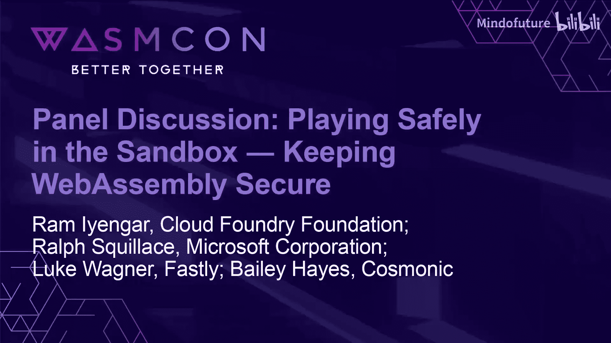

# WasmCon-2024-p31-P32-Panel-Discussion---Playing-Safely-in-the...-Ram-Iyengar,-Ralph-Squillace,--L--BV18DjSzJE6r_p31-

Good morning， everyone。 Thank you for making it。 despite the snow and despite like 20 other events happening at the same time。

 not to mention other great talks in the other tracks of Wassmcon。 My name is Ram。

 I work at the Linux Foundation。 I help manage the community around a couple of projects。

 One of them focused on open source Security。😊。

And so I thought this would be a good opportunity to get together some great folks from the WasM ecosystem to discuss security you know。

 aspects of wasm in general。I'm going to let folks quickly introduce themselves， look。

 why don't we start with you？Hello， I'm Luke Wagner。

 I work at Fastly in the Office of Technology Research and Incubation。

 work on Webassembly standards and evolution， I was one of the co- creatorators of Web assemblymbly back when I was at Mozola working on Firefox。

 yeah now working on wing the componenta model。Hi， my name is Bailey Hayes。

 I am a CTO at Cosmonch which is a company that builds a WMCud platform application platform。

 I also serve as Bcode Allliance technical steering committee director and also one of the cochairs for the WE subgroup within the W3C's Webassembly community group。

 I've been doing Webassembly stuff since 2012 if you count Asm JS and got to run into folks like Luke who were doing cool amazing experimental things upstream and yeah I always interviewvied them and I only recently got to be involved in some of that standard sided things maybe two years ago。

I'mal Coatchi I'm a principal PM at Microsoft， Azure， the group is Azure， what is the group。

 what is my group， Azure corere Upstream， which does all the open source work for a lot of services in Azure and across Microsoft。

 that includes Kubernetes but includes Webassembly as well， so that's what my team does。Alright。

 considering that this is happening alongside Qecon and cloud native con。

 I'm going to begin with a question about。A lot of people who are， you know。

 either here or watching this later might be。Entrenched in a containers world， so。

What is the difference or what is the change that you know they ought to be mindful of as they're transitioning from a containers world to a bosom world。

 especially in terms of security。I'll start I think all of us will probably have something to say on that one so a Webassembly module or component。

 it's really a dot WasSM it's a compilation target so when I'm coding in let's say go I say dash target WEP2 outcomes a dotwaSM binary and so I'm able to run that now on any runtime basically that supports Webassembly and those are there are a number of those there are plenty that are cloud native WASM Edge is a CNCF project that's a Webassembly runtime I am a maintainer on WASM cloud that's a CNCF application platform it embeds the WASM time runtime inside it and so the way in a cloud native world that you take a Webassembly module that dot WasSM and send it to one of these application platforms running。

 let's say in Kubernetes the way that I would do that is I would package it inside OCI and so we've done a lot of work。

Stt event and Taylor Thomas working within the CNCFs WSM working group they've advanced the OCI spec forward to have a specification for WSM artifacts Oh also Luke too you worked on that sorry about that and so we package it together in an OCI artifact so what is great about that is that your existing tools basically just work with it and the runtime that are pulling that down they know what they're downloading。

 they know the type of component what it needs to be able to run and so from an aspect of security the thing that you can scan is you can look at that OCI artifact。

 know what a dot WSM isn't crack that thing open and see exactly what it needs exactly the APIs that is trying to import so let's say you want to add security for something that says it needs Wy sockets Aka needs a socket well you need to make sure that you found a way to sandbox sockets safely to be able to run that component。

What would you add？Wow， and so that。I report up through the AKS of the Kubernetes experience at Azure and the Kubernetes teams。

 I guess for people who are trying to figure that out the difference between containers and Webassembly from that perspective。

 for example， would be something like there isn't really a container。In Kubernetes。

 there is only a process that is executing within a framework of certain see group and namespaces and sec comp and whatever else。

 so what that really means is that in Kubernetes the way it works by default， all the security。

Configuration。That you get for your native process。Is actually handled not in the container。

 it's handled by the OS configuration。In the note。Okay。

And so what Webassembly brings in addition to that is that Webassembly actually executes inside a sandbox and there's a specification for that and how it's supposed to be constructed and executed。

And then that itself can be part of the entire security configuration all the way down if you're thinking like。

Maybe you're thinking of running Webassesembly Kubernetes， for example。

 you can actually put C groups and namespaces underneath that process and get sandboxing at the Webassembly level at the per module level。

 for example， which is typically each request。In addition to whatever configuration you've done for the actual process in Kubernetes。

 and that allows you to have layered security。Values for example。

 and that's just in the Kubernetes Kubernetes environment。

 and if you're running a container outside of Kubernetes。

 you got to do all that security work yourself。And with Webassembly， by default。

 you still get the sandbox。Per execution。And so the default stance of Webassembly is vastly superior。

Absent other contexts， other things you're doing with the process。

 than just the way you run an into process in containment。 if that makes sense。 and that。

 I think helps。The security conversation， if you' coming from Kubernetes and containers all lot。

Something to add you to that you Well Yeah， those are great points。

 I'll work a lot more with containers in practice than I do。

 so I think that pretty much pretty well covers it。Cool， I'm going to point this to you Rpham。

The ecosystem seems like they're filled with amazing and smart engineers， but。

Do you think they still end up doing dumb stuff in terms of， you know。

 not adhering to I think I'm triggered over the word dumb。 I think you're teeing me up， listen。

And engineering is easy when you're building hello worlds and when you build real stuff that runs at high throughput with heavy workloads that cost people pay money for and so forth。

 engineering is extremely hard it's a very complex puzzle that we construct with colleagues with the collaborators and organizations。

 with projects and all this kind of stuff is extremely hard。So the answer is， yeah。

 we all do dumb stuff。Everybody does。 We're humans right， And when things get complex。

 maybe we're tired that day， maybe it's an interruption in our thought process。

 and we don't complete some step， you know， so those things happen。

I do want to say that for people who are coming to Webassembly。

 there's one thing that it's really important to sort of realize that Webassembly。

Almost all the code that we inherit and even the way we learn a program makes an assumption that we have an operating system underneath us。

 and so when you start writing code， even for something like Web assemblyly。

 you assume you have a file system， you assume you have networking。

 you assume you have some sort of chip that maybe has a GPU and something like that and you can just use them。

And the answer is， you can do that in Webassembly 2。

But every time you make an operating system assumption。

What you're saying is my code that I'm writing can do anything。

And what the component model and Web assemblymbly generally gives you is the ability to constrain the attack surface from either inside the module with guest code or outside the module。

 even。And from other modules， other components。That for the next 10 years of distributed computing is a critical security boundary。

But there's one other problem that most people， when they're coming to Webism don't really realize because you have to really get used to the spec。

And that is that Webassembly， unlike operating systems。

 doesn't have a concept of read only memory inside the module。

But we assume when we're writing to our you know that read only memory is a part of our security environment because we're used to that feature in operating systems。

 and so when we write code， we think， oh， it's great。You can read。

 The one of the interesting things is you can read。Research papers from 2019， 2020， 21， 21 and '22。

 and of all the security research papers， which I spent a large amount of time reading。嗯。

The single number one feature that is cited as a security flaw in Webassembly is the lack of read only memory。

Which means that other things inside the component can actually read memory that isn't theirs and do something with it。

That seems like a flaw happens to be not really necessary in the way Webassembly was evolved。

Of course， I'm looking at Luke here because I don't want to stomp on Luke's foot or something。

 but it's because Webassembly is not an operating system。

And so one thing in the security thing we need to remember when we're learning Webassembly to not think automatically with the operating system assumption。

You want to constrain what you， you want to constrain， what other people consume from you。

 and then internally you're going to need to tighten the boundary of the code you use inside your module and your component。

In order to reduce the number of supply chain dependency attacks that we now know will occur。

 whether you want them or not， right And then thing that I like about the component model。

 one of the reasons we invest in it。Is that allows the component model allows you to get that boundary in a lot more fine grain solutions。

That's a value。In security。That can be used to address what most people think of as a missing feature。

 of course we could modify the spec and add reader memory in the future， and I'll ask you about that。

 put you on the spot。But I think that is one of the things that I think people need to sort of have consciously in mind that that it's a feature and it's designed that way。

 but it means that you have to think a little bit differently about how you build your modules and components。

follow up loop Sure yeah so Do agreed。 we all accidentally write dumb code sometimes And so the way to sleep freeze at nights is shrink that blast zone So when the worst thing happens it doesn't take down the whole fleet。

 it just is a failure that we can wake up and solve at our leader and it means shrink the blast zone and just put least permissions and privileges into that blast zone so that when the worst thing happens it's not that bad both good for supply chain attacks but also like fat fingering things and that's just that's just how it goes so that's great and component model yes lets us have much smaller boundaries than before but actually getting to the read only memory part this is a thing where there's some positive progress more recently So initially when we start w everyone was like well of course we should have read only memory because everyone knowsulsha trap when you load from it and then we want to someplace to put our R data So we're like yeah well clearly we should have anpro instruction to flip permissions but the problem with that is our goals is be portable and run a bunch of different operating systems well not all operating systems give you M protects and some hardware doesn't physically have an MM。

So it's not even possible to implement imp protecttect And so we're like。

 okay we want to run there Also like this is a pretty serious OSs functionality and we can anticipate all the consequences of this。

 And so I'm kind of glad we didn't because in like a highly multitenon environment we're running a lot of asm in a single process on many cores and protecting does a tlB shootdown that wakes up all the other processors and pauses them slightly and this can dominate overalls of performance。

 So it's kind of very lucky we didn't have this thing and everyone' setting it all the time because like our temporary substance at that time would have had all these massive impact。

 So it's nice we know to have impprotect， but it's still annoying that nulls don't trap I can just load from null and stored to null and that we don't have place put read only data but there is a fortunately much simpler solution now being proposed as a subpropoal of the memory control proposal that's being worked on and the more simple idea which is actually an old idea which just finally got to the front of the priority queue is let's have on the type of a memory。

 let's be able to declare how many pages of no read no right memory go at the beginning and that's just a static constants today。

everything's none zero。 so the first page is readable writeable but lets you declare one page or two pages are no read No write and then the next pages how many are read only and with this more static allocation way where you start with no access and then we start with read only followed by all the normal memory if you don't have an MMu if you don't have the magic hardware to help you a simple subtraction before the bounce check。

 which you have to do catches you without having to do the whole expensive software page table stuff So good fallback performance like modest overhead when you don't have any hardware sport and if you only have anmpu。

 which is a lot of embedded has and increasingly here like most of it does。

 you can enforce this because they have static declarations of what regions of memory of what access So we can finally get it's not the most high order bit but I think we can finally address this original use case and hopefully it can stop writing papers that being us for no read only memory Well even though I think the hired of is what you said smaller glass zones less principle least authority So for people。

are learning that's the high order bit because of course we don't have this yet。

 but the point here is that even when that comes your habit needs to be small blast zones and you will need to think about the code really the function code path and deliver that in the sense of Unix do one thing and do it well kind of concept I' just finish security this is my one security rant by saying that one of the consequences of this is that if you use all the Wy interfaces。

 for example， that comprise an entire operating system platform kind of call set or if you create a custom one that allows you to do like Posits completely and all this kind of thing。

 one of the problems is now you're essentially just writing native code。

 it's bundled in a module or a component right， but essentially because of inability to lock parts of memory。

 you're now actually giving your what？y malicious code， complete access。

 not only to pilfer through your memory， but also go ahead and exfiltrate it as well。

 and so not tightening down the exfiltration boundary as much as you can。

 as well as creating concrete boundaries for individual or small collections of functions。

Is a larger problem that will eventually be bad for us' if we end up thinking。

 it's all just going to be an operating system through time。Sometimes it is。

 but a lot more it's not going to be anyway， that's one of those areas where I think it's not really dumb。

 it's that our habits of coding that we have will lead us to make mistakes that we didn't realize we were making。

I feel like we should just throw out down some examples of dumb mistakes that we might make。

 Maybe my dumb mistake is my language that I chose and it's not a memoryafe language and I wrote a bug in my code that had a double afterfr well now because I'm running in WSm and I have this linear memory I'm not allowed to reach outside of my memory so when that happens I'm going trap as part of the runtime and so I get to keep my bug all to myself and not impact anybody else I think that's a really important thing to call out so there's a whole host of types of things that can happen。

 Ralph just mentioned Wy and I feel like maybe we should level set that stands for well I guess if you watch Luke's talk you might already know but the Webassembly system interfaces system makes you think that it's very low level it actually has some very high level ones like HP those are essentially interfaces that were standardizing together and we think really deeply about the sandbox ability of those interfaces。

Ptically important for runtimes to implement and for vendors who then will take a runtime and then also think about the right way to sandbox that and maybe even run in multi tenant environments。

And what those ultimately are a Webassembly module has imports and exports。

 so the things that it needs to run and things that other things can call on it。

 and in those imports， you're pulling in something it's like a function handle。

 but that could be something to a lot of different things。

 it could be something that is inside the Webassembly runtime itself that is providing some of those WI interfaces it's built into the runtime。

 but it could also be something that another thing embedded that runtime and it's a host and it's native code that they're doing their own thing on and you don't your imports don't have to be WI imports。

 it could be anything and so that's another thing that we're seeing in the industry which is both great and terrifying because we are seeing a ton of people create their own APIs they're providing these imports。

 they're creating native functionality enabling hardware capabilities by doing that and also you know introducing。

Other areas that we need to think deeply about the security and sandbox properties of those functions。

 Yeah， I'm just going to。Have you folks on the memory safety and isolation areas look I know you had written something up earlier this year about memory safety and isolation and things like that what are your thoughts about you know these areas of security in the context of Wa。

😊，Yeah。Try to think。I wrote a linking document that explains some people think that in the component model every single tiny library has to be in a separate memory。

 and so anytime I use like my left pad or whatever tiny library it's gonna a separate component I'm going be doing lots of copying a thing the component model lets do is choose when you want two modules of code to share memory and when you want them to be in separate components and so this kind of gives the developer some degree of choice of here's a collection of code that I think is all in the same trust zone。

 I'm gonna to give them the same capabilities I'm gonna to put all in one components and this is like when I'm running JS and I import other JS packages this probably is all going in one component but you also have the ability to say okay well this library I'm a little worried about I don't know what's gonna to happen here it has a ton of dependencies or it's large or it's just in a different language and I have to I'm going to put in a separate component and I'm going think carefully about what imports I give to that thing so what it can do in the worst case I'm going to think about what its blast zone is maybe I don't want to give the same file system I have I want to give it a little virtualized file system that only is like three things I put in there because that's all I know it needs。

But itt wants file system， so I'm going to give it a little virtual file system。

 so maybe the thing I'm trying to think of that I wrote earlier was this linking MD that's in the componenton model repo that describes how all this stuff comes together and like。

 oh， this a lot of the normal tools they're used to like static linking dynamic linking。

 these fit in the picture， as well as the newer stuff like linking components together with WasSM composeose。

Is there anything else that didn I would love it if you just gave us a level set on。

How linear memory were。Yeah， that's a great starting point。

 so OWSA module can only access memory that it's either creates itself or it's given as an import and so every time you do a load or store in WASM it it's with either this memory created itself or something in imported and it's bounce checks because that memory has a length and we can optimize these bounce checks so they don't end up being too expensive in practice。

😊，You know by when you create this module， it's not going to be messing with random host memory that's in the same process。

 so you have this very strong kind of by default without you having to do anything， anything special。

 anything really magic， knowing that when you run the ssm code it can only access that memory and not your own memory and you're like well what else can to do it then running first of all if I haven't called it it can't even run so it's only running when I called it and then while it's running what can do well it can only call functions that I gave it as import。

And that's it， that's from the outside world， I can think about this without doing all sorts of really low level if you look at the way people used to have to sandbox bras。

Containers are a huge amount of effort and still ongoing to sandbox things with an interface that wasn't meant for virtualization。

 whereas components are entirely designed around， we want to be able to virtualize and sandbox。

 these things。 How can make it as easy and natural as possible。

 So it just feels like calling functions， you know passing functions more familiar concepts。

 So how can we make yeah bring principal least authority， you know。

 to regular day to day programming develop instead of like this like super elites， you know。

 dark magic。😊，If I were to pick up on the container thing。

 the container comparison is a really useful one because it's something that we as an industry and communities have kind of suffered and succeeded through for 10 years or more to understand and learn how it works。

嗯。The interesting thing about the container again， heart getting back to exactly what Luke just described。

 all of those things are specified。And in the W3C in particular。

 and the things that are like in component land that are being evolved will eventually end up there as well。

嗯。Those things you can write tools against。That help you make decisions that are good for you。Right。

The problem with containers is that there are blobs of native code that you must understand all the way back the。

The compilation chain in order to even get a chance to do it and we have scanners， for example。

 for containers now that are essentially native scanners just you can mount a file system and then run the native scanner through the file system and they come up with all kinds of things that are sometimes actual errors and they do a pretty good job。

 we must say。But also， they give you false positives and they miss things and so forth。

 And the difficulty there is that it's really hard to follow the code path because it's a blob。

 It's an executable blob set。And in Webassembly， we have the kinds of things that Luke was just talking about。

 We have the ability， and there are already tools for a lot of this stuff。

We have the ability to make tools that examine these code paths in advance that understand imports and exports in advance。

 Some of these things are already here， but a lot more possibility exists。

And I think that from a Microsoft point of view for example， fills me with joy。

 I am 10 or 11 container years old and that in container years is about 183 and you get get to see it and the color my hair and so when I look at it from that perspective of lived experience。

 the kind of tooling that I would build or that will be built or is being built to understand our components and our modules as they go together and has they execute is just filling me with joy。

 I am so looking forward to the next 10 years of distributed computing with web assemblymbly whereas if you give me a container and tell me that you' got to do that for the next 10 years in all these different places where compute can happen。

 I am ready to retire。And so the joy that participating in this new technology。

 which I think is done well， I never compliment you in public again， okay， I just can't do it。

That's really important。And it means that I go talk to my customers。 I talk to the ecosystem。

 and I can say， no， no， we can do this。 What do you need the tool to tell you before you run。

That component， that's great。I want to talk about the sandbox before we end， because。

Every time you look up something about Wa security。

 it ends up being a Wa is safe because it has a sandbox。 Billy。

 why don't we start with you And you know， if you can share some thoughts about。😊。

What it actually is like in in reality and。You know， anything related to that sure。

You know I think it fundamentally comes down to the thing that provides your sandbox is your runtime。

 so you are only as safe and secure as good as your runtime is at providing that safety and security property using the example that I gave before about I wrote some code。

 it did a double after free we do bounce checking as part of the semantics of Webassembly and so in that case we would successfully trap。

Now if your runtime decided to disable bounce checking or if it had other types of maybe non-standard APIs that they've added to the way that they instrument and run that Webassembly code is not going to be secure you're going to break the sandbox or even if it was just a mistake in the coding at that moment he was interrupted by the alarm clock or something and so we do a lot of work within the bycode Alliance Foundation and also in the CNCF for running fuzzers running sanitizers on your runtime。

 but there's I think a lot there on just proving the validity of your Webassembly runtime Sandbox capability and mistakes happen。

 even if your runtime is written in a memory safefe language like Ru。

 there are still things that we catch and so it's really important。

 I think when evaluating runtime that you would want to use。

You look at a few different types of properties that it provides if that is one of its key goals or if it's global is to go fast room room。

F up Yeah， one other the thought is lowlevel memory safety is bugs are a large source of Cs。

 But importantly， log 4 J happen in a safe language and so confused deputy attacks overprivileed。

 confused deputy attacks are a major also threat。 And so that's why where even if you are using a safe language and not even using its unsafe keyword controlling the capabilities you give to having fine grain blasts and controlling the capabilities you give to them limits what happens when you accidentally embedded a total exccutable interpreter in the middle of this otherwise safe language。

 so。OhIt just triggered me again so like one of the questions I have gotten for several years and you there are a really bunch of cool tools out there that already do this is okay。

 great， I'm going to be able to build my container as a web assemblymbly module。

With the idea that you can just actually copy and just use Webassely as a new kind of container kind of thing。

But if you start thinking about the blast zone problem。

 right and you've made the containers make an OS assumption。

 like you can put anything in there because you have full power kind of thing。

 you're just removing the blast radius constraint security tool that Web assemblymbly has given you。

And you haven't really changed the operating parameters of your code at all。

 you it might in theory be slightly more portable， but it's not necessarily going to be faster。

 it might well be slower， for example a little bit。😡。

It's important to realize that although we would like a make a container。

 or a web assemblymbly module and my job's done kind of workflow。

 that's actually not what we want as engineers。There are going to be scenarios， of course。

 because engineering is fits in every single niche of our existence。

 So there are going to be scenarios where you really do take an entire kind of operating system chunk of code and put it in a Webassembly module。

 because that's simply how you need to be able to make it work。

But we should not be wanting Webassembly containers in the dockerized sense。

 in the sense of I want to X copy everything， and it'll be Webassembly now to just run the same way that that doesn't change your security stance at all。

😡，And Web assemblymbly can't help you because you've made the O assumption。

 the code can do whatever the operating system you， can do。

That's really interesting that you can think about containers and wanting to move them over。

 and it's actually what you should not want。Which is one of my hot takes， I guess。Cool， yeah。

 I think we're getting close to the end of this。 So you know。

I just want to do more hot text individually， I guess。

 but any closing thoughts with something to think about for the audience in terms of what they can do to。

Implement some security good practices within Ma。I'll give my like not hot take first and then we can really go in。

 but the first one starts with your code scanners that you're running today on your source code。

 those just work so keep doing that for WASM， the world doesn't have to look completely different to be able to do this。

 it is a compilation target that many standard language libraries are adopting and that means that other tools that are using it just work。

You can inspect the module before you ever run it right the whole thing especially with a Webassembly component it's practically declarative itself you look at it。

 you can say this is exactly what it needs to be able to run that's really powerful we as an industry need to really build an ecosystem around that we are emerging right now and there's just so much opportunity there to expand that out I think you I was just saying right before we got on here that I would love to have like a little kind of indicator that shows me when I'm running your component hey this thing needs some extra stuff do you know what that extra stuff is it's actually just like loading you know all of TensorFlow and like all these other things and it's loading it inside the runtime process and you know if you're okay with that cool but maybe you might not be okay with that and so there's just so many different things that I think we can build out as an industry I know you work with open SSF and so。

Having scorecards for WASM components would be amazing I want that so bad so that's one really great place that we can do this I just want to like double click into Ralph's hot take here on let's not make WASM you know Poic 20 let's think about why we wanted to get here in the first place and really we want to be able to run just our business logic just our code right and we want to run it in a way that's virtualizable so that we can run it safely inside a sandbox。

😊，And so when you pull in tons of other stuff into your WSM， that can be totally fine， right。

 I can virtualize an entire file system safely， securely， and I can make it read only even cooler。

 there's a tool like for a Wy Bt for that， but let's think about when we're trying to build。

Software architectures in a new way， we're able to finally actually take advantage of the UniX philosophy I talked a ton about this with Luke back in like Barcelona at Wasam Mayo and it just really clicks because we can finally write one thing。

 make it do it extremely well and we now also have a common way of communicating across these components so let's build the right semantic APIs that are also taking advantage of all of these same properties that we're talking about that it's virtualizable that it's sandboxable and that it makes sense and feels good to use there's just so much opportunity there that we can take our code。

 make it work like how we're used to but then also think about the way that we're designing our programs so that it works really well together。

😊，R that was the best closing hot take I've seen。 That was a great summary。

 I don't have anything to add。😊，It's going on that note， yeah。Well， thanks so much for， you know。

 taking the time to be part of this panel and sharing all of these wonderful insights。

 And thank you all for being in attendance and being a great audience today。😊。

