# WasmCon-2024-p33-P34-Sponsored-Keynote---WordPress-Meets-WASM---Full-Power-of-the-CMS-In-Any...-J--BV18DjSzJE6r_p33-

My name is Jason Ball， I'm an engineer at Automatic， and I'm here to talk about WordPress Mes Wasm。

 the full power of the CMS in any app。

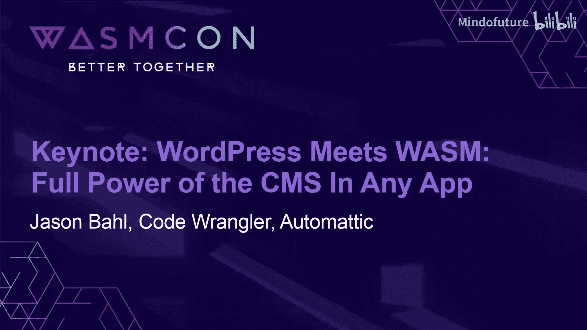

So I've spent most of my career using WordPress in pretty nontraditional ways。

 and I want to take you back to where that started。 So in 2006。

 I came across a website called Leo for Market agency Leo Burnett。

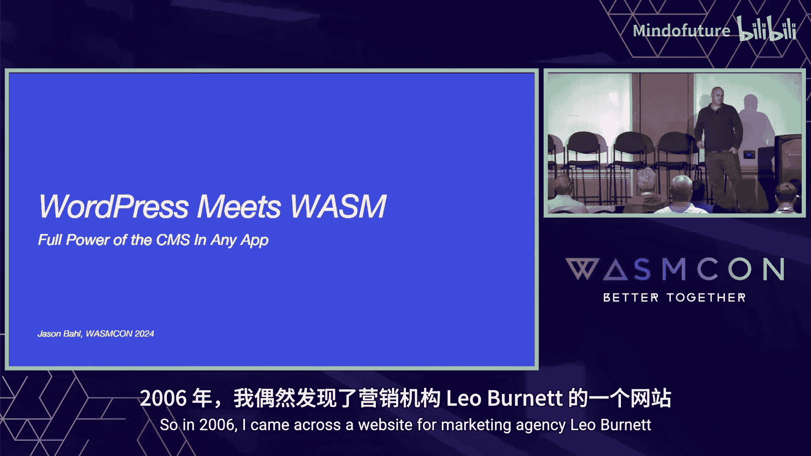

At the time， it was one of the most interactive things I'd seen on the web。

 I was pretty impressed with it， and I became obsessed with learning to make interactions like this。

 and that ultimately led me to learning flashlash and flashlash。

 as many of us probably know as a timeline based editor for building interactive sites for the web。

So I taught myself how to recreate this Leo Burnett site using flashlash。

 and then I continued to create more and more websites using flashlash。One day somebody asked me。

 hey， if you built a website like this for me， could I edit the content of this flash site without known flash And at the time I only knew how to edit a flash site using flash right and maybe some action script。

 you had to know how to compile it deployed to the web so I to do some research and ultimately that led me to something called Wordpress which was a content management system。

 I hadn't even heard of the word content management system at the time。

 but doing some research I found out it had an API called XMLRPC and that would allow me to write a flash site that could consume XMl from a content management system So ultimately the answer was yes。

 you can use something like Wordpress to a content and use something like flash to get the content out of it。

Ultimately that project didn't really go anywhere， but my career in WordPress did。

 so ever since then I've been working with WordPress fast forward many years。

 WordPress has changed quite a bit， but how I use WordPress hasn't changed。

 I use it in very nontraditional ways in 2016 I created a project called WPGraphQL。

 this is a free open source WordPress plugin that turns WordPress sites into a GraphQL API。

So that allows users to use WordPress as a CMS and then build decoupled their headless frontends using things like NextX or Gatsby。

 spell Astro or even nativeative iOS so the content is managing in WordPress but then rendered in something else and at this point you're probably thinking hey palal like what does this have to do with WasASM so as a WordPress plugin developer one thing I need to do for my users is give them the ability to test my plugin quickly and so typically that requires them to set up a full WordPress server？

you know or install it on an existing server and test their plugin， so that would require PhP。

 MySQL Apache， Linux， all that， but we have a project called WordPress Playground。

 and that allows you to run WordPress fully in the browser， and so that converts PhP to PhP WasSM。

 MySQL is replaced with SQLite， Apache functionality is replaced with JavaScript APIs and the Linux functionality is replaced with JavaScript polyfillls。

So plugin developers like me can give live previews of our plugin to our users。

 so when you're browsing for plugins we have， I don't know， 17，000 plugins on the Wordpress。

org repository so if you're testing plugins you can click live preview button if it's supported by that plugin and it will open up WordPress fully in the browser。

 no dependencies with plugins like Min active and folks can test it right there in the browser。

So that's one use case， another use case for me personally。

 I manage my content for my marketing and blog content in WordPress as just traditional CMS。

But then when I want to manage my docs， I want to manage my docs and markdown files close to the code。

 right， something if you've used WordPress for a long time to edit content。

 something about editing Markdown directly feels a bit archaic， I don't mind it。

A lot of users that do manage content don't want to manage content in Markdown。

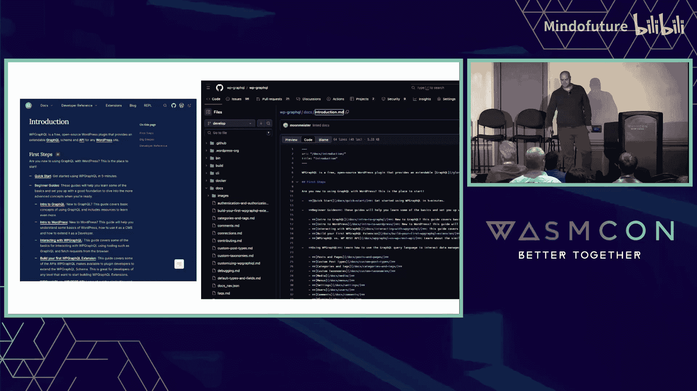

So。With this WordPress playground supports a workflow where we can open up WordPress fully in the browser。

 connect with GitHub so this gets my docs from my markdown files fully in the browser。

 imports it into Word again there's no server running that's all in the browser it will import my markdown files from my GitHub repository into WordPress。

 I can then edit my content using proper CMS， I can make changes to my content like maybe fix a typo or what what not save my content and when I'm done making the changes I can export it back to GitHub as a poor request so this allows me to edit content from any data source really。

 this is just one example markdown， but you could use this to edit content and any other data source fully in the browser again no server or anything like that running。

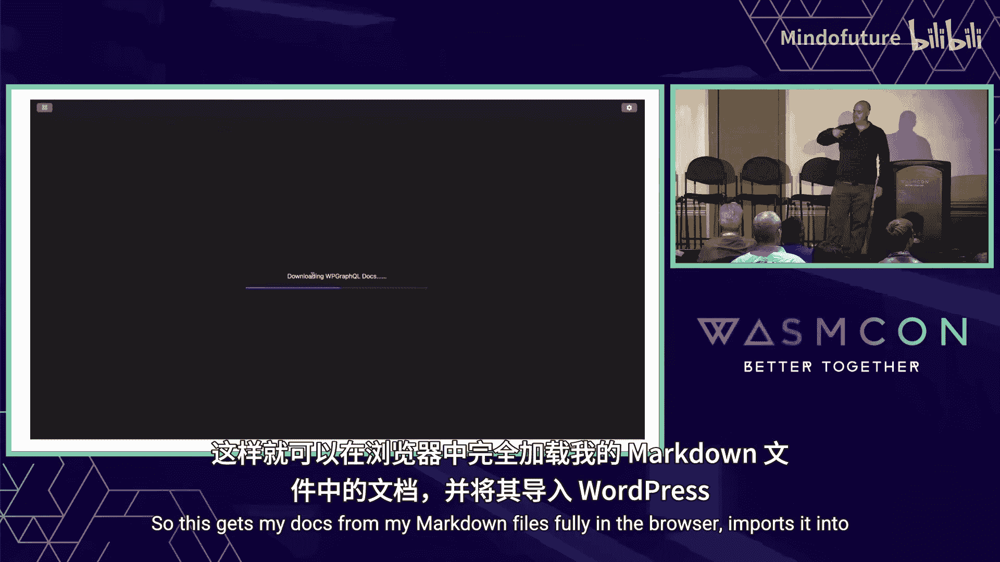

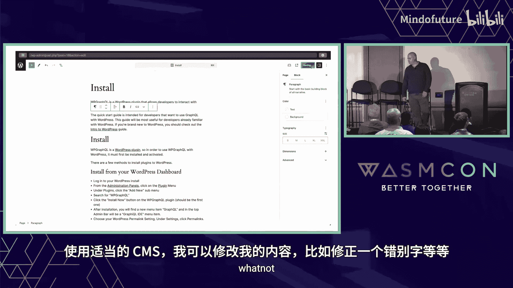

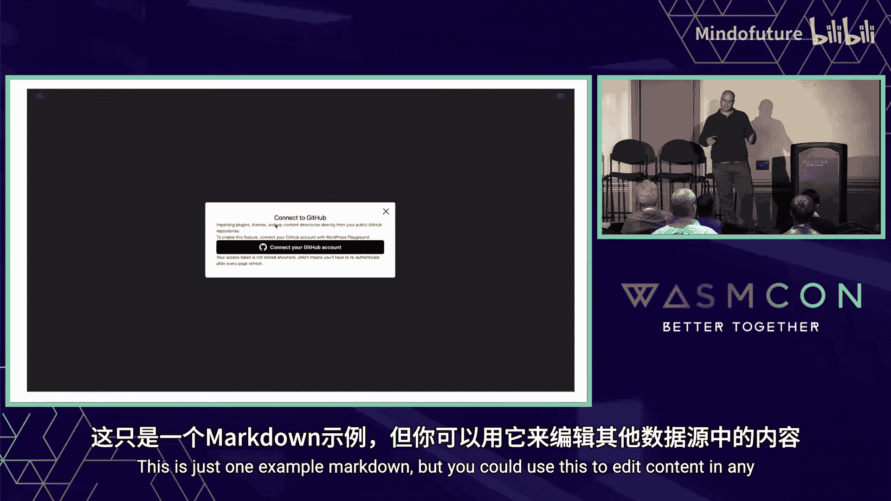

So these are just two examples of how you can use WordPress in ways that maybe you wouldn't have thought before。

 so we can use WordPress in the terminal， the desktop， mobile front end and all that stuff。

 So another example you can embed WordPress in web pages， you can run execute PhP functions。

 even when there's no network。

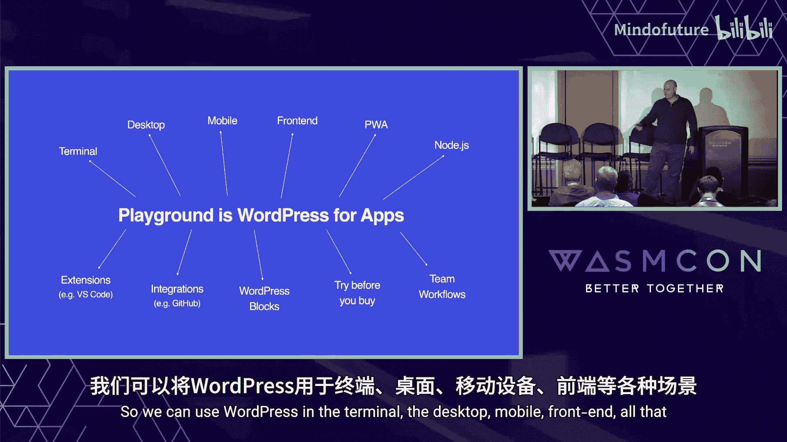

Access。

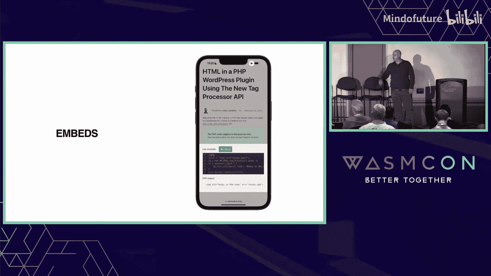

You can use WordPress and nativeative apps on mobile， you can use， like I said。

 WordPress and terminal apps， this is a desktop app called Studio where you can spin up WordPress sites locally to do testing with just a few clicks of a button。

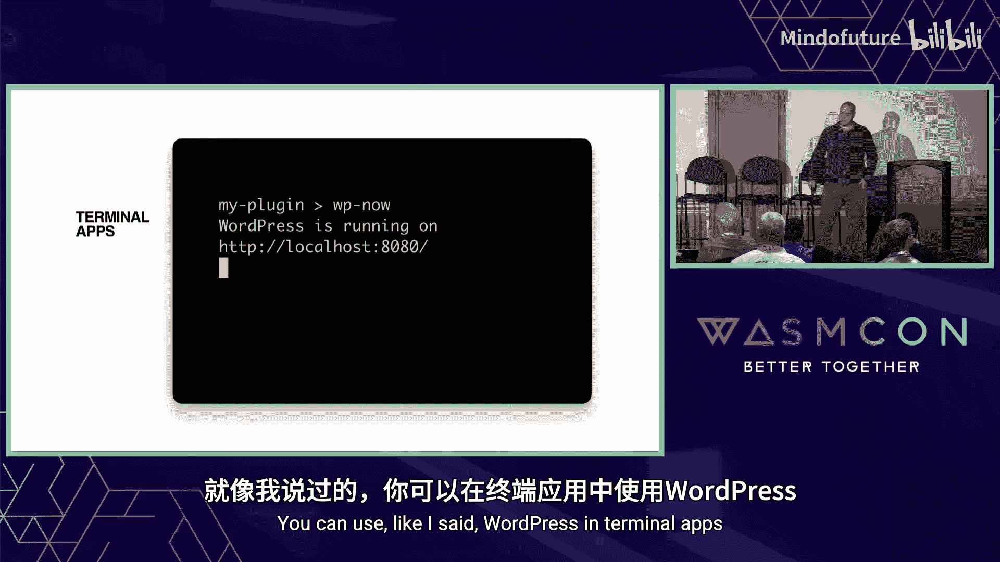

We have some WordPress VS code extensions in the works right now as well。

 So the question is this full free open source。 So whether you're interested in WordPress or not。

 what can you build with this technology is the question。 If you want to learn more。

 you can find us at WW dot org playground。 I'm on Twitter or X or whatever at Jason Ba。 Thank you。

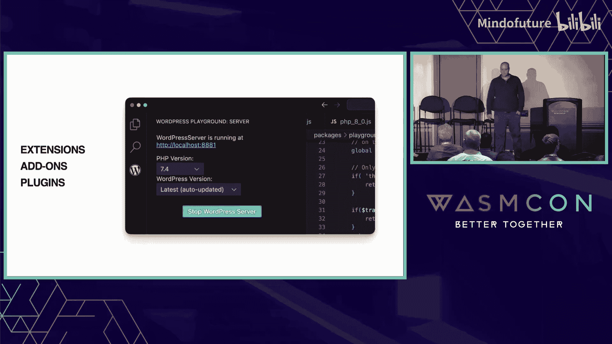

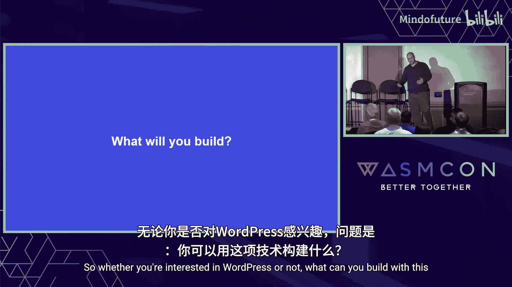

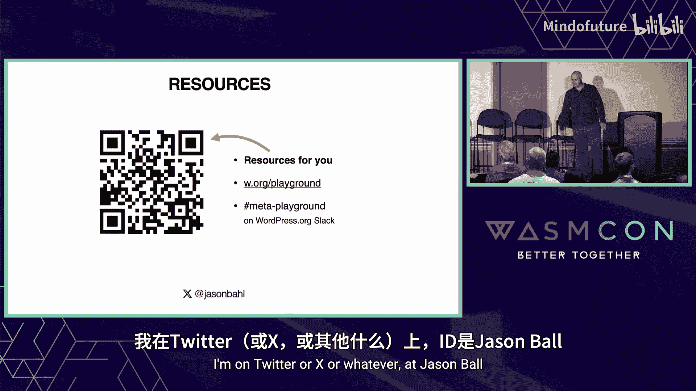