# WasmCon-2024-p36-P37-Workshop---Implementing-a-Wasm-Native-Database-API-with-Couchbase---Laurent--BV18DjSzJE6r_p36-

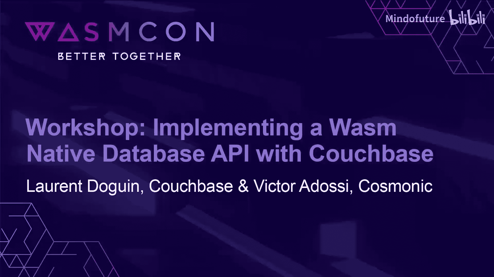

Hey everybody， for people coming in if you。If you can scan the QR code here or visit the link below to get to the repo。

 please use Gitpod or code spaces for the easiest way to get started。

 if you have either either of those enabled， you can it is possible to clone the repo as like a template and install everything manually but that probably will take a little bit to find everything so please use either Gitpod or code spaces and those should work actually out of the box。

 everything should be working when you set that up。If you have any questions。

 just raise your hand or if you're talking any issues。

 raise your hand and we'll walk over and try to help。All right。

 so it's time to start welcome to our talk or to a workshop， as like I say。

 implementingment the We nativeative database API， my name is Lohodo Gawell for Cabase and I'm today with Victor。

 my name is Victor Dari and I work with Cosic， we build WassonCud， which runs Webassembly。😊，Right。

 so you've already seen that slide。 that is the let's get started slide。

 The whole point of this is to。Get to our repo on the Readmed's a link to Gitbod。

 Gitbod is an online I DE。 And so if you click on open Gitbod and you create your accounts。

 you'll have an online version of V S code。That's going to download all the stuff for you in the cloud You。

 We don't have to do this over this Wifi， which would be a terrible I。 So it should work smoothly。

 It should give you。A nice online idea with everything you need to get started building stuff with Boomchar and Caspace。

And so backyard space， that was too fast。Agenda， what did I say would first we're going talk a little bit Lauren about the couchbase side and me more about the Webassely and WasmCud side。

 again WasmC the open source project and then we're going to get to writing some code。

 but we want to set up some of the context just so you know a little bit about what's happening and where the sort of ecosystems are and what this sort of workshop represents。

All right， so I'll start with catchb。 This is what is catchb。 If you had a bad catch base before。

 could you please raise your hand if you have。😊，Some of you。

 I'm assuming most of you are here for the wasn part。

 Catb name comes from couple names catch D B and man。 catchb is the merge or a fork。

 depending on who you ask of catch D B and man， which gives us catch base distributed key value in memory with persistence。

And the way you would do query at the time was by writing map produced function in jascripts。

 creating index， and then querying those index， which， of course， nobody wants to do。

 So we added SQL， and we added a whole bunch of different things。 So what you see on the。

 on this side is architecture。 We have a couple services。You have the data services。

 which is basically the auto shing， key value distributed stuff。 You get SQL， you get full text。

You get AI stuff， you get all the new thing that is going to turn into a cache based cell talk。

 So I'm going to stop there。 but if you want to talk about cachebase more。

 I'll be at the Cos booth all day。 Basically， this is cachebase。We have the right。 jump a slide。 Yes。

 I did jump a slide。 This is how we store things in cacheb。

 That's important for you for the workshop to know。We have。We own a SQL database。

 We start using documents。 So it's not a relational database。There is no table in primary key。

 it's just collections。On which you would store Jason。

 and we allow you to run SQL queries on Jason document。So our goal will be to connect to a bucket。

 scope and collection， and to start。You know， writing and reading documents from that collection using Web assemblyly。

And this is going too fast。Yeah。There we go。Actually。

 I don't know how to use a key card That's the issue。 different， different lines， different capacity。

 different capability， as you folks would say， at Wam cloud， you can do key value。 You can be SQL。

 You can do full text。 You can do a whole bunch of different things in a whole bunch of different language。

Does it matter anymore。Like we maintain a native version for every single one of those SDKs。

 Is there a better solution， Probably because 15 years ago at the time， I think was didn't exist。

 I think what's called assembly J S， A M J S in the browser。

Maybe if we were to video everything over again and we could know just write once and then use all the Wam binding everywhere。

 which is what Victor is going to talk about now yeah Lauren So yeah I'm going explain just a quick level set on what Webassembly is and Lauren touched on it a little bit but the technology's been around for a while and originally started as a way to run other languages other than jascript in the browser right so obviously people who dislike ja we're big fans and we're still big fans and we like ja as well but the basic idea is to take your language。

 whichever language you have compile it and you can think of the ja case right when you compile Java what you get。

 you get a jar right you get some bytecode， when you compile Python what you get you get bytecode right Webassembly is a bytecode that comes from other languages from multiple languages and can run anywhere。

Right， so you can think of it like a binary format。 If you open a Web assembly binary。

 like the file that gets put on disk， you're just gonna see gibberish。 You're gonna see binary。

But it has a lot of other functionalities and a lot of other features that sort of make it powerful。

 And so we start from almost nothing， which is just really basic binary operations。

 You can think of like assembly。And we build up。 So we build up to file access。

 We build up to Internet access， etca。So basically， it's a compilation target。

 You can think of it as a binary file， right， You can think of it like you know code that would have you been run on X86。

 let's say a machine or Apple Silicon but it runs on a runtime that embeds everywhere。

 So the basic runtime or the sort of flagship runtime is developed by the Btecode Alliance。

 which we also contribute to and it's called WasM time。 So our open source project。

 Wasm cloud sort of wraps Wasm time， and makes it a bit easier to use。

 but you can think of Wasum time as the。Python interpreter， if we're talking about Python， right。

 Python is to wasom as Python， the Python interpreter， Python。

 can think of it kind of like a compiler is to was time。😊，And like I mentioned a little earlier。

 there's extreme isolation here。 So Web assemblymbly， the core spec。

Only has numerical operations in it。 right， Can't do anything， right， There' there's no。

 there's no like concept of a string， even right， So you have to build all that back up on top of a very isolated and。

 of course， very secure by default base。And we want to really support building again across every language。

 right， whereasas the JVM， you would generally build， let's say， Java， Sca， closure。

 if you're into that， Cotlin。Into a jar。 we want to take every language and compile that into a Webassely binary that runs on。

 let's say， like Was time or wherever， wherever you'd like to run Webassely。

 And this includes in languages， right， you'd probably never try and embed the JreE into your jascript app or into your Ruby app。

But you can embed Wam time in your javascript app or your Ruby app。 And you can get functionality。

 That's like， let's say you want some functionality that's written in rust or written in zig or written in some other high performance language。

 C E C plus plus。And you want it to use it from your language。 You can do that。

So this is a little bit of what what I've said earlier。

 This is written a little bit in terms of support for languages sort of top left is languages with sort of the best support。

 or let's say a lot of the tooling is written in and so we've rust go've got newer languages zig+ plus The idea is that all of these ecosystems are adopting Webassembly at the same time right now And so this means that upstream code is being patched or being added to modify go So in our case that it's both big go we call it and tiny go So tiny go is a sort of subset of go that has really good Webassembly of support and a bunch of that is getting merged up into big go as well。

 theres ja and typeyscript because they're similar let's say they have shared tool chain and you've got Python all these other languages。

 But the idea is that you don't necessarily change your code。

 You use the compiler you normally use but what you get out is different。

 You get out where you wouldn't necessarily get out of binary before and like an interpreted language。

 you get。B， you get out a Web assembly binary。So one thing I didn't cover that was on that earlier slide for those readers in here is the strongly typed interfaces。

 right。If you start with Webassembly core， you get nothing， right。

 So you get just basically numerical operations。 You have to build in types on top of that。The types。

 the way we build in those types is with the Web assemblymbly interface types standard and specification。

So if you're doing something like building a database。What you want to do is you want to change your。

The calls you would normally make in process。 And remember， Webassembly is in process。

 We do distributed things with with Wasm cloud， but that that doesn't change Webassembly at its core is that most of the time you are running in the same process。

 function call speed， not network speed。So youd want to change what you would normally call like。

 you know， an SDK call， right， you want to change your insert call into essentially replicate it in in an interface that describes the arguments。

 describes the types that are required to make that call。

So we've done that with the help of Laurent here and the help of a bunch of other couchbase contributors。

 we've essentially broken couchbase down and the SDK into many of the other many of the sort of distinct functionalities it has。

 So there's like document management。 There's some key value stuff。

 There's a little bit of search queries there there's full text search， there's vector search。

 that stuff is really new and actually very exciting But we basically you do this once right This is like almost like CRRP right you sit there。

 you look at the interface。 you decide what kind of interface you want and you encode it。

 right feel free to scan that QR code because that is a link to the repo that has all this on there。

 and you can you can actually just go look through the w。

 So you can look through the full specification of couchbase as we see it right And the thing is you can actually write another one if you'd like right if you want a different set of features。

 if you want a different set of exposed types you can actually completely changes if you'd like。

 But we have that out。 and that's actually out in our operator。😊，Repo。Oh， sorry。 I just want to wait。

 Does everyone scan it and suddenly scan， okay。I see one person。 I'm gonna to。Take a second。

 Allright。Okay， so if you can build interfaces。Like， let's， if you sort of go back to the beginning。

 if you have core Web assembly， and that means you can， you know。

 do things with numbers and you build upon that to， to add rich types， right。

 So now you can do things with strings。 You can write functions。 You can write。

 you can specify interfaces。You can have multiple things adhere to the same interface。

So one of the things that's being built along with Webassembly is the Wi in which is the Webassembly standard interface standard of system kind of changes。

 but generally Wi is how we refer to it。 And Wi key value is actually one of the standardized interfaces because we and this is also sort of shepherded by the Bcode All and many of the other sort of companies involved in Webassembly it's a growing standard。

We recognize that key value isnt important。Interface， right， Lots of people use Redis。

 Lots of people use caches。 Lots of people use things that are sort of key value related。So。

 if you have。A thing or any sort of program， let's say， a database that supports key value。

 You can expose it with a key value interface。And more， moreover。

 you can use the same key value interfaces to talk to possibly different implementations。

 So that's important here。 Now， we won't actually use this in the in the workshop because the workshop will be focused on documents。

 But couchbase supports obviously key value documents and a lot more。 So this is actually。

 there' is actually also an implementation in this repo。

 So that link is actually to the line of code that is being shown on the slide。 And there is a。

 theres a section of that repo that has a key value implementation for couchbase。

These can actually be the same， right， We have them separate， but you can actually have the same。

 you have multiple interfaces sort of exported or made available by the same piece of sort of Web assemblymbly native。

 let's say， binary。

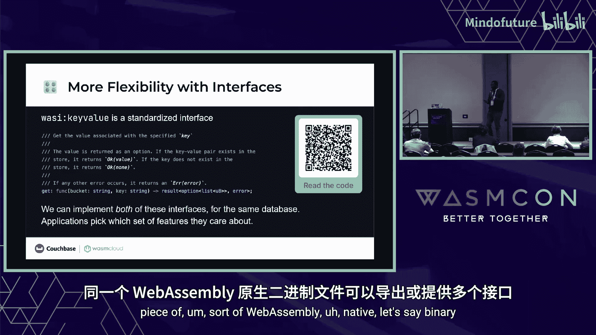

So we want to get you started with the。The the workshop， we don'， we don't have a ton of time。

 but we do， we do want to get you started quickly。 So if you for those who haven't seen this before。

 you can scan it or go to the the Github repo below。

 and we recommend that you use Gitpod or Github code spaces to set up the environment really quickly。

There's there's a link to Gid on the Redmi。 So once you on on the Gi repo。

 if you scroll down a little bit， there's gonna be a badge that says open Gipad。

 And so that's probably the easiest way to to do this。

 It's going open V S code online in a tab in your browser it's gonna download the darkcker image that has cache that has Wam cloud that has a wash。

 which is web cloud shell。And a bunch of also things like tiny go that we're gonna need for this workshop。

 we really encourage you to use Gitbod because it will set up everything automatically。

 All the downloadloads are gonna happen somewhere in the cloud in one of the Gitpad machine now on that wfi which is better for everyone So if anyone has any problem with this please raise your hand and then if not。

 we'll start playing around with it。As well。Okay。And just to explain a little bit about the repo。

 what we've got here is we've got a repo that has a WasASM cloud provider in it， or sorry。

 I should say， a WasASM cloud component that talks to a WasASM cloud provider。So a few slides ago。

 we showed the link to the Wasson Cloud couchuchbase provider。

 and since we do need something to actually store state， right。

 we do need something to actually manage the data， we use that provider。

 which gives us access to couchbase， but the part you're writing will be a go app called Newbase。

 right so there should be a new basease folder in there。

So there should be a new base folder in there。 And that has got a bunch of go code that you can run against and sort of look at and inspect。

 But you should also be able to， if you set up in Gitpod or if you set up in the code space。

 you should be able to curl it。 You should actually be able to just use curl and hit this sort of API right away。

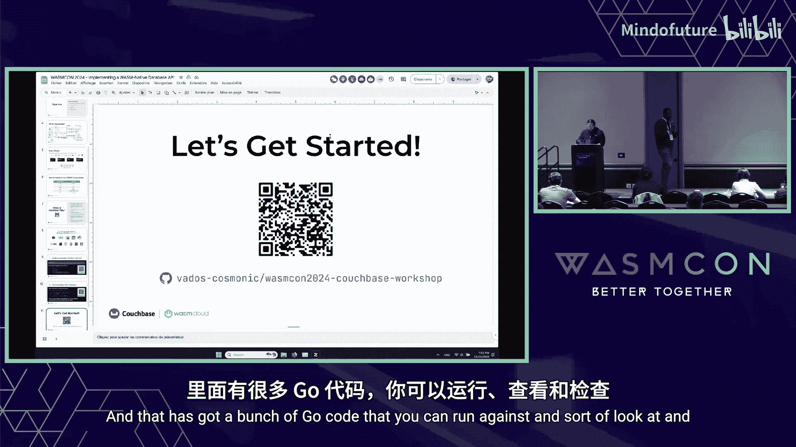

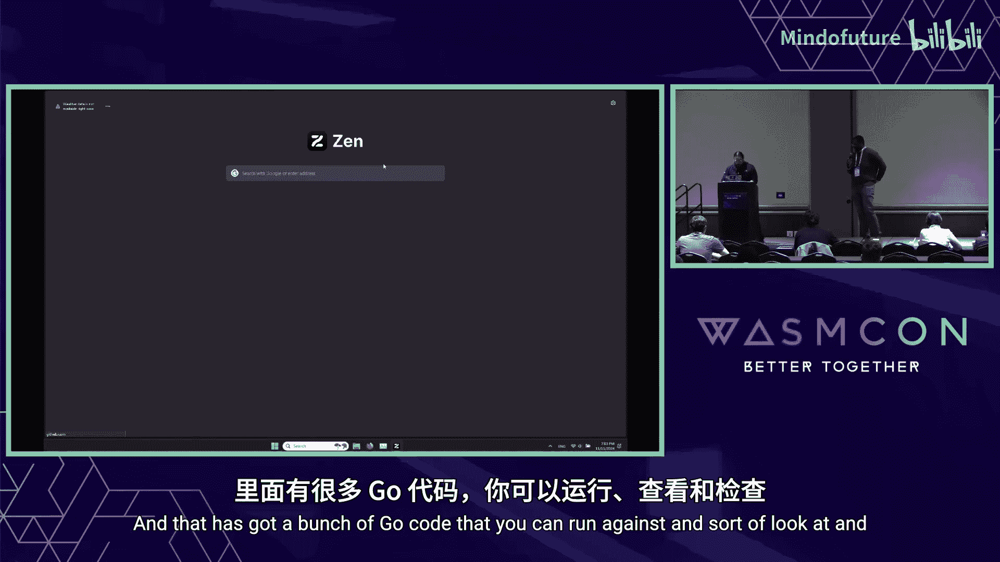

Yeah。So here's the repo， looking at it。There we go。 Yeah， so generally， should， if you click this。

 you know， getpod button， you'll get an opportunity to make the workspace and sort of like open the project。

 and you should actually start and everything should be running。Yeah， well， sorry。

 If you don't have a Gitpotd account， you might want to make an account if you prefer Github code spaces。

 that's also fine。They should both work equally。 if you prefer to do manual setup。

 the instructions also include manual setup for everyone who wants to know。

 install things themselves。Again， if you have any questions or you get stuck anywhere。

 please just raise your hand。 We'll get someone to run over， and talk to you。It's doing right now。

 It's， it's pulling my Docker image image specifically for this workshop that has all the dependencies you need。

 gasb， wash， tinyo， wit。We some tools。As the V code Cbase extension as well。

 there's gonna be the Cbase shell tool that allow you to， you know， use Cbase which to come online。

 which is， which is nice。 Of course， Gi and a whole bunch of other things。

And as Laurent Mer mentioned earlier， to build Webassely components， we produce a tool called Was。

 the Web assemblymbly shell or sorry， the Wasson cloud shellll。

 but the point of that tool is to make it easy to build Wasm Webassembly binaries in different languages。

 So you can download wash again， you won't have to because the Gitpod container will have it but you can download wash and just wash build any components like and also create new components in different languages。

 So we have also a bunch of templates which can make it easy to get started。

 Now you won't have to do any of that because we have a Wasomclo project called newb again in the repository already。

 and again， this will just be in your in your Gitpod setup。

 but just to note about about some of the tool in here。

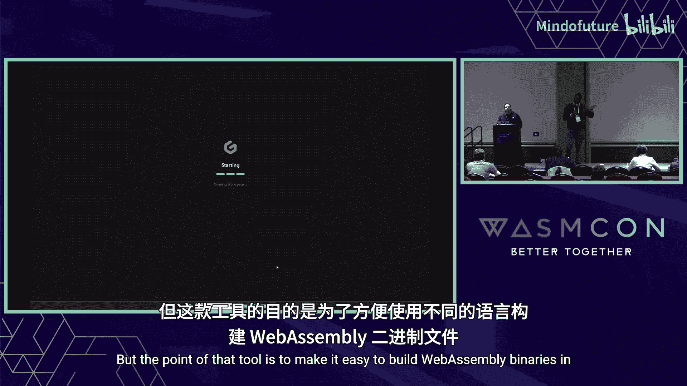

So yeah， we'll follow along here with Lauren as he does it。

it's instilling just Do you want to talk about just Oh I feel like youd love to talk about just Well for people who are somewhat familiar with with make right or sort of like the build tool。

 just as is a task runner now the sort of most important tool here is wash but we use just here just to sort of make it really consistent and kind of like a sort of top level porcelain for all the commands you want to run but what you can do at the top level here is run just dev and itll run our tool wash which which is it'll call wash dev you can look down Yeah so he's。

Scroll to it there。 but you know it's very simple right So we're gonna see these to the new base director。

' we're just gonna run wash right' gonna Was devev Was devev is a selfreloading essentially a development environment to easily and quickly iterate when you're when you're building components。

 So you run Was dev。 we actually set up for example。

 an HP server we set up and build the component and we make sure that we reload any of those things when the code changes Now there's a lot of stuff that sort of happens behind the scenes。

 but in general， what you get is a whole bunch of log messages and you should be able to curl curl local host and access your component and access in particular this component newb fairly quickly right so this is the log you have nothing else to do then just look at those logs there's two tabs terminal there's one gold start catchb which basically start the catch base server。

 you can see the credential of a very secure local。

Cbase various password that means catchbase is running and then the other tab which was installing just and then it did a bunch of we shell basically create making sure that our buckets and scope and collection in thatb instance and then this is just dev and so you can see it doing that's wash there with the em we we spent a lot of time make sure the emerges are and it seems to be happy about it。

 So all right let's go so one thing that's really important there is you see that wash is actually using the build tooling right so wash works across different languages And again this goes to the sort of cross language point is that。

These tools that work with Webassembly， they don't need to。 But if you want to work at a high level。

 it's important to work across different languages。 So wash makes it easy to build in javascript。

 all right so build Webasse components in jascript go rust primarily。

 we have some python support as well。 And basically we expand that support as languages get sort more advanced on the webasse sort landscape as languages implement more features。

 we make it easy to build Webasse components with wash right So making sure everything works I've opened a a new tab on my terminal by clicking on the plus button here which might look like this on your laptop click on new terminal and just local host88 API V1lash status sending me a nice message saying success data Okay good so we know that wash works。

 What about cachebase。 A couple of you can do to。If Cabase works。

 you can use catch based shell or you can just click on the catch base tab。 It's gonna。

Show you nothing， which means you need you had local connection。 So if you click on the plus。

 it gives you a window to describe the cache based connection。 And because we do things right。

 it should already be preloaded with this very secure administrator and password。

 It just needs a name。 So I'm gonna call it local。 I'm going click on connect。

And you will see that if everything works well， you have the difference different buckets that are already available。

 So while you're testing while you're using the API。

 if youre want show that it's actually in cachebase。

 you can just go on the cachebase tab and then add a connection and then look into this because right now we don't have anything our default bucket is empty。

 there is a bucket called travel simple， there's a collection called inventory and you can see they has some document。

诶。Pm， p， po。 there was the scope。 This is the collection collection called Landmark。

 and this is adjacent document。 So you should， you should addie and see something roughly like this。

Can you， can we access the。Ctuchb admin you are because I use that a lot。

 Can I access the couch base I So when you use Gibot。It's gonna start a new。B， b。

 It's going to ask you to open a new tab。Probably。And because I'm configured to not show new tab。

 It's asking me， do you want to show that tab？ So when， once you've run Gitbod。

It should either have opened a new tab or had it like it did for me。

 So I'm going to click on showboard 1891。 So importantly。

 the pod where the couchbase admin U I runs is 1891，8，0，91。

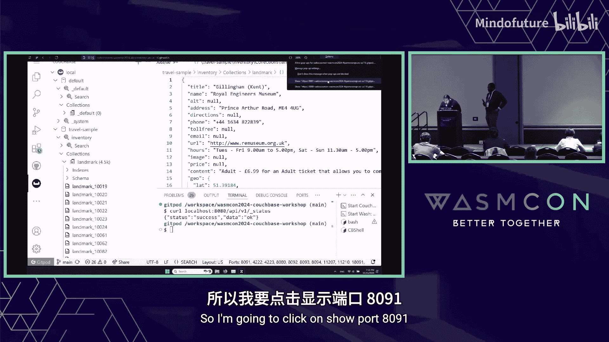

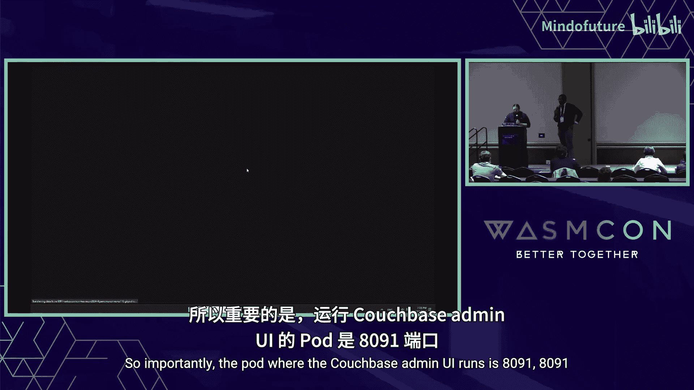

嗯。And there you go and the username， which you should not use in production。

 is capital A administrator。 And the password is。Password， I mean， you could， but， you know。

This is a workshop。 Don't do this。 It's not because you could that you should。And Mr。 Passworth。

 and this is going to show you， this is the local cash based U I。

 We have a managed version that has a different U I， but this is what you。What you'll see。

 this is the overview of your cluster， what it's doing。There's a bunch of metrics。

 And then if you click on the menu， you can see the list of buckets that exist。

There's a default bucket。 There there's nothing。 There's a travel sample。 You can click on documents。

 and you should。To be able to see stuff at some point。And there you go。Soorrry。Okay， so this。URL。

 this based dashboard。If your browser is configured to just open tabs， it should have opened。

 If it's not just like me， there should be， depending on your browser， something that tells you。

 I have blocked this pop up window。And that's what you can see here on my laptop on the on the upper right corner and it it said it blocked the all those URLs。

 So that's one way of getting those。 If you go to ports， there's a tab called ports in Gitbod。

 and basically that's all the port that Gitbod will expose。And you can scroll the list。

 and you can see that 1891， which is the the amin U I of Kaby is made public。

 And you should also have a link here。 You can copy URL or you can， you can open it。

So Keba is running。W she's running。Where do you want to go next。Let me go back to。

Can you open the read me in the。Inside new base there。Opening the newest folder。 Yes， days areri me。

RightClosing this down。系。Yeah， towardsward the bottom just to start and get a feel for what's already implemented。

 so you should be able to run through the curls in there。

 There are a bunch at the bottom there's a bunch of Ch commands。

 there's the API we sort of want and is partially implemented near the top right so this is done automatically by Was devev because just devev run Was dev So we have this running and then that's the girl I run at the beginning So if you want to run this you become terminal。

You click on the plus。 it's going to open a new terminal， and then you can copy and paste that girl。

 And this is what you should get。And one thing I didn't see was the newb should be a database in there already。

 so there should be in your couchDB cluster， there should be a database called newbase。

 and that's where all the data will get stored。It's default right now。 Maybe not。Well。

 we' going to to change this we're going to have to change that probably okay。

 let me let me check actually， is it going to work？두墩嘟嘟。んてるンてる。Okay， excellent。 Yeah。

 We've got a script in there。 Oh， you， you， I think you curl。 you missed the。

Did the scene get in there， Maybe not to because my Oh yeah yeah， it's cutting off the text。Yeah。

 the girl command and go in。Actually， it doesn't work。No， it's。

And I'm assuming that's because we don't have the right bucket， probably。ほ的嗯。

Welcome to live workshops and live Co。 Wait。 Someone didn't know that It worked。 Who was that。Okay。

 created the bucket， Okay， so the buckets， so you have to create a bucket。Okay。

 so what's the name of the bucket again， let's take a look So actually， let's take a look。

 So if you go into， as it possible a tunnelmil， you should see a whole bunch of configuration。

 That's not the right one。B， boom， boom， is it this one。Yes， that's this one。All right。

So maybe we go through that conflict file。 Maybe it's a bit early。 I don't know。 Yeah。

 you mean this one， yeah。So in Wasmclo， there's a thing called Waam application。

 so it's a application deployment manifest and you can think of this kind of like somewhat similar to Kubernetes。

 but it works on the scale of just one Wasomclo instance to multiple and what we're showing there is that we're building the new base component which is there locally and we're going to sort of set how it can scale and we're going connect it to the couchbased provider so this gets used when you run Was devev。

And so that's called the link right Yes， yes， so the component and the provider which sort of gives you the couchb functionality there are linked。

 And so what you see here is the connection stream local hosts， a couchbase is running on local host。

 the username is administrator。 The password is password。

 and then bucket name is newbase which is where we fail。

 So there's a couple ways we can do that we can either create a bucket called newbase or we can change this to default。

That's up to you。Yeah， let's， let's， let's create a， let's create a new base。 I create new base。

 alright， so to create new base， I'm just gonna go on my couch base。😊，Extension。

And I'm going to click。 I'm gonna to right click on this。And I'm going to do。I'm not going to do。

If I could create。I thought I could create buckets from there。

So was this Yaml file automatically generated or did we had to build it by hand Yes。

 so it's actually a combination。 So this file is written by me。

 but it is used in the process of running Was devev So Was devev actually pulls in this file and makes changes depending on what's configured and uses the file so it uses a dynamic version of it。

 we do this to make it sort of easy to see what is actually involved in this sort of deployment right so you've got the component which was built locally and there's like a。

Pa to a file。 And you've got the provider。Right， so in running Was dev。

 you get sort of enhanced sort of like functionality around starting that manifest is an override。

 essentially。

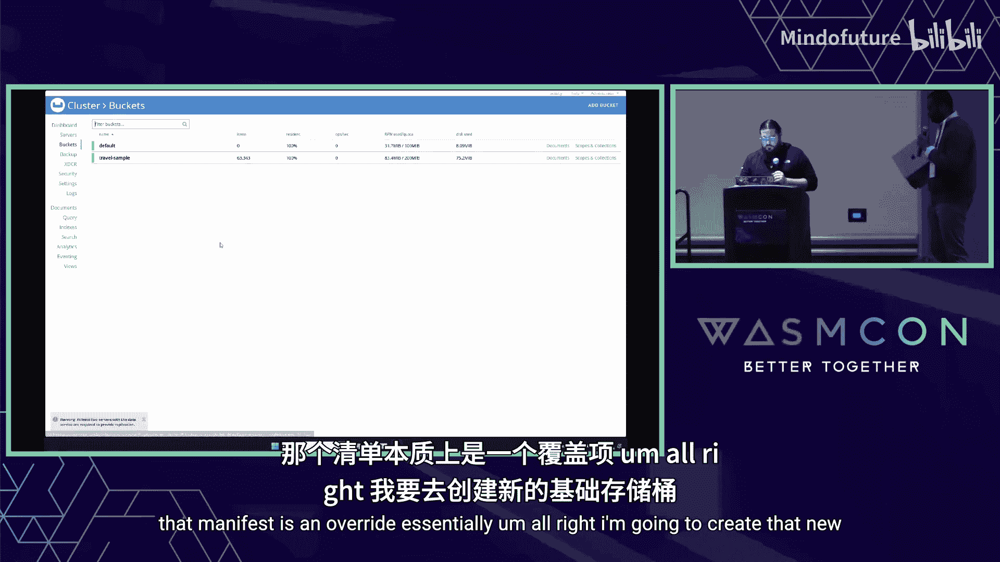

All right， I'm going to create that new base bucket。Yes， people who are running in。Gippa。

 you may need to do this as well。

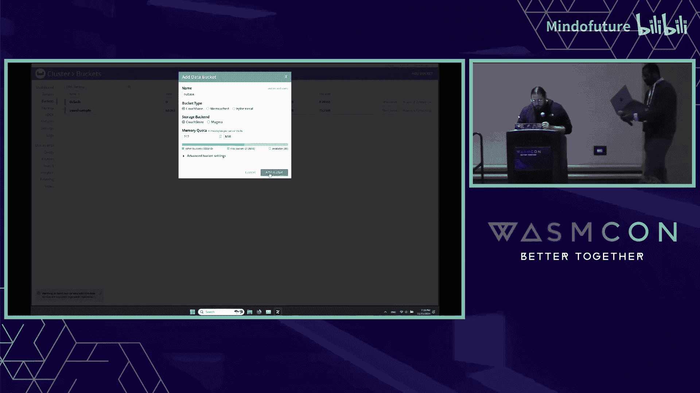

And then I'm going to rerun the girl。It should be happier。Yes。

So you do need to create a bucket called Newbase。 How to do this。 If you have the。

Casb interface open， which is what I have here。 You can click on buckets， then add buckets。

You call it new base， and it'll be done。 another way to do it。Could be to you best show？

And I'm going to use my two hands for that。So you should have a tab called CB shell and I just typed buckets or just give me the list of buckets that exist。

 I've already created new bay， but if you don't have new bay。

 you can type something like buckets create。Minus H。And it should tell you how to create。

Ac catchbys bucket。I'm going to stop here， and I'm going to ask you。

Is anyone having a problem right now， please raise your hand。Some people， yes。

How did I get to CB Shell， All right， Actually， I don't remember it was opened。What happened。Oh。

That's a new feature that I didn't know about from our V S code extension。

 If you connect to a local cluster from the V S code extension， it's gonna open。

ACarsby Shell already configured the other way to do this。

Is to open a new terminal and just type CBS H。Weizer be， then。To。

And it should give you the exact same thing。Yes。啊。You want to take this Yeah like that's a cacheb specific but so if you've done the curl command to insert a document。

 what you get back is those are couch based internals right so partition ID that's a good point partition ID is couch based partition for that inserted document so the stuff there I think cast also comes through but like it's kind of like a version essentially like you can think of cast like compare and set version there that that you can use again from code right they basically made the data because catchbase shots document automatically we have different partition basically a bucket is split into 124 virtual partition and the way it works is it's not a rest API it's actually a binary protocol and it's a stateful protocol So when you open a connection to catchbase which' an SDK where it's going do is's gonna call the catchbase cluster and from the cluster is gonna get something called the cluster map and a cluster map is basically a big Json file that tells you the partition from one。

To partition， blah， blah， bh are on node  one and the partition from this to there are on node 2。

 et cetera， et cea。 And you get a replicas as well。 And you get all this information。

 And so you need to have that to maintain a strong consistency。

It is time you do an a key key value operation we base。We take the I D。 We hash it。

 and know that the hash that starts with whatever ends with whatever goes under a partition number。

 blah， blah， blah。 And because we know where partition blah， blah is because we have the cluster app。

 then we can do it directly， which is how we can achieve like sub millisecond。

Key value operation most of the time。All right， we have 37 minutes left to go Yeah any more before we open up the questions。

 if you want to open just the go， the go aside。 So if you open main main do go Where is everything going to happen。

 there's a file called main do go。 and of course， I'm sure people have seen it by now。

 but inside the new base folder， there is also a there will read me in there。

 which also explains more and has some sort of instructions on how to run again if you want to if you're running either locally or you sort of stop the process inside Gipod。

 if you run just dev， it'll sort of start the dev process up again。 but yeah。

 here's here's the go code。 So that's where everything is happening。

 you want to talk about the import a little bit maybe I mean， there's a bunch of very generic。

Go impulse that we need。 And then there's the binding， which is the important part。 right So again。

 with with Webassembly， the idea is that you use the languages and tooling that you are using now right And for the most part。

 things shouldn't have to change while support for Webassembly gets merged natively into big go and tiny go。

 there are some libraries that make things a bit easier to use right So normally you'd only have net HtP。

 right， which is the usual the usual go library for for dealing with doing web requests。

 And while that's not fully landed in biggo yet， we have some shims that make it easy。

Easy to use sort of web web Webassembly web handling logic， right。

 So there are a bunch of comments over there at the imports that sort of sort of explain which。

 which bits and why you need certain parts of this another big sort of generated or important import is the component model。

 right， So a lot of the rich types of jascript sorry， I think jascript。

 But of Webassembly come from the component model。 So that is the sort of layer above the regular sort of numeric operations that Webassembly core would give you So the component model adds things like result。

 right and optional type， which are pretty pretty common cost languages now， right， you know。

 containers， things like that。And so we pull in some of that code here just to make it easier to reference to a bunch of those types。

And then the next set of imports is actually generated based on the W interface。 Oh， actually。

 could you open the w folder。Yeah， so the webassely interface types w helps us define a interface that we can implement ourselves。

 right， either with components or with on Wasm cloud providers， right。

 which are like binaries that sort of speak the same interface， almost like a GRPC binary。

 you can think of that。And the w interface basically shows you。What the program must implement。

And to make that easy to write， right， to make it easy to write a program that implements a w interface。

 we generate code， right， just like with GRPC， just like with Open API or swagger。

 depending on how you use it。So that's where those imports come from。 the document import。

 go ahead you have to write this manually and then this is gonna generate a client。

 a wasn client that can be used based on what's been generated Yes。

 yes and in this case this been written manually Yes normally let's say for just if you're just a developer a company the w interface might already exist。

 this is kind of work you do once to sort of specify the API you want and then when you want to write a component that uses this API you code generate the code that that comes out of this API or you essentially passed this file to the code generator and you get code that you can call similar to GRP similar to open API swagger。

 etc right so this is the insert command you can see that it takes。Don't， don， where is it。

Several options。 most of those options are related to cash base， We come from a cache。 So of course。

 there's an expiration。 And then if you're going to be strongly consistent。

Gasashbase starts in memory。 So it's eventually persisted in， the data enters in Ram。

 And then if I unplug the computer， you've lost the data， which for important data。

Would be a table thing to do。 So， of course， you can change the consistency level you want。

 which is why you have the basis two option of the replicate two option。

 basis2 meaning if it's in Ram。 I'm happy if it's in I and written in the disk， I'm happier。

 And if it's written on disk and then replicated once or twice or rice even。Much more happier。

 There's a global time at for your operation as we it。

 it is a whole bunch of functions of options sorry that you can use for each function。

And also span because we support open telemetry and tracing。 So that's good。 And just to。

To sort of bang on this point again， this is not network。Native by default， right。

 So these boundaries are normally in process。 samee binary function， called fast。Right。Wmclo。

 what Wasm cloudud does is actually bring the distributed nature， right。

 So we add the R PCC mechanism that makes this go over the network instead of just in the same binary。

That's sort of the value we sort of bring to the table。

 but this interface is really something I think we haven't had before on a multiple language level。

 which is a specification， well， I guess other than see like FFI right。

 is a language level specification of the types your functions take right even again。

 this works for untyped languages right like JavaScript and the contract that your program fulfills。

And what's interesting about this is that。If I get a Webassembly binary and I know it has a certain w interface。

 I can actually call those functions directly。 right。

 I don't actually have to call the rest of the program。

 I can just call one single function in a Webassemb binary。 But， but yeah， in general。

 that's how this works。 Yeah， you remember the right ones run anywhere。

 I kind of promise that that's sort of what enables you to do it wasnm。😊。

It's easier to do with your government interface。Going back to the GoF。

 let's see so the document interface that you've seen describes several key value operation as the common types for all of those operations and so this is basically a go program that uses the cachebase SDK as a dependency and that's going to allow us to implement the interface that we just the interface that we just saw。

Yes， yeah， and so the first sort of bit we've got some URL path。

 just like we use a URL path library just to make everything really。

 really simple and easy to understand the endpoints that are supported and if you scroll down a little bit。

 you've got somestructs and basic like one of the things this demo does is it implements JSON patch which is a standard for performing operations and modifying JSON and so we've just got astruct to represent a single patch element and then some of the some request bodies。

are used by the requests in there。How many people in here write， go。 If you write。

 go like on a regular basis， raise your hand。Okay， so please love your neighbors。

Theres so that was maybe like 10 people， let's say。 So you're probably really。

 really wondering why there isn't a serve mux in here for the people who write go normally and that。

Actually can be added， but isn't in here because tinygo did not support Surms is so great。

 So tinygo is like can be a bit questionable。 Obviously， biggo is big go。

 So it all works great all the time。 But sometimes tinygo has some rough edges。

 this is actually fixed with the latest version of tinygo。 and I just haven't updated the demo。

 I thought it's a little close。 But but yes， you can use a normal surf mugs here。

 you can use gorilla can useqi or chai。 I think it might be。 I don't know。

 I'm completely unbiious to whatever to go because' you can use your normal router and be able to be able to do with web components。

 And so you can see it's routing into a different method。😊。

This is N status which basically just a success default success response。

 Okay Okay great and then there's a whole bunch of other that are implemented which one did we implemented Yes so everything except for batch up is implemented So there are regular sort of get and set well I said get and set but like let's say you know create read update and delete or all the sort of cru pattern is all implemented already so you don't have to do anything for that but the one unim function is batch So you have a batch insert and you have but no batch So that's why the end on shows up Yes so here there's the to do and you know that's what you got that's what we'd like for everyone to try and try and accomplish again you can feel free to borrow liberally from the insert and sorry insert and methods and functions that are available there。

But basically， it should look just like regular go。

 You may have to look up a little bit in the bindings， in the generated binding。

 So the files like dot w dot go exist in the。In the repo as well。 but but in general。

 if you look at the other other the other endpoints， it should be actually somewhat manageable。

 Hopefully， so you want to go across the upset method， maybe Yeah， just to see so。

Eachs a function has two parameters， the response writer and the request。

And then it's an upting document。 So there's a document 80 parameter as well。

 So we're gonna read the body。Send an error if we cannot beat the body。I。Don't no go。 I need help。

 Yeah and so so here like we're just gonna pull that request body。

 So we've pulled in the request body from the incoming request。

 assuming Jason Yes assuming we're gonna unmarshahal it and regular sort go style and check for errors and keep going。

 And at this point， if you look at the top we now have one of those we've got a that sort ofs or describes an that should happen with the I and the operations should be performed if you go straight to the top there you go doc I Jason batch and then a map And just for people who aren't necessarily familiar with go on the right side。

 you've got what the Json keys will look like when the thing is either let's say coming in off the wire or going out So either marshaing or unmarshaing to Json and then we' got in there we've got a doc I we've got the patches And since it's an up right we might have the user might want to insert something right So we've got an insert map。

And that is a just。Completely generic map， instance， right。

 so you can insert any object you want there。Okay， so yeah， moving back to the code。

 So one thing I do that's a little bit extra。 Again， this is just sort of parania。

 I don't have to do this。 But I check that the URL that came in， right。

 So the parameter on the URL and the body of the。Like the doc I D and the body match， right。

 This is just optional。 I， I just do this for fun just just to make sure they match because obviously。

 if you're hitting one endpoint with one I D and then using a different doc I D。

 you might be like something else might be wrong。😊，Okay， and next， okay。

 so here we're getting to the Web assembly stuff。 And this is the generated web assemblyly stuff。

 So the generated code that is imported and named document at the top of the file exports a get。

Function， right now， if we go back to the， to the width。Oh， yeah。 So there's。

 there's a get get function。 Again， all the code that he's scrolling through right here in the bottom is generated。

 right， You don't want to go in there and edit that， but you can obviously reference it。

And it should be filled out by your editor， right？So you said to go back to the this definition。 Yes。

 document。 Yep， exactly。 So。 And so it was a get。 get， yes。水。There we go。Oh yeah， you're on it。

 You can also， there's there's syntax highlighting， but well maybe saw that another time。

So if you look at the bottom here。 So in document dot w， which is also， you know。

 in your in your local repo there， we've got the get function similar to insert that was on the slides earlier。

To keep scrolling。Yeah， I keep scroll a little bit。There we go， yeah， so line 247 you highlight that？

So if you look at that line， this。The interface sort of defined here gets turned into and sort of code generated into that go function。

 the document dot get that you saw from earlier， so。Again， this is just a mapping of。

The sort of w types and sort of the sort of I D L， again， very similar to G PCC。

 similar to open API to a sort of。Go module that works with Webassembly under the covers。 Right。

 So you don't have to really think about Webassembly here。

 but you do in that you need to generate the code from this description。 right again。

 similar to other， to other ecosystems， but again， this is not， this does not require the network。

 We happen to be using the network， but it does not require it。So yeah， so if you go back to the up。

Endpoint， we do a pretty， a pretty sort of vanilla or obvious upset， right。

 So if the and only if the get returns that the document is missing， we perform an insert。Right。

 so it can be a little hard to read， but the thing you get back from that operation is a result object。

 So for those who are not familiar with rust or some you you could I think also Javas got optional。

 for example， but a result type is kind of something that either contains the thing you wanted or an error right and you have to check right。

 So you have to sort of make sure that the operation succeeded or and if there an error happens。

 you ideally should handle it。 So we check if the get worked and then we do an insert。

 which is again just regular up things。And yes， if you scroll down now。

 assuming we didn't have to insert the document， right。

 we go doing the update part right so we've got the document， we pull it out of the result。

 So that line where you see get get rez， I think that's line 303。

 you see get res okay that is actually pulling the value。

 a reference of the value out of the result and you know storing it locally so we can use it。So next。

 we're going to go through and apply all the patches to the object we just pulled from either。

 well in this case， from the from the database。 So we ran that get。

 we've got a Json document out of couchbase。 We've got a bunch of patches that came in on the H TP request。

 So we're just going go through and apply them nothing super crazy here。

 if you haven't seen the patch sort of spec and merge patches and Json patch before。

 I recommend looking into it， I think it's something that a lot of companies sort of rebuild in house when you just don't have to anymore。

 again， on the off chance。 It's actually pretty interesting。It's a great learning opportunities。

 but most of I DKs already have dis implemented。 and we have a subdoc API folded patches as well， so。

😊，It's just learning opportunity。 Allright， so better document。

 replace the existing document and then send the。She was yes， yes。

 and actually that is I'm just to call that again。 So we're using that document module again。

 So again， that is the auto generated from the w go code。

 the w describes a replace function right And so that's what we're actually calling there。

 and we're using the generated code module to call replace and we're using all the sort of like options that it expects。

Right， I think some of the sort of interesting things here are like， you know。

 document I is just obviously a string。 Again， that type that's sort of the types module is also auto generatedrated。

 right， So we sort of we， we cast the string that came in over the HTP request to a document I D。

 which is a ws type， a w specified type that we've sort of generated and then we use the the second argument there to create。

The document raw。 So that's like。There is a ws type that is a document raw。

 which is like a raw document specified as JSON。And we've got the patched data there。

 so the patch data you can just think of it like a string right but we do casting and this we could have had the interface。

 just take a string right like this is actually an option we chose on this part。

 but we wanted to make it really explicit basically the difference between a key value store and the document story is that document is the actual Jasonson string are structured data Yeah it's just like it's well known and we make it explicit。

 It's kind of like you can think of it like a type As if you have that in the languages you use there's not necessarily actually checking here。

 but just like you should be sure that you're working with the types that the interface says and a couple options the cast and the timeout timeout of course。

 is if your operation because the network operation things happen with a network if its too long then you can cancel and the cast cast stands for Comp web。

It's used to do optimistic locking。 Basically， you have a document。 The cast number is one dash。

 whatever。 You retrieve that document。 You know the cast number。

 Let's say there's two people that are doing this at the same time。Those two clients。

 they all have one dash， whatever as a cash value。And so what they're going to do is they're going to upgrade to two dash。

 whatever。Doesn't know it works。 What they're going to do is they're going to replace it with that value。

And if on server， the cache value is the same。Then everything's fine。

 and then the server will update the cache value to do that something because the update went well。

So the first person that shows up with Ca 1 dash something is going to work。

 The second person is going to show up with Cas1 dash something， but on the server side。

 it's now2 thats something。 So we sending an error saying you need to re tried because the document has changed。

 So it's kind of a optimistic clocking way of doing things。

 you have an actual log that you can doing in the database。 So that's why we have gas。We have H。

 you want to do the live code not do okay one thing I do want to note so if you're running through this。

 if you're run into issues， you can actually file issues on that repo and we'll look at them and we'll get to fix them but yeah。

 we're gonna go ahead and try to do some live coding here and actually maybe we'll give you all some time to sort of work on it as we do the live coding7 minutes so we'll live code for about seven minutes here and try and get an implementation working here and everyone can work on it as well。

 if you have any questions， please just like raise your hand or get one of attention from one of us and we'll sort of walk over and explain it or see what's wrong if anythings wrong。

And are there any questions like just in general， you can be about Webassembly， some about go。

 you know， couchbase， if there are any questions we'd love to take them now。Yeah。Okay。

 great question。 So it was a question about Cas and whether that's related to the sort of H TP layer。

 right， So you have like。300 codes or， you know， essentially different HP statuses。

 And Ca is just a general sort of database concept， right， So and actually， not even just databases。

 even just at the sort of CPU level， right， So if you。

 if two processes are trying to modify the same value。

 you what you want to do is be able to do a sort of atomic operation， right， to check if the value。

 let's say， matches some， some。Some quality， like usually this is a version number， right？

 So if you want to change， let's say， a number from  one to 3。

 you want to make sure that it's at the version you thought it was before you make the change。

 So that's just a general database concept and other places， but but mostly database。

 So it' it's not quite related to HB stuff。 but catchbase， of course， is a proper database。

 So it will tell you things like the version numbers and cast and allow you to use them and we use it right。

 obviously in the update， just to make sure we don't overrite an update， right。

 if to request try to make the same overrite at the same time。It's free to avoid locking a document。

 You know， when you lock a document and you can do anything else except you。 Well。

 here you do optimistic locking。 You hope that there won't be any cash problem so you don't love the document。

 but you can still lock it if you wanted to。And yeah， just in general。

 so you are this the project in the project， you are coming in over HP， so right。

 the request is coming in over HP in Webassembly， we are taking the HP request。

Turning it into something couchbase can use and then talking to the couchbase provider right。

 which then it talks to a couchbase database right and the idea is that when you speak the interface。

 you can actually use other implementations or change around your implementations without the application。

 which is at the sort of component level， the Web assembly level， having to care or having to notice。

All right， if there are no other questions， we'll。Start live coding in in about。Well。

 what is now 5 minutes or4 minutes willll show hopefully a working solution， hopefully。偉いだ。

So question。 in line 1，3，2， the may not go。hich is where I think the path for the badge up is defined line 132 going I think that's got the wrong。

Paath。go 1，32 right here。 So when you have documents by D path。 Oh， yeah， you're actually right。

 hold documents by deep。So I think it's matchinging with Oh no， no。 So upts can be done by Id。

 So remember that check that was like checking if the URL was right and the dock Id was right。

 It's kind of in both places。So， so you can do。Like， oh， you're okay， you're saying this here。

 I'm saying， I'm saying the up by like the this one。 Yeah， so if we go up here， up by I D。

I'm talking about the batch up that we were we want to implement。 Oh okay， sorry。

 I thought you were talking about this one。 this。 Okay， batch。 Yes， has the document by D pass。

 So like it to get and post。 So there are some bugs that are strategically inserted。

 That's a good find。 This was unintentional。 But you found it nonetheless， Well done。😊，Well done。

 well done。 So at the very least， you should start by changing this， this path right here。啊，我想。嗯。No。

Okay。Good point。Oh， and one thing that you will probably have to do to get this working really easily and really well is maybe a little refactoring。

 right， So if you know that you're gonna to do ups in a batch。

 it might make sense to factor out all the code for uping and just make it callable in a loop。

 So just implicitly。That's sort of the easy way get to get most of the functionality somewhat easily。

Oh， there's a second question。Or。Okay， we're good。Yeah。

 raise your hand if you have a question so that I can see you and give you the microphone。Or scream。

 because I might not be able to see。So you've copied and pasted the beginning of the batch answer。

 and now you're replacing the upset operation by the upset batch operation。

 which expects different options because the different。Method。

And basically expect an array of absurd， which is what you had before。And so now you need a loop。

And how do you looping go。Why write when we can copy。There's a range in here somewhere。There we go。

 Yeah， so from the thank you from the handle batch up function。

 which where we just copied most of the other stuff。 here we go。Right。

 we basically just need to go through and try and do an up for all of these operations， so。

We're going to take this loop here。PullP it down。And then， we know。That here。I giving。

So it's quite oh， right。This is wrong。This is the。It should be an array。Oh， I probably name this。

 Yes， it's ups。So。So at this point。At this point， we basically want to do everything that was kind of related to a single up。

In a list like in in a row， right？ So we're going go copy again。

 and we're going to take the up functionality。 So if we look up here， and obviously。

 this is a lot to try and just copy into that for loop。 So we're。

 we're going to go ahead and try and。Factor it out here。See。是。Let see。That's just depression。

So we need the document in here。Let's say。See。So we can pass in since what we since the JSON patching library we're using here。

 JSON Patch uses strings， like we can pass into the doc JSON here， we could pass in as like a listen。

 but interface right just the sort of no interface or we can do like a map or whatever， but。

Let's just use Dr。 JO to make it easy。And you what， we' actually just。

We won't even return the document I D because we already have that。 So we might as well just return。

Right。If it if it faileded or not。So。So try。What I call this。Yeah， think I think so。いや、確かし。いやいや。

the because' have the right anyway， so you can just understand。You need an error to be done。Wai don。

 let's do that。There's a typo。How was that used。AndHere。感謝したら。Oh， it's cause this。Different。あです。

I need the initial document。Oh you need to hold up numbes the string， Yes， I do。えりです。趣味だけメ。私して。

I think this is the。That's the。Let's just say。なんてやった。So。い可だ。あ当いだ。It's just dug on the road。のキラビ自に。

All right。 And then now we have。そ精初ただだけ。And just a string。See， then we can do。いま好き。Yes。ながいない。I value。

 yeah。And they are the previous documents that should be there。Rock。about。いじ？Yeah， it'd be nice。

Let me see I'm wondering why。I don't have it here。啊。No， I need the。 I need to get it。Actually。

You could call get。掴めて。I mean's oh my God， Mari time， okay。All right， we are absolutely out of time。

So even with all the copying， it takes a little bit more thinking， so it wasn't doable in 10 minutes。

Hopefully everyone was able to get a little， a little farther and hopefully sort of going through this helped。

 But basically， so the， the sort of outline is pretty is is is pretty obvious， at least， right。

 So we just want to inside the。Handle batch upert。 We want to go through all the upts that came in。

 right， We want to parse。The body， pull the body， parse it into an up batch for all the ups。

 Go through and do the ups。Do the patches that are。Specified for each document。

On on each given document， we've factored that out to a sort of do up function。 And here we want。

Batch。Dot。Oerts， right。 So we've got the document I D。Not the document。

And the ups that should be performed on it。 And then we've got， basically in this function。

 we're going to want to get the dock， which again， we didn we didn't get to here。 but you can， again。

 copy sort of the get logic that's earlier。 We marshal all the patches。And we use them。

 so we apply all the patches to the document。And then we want here to make the final sort of Json document that we want to save。

 right， The thing we wanted to use in the actual replace。And then we want to replace the document。

 And so that should be， that should be it。 again， this， this isn't complete。

 So we can actually run this。 but the the reos homework。Yeah。

 its't work for the rest of CoCon which is well， but yeah。

 is so what we really wanted to highlight here is that this is basically just your normal go code right。

 you've got normal go code， you've got some generated stuff， very similar to GRPC。

 very similar to Open API and you get to interact with the interface that someone maybe couchbase。

 maybe Postgres， maybe maybe actually someone inside your company has defined for another service and then you can call it quite natively with code completion and if you're a little faster writing go。

 you can finish in 10 minutes。

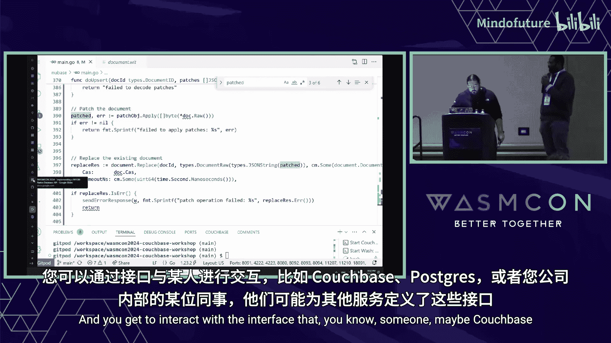

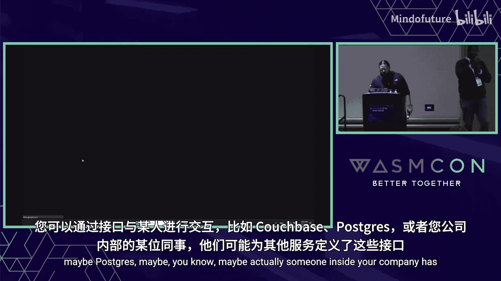

But yeah， that's Laent， would you like to add anything。Yeah， just one thing。 Well， first of all。

 thanks for， for joining us to for that workshop。 I appreciate it。 I will be。😊，Here。

For the remaining of the day。 and also， we're doing an event tonight。 So drinks are on catch base。

 If you don't know what to do between what is it 6 to 8 PM。

 please register and please join us at Graces， which I hear is pretty close to here。

 There's a whole program that says AI and apps。😊，I don't really care about that。

 We just used to here to have fun and just Sha rings and chat about stuff。

 so it' would be lovely to see you all there。 And hopefully you can make it。 And yeah thank you。

 Victor for doing all the heavy lift。 Thanks， Lauren， for setting up the development environment。

 Of course， Lauren will be here。 I'll also be here I work for cos。

 We have a booth that's right outside here If you have any questions。 know。

 not about go more about Webassembly。 I'm kidding we also can answer some questions about go。

 please come talk to us。 Again， no question is too small We let to talk about this stuff。😊，Yeah。

 thank you。

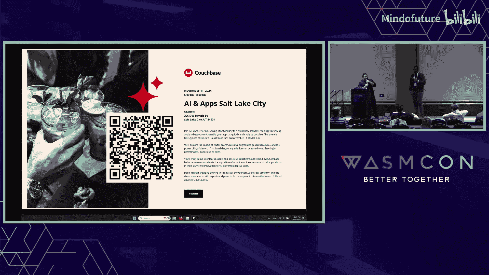