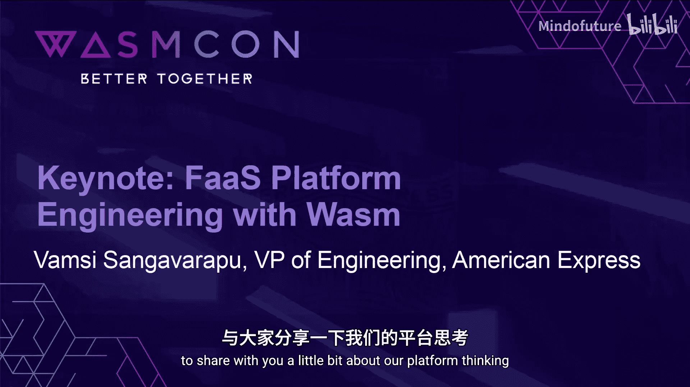
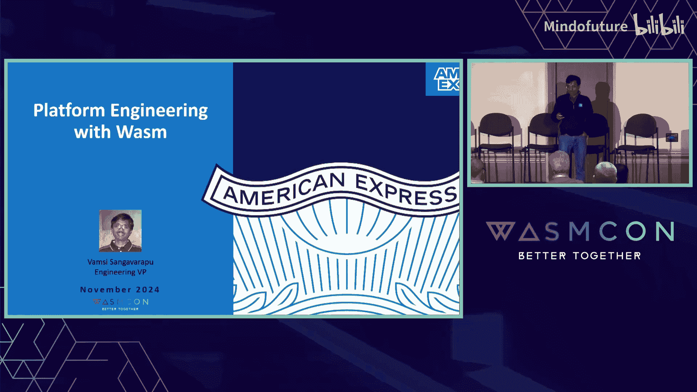
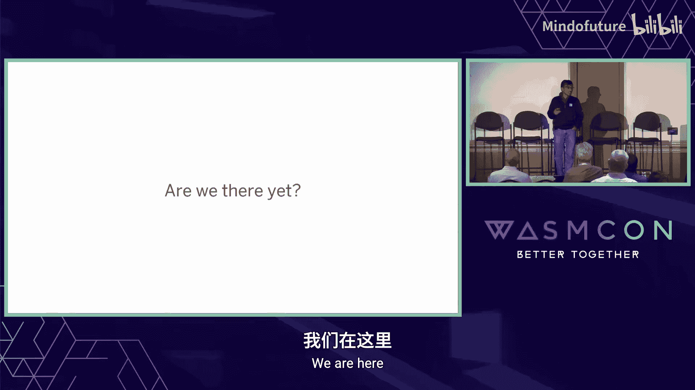

# WasmCon-2024-p37-P38-Keynote---FaaS-Platform-Engineering-with-Wasm--Vamsi-Sangavarapu,-VP-of-Engi--BV18DjSzJE6r_p37-

Souper excited to be here。To sharere with you a little bit about our platform thinking you know I work in CT organization in American Express technologiesnologies。

 I lead teams building frameworks and platforms for developers to build their business applications on and one of the core platforms we have is called a function not the name but it it's a functional as service platform and I want to share with you a little bit our thinking platform thinking in terms of what this platform is providing for the developers。

And what makes it tick and how can we take it to the next level with Wam and what was has to offer to kind of really elevate the experience there。

So。To begin with this functional service platform is really an ecosystem。

It does platform in terms of it frees developers from all the cross cutting concerns they don't need to worry about。

Servers where my server is running or where my application is running， managing the infrastructure。

 CSCD pipelines， observability， all these things come out of the box so to write an enterprise hello world you all know how what are we have to think about you know before you get to really do in the meat of the work which is the business logic。

All these cross cutting concerns are taken care of by the platform so the developers can just write to business。

It's also a framework。 We encourage a。We encourage contract first development so every function exposes a specific contract that can be used to interact with it and we also provide language specific runtime so today we support the ja and cartline with the JV and based runtime we have a node JS based runtime for ja and Tpescript and we have some opinionated defaults in terms of what languages and libraries to use how to do I think programming so developers are free from all this lower level decisions and again they can straight away work with the business logic and then the platform also provide tools which are needed for majority of the developers you know depending on what kind of applications they want right and there is a large community around the platform so that they can learn from each other discover how things are done find patterns and reuse code and things like that。

And it's also， you know， if you look at all the different stakeholders， not just the developers。

 developers really love it because they just。Straide away write business logic。

 they don't have to think about anything else。But from data architecture perspective。

It gives a standard way to。Create APIs the contract for development that we encourage make sure that every function has a well defined contract and well defined open API spec for it that is discoverable and data architects take this advantage to standardize how do we expose and write APIs across different lines of business。

And， you know， it's a place for them to do A management and governance。Inforac， a single。

Pin of control， single point of enforcement for all the different authentication authorization we want to do auditing that we want to do。

 I find really what A are running in the company。And from an S perspective。

 observability out of the box。 So every team don't have to think about how do I solve my logging and metrics and why know of。

Any other concerns that they have， it's the same technology and tools and dashboards and alerting they can use across the board。

嗯。So it has been very successful。 It's quite mature at this point of time。😊，And what makes it tick。

 really the the。USB of this platform， right， First thing is。The cold Start problem， right。

 any functional service platform needs to think about this and。

Our functions are small packages of code they are not full on containers we when we deploy function we deploy into a running container so if you take Java example it's a small jar that only has that business logic and the library is used by that function that runs into a runtime that is deployed into a runtime so coldstar is you know compared to a container based system it is significantly improved with with this platform。

And the other two go hand in hand， really speaking。If you think about any large enterprise。

 applications are owned by different lines of business。

 different teams and everybody each team manages their own application。

 they deploy it and they manage it their run it， they scale it in their own space so when you need to write a cross cuttingtting journey that goes from application to application lines of business notwithstanding。

To call from one application to another application or to from APA to another API owned by different teams。

 you have to leave the box， you have to go across the wire， make A calls over the network。

And this also put some limitations on how best we can leverage infrastructure because it's all at an application level。

 What we do with this platform， we blur those lines of lines of business and application ownership。

 bring all the functions into the same platform。And we can use the intelligence in the platform to find out。

And call kit functions that depend on each other so that function to function calls are super optimize。

 They don't hit the network and。This also gives us an opportunity to pack functions a lot more。

 you know， with a higher density than what we can do if you are artificially dividing it by lines of business。

 So function packing function collocation。😊，Are really the US piece of this platform and what have some numbers here。

 but really this is one of the platforms that unifies a lot of developers so。

I think it's it's probably the biggest。Sing way of developing applications in the company so that when developers move from team to team。

 they are productive on day one because they can bring their expertise of how to develop applications and take it to the next team without having to learn new ways of doing things。

And what do we want to do next with this we wanted to see right now I talked about Java cart in Java typescript some teams want to develop and go。

Some want to develop in Python because that is their first language。

 That is what they do all their other applications in。

And I want to be able to do this without having to write new runtimes for every language that people are asking me for。

And that's where we thought wasm really helps with this polyglot nature。

I want to increase the function density， while we are。We are。

 we are packing a lot of functions in one one part。

 Each function still has some common libraries that I can extract it out。

And that makes the function even smaller and be able to pack more functions in。

 but do it responsibly。😊，Meaning， make sure that functions don't step on each other。

 And that's when the boom sandboxing， strong sandboxing helps with the isolation。

And language interoperability is a bonus。 We are not looking for it today when they talk when a Java function needs to talk to a jascript function。

On the way it has to go and in a format like X format like Jason today。And with Wasom's。

 language interoperability with components。I can do this in a lot more efficient manner with WRPC and that that is really promising。

And。We， when we started exploring this earlier this year， we started with a。

Custom runtime built on Wa on time。And then we started seeing we are doing a lot of heavy lifting that should be common in the community and that is when we kind of discoveredom Bosom cloud and now we are building our runtime around Bosom cloud leveraging all the functionalities that Bosom cloud has to offer。

嗯。Two things， key things I want to talk about Was cloud that we really like are the capability providers。

And what that lets us do Wam， there is only certain types of workloads you can run on Wa today。

No I think support for example just yet and things like for example。

 if you are talking multiple wM components or talking to a database if you want to do connection pooling at a higher level you have to do it outside of the module outside of the component and that's when I think the capability providers concept in Wasm cloud really shines。

And there is a lot of opportunity here that we are looking at to see how multiple functions we can optimize further the database connections and thereby the performance。

😊，So this is early to be honest we just started this year and with partnership with Bossom cloud team we've made I think a lot of progress but what we also want to see is you know we are not there yet we don't have this in production we are in early days and。

But the way we are thinking about the volume components and how we can layer in platform for those of you who are in our talk yesterday。

 we have went into some of the details on how platform components are layered over a business logic specific function component and。

That's super promising to me we'll see how that pans out as we kind of put it in production and gain some real world experience。

Also。Just as an ecosystem， I think just the last six months。

 we have seen so much growth and improvement in the maturity of the bottom cloud and the ecosystem around it。

😊，But， I think。There is a long way to go。 And for me， the focus is not using the technology。

 The focus is enabling the developers as a platform。

To write idiomatic programs in the language of their choice and do it in such a way that I can support multiple languages with you know low burden on the platform as well platform team。

And while I like the technology， maybe not popular， but I have to say。You know。

 it's hard to get people to write mission critical business applications on。Was a 0。

2 preview version。 Just， it doesn't inspire confidence in people who are not in the。In the community。

So， and definitely， I know I was very excited to hear Luke talk yesterday about what's coming up in or you know。

0。3 preview again。 so I think。😊，To get real enterprise adoption and get people to write。

Super critical applications on this。The appearance of。

 you know the stability of the interfaces that we are building on top is also very important。

And I think we hope to work with the community to get it to a stage where we can confidently go and say。

 hey， we like as a platform team， we like this technology。

And you can trust us to run your mission critical applications on this。 So there is work to do。

 We are here。 We want to work with the committee， and make this happen。

