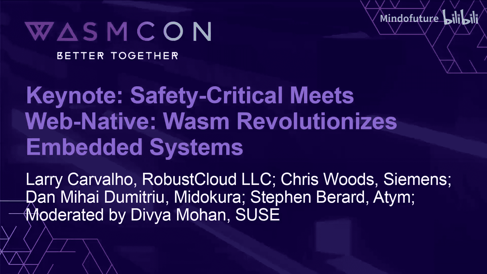

# WasmCon-2024-p38-P39-Keynote---Safety-Critical-Meets-Web-Native---Wasm-Revolutionizes-Embedded-Sy--BV18DjSzJE6r_p38-

All right， so before we get started， I know Bailey gave a terrific introduction to each of our job titles。

 thank you， but I would also like to take this opportunity and have each of you all introduce and give a little more context on the you know。

 backgrounds that you're coming from in maybe a 3 second introduction starting with you Stephen。😊。

Hello， my name is David Brod， I'm cofounder and CTO at At At is an edgedge application framework for resource contrained devices。

 it allows developers to build， deploy， update， manage and monitor and troubleshoot Edge applications on the smallest of constrained devices My background I spent a lot of time in the OS world working in the Windows kernelnel team at Microsoft I've spent a fair amount of time in the industrial space at Schneider Electric and so I've brought a lot of those two worlds kind of managing these things and understanding how to build these systems and deploy these applications at scale。

Yeah so Chris Woods I'm from Siemens been coordinating a lot of the Siems work around Webassembly we've been looking at Webassembly now for about four or five years you and I think Siemens is a pretty big organization so there's a fair chance that everybody here who came into this room has touched something that Siems built made or maintained so the electricity that comes in here if you took a train。

 light rail， 80% of the railroad crossings of Siemens and when you get into those systems。

 they look an awful lot internally the software architecture starts to look a lot like what we see in the cloud except you don't get a 500 server error when things go wrong。

😊，You get people losing arms and limbs or electricity going down。

 So it's a surprising of parallels between the two。

 And that's one of the reasons why we started looking at Web assemblymbly。Larry Kvallo。

 I'm an independent analyst， cover cloud native technologies and edge computing and when my interest in edge computing grew。

 I thought that we have to cover Waom to see how is it going to play a role。

 especially in what we're going to talk next in this session。I'm Dan de Mitriru， Midora。

 which is part of Sony Group。And what we do is build intelligent sensors。

 mainly for computer vision on the edge。 So we kind of stumbled upon Webassembly out of a real technical need to basically build safety and isolation into the deployable。

 changeable components of these sensors。And we've been working on it for about， I would say。

 over four years now。Thank you。thank you。 But I am Dea and as Be currently mentioned。

 I'm the principal technology advocate， Suusa。 So a lot of my work is in the cloud native Web assemblymbly space。

 So as much as y'all are going to learn from this panel， I'm probably going to learn a lot more。

 So I'm directly going jump right in and Stephen， I think the first question is for you right in the embedded world。

 you'll operate under real constraints in terms of resources。

 So what benefits does Webassembly bring to you know， this ecosystem and you know。

 these sort of resource constrained environments and what should the Webassembly community here actually be aware of in terms of the benefits and the resource constraints that you'll operate。

😊，Sure， thanks davia， first I'll talk a little bit about these constrained devices。 you know。

 they're everywhere， as Chris mentioned， they're all around us， they're in our cars， they're。

Our smart home devices， they're in。A multitude of things that you don't even know exist。

 but one of the things that is really common here is they're very resource constrained and by resource constrained。

 I mean they could be limited in CPU， they could be limited in the amount of memory they have。

 how fast that memory is， they could be limited by the network connection if they have one at all。

 it could be very slow high latency， and very often their battery operated。

They're used all these different places， but if you look at the programming model for that。

 it's largely what we did in the 90s on the server side， it's monolithic programming。

 it's generally in C， sometimes C++， everything gets linked together in a single binary。

So as we all know there's a lot of friction to go do that right especially in large organizations。

 Chris， you know we've all worked in large organizations where there's a group that does the sensor stuff。

 there's a group that does the analytics， there's a group that supports the applications you have to get all those people to get together integrate that code and then build that into a single image and then even if you do a single line change of code you got to retest that entire image you got to deploy that whole image there's just a lot of friction in that chain and so the ability to keep these things up to date to patch bugs to support them to troubleshoot them or just build modular architectures just has a lot of friction to them and so when you start looking at that world and say how do we revolutionize that and then you go look at the cloud side the cloud native folks they have all these cool tools they have containers they have components they have dynamic loading they have all sorts of things and so what we did is we looked at those tune and you said。

 hey， why does that have to be you look at the embedded devices today the amount of CPU they have while it's constrained has the ability to do a lot of these things and so we've started to reimagine that。

That's where we stumbled upon webassembly so when you look at Webassembly to get to your question Dvia know which there's a lot of really interesting properties of that was designed to be secure by default it's designed to be running in your browser running code that you don't know where it came from right or if you're a developer your code is running in somebody's browser that you don't control so the core security properties that was built into the design of that are really attractive from the embedded space when you start looking at reliability in real time and safety critical。

Further， it's simple right so it allows us to build really small runtimes we're using Webassembly micro runtime which I think most of us here on this panel are using an embedded space we're able to get that runtime down to 50k and that actually now fits on this device right there was a talk yesterday with your colleague and keys from Stanford where they were getting it down to about 5K by removing almost all of the runtime but still getting a lot of the benefits。

 so there's some really interesting things you can do to get this virtualization technology into into this this class of device just to contrast that you look at the VM the JVN rather in Java you look at the CLR and some of the other VM technologies like that they're much much larger and they're just not usable on these devices so I think being able to do that and get that into that form factors is key the other thing is we're actually getting isolation so these devices generally don't have things like virtual memory they generally don't have memory management unit so we don't have process boundaries we don't have that kind of isolation but with webassembly we're able to do that and're。

And software， which means we can do that on cheaper hardware and we can do that at scale so a lot of really exciting things we can do and then once we get to the side of software development we have the ability to write in the language laborories。

 modize our code update in fractional updates so all those cool qualities that we have with containers and we're doing there now in the cloud。

 but on this class of device so we really can do some really interesting things that we just couldn't do before。

And just to add to that， I had a colleague of mine， Dominic， he's probably in the audience。

 and when we first started looking at Web assemblymbly， he said，Wow。

 you can put different languages and not have C on a device。He says， yeah， we're always being pushed。

 but more intelligence on the edge。How many machine learning experts are also experts at embeddedd C。

Right。They don't exist or if they do the very few and probably paid very well。

 so this is a way we can get some of that different skill set onto those devices and I think there was a talk the American Express talk just before where they said are we there yet can we use it in production？

And today， the Whammer， the Webassembly micro runtime that we've all been focusing on。

 it's deployed and in production in about 1。5 million devices that we know about at the moment。

 So every time you watch an Amazon videoide prime movie。

 that's Whammer and Webassembly Disney+ streaming that's Whammer and Webassembly if you're on a Xiaomi product it's probably web assemblymbly So it's already in there and it's deployed and it's pretty successful right So we as an industry haven't yet and the embedded side being able to adopt preview too。

 but for the previewron world it's been tremendously successful and it's providing that isolation and the sort of。

Cloud isolation， the same mechanics， the same programming styles。

 coming down to something that costs a fraction of a cost of a laptop。

 right you're in a single digit dollar figures for this。

And' that's revolutionizing how we build embedded software and how things will work。

 And that's really the advantage that's coming。 or to an extent。

 already exists in some of our embedded colleagues products。Just one thing I wanted to add， you know。

 speaking of resource constraint， today's resource constraint is。

Very good by historical standards right， like it's 32 bit and memory is。

 let's see on the order of tens of kilobytes to hundreds or megabytes。

 hundreds of kilobytes or megabytes， so it's not that bad。

 that means that we can do a lot more than we could do before。

That said you still need to be a lot more careful than on a server or even a respberry pie sometimes people think a respberry pi is an embedded system。

 no it's not it's a supercomputer by comparison right so you still need to be very careful so that's where some key properties of Webassembly come in which is for example the lack of garbage collection that's one of the main reasons why Java and CLR willll never run on these things because everything's garbage collected。

 it's part of the fundamentals of the safety the memory safety is that you don't have real memory references right you can't forge them。

Weassembly has a totally different approach to that with the linear memory and that's a key that's a key point the second point is that in our case we can ahead of time compile stuff。

 we don't jit thats maybe you can jit on certain platforms but you certainly can't on the thing that has 32 kilobtes of memory so these are two of the key properties I think that we need to keep in mind as a community and not to screw them up as we evolve the thing so if ever somebody thinks that we should have everything be garbage collected。

 no bad certainly bad for us in the embedded space。And just to add to that。

 I think the goal of the component model is really appealing。

 the vision is spot on and we'm super excited to adopt it when it's ready to hit these constrained devices。

The limitations that we just have and it's hard to do that I we joke right。

 you know the devices we're programming today capability wise。

 they start to look like they're really expensive home computers I used to lust after as a teenager right I can play doom on a microcontroller。

 that's pretty awesome so they're fairly capable in that whole scope of things but。😊。

It still means we've got to be very judicious for what we do and try and eke out all the power and performance。

Particularly when we get to sort of cyber physicalical world and to the safety critical points here。

 when you have things that control stuff that moves in the real world。

 people can get hurt and it doesn't matter what it is if it's a lit lathe in a shop for and a factory。

 if it's a railroad crossing guard， when you ask it to do something it should do it and it should do it within a predefined period of time。

And so for us knowing exactly what goes on in every function call in every invocation of a method。

 understanding the timing that takes and being able to reproduce that in a deterministic way becomes really important So I see Dan say。

 well garbage collection maybe that's not a great thing for us。😊。

It might not be for all of the stuff we do and I have to say to Beatty and the folks involved in the Bcode Alliance they've been tremendously receptive and we've come up to them and said。

 heHey， wed like to change things and also in the W3C when we talked to them about garbage collection and said。

" hey this is awesome for you guys but for us it would suck man and they said。

 well maybe we can create Webassemb profiles we don't have to implement all of the garbage collection。

And so it's been a fantastic collaboration， I think and it's growing。

 so we've set up the embedded special interest group as a way to kind of drive some of our concerns from the embedded side。

😊，And the really cool thing is most of the stuff we're doing is around efficiency and determinism and performance and everything we do and we contribute to everybody else while it makes F5 go faster。

 right it makes everybody else's products work a little bit better。

 So you see us complaining about garbage collection and looking at bits and bytes。

 but the results should be something that benefits the entire Web assembly ecosystem。😊。

Right and I know you already sort of answered the next question probably around realtime performance。

 but I do want to you know delve a little more into that in terms of you know what are some of the concerns that still very much for me you touched upon the deterministic side of it but damn if you could sort of delve a little more into it that would be great Sure I'll get things started anyway so real time what is real time mean I mean it basically means fast but also deterministic as in you know bounded by some know probabilistically of course at some point everything is there's nothing there's nothing certain in the world but as certain as possible and so what we need to do there is remove the sources of nondeterminism garbage collection is certainly one of those know so is a memory allocator at some point right so you think various things can introduce nondeterminism in the way that the system operates。

One of the things we were kicking around yesterday was。

What else can happen is if there's not a coordinated approach， for example。

 of threading between the Webassembly runtime and the operating system as minimal as it is。

 you know then that can introduce problems as well。

 even with cash misses that may occur when you're switching threat boundaries and stuff like that so that for example I think we think is still work that needs to continue to be done isn't quite there yet。

嗯。Larry， okay Yeah， just one thought about real time。

 and I look at the business value of what you're going to get out of real time。 There are two things。

 One is preventive maintenance and quality in a manufacturing environment。

 So if you get the real time information and you want to keep your。Manufacturing， shop flow， running。

 you know， with high reliability and。Up time， you're going to have that。Build into。

Making sure all your machines are running， identifying errors up front and in terms of quality。

 you know， getting that feedback and immediately saying， hey， there's something wrong。

 we need to fix it。 that is a huge you reduction in cost you know to the bottom line of a manufacturing facility。

See when you had something to say I don't do what Laie just said actually I was gonna to doublet a little bit und comment and then probably get a little into our next question but when you start talking about these systems where you have real-time constraints and whatnot you also run into situations where you have mixed criticality and that's something I think is really exciting about that where you can have part of the system be a true realtime system with all the normal constraints you have running potentially traditional C code it's certified it's been running for years and then alongside it put something in a WSM runtime to run something else very often will have a web server for example for configuration or maybe managing a user interface and if that doesn't run it it's a 500 error if it is slow doesn't really matter it might matter because you might care about configuring it but it's not going matter from a correctness of the system things that interlocks for safety。

 those things are still going happen and so I think。

It's really exciting and obviously that's a lot more your world， Chris。Yeah， I just， don know。

 I'm going to ask for show of hands， has anybody written anything in the embedded space here？

Wow great there's a good few good， so you know when you do the real time side you've got to prelocate your memory。

 don't start mess or if you can don't use it at all。

 just use largedge global variables for everything right and it's a very peculiar and non-natural way of writing stuff and it's kind of fixed and it's a little bit awkward to be honest。

 but it's pretty performant and does what you need it to do。😊。

But that sort of excludes all the really cool intelligence that we want to put on it。

 when you get to the polyglot side of Webassesembly it's like， hey， you know what。

 we're gonna have this other component written in some other language and it's going to run and maybe it's doing garbage collection and undedeterministic stuff and that's cool because the functionality of stuff that we want on this device and that mix criticality。

 the ability to say carve out this little bit， this little bit of code here。

 it runs inside this sandbox， it doesn't touch anything else。

 and it can do whatever it wants to do It can maybe consume consume data and probably the best sort of。

😊，Real world example that you probably don't know about。In different industries。

 the the aircraft industry you've got the black box at the back of the aircraft and it's collecting all the data and that's FAA assured don't play with this。

 this is sort of safety critical needs to go to the black box but a lot of airlines actually want to consume that data for the own process improvements and pilot training and predictive maintenance and so there's a read only port on it where you can read it but this is a read only port design in hardware whichs the hardware bill of materials and cost now a Webasse hey we can do that in software so you can have this read only port we consume the data maybe youre doing predictive maintenance and analytics and offline processing and I can put it on the exact same bit of silicon that you're doing everything else on and that's this mixed criticality concept and。

That's something that's really cool。 It's sort of taking the benefits of co hoststing two tenants in the cloud on the same server and bringing it to a chip that doesn't have a hypervisor。

And doesn't run a big server O S。 It runs a tiny real time operating system， but we can still do it。

 So' that's the really cool thing。😊，And zooming a little bit on that， you know。

 aircraft thing because we talked I mean， it's maybe not as mission critical， but probably also is。

 And it's also important in contributing to the safety and reliability aspects of you know。

 the entire flight and， you know the entire operations， So are there any specific you know。

 concerns that Webassembly can help address in such situations and enhancing the safety around these embedded systems in a real world prospect are there like。

 you know， some light is there some light that you can shed， sorry。😊。

So probably the best example is this sort of mixed criticality world。

 but to be honest we haven't yet seen a fully safety critical certified web assembly runtime so' that doesn't exist yet but what's so exciting and this is where I say well we're in production but there's more to come but's so exciting is the building blocks for this are starting to appear so the core Web assembly spec it's written in a DSL at specte and we have something that can be machine read and interpreted and automatic proofs generated for correctness and we start to head towards this exciting world where hey this is just around the corner this comes and we have a safety critical runtime we just sort of expand upon the range of devices and use cases we can use it in in the embedded world but Stephen you were talking yesterday to me about how many arm chips are shipped every year what was it？

😊，I' am totally going to get the number wrong but it was billions every year and if you look at that you know there's multiple classes of arm chips obviously so most of the arm chips we think of the ones that are in our phone or maybe in our tablets or PCs。

 that's like about a third of what arm chips every year the amount of chips that they ship in the realtime space in the microcontroller space or twice that right and so。

I want to say on the order of I think it was like 4。

2 billion chips a year so I mean it's an enormous amount of chips。

 and I'd say about half of those are really， really small fixed functions like things that would be in like your ABS control system right course。

 minor correction right course， not not chips shoot， they license it by Yes by course， yes。

And so about half of those are really， really， really tiny right they're the very fixed functions。

 but the other half of those are these general purpose microcontrollers and that's where a lot of this pertains。

Yeah， and just for safety， right the main thing about safety is when things go wrong。

 they go wrong in a predictable way， so you know what's going to happen so if you're going to stick your hand in front of a flying blade。

 you know it's going to stop。Safety is not what happens to me in my Tesla when it decides to reboot while I'm driving it。

 that's not safety critical。 or at this is not the user perception of safety critical so。Yeah。

 my view on the whole thing is the operation systems。

 you really got to figure out how you're going to manage the safety。

Because there are nation states looking to you know attack， attack the water systems。

 attack the electrical systems， attack the rail systems， so I think what Chris。

 you know you're talking about in know certified you safety core that's going to play a big role in preventing something like this。

 you're going to see much more of these potential attacks as we go on in the next。You know，10 years。

 five years，10 years。 And we are going to see certain software and hardware build together。

Be the way in which to prevent it。Yeah if I can just that a little bit。

 I think security is a huge important topic we could probably talk for multiple hours on it but the fact of the matter is we have to deal with these potential cyber securityity attacks and if you look at how traditional embedded systems are built their monolithic applications that run in the same process space generally and so if any bad code gets in there if anybody exploits a security bug you can take down the whole system safety included when you start partitioning this into separate modules that run independently if I were to attack one module maybe I can do something bad there but the blast zone of that attack is often limited to that zone and I think building that in a modular way in a defense and depth way brings us much more resilient systems。

You know it's hard to build these secure systems， this is just another tool that helps us build these systems better。

Yeah， a lot of embedded devices would be kind of， as Steven said monolithic。

 they execute the same binary the whole time， and that would mean for some devices that they're constantly exposing a management port even when they don't need to。

😊，RightBut if you can dynamically load and unload code。

 I can dynamically load my management console when you need it and turn it off when you don't。

 so I close the attack surface and I reduce it。😊，And certainly on top of all of that we talk。

A little bit about regulations。 But the European Cyber Resiliency Act is is coming quick。

 and we need to be able to update all those devices that we never thought we would。and。

Things like the component model， this very detailed software bill of materials。

 You know exactly what's in every piece of software that's deployed。

 And if we have a log for J style incident， I can just replace that component。That's cool。

 That's really powerful。 So， you know， there's a lot with with what we're doing today。

 What some production today， the isolation and the execution we've got solving this。

 and there's a lot more。😊，Fun stuff， exciting stuff to come。Just on that point。

 the ability to specify what a component or what a module is allowed to do and basically by default nothing。

 that's very very key so that's very different also from running on a server in Linux as much as you have all these capabilities but typically you can do everything by default and in our case it should be exactly the opposite and I think we can make that work with WASM although maybe not everything is 100% there yet right。

Right， and I think we're almost at the end of our time。

 but as like probably call to action or maybe a final point。

 can each of you all sort of like give the community assembled here any message starting with you。

 Stephen Pick assistant at the other end。Sure， thank you， I think from my perspective。

 you know I would love to have people participate in what we're doing so you know we have an open source product that is sorry project that is the core of our runtime called Project Oker it's a Linux Foundation Edge project I'd invite all of you to go check it out and you if you have questions come see me love to have people participate if you're building these systems you want to understand how to you know how to compartmentalize your application。

 what build tool chains we have available and all that we'd love to hear your input。

 get your contribution。Yeah， for us， we， I mentioned it earlier。

 we established the Emd Special interest group， it's part of the Bikecode Alliance and we're looking at what's coming in the core Web assemblymb specification and what's coming with the WAy specifications and how we make them work on these embedded devices。

Come along and join us if you're building software for embedded devices。

 come and join wed value your expertise and views and opinions on things。

 The one of the most exciting things in that SIG is how we've seen ideas bounce。

 you've seen some of it in the panel here， but I've seen ideas bounce evolve and just get so much better。

😊，And it's becoming a really exciting place and it's a great opportunity for fellow travelers。

 people who wouldn't normally talk with each other because we're maybe competitors in some spaces。

 but it's a really great opportunity for fellow travelers to come along and talk about the problems they see as they take the Webassesedi micro runtime and the embedded approaches to Webasse assemblymb forward and try and come up with those solutions so come along and join us。

😊，My view there is a huge opportunity on the edge when you're looking at onshoring of manufacturing。

 you have to have automation and to get that automation using Webassembly on these devices but in the future you can also start thinking of JenI embedded at the edge that you can do some inferluencing and make that the next level of automation and talking about safety and other things that you want to accomplish in this journey to the edge。

 I think yesterday Dan you talked about how much of vision is increasing on the edge and you're going to need technologies like this to be working to make that happen when I'm talking about vision inspection of items and everything else with cameras coming in。

 that's the next generation， not just on the website but on the edge。

 you're going to get a new level of innovation and efficiency。Hes built on。

Well I think it's mostly been said， by my colleagues here， but I think the one thing to。

 I would say we should keep in mind maybe for the non- embeddedbedded people is。

 I guess we have this notion that any WAM program should run anywhere， right once run anywhere。

 it's a joke I know， but we are actually much， much less concerned with that point in the embedded space I would say。

 like yes， write the software against SDK is compiled and so on。

 but then between that and actually deploying and running it。Anything goes， you know。

 so for example yesterday we saw a talk on the Wm to see。Great。

 if that works and it fulfills all the properties， that's a perfectly reasonable way to go。

 it is not an interpreter， it is not an AoT compiler， it's just something else， it works。So。

We're really open to doing a lot more， let's say， pre deploymenteployment processing of the artifacts that come out of the build system。

 and that goes back to the point about the component model which we love philosophically。

 but there are different ways to make it work， so one way to make it work would be to again。

Build your components using the tool chain and then instead of relying on the canonical A。

 which we don't have， right？We will process the components so that they do the dealization inside each module。

 deploy it like that。And from the functional point of view， problem solved， we're good， you know。

 but that is not like within spec so so to speak quote unquote。

 right so I guess it's something that we we can discuss and we have discussed in the embedded sick but we can discuss more widely or I was gonna say this is why you should come to the embedded sick Yeah you agree。

 disagree or thinking we can do better， come along。And I think with that， we're right on time。

 So thank you very much for that wonderful discussion。 I'm glad to have been part of that。 yeah。

 that's pretty much it Bailey， over to you。 if anybody has any questions。

 I don't know if we can't take them。😊，Any questions， audience？Hey， right here。Cer。Process。

Getting these w。We need to repeat that question real quick。

Can I speak to the certification process for getting certified approved wise modules and components out。

 yes， we haven't done it。Right。Not there yet， even today speaking to colleagues in the room。

 you know， I'm learning about new efforts that are happening that are really exciting so I'd say。

Keep watching， it's coming， right？That's a promise。嗯。I think the gentleman over there has raised。

 I don't know if I anybody else did。は嗯。And I think of an industrial。Chs。I think you do。

The question was， if。So in some of these safetycritical systems。

 they require like lockstep computation on two different pieces of hardware。

 and they need to agree in order to take the action。嗯。And the question is。

 do we need to change the WSM spec to make that work？I have no idea， I wouldn't think so。

 but what do you guys think？I don't think so， but you get into this very philosophical world of what do we mean by safety？

😊，And there is this push in the industry in general to start thinking about safety。

 criticality and certification， which it can be industry dependent right so the aerospace industry does it one way。

 the automobile industry does it one way rail industry does it another way but a lot of it all bores down to that determinism。

 everything does the same thing in the same way and verifying that and making sure if there's an error that you can catch it but then the question becomes。

 well is that really safety is that just determinism and what do we mean by safety and that gets particularly interesting when you move into the world of statistical programming so it's no longer hard rulebased youre now moving into the world of maybe it's an AI model is giving you an instruction where does that sit How do I qualify that as safe or not safe。

So the underlying infrastructure that builds our safety critical systems today is starting to slowly migrate and change。

 you can see it coming down the line， particularly in the world of academia。

 so things are modifying but there's no changes yet。

 nothing happening yet in the regulatory bodies to shift away from it。😊，Perhaps， one of the most。

Compelling regular body， regulatory body change and certification was the。

The FDA and it was approving our colleagues in Simens Health and Eas have a product called AI RAD that helps say radiographer spot issues。

That's available to purchase today。 And that AI model。

They worked with the FDA to find a safety critical features for certifying that and because that was a brand new approach to it。

 statistical programming， how do you validate that this works。

 they had to work very closely with the FDA on that， make some changes。I'm getting enough topic here。

 it's nothing to do with Web assemblymbly， but you can see it coming。

You can see this change in safety， critical definition coming down the line。

 but it's a really interesting conversation and I think part of it does go towards academia in terms of Webassembly。

 I don't think Web assemblymb is going to redefine what safety is we're going to provide a mechanism for executing code in a safe and deterministic way。

 which are core parts of what the Web assemblymbly specs trying to achieve today so there's no change。

😊，Add a couple of things to both your comments too。

 I think one of the tools that we have with Webassembly is we have the ability to have these binaries and it portable code that we can then run in different places。

 Yes， we may Aot compile it， but that code， the source of that is code it's not source。

 We're not recompiling that。 So when I recompil it with a different tool chain with different compiler options I'm going to get different characteristics。

 So if'm building these safety systems， I'm going to have to go through a lot of integration and then a lot of testing and then recertification。

 when I can show those at the binary level， that solves some of the problems。

 I doesn't solve all of the problems， but it solves some of the problems because I can take that code that's known to be run correct。

 known to be safety certified and put in a different system。 Yes， I still have to do certification。

 Yes， I still have to do testing but I've reduced some of that friction。

 And I think that's a huge huge thing。 and then I can also provide things like signatures and S bombs。

 So I know that I'm running exactly what I expected what exactly was tested what was certified and potentially even enforce that cryptographically。

