# WasmCon-2024-p39-P40-Behind-the-Scenes---Debugging-Kotlin-Wasm---Artem-Kobzar,-JetBrains--BV18DjSzJE6r_p39-

Hello， everyone。 Thank you for joining my session。My name is Art。 Oh my God so huge image of me。

 Sorry for that。 I'm working on quantum to Wasp compiler in Jedbrains。 Previous。

 I worked on to jascript compiler， and also I'm helping with source map specification。

 We will talk a little bit about it during this talk。 Yeah， so our schedule is really tight today。

 So I will try to quickly introduce Q to Wasp compiler some aspect and facts that can。😊。

Give you like understanding why we made some decisions。Also。

 we will dive into the in browser debugging with demos。 I created two demos。

 So we will see them anyway。 and also， we will explore a little bit area of improvements。

 It's not so big， but there are some items that could be improved。 And if we have enough time。

 I will also try to cover outside of browser debugging。So firstly， what does Scotland was？

Thank you for asking。 So Jetbrains is a company you may know because of a lot of nice Is for different languages。

 for Java， for Ras， for C。 But also this is a company that created a language Cotlin。

 So some of you may know the Kotlin because of Android or S better Java。

 but actually Co is multiparting and cross platformat language。 And right now we have four compilers。

 So for JVM for Js for native through LOVM and a new one for Wason。 so。😊。

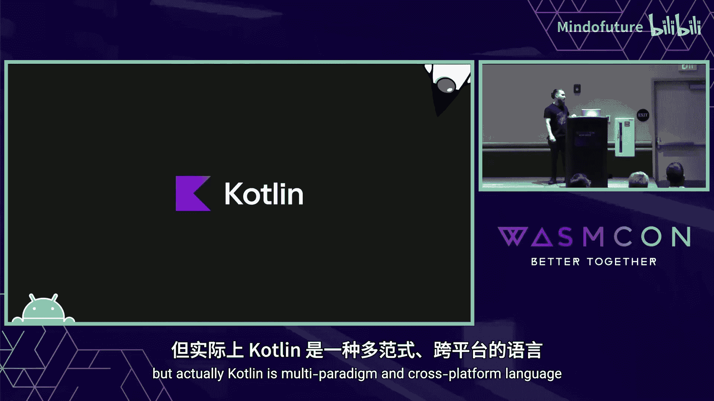

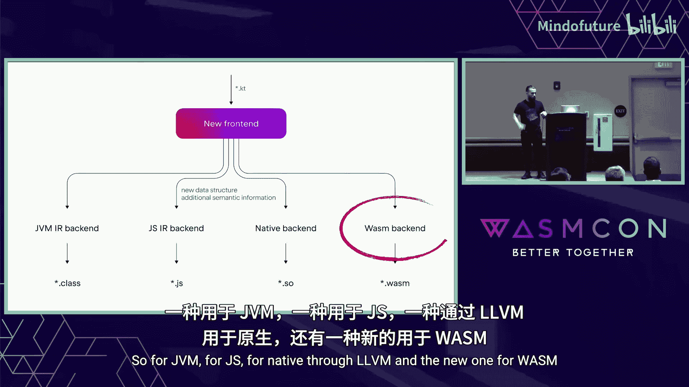

Cootton is open source， so I will refer to each file and to some implementation details in Gitthub Ripo。

And also， it's about from scratch。 So we don't use any L L VM or something like this。

 We just grab IR from cotton in front end and compiled it directly to wasn binary。 Also。

 re'us some components of cotton to jascript。Also， we have two sub targetsrg。

 one for browser and one for outside of browser。 first one called Was GS， second one， Was Was。

So also， we heavily rely on G C and function references。 It means that if you try to run。

The binary generated by our compiler in VM that doesn't support one of this proposal。

 It will not work。 Also， we softly rely on exception handling proposal。 It means that by default。

 we turn on exception handling， but you have ability to turn off。

 And if some VM doesn't work with it。 So you can just turn off and it will work。 So this gotten was。

Let's dive into in browser debug。

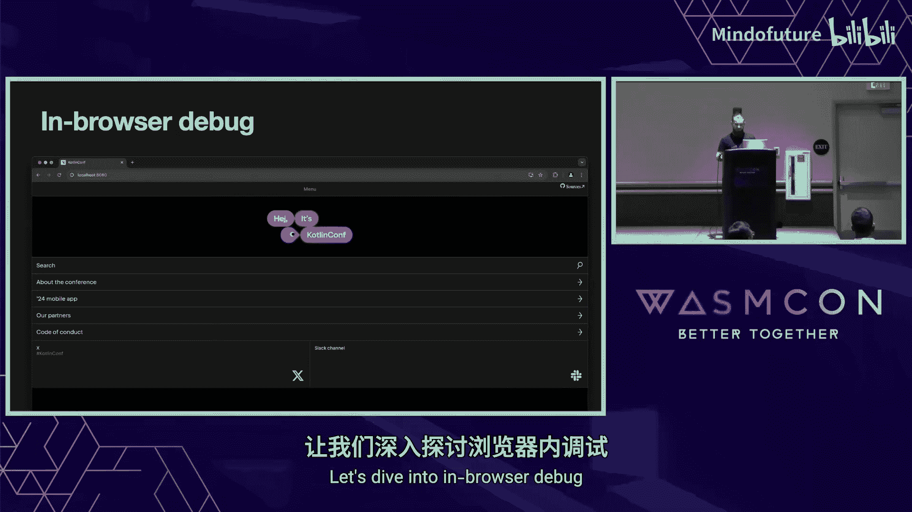

So this is an application we will debug today。First， originally。

 it was like Android application for our Kotland conf。 And with the compos multipl。

 we compileild it to Ios and for web。

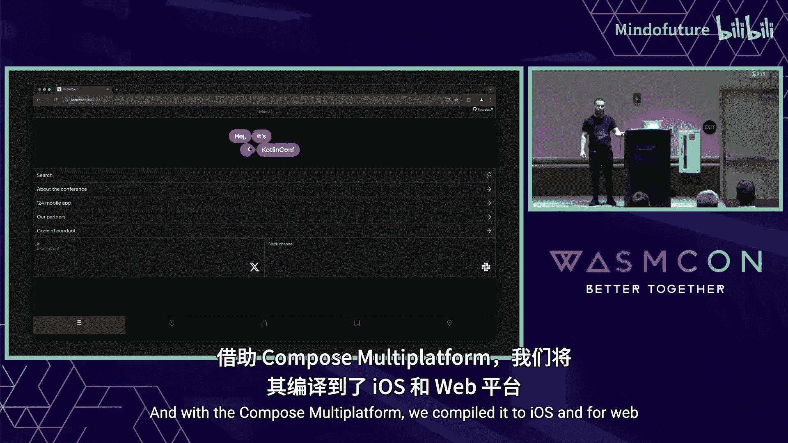

So。Let's check， how can we debug it。

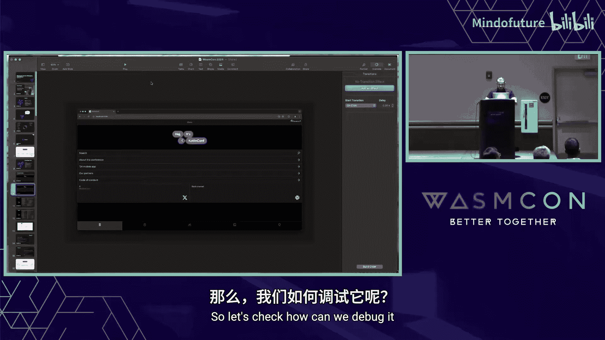

Firstly， let's go like directly in browser debu。Lets prefer to go。Domain screen。Yeah。And we are here。

 So what we can see here， firstly。We debu by sources， it's not like raw wass or something like that。

Like step work。 and yeah。Really readable names so we can jump there and back by call stack。And also。

 all the variables are pretty formatted to not be so low level。 So， for example， in service。

 we can see that there are some string。 It's caution string based onstruct proposal on GC proposal。

 but we trying to format it to be more high level so。More to say， let's go to menu screen。

And try to debug some action。For example， we go to the search。 and yeah， we are here。

 So we go step into。Our search and trying to understand what we grabbed from server。

And here you see also some talks。 and as you see， they also try to be more expable。

 So we are building for hugely some expansion， some faults so we can unfold it and check what it is。

Okay， so something like this with the high level structures。 So this is about the in browser debu。

 What's about I D。What。Let's also put some break point here。Yeah， and we are here。

So the same as we see。Also， pretty nice names debugging by sources。

And organize data to be as high level as possible。 The same we can do。With menu screen。

Was a controller。So let's try turn around it。And we also step into， for example。

 a debug different part， so stack is 0， we step over it and it's one。

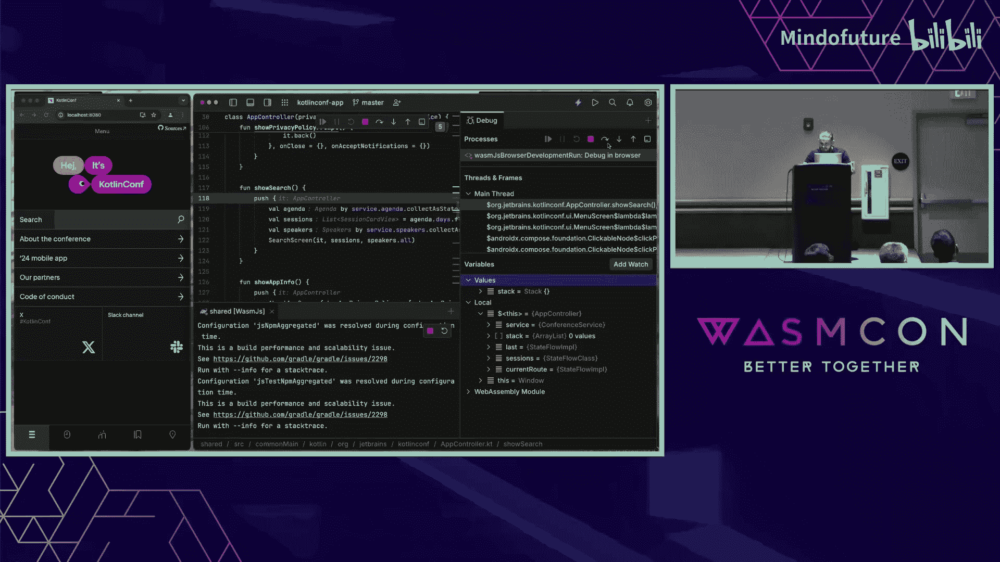

So。

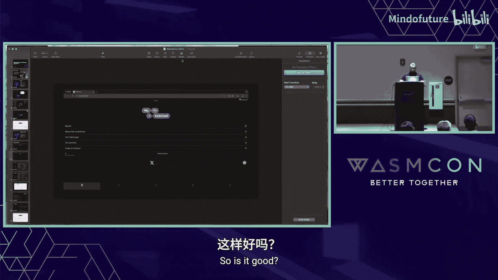

Is it good？Not quite true， right。Because we need to understand what with with what we can compare。

 Let's imagine that debugger doesn't provide any debug information to browser。

 How would it look like。

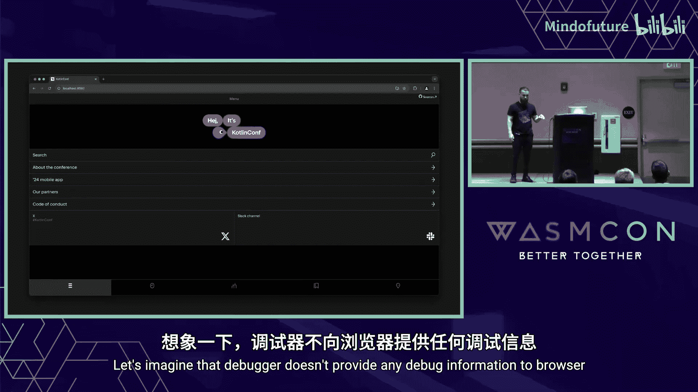

Sounds like this。So as you see， Ro Wason。

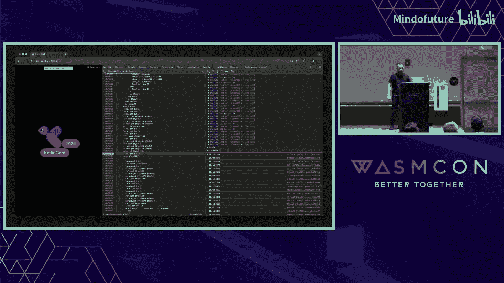

Some random names， and。

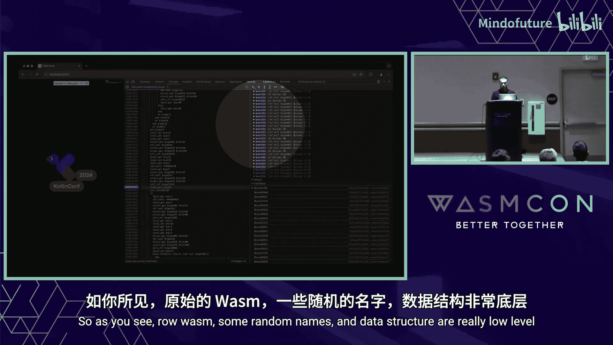

Like datata structure are really low level。And we will try to like， incrementally improve it。

 So integrate， add some more and more debug information to this become something like this。

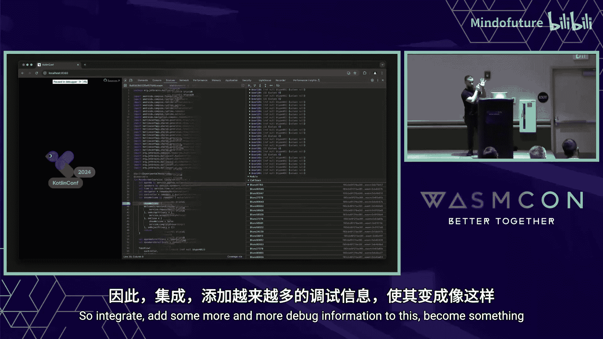

So let's first start with names。How can we improve them。

There is a custom section in the what specification called name section。

 So it's actually the purpose of this section is to introduce names to show them like really beautiful in your debuder or in Web assembly text format。

 So as you see here， it covers。

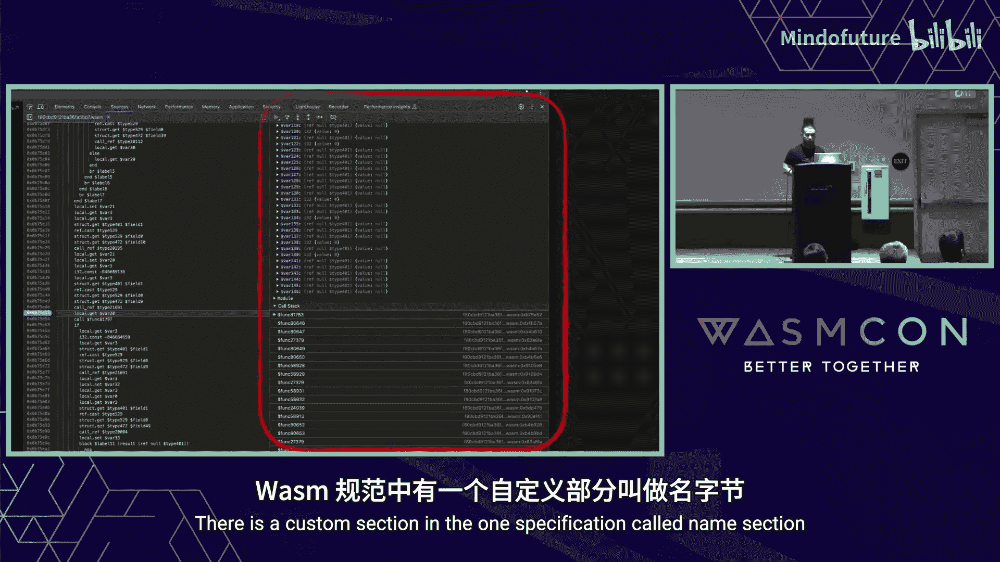

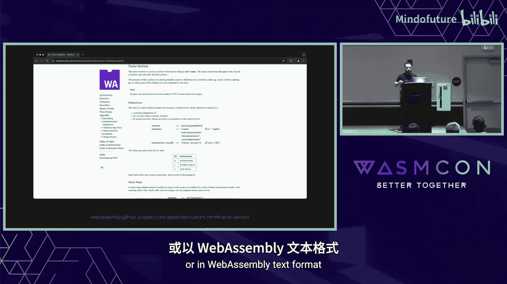

Model name， function names and local names， not too much。 because we're using G C proposal。

 we also rely on some extension inside GC proposal that gives us ability to also declare names for types and for fields。

 Also， we want to cover a little bit globals。 And this is another proposal called extended name section。

 We also use it just for globals。

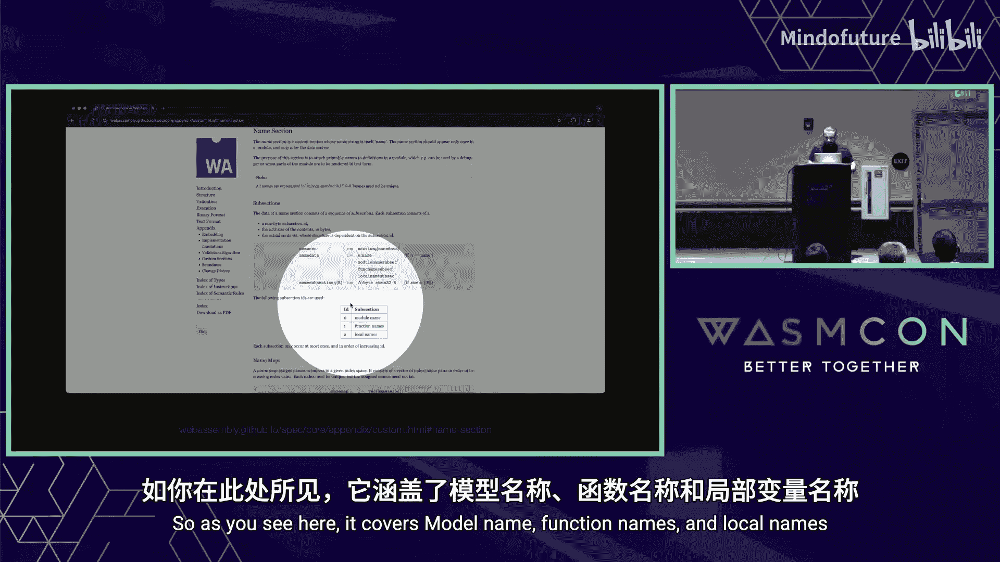

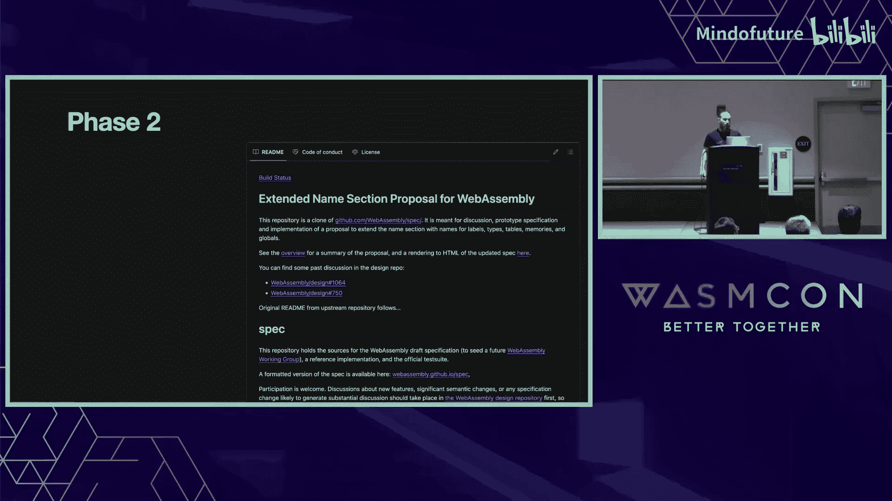

So we grab it from our front end from the intermediate presentation， our declarations has name。

 And yeah， we just added it in this section。 If we just try to was dump this bin that were generated by for this application。

 we will see， by the way， it was one binary toolkit。 Y， we will see name for model。

 name for function， name for locals for types from GC proposal and for globals from extended name section so。

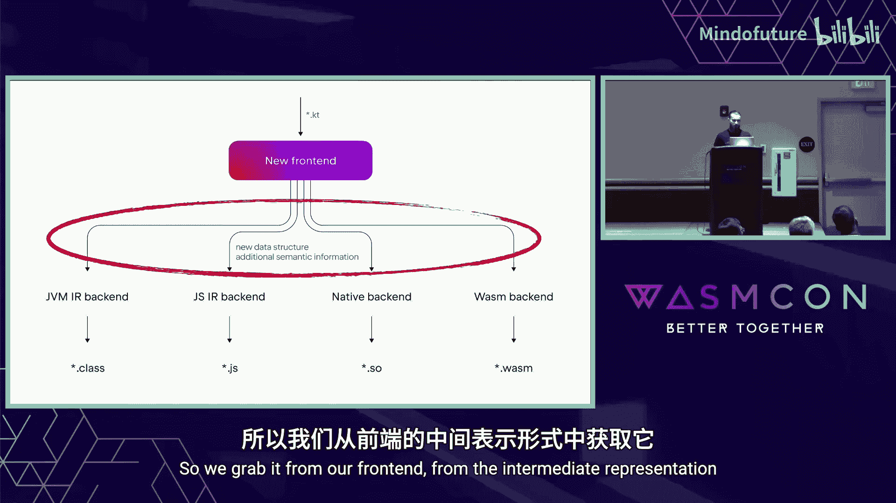

As soon as we provide all of this information， our debugger from this become like this。

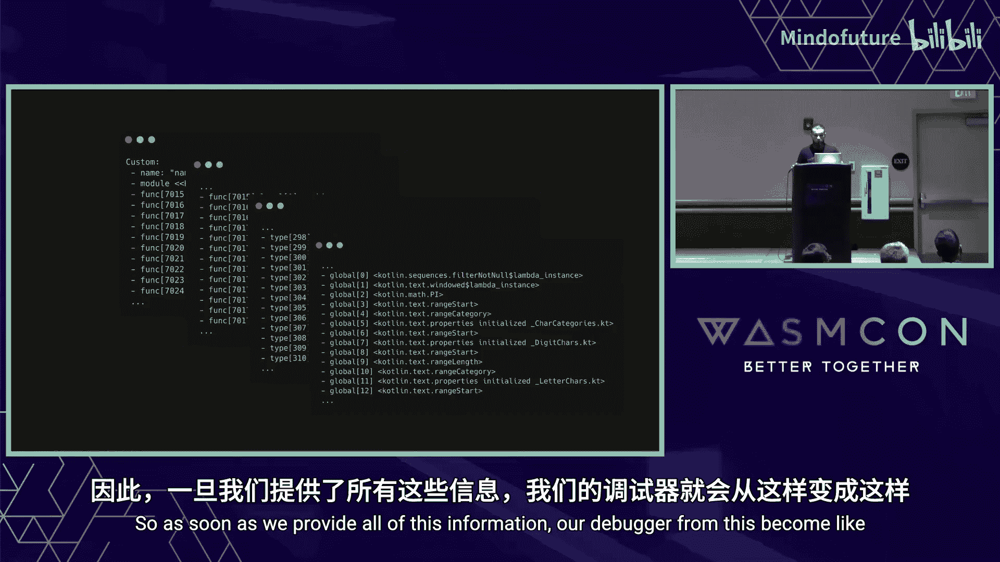

A little bit more beautiful。 So even in the Web assembly text format。

 you see that also locals and functions change the name。But not too good， right？

 So we definitely want to debug not by binary， but by sources。 So how can we improve this。

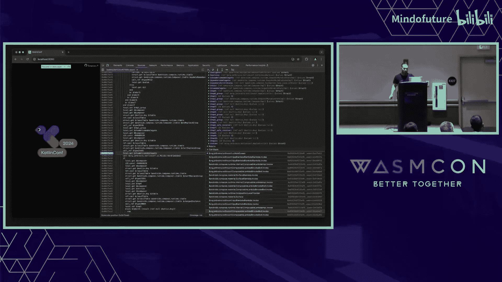

It would be nice if there is a format that can map our instruction to sources， right。

 and there is a standard called source Maps in which I also trying to improve。

 and this is actually quite easy format。 So it's a text format， JO， not a lot of features。

 So version always three right now， as soon as we change and integrate new features。

 it will be improved and like version will be changed to4 or5， etc。

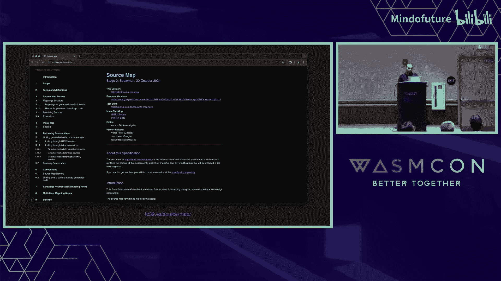

So file is the file for which we generate this format。

 source ruless just repeated part of patents in the sources。

 sources like our files in which to which we want to map our instructions。

 source content content of this files。Ignore list is quite interesting one。 We don't use it yet。

 but yeahep， I will talk a little bit more why。 But what it does， obviously。

 it makes sources ignored by debug。 So what does it mean for a debugger。

 it means that functions from files that define it as ignored。Will not appear in a call stack。

 So it's about implementation details and also will not not allow to step into those functions。Names。

 because this format is not only for Web assemblymbly， but also for jascript and CS。

 and there is no custom sections in JS or C SS。 The proposed was the same as custom section for names。

 and mapping is heart of this document。 So it's mapping from。Our instructions do source。

So each segment separated by commas and each segment represents the next data。

Like offset inside the binary。 It's an absolute offset。After that。

 all the boards are optional source index。 So file in which this instruction。Start line in this file。

Start column in the file and name index。 So I will not go deeply into the format。

 So you see the link。 you can read about encoding because it's also used VL Q encoding and differential computing。

 So each next segment depends on the previous segment。To reduce the size。But yep， as soon as we。

Add something like this。 Yeah， by the way， we used all of the data from our IR too。

 So as you see in IR file entry we have name and also functions that as we provide offset in the file and we've got line and column in the file。

 So as soon as we provide all of this information and also we need to add a new custom section called source mapping URL。

 So browser firstly fetch your binary， check this custom section。

 And if there is this custom section， it also tried to fetch the mapping file。

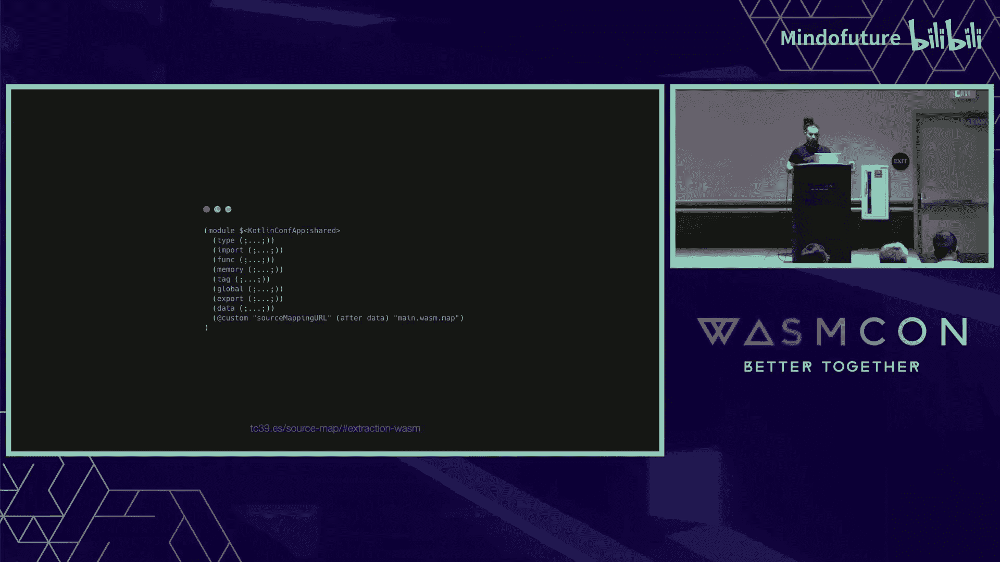

So as soon as we add this， our debugger began like this。Much more friendly， right。But not so perfect。

We want also to customize a little bit variable views because they are too low level。

 How can we do it。It's interesting because if we open a console during debugging and try to explore our locals。

 we will see that they look like jascript objects。And this is because Chromeev tools and firefs of tools。

 they trained you to give an expression evaluation。 So。

 and the only expression evaluation language you can use is jascript。 So they built views。

 jascript objects that representing data inside Wason。It's actually a little bit problematic。

 And I will talk about it later。 But because it's a javascript object。

 we can use a feature called custom formatters。 So it's a feature supported by。

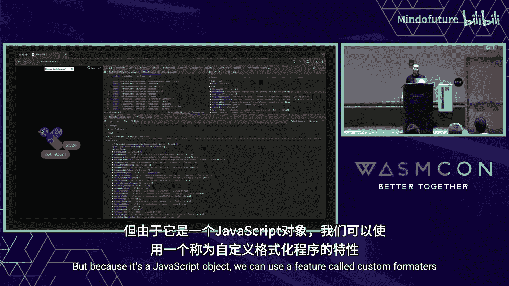

Fieffox and a crumb。And it gives you ability to customize jascript objects。

 And because our was values represent as a jascript object， we can customize them。 How。

 So you need to declare a global variable called dev tools Forters。

 And it's an array of objects that contain header， has body and body。

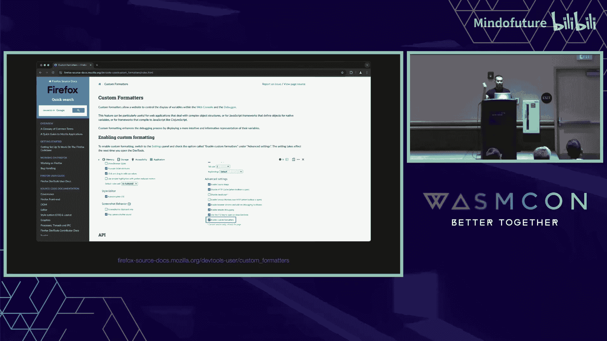

So has body is just representing like return true or false if our data is complex。

 or should it be expanded or not， hower represents this preview of the data and body is the expansion part and it accept object and return now if we okay with the previous format and core default one or HTML really restricted one in JONM format it looks like this so it's like an array。

 first element is stack after that we have object of attributes only style is allowed and after that children so as you see only span D all U and only those stack are available so how we use it。

We declare something like this and list of all formatters。

 and we listed all possible quat types that we want to customize。

 I will show you a small one for classes。 It's quite easier。So what we do。

 because we have some implementation details， fields， hash a table。 So this is not what user define。

 And this is our in in in implementation detail。 And we want to hide this。

 So I'm just going through the object and just remove those those fields and also remove dollar sign from fields。

Y， and as soon as we add it to the blue code as import。

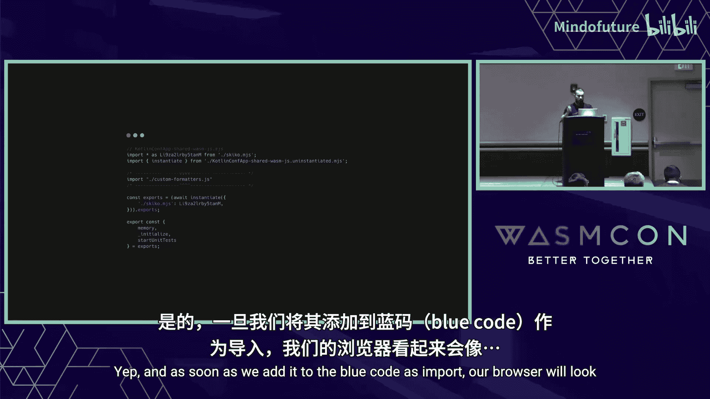

Our browser will look like， no， it doesn't work because by default， we。

 it's turned off and we need to turn on this feature。 And only after that。Sounds like this。

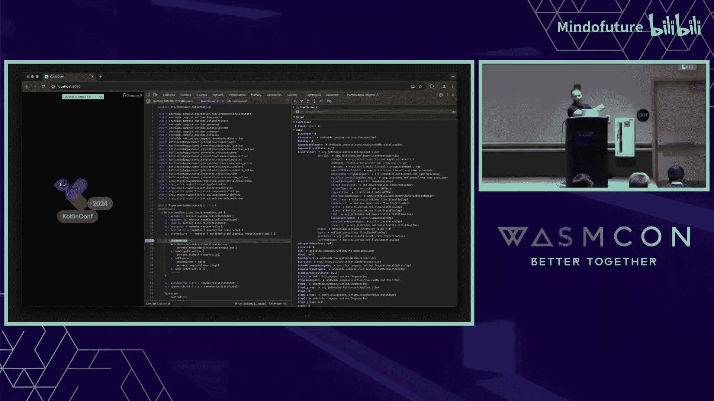

Yeah， so we are here。But not so。 H T M L， What if your I D can't render some random H T M L。

 This is our case with fleet I shown you。 And yeah， to customize variables there。

 I needed to reimplement the same logic that I define it in custom formats。 but in cotton for JVM。

 unfortunately， cost source， I can shown you。 But Im promised， I mean。

 the logic is quite the same as in custom formats。

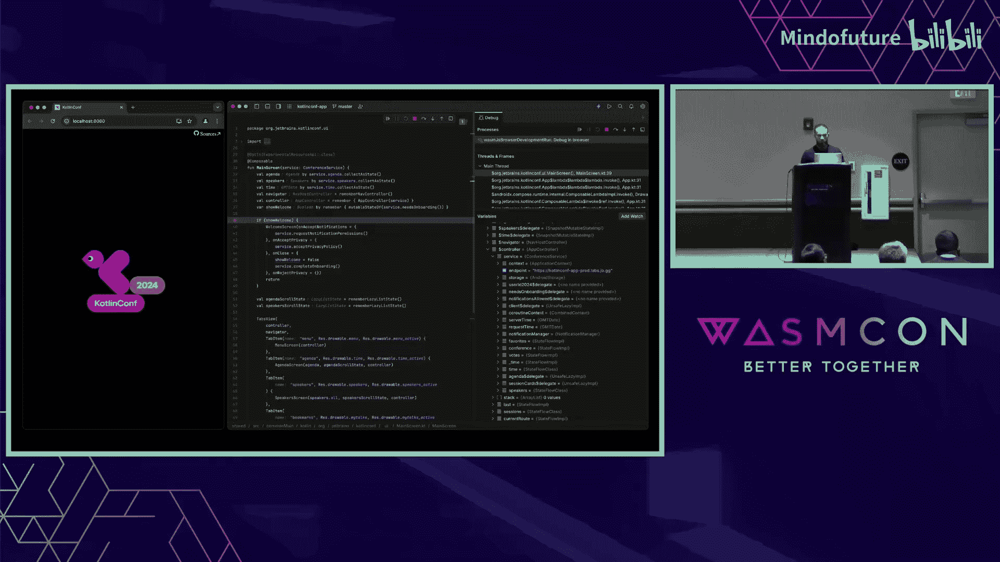

So this is it。 What can we improve， I mentioned an ignoreist， and ignore list is something special。

 I mean， we have a problem right now。 I will show it to you。

Thats actually really weird and in some sense， crazy。

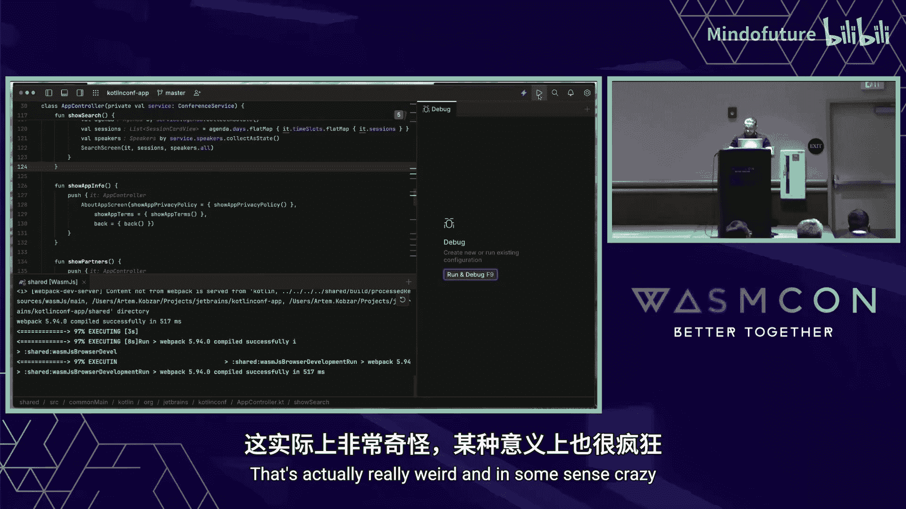

What we。Run it。Yep。Let me go， for example， in main screen somewhere here on the string。Sorry。

As you see， we stopped on string。And we can do something weird。 It's string literal。

 But under the hood， we used some intrinsic to check if the string already existed in string pole。

 if it is， we will not create new ones of just a few optimizations。

 But because we use some function to build string， we can step into the string literal。😊。

In some random Web assembly。 So this is definitely we don't want to provide to a user。 So， and here。

 ignoregno list can help us with it。 So what I'm going to do is ignore list。

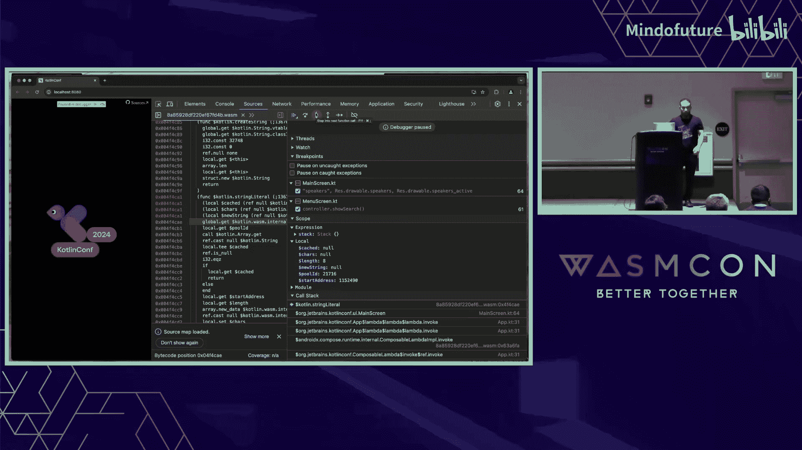

It's to declare some artificial file， like called ignore file or something like that。

 and refer all instructions like this， like intrinsic to this file。 So this function will be ignored。

 So there will be no step into and there will not appear in the contact。Why we didn't use it before。

 Because it didn't work in Chrome for a while， and。Thankfully and really thank to Eric Liz。

 I called people from Chrome and said， how can I implement it and they help me to implement it and thankfully it's already merged in V8。

 and I hope it will be available in the next version of Chrome。Next thing， the new scope proposal。

 as I said， like source map standard is like standard and specification。

 So it's incrementally improving。 And there are a lot of new proposals。 actually。

 one of them is scope。

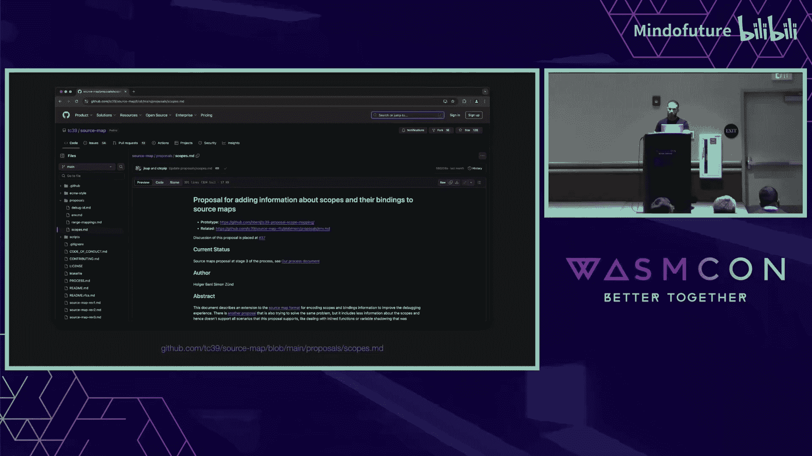

If we check this area， you see that there are a lot of random variables that are not declared in the sources。

 right， and also we want to not show it to people。 and scope proposal could help us with it。

 So we just declare scope in our source map and say， okay， in this scope。

 we have the next variables and it's it。 So only those variables will be shown in the debar。

 Also it could help us with the next thing in cotton we have in line functions。

 and as soon as in line function。

Right now， in source Mops， there is no possibility to declare that this is inline body。

 So it means that we don't have ability to step over any function and always will step into this inline function。

 So also， scope proposal could solve this problem。

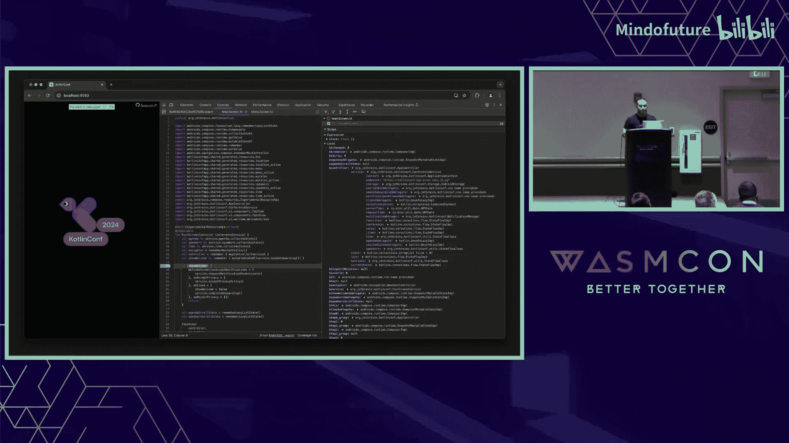

Next thing。Expression evaluation。This is a wild area， actually。

 because I actually don't know how to improve it。 And this is why first problem I met。

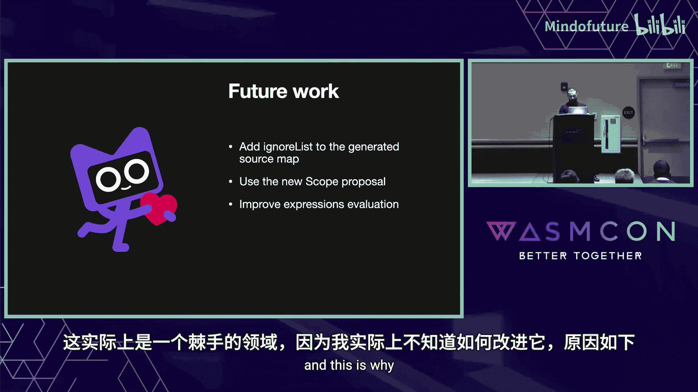

Because I use custom formatters， let's just try to check agenda delegate reader kinds， I mean。

 obviously shown in our locals， and it's undefined because the value customized and the original value pass is different so we need to make this dot value dot feel dot value and it's a little bit annoying。

So I don't know how to fix it right now， but we collaborate with Chrom tools a lot to find some solution。

 The second problem， Do you remember， I mentioned it that all the Web assembly values represented a javascript object。

So you don't have reference to the original structure。

 And if you want during debug and just call some functions that accept structure。

You are failing because you don't have the original reference。 And as soon as you try to put as。

 for example， here， I try to use string and call is white space functions that is declared。And， yeah。

 as you see， errors because it's javascript object， it's not structure。

 We don't have original reference to the structure。So， yeah， and it's a problem。

 And also we're trying to solve。 So one of the solution we propose。

 in case just inside this object also holds some reference or original structure so we can provide the reference itself instead of this javascript object。

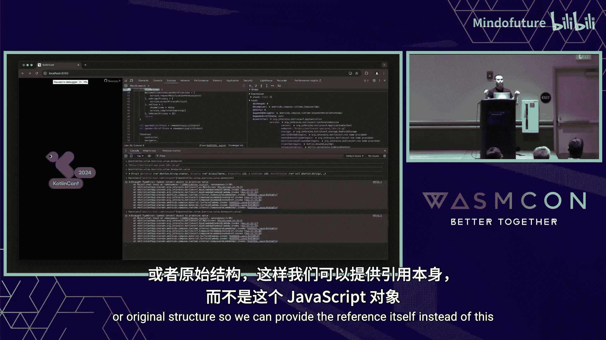

So this is about。In browser debug， What about outside of browser。 Oh my God。

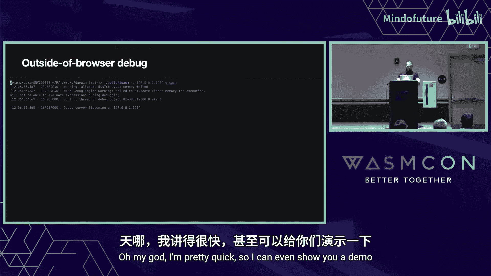

Pretty quick。 So I cannot even show you a demo。So this demo I created。Not a long time ago。

And it's not as promising as one before， so。I just have。A few simple files。Xier。😔，Y， from our tests。

And what I can do is run。Yeah， this is by the way， warmmar。And run L LDB。Connect to the LODBU。Yeah。

 we need to wait a little bit。 Yeah， we stopped， and we stopped here。On the start test。

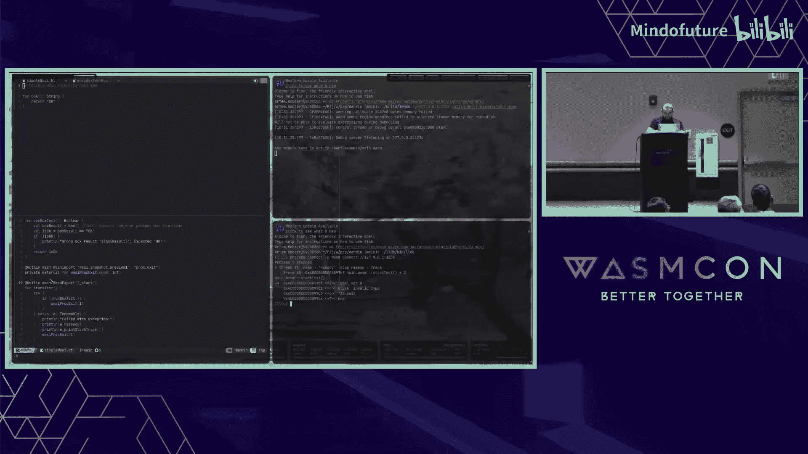

We can break by box。The define it。Here。

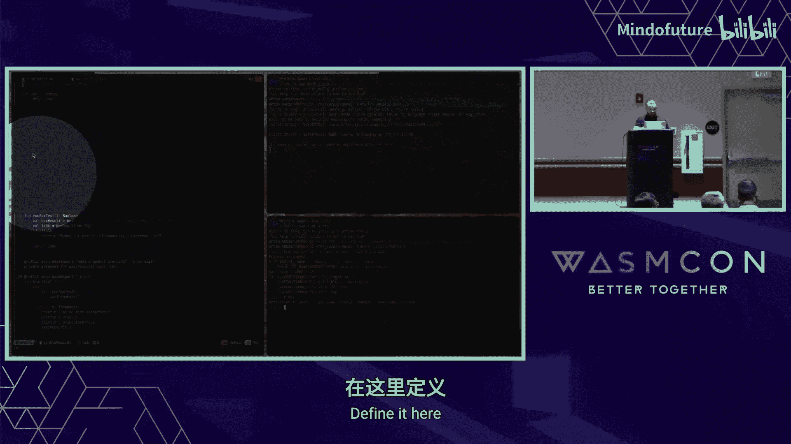

And just go continue。 and we stopped here。 So yeah， it's not quite because the one before。

 the problem is， as I said， this demo of， I mean， the generation。

 the basic generation of debugging information for outside of browser was created like week ago。

 I really finished it on Tuesday last Tuesday。 And yeah。

 we continue to work and it continue to improve it。 And it's quite quite big area， actually。

 I will explain why firstly， yeah， we still under development。 Firstly。

 we are working quite now and trying to make it work for Wa time and warmmar。

 because those to run times provide to us both debugging and youC proposal that we can work with。

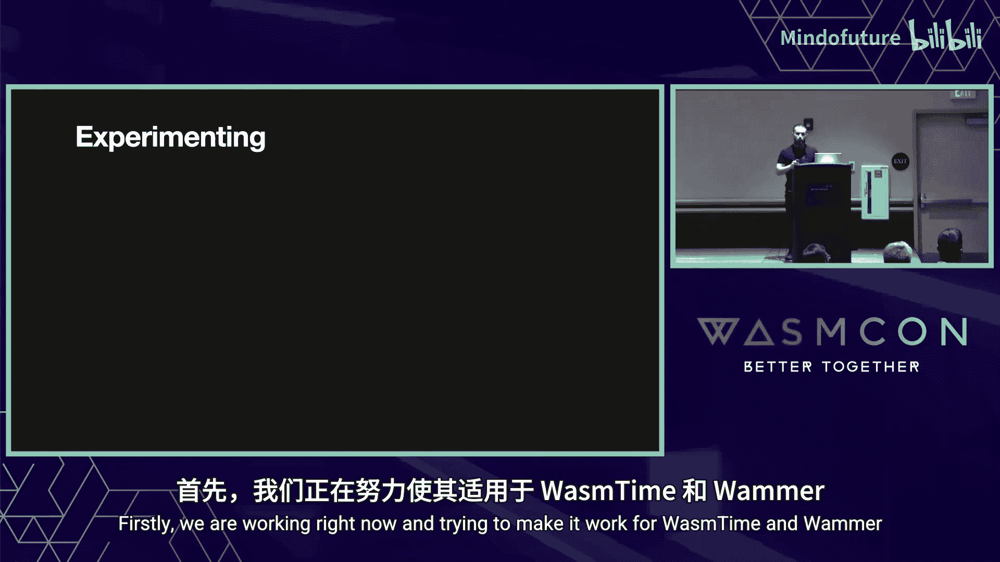

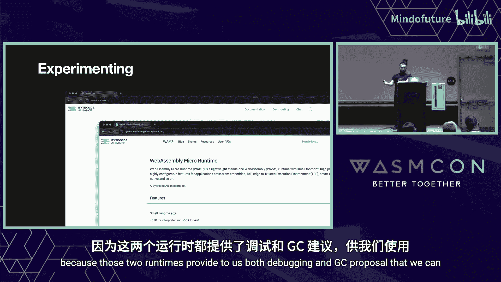

Secondly， dwarf。I will not go explainwarf because the specification size is around 500 pages。 So。

 yep， I need like three talks like this to explain the whole format。

So let's go through what I've generated。 It's really basic actually。 so we generate few new sections。

 also custom like debug info debug strings， debu line and debug appreviations。

 So only debu info and debug lines are interesting for us so debu line representing this mapping from instructions to original sources and debug info representing more highle structures。

 more like about declaration so you declare functions you declare a local types well see it actually so for this files that they've shown you we generate this kind of debug information so what we see here is compile unit like just we say that this is the binary we generate n few functions。

 one for box that we broke the second one for run box test and serverline start test。

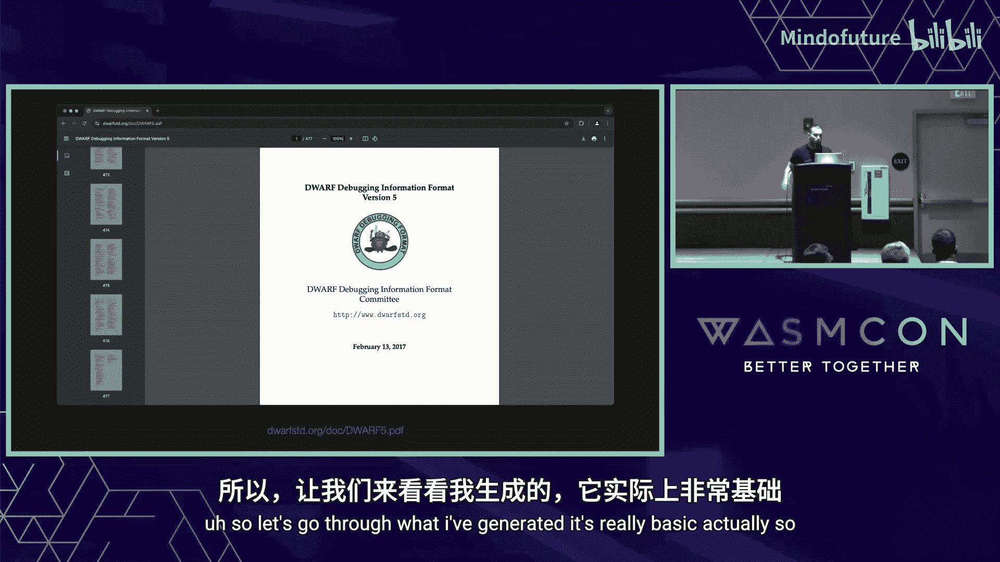

Not quite big。 So also， what's interesting here offset。In source map format， offsets are absolute。

 So from the beginning of the binary。 but in dwarf， it's relative from the cult section。

It is because in source maps， they also try to cover use case when you have expression in your global。

 So in dwarf right now， you don't have ability to cover expressions in global because， I mean。

 it's relative to code section。The second thing was interesting。 Yeah， I tweeted about it。

 but this part。We use Scotland。 Why do we have here C plus plus language。

And this is because inside LDB seems like there' is a white list。Of languages。

 So if you declare coling swift annual language， actually， it will not work。 So you will not break。

 I realized only after three hours of comparing clan output and my output。 But yeah。

 it was quite fun。 And actually obvious。 LGB is C， C plus plus objective。

 C objective C plus plus debu。😊，So， y， and this is a debug line。 So it's actually like。

In whole program， virtual machines that help you to define what and how mapping。

 So when we just explore it with dwarf dump， we will see that everything mapping like this。

By the way， about dwarf D， I can use regular LVM dwarf D， Why Because GC proposal。

 Because LVM dwarf dump also trying to parse your binary。 And as a result。

 it's just fine undefined instruction。 just say ay， I'm failed。

 So thankfully to the Gingly project inside the example they have their own dwarf dump。

 So this is1 I used。😊，Yep， and also， there is a S and Wa tool that was really helpful for me called address2 line。

 so we can just provide absolute offset inside binary。

 And it will say to which file and at which line it moped。So future work。

 I mean there are a lot of area of works， firstly I want to fully make it work for warmmar at least for breaking by lines and files and maybe columns。

 secondly， make it works for Wa time because even with this debug information it doesn't work for Wa time and I don't know why。

And search1， I want to work it for your VM。 Yep， and it's called the for action。

 If you are a contributor to Wamar to Watime or any other VM， and you support GC proposal。

 please pin me。 Yep， I want it work for your VM too。 And of course， because with chat brains。

 providing tool。 We want to have a nice tool。 Can you not debox re D CI。

 So we want to integrate it with our Is So to have a seamless and nice developer experience。 so。😊。

This is。Cure quote。 First one， If you are interested in Co and Was and want to read more about Co Wason。

 The second one is our public slack。 So you can join it。 It's a huge cotton slack。

 but there is a webasse room， you can join me。 Yeah。

 and if you are interested in collaboration to make Co Was work on your runtime。

 or you are interested to contribute to source my specification。 Also， please bring me I here。

 and I also share my Twitter。 Thank you。😊。

