# 001：芯片是如何制造的 💻

在本节课中，我们将学习计算机体系结构的基础知识，并深入探讨现代计算机的核心——芯片是如何被设计和制造出来的。我们将从最基础的晶体管开始，了解其工作原理，并逐步构建出对芯片制造全流程的理解。

## 课程概述与目标

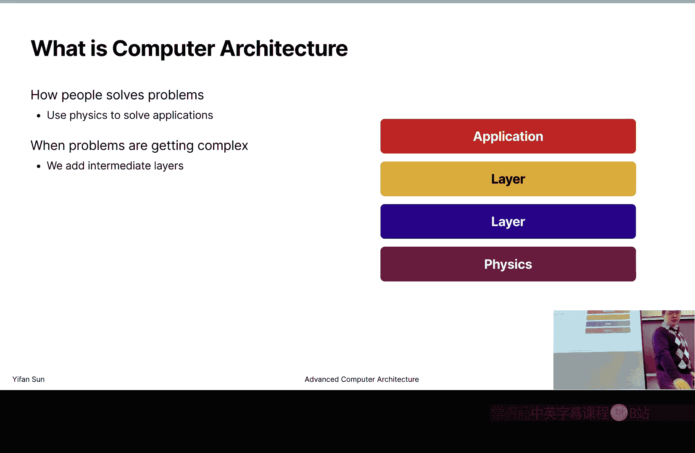

这是新学期的开始，我们将教授高级计算机体系结构课程。本课程将采用讲座形式，覆盖从数字设计基础到现代CPU/GPU架构的广泛主题。课程目标是为你进行计算机体系结构相关研究铺平道路，并理解该领域的基础知识。

评估方式将包括作业、测验和期末考试。作业将围绕构建一个简单的RISC-V CPU模拟器展开，这是本课程的核心实践部分。我们鼓励使用生成式AI来辅助完成作业，但测验和考试中不允许使用。

## 什么是计算机体系结构？

在深入细节之前，我们首先需要理解计算机体系结构在整个技术栈中的位置。计算机体系结构是连接物理硬件与应用软件的桥梁。

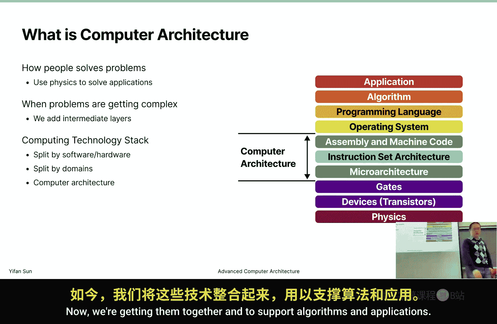

技术栈从底层的物理现象（如电子、半导体）开始，向上依次是：
*   **设备**：例如晶体管。
*   **门电路**：例如与非门、或非门。
*   **微架构**：芯片的硬件实现。
*   **指令集架构**：软件与硬件之间的协议，定义了二进制指令的含义。
*   **汇编与机器码**：由编译器生成，供硬件执行的代码。
*   **操作系统、编程语言、算法和应用**。

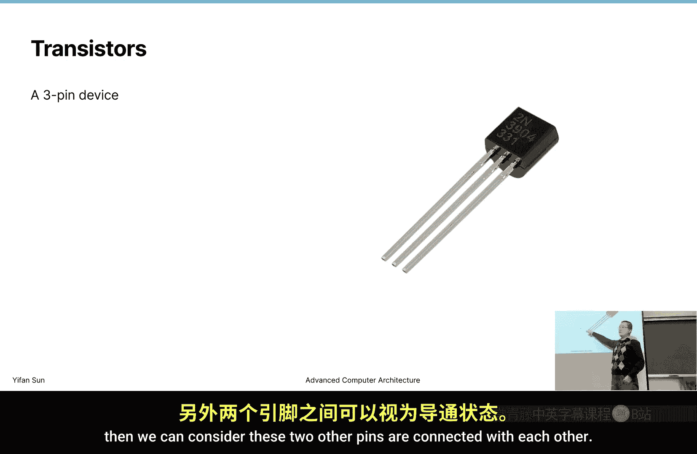

指令集架构是一个关键的分界点，其上是软件领域，其下是硬件领域。计算机体系结构的研究主要集中在微架构和机器码层面，其核心作用是吸收底层物理技术（如更小的晶体管）的进步，并满足上层应用（如大型语言模型）的需求，从而设计出性能更高、更可靠、更安全的计算系统。

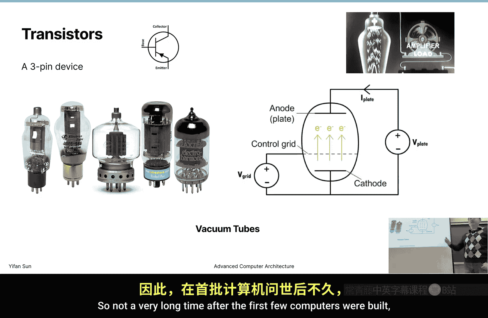

## 从晶体管到逻辑门

计算机设计的起点是晶体管。在数字电路领域，我们主要关注代表“0”和“1”的电压信号。

### 晶体管的工作原理

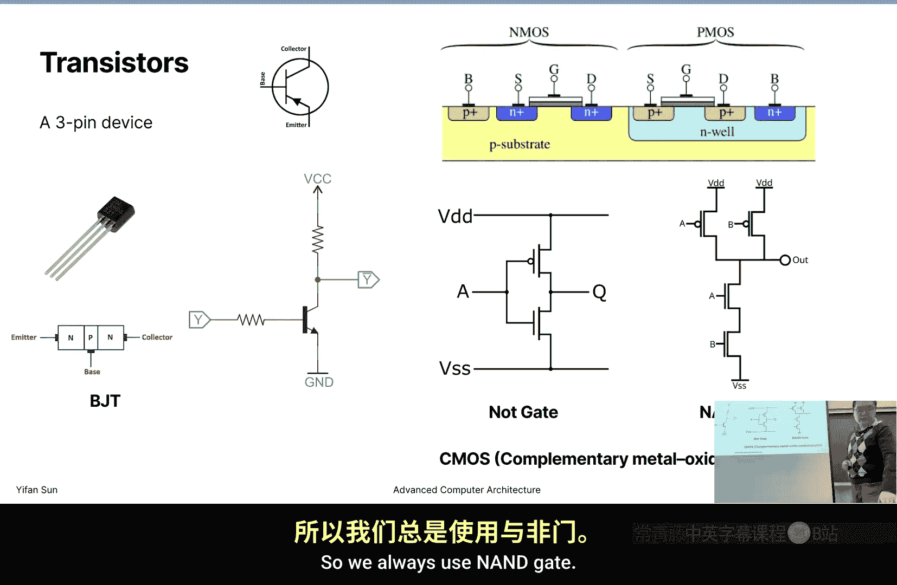

晶体管是一个三端器件。以CMOS（互补金属氧化物半导体）晶体管为例，它有一个控制端（栅极）和两个电流通路端（源极和漏极）。其核心功能是：根据栅极的电压，控制源极和漏极之间是否导通。

CMOS技术的优势在于其静态功耗极低。当电路处于稳定状态（不进行开关切换）时，从电源到地之间没有直接的导通路，因此几乎不消耗能量。

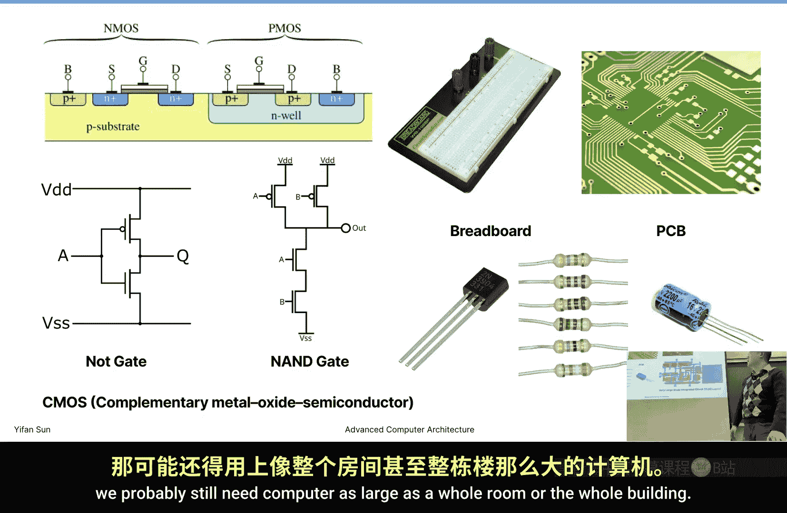

### 构建基本逻辑门

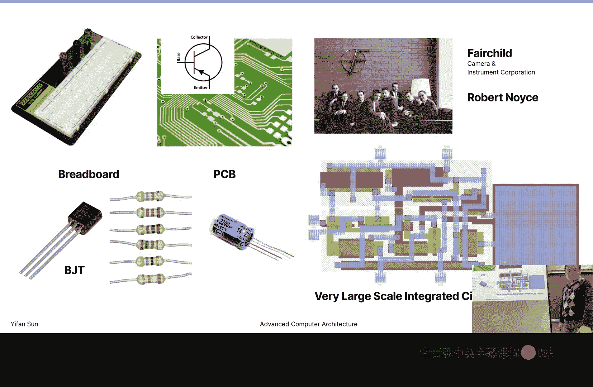

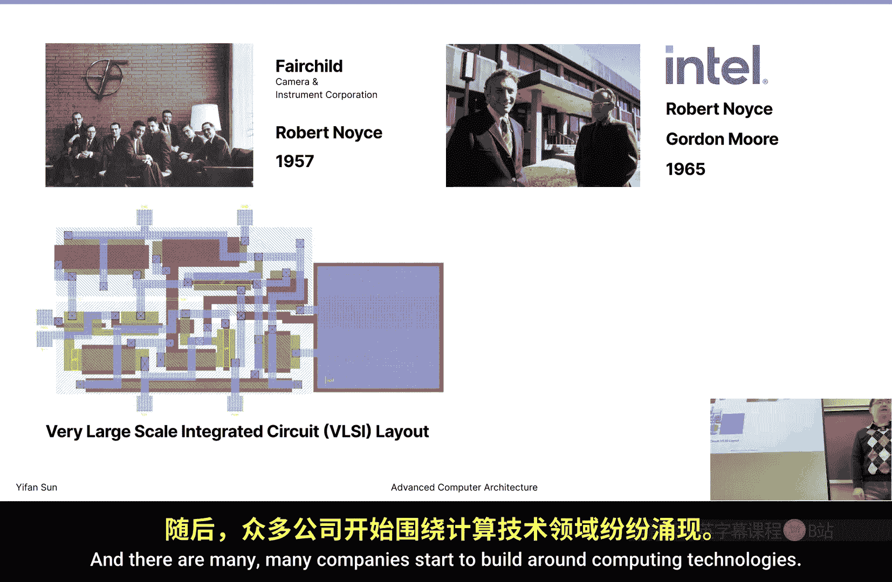

使用CMOS晶体管可以构建基本的逻辑门。以下是两个关键示例：

1.  **反相器**：实现“非”逻辑功能。
    *   当输入A为低电平（0）时，上方的P型晶体管导通，输出Q被拉至高电平（1）。
    *   当输入A为高电平（1）时，下方的N型晶体管导通，输出Q被拉至低电平（0）。
    *   逻辑公式：**Q = NOT A**

2.  **与非门**：实现“与非”逻辑功能。在现代集成电路设计中，与非门是构建所有复杂数字电路的基础单元。
    *   仅当输入A和B均为高电平（1）时，两个串联的N型晶体管才导通，输出被拉低（0）。
    *   其他情况下，并联的P型晶体管中至少有一个导通，输出被拉高（1）。
    *   逻辑公式：**Q = NOT (A AND B)**

整个数字电路本质上就是由无数个与非门以特定方式连接而成的网络。

## 集成电路的制造

从分立元件到集成电路是计算技术的巨大飞跃。罗伯特·诺伊斯等人发明的集成电路，使得将数百万甚至数十亿个晶体管集成到一块微小的硅片上成为可能。

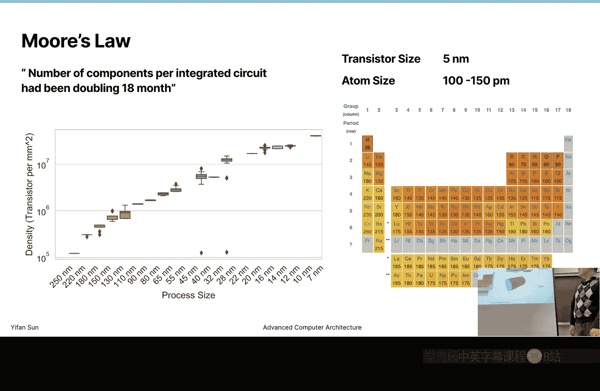

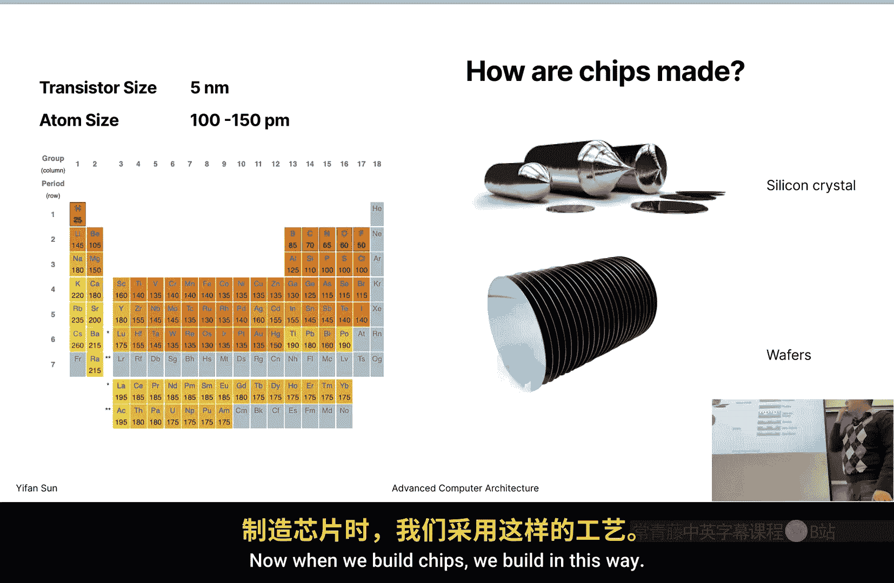

### 摩尔定律

戈登·摩尔观察到一个趋势，即集成电路上可容纳的晶体管数量，大约每18-24个月便会增加一倍。这一定律并非物理定律，而是技术竞争和商业驱动的结果，它长期指引着半导体行业的发展。尽管多次被预言终结，但通过新工艺（如更小的制程节点）和新架构（如Chiplet技术），性能增长仍在以某种形式持续。

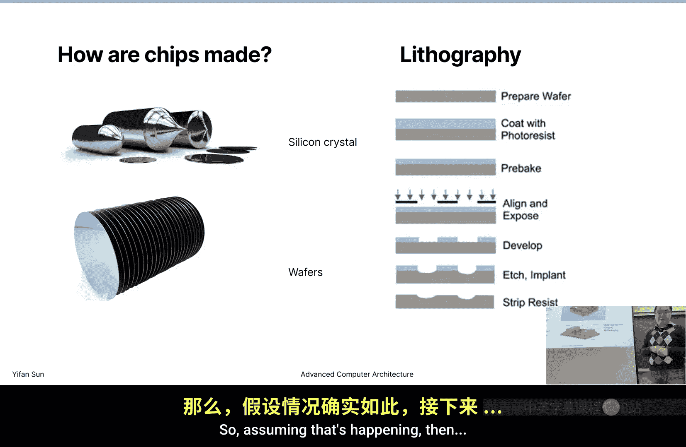

### 芯片制造流程

芯片制造是一个极其复杂和精密的过程，主要步骤包括：

1.  **制备晶圆**：从高纯度的硅晶体上切割出圆形的薄片，称为晶圆。
2.  **光刻**：这是最关键且昂贵的步骤。在涂有光刻胶的晶圆上，使用预先制作好的掩膜版，通过紫外光（如今使用极紫外光EUV）进行曝光。光刻定义了晶体管和电路的图案。
3.  **刻蚀与掺杂**：通过化学方法去除或修饰被曝光（或未曝光）区域的光刻胶及下方的硅材料，形成晶体管结构，并通过离子注入等方式形成P型或N型半导体区域。
4.  **沉积与互连**：重复以上步骤，沉积绝缘层和金属层，并刻蚀出连接各个晶体管的铜互连线，形成多达十几层的立体结构。
5.  **切片与测试**：将晶圆切割成单个的芯片（裸片），并进行测试。
6.  **封装**：为裸片加上保护外壳和外部引脚，使其能够与电路板连接并散热。封装技术本身也在快速发展，如2.5D/3D封装、硅中介层等，以提供更高的互联带宽和集成度。

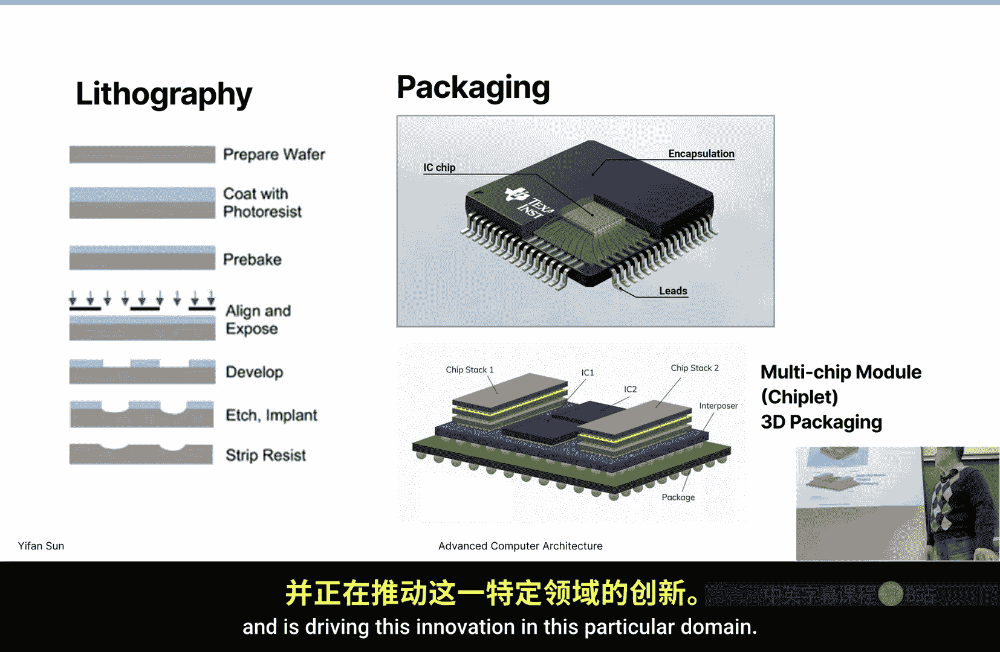

### 制造中的挑战与权衡

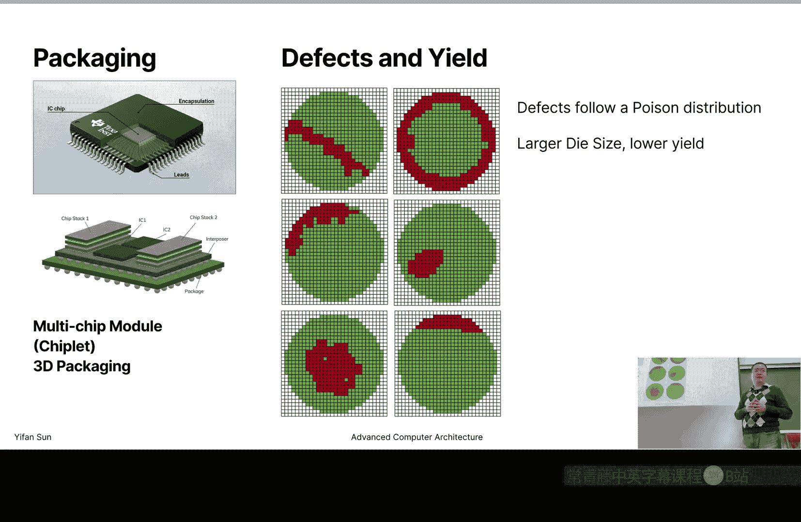

芯片制造面临诸多物理和工程挑战：

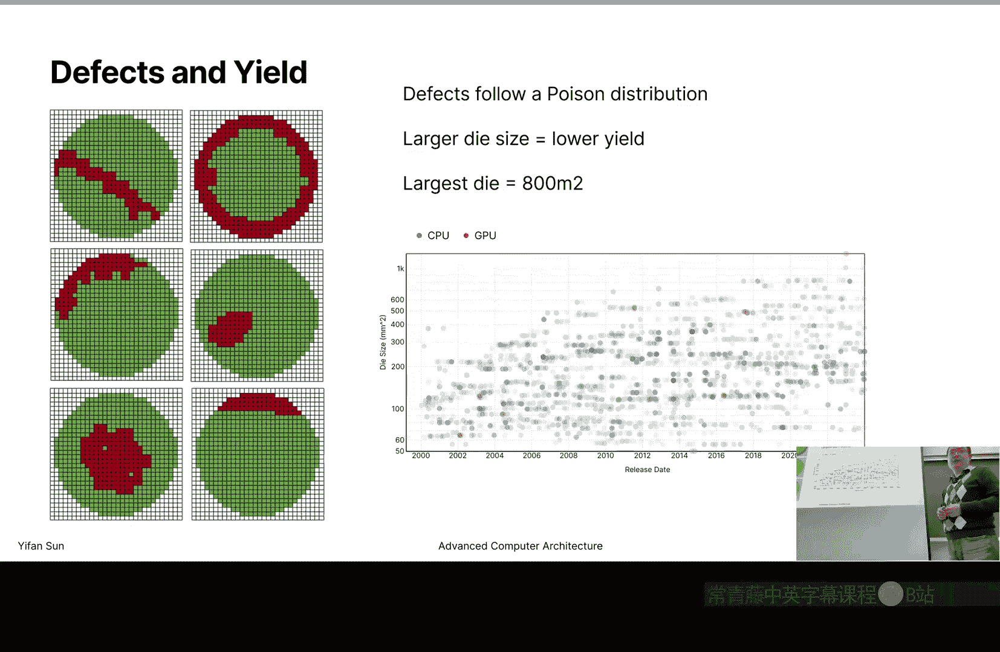

*   **缺陷与良率**：由于尘埃、硅晶体缺陷等原因，制造出的芯片可能存在故障。芯片面积越大，出现缺陷的概率越高，良率就越低。这限制了单颗芯片的最大尺寸（通常在800平方毫米以下）。
*   **功耗与散热**：随着晶体管密度增加，功耗和散热成为严峻挑战。芯片的**热设计功耗**是指导散热方案设计的关键指标。架构师通过动态电压频率调节、时钟门控等技术来管理功耗。
*   **登纳德缩放定律的终结**：过去，晶体管尺寸缩小，其功耗密度保持不变。但近年来，这一定律已失效，单位面积功耗在上升，进一步加剧了散热和能效设计的难度。

为了应对良率问题，厂商常采用“产品分级”策略：将功能完好的芯片作为高端产品出售，而将有部分核心或缓存缺陷的芯片，通过禁用故障部分后，作为低端产品出售。

## 总结

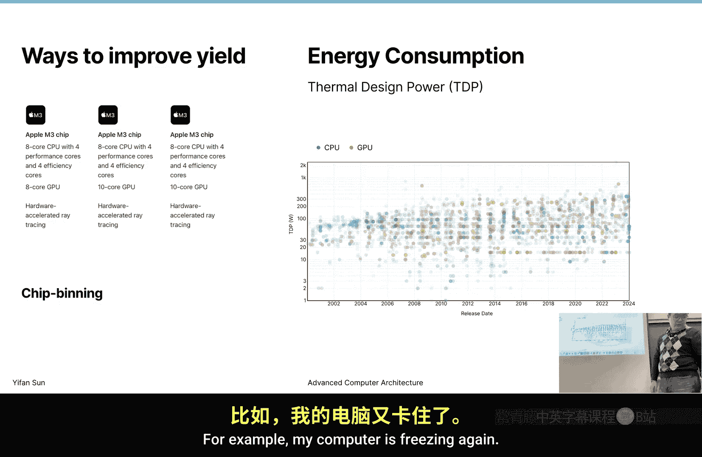

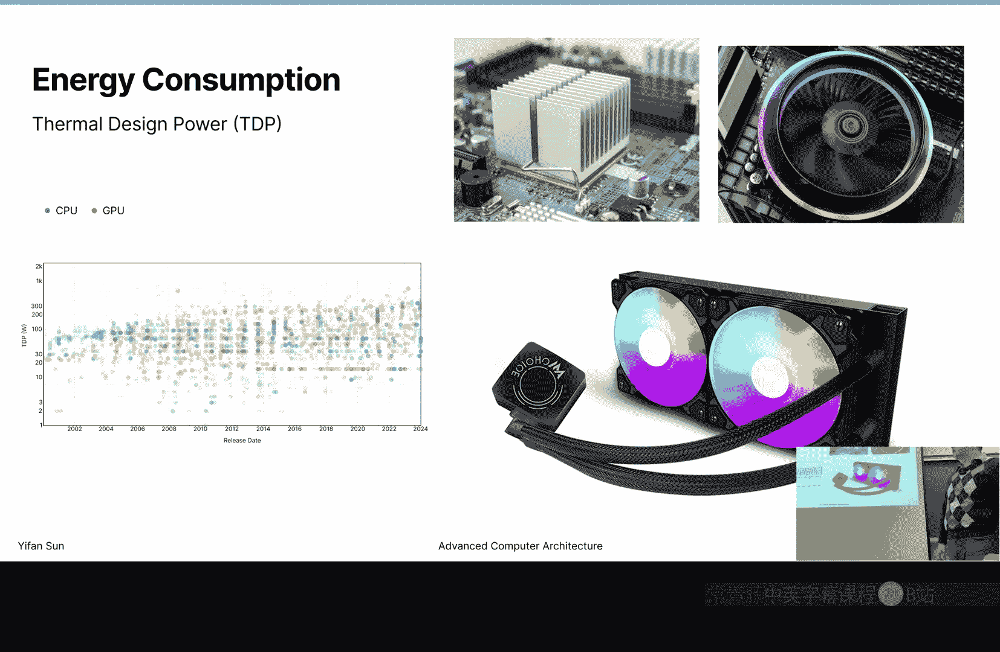

本节课我们一起学习了计算机体系结构的定位，并深入探讨了芯片制造的物理基础与工程流程。我们从晶体管的工作原理出发，了解了CMOS技术如何构成现代数字电路的基石。随后，我们回顾了驱动半导体行业发展的摩尔定律，并详细拆解了从硅晶圆到封装芯片的复杂制造步骤，同时分析了制造过程中面临的缺陷、良率、功耗和散热等核心挑战。

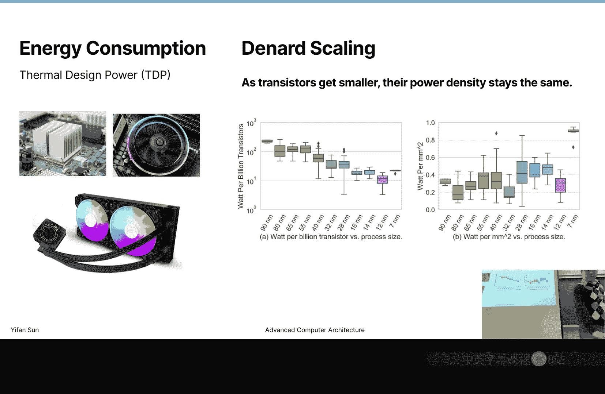

理解这些硬件制造层面的约束，对于计算机体系结构设计师至关重要，因为我们的任务正是在这些物理限制下，设计出性能最优、能效最高的计算系统。从下节课开始，我们将进入数字逻辑和二进制数表示的世界，为后续的CPU架构设计打下基础。