# 004：时序逻辑 1

在本节课中，我们将开始学习时序逻辑。时序逻辑是数字电路设计中的核心概念，它允许电路拥有“记忆”能力，其输出不仅取决于当前输入，还取决于电路过去的状态。我们将从时序逻辑的基本构建模块——锁存器和触发器开始，并学习如何设计一个简单的同步时序电路。

## 从组合逻辑到时序逻辑

上一节我们介绍了组合逻辑，其特点是给定输入会立即产生确定的输出，电路本身没有记忆功能。然而，组合逻辑的能力是有限的，因为它只能执行固定的函数，且其功能受限于输入/输出引脚的数量。

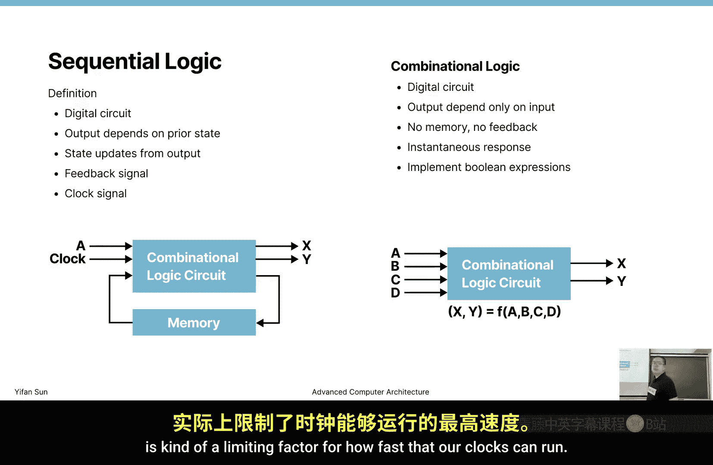

本节中，我们来看看时序逻辑。时序逻辑电路引入了“状态”的概念。如下图所示，时序逻辑的核心仍然包含组合逻辑部分，但增加了存储元件（内存）和反馈回路。这使得电路的输出不仅取决于当前的输入状态，还取决于电路之前的状态。状态会随着时间的推移而更新，从而实现了更复杂的功能。

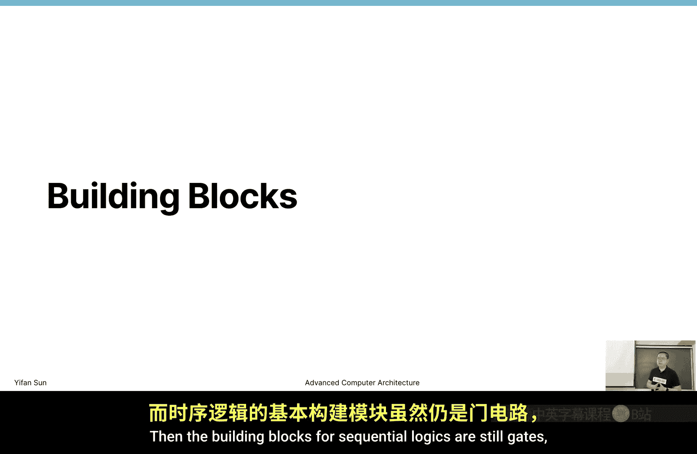

在大多数情况下，时序逻辑电路由一个时钟信号控制。时钟信号就像节拍器，以固定的频率（例如，CPU的几GHz）在高电平和低电平之间切换。在每个时钟周期内，组合逻辑完成一次计算，电路状态在时钟信号的特定边沿（如上升沿）进行更新。因此，组合逻辑的计算速度实际上限制了时钟可以运行的最快频率。

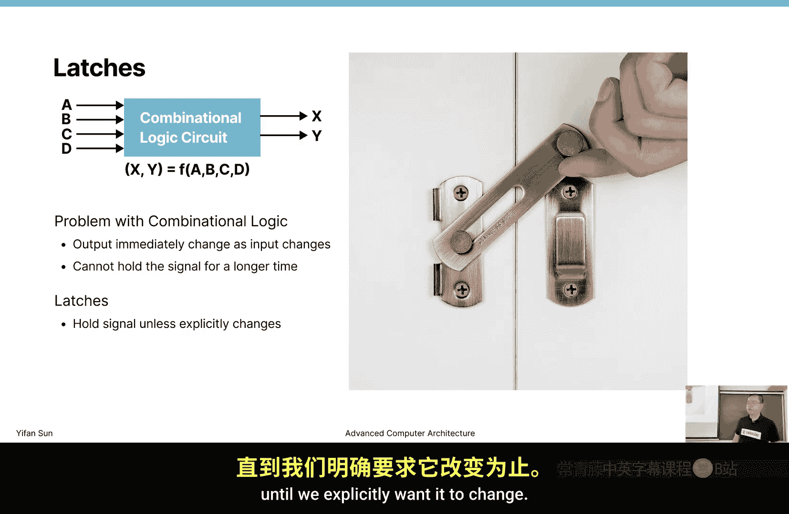

## 时序逻辑的构建模块：锁存器

组合逻辑的构建模块是逻辑门（如与门、或门、非门）。对于时序逻辑，我们则需要更复杂一些的组件，它们由多个门以特定方式连接而成，最基本的组件就是**锁存器**。

在组合逻辑中，输入变化到输出稳定需要一段传播时间，在这段“瞬态”期间，输出可能会产生我们不希望的噪声波动。锁存器的作用就是“锁住”信号，使其在一段时间内保持不变，直到我们明确指示它更新。这就像门上的门闩，闩上时门就不会被打开。

### SR锁存器

让我们从一个基本的锁存器——SR锁存器开始。它由两个或非门交叉耦合构成，有两个输入S（Set，置位）和R（Reset，复位），以及两个互补输出Q和Q'。

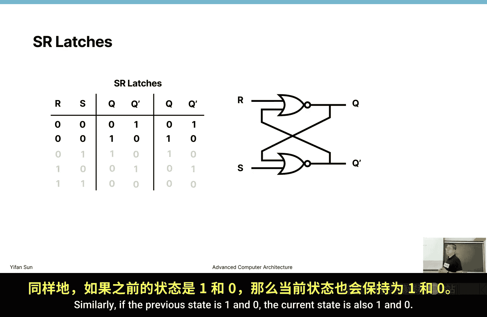

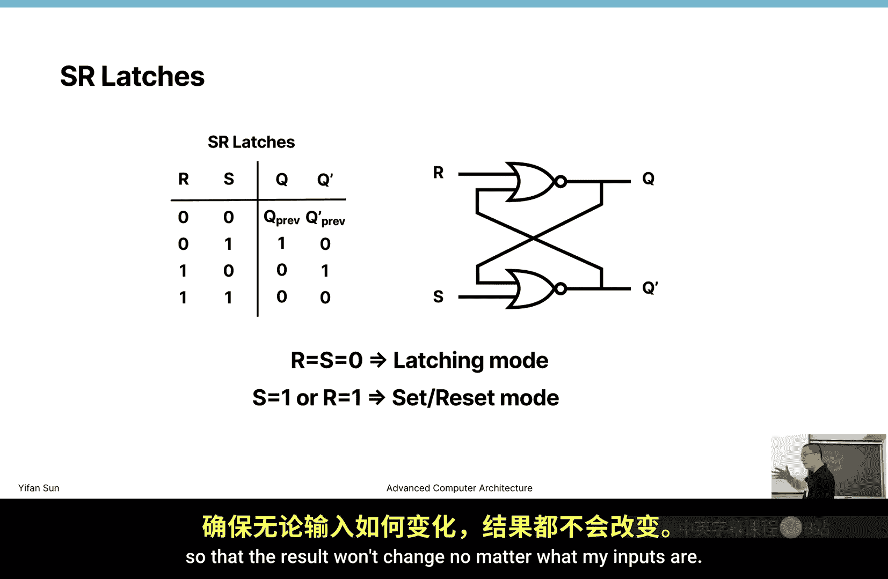

以下是其功能真值表：

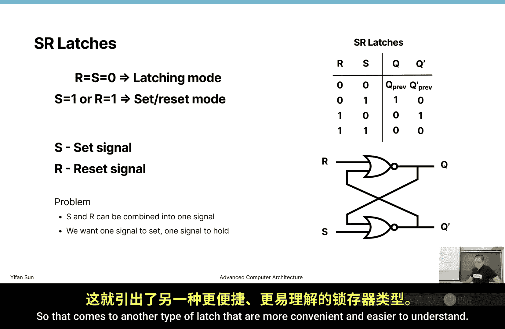

| S | R | Q (下一个状态) | Q' (下一个状态) | 模式       |
|---|---|----------------|-----------------|------------|
| 0 | 0 | Q (保持原状态)  | Q' (保持原状态)  | 锁存/保持   |
| 0 | 1 | 0              | 1               | 复位 (Reset)|
| 1 | 0 | 1              | 0               | 置位 (Set)  |
| 1 | 1 | 0              | 0               | 无效状态    |

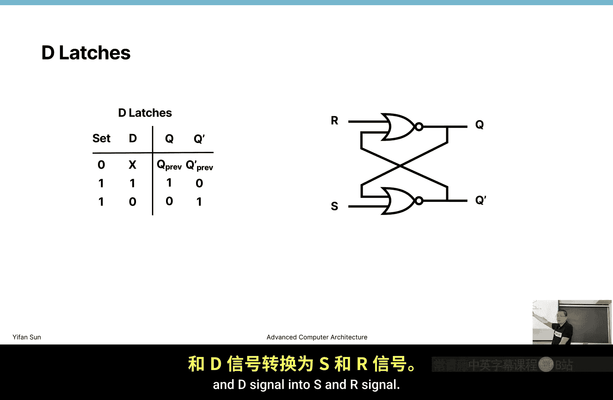

*   **当 S=0, R=0 时**：电路处于“保持”模式。输出Q和Q'将保持它们之前的状态不变。这是锁存功能的核心。
*   **当 S=0, R=1 时**：电路“复位”，输出Q被强制设为0，Q'为1。
*   **当 S=1, R=0 时**：电路“置位”，输出Q被强制设为1，Q'为0。
*   **当 S=1, R=1 时**：这是一个无效状态，因为Q和Q'都变为0，违反了它们应互为反相的原则，在实际设计中应避免。

SR锁存器的问题在于需要两个控制信号（S和R），且输入模式不够直观。我们更希望有一个单独的控制信号来决定是“更新数据”还是“保持数据”。

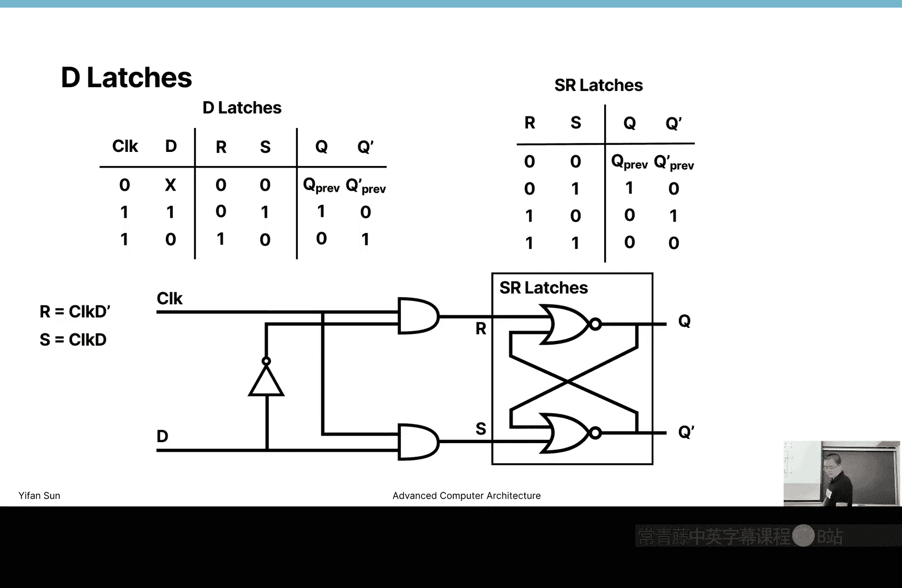

### D锁存器

为了解决上述问题，我们引入了**D锁存器**。D代表数据（Data）。它通过一个控制信号（通常称为使能端，或直接接时钟）和一个数据输入端D，来实现更简单的控制逻辑。

其目标真值表如下：

| 使能 | D | Q (下一个状态) |
|------|---|----------------|
| 0    | X | Q (保持)       |
| 1    | 0 | 0              |
| 1    | 1 | 1              |

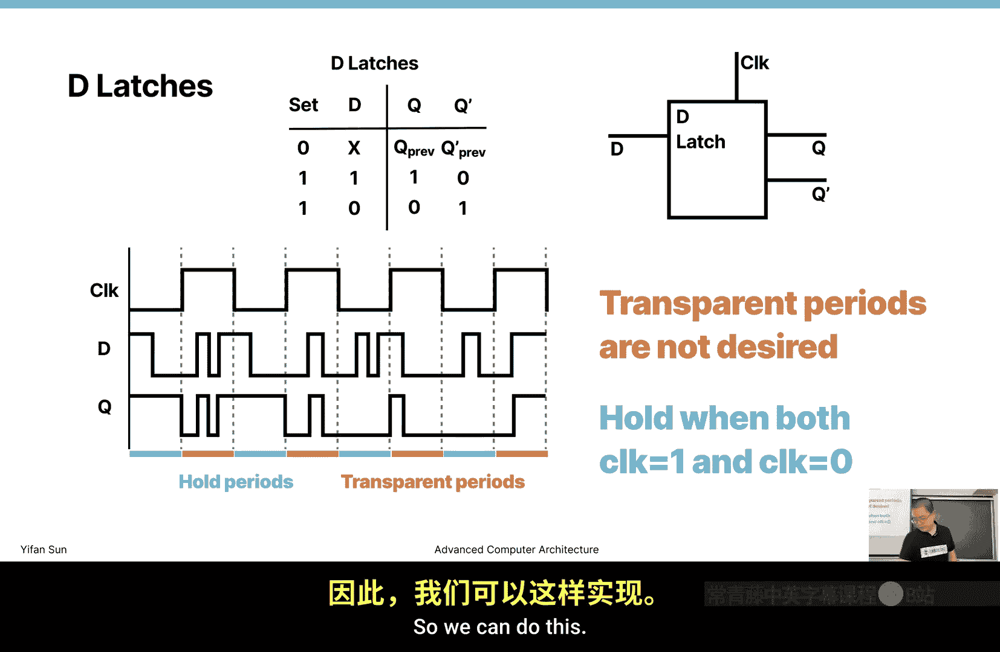

当使能信号为0时，无论D是什么，输出Q都保持不变（锁存模式）。当使能信号为1时，输出Q等于输入D（透明模式）。

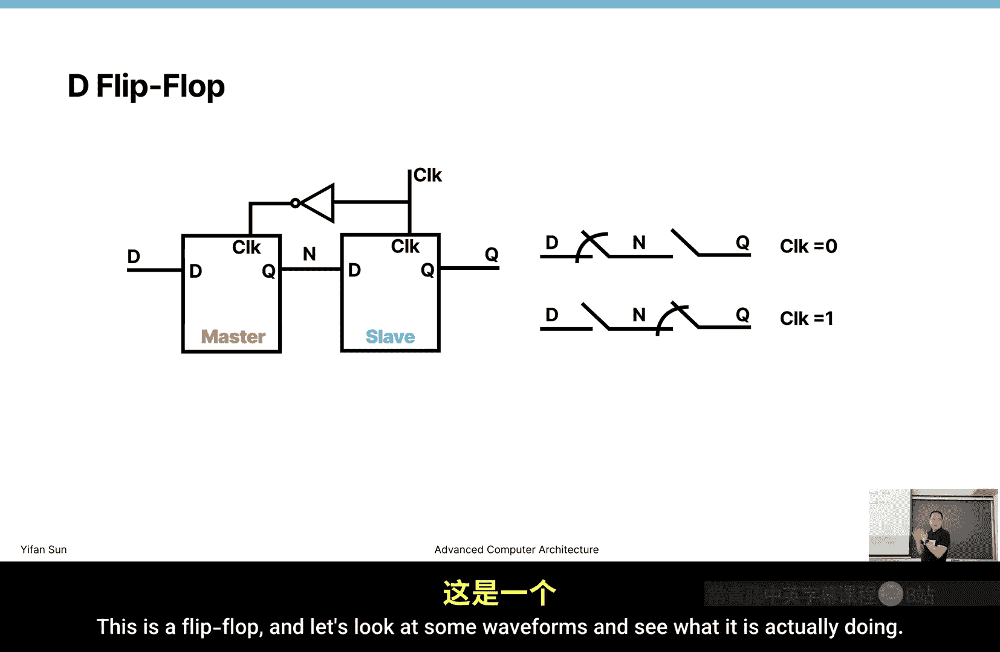

我们可以通过一个组合逻辑电路，将“使能”和“D”信号转换为SR锁存器所需的S和R信号，从而用SR锁存器构建出D锁存器。推导出的逻辑方程为：
*   **S = 使能 AND D**
*   **R = 使能 AND (NOT D)**

对应的电路图如下：

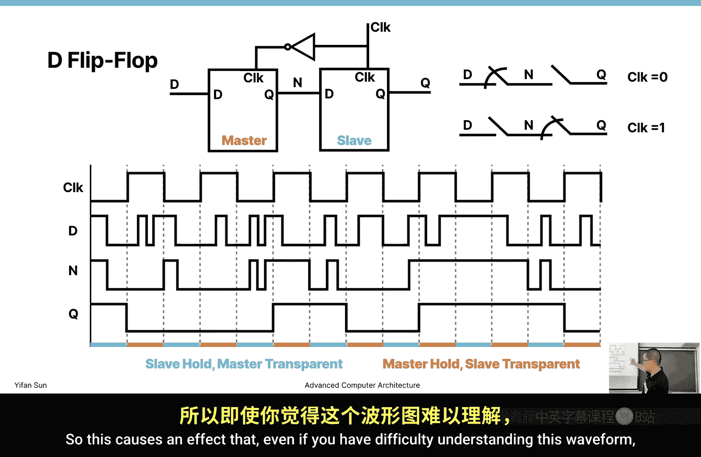

在实际中，我们常将“使能”信号替换为时钟信号。这样，当时钟为低电平时，D锁存器处于锁存模式；当时钟为高电平时，它处于透明模式，Q跟随D变化。其波形如下图所示：

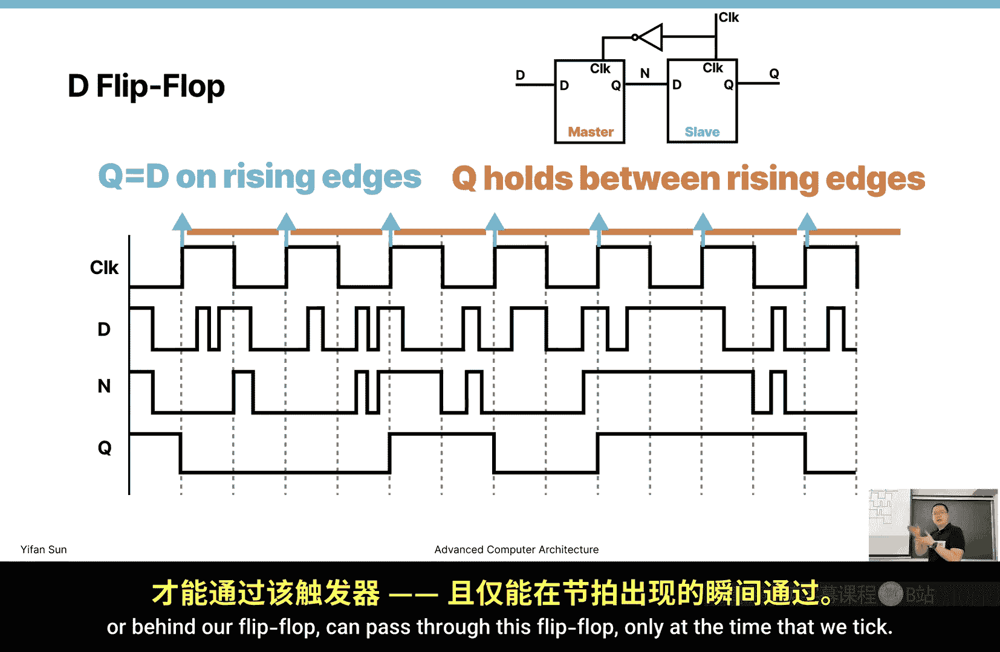

可以看到，在时钟高电平期间（透明期），Q随D变化；在时钟低电平期间（保持期），Q保持不变。D锁存器就像一个由时钟控制的开关：透明期如同导线连通，保持期则断开连接并保持之前的值。

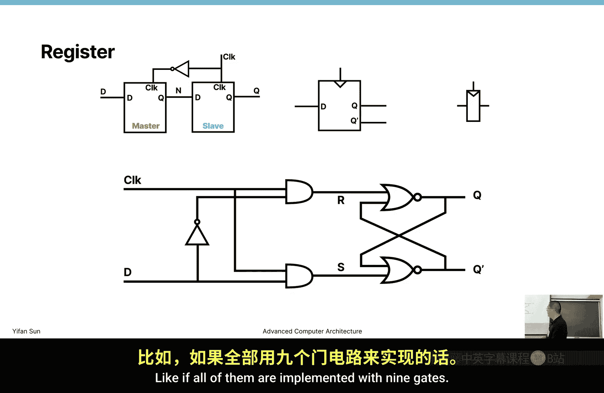

## 从锁存器到触发器

D锁存器仍然存在问题：它在半个时钟周期（透明期）内输出是不稳定的，会随输入波动。我们希望在整个时钟周期内，输出都只在某个特定时刻变化一次，其余时间保持稳定。

解决方案是使用两个D锁存器级联，构成**主从D触发器**。

*   **第一个锁存器称为“主”锁存器**，它在时钟为低电平时透明。
*   **第二个锁存器称为“从”锁存器**，它在时钟为高电平时透明，但它的输入来自主锁存器的输出。

由于两个锁存器的透明期被反相时钟错开，其效果是：**输出Q只会在时钟的上升沿（或下降沿）瞬间采样输入D的值，并在此后整个时钟周期内保持该值不变，直到下一个边沿到来**。

其波形图清晰地展示了这一特性：

注意观察，输出Q的变化只发生在时钟的上升沿时刻。在上升沿，Q的值被更新为D在那一时刻的值。此后，无论D如何变化，Q都保持不变，直到下一个上升沿。触发器是构成计算机中**寄存器**的基础。一个触发器可以存储1位数据。在电路图中，我们通常用以下符号表示一个边沿触发的D触发器：

## 同步逻辑设计与状态机

现在，我们有了核心的存储元件——触发器（寄存器）。接下来看看如何用它们和组合逻辑来设计完整的时序电路。这种设计方法遵循**同步逻辑设计**原则：
1.  所有电路元素要么是组合逻辑，要么是寄存器。
2.  所有寄存器由同一个时钟信号驱动。
3.  任何循环路径（反馈）必须至少包含一个寄存器。

寄存器在电路中扮演着多重角色：它是门卫，只允许信号在时钟边沿通过；它是1位存储器；它也是分隔符，将连续的计算过程划分为离散的时钟周期步骤。

设计同步时序电路的一个强大心智模型是**状态机**。状态机将系统行为描述为一系列“状态”，以及状态之间在特定输入条件下如何“转移”。这改变了我们的设计思路：组合逻辑不能“等待”，它总是立即根据当前输入产生输出。而寄存器则保存了“当前状态”，作为下一周期组合逻辑的输入。

### 设计实例：交通灯控制器

让我们通过一个简单的交通灯控制器例子，来实践从问题描述到电路实现的全过程。

**1. 定义输入与输出**
*   **输入**：两个方向的道路传感器 `TA` 和 `TB`。`1`表示有车，`0`表示无车。
*   **输出**：两个方向的交通灯 `LA` 和 `LB`。每个灯有红(R)、黄(Y)、绿(G)三种状态。我们可以用2位编码表示：`00`=绿，`01`=黄，`10`=红。

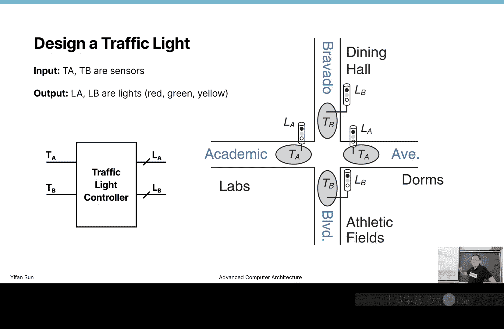

**2. 确定状态**
根据交通灯的正常循环，我们可以定义四个状态：
*   **S0**: LA=绿， LB=红
*   **S1**: LA=黄， LB=红
*   **S2**: LA=红， LB=绿
*   **S3**: LA=红， LB=黄

**3. 绘制状态转移图**
基于交通规则（例如，绿灯方向在有车时保持，无车时经过黄灯切换），我们绘制出状态之间的转移条件和方向。

**4. 创建状态转移表**
将状态转移图转化为表格形式，列出当前状态、输入与下一个状态的对应关系。

| 当前状态 | 输入 TA, TB | 下一状态 |
|----------|-------------|----------|
| S0       | 1X          | S0       |
| S0       | 0X          | S1       |
| S1       | XX          | S2       |
| S2       | X1          | S2       |
| S2       | X0          | S3       |
| S3       | XX          | S0       |

*(X表示“无关项”)*

**5. 状态与输出编码**
*   **状态编码**：4个状态需要2位二进制编码。例如：`S0=00`, `S1=01`, `S2=10`, `S3=11`。
*   **输出编码**：如前所述，`00`=绿，`01`=黄，`10`=红。

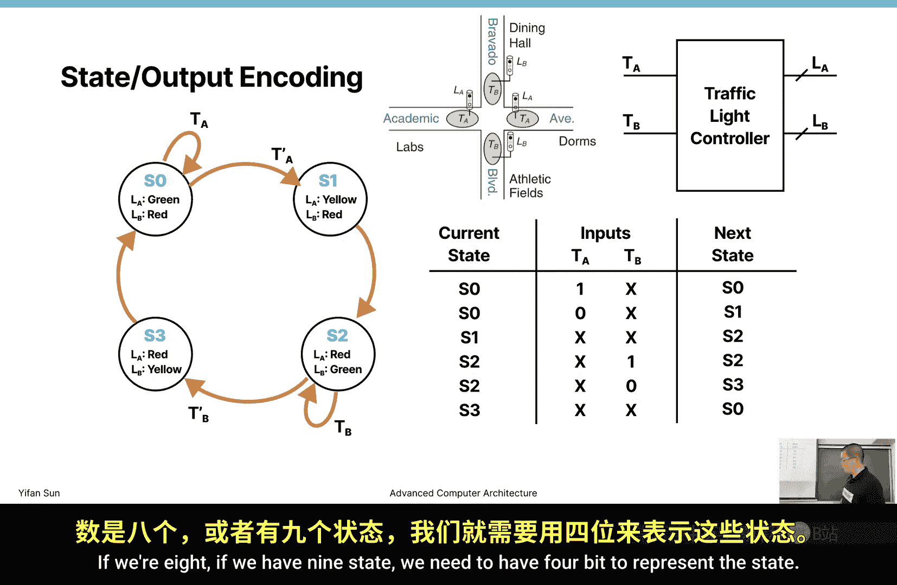

将编码代入状态转移表，得到一张完全由0和1组成的真值表。

**6. 推导逻辑方程**
将编码后的状态转移表视为一个组合逻辑问题：输入是“当前状态位”和“传感器输入”，输出是“下一状态位”和“灯信号输出”。我们可以为每个输出位（如下一状态的bit0, bit1，以及LA, LB的各个信号位）推导出布尔表达式。

例如，通过卡诺图或观察简化，可能得到如下形式的方程（具体取决于编码和转移表）：
*   `下一状态位1 = (当前状态位1) XOR (当前状态位0)`
*   `LA_绿 = NOT(当前状态位1) AND NOT(当前状态位0)`
*   ...（其他输出位方程）

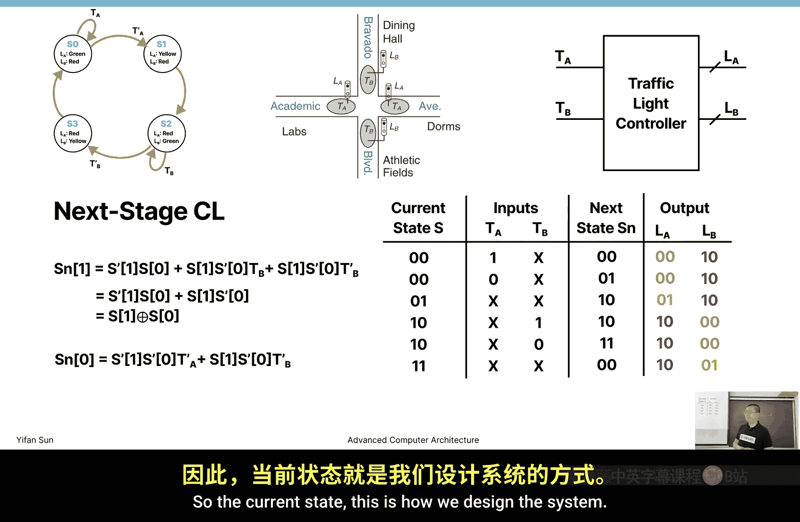

**7. 绘制电路图**
根据推导出的逻辑方程，我们可以绘制出最终的电路。电路核心包含：
*   **一组寄存器**：用于存储当前状态（例如2个触发器）。
*   **下一状态组合逻辑**：根据当前状态和输入TA/TB，计算下一状态的值，并反馈到寄存器的输入端。
*   **输出组合逻辑**：根据当前状态，直接生成控制交通灯LA和LB的信号。

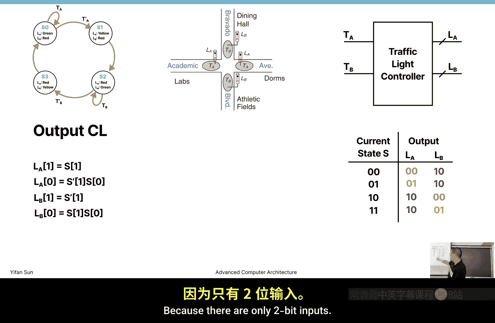

一个简化的电路框图如下所示：

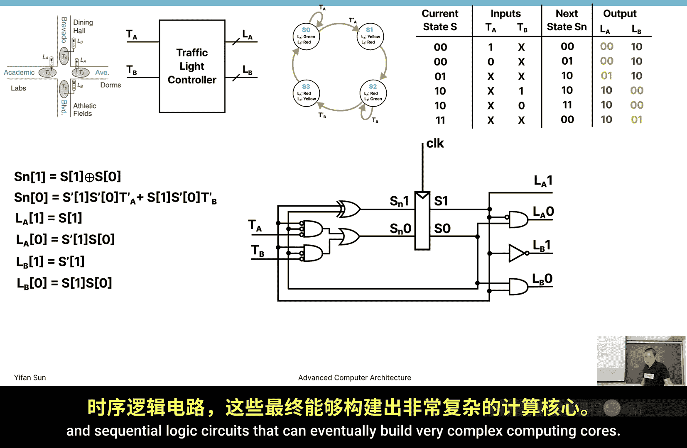

当时钟上升沿到来时，下一状态的值被存入状态寄存器，成为新的当前状态。输出逻辑随即根据新状态更新交通灯显示。如此循环往复。

## 总结

本节课中我们一起学习了时序逻辑的基础知识。
*   我们首先了解了时序逻辑与组合逻辑的根本区别：**时序逻辑具有状态记忆功能**。
*   然后，我们深入探讨了时序逻辑的基本构建模块：**锁存器**和**触发器**。重点是D触发器，它只在时钟边沿采样输入，并在周期内保持输出稳定，其行为可以概括为：**在时钟上升沿，Q = D**。
*   最后，我们通过**交通灯控制器**的设计实例，学习了**同步逻辑设计**和**有限状态机**的方法论。这个过程包括：定义输入输出、确定状态、绘制状态图、创建状态表、进行编码、推导逻辑方程并最终实现电路。

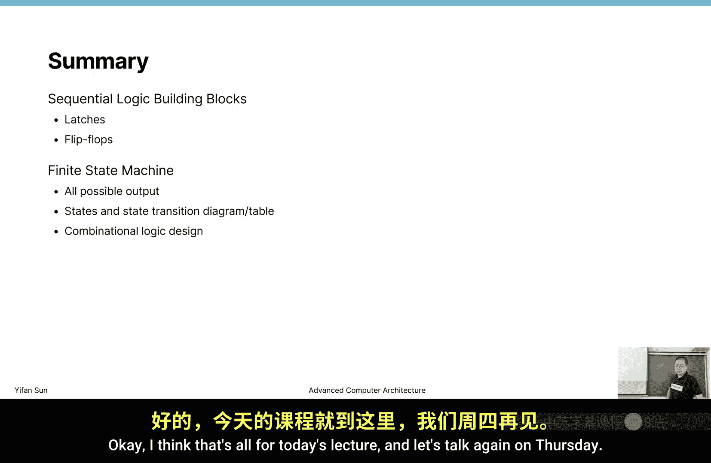

掌握从抽象问题描述到具体电路实现的设计流程，是理解复杂计算系统（如CPU）如何构建的关键第一步。在接下来的课程中，我们将看到更多时序逻辑的构建模块和复杂设计。