# 007：计算机体系结构模拟 1

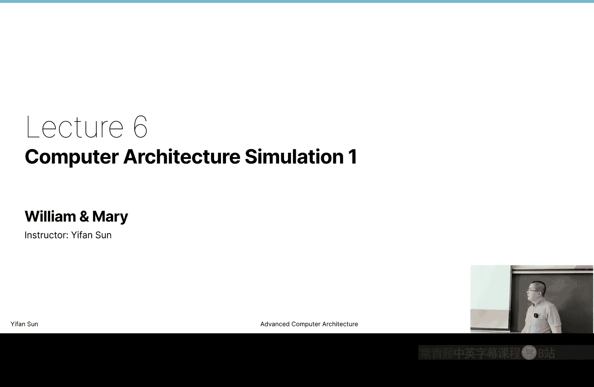

在本节课中，我们将要学习计算机体系结构模拟的基本概念、目的和方法。我们将探讨为什么需要模拟、不同类型的模拟器及其权衡，并初步了解 Akita 模拟器框架的基本原理。

## 概述：为什么需要模拟？

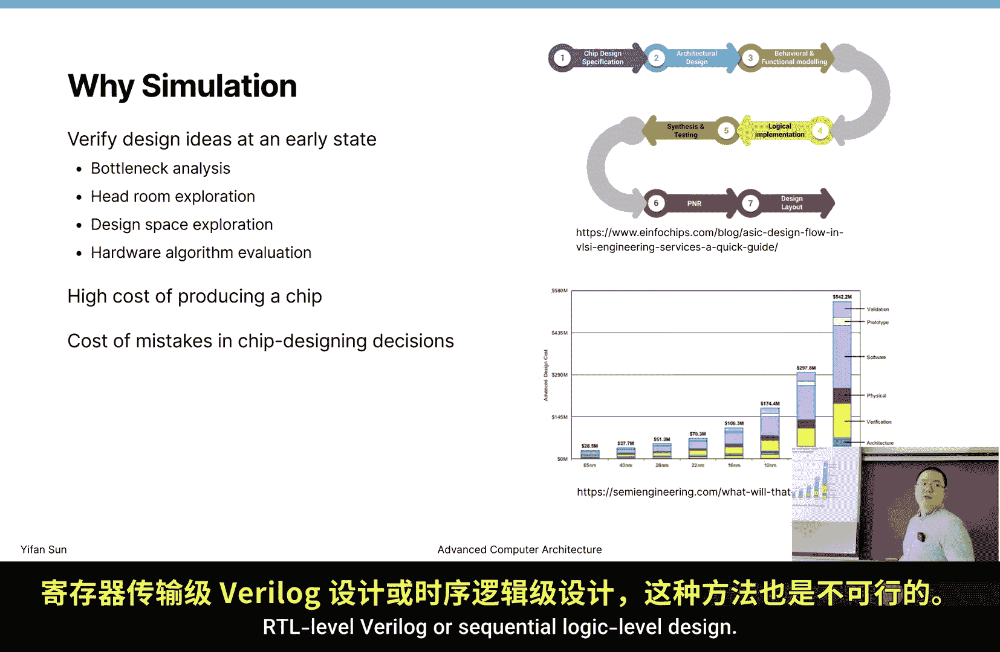

设计新的计算机硬件（如 CPU、GPU）成本极高。例如，制造一颗 5 纳米芯片的成本可能超过 5 亿美元。因此，在投入实际生产之前，研究人员和工程师必须使用模拟器来验证设计理念、分析性能瓶颈并进行设计空间探索。

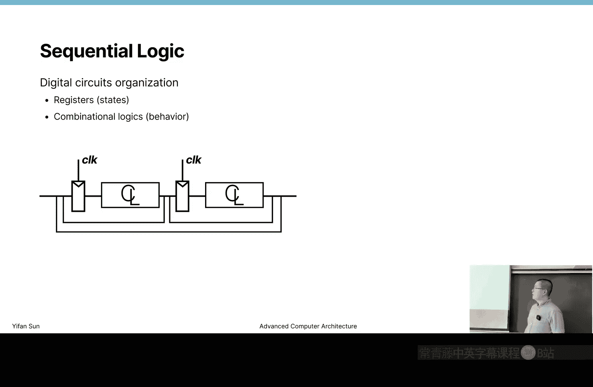

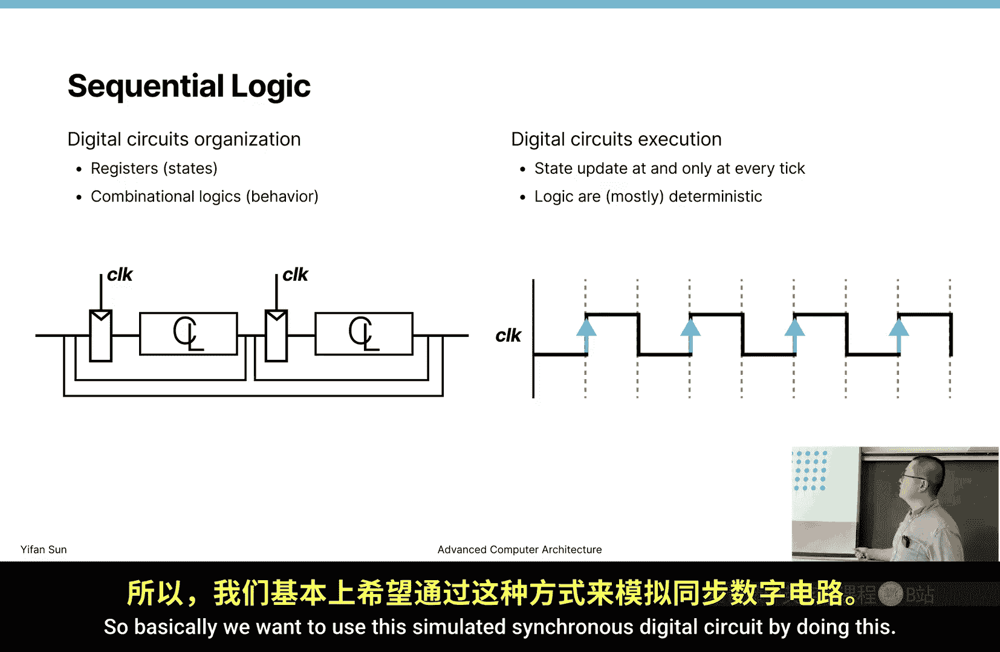

模拟器允许我们：
*   **在设计早期验证想法**：快速排除不可行的方案。
*   **进行瓶颈分析**：找出程序运行中的性能限制因素。
*   **进行设计空间探索**：测试不同配置（如缓存大小）对性能的影响。
*   **评估硬件算法**：在不实际构建硬件的情况下测试新算法。

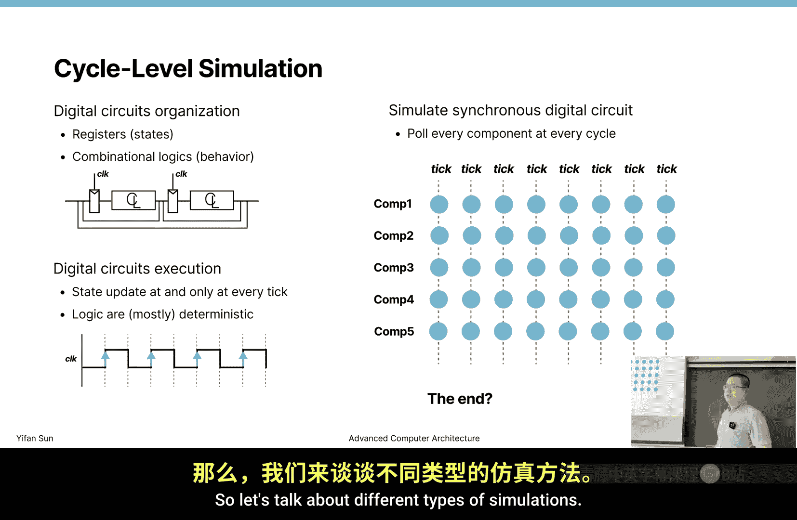

## 模拟方法的分类

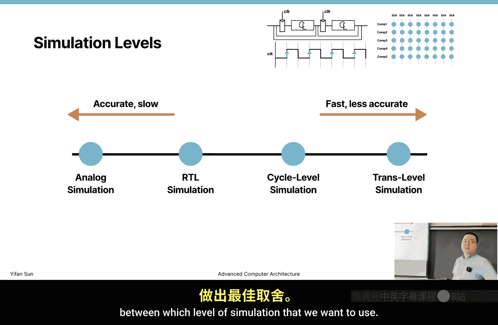

上一节我们介绍了模拟的必要性，本节中我们来看看如何对模拟器进行分类。模拟器可以从多个维度进行区分。

### 模拟的抽象层级

根据对硬件细节的建模精度，模拟可以分为不同层级：

*   **模拟级模拟**：关注晶体管级的电压、电流等物理特性，精度最高，但速度极慢。
*   **寄存器传输级（RTL）模拟**：在时钟周期内对数字电路（组合逻辑和寄存器）的行为进行建模，关注比特级的准确性。通常使用 Verilog 或 VHDL 描述。
*   **周期级模拟**：以时钟周期为步进单位模拟硬件行为，通常用高级语言（如 C++、Go）实现，不追求比特级精度，但追求时序准确性。
*   **事务级模拟**：在更高的抽象层级（如“完成一次矩阵乘法需 1 秒”）上模拟，只关心时间估计，不关心具体功能，速度最快。

**核心权衡公式**：`模拟精度 ∝ 1 / 模拟速度`

周期级模拟在精度和速度之间取得了较好的平衡，是本课程关注的重点。

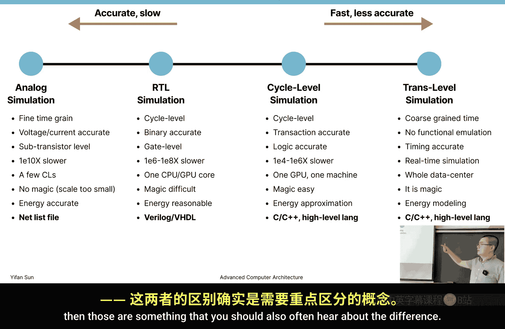

### 功能模拟与时序模拟

根据模拟目标的不同，模拟器可分为两类：

*   **功能模拟（仿真）**：目标是精确复现硬件执行的功能和结果，确保程序输出与真实硬件一致。它不关心或无法准确反映执行时间。常用于软件测试、硬件功能验证（如游戏模拟器、量子计算模拟器）。
*   **时序模拟**：目标是预测程序在特定硬件配置下的**执行时间**和**性能指标**（如缓存命中率、能耗）。它需要周期级或更细粒度的建模。为了处理数据依赖性（如循环次数），时序模拟通常需要与功能模拟结合（执行驱动），或依赖预先采集的执行轨迹（轨迹驱动）。

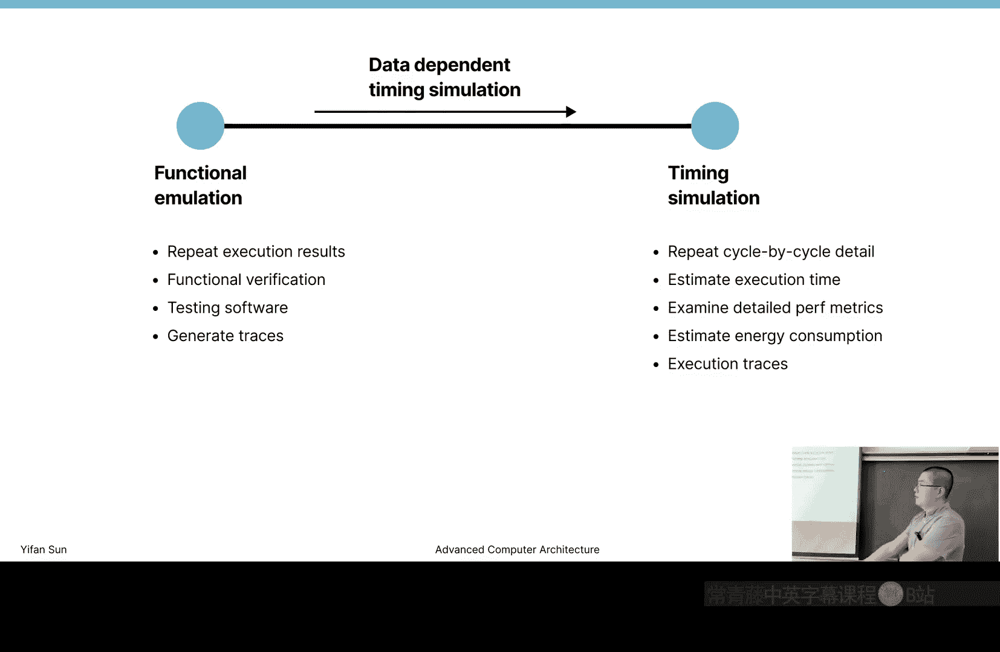

### 事件驱动与周期驱动模拟

在时序模拟内部，根据时间推进机制，可分为：

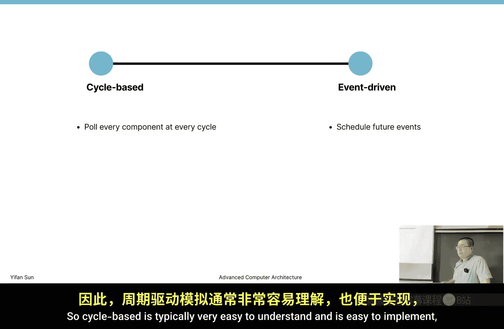

*   **周期驱动模拟**：在每个时钟周期，模拟器“唤醒”所有组件，更新其状态。实现简单直观，但难以处理多时钟域或长空闲时间，可能造成效率低下。
    ```go
    // 伪代码示例：周期驱动循环
    for cycle := 0; cycle < totalCycles; cycle++ {
        for each component in allComponents {
            component.Tick(cycle) // 每个组件更新状态
        }
    }
    ```
*   **事件驱动模拟**：模拟器维护一个未来事件队列。只有当事件预定发生时，相关的组件才会被激活和处理。时间可以“跳跃”到下一个事件发生点。效率高，能灵活处理多时钟域，但实现更复杂。
    ```go
    // 伪代码示例：事件驱动循环
    while eventQueue not empty {
        event = eventQueue.popEarliestEvent()
        currentTime = event.scheduledTime
        event.handler.Process(event) // 处理该事件，可能生成新事件加入队列
    }
    ```

现代模拟器（如 gem5、Akita）通常采用**混合策略**，结合两者优点。

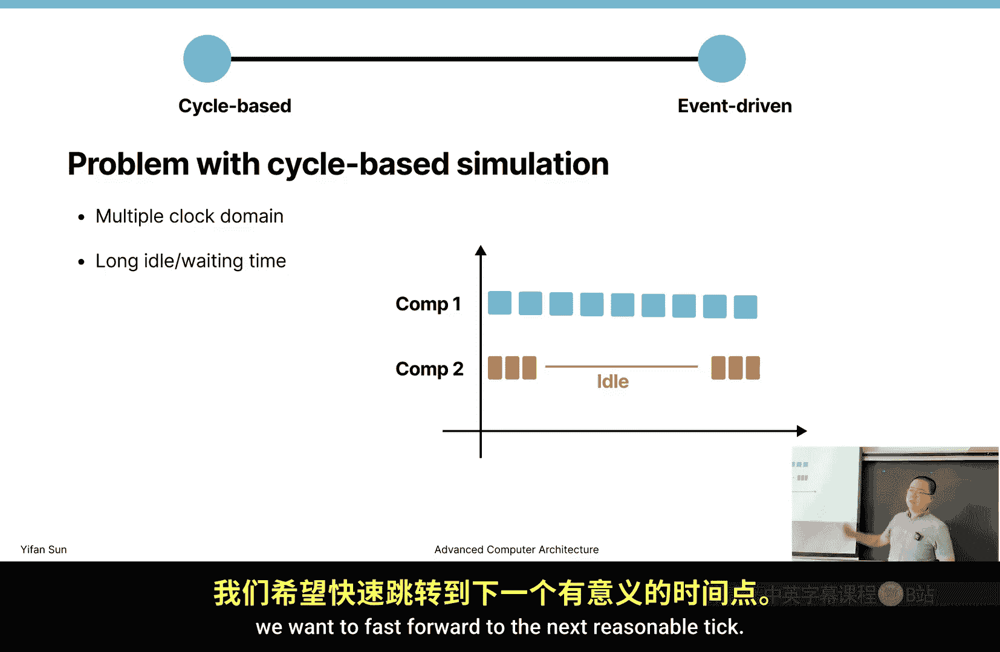

## Akita 模拟器框架初探

了解了模拟的基本分类后，我们聚焦到本课程将使用的 Akita 框架。Akita 是一个用 Go 语言编写的、底层采用事件驱动的模拟框架，旨在平衡开发复杂度和模拟性能。

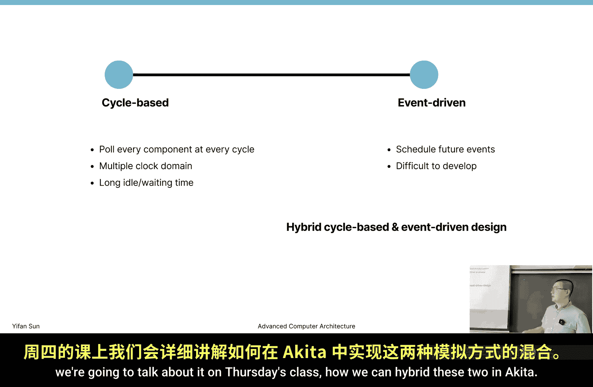

### 核心概念与接口

Akita 的核心围绕三个接口构建：

1.  **时间表示**：使用 `VTimeInSec` 类型（本质是 `float64`）表示虚拟时间（单位：秒），与真实时间区分。
    ```go
    type VTimeInSec float64
    ```
2.  **事件**：`Event` 接口定义了在特定时间 (`Time()`) 由特定处理程序 (`Handler()`) 执行的动作。
    ```go
    type Event interface {
        Time() VTimeInSec
        Handler() Handler
    }
    ```
3.  **事件处理程序**：`Handler` 接口负责处理事件。
    ```go
    type Handler interface {
        Handle(Event) error
    }
    ```
4.  **引擎**：`Engine` 接口是模拟器的心脏，负责管理当前时间、调度事件和运行模拟。
    ```go
    type Engine interface {
        CurrentTime() VTimeInSec
        Schedule(ev Event) // 调度未来事件
        Run() // 运行模拟直至无事件可处理
    }
    ```

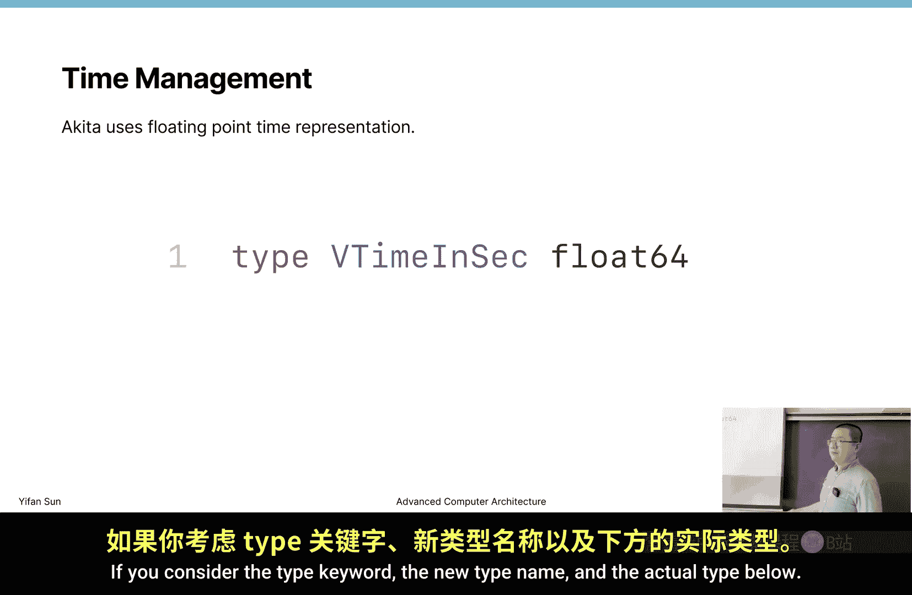

### 一个简单示例：细胞分裂模拟

让我们通过一个“细胞分裂”的例子，直观理解 Akita 模拟的工作流程。模拟规则：初始有 1 个细胞，每个细胞在诞生后的 1 到 2 秒之间会分裂成两个新细胞，模拟运行 10 秒。

以下是实现的关键步骤：

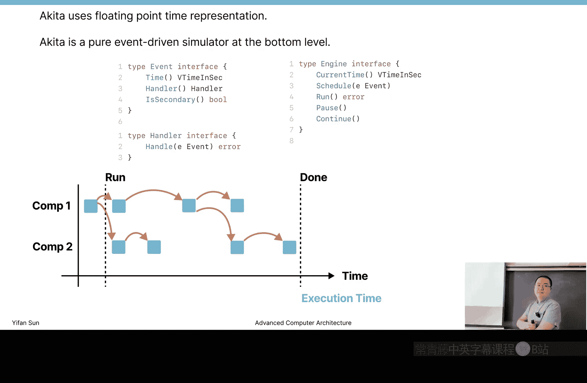

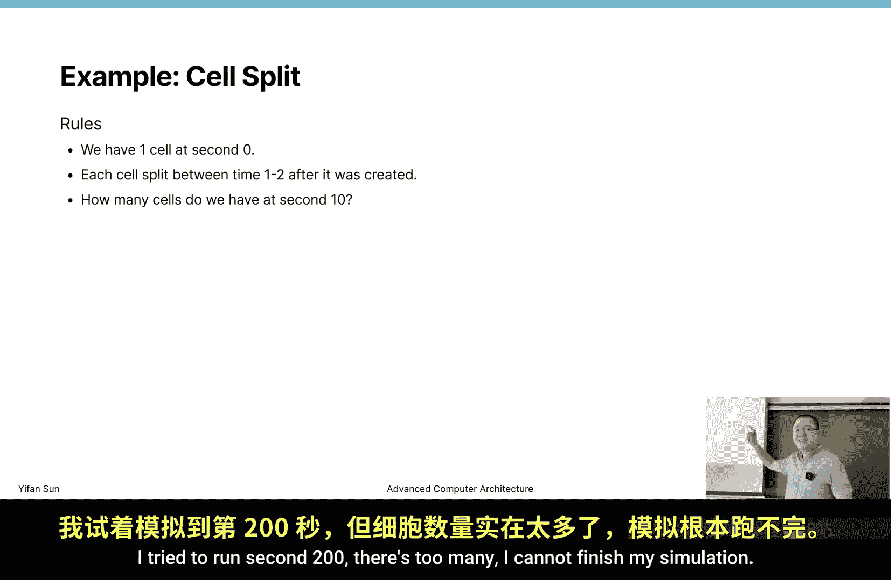

**步骤 1：定义事件**
我们定义一个 `SplitEvent`，表示细胞分裂事件。
```go
type SplitEvent struct {
    fireTime VTimeInSec
    handler  Handler
}
// 实现 Event 接口的 Time() 和 Handler() 方法
func (e *SplitEvent) Time() VTimeInSec { return e.fireTime }
func (e *SplitEvent) Handler() Handler { return e.handler }
```

**步骤 2：实现事件处理程序**
`CellSplitHandler` 负责处理分裂事件：增加细胞计数，并为每个新细胞调度下一次分裂事件。
```go
type CellSplitHandler struct {
    count int
}
func (h *CellSplitHandler) Handle(ev Event) error {
    h.count++ // 一个变两个，数量+1
    e := ev.(*SplitEvent)
    now := e.Time()
    // 为每个“新细胞”调度下一次分裂
    for i := 0; i < 2; i++ {
        nextSplitTime := now + 1 + rand.Float64() // 1-2秒后
        if nextSplitTime < 10 { // 只模拟10秒内的事件
            nextEv := &SplitEvent{
                fireTime: nextSplitTime,
                handler:  e.Handler(),
            }
            engine.Schedule(nextEv) // 关键：调度未来事件
        }
    }
    return nil
}
```

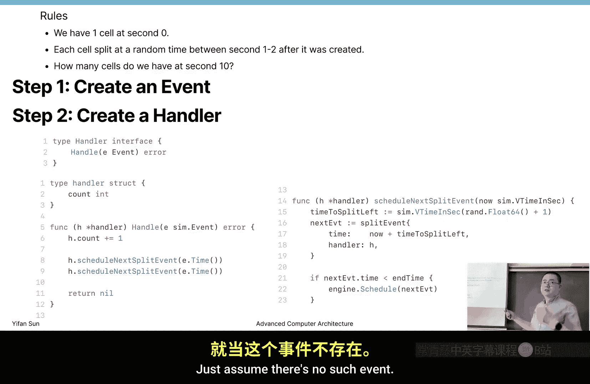

**步骤 3：组装并运行模拟**
创建引擎、处理程序，调度初始事件，然后启动引擎。
```go
func main() {
    engine := NewSerialEngine() // 创建串行引擎
    handler := &CellSplitHandler{count: 1} // 初始1个细胞
    // 调度第一个分裂事件
    firstEv := &SplitEvent{
        fireTime: 1 + rand.Float64(),
        handler:  handler,
    }
    engine.Schedule(firstEv)
    engine.Run() // 开始模拟
    fmt.Printf("Cell count at time 10: %d\n", handler.count)
}
```
模拟引擎会不断从事件队列中取出最早的事件，调用其处理程序，从而链式地触发更多事件，直到 10 秒后不再有新事件，模拟结束。

### 引擎内部工作原理简介

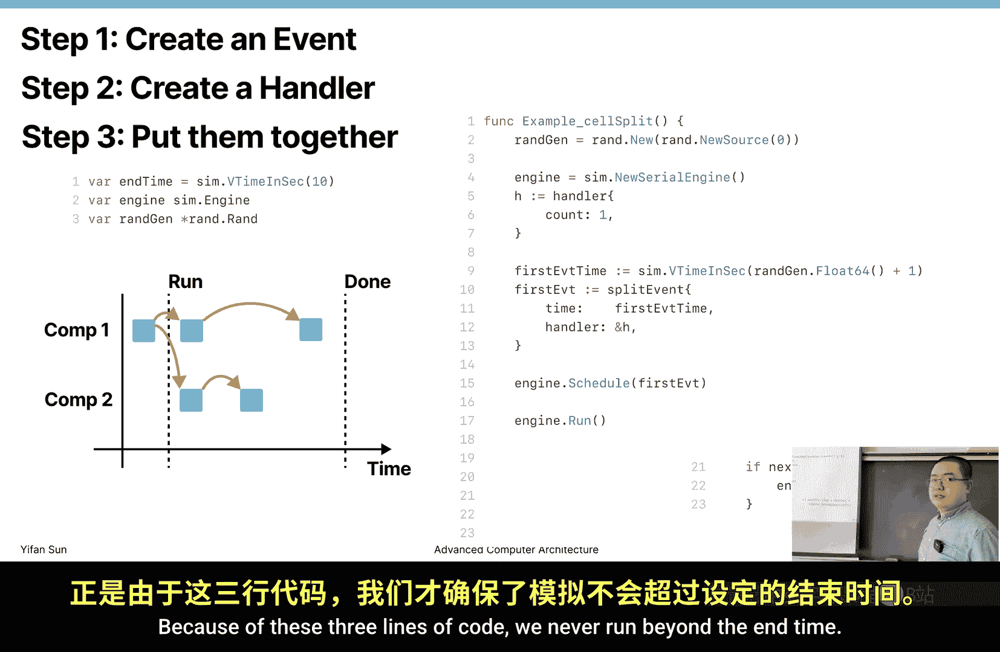

最后，我们简要看看 Akita 引擎（以串行引擎为例）内部如何工作：

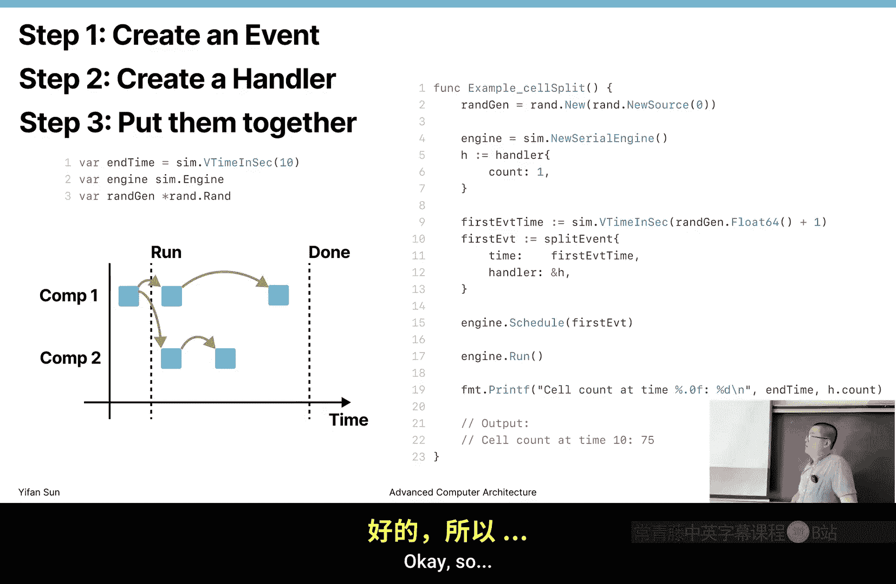

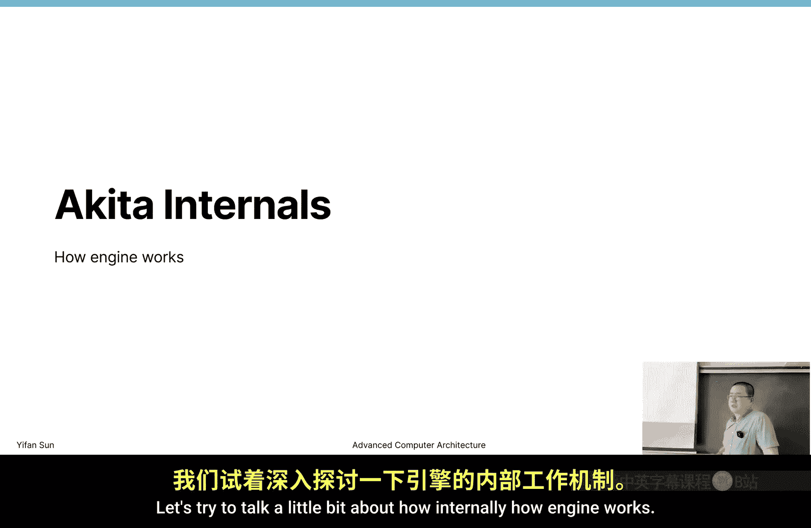

1.  **调度 (`Schedule`)**：将事件插入一个按时间排序的**优先队列（最小堆）**。确保事件时间不早于当前时间。
2.  **运行 (`Run`)**：引擎进入一个主循环。
    *   从队列中取出**时间最早的事件**。
    *   将引擎的当前时间推进到该事件的时间。
    *   调用该事件的 `Handler().Handle(event)` 方法执行事件。
    *   处理程序执行过程中可能会调度新的未来事件。
    *   重复此过程，直到事件队列为空。

这种集中式事件队列的管理方式是 Akita 的设计特点之一。

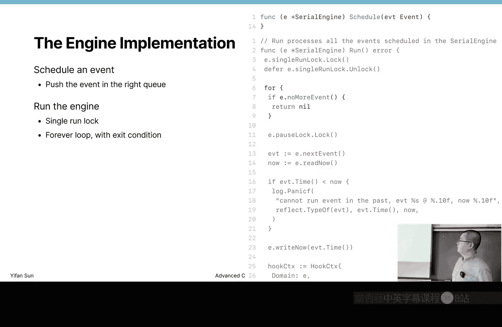

## 总结

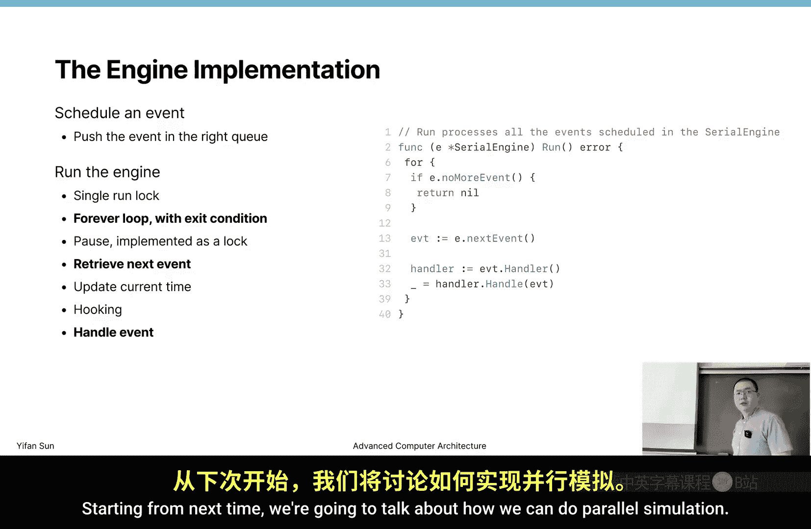

本节课中我们一起学习了计算机体系结构模拟的基础知识。我们了解了使用模拟器验证设计、探索设计空间的必要性。我们掌握了从抽象层级（模拟级、RTL、周期级、事务级）、模拟目标（功能vs时序）以及时间推进机制（周期驱动vs事件驱动）等多个维度对模拟器进行分类的方法。最后，我们初步接触了 Akita 模拟器框架，理解了其以事件驱动为核心的 `Event`、`Handler`、`Engine` 核心接口，并通过一个细胞分裂的示例，看到了如何利用这些接口构建一个简单的动态模拟。在接下来的课程中，我们将更深入地学习如何使用 Akita 构建具体的计算机体系结构模型。