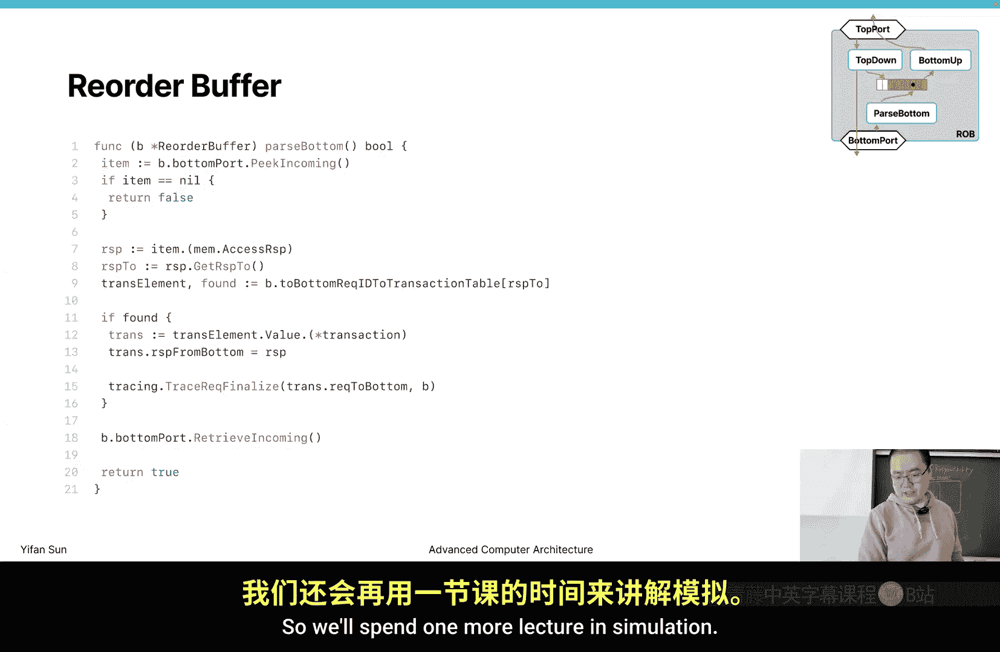

# 009：智能节拍与组件实现 🚀

在本节课中，我们将学习如何通过“智能节拍”方法优化基于事件的模拟，并深入探讨如何实现一个基于节拍的模拟器组件。我们将从纯事件驱动模拟的问题出发，介绍智能节拍的核心思想、实现机制，并通过两个具体示例来展示其实现模式。

## 纯事件驱动模拟的挑战

上一节我们讨论了使用纯事件驱动模拟方法。我们演示了一个包含两个事件和两条消息的简单示例。纯事件驱动模拟存在一些问题：它需要为组件可能执行的每种不同类型操作创建不同的事件，这要求开发者以非直观的方式思考，使得推理过程变得困难。特别是当多个事件同时发生时，它们之间的交互会成为一个难题。此外，如果需要重试事件（例如，由于缓冲区已满而无法发送消息，则必须在下一个周期调度另一个事件），这种方法的效率甚至可能低于简单的逐周期模拟。

## 智能节拍：概念与目标

为了解决上述问题，我们引入了称为“智能节拍”的方法。我们的目标是让用户能够编写基于周期的代码，即为每个组件编写一个 `tick` 函数，然后由模拟引擎决定何时执行节拍、何时跳过节拍。其机制非常简单，但能通过跳过所有不必要的节拍来显著提升性能。

首先，我们为每个组件创建一个节拍事件。这本质上是在事件驱动模拟引擎之上运行的基于周期的模拟。然而，这种方式在性能上严格劣于纯粹的逐周期模拟，因为除了在每个周期更新每个组件的状态外，我们还有创建事件、将事件加入事件队列以及从队列中弹出事件的额外开销。

## 智能节拍的核心机制

为了实现智能节拍，我们需要分析哪些节拍是不必要的。我们认为，如果一个组件的内部状态在某个节拍中没有更新，那么这个节拍就是不必要的。具体有两种情况：
1.  **组件完全空闲**：例如，一个缓存单元没有内存请求通过。
2.  **出站缓冲区已满**：组件无法发送任何消息，必须等待缓冲区有空闲槽位。

为了检测这两种情况，我们让 `tick` 函数返回一个布尔值 `madeProgress`，用于指示该周期内是否发生了状态更新。如果 `madeProgress` 为 `false`，我们认为没有进展，并将组件“置为休眠”，不在下一个周期为其调度节拍事件。当外部环境发生变化时（例如，有新消息到达或某个端口的出站缓冲区从满变为非满），我们再“唤醒”组件，使其恢复节拍。

这个机制保证了模拟结果的精确性，因为我们跳过的所有节拍都保证不会引起状态更新。

## 实现细节与代码模式

智能节拍的实现代码非常简洁。一个“节拍器”接口只包含一个返回布尔值的 `tick` 方法。一个“节拍组件”需要实现 `tick`、`notifyReceive`（当收到消息时调用）和 `notifyPortFree`（当端口变为可用时调用）等方法。

以下是核心逻辑的伪代码表示：
```go
func (c *Component) Handle(e Event) {
    if e.Type == TickEvent {
        madeProgress := c.Tick()
        if madeProgress {
            c.TickLater() // 调度下一个周期的节拍事件
        }
        // 如果没有进展，则不调度，组件休眠
    }
}

func (c *Component) NotifyReceive(msg Message) {
    c.TickLater() // 新消息到达，唤醒组件
}

func (c *Component) NotifyPortFree(port Port) {
    c.TickLater() // 端口可用，唤醒组件
}
```

通过这种方式，我们只在必要时执行节拍，从而大幅提升模拟性能，尤其是在模拟多GPU系统等场景下，其中许多组件可能长时间处于空闲状态。

## 回压与可用性反向传播

在计算机体系结构模拟中，“回压”是一个常见概念。它描述了当下游组件处理速度慢于上游组件的请求发送速度时，缓冲区压力会向上游传播的现象。在Akida中，我们使用消息、端口和缓冲区系统来建模回压。

可用性反向传播是实现高效回压处理的关键。当下游缓冲区释放一个槽位时，它会通过函数调用（而非发送消息）通知上游连接和组件。这个唤醒信号沿着与消息发送相反的方向（即向上游）传播，确保在缓冲区槽位可用时，正确的组件能够被及时唤醒以继续工作。

## 示例一：Ping组件实现

让我们通过一个简单的Ping组件示例来看智能节拍的具体实现模式。该组件周期性地发送Ping消息，并处理回复。

其 `tick` 函数通常遵循以下模式：
1.  初始化 `madeProgress = false`。
2.  按**反向顺序**（模拟硬件中寄存器更新的时序）处理各个阶段（如发送Ping、处理输入、倒计时、发送响应）。
3.  在每个阶段，先检查执行条件（如缓冲区是否满、是否有待处理消息）。如果条件不满足，可能提前返回 `false`。
4.  一旦通过所有条件检查，到达“关键点”，则执行实际的状态更新操作（如修改计数器、从缓冲区移除消息），并将 `madeProgress` 设为 `true`。
5.  函数最后返回 `madeProgress` 的值。

这种模式确保了代码清晰且符合硬件行为的时间特性。

## 示例二：重排序缓冲区实现

第二个例子是一个真实用于模拟器的组件：重排序缓冲区。它用于确保内存请求的响应按发送顺序返回给核心，即使底层内存系统可能乱序返回。

ROB的实现同样遵循智能节拍的模式。它包含多个处理阶段（如自上而下传递请求、自下而上接收响应、从头部返回响应），每个阶段在 `tick` 函数中按反向顺序执行。每个阶段都包含条件检查、关键点操作和状态更新。通过这种方式，ROB能够高效地管理请求和响应，同时只在必要时消耗计算资源。

## 中间件模式与设计原则

在构建复杂组件时，我们引入了“中间件”模式来分离关注点。中间件类似于责任链模式中的处理器，每个中间件负责处理一类特定的逻辑（如缓存替换策略）。组件可以将消息传递给一系列中间件，直到有一个能处理它为止。这样做的好处是提高了代码的模块化和可替换性，符合软件设计中的“单一职责原则”。

## 总结




本节课我们一起学习了智能节拍模拟方法。我们从纯事件驱动模拟的局限性出发，探讨了智能节拍如何通过有选择地执行组件的节拍来提升性能，同时保证结果的精确性。我们详细介绍了其唤醒和休眠机制、回压的处理，以及通过可用性反向传播实现高效通信。通过分析Ping组件和重排序缓冲区两个示例，我们揭示了基于智能节拍的组件实现通用模式：条件检查、关键点操作和状态更新。最后，我们了解了如何使用中间件模式来构建更清晰、更易维护的复杂组件。掌握这些概念和模式，是构建高效、准确计算机体系结构模拟器的关键。