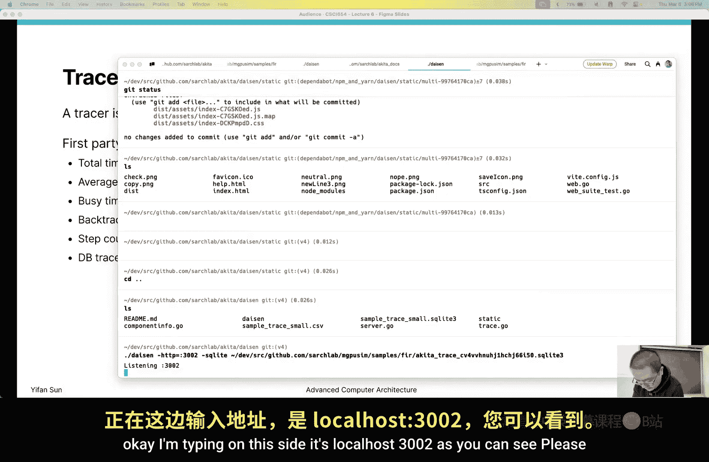
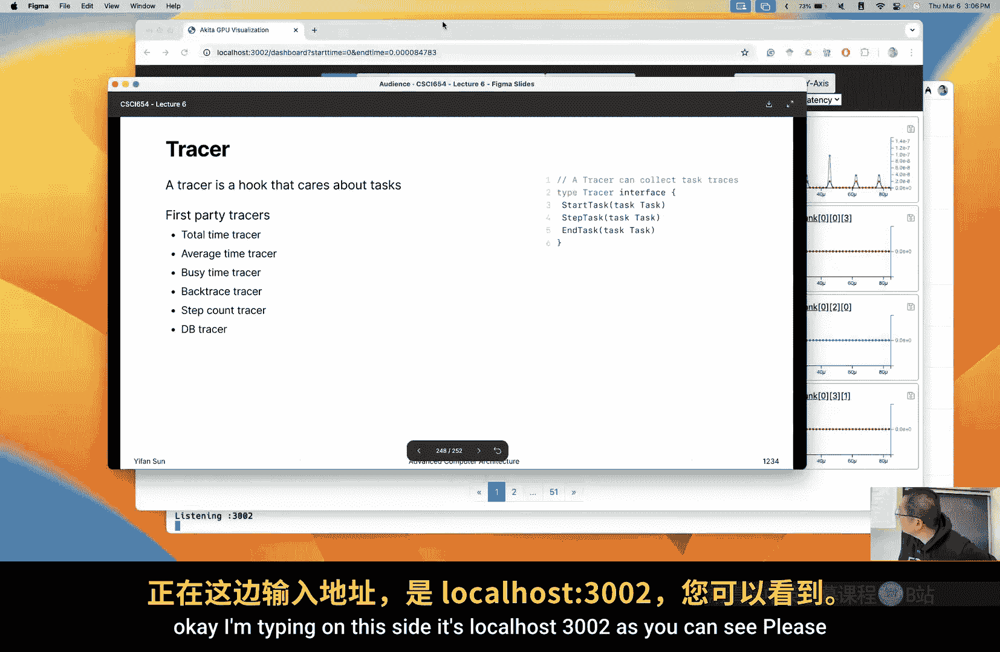
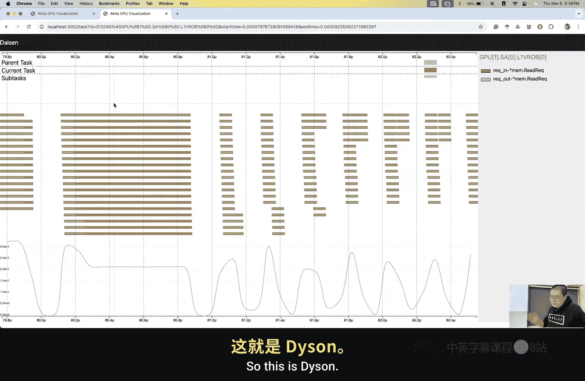
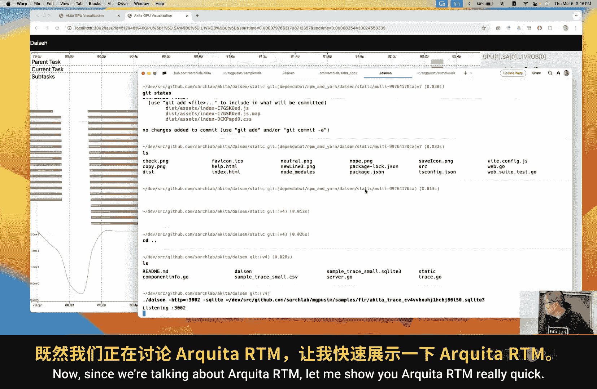
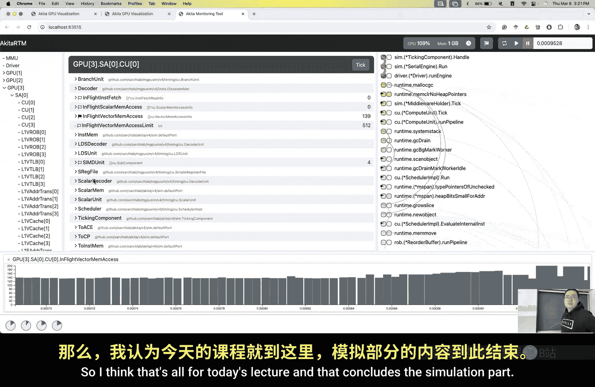

# 010：计算机体系结构模拟 4

在本节课中，我们将继续深入探讨计算机体系结构模拟，重点解决上一讲中未解决的问题，包括次级事件、构建器模式、设计原则以及钩子和追踪机制。这些概念是构建灵活、可扩展模拟器的关键。

## 次级事件

上一节我们介绍了智能滴答和如何为Akita编写常规组件。本节中我们来看看一个尚未解决的问题：次级事件。

次级事件并不复杂。其基本原因与我们之前讨论流水线实现时类似，即需要将某些操作安排在函数开始时执行。对于次级事件，考虑有三个滴答事件：两个组件（A和B）以及它们之间的连接。在硬件中，可以认为有三个组合逻辑控制着端口内的两组寄存器。在模拟器中，这些事件的执行顺序可以是任意的。

例如，如果我们按A滴答、连接滴答、B滴答的顺序执行。在周期1中，A滴答会在缓冲区中创建一条消息。接着连接滴答会将此消息移动到目的地。然后B滴答会接收并消费此消息。这里的问题是，我们在发送消息的同一周期就接收到了它。这在真实硬件中是不应该发生的，我们需要防止这种情况。

以下是解决此问题的方法：

*   **解决方案**：我们可以简单地让传递消息的事件总是晚于消费消息的事件发生。
*   **实现**：将连接的事件设置为次级滴答事件。如果事件被安排在同一时间执行，我们总是先执行主事件，然后再执行次级事件。
*   **效果**：这样就能保证连接滴答总是晚于A和B的事件执行。假设A和B先滴答，A会创建消息，但连接不会立即传递它。之后，作为次级滴答的连接事件会在同一周期内传递消息。但由于B在同一周期已经滴答过，它无法再次消费。因此，B将在周期2的滴答中接收到消息，从而在发送消息后的下一个周期才收到，问题得以解决。

这就是我们需要次级事件的原因。它实际上会带来一些性能问题，特别是在并行模拟中，因为我们必须先执行主事件，再执行次级事件，这需要在主事件和次级事件之间添加实际的同步机制。

## 构建器模式

现在，我们来看看另一个未讨论的话题：构建器。在模拟器中，对于许多组件或事物，我们使用构建器来实例化类。

构建器是什么？以重排序缓冲区为例。`ROBBuilder`是一个结构体，用于构建或实例化真正的重排序缓冲区组件。它包含ROB的一些属性字段。

`MakeBuilder`是一个函数，用于实例化一个构建器。它不接受任何参数，但提供默认值。例如，频率默认为1 GHz，每周期请求数默认为4，缓冲区大小默认为128。如果不设置，这些将是ROB中使用的默认值。

在`MakeBuilder`中，我们创建了许多以`With`开头的函数，例如`WithFrequency`。这些函数用于设置属性。最后，我们使用`Build`函数来设置必要的内容，例如初始化映射、分配参数以及实例化端口。

以下是使用构建器的示例代码：
```go
rob := rob.MakeBuilder().
    WithEngine(engine).
    WithFrequency(1e9).
    WithBufferSize(128).
    WithReqPerCycle(4).
    Build("MyROB")
```
我们可以像阅读英语一样阅读这段代码：创建重排序缓冲区构建器，设置引擎、频率、缓冲区大小、每周期请求数，最后用此名称构建。通常我们会换行书写，使其更易于阅读和理解。

构建器本身是一种编程模式。这里我还想谈谈策略模式，这可能是我认为最重要、最喜欢的模式。

## 策略模式与依赖注入

什么是策略模式？例如，在重排序缓冲区中，我们有一个引擎。基本上，我们说引擎是一个依赖项。这与依赖倒置原则中的图相同。这是一种特定的模式，可以帮助我们遵循依赖倒置原则。

引擎是一个策略，ROB依赖于引擎接口。我们称ROB需要一个引擎策略。在这个策略类别下，我们有具体的策略，例如`ZeroEngine`和`ParallelEngine`。在配置时或调用构建器时，我们设置想要使用的具体策略。

策略模式相当容易理解，但实际上非常常用。如果你觉得这个例子有点难懂，让我介绍另一个例子。

例如，一个缓存需要一个替换策略。如果你从未学过编程模式或原则，你可能会这样写代码：
```go
if policy == "LRU" {
    // 执行LRU逻辑
} else if policy == "Random" {
    // 执行随机逻辑
}
```
这是一种常见的写法，但这是一种不好的代码风格，我们称之为“代码异味”。通常，如果你看到这种代码，表明你的代码不够灵活，实际上违反了开闭原则。我们稍后会讨论这一点。

相反，我们应该这样做：
```go
cache.ReplacementPolicy.Evict()
```
然后它会告诉我们该驱逐哪个，具体的实现在这个`ReplacementPolicy`内部。关键在于你想使用哪种策略，你应该使用构建器来设置你想要使用的驱逐策略。

因此，我们需要在构建代码时选择策略。这是另一种模式，这种模式不是传统模式，不在设计模式书中，但是一种常用的模式，称为**依赖注入**。

依赖注入在Akita和MGPM中的使用方式，你可以看到我有两种不同的写法。第一种是`NewCache`，在实现缓存时我创建了一个策略并写入LRU策略。如果你写这种风格的代码，你甚至不需要策略。

在这里，我们说`NewCache`接受一个策略字段。我们首先创建一个策略，然后创建一个缓存，并将策略传递给它。那么什么是依赖？缓存依赖于替换策略。所以替换策略是缓存的依赖项。什么是注入？在这种方式中，我们称之为自定依赖，即我们提供自己的策略，或者缓存创建自己的依赖。另一方面，我们从外部提供依赖，这称为注入。注入意味着我们从外部提供并将其放入。在这种方式中，这个`New`函数或其他语言中的构造函数可以充当依赖注入器。

因此，构建器就是依赖注入器。我们使用构建器的`Build`函数来注入依赖。你也可以认为这是参数设置，但这是一个依赖注入器，用于提供组件想要使用的依赖。

依赖注入更灵活，因为我们可以轻松地从外部更改它。

## 开闭原则与代码分类

既然我们谈到了开闭原则和设计原则，那么开闭原则是最重要的原则。可以说，所有其他原则的存在都是为了实现开闭原则。

开闭原则是：软件实体应该对扩展开放，对修改封闭。或者用另一种易于理解的方式解释这个术语：一个软件实体（类、函数等）应该允许在不修改其源代码的情况下扩展其行为。

例如，如果你写这种实现，突然想写一个基于AI的策略，你该怎么做？你会继续通过提供另一个`if`分支来编写。这是在修改代码。

我们为什么不想修改代码？因为代码已经存在并正常工作，你不想修改它，修改很可能会破坏它。因此，你希望尽可能避免修改现有代码，但又想添加新功能。我们总是希望添加新功能。当我们想要添加功能时，我们希望编写新的代码片段，而不是修改已经存在的代码。

那么如何做到呢？策略模式可以帮助，其他模式也可以。例如，在策略模式中，我们有LRU和随机策略，但我们可以实现新的策略。如果我们编写新的策略并使用构建器通过依赖注入，那么我们就是在扩展行为而不修改代码。我们没有修改缓存代码，只是提供了另一个文件，这就足以支持这个功能。

遵循这种模式或风格，我通常将我的代码视为三部分：

1.  **数据**：什么是数据？请求是数据，事件是数据。组件本身，如果你考虑中间件，我只说组件本身是数据，因为它记录了组件的状态。这些都是纯数据或组件状态的表示，是程序或模拟的某种状态的表示。我们应该尽可能减少行为，使其成为纯数据。
2.  **行为**：行为可以认为引擎是一种行为。组件中间件是它们的行为。
3.  **粘合代码**：粘合代码将一切组合在一起。什么是粘合代码？它们通常是像构建器、调用构建器的代码，甚至是主函数`main`。它们被认为是粘合代码，只是以你期望的方式将不同的事物组合在一起。

在MGPM中，对于每一段代码，我几乎可以肯定它可以归类为这三种类型之一。

## 中介者模式

我正在尝试尽快完成所有与Akita相关的模式。中介者模式是另一个非常重要的模式。

什么是中介者模式？中介者模式定义了一个对象，它是一个行为对象，控制所有其他状态在做什么。例如，考虑这是一条消息。我的中间件将从消息中读取状态和内容。如果这是一条读消息，那么我将改变组件的状态。同时，我将创建另一条消息作为响应并发送回去。

因此，中介者是纯行为代码，控制着其他组件的状态。这样，我们应该尽量避免中介者与另一个中介者一起工作。这个中介者应该只直接与状态交互，读取输入状态并生成输出状态。这就是中介者应该做的，这也映射回行为类型的代码，我认为它们是中介者。

这实际上非常有用，因为每当我进行单元测试时，我不需要测试消息，不需要测试组件状态，我只需要测试中介者。我可以检查，如果我以这种方式给它一个状态，它是否真的以期望的方式修改了这个组件的状态，以及它是否实际创建了响应消息。所以我只需要测试行为部分，不需要测试所有其他状态部分，也不需要测试粘合代码。对于单元测试，我尝试对行为部分实现全覆盖。

## 设计原则回顾

我们可以快速回顾一下我们学到的所有原则。我们还有一个模式要介绍。我们先说原则。

我们考虑SOLID原则，还有其他原则，如“不要重复自己”。这是一个相对容易实现的原则。

对于SOLID，我们学习了S、O、L、I、D。

*   **S**：单一职责原则。我们希望每个组件、每个类只有一个职责。例如，如果你将每个状态作为一个类，那么它自然只有一个职责。如果它是一个行为，那么它也将只有一个职责，特别是如果你尝试将策略与主要行为分离。那么每个策略，比如我们的LRU策略或随机策略，几乎自然而然地遵循了S原则。
*   **O**：开闭原则。我认为O原则是最重要的原则：对扩展开放，对修改封闭。你可以通过编写新代码来添加功能，而不是修改现有代码。
*   **L**：里氏替换原则。我们还没有讨论L。
*   **I**：接口隔离原则。为什么我们要进行接口隔离？我们希望每个接口尽可能小。这样，对于每个组件，每当你有一个依赖时，你只依赖于该依赖的最小部分。因为如果你依赖更少的函数，替换它更容易。如果你依赖许多甚至不使用的函数，你可能必须实现一些你的主对象不依赖的其他函数。
*   **D**：依赖倒置原则。依赖倒置几乎告诉你，永远不应该让一个中介者直接依赖于另一个中介者。你应该让一个中介者依赖于接口，然后由其他中介者实现该接口。这样，你总是可以替换你想要使用的策略。

最终的整体目标是O原则：我可以在不显著改变实际逻辑代码的情况下，替换任何我想要的东西，但我可以在粘合代码部分改变行为，在那里我构建整个组件，我可以改变成任何我想要的样子。

## 钩子与追踪

现在，你可能已经在代码中看到过关于钩子和追踪的内容。这可能是我们必须介绍的最大部分，也是Akita中很大的一部分。

为什么需要钩子？正如你在重排序缓冲区中所想，当我们实现重排序缓冲区甚至引擎时，我们专注于主要逻辑。我不想让你写很多在我们的程序中非必要的代码。有时我们想记录数据，例如记录执行了哪些事件、消息何时到达端口，或者在核心组件中执行了哪些指令。这些都是记录数据的任务。

我想记录什么数据？很难说。这次我想记录这个数据，下次我想记录那个数据。一个简单的方法是添加打印语句。但当你添加大量打印时，就违反了O原则。当你添加大量打印时，如果我想记录一些新数据，那么我就在修改我的代码。

有时一些临时的打印是可以的，但有时如果你想通过记录数据来正式支持某个功能，这会给你的代码增加复杂性，你的代码最终会变得混乱，函数会变得很长。你不希望这种情况发生。因此，我们使用钩子来分离记录指令的逻辑与指令执行本身，以及我们可以记录和追踪的许多其他事情。

有时我们想修改不属于常规逻辑的状态。例如，在计算机体系结构研究中一个非常特殊的研究类型叫做故障注入。我们讨论过宇宙射线可能击中你的CPU，并使1位从0翻转到1或从1翻转到0。在这种情况下，这绝对不是你想在代码中实现的真实逻辑，你不想写很多`if`语句。你想模拟它。我们能做什么？我们可以将故障注入实现为另一段代码，以某种方式操纵你的状态。这些都是我们想做的特殊情况，但不应该在主逻辑中实现。这时我们使用钩子。

考虑这是正在执行的主线程，钩子是如果我们想要，就挂载到它上面；如果我们不想要，就把它取下来。它可以附加到这个主线程上，并在某些事情发生时采取行动。

这是另一个模式。这可能是我们必须介绍的最后一个模式。有很多模式，但我们只介绍其中一部分：**观察者模式**，有时也称为订阅者模式。如果你想称之为钩子模式，也可以。人们通常能理解。

观察者模式很容易理解。这里有一个主体，主体是实现主要逻辑的主要组件。然后我们有一个观察者接口。有一些观察者实现这个接口。它们只需要实现一个`Update`函数，一个非常简单的`Update`函数，用于执行该观察者的操作。

然后，主体应该有一个观察者列表来维护谁是我的观察者。它应该允许注册观察者（提供一个观察者，只需将其添加到观察者列表）或移除观察者。在Akita中，我们甚至不需要移除它，一旦挂载，它就一直在上面。

这里最重要的函数是`NotifyObservers`。在适当的时候，我们需要通知所有观察者某些事情已经发生。

基本上，这些观察者允许我们在配置时定义此行为。如果我想进行故障注入，我可以附加这个钩子；如果我不想，就在配置时不附加它。

配置时间基本上是你启动一段程序时，首先构造你想要模拟的硬件和基准测试。当你调用`Engine.Run`时，你实际上是在进行模拟。所以`Engine.Run`是真正的模拟，开始部分是配置代码。

钩子的实现实际上非常简单。它接受一个钩子接口，你只需要实现一个叫做`Func`的东西，它接受一个参数，称为钩子上下文。

钩子上下文包含四样东西：

1.  **域**：是可钩挂的组件，即主组件。
2.  **位置**：位置。我们可以这样命名这些位置。这些有点像全局变量或全局常量。有时我可能会说这是事件处理前的钩子位置，事件处理后的钩子位置。这个位置会告诉我这是否是我可能感兴趣的东西。
3.  **项**：是你关心的东西。例如，如果你关心一个事件，那么该事件就是项。如果你关心一条指令，那么该指令就是项。
4.  **详情**：基本上是你想附加到此钩子的任何数据，以便钩子可能需要或不需要处理详情中的信息。你可以在那里附加任何你想要的数据。

可钩挂的是可以接受钩子的主组件。它有三个方法：`AcceptHook`（接受一个钩子）、`Hooks`（返回已注册的钩子），以及另一个重要函数`InvokeHook`。每当我们调用`InvokeHook`时，实现非常简单。基本上只是遍历所有钩子列表并调用钩子的`Func`函数。通知钩子发生了某事，然后如果你感兴趣，就做你想做的事。

我们如何调用钩子？你可以看到这是引擎的`Run`函数。当我们处理这个事件时，我们创建一个钩子上下文。在这个钩子上下文中，域是引擎本身，项是事件，位置是事件前的钩子位置，这是在事件发生前触发的。然后我们在此上下文中调用钩子。

事件被处理后，我们执行事件后的钩子位置，只是重用这个上下文，但改变位置，然后再次调用钩子。

因此，每当我写一个钩子时，我会称这个东西为可观察行为。在这一点上，这个事件的执行是可观察的，因为你可以附加一个钩子来观察这个行为。否则，你的模拟将一直运行，你无法从主运行线程中获取任何数据。

因此，当你编写一个组件时，你需要考虑哪部分是可观察的。如果你希望这个东西是可观察的，就在那里留一个钩子，最终它可以被钩子消费以提取这类信息。

通常，每当某些事情开始时，例如指令开始、指令结束、事务开始、事务结束，这些都是可观察的操作或事件。我们会留下钩子位置，以便钩子可以监视这些行为。

这段代码可能有一些性能开销。实际上，性能开销并不小，主要是因为调用钩子操作。但有时，Go与C或C++有点不同。在C或C++中，这通常是分配在栈上的，但Go可能将其分配在堆上。如果在堆上，可能需要垃圾回收。分配内存和垃圾回收会花费很多时间。这是我们可能寻求性能改进的机会之一。

## 追踪与任务

我们想看看事件记录器的一个例子。事件记录器是一个可以附加到引擎的钩子。它只对`InvokeHook`这个函数感兴趣，比如事件前的位置。只关心这个位置，每当我们执行这个钩子时，它只是简单地打印出来，告诉我正在执行什么事件。

让我们看看如何实现它。我们说这是一个事件记录器结构体，带有一个日志钩子基。在`Func`中，它接受一个上下文。在上下文中，我们首先检查这个位置是否是我们关心的。如果不是，我们返回，什么都不做。我们检查这个项是否是一个事件。这是Go中的向下转型语法。我们将项从接口类型转换为事件类型。如果它是一个事件，我们就打印出来。如果它不是事件，我们返回。这很简单。

我们如何将这个钩子附加到引擎上？我们这样实现：创建一个引擎，如果用户想使用并行引擎，就创建并行引擎，否则创建零引擎。然后我们附加一个钩子，实例化这个事件记录器并将其附加到引擎。这个引擎附加了这个钩子，所有事件都会被打印出来，你的整个程序执行会非常慢，因为打印有很大的性能开销。如果你打印到文件，可能还可以，特别是如果你打印到终端，会比不打印慢数千倍。但有时这只是一种调试机制。所以我通常会保留这行代码，但大多数时候，我只是注释掉它，因为我不想看到这类事件被打印出来。

追踪是在追踪包中实现的。基本上，在追踪包中，我们不关心事件，但关心任务。

什么是任务？你可以认为每个任务包含两个事件。一个任务事件几乎总是一个单一时间点发生的事情，没有持续时间，那是一个事件。而任务是一对事件：某事开始和某事结束。例如，我执行一条指令，当我开始执行这条指令和当我完成执行这条指令时。所以任务有开始时间和结束时间。

如果你看这里的字段，有任务的ID标识符，有描述任务种类的`Kind`，有一个`Where`字段（意味着一个任务只能发生在一个位置）。最重要的部分是开始时间和结束时间。`Steps`目前用作任务的标签。`Detail`是你可以附加到此任务的信息部分，以后可能有用或没用。

`ParentTask`是最有趣的部分。父ID字段或父任务，我们不一定需要同时启用两者。这取决于我们是否想序列化成JSON格式或存储到数据库中，我们可能只想保留父ID。如果我们想使用它，我们可能可以直接保留对父任务的引用。



每当我们有一个父任务，父任务可能有另一个父任务。所以你想，这个父任务，你的整个程序指令任务形成一棵树。如果你考虑一个根任务叫做“模拟”，它可能总是有一个ID为0。那样的话，那就是根。然后所有其他任务都是这个根的叶子。现在我们将整个执行理解为一棵需要在我们模拟中执行的整个任务图。



我们为任务处理提供特殊的API，但它们基本上是钩子调用的包装器。我们有一个`StartTask`，我们用一个ID、一个父任务ID、一个域（一个命名的可钩挂对象，是两个不同接口的组合）、一个种类/类型以及可选的详情来开始一个任务。当我们结束一个任务时，我们调用`EndTask`函数。`EndTask`非常简单，只需要ID和域，这样我们就可以映射到原始的开始任务。如果我们能映射到一个开始任务，我们知道结束时间，这就足够了，我们可以存储它，保存到某个地方。

所以这是`EndTask`。没有什么特别的。它们是调用钩子的包装器。将在此`StartTask`和`EndTask`函数调用中创建一个任务结构体。那些是项。域（命名的可钩挂对象）是上下文中的域，位置总是像`TaskStart`和`TaskEnd`这样的东西。所以这不是专门的代码，只是包装器。

任务中最常见的一种特殊任务是当我们处理请求和响应时。考虑一个核心向缓存发送内存请求。现在，这是一个任务。这个任务在请求首次创建或首次发送出去时开始。我们通常认为当它被创建时开始，因为有时它可能在自己内部缓冲一会儿才发送出去。我们想记录最早可能的时间作为此请求相关的最早时间。所以开始时间是此请求创建时，结束时间是响应被接收时。我们认为这是一个任务。这是整个内存事务花费的时间，记录结束时间减去开始时间就是持续时间或此内存事务的延迟。

然后考虑这个请求被发送到一个接收者。这是在缓存端。在缓存端，当我们首次意识到有一个请求时，是当我们从端口检索时。所以这个时间是请求被接收时。它可能在此组件外部缓冲了一会儿，或者网络需要一些时间将此消息发送到目的地。所以父任务和子任务开始之间总是有一个小间隙。缓存可能需要一些时间来处理它，可能是缓存命中或未命中。最终这个任务完成，我们有了数据。现在我们可以将这些数据发送回请求者。这可能需要更多时间，可能在请求者端缓冲，或者网络可能需要一点时间来传递响应。但这是另一个关键时间，即请求完成时。

我们给它一个种类，这是“请求发出”，我们发出一个请求；这是“请求进入”，我们接收一个请求并处理它，响应这个请求。我们总是将父任务指向这个“请求进入”有一个父任务“请求发出”。所以一个请求，两个任务。因为一个请求有两个不同的位置。一个请求，两个任务，四个关键数据点。

我们提供专门的API来处理这个。我们称之为`Initiate`（首次相关时）、`Receive`（发送到目的地时）、`Complete`（完成时）和`Finalize`（最终完成时）。四个简单的API来记录每个请求的生命周期。它们仍然是`StartTask`和`EndTask`的包装器。所以两层包装器。这些API是钩子调用的包装器。

因此，我们提供这四个方便的API来处理“请求发出”和“请求进入”这类专门的任务。最后，追踪器是什么？追踪器是一个关心任务的钩子。每当我们调用那些API时，这些API最终是钩子调用的包装器。所以我们需要专门的钩子来关心那些任务。所以我们需要编写一个追踪器。追踪器也非常简单，只需要实现三个函数：`StartTask`、`StepTask`和`EndTask`。`StepTask`意味着在中间执行，如果有实际信息需要记录。我们目前只将其用于一个目的：在缓存中记录缓存命中或未命中，因为在开始时我们并不真正知道它是命中还是未命中，在结束时我们可能不关心它是命中还是未命中。所以只有在我们查找标签并检查是命中还是未命中后，我们才为此任务添加一个步骤，这样我们就知道是命中还是未命中。

因此，追踪器是关心任务的钩子。我们提供一系列第一方追踪器，这些是Akita提供的追踪器，可以使用。例如，总时间追踪器。大多数第一方追踪器接受一个过滤器。例如，如果你只关心一种类型的任务，你可以过滤掉，只专注于一种类型的任务。

总时间追踪器是什么？例如，如果我们在一个缓存上附加一个总时间追踪器，那就是该缓存处理所有传入请求的总时间。请求一花费一秒，请求二花费另一秒，我们加起来，总时间是两秒。我不使用它，因为它没用，因为我们需要考虑重叠。如果我们处理一个请求和处理另一个请求有重叠，把它们加起来没有意义。可能在一个地方我们关心这个，比如在ALU中计算ALU利用率，像开始计算和结束计算。所以那是总时间追踪器。

平均时间追踪器是广泛使用的。我们关心L1缓存级别的平均延迟、L2缓存级别的平均延迟、DRAM级别的平均延迟，以及从核心角度来看我的内存事务的平均延迟。这可以告诉我们很多信息。延迟越短越好。那是平均时间追踪器。

繁忙时间追踪器考虑重叠。如果有两个任务重叠，我们只考虑全局开始时间和结束时间。如果有间隙，我们也会丢弃间隙部分。基本上，这意味着该组件至少在处理某些事情。它的使用方式只在一个位置：在MG中的GPU级别，我们计算总时间，我们称之为GPU总内核时间。GPU执行内核，内核是GPU函数。我们计算GPU忙碌了多长时间。我们有一个繁忙时间追踪器应用于GPU级别，所以我们知道GPU至少运行一个内核、一个函数的总时间。那是繁忙时间追踪器。



回溯追踪器是什么？这是最近相对较新实现的。实际上，编写基于周期的或事件驱动模拟的一个非常烦人的事情是，当出现错误触发时，很难调试。当我的程序崩溃时，我的崩溃会打印一个回溯。回溯类似于：事件点、引擎点、我的核心滴答。仅此而已，只有两个级别。我没有太多信息，为什么滴答，它在做什么，为什么崩溃。有了栈追踪器，因为它是一棵树，现在我们可以告诉，当我们执行这个特定任务时，我们崩溃了。你会告诉我，这是MMU转换，一路是TLB、L2 TLB、L1和CU指令。什么指令？你可以告诉我与体系结构相关的细节，这样我就知道，哦，我们执行这条指令，这个东西失败了。至少它为我们提供了更多信息来调试问题。那是回溯追踪器。



步骤计数追踪器也广泛使用。记得我说过对于缓存，我们计算缓存命中百分比和缓存未命中百分比。所以我们计算每种类型的步骤。然后我们计算有多少事务命中，有多少事务未命中。那是步骤追踪器。

最后，是数据库追踪器。数据库追踪器相当简单。对于被追踪的任何指令、任何任务，我们都将其存储在数据库中，以便我们可以恢复整个执行的完整追踪。

## 演示与总结

这些是追踪器。我想向你展示这个追踪器在真实环境中的使用方式。让我们尝试执行一些程序，一些我的模拟，我想向你展示这是如何工作的。我可以基本上操作最后两张幻灯片，而不是给你幻灯片，我在这里做现场演示。我认为这更有趣。

（演示部分展示了如何运行模拟、生成报告、使用Dyson可视化工具分析追踪数据，以及使用Akita RTM进行实时监控。演示了如何从模拟中提取数据、查看组件性能指标、分析任务层次结构以及识别瓶颈。）



本节课中我们一起学习了计算机体系结构模拟的最后几个关键概念。我们探讨了次级事件如何解决硬件模拟中的时序问题，介绍了构建器模式和策略模式如何提高代码的灵活性和可扩展性，并深入理解了依赖注入和开闭原则的重要性。我们还学习了中介者模式以及如何将代码分为数据、行为和粘合代码三类。最后，我们详细介绍了钩子和追踪机制，包括观察者模式、任务的概念以及各种追踪器的用途。这些工具和原则共同构成了构建强大、可维护且易于调试的体系结构模拟器的基础。通过现场演示，我们还看到了这些概念在实际模拟和分析中的应用。至此，我们完成了模拟部分的学习。