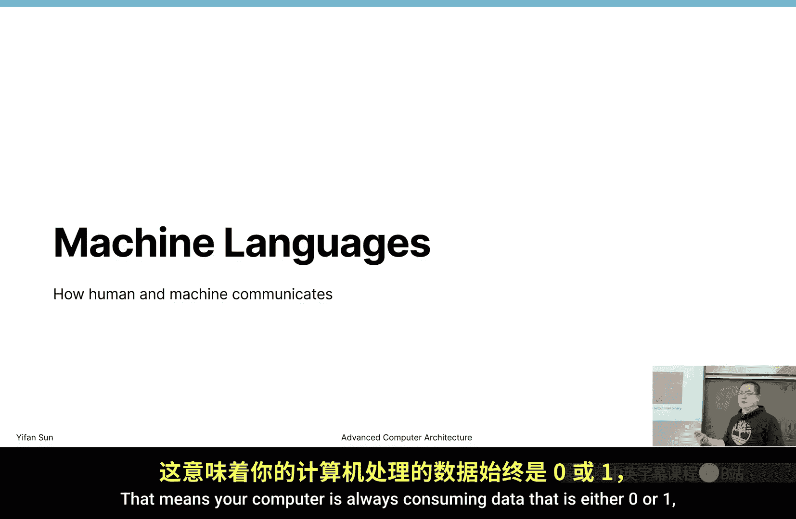
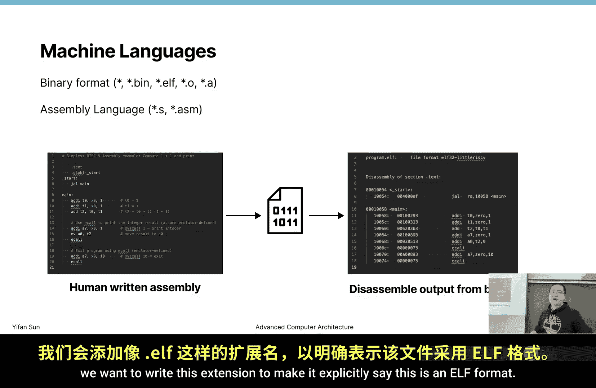
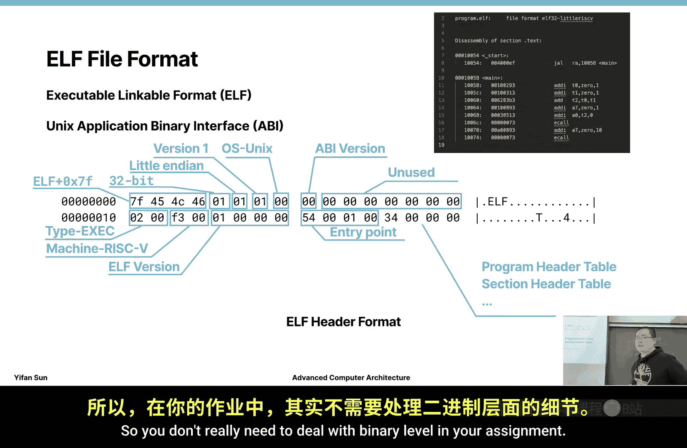
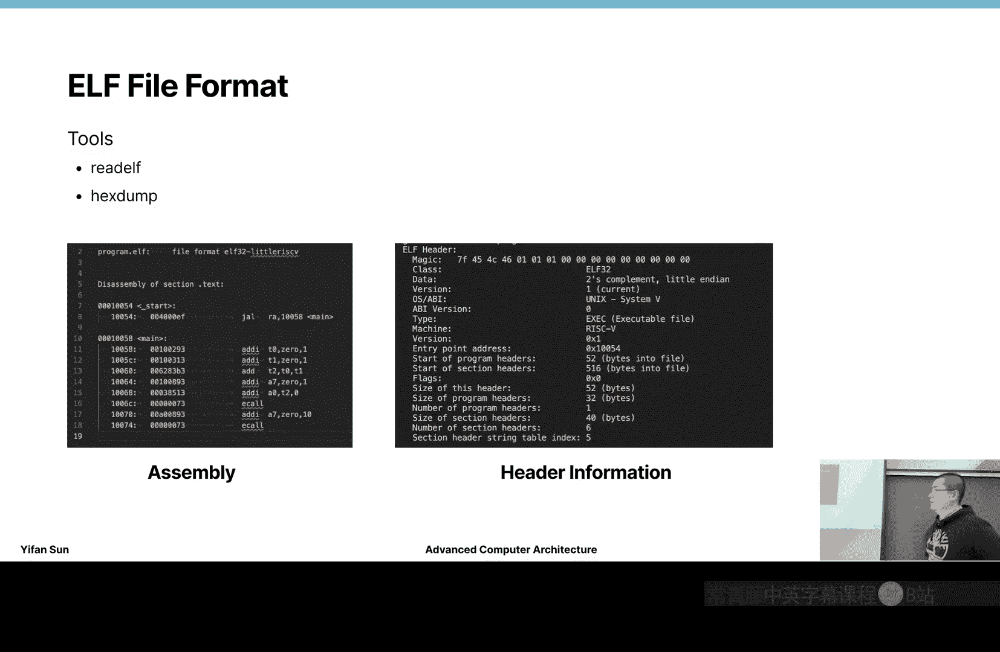
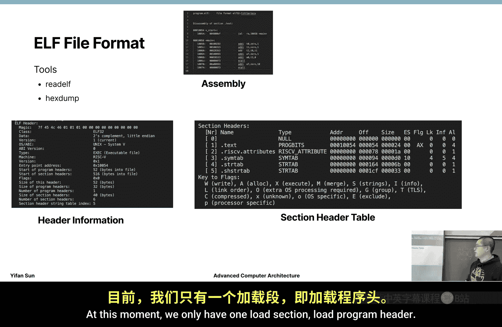
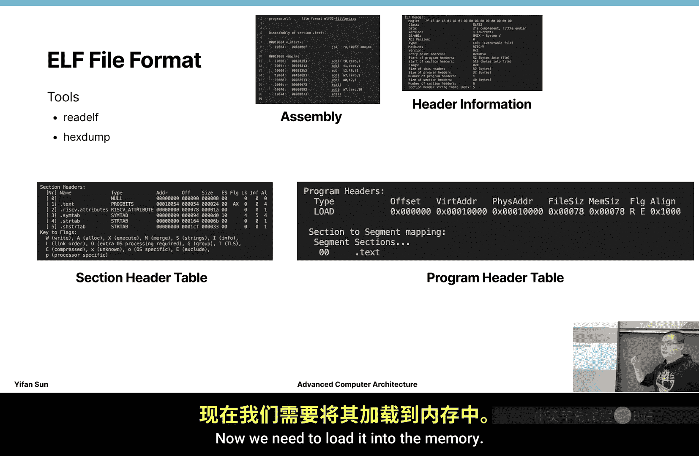
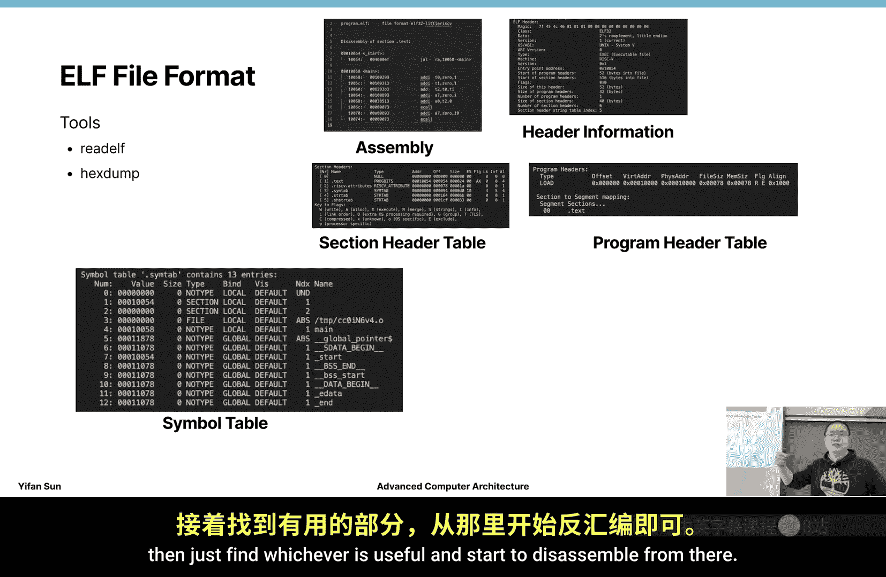
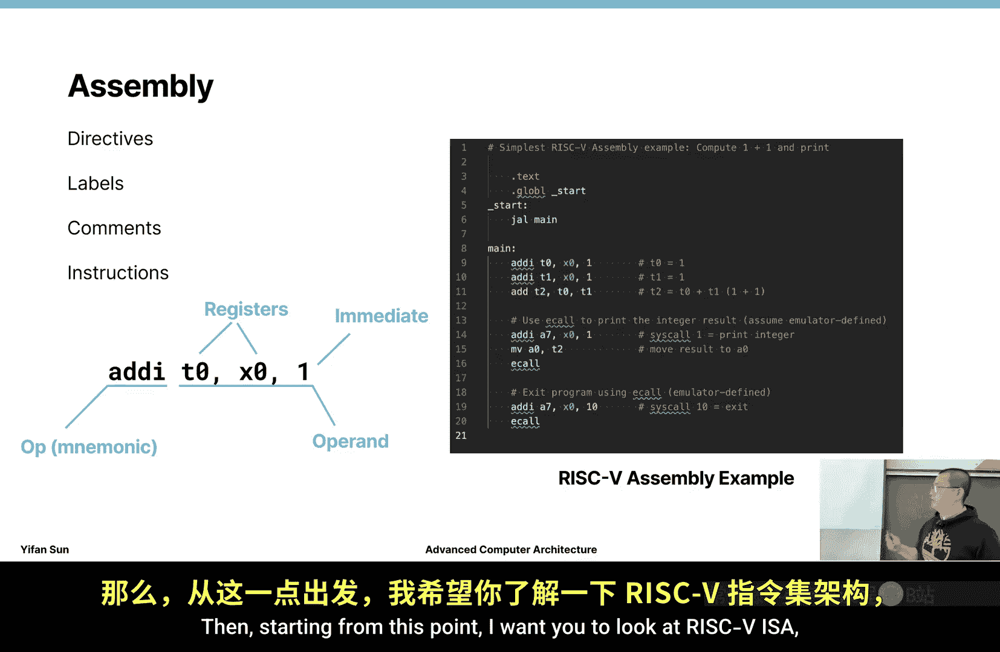
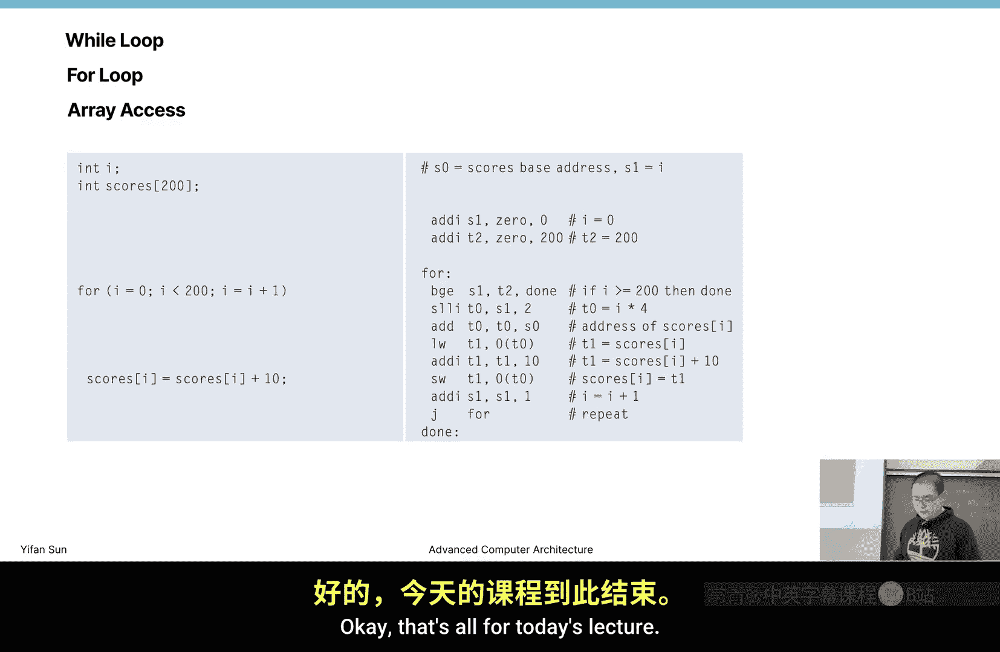

# 011：RISC-V 指令集架构 1 🚀

在本节课中，我们将学习计算机体系结构的基础——指令集架构，并重点介绍现代、开源的RISC-V指令集。我们将从指令集架构的历史和重要性开始，逐步深入到可执行文件格式、汇编语言以及RISC-V的核心指令。

## 概述：指令集架构的诞生与发展

在早期编程时代，程序员使用穿孔卡编写程序。每个计算机厂商都有自己的硬件标准和指令集，这导致为不同机器编写的程序无法通用，即使是同一种高级语言也需要为每台机器重写编译器。这种重复性工作催生了指令集架构的概念。

1964年，IBM 360系列计算机的发布标志着指令集架构的诞生。其核心思想是定义一套软件与硬件之间的**契约**，使得为同一指令集编写的软件可以在不同硬件实现上运行，从而实现了软硬件设计的分离。

## 指令集架构与微架构

指令集架构定义了机器需要支持的操作集合，是软件与硬件之间的协议。例如，x86就是一种指令集架构。

微架构则是指令集架构的具体硬件实现。例如，Intel和AMD的x86处理器内部设计不同，但都能运行相同的Windows程序。这种分离使得软件生态得以长期延续，但也带来了向后兼容的历史包袱，例如x86从16位扩展到64位的过程。

## 主流指令集架构

目前主流的指令集架构包括：
*   **x86-64**: 由Intel和AMD共同主导，在服务器和桌面领域占主导地位。
*   **ARM**: 采用授权商业模式，在移动和嵌入式领域广泛应用。
*   **RISC-V**: 一个新兴的、开源的指令集架构，以其模块化和可扩展性著称。

## CISC与RISC



历史上存在复杂指令集计算和精简指令集计算的争论。
*   **CISC**: 指令复杂，单条指令能完成较多工作。早期的x86是CISC代表。
*   **RISC**: 指令精简，每条指令只完成一小部分工作。现代处理器多为RISC设计。



如今，纯粹的CISC设计已不常见。例如，现代x86处理器内部使用**微码**将复杂的CISC指令翻译成一系列简单的RISC风格微操作来执行。

一个区分RISC的典型特征是**加载/存储架构**。在这种架构中，只有`load`和`store`指令可以访问内存，所有计算操作都在寄存器之间进行。`load`指令将数据从内存读入寄存器，`store`指令将寄存器数据写回内存。

## 机器语言与可执行文件

计算机直接执行的是**机器语言**，即二进制格式的指令。为了方便人类阅读和编写，我们使用**汇编语言**，它是机器指令的助记符表示，可以通过汇编器转换成二进制文件。

在Linux系统中，可执行文件、目标文件(.o)和动态库(.so)通常采用**ELF格式**。这是一种标准的可执行与可链接格式。





以下是ELF文件的基本结构：
```c
// ELF文件头结构示意
typedef struct {
    unsigned char e_ident[16]; // 魔数，如 0x7f 'E' 'L' 'F'
    uint16_t      e_type;      // 文件类型（可执行、共享库等）
    uint16_t      e_machine;   // 架构类型（如RISC-V）
    // ... 其他字段，如入口点地址、程序头表偏移等
} Elf64_Ehdr;
```
ELF文件头包含魔数、架构位数（32/64）、字节序（大端/小端）、文件类型和程序入口点等信息。字节序是指多字节数据在内存中的存储顺序，现代主流系统大多采用**小端序**。



ELF文件中包含多个**节**，例如：
*   `.text`节：存放程序的指令代码。
*   `.data`节：存放已初始化的全局变量。
*   符号表：存放函数名、变量名等符号信息。





操作系统根据ELF文件中的信息，将程序加载到内存并执行。

## RISC-V指令集架构介绍



RISC-V由加州大学伯克利分校于2010年设计，是一个开源的指令集架构。其核心特点包括：
1.  **模块化设计**：基础整数指令集（RV32I/RV64I）很小，可通过标准扩展（如乘法除法M、单精度浮点F、原子操作A等）或自定义扩展来增加功能。
2.  **简洁性**：基础指令格式规整，易于学习和硬件实现。

RISC-V有32个整数寄存器（x0-x31），每个寄存器有特定的约定用途和ABI名称，例如：
*   `x0` (`zero`): 恒为零的寄存器。
*   `x1` (`ra`): 返回地址寄存器。
*   `x2` (`sp`): 栈指针寄存器。
*   `x10-x17` (`a0-a7`): 函数参数/返回值寄存器。

## RISC-V基础指令

上一节我们介绍了RISC-V的概况和寄存器，本节中我们来看看一些基础指令。

以下是常见的RISC-V整数指令示例：

**逻辑与移位指令**
```assembly
and t0, t1, t2  # t0 = t1 & t2 （按位与）
andi t0, t1, 5  # t0 = t1 & 5 （与立即数）
slli t0, t1, 2  # t0 = t1 << 2 （逻辑左移）
srai t0, t1, 3  # t0 = t1 >> 3 （算术右移，符号位填充）
```

**算术指令**
```assembly
add t0, t1, t2  # t0 = t1 + t2
sub t0, t1, t2  # t0 = t1 - t2
addi t0, t1, -4 # t0 = t1 + (-4) （加立即数）
mul t0, t1, t2  # t0 = t1 * t2 （低32位，需M扩展）
```

**加载与存储指令**
```assembly
lw t0, 4(sp)    # 从内存地址(sp+4)加载一个字(4字节)到t0
sw t1, 8(sp)    # 将t1的值存储到内存地址(sp+8)
```

**分支与跳转指令**
控制流指令用于实现条件判断和循环。分支指令根据条件决定是否跳转，跳转指令则直接修改程序计数器`PC`。
```assembly
beq t0, t1, label # 如果 t0 == t1，则跳转到 label
bne t0, t1, label # 如果 t0 != t1，则跳转到 label
blt t0, t1, label # 如果 t0 < t1 (有符号)，则跳转
j label           # 无条件跳转到 label
jal ra, func      # 跳转到函数func，并将返回地址保存在ra中
```

## 从高级语言到汇编

高级语言中的控制结构最终都会编译为分支和跳转指令的组合。

**if 语句的实现**
C语言代码 `if (a == b) { a = a + 1; }` 可能被编译为：
```assembly
    bne a0, a1, L1  # 如果 a0 != a1，跳过if块
    addi a0, a0, 1  # if 块内的加法
L1:
    # if 语句后的代码
```

**while 循环的实现**
C语言代码 `while (i < 10) { i++; }` 可能被编译为：
```assembly
    li t0, 0        # i = 0
    li t1, 10       # 循环上限
loop:
    bge t0, t1, done # 如果 i >= 10，跳出循环
    addi t0, t0, 1  # i++
    j loop          # 跳回循环开始
done:
    # 循环后的代码
```

**数组访问**
C语言代码 `scores[i] = 10;` 涉及地址计算。假设`int`为4字节，`scores`基地址在`s0`，索引`i`在`s1`：
```assembly
    slli t0, s1, 2   # t0 = i * 4 （计算字节偏移）
    add t0, s0, t0   # t0 = scores基地址 + 字节偏移
    li t1, 10
    sw t1, 0(t0)     # 将10存储到计算出的地址
```

## 算术强度：一个关键概念

在分析程序性能时，**算术强度**是一个重要指标。它定义为程序执行的**操作数**与访问的**字节数**之比。

`AI = 操作数 / 字节数`

在前面的数组存储例子中，我们进行了一次存储操作（4字节），但执行了多次算术运算（移位、加法等）。如果AI值很低，说明程序是**内存密集型**的，性能瓶颈往往在内存访问；如果AI值很高，说明是**计算密集型**的，性能瓶颈在计算单元。理解AI有助于优化程序和数据布局。

## 总结



本节课我们一起学习了计算机体系结构的基石——指令集架构。我们从其历史背景出发，理解了ISA作为软硬件契约的重要性。我们探讨了CISC与RISC的区别，并详细介绍了新兴的RISC-V ISA，包括其模块化设计、寄存器文件和基础指令。我们还分析了如何将高级语言的控制结构（如条件分支、循环）和数据结构（如数组）映射到汇编指令。最后，我们引入了**算术强度**的概念，作为分析程序性能特征的一个有用工具。在下一节课中，我们将继续探讨函数调用约定、栈管理以及操作系统如何加载和运行程序。