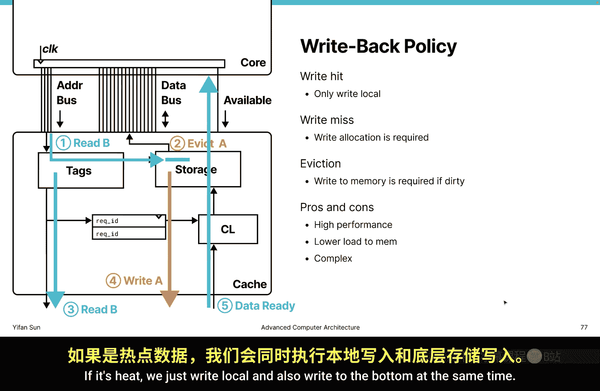

# 018：缓存设计 2

## 概述
在本节课中，我们将继续深入探讨缓存的设计，特别是缓存未命中状态保持寄存器（MSHR）的工作原理，以及不同的写策略（如写直达和写回）是如何影响缓存性能和一致性的。

## 缓存未命中状态保持寄存器（MSHR）

上一节我们介绍了缓存的基本接口和读操作流程。本节中，我们来看看如何通过一个名为**未命中状态保持寄存器**的组件来提升缓存性能。

MSHR并非标准必需组件，但能以较小的能耗和面积开销显著提升性能。让我们回顾缓存接口：当发生缓存命中时，数据直接返回给请求者（通常是核心）。当发生缓存未命中时，缓存需要向下一级存储器（可能是内存或另一级缓存）发起请求以获取数据，并在数据返回后，一方面将其存入本地存储，另一方面返回给请求者。

这里存在一个问题：如果请求A未命中，在等待A的数据返回期间，请求B到达了。如果B是命中，我们能否在处理A的同时处理B，以减少B的延迟？这需要缓存能够同时处理多个请求。

核心与缓存之间的接口由一组总线（导线）连接，主要包括地址总线、数据总线和控制信号（如`available`和`ready`）。在典型的缓存未命中场景中，处理无法在一个周期内完成，需要多个周期。在此期间，缓存需要持续使用请求A留在接口总线上的信息（如地址）来生成最终的响应。这意味着，在A处理完成前，缓存无法告知核心“准备好”接收新请求，因此请求B必须等待，这阻碍了并发处理。

为了解决这个问题，我们可以在缓存侧引入一组寄存器，临时保存来自核心的请求信息（如地址、请求ID等）。这样，在向下一级存储器发送未命中请求A后，缓存可以立即释放接口，告知核心可以发送下一个请求B。当B到达时，如果是命中，就可以立即处理并返回，无需等待A。这个用于临时保存未命中请求状态的寄存器组就是**MSHR**。

当数据从下一级存储器返回时，缓存控制逻辑会查询MSHR，找到对应的原始请求信息，然后将数据返回给正确的请求者，并写入本地存储。

以下是MSHR处理的几种典型情况：

*   **情况一：未命中后的命中**
    请求A未命中，信息存入MSHR，并向下一级发起请求。此时请求B到达并命中，可以立即处理返回，实现了请求的重叠处理。

*   **情况二：对同一地址的双重未命中**
    如果两个请求访问同一缓存行（地址相同），第二个请求在MSHR中会“命中”（即发现已有对该地址的未处理请求）。此时，缓存无需为第二个请求再次向下一级存储器发送请求，只需在MSHR中记录这个新的请求ID。当数据返回时，缓存会同时响应两个请求。这被称为**MSHR命中**或**自然合并**，它减少了访存次数和能耗。

*   **情况三：对不同地址的双重未命中**
    两个请求访问不同地址且均未命中。缓存可以为两者分别分配MSHR条目，并同时向下一级存储器发送两个请求，充分利用存储器带宽。如果MSHR条目已满，第三个未命中请求T3就必须等待，直到有MSHR条目被释放。这种等待会通过接口反向传递压力，导致核心端的流水线停滞，这被称为**反压**。

MSHR是一种稀缺资源，因为其实现代价（寄存器和比较器）较高，所以数量有限（通常为4、16或32个）。虽然MSHR看起来是可选的，但在现代CPU和GPU的缓存设计中几乎都被采用。

## 写策略

之前我们主要讨论了读操作。现在，让我们来探讨更复杂的写操作策略。写策略决定了数据何时被写入缓存以及何时更新下一级存储器，这对性能和缓存一致性至关重要。

首先考虑一个架构层面的复杂性问题：当未命中数据从下一级返回并需要写入缓存块时，**标签**应在何时被更新？如果过早更新标签，在新数据实际到达前，另一个读请求可能误判为命中。此外，如果数据在返回途中，该缓存块又被选为**牺牲块**，该如何处理？这些底层细节在设计真实的缓存控制器时需要仔细考虑。

现在来看核心的写操作问题。假设缓存行大小为64字节，而写操作只写入4字节。

*   如果写命中，我们更新本地缓存中的数据。但这会立即导致缓存中的数据（新版本）与下一级存储器中的数据（旧版本）不一致，我们称这个新数据为**脏**数据。在多核系统中，如果不加控制，其他缓存可能读到过时的数据，引发一致性问题。因此，脏数据最终必须写回下一级存储器。问题在于**何时**写回。

*   如果写未命中，情况更复杂。我们只有4字节新数据，但缓存行需要完整的64字节才有效。我们该如何处理？

针对这些问题，业界有几种常用的写策略。

### 写直达

第一种策略是**写直达**。顾名思义，只要发生写操作（无论命中或未命中），数据都同时写入本地缓存和下一级存储器。

对于**写命中**，过程直接：更新本地缓存行，同时将数据写入下一级。

对于**写未命中**，缓存可以选择是否在本地分配一个缓存行来存放新数据。如果选择分配（称为**写分配**），由于我们只有4字节数据，缓存必须首先向下一级发起一个**读请求**，获取该地址完整的64字节数据。待数据返回后，将新的4字节与读回的60字节合并，再写入本地分配的缓存行中。同时，这4字节新数据也会被写入下一级。如果写操作恰好是完整的64字节，则可以省去读过程，直接分配并写入。

**写直达缓存的牺牲块替换非常简单**：如果要将一个有效块替换出去，只需将其标签标记为无效即可，无需将其数据写回下一级，因为根据写直达策略，它的数据已经是最新的。

写直达的优点在于**易于维护一致性**，因为下一级通常持有最新数据（尽管在写请求传输期间仍有短暂不一致窗口）。其缺点是**每次写操作都会访问下一级存储器**，如果下一级延迟很高，会显著增加写操作的延迟，甚至可能使缓存失去加速作用。

### 写绕回

第二种策略常被称为**写绕回**或**写非分配**。这种策略的核心思想是：如果写操作未命中，则**不在本地缓存中分配新行**，而是直接将数据写入下一级存储器。

对于**写命中**，处理方式与写直达相同：同时更新本地和下一级。

对于**写未命中**，缓存不进行写分配，数据直接“绕过”本级缓存，写入下一级存储器。

写绕回的优点是避免了写未命中时昂贵的缓存分配和读-修改-写操作序列，减少了写延迟。缺点是数据不会载入本级缓存，如果后续很快又读取该数据，则会遭受未命中惩罚。

## 总结
本节课我们一起深入学习了缓存设计的两个高级主题。首先，我们探讨了**MSHR**如何通过保存未命中请求状态来支持请求的并发处理，从而提升缓存性能。我们分析了MSHR命中、自然合并和反压等概念。接着，我们转向**写策略**，分析了**写直达**和**写绕回**两种主要策略的工作原理、优缺点及其在命中与未命中场景下的具体行为。理解这些机制对于设计高效、正确的存储层次结构至关重要。