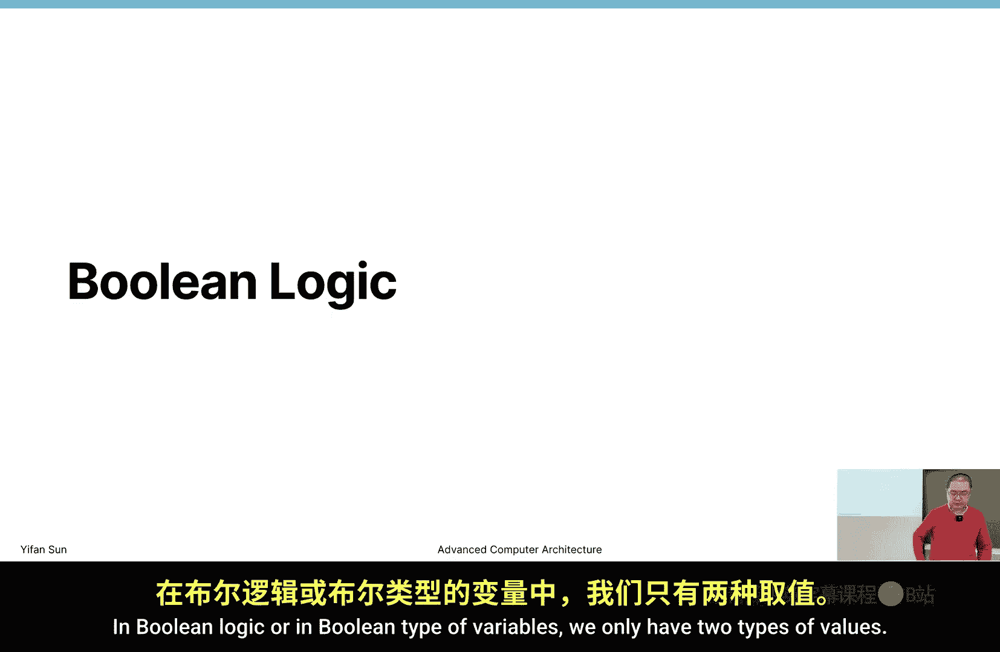
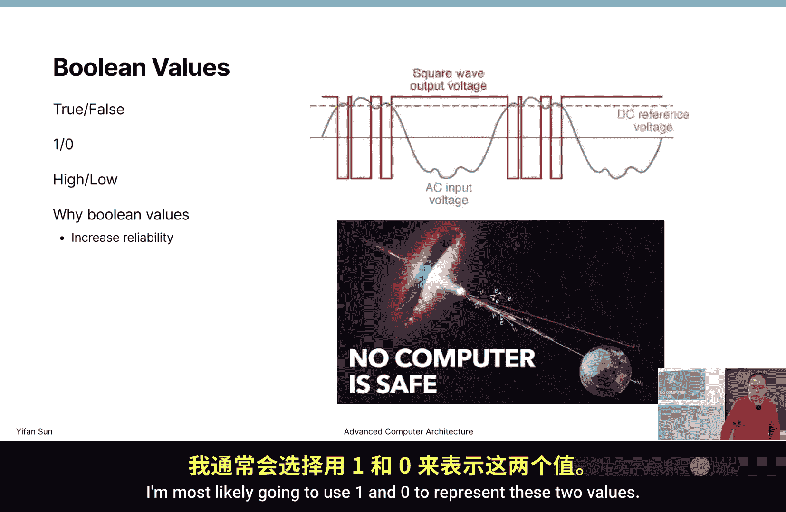
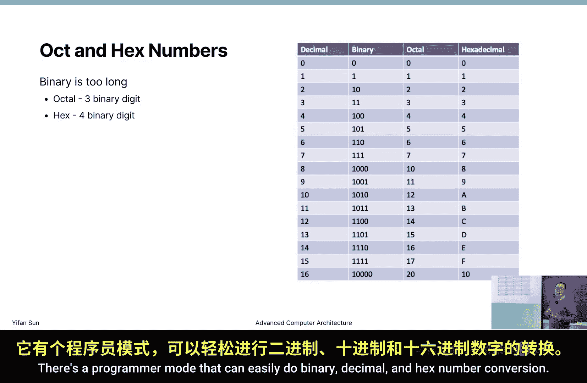
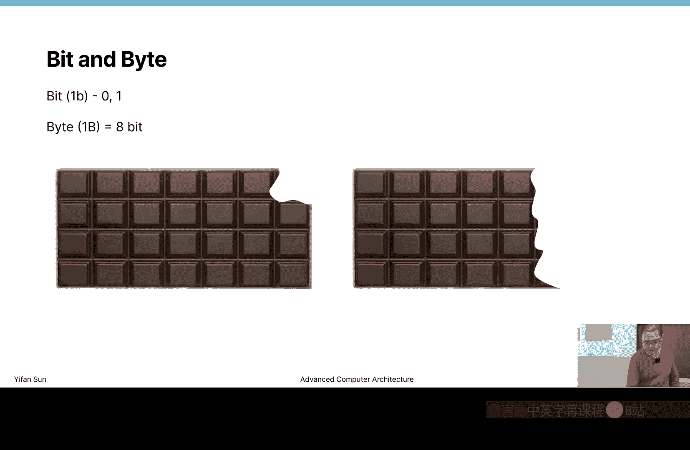
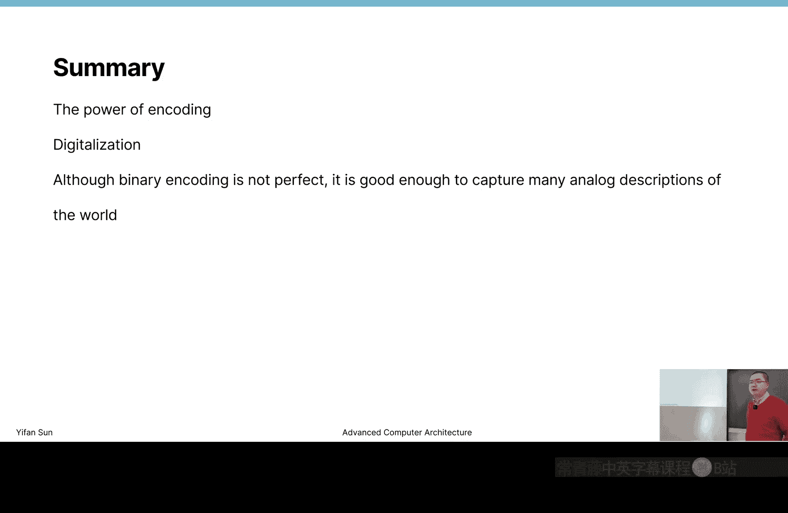

# 高级计算机体系结构：P2：布尔逻辑、二进制数与编码 🔢



在本节课中，我们将回顾计算机科学的基础知识：布尔逻辑、二进制数以及如何在计算机中表示和编码各种信息。这些概念是理解后续组合逻辑和时序逻辑等电路设计内容的基石。



## 布尔逻辑回顾 🧠

上一节我们介绍了课程概述，本节中我们来看看布尔逻辑的基础。布尔逻辑处理的是只有两种值的变量，这两种值可以用不同方式表示：真（True）或假（False）、1或0、高电平（High）或低电平（Low）。使用二进制表示是为了简化硬件设计并提高其可靠性。

以下是三种最基本的布尔逻辑运算及其真值表：

*   **非门（NOT Gate）**：简单地翻转输入值。
    *   公式：`NOT X = X'`
    *   真值表：
        | X | NOT X |
        |---|---|
        | 0 | 1 |
        | 1 | 0 |

*   **与门（AND Gate）**：仅当所有输入都为真时，输出才为真。
    *   公式：`X AND Y = X · Y`
    *   真值表：
        | X | Y | X AND Y |
        |---|---|---|
        | 0 | 0 | 0 |
        | 0 | 1 | 0 |
        | 1 | 0 | 0 |
        | 1 | 1 | 1 |

*   **或门（OR Gate）**：只要有一个输入为真，输出就为真。
    *   公式：`X OR Y = X + Y`
    *   真值表：
        | X | Y | X OR Y |
        |---|---|---|
        | 0 | 0 | 0 |
        | 0 | 1 | 1 |
        | 1 | 0 | 1 |
        | 1 | 1 | 1 |

除了这三个基本门，还有一个**异或门（XOR Gate）**，它检测两个输入是否不同。如果不同，输出为1；如果相同，输出为0。公式：`X XOR Y = X ⊕ Y`。

为了简化和优化逻辑电路设计，我们使用布尔代数定律。其中，**德摩根定律（De Morgan‘s Laws）** 非常有用，它描述了与、或、非运算之间的转换关系：
*   `(X AND Y)' = X' OR Y'`
*   `(X OR Y)' = X' AND Y'`

## 二进制数与整数表示 💻



理解了基本逻辑后，我们来看看计算机如何用二进制表示整数。我们的目标是用0和1表示一切。数字系统基于“基数”。例如，十进制数6715可以表示为：
`6×10³ + 7×10² + 1×10¹ + 5×10⁰`



将基数10替换为基数2，我们就得到了二进制表示。二进制只使用数字0和1。例如，二进制数`1101`转换为十进制是：
`1×2³ + 1×2² + 0×2¹ + 1×2⁰ = 8 + 4 + 0 + 1 = 13`

**移位操作**在二进制中非常高效：
*   左移一位相当于乘以2。
*   右移一位相当于除以2（向下取整）。

二进制加法遵循与十进制类似的规则，逐位相加并处理进位：
```
  1011  (11)
+ 0110  (6)
------
 10001  (17)
```

由于二进制表示较长，我们常用更紧凑的**十六进制（Hexadecimal）** 或**八进制（Octal）** 表示法。十六进制使用数字0-9和字母A-F（代表10-15），每四位二进制数对应一位十六进制数。

关于数据单位：
*   **比特（bit）**：一个二进制位，表示0或1。
*   **字节（Byte）**：通常由8个比特组成，是表示单个数字的常用单位。
*   1 KB = 2¹⁰ = 1024 Bytes， 1 MB = 2²⁰ Bytes，依此类推。

一个n位无符号整数能表示的范围是0到2ⁿ - 1。例如，一个字节（8位）可以表示0到255之间的256个数字。

## 负数的表示：补码 🧮

计算机不仅需要处理正数，还需要处理负数。最直观的方法是使用**符号-数值表示法**，即用最高位表示符号（0正1负），其余位表示大小。但这种方法存在两个问题：存在+0和-0两种零；加法和减法电路需要分别设计。

实际计算机中广泛使用的是**二进制补码（Two‘s Complement）**。对于一个正数，其补码是其本身。对于一个负数（如-82），其补码通过以下步骤得到：
1.  写出该数绝对值的二进制表示（82的二进制）。
2.  **按位取反**（所有0变1，1变0）。
3.  **结果加1**。

补码表示法的优势在于，它使用同一套加法电路就能处理正数加法、负数加法以及正负数的减法，简化了硬件设计。在补码中，最高位同样指示符号（1为负），并且零只有一种表示（全0）。

## 浮点数表示 🌊

对于非整数的实数，计算机使用**浮点数**表示，遵循IEEE 754标准。以单精度（32位）浮点数为例，其格式为：
*   1位：**符号位（Sign）**
*   8位：**指数位（Exponent）** （采用偏移码表示）
*   23位：**尾数位（Mantissa）** （表示小数点后的部分）

这种表示法可以覆盖极大和极小的数值范围。然而，由于总位数固定（32位），它在广袤的实数轴上必然存在间隔，无法精确表示所有实数，有时会产生舍入误差。

在机器学习等领域，为了追求更高的计算速度，常使用**低精度浮点数**（如FP16、BF16甚至FP8）或**定点数（Fixed-Point）**。定点数直接使用整数来表示一个预先确定好小数点位置的数，省去了复杂的指数处理单元，在面积和功耗上更具优势。

## 其他数据的编码 🎨

计算机还需要编码数字以外的数据。

**文本（字符串）**：
*   **ASCII**：早期标准，用7位表示128个字符，主要用于英语。
*   **Unicode**：字符集，为全球所有字符分配唯一编号。
*   **UTF-8**：最常用的Unicode编码实现，变长编码（1-4字节），兼容ASCII。

**图像**：
*   **位图（Bitmap）**：将图像离散化为像素网格。每个像素的亮度用一个数值表示（如0-255）。彩色图像常用**RGB**（红、绿、蓝）三个通道表示。
*   **矢量图（如SVG）**：用数学公式描述图形，缩放无损，适合图标和图形。

**音频**：
*   通过**采样（Sampling）** 和**量化（Quantization）** 将连续的声波转换为数字信号。
*   两个关键参数：
    *   **采样率（Sampling Rate）**：每秒采集样本的次数（如44.1 kHz）。
    *   **位深度（Bit Depth）**：每个样本用多少位表示（如16位），决定动态范围。

## 总结 📚



本节课我们一起学习了信息编码的核心原理。我们从最基本的布尔逻辑（与、或、非）出发，探讨了如何使用二进制系统表示整数，并深入分析了表示负数的关键方法——补码。接着，我们了解了如何用浮点数表示实数及其在精度与效率间的权衡。最后，我们概览了文本、图像和音频等其他类型数据是如何被编码成二进制形式的。尽管二进制编码并非完美，但它足以以合理的精度表示模拟世界，并“欺骗”我们的感官。掌握这些编码基础，是理解后续计算机如何通过电路进行运算和存储的关键。