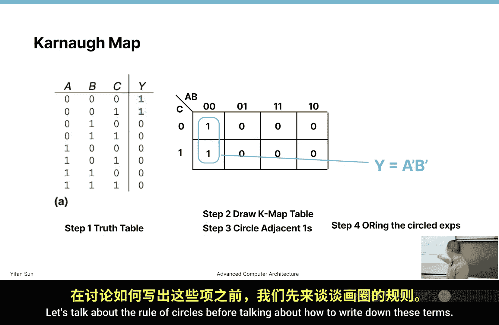
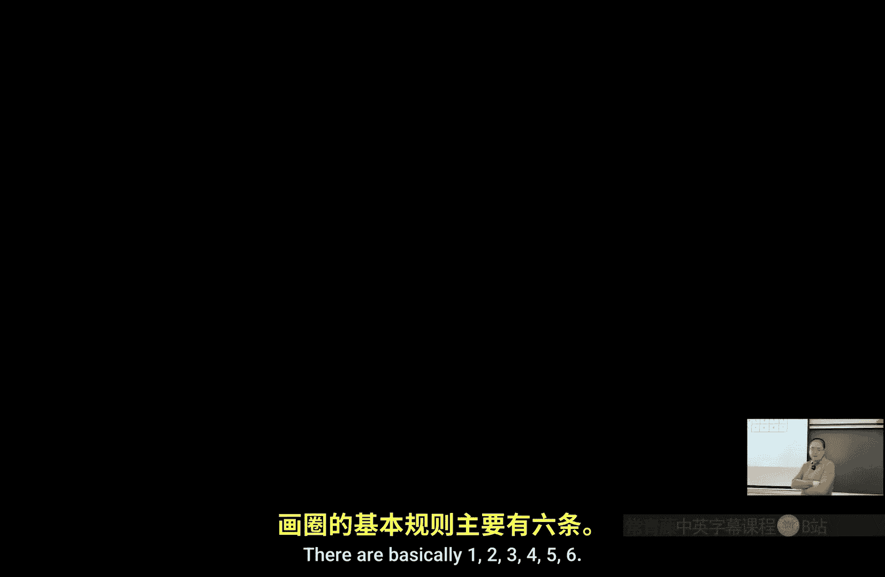
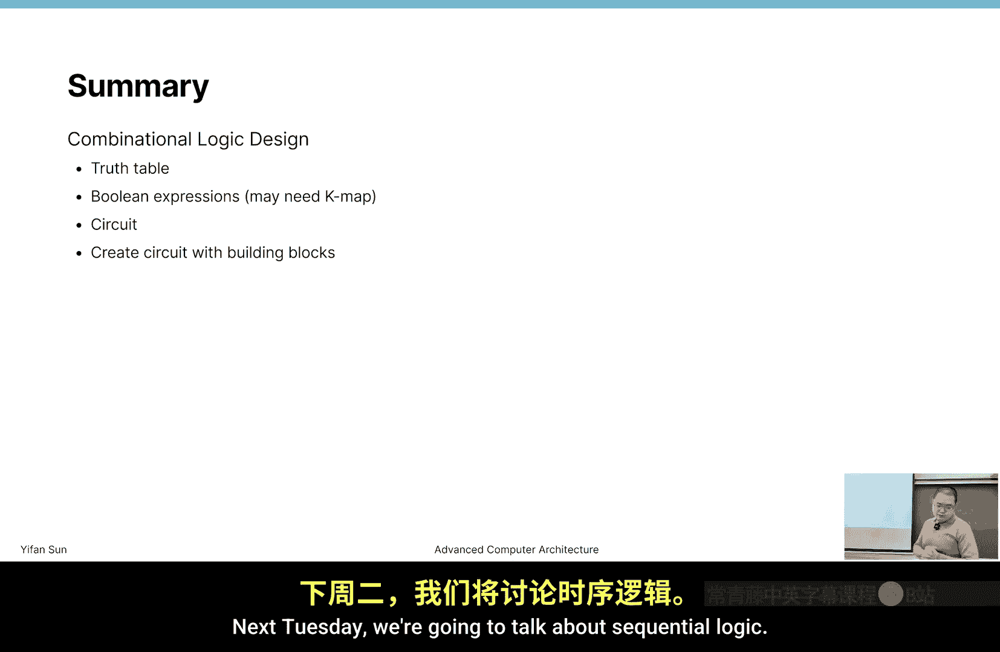

# 高级计算机体系结构：P3：组合逻辑 🧠

在本节课中，我们将开始学习组合逻辑，并介绍如何设计一些基本的数字电路。

## 什么是组合逻辑？

组合逻辑本质上是一种数字电路，它可以根据输入生成输出。其输出**仅**取决于当前的输入，电路内部没有记忆功能，也没有反馈回路。这意味着，给定一组输入，电路总是会生成确定的输出，并且这个输出是即时产生的（在架构层面，我们通常忽略计算所需的时间）。

上一节我们介绍了数字电路的基础，本节中我们来看看组合逻辑的具体实现。

## 基本逻辑门

要实现布尔逻辑，我们需要使用逻辑门。以下是三种最核心的逻辑门：
*   **与门 (AND Gate)**：当所有输入都为1时，输出为1。
*   **或门 (OR Gate)**：当至少一个输入为1时，输出为1。
*   **非门 (NOT Gate)**：将输入取反，1变0，0变1。

除了这三种基本门，还有其他由它们组合而成的门：
*   **与非门 (NAND Gate)**：一个与门后接一个非门。`NAND = NOT(AND)`
*   **或非门 (NOR Gate)**：一个或门后接一个非门。`NOR = NOT(OR)`
*   **异或门 (XOR Gate)**：当两个输入不同时输出1，相同时输出0。`XOR = (A AND NOT B) OR (NOT A AND B)`

在CMOS电路设计中，与非门因其晶体管实现更简单，常被视为“通用门”，理论上仅用与非门就能构建任何逻辑功能。

## 缓冲器的作用

缓冲器并非逻辑门，但在底层电路设计中非常有用。它有两个主要作用：
1.  **信号放大**：在长导线中，信号会衰减。加入缓冲器可以像中继器一样增强信号电压。
2.  **路径延迟匹配**：在复杂电路中，不同路径的信号到达时间可能不同，这会导致错误。通过插入缓冲器，可以确保所有路径经过相同数量的门延迟，使信号同时到达。

缓冲器的真值表非常简单：输出始终等于输入。

## 从布尔表达式到电路

理解了基本门电路后，我们来看看如何将一个布尔表达式转化为实际的电路图。

假设我们有一个逻辑表达式：`F = (A OR B) AND (A OR C) OR (A AND B) OR (B AND C) OR (NOT D)`。

以下是直接根据表达式绘制的电路图（可能不是最优设计）：
*   首先，分别计算 `(A OR B)` 和 `(A OR C)`，然后将它们的结果进行 `AND` 操作。
*   同时，分别计算 `(A AND B)` 和 `(B AND C)`，然后将它们的结果进行 `OR` 操作。
*   接着，将上一步的结果与 `NOT D` 进行 `OR` 操作。
*   最后，将第一步和第三步的结果进行 `OR` 操作，得到最终输出 `F`。

这种直接实现方式可能使用了过多的门，因此我们需要对表达式进行简化。

## 逻辑表达式简化

我们的简化目标是获得“积之和”或“和之积”形式，并尽可能减少运算符（即逻辑门）的数量。

对上述表达式 `F = (A OR B) AND (A OR C) OR (A AND B) OR (B AND C) OR (NOT D)` 进行逐步简化：
1.  应用分配律展开：`= A + AC' + AB + AB + BC + D'` （其中 `'` 表示 `NOT`）
2.  合并同类项并提取公因子：`= A(1 + C' + B) + B(C' + C) + D'`
3.  利用布尔代数规则（任何值与1相或均为1，`C' + C = 1`）：`= A(1) + B(1) + D'`
4.  最终得到简化结果：`F = A OR B OR (NOT D)`

简化后的电路仅需三个门，远比原始设计高效。

## 从真值表到电路

有时我们并非从表达式开始，而是从一个定义好的真值表出发。以下是标准的设计流程：**真值表 -> 布尔表达式 -> 电路实现**。

以设计一个异或门为例，其真值表要求：输入相异时输出1。

**步骤1：根据真值表写出积之和表达式**
观察输出为1的行：
*   当 `X=0, Y=1` 时，对应项为 `X' AND Y`。
*   当 `X=1, Y=0` 时，对应项为 `X AND Y'`。
将这两项相或，得到表达式：`F = (X' AND Y) OR (X AND Y')`。

**步骤2：电路实现**
根据表达式，使用两个与门、一个或门以及两个非门即可实现。

## 卡诺图简化法

对于包含3个或4个变量的表达式，手动简化可能比较困难。卡诺图提供了一种直观的图形化简化工具。其核心思想是：将真值表中相邻的、输出为1的单元圈在一起，每个圈可以合并并消去一个变化的变量。

**卡诺图绘制与简化规则：**
1.  根据变量数画出网格，并确保相邻网格的编码只有一位变化。
2.  根据真值表，在对应网格中填入输出值（1或0）。
3.  开始画圈合并。画圈规则如下：
    *   必须覆盖所有输出为1的单元。
    *   每个圈内只能包含1、2、4、8...（2的幂次方）个单元。
    *   每个圈应尽可能大。
    *   圈的形状必须是矩形或正方形。
    *   卡诺图可以循环卷绕，即最左与最右相邻，最上与最下相邻。
    *   同一个“1”可以被多个圈包含。
4.  根据每个圈写出最简项：**圈内值保持不变的变量被保留，变化的变量被消去**。如果该变量在圈内恒为1，则写原变量；若恒为0，则写反变量。
5.  将所有圈对应的最简项相或，得到最简表达式。

## 组合逻辑构建模块

掌握了基本设计方法后，我们来看一些常用的、标准化的组合逻辑模块，它们像积木一样用于构建更复杂的系统。

### 半加器与全加器
*   **半加器**：计算两个1位二进制数的和，产生一个和位与一个进位位。
    *   和位 `Sum = A XOR B`
    *   进位 `C_out = A AND B`
*   **全加器**：计算两个1位二进制数及一个低位进位输入的和，产生一个和位与一个进位输出。
    *   可以用两个半加器和一个或门构建。
    *   和位 `Sum = A XOR B XOR C_in`
    *   进位 `C_out = (A AND B) OR (B AND C_in) OR (A AND C_in)`

### 多路选择器
多路选择器根据选择信号，从多个输入中选择一个送到输出。
*   **2选1多路选择器**：输入 `D0, D1`，选择信号 `S`。当 `S=0` 时，`Y=D0`；当 `S=1` 时，`Y=D1`。其逻辑表达式为 `Y = (S' AND D0) OR (S AND D1)`。
*   可以扩展为4选1、8选1等，也可以扩展数据位宽（如32位宽的多路选择器）。

### 编码器与解码器
*   **编码器**：将多个输入线（通常只有一条为有效）的状态，编码成位数更少的二进制输出。例如，4线-2线编码器。
*   **优先编码器**：当多个输入同时有效时，根据预设的优先级进行编码。
*   **解码器**：与编码器相反，将二进制输入解码，使对应的唯一输出线有效。例如，2线-4线解码器。

## 总结

本节课中，我们一起学习了组合逻辑的核心概念。我们了解到，组合逻辑是一种输出仅取决于当前输入的无记忆电路。我们从最基本的逻辑门（与、或、非）出发，学习了如何根据布尔表达式或真值表来设计电路，并掌握了使用代数法和卡诺图法对逻辑表达式进行简化的技巧。最后，我们认识了几种重要的组合逻辑构建模块：加法器、多路选择器、编码器和解码器。这些知识是理解复杂数字系统（如CPU）如何执行基本运算的基础。理论上，任何确定的输入/输出映射关系，都可以通过组合逻辑电路来实现。